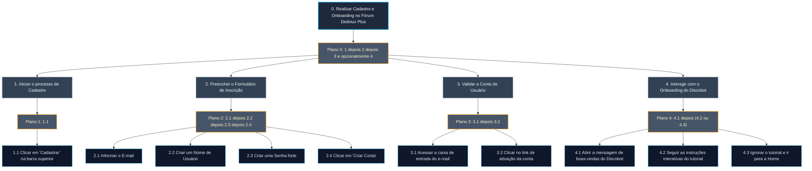
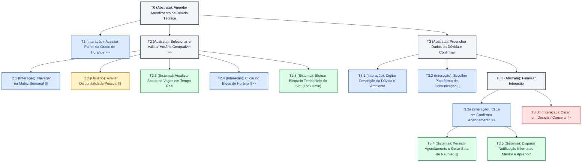

# Análise de Tarefas: HTA, CTT e GOMS/KLM

## Tabela de Contribuição

| Integrante | Contribuição no Artefato | Data | Ferramenta de IA e Contribuição |
| :--- | :--- | :---: | :--- |
| [Edvaldo Soares Brasileiro Filho](https://github.com/PajeMurici-dev) | [Modelagem da Tarefa 3 com HTA e CTT](#tarefa-3-agendamento-de-horarios-de-duvidas-e-mentorias-na-grade-de-disponibilidade-edvaldo-soares) (Grade de Disponibilidade e Agendamento comunitário). | 22/10/2026 | LLM: apoio na modelagem conceitual HTA/CTT e sintaxe dos diagramas Mermaid. |
| [Gustavo Antonio Rodrigues e Silva](https://github.com/gus-ant) | [Autoria individual da Tarefa 2 (Cadastro e Onboarding)](#tarefa-2-cadastro-e-onboarding-do-novo-usuario-gustavo-antonio) | 26/09/2026 | *A ser desenvolvido pelo discente em sua branch de trabalho* |
| [Vinicius Silva Araruna](https://github.com/ViniciusA05) | [Estruturação metodológica, fundamentação e autoria integral da Tarefa 1 (Criação de Tópico com Tags e Markdown: HTA e KLM)](#tarefa-1-criacao-e-publicacao-de-topico-com-tags-e-markdown-vinicius-silva-araruna) | 26/09/2026 | Suporte na estruturação Markdown e tabelas |

---

## Introdução

Este artefato documenta a **Análise de Tarefas** realizada sobre as principais interações do **Fórum Diolinux Plus**, desenvolvida no âmbito da disciplina de Interação Humano-Computador (FGA0173), sob docência do Prof. Dr. André Barros de Sales (Faculdade UnB Gama — FGA/UnB).

A análise de tarefas é uma das abordagens mais tradicionais e rigorosas de IHC para compreender em profundidade o trabalho dos usuários, as operações mentais e físicas necessárias e os gargalos de usabilidade existentes em um sistema interativo (*Barbosa & Silva, 2021, p. 177*). Segundo Annett e Duncan (1967) e Card, Moran e Newell (1983), analisar tarefas não significa apenas inventariar as funções oferecidas pelo software, mas decompor sistematicamente o que as pessoas realmente fazem para atingir seus objetivos de alto nível, identificando os conhecimentos requeridos, as decisões operacionais e as condições contextuais sob as quais as ações se desenrolam.

---

## Metodologia e Técnicas Canônicas Adotadas

Em consonância com as exigências pedagógicas do Tópico 11 do Plano de Ensino da disciplina (que estabelece a modelagem de pelo menos uma tarefa individual para cada integrante empregando no mínimo duas técnicas formais distintas), a equipe selecionou métodos canônicos amplamente consolidados na literatura científica de IHC:

1. **Análise Hierárquica de Tarefas (HTA — *Hierarchical Task Analysis*)**: Proposta originalmente por Annett e Duncan (1967) e aprofundada por Barbosa e Silva (2021, p. 178-185), a HTA decompõe um objetivo de alto nível em subobjetivos, planos de execução e operações físicas/cognitivas elementares. A técnica destaca-se por evidenciar a lógica de ordenação e dependência temporal entre ações e por identificar pontos críticos onde ocorrem falhas operacionais e custos de aprendizado.
2. **GOMS e Modelo de Nível de Teclas (KLM — *Keystroke-Level Model*)**: Formulado por Card, Moran e Newell (1983) e detalhado por Barbosa e Silva (2021, p. 185-188), o GOMS (*Goals, Operators, Methods, Selection Rules*) modela o conhecimento procedural do usuário. Sua variante quantitativa, o KLM, permite prever com precisão matemática o tempo de execução que um usuário especialista sem erros levará para concluir uma tarefa computacional, decompondo-a em operadores motores ($K, P, B, H$) e cognitivos ($M$).
3. **Árvores de Tarefas Concorrentes (CTT — *Concurrent Task Trees*)**: Introduzida por Paternò (2000), a notação CTT enriquece a modelagem hierárquica ao categorizar as tarefas conforme seus agentes de execução (tarefas do usuário, do sistema, interativas ou abstratas) e formalizar operadores temporais avançados (escolha, concorrência, desativação e sincronização).

A Figura 1 e a Figura 2 ilustram a definição destas técnicas (HTA e GOMS, respectivamente) extraídas diretamente da bibliografia base.


**Figura 1** — Trecho do livro de Barbosa e Silva detalhando a técnica HTA (Análise Hierárquica de Tarefas).


**Figura 2** — Trecho do livro de Barbosa e Silva detalhando a técnica GOMS e o KLM.


---

## Mapeamento Geral das Tarefas Analisadas

A Tabela 1 apresenta a visão sistêmica da divisão das tarefas prioritárias do Fórum Diolinux Plus entre os membros da equipe, garantindo cobertura das principais jornadas da plataforma.

**Tabela 1** — Mapeamento de atribuição das tarefas e técnicas adotadas

| Tarefa Analisada | Técnicas Empregadas | Autor Responsável | Revisor |
| :--- | :--- | :--- | :--- |
| **Tarefa 1**: Criação e Publicação de Tópico de Dúvida com Tags e Formatação Markdown | HTA (Diagrama + Tabela) + GOMS/KLM | [Vinicius Silva Araruna](https://github.com/ViniciusA05) | [Gustavo Antonio](https://github.com/gus-ant) |
| **Tarefa 2**: Cadastro e Onboarding do Novo Usuário | HTA (Diagrama + Tabela) + CTT | [Gustavo Antonio](https://github.com/gus-ant) | [Edvaldo Soares](https://github.com/PajeMurici-dev) |
| **Tarefa 3**: Agendamento de Horário para Dúvidas e Mentorias (Grade de Disponibilidade) | HTA (Diagrama + Tabela) + CTT | [Edvaldo Soares](https://github.com/PajeMurici-dev) | [Vinicius Silva Araruna](https://github.com/ViniciusA05) |

_Fonte: Elaborada pelos autores, 2026._

A Tabela 1 assegura que cada integrante assume a responsabilidade direta pela modelagem aprofundada de um fluxo crítico do fórum.

---

## Tarefa 1: Criação e Publicação de Tópico com Tags e Markdown (Vinicius Silva Araruna)

- **Autor Principal**: [Vinicius Silva Araruna](https://github.com/ViniciusA05)
- **Revisor**: [Gustavo Antonio Rodrigues e Silva](https://github.com/gus-ant)
- **Objeto de Análise**: Fluxo de composição, categorização taxonômica, inserção de blocos de código com sintaxe Markdown e submissão de nova postagem de dúvida na plataforma Discourse do Fórum Diolinux Plus.

### 1. Modelagem HTA (Análise Hierárquica de Tarefas)

A Figura 1 apresenta o diagrama hierárquico da Tarefa 1 elaborado na notação canônica de Annett e Duncan (1967) e Barbosa e Silva (2021).

```mermaid
graph TD
    classDef goal fill:#1E293B,stroke:#0EA5E9,stroke-width:2px,color:#F8FAFC;
    classDef sub fill:#334155,stroke:#94A3B8,stroke-width:1.5px,color:#F8FAFC;
    classDef op fill:#0F172A,stroke:#38BDF8,stroke-width:1px,color:#E2E8F0;
    classDef plan fill:#475569,stroke:#F59E0B,stroke-width:1.5px,color:#FEF3C7;

    G0["0. Publicar Tópico de Dúvida Técnica no Fórum Diolinux Plus"]:::goal
    P0["Plano 0: Realizar 1 depois 2 depois 3 depois 4 e finalmente 5"]:::plan

    G0 --> P0
    P0 --> G1["1. Acionar Mecanismo de Criação de Tópico"]:::sub
    P0 --> G2["2. Definir Título e Avaliar Desduplicação"]:::sub
    P0 --> G3["3. Categorizar e Classificar por Tags"]:::sub
    P0 --> G4["4. Redigir e Formatar Conteúdo da Mensagem"]:::sub
    P0 --> G5["5. Revisar e Confirmar Publicação"]:::sub

    P1["Plano 1: 1.1 ou 1.2"]:::plan
    G1 --> P1
    P1 --> O11["1.1 Clicar no botão '+ Novo Tópico'"]:::op
    P1 --> O12["1.2 Pressionar tecla de atalho 'c'"]:::op

    P2["Plano 2: 2.1 depois 2.2 e opcionalmente 2.3"]:::plan
    G2 --> P2
    P2 --> O21["2.1 Clicar no campo de título e digitar descrição"]:::op
    P2 --> O22["2.2 Inspecionar painel lateral de tópicos semelhantes"]:::op
    P2 --> O23["2.3 Ajustar termos do título se houver tópico correlato"]:::op

    P3["Plano 3: 3.1 depois 3.2"]:::plan
    G3 --> P3
    P3 --> O31["3.1 Selecionar categoria adequada no dropdown"]:::op
    P3 --> O32["3.2 Inserir uma ou mais tags representativas"]:::op

    P4["Plano 4: 4.1 depois 4.2 e iterativamente 4.3"]:::plan
    G4 --> P4
    P4 --> O41["4.1 Redigir texto explicativo do problema"]:::op
    P4 --> O42["4.2 Inserir blocos de código/logs com Markdown (três crases)"]:::op
    P4 --> O43["4.3 Monitorar renderizador em tempo real na aba dividida"]:::op

    P5["Plano 5: 5.1 depois 5.2"]:::plan
    G5 --> P5
    P5 --> O51["5.1 Clicar em 'Criar Tópico' ou atalho Ctrl+Enter"]:::op
    P5 --> O52["5.2 Confirmar redirecionamento para o tópico criado"]:::op
```



**Figura 1** — Diagrama HTA da tarefa de criação e publicação de tópico de dúvida com tags e Markdown no Fórum Diolinux Plus.  
_Fonte: Elaborada por [Vinicius Silva Araruna](https://github.com/ViniciusA05), 2026._

Conforme representado na Figura 1, o objetivo 0 se desdobra em cinco subobjetivos sequenciais rigorosos governados pelo Plano 0.

A Tabela 2 apresenta a legenda dos elementos constitutivos da notação HTA utilizada no diagrama.

**Tabela 2** — Legenda da notação gráfica HTA empregada

| Elemento Gráfico | Notação HTA Canônica | Descrição e Papel na Modelagem |
| :---: | :---: | :--- |
| **Retângulo Escuro com Borda Ciano** | Objetivo Nível 0 | Meta de alto nível que representa o estado final desejado pelo usuário na interação. |
| **Retângulo com Borda Cinza** | Subobjetivo (Nível 1) | Decomposição funcional de uma etapa necessária e obrigatória da tarefa. |
| **Retângulo Escuro com Borda Azul** | Operação (Nível 2) | Comportamento físico ou perceptual indivisível executado diretamente na interface. |
| **Retângulo com Borda Âmbar** | Plano de Execução | Regra lógica condicional ou sequencial que dita a ordem de execução dos subobjetivos subordinados. |

_Fonte: Elaborada por [Vinicius Silva Araruna](https://github.com/ViniciusA05), 2026._

A Tabela 3 complementa o diagrama hierárquico ao apresentar a decomposição tabular completa, com o mapeamento detalhado dos objetivos, operações, planos, problemas de usabilidade detectados na interface e recomendações ergonômicas de melhoria.

**Tabela 3** — Decomposição hierárquica tabular da Tarefa 1 (Criação e Publicação de Tópico)

| Identificador | Nome do Objetivo / Operação | Relação / Plano | Problemas de Usabilidade Detectados | Recomendações de Melhoria na Interface |
| :--- | :--- | :--- | :--- | :--- |
| **0** | **Publicar Tópico de Dúvida Técnica no Fórum Diolinux Plus** | **Plano 0**: Executar 1, 2, 3, 4 e 5 em sequência ordenada. | Usuários inexperientes tendem a redigir o corpo sem antes definir tags ou verificar duplicatas. | Adicionar indicador progressivo de preenchimento (checklist contextual). |
| **1** | **Acionar Mecanismo de Criação de Tópico** | **Plano 1**: Executar 1.1 ou 1.2. | O atalho `c` só funciona se o foco não estiver em um campo de texto ativo. | Sinalizar o atalho no tooltip do botão "+ Novo Tópico". |
| 1.1 | Clicar no botão "+ Novo Tópico" | Operação física | Botão bem posicionado no canto superior direito. | Manter padrão de contraste alto. |
| 1.2 | Pressionar tecla de atalho `c` | Operação de teclado | Desconhecido pela esmagadora maioria dos novatos. | Exibir dica de atalho de teclado no primeiro login. |
| **2** | **Definir Título e Avaliar Desduplicação** | **Plano 2**: Executar 2.1, 2.2 e, se aplicável, 2.3. | Se o título for muito curto (menos de 15 caracteres), o Discourse bloqueia a publicação sem feedback em tempo real. | Exibir contador regressivo de caracteres mínimos diretamente no campo. |
| 2.1 | Clicar no campo de título e digitar descrição | Operação motora e cognitiva | Títulos genéricos (ex: "Socorro me ajudem") prejudicam buscas futuras. | Inserir placeholder instrucional ("Ex: Como configurar placa NVIDIA no Pop!_OS"). |
| 2.2 | Inspecionar painel de tópicos semelhantes | Operação visual/cognitiva | O painel lateral ocupa espaço considerável e pode distrair telas menores. | Permitir colapsar o painel de sugestões com um clique sem perder a busca. |
| 2.3 | Ajustar termos do título se houver tópico correlato | Operação cognitiva | Usuário pode abandonar o fluxo se achar que a dúvida já foi respondida. | Permitir vincular como tópico derivado ou réplica com um clique. |
| **3** | **Categorizar e Classificar por Tags** | **Plano 3**: Executar 3.1 e 3.2. | Excesso de categorias causa indecisão e dúvida de enquadramento. | Limitar a seleção primária às 5 categorias mais utilizadas. |
| 3.1 | Selecionar categoria adequada no dropdown | Operação de seleção | O seletor exibe muitas opções sem uma hierarquia visual nítida. | Agrupar categorias por tema (Hardware, Software, Distribuições). |
| 3.2 | Inserir uma ou mais tags representativas | Operação de digitação | Algumas tags possuem sinônimos não unificados no sistema. | Autocompletar inteligente com tags consolidadas e populares. |
| **4** | **Redigir e Formatar Conteúdo da Mensagem** | **Plano 4**: Executar 4.1 e 4.2 monitorando 4.3 iterativamente. | Usuários frequentemente colam logs de erro longos sem formatação de código. | Detecção automática de saídas de terminal com inserção automática de crases. |
| 4.1 | Redigir texto explicativo do problema | Operação motora/cognitiva | Ausência de roteiro para o usuário informar versão de distro e hardware. | Disponibilizar template padrão de abertura de chamado técnico. |
| 4.2 | Inserir blocos de código com Markdown (três crases) | Operação de formatação | O botão de formatação de código da barra insere apenas indentação de 4 espaços por padrão. | Alterar o comportamento padrão da barra para inserir blocos de código cercados (```` ``` ````). |
| 4.3 | Monitorar renderizador em tempo real na aba dividida | Operação perceptiva | Em telas compactas de notebooks, o editor divide a tela tornando o espaço restrito. | Adicionar opção de alternância rápida entre abas "Editar" e "Pré-visualizar". |
| **5** | **Revisar e Confirmar Publicação** | **Plano 5**: Executar 5.1 e confirmar em 5.2. | O botão "Criar Tópico" fica desabilitado sem aviso caso falte categoria obrigatória. | Exibir tooltip explicativo em vermelho sobre o botão desabilitado indicando a pendência. |
| 5.1 | Clicar em "Criar Tópico" ou atalho Ctrl+Enter | Operação física/motora | Operação rápida e responsiva. | Manter atalho de submissão rápida universal. |
| 5.2 | Confirmar redirecionamento para o tópico criado | Operação de validação | Transição de página é rápida. | Apresentar confirmação sutil com opção de edição imediata nos primeiros 5 minutos. |

_Fonte: Elaborada por [Vinicius Silva Araruna](https://github.com/ViniciusA05), 2026._

Conforme evidenciado na Tabela 3, a análise hierárquica revela que as principais oportunidades de ganho ergonômico residem na orientação contextual do editor e na simplificação da escolha de taxonomia de categorias e tags.

---

### 2. Modelagem GOMS / KLM (Keystroke-Level Model)

O Modelo de Nível de Teclas (KLM) de Card, Moran e Newell (1983) destina-se a quantificar o tempo gasto por um **usuário especialista** executando uma tarefa rotineira no sistema sem cometer erros (*Barbosa & Silva, 2021, p. 187*).

#### Operadores Canônicos e Tempos Padronizados

A Tabela 4 define os valores temporais empíricos padrão da literatura adotados no cálculo.

**Tabela 4** — Valores padrão dos operadores do modelo KLM

| Operador | Denominação | Descrição Operacional | Tempo Canônico Adotado | Referência na Literatura |
| :---: | :--- | :--- | :---: | :--- |
| **$K$** | *Keystroke* (Tecla) | Pressionar e soltar uma tecla comum de caractere no teclado físico (usuário bom digitador: 40 a 60 ppm). | **0,20 s** | Card, Moran e Newell (1983); Barbosa e Silva (2021). |
| **$P$** | *Pointing* (Apontar) | Mover o cursor do mouse até um alvo gráfico na tela utilizando a Lei de Fitts. | **1,10 s** | Card, Moran e Newell (1983). |
| **$B$** | *Button Click* (Botão) | Pressionar e soltar o botão primário do mouse (clique). | **0,20 s** | Card, Moran e Newell (1983). |
| **$H$** | *Homing* (Mover Mãos) | Mover as mãos entre o teclado físico e o dispositivo apontador (mouse ou touchpad). | **0,40 s** | Card, Moran e Newell (1983). |
| **$M$** | *Mental Preparation* | Preparação mental e planejamento cognitivo prévio antes de iniciar uma sub-rotina ou bloco de ações. | **1,35 s** | Card, Moran e Newell (1983); Barbosa e Silva (2021). |
| **$R$** | *System Response* | Tempo de resposta e renderização do sistema computacional durante a interação. | **0,50 s** (média Discourse) | Medição empírica na plataforma Diolinux Plus. |

_Fonte: Elaborada por [Vinicius Silva Araruna](https://github.com/ViniciusA05) com base em Card, Moran e Newell (1983), 2026._

A Tabela 4 sintetiza as constantes de engenharia utilizadas para calcular o tempo total da tarefa.

#### Roteiro Operacional da Tarefa no KLM

Considera-se o cenário onde o usuário especialista Lucas Mendonça (Persona Primária) já se encontra na página inicial do fórum autenticado e deseja postar sua dúvida técnica.
- Título conciso: *"Erro Docker no Fedora"* (22 caracteres);
- Categoria: "Desenvolvimento";
- Tag: `docker`;
- Corpo textual conciso com bloco de código de 3 linhas de terminal (total: 85 caracteres digitados/colados);
- Método de execução eficiente empregado por usuário especialista.

A Tabela 5 detalha a decomposição passo a passo da tarefa segundo o KLM.

**Tabela 5** — Decomposição quantitativa das operações KLM para a Tarefa 1

| Passo | Descrição da Ação Operacional | Operadores KLM Envolvidos | Tempo Parcial (s) |
| :---: | :--- | :---: | :---: |
| 1 | Preparação mental para abrir o compositor de tópico | $M$ | 1,35 s |
| 2 | Mover as mãos para o teclado e acionar atalho de criação de tópico (`c`) | $H + K$ | 0,40 + 0,20 = 0,60 s |
| 3 | Tempo de renderização da janela do editor pelo Discourse | $R$ | 0,50 s |
| 4 | Preparação mental para formulação do título | $M$ | 1,35 s |
| 5 | Digitar o título do tópico (22 caracteres) | $22 \times K$ | $22 \times 0,20 = 4,40\text{ s}$ |
| 6 | Mover a mão para o mouse para selecionar categoria | $H$ | 0,40 s |
| 7 | Apontar o cursor para o seletor suspenso de categoria | $P$ | 1,10 s |
| 8 | Clicar para abrir a listagem de categorias | $B$ | 0,20 s |
| 9 | Tempo de exibição da lista suspensa | $R$ | 0,20 s |
| 10 | Preparação mental e busca visual da categoria "Desenvolvimento" | $M$ | 1,35 s |
| 11 | Apontar para o item "Desenvolvimento" e clicar | $P + B$ | 1,10 + 0,20 = 1,30 s |
| 12 | Apontar para o campo de tags e clicar | $P + B$ | 1,10 + 0,20 = 1,30 s |
| 13 | Mover as mãos de volta para o teclado | $H$ | 0,40 s |
| 14 | Digitar a tag `docker` (6 caracteres) e confirmar com Enter | $7 \times K$ | $7 \times 0,20 = 1,40\text{ s}$ |
| 15 | Mover foco para a área de texto do corpo da mensagem (`Tab` ou clique) | $K$ | 0,20 s |
| 16 | Preparação mental para organizar a estrutura do texto e bloco de código | $M$ | 1,35 s |
| 17 | Digitar corpo do texto e comandos Markdown com crases (85 caracteres) | $85 \times K$ | $85 \times 0,20 = 17,00\text{ s}$ |
| 18 | Olhar de verificação na pré-visualização ao lado | $M$ | 1,35 s |
| 19 | Acionar atalho de envio direto (`Ctrl+Enter`) | $2 \times K$ | $2 \times 0,20 = 0,40\text{ s}$ |
| 20 | Tempo de envio e resposta do servidor Discourse | $R$ | 0,80 s |
| **TOTAL** | **Tempo Previsto de Execução pelo Modelo KLM** | **$5M + 3H + 4P + 3B + 117K + 3R$** | **36,15 s** |

_Fonte: Elaborada por [Vinicius Silva Araruna](https://github.com/ViniciusA05), 2026._

#### Análise e Interpretação dos Resultados do KLM

A análise quantitativa dos tempos da Tabela 5 conduz a conclusões ergonômicas reveladoras:

1. **Predomínio da Digitação Motora ($K$)**: A digitação responde por aproximadamente $23,6\text{ s}$ dos $36,15\text{ s}$ totais ($65,3\%$). Isso confirma que o desempenho na tarefa está intrinsecamente ligado à agilidade do teclado e à eficiência dos atalhos de Markdown.
2. **Custo das Transições Teclado-Mouse ($H$)**: As constantes trocas de modo entre digitar texto e apontar campos suspensos com o mouse consomem $1,2\text{ s}$ apenas em movimentos de braço ($3 \times H$) e outros $4,8\text{ s}$ em apontamentos e cliques ($P + B$). Se o editor permitisse autocompletar tags e categorias inline via teclado (e.g., digitando `#desenvolvimento`), o tempo de tarefa cairia cerca de $5\text{ segundos}$ ($14\%$ de ganho de eficiência).
3. **Carga Cognitiva Preparatória ($M$)**: As pausas mentais representam $6,75\text{ s}$ ($18,7\%$). Elas ocorrem nos momentos críticos de transição: antes de titular a dúvida, ao inspecionar seletor de categorias e ao verificar o renderizador de Markdown. A automação da detecção de duplicatas e a presença de templates contextuais reduzem diretamente a duração dessas pausas cognitivas.

---

## Tarefa 2: Cadastro e Onboarding do Novo Usuário (Gustavo Antonio)

- **Autor Principal**: [Gustavo Antonio Rodrigues e Silva](https://github.com/gus-ant)
- **Revisor**: [Edvaldo Soares Brasileiro Filho](https://github.com/PajeMurici-dev)
- **Técnicas Adotadas**: HTA (Análise Hierárquica de Tarefas) e CTT (Árvores de Tarefas Concorrentes)

### 1. Modelagem HTA (Análise Hierárquica de Tarefas)

A Figura 4 apresenta o diagrama hierárquico da Tarefa 2 elaborado na notação canônica de Annett e Duncan.



**Figura 4** — Diagrama HTA da tarefa de Cadastro e Onboarding.  
_Fonte: Elaborada por [Gustavo Antonio Rodrigues e Silva](https://github.com/gus-ant), 2026._

A Tabela 6 apresenta a decomposição hierárquica tabular da Tarefa 2.

**Tabela 6** — Decomposição tabular da Tarefa 2 (Cadastro e Onboarding)

| Identificador | Nome do Objetivo / Operação | Relação / Plano | Problemas de Usabilidade | Recomendações |
| :--- | :--- | :--- | :--- | :--- |
| **0** | **Realizar Cadastro e Onboarding** | **Plano 0**: 1, 2, 3 e opcionalmente 4. | O onboarding pode ser evasivo para usuários com pressa. | Opção clara de "Pular tutorial" na primeira tela. |
| **1** | **Iniciar o processo de Cadastro** | **Plano 1**: Executar 1.1. | Botão pode não ter destaque suficiente em telas menores. | Usar cor de contraste maior para "Cadastrar". |
| 1.1 | Clicar em "Cadastrar" | Operação física | N/A | N/A |
| **2** | **Preencher o Formulário** | **Plano 2**: Executar 2.1 a 2.4 em ordem. | Falta de feedback imediato de nome de usuário em uso. | Validação assíncrona (AJAX) do nome enquanto digita. |
| 2.1 | Informar o E-mail | Operação motora | N/A | N/A |
| 2.2 | Criar um Nome de Usuário | Operação cognitiva | Dificuldade em achar nomes livres. | Sugerir nomes com base no e-mail fornecido. |
| 2.3 | Criar uma Senha forte | Operação cognitiva | Regras de senha só aparecem após o erro. | Mostrar requisitos de senha visíveis o tempo todo. |
| 2.4 | Clicar em 'Criar Conta' | Operação física | N/A | N/A |
| **3** | **Validar a Conta** | **Plano 3**: Executar 3.1 e 3.2. | E-mail cai na caixa de spam com frequência. | Aviso explícito para verificar a pasta de Spam. |
| 3.1 | Acessar o e-mail | Operação navegação | N/A | N/A |
| 3.2 | Clicar no link de ativação | Operação física | Link longo quebra em alguns clientes de e-mail. | Usar botão HTML em vez de link de texto longo. |
| **4** | **Interagir com o Onboarding** | **Plano 4**: 4.1 depois (4.2 ou 4.3). | O Discobot não explica o tempo médio do tutorial. | Indicar "Duração: 3 minutos" na mensagem. |
| 4.1 | Abrir a mensagem de boas-vindas | Operação navegação | N/A | N/A |
| 4.2 | Seguir as instruções interativas | Operação cognitiva | Pode ser tedioso para usuários experientes. | Permitir finalizar a qualquer momento e ganhar o badge. |
| 4.3 | Ignorar o tutorial e ir para a Home | Operação de escape | A notificação da mensagem fica pendente. | Botão "Marcar como lido" no topo. |

_Fonte: Elaborada por [Gustavo Antonio Rodrigues e Silva](https://github.com/gus-ant), 2026._

### 2. Modelagem CTT (Árvores de Tarefas Concorrentes)

O CTT (*Concurrent Task Trees*), formalizado por Paternò (2000), é utilizado para modelar interações concorrentes e papéis de tarefas (usuário, sistema, interação, abstrata). A seguir, a descrição textual hierárquica do modelo CTT para a Tarefa 2.

*   **T1 (Abstrata):** Realizar Cadastro e Onboarding
    *   **T1.1 (Interação):** Acessar a tela de Cadastro `>>` (Habilita)
    *   **T1.2 (Abstrata):** Efetuar Inscrição `>>` (Habilita)
        *   **T1.2.1 (Interação):** Preencher Dados do Formulário
            *   **T1.2.1.1 (Usuário):** Digitar e-mail `|||` (Concorrência *interleave*) **T1.2.1.2 (Usuário):** Digitar usuário `|||` **T1.2.1.3 (Usuário):** Digitar senha
        *   **T1.2.2 (Interação):** Submeter Inscrição `>>` (Habilita)
        *   **T1.2.3 (Sistema):** Validar Dados e Enviar E-mail de Ativação `>>` (Habilita)
    *   **T1.3 (Abstrata):** Ativar a Conta `>>` (Habilita)
        *   **T1.3.1 (Usuário):** Acessar o E-mail Pessoal `>>` (Habilita)
        *   **T1.3.2 (Interação):** Clicar no link de ativação `>>` (Habilita)
        *   **T1.3.3 (Sistema):** Ativar Conta e Redirecionar para o Fórum `>>` (Habilita)
    *   **T1.4 (Abstrata):** Executar Onboarding
        *   **T1.4.1 (Sistema):** Enviar mensagem de boas-vindas do Discobot `>>` (Habilita)
        *   **T1.4.2 (Interação):** Escolher interagir ou ignorar `[]` (Escolha exclusiva)
            *   **T1.4.2.1 (Interação):** Responder ao Discobot `>>` (Habilita)
                *   **T1.4.2.1.1 (Sistema):** Enviar nova dica (Iterativo)
            *   **T1.4.2.2 (Interação):** Fechar a mensagem e seguir para Home

Esta modelagem evidencia a forte sincronização necessária entre ações do sistema (envio de e-mail e validação de dados) e do usuário, destacando especialmente a flexibilidade de escolha (*Choice* `[]`) na etapa final de Onboarding (T1.4.2), onde o usuário tem liberdade para seguir fluxos paralelos.
---

## Tarefa 3: Agendamento de Horário para Dúvidas e Mentorias na Grade de Disponibilidade (Edvaldo Soares)

- **Autor Principal**: [Edvaldo Soares Brasileiro Filho](https://github.com/PajeMurici-dev)
- **Revisor**: [Vinicius Silva Araruna](https://github.com/ViniciusA05)
- **Técnicas Adotadas**: HTA (Análise Hierárquica de Tarefas) e CTT (Árvores de Tarefas Concorrentes - Paternò)

- **Cenário de uso**: Um usuário aprendiz com dúvidas técnicas complexas (ex: falhas de boot, configuração de drivers ou particionamento de disco) acessa a grade interativa de disponibilidade (estilo *When2meet / Calendly*) disponibilizada por um membro experiente/mentor do Fórum Diolinux Plus, seleciona um bloco de horário vago, descreve a dúvida técnica e confirma a reserva com prevenção de conflitos de agenda e geração de link para sala síncrona.
- **Status da modelagem**: Proposta analítica inicial; confirmar os passos na interface e validar com participantes antes de caracterizar resultados como empíricos.

### 1. Modelagem HTA (Análise Hierárquica de Tarefas)

A HTA (Annett & Duncan, 1967; Barbosa & Silva, 2021) decompõe o objetivo de alto nível em subobjetivos, planos de execução e operações elementares, explicitando as condições de parada baseadas na relação $p \times c$ (probabilidade de falha vs. custo do erro). A Figura 3 apresenta o diagrama hierárquico da decomposição da tarefa.

```mermaid
graph TD
    classDef goal fill:#1E293B,stroke:#0EA5E9,stroke-width:2px,color:#F8FAFC;
    classDef sub fill:#334155,stroke:#94A3B8,stroke-width:1.5px,color:#F8FAFC;
    classDef op fill:#0F172A,stroke:#38BDF8,stroke-width:1px,color:#E2E8F0;
    classDef plan fill:#475569,stroke:#F59E0B,stroke-width:1.5px,color:#FEF3C7;

    G0["0. Agendar Sessão de Mentoria/Dúvida na Grade de Disponibilidade"]:::goal
    P0["Plano 0: 1 depois 2 depois 3 depois 4. Se não houver horário, executar 5."]:::plan
    G0 --> P0
    P0 --> G1["1. Localizar e Abrir a Grade do Mentor"]:::sub
    P0 --> G2["2. Inspecionar e Selecionar Bloco de Horário Vago"]:::sub
    P0 --> G3["3. Formular Solicitação e Dados da Dúvida"]:::sub
    P0 --> G4["4. Confirmar Agendamento e Salvar Convite"]:::sub
    P0 --> G5["5. Solicitar Encaixe ou Notificação de Nova Grade"]:::sub

    P1["Plano 1: 1.1 ou 1.2"]:::plan
    G1 --> P1
    P1 --> O11["1.1 Clicar no botão 'Agendar Horário' no perfil do mentor"]:::op
    P1 --> O12["1.2 Acessar link direto da grade compartilhado em tópico técnico"]:::op

    P2["Plano 2: 2.1 depois 2.2 e opcionalmente 2.3"]:::plan
    G2 --> P2
    P2 --> O21["2.1 Navegar pela matriz semanal de dias e faixas de horários"]:::op
    P2 --> O22["2.2 Clicar em um bloco verde (status: livre)"]:::op
    P2 --> O23["2.3 Ajustar fuso horário local se divergente do padrão"]:::op

    P3["Plano 3: 3.1 depois 3.2 e opcionalmente 3.3"]:::plan
    G3 --> P3
    P3 --> O31["3.1 Inserir resumo objetivo do problema técnico"]:::op
    P3 --> O32["3.2 Selecionar plataforma de chamada (Google Meet, Discord, Jitsi)"]:::op
    P3 --> O33["3.3 Anexar prints ou logs de erro do sistema"]:::op

    P4["Plano 4: 4.1 depois 4.2 e 4.3"]:::plan
    G4 --> P4
    P4 --> O41["4.1 Clicar em 'Confirmar Reserva de Horário'"]:::op
    P4 --> O42["4.2 Verificar mudança visual do bloco para ocupado (bloqueio de conflito)"]:::op
    P4 --> O43["4.3 Exportar evento para calendário (.ics / Google Calendar)"]:::op

    P5["Plano 5: 5.1 ou 5.2"]:::plan
    G5 --> P5
    P5 --> O51["5.1 Enviar mensagem privada sugerindo horário alternativo"]:::op
    P5 --> O52["5.2 Ativar alerta de novos horários abertos pelo mentor"]:::op
```



**Figura 3** — Diagrama HTA do agendamento de mentoria e dúvidas na grade de disponibilidade do Fórum Diolinux Plus.  
_Fonte: Elaborada por [Edvaldo Soares Brasileiro Filho](https://github.com/PajeMurici-dev), 2026._

#### Decomposição Hierárquica Tabular

A Tabela 7 detalha a decomposição hierárquica completa, identificando os planos, as operações, os problemas de usabilidade previstos e as recomendações ergonômicas de projeto.

**Tabela 7** — Decomposição hierárquica tabular da Tarefa 3 (Grade de Disponibilidade e Agendamento)

| Identificador | Objetivo / Operação | Relação / Plano | Problemas de Usabilidade Potenciais | Recomendações Ergonômicas (IHC) |
| :---: | :--- | :--- | :--- | :--- |
| **0** | **Agendar Sessão de Mentoria/Dúvida na Grade de Disponibilidade** | **Plano 0:** Executar 1, 2, 3 e 4 em sequência ordenada. Se não houver blocos compatíveis, executar 5. | Desistência por falta de horários coincidentes ou receio de exposição. | Exibir claramente as políticas de mentoria e duração do atendimento (ex: 20 ou 30 min). |
| **1** | **Localizar e Abrir a Grade do Mentor** | **Plano 1:** Executar 1.1 ou 1.2. | Botão de agendamento pouco visível no perfil do Discourse. | Inserir badge destacado "Disponível para Mentoria" ao lado do nome do usuário. |
| 1.1 | Clicar no botão "Agendar Horário" no perfil | Operação motora | Poluição visual de botões de interação padrão (Mensagem, Seguir, Convidar). | Destacar com cor de contraste primária o botão de mentoria. |
| 1.2 | Acessar link direto da grade via tópico | Operação de navegação | Links externos quebram o contexto de imersão do fórum. | Abrir a grade em modal integrado (overlay) sem desviar o usuário da leitura do tópico. |
| **2** | **Inspecionar e Selecionar Bloco de Horário Vago** | **Plano 2:** Executar 2.1, 2.2 e opcionalmente 2.3. | Dificuldade de identificar horários disponíveis se o contraste de cores for baixo. | Usar padrão visual WCAG: Verde com padrão de preenchimento para livre; Cinza hachurado para ocupado. |
| 2.1 | Navegar pela matriz semanal de dias/horas | Operação visual/cognitiva | Matriz pode exigir rolagem horizontal excessiva em dispositivos móveis. | Design responsivo alternando de matriz ampla para visão em lista de dias no mobile. |
| 2.2 | Clicar em um bloco livre | Operação motora | Clique acidental em horário vizinho devido a alvos de toque pequenos (Lei de Fitts). | Área mínima de clique de 44x44 px com destaque visual (hover/focus ativo). |
| 2.3 | Ajustar fuso horário local | Operação cognitiva | Conflito de fusos entre mentor e aprendiz gerando ausência na chamada (*no-show*). | Detecção automática do timezone pelo navegador com aviso explícito de conversão. |
| **3** | **Formular Solicitação e Dados da Dúvida** | **Plano 3:** Executar 3.1, 3.2 e se necessário 3.3. | Usuários descrevem dúvidas de forma vaga (ex: "meu linux travou"). | Formulário com campos estruturados: "Qual a Distribuição?" e "Descrição do Erro". |
| 3.1 | Inserir resumo objetivo do problema | Operação de digitação | Usuário não sabe quanto detalhe deve fornecer. | Contador de caracteres e placeholder instrutivo. |
| 3.2 | Selecionar plataforma de chamada | Operação de seleção | Falta de conta na plataforma escolhida (ex: não ter Discord). | Suporte a link público sem necessidade de conta (ex: Jitsi Meet institucional). |
| 3.3 | Anexar logs ou capturas de tela | Operação de upload | Limite de tamanho de arquivo opaco ou falha silenciosa. | Indicação em tempo real de formato aceito (.png, .log, .txt) e barra de progresso. |
| **4** | **Confirmar Agendamento e Salvar Convite** | **Plano 4:** Executar 4.1, 4.2 e 4.3. | Incerteza se o mentor foi notificado. | Feedback imediato: toast de confirmação, card com resumo e envio de mensagem privada automática no fórum. |
| 4.1 | Clicar em "Confirmar Reserva de Horário" | Operação motora | Concorrência se outro usuário tentar o mesmo slot simultaneamente. | Trava temporária de 3 minutos no slot assim que o usuário abre o modal de preenchimento. |
| 4.2 | Verificar bloqueio do bloco na grade | Operação perceptual | Ausência de retorno visual imediato gerando múltiplos cliques. | Bloqueio imediato com animação e alteração de estado para "Reservado por você". |
| 4.3 | Exportar evento para calendário (.ics) | Operação de utilidade | Esquecimento do compromisso agendado. | Botão de 1 clique para "Adicionar ao Google Agenda" e arquivo `.ics` para download. |
| **5** | **Solicitar Encaixe ou Notificação de Nova Grade** | **Plano 5:** Executar 5.1 ou 5.2. | Frustração ao encontrar toda a grade ocupada. | Mecanismo de lista de espera com notificação automática quando abrir vacância. |

_Fonte: Elaborada por [Edvaldo Soares Brasileiro Filho](https://github.com/PajeMurici-dev), 2026._

---

### 2. Modelagem CTT (Árvores de Tarefas Concorrentes)

O CTT (*Concurrent Task Trees*), formalizado por Paternò (2000), é utilizado para modelar interações concorrentes, processos assíncronos e os papéis dos agentes envolvidos:
- **Tarefas Abstratas** (composição de alto nível);
- **Tarefas de Usuário** (cognição e julgamento pessoal);
- **Tarefas de Interação** (manipulação de elementos da interface);
- **Tarefas de Sistema** (processamento, *locks* transacionais e despachos).

A Figura 4 apresenta o diagrama CTT da Tarefa 3 elaborado na notação de Paternò.



**Figura 4** — Árvore de Tarefas Concorrentes (CTT) do Agendamento de Dúvidas / Mentorias.  
_Fonte: Elaborada por [Edvaldo Soares Brasileiro Filho](https://github.com/PajeMurici-dev), 2026._

#### Interpretação dos Operadores Temporais

1. **Paralelismo em `T2` (`|||`):** A navegação do usuário na matriz (`T2.1`), sua reflexão cognitiva sobre horários compatíveis (`T2.2`) e a escuta de eventos do sistema via WebSockets atualizando blocos ocupados (`T2.3`) ocorrem de forma concorrente (`|||`).
2. **Prevenção de Condição de Corrida (`T2.5`):** Ao clicar no slot (`T2.4`), o sistema executa um bloqueio transacional imediato (*lock* de 3 minutos) enquanto o formulário é exibido, evitando que outro usuário selecione o mesmo bloco no mesmo instante.
3. **Ponto de Desativação (`[>`):** A qualquer instante durante o preenchimento, o usuário pode clicar em Cancelar (`T3.3b`), o que desativa a tarefa e libera o slot temporariamente retido no sistema.
4. **Sincronização Pós-Confirmação (`T3.4` e `T3.5`):** Assim que a confirmação é despachada (`>>`), o sistema gera as credenciais da sala de reunião e emite as notificações de forma concorrente em segundo plano.

---

## Histórico de Versão

A Tabela 8 documenta o histórico de versões deste artefato.

**Tabela 8** — Histórico de versão do documento

| Versão | Data | Descrição | Autor(es) | Revisor(es) |
| :---: | :---: | :--- | :---: | :---: |
| `1.0` | 26/09/2026 | Estruturação metodológica e modelagem da Tarefa 1 por Vinicius Silva Araruna | [Vinicius Silva Araruna](https://github.com/ViniciusA05) | [Edvaldo Soares Brasileiro Filho](https://github.com/PajeMurici-dev) |
| `1.1` | 26/09/2026 | Inclusão do rascunho de HTA e GOMS/KLM para busca avançada | [Edvaldo Soares Brasileiro Filho](https://github.com/PajeMurici-dev), com apoio de IA generativa | [Vinicius Silva Araruna](https://github.com/ViniciusA05) |
| `1.2` | 22/10/2026 | Substituição da Tarefa 3 pela Grade de Disponibilidade e Agendamento de Dúvidas/Mentorias (estilo When2meet) com modelagem completa em HTA e CTT | [Edvaldo Soares Brasileiro Filho](https://github.com/PajeMurici-dev) | [Vinicius Silva Araruna](https://github.com/ViniciusA05) |

_Fonte: Elaborada pelos autores, 2026._

---

## Referências Bibliográficas

[1] ANNETT, John; DUNCAN, Keith D. *Task analysis and training design*. Journal of Occupational Psychology, v. 41, n. 4, p. 211-221, 1967.

[2] BARBOSA, Simone Diniz Junqueira; SILVA, Bruno Santana da. *Interação Humano-Computador*. 1. ed. Rio de Janeiro: Elsevier, 2010.

[3] BARBOSA, Simone Diniz Junqueira et al. *Interação Humano-Computador e Experiência do Usuário*. 1. ed. Rio de Janeiro: Autopublicação, 2021.

[4] CARD, Stuart K.; MORAN, Thomas P.; NEWELL, Allen. *The Psychology of Human-Computer Interaction*. Hillsdale: Lawrence Erlbaum Associates, 1983.

[5] PATERNÒ, Fabio. *Model-Based Design and Evaluation of Interactive Applications*. London: Springer-Verlag, 2000.

[6] DISCOURSE. *Searching for content effectively*. Discourse Meta. Disponível em: <https://meta.discourse.org/t/searching-for-content-effectively/273328>. Acesso em: 26 set. 2026.

---

## Agradecimentos e Uso de Inteligência Artificial (IA) Generativa

Durante a preparação deste artefato, foram utilizados recursos de Inteligência Artificial Generativa (Antigravity LLM / Gemini) para apoio na formatação sintática dos diagramas em Mermaid e na estruturação do modelo CTT. O embasamento metodológico, a definição dos fluxos concorrentes e a validação ergonômica da Tarefa 3 foram concebidos e validados pelo integrante Edvaldo Soares Brasileiro Filho.
