```mermaid
graph TD
    classDef goal fill:#1E293B,stroke:#0EA5E9,stroke-width:2px,color:#F8FAFC;
    classDef sub fill:#334155,stroke:#94A3B8,stroke-width:1.5px,color:#F8FAFC;
    classDef op fill:#0F172A,stroke:#38BDF8,stroke-width:1px,color:#E2E8F0;
    classDef plan fill:#475569,stroke:#F59E0B,stroke-width:1.5px,color:#FEF3C7;

    G0["0. Encontrar uma discussão útil sobre o problema de Wi-Fi no Linux Mint"]:::goal
    P0["Plano 0: executar 1, 2, 3 e 4; sem resultado útil, executar 5"]:::plan
    G0 --> P0
    P0 --> G1["1. Acessar a busca do fórum"]:::sub
    P0 --> G2["2. Formular e executar a consulta"]:::sub
    P0 --> G3["3. Examinar os resultados"]:::sub
    P0 --> G4["4. Avaliar uma discussão candidata"]:::sub
    P0 --> G5["5. Reformular a busca ou encerrar"]:::sub
    G1 --> O11["1.1 Localizar e acionar o campo de busca"]:::op
    G2 --> O21["2.1 Digitar termos relacionados ao problema"]:::op
    G2 --> O22["2.2 Aplicar filtros de categoria e tag, se disponíveis"]:::op
    G2 --> O23["2.3 Executar a consulta"]:::op
    G3 --> O31["3.1 Examinar títulos e trechos dos resultados"]:::op
    G3 --> O32["3.2 Comparar categoria, tag e data, quando exibidas"]:::op
    G3 --> O33["3.3 Selecionar um resultado potencialmente relevante"]:::op
    G4 --> O41["4.1 Abrir a discussão selecionada"]:::op
    G4 --> O42["4.2 Comparar o problema com a necessidade atual"]:::op
    G4 --> O43["4.3 Verificar as respostas e uma solução aplicável"]:::op
    G5 --> O51["5.1 Alterar termos ou rever/remover filtros"]:::op
    G5 --> O52["5.2 Executar novamente ou encerrar sem resultado"]:::op
```

# Análise de Tarefas: HTA, GOMS e CTT

## Tabela de Contribuição

A Tabela 0 apresenta a distribuição de responsabilidades e as ferramentas utilizadas na elaboração deste artefato.

**Tabela 0** — Matriz de Contribuição da Análise de Tarefas

| Integrante | Contribuição no Artefato | Data | Ferramenta de IA e Contribuição |
| :--- | :--- | :---: | :--- |
| [Gustavo Antonio Rodrigues e Silva](https://github.com/gus-ant) | [Modelagem e especificação integral da Tarefa 2: Criação de Eventos Presenciais (HTA e CTT) com Enquete e Quórum Mínimo](#tarefa-2-criacao-de-eventos-presenciais-da-comunidade-gustavo-antonio) | 22/10/2026 | Gemini: suporte na estruturação das tabelas e sintaxe dos diagramas Mermaid |
| [Edvaldo Soares Brasileiro Filho](https://github.com/PajeMurici-dev) | [Modelagem da Tarefa 3 com HTA e GOMS/KLM](#tarefa-3-busca-avancada-e-filtros-de-categoria-edvaldo-soares) com apoio de IA generativa; validação empírica pendente. | 26/09/2026 | LLM: apoio na estruturação HTA/GOMS/KLM; revisar e validar com usuários |
| [Vinicius Silva Araruna](https://github.com/ViniciusA05) | [Estruturação metodológica, adequação da notação HTA canônica, modelagem CMN-GOMS e inclusão de IA semântica pré-envio na Tarefa 1](#tarefa-1-criacao-e-publicacao-de-topico-com-tags-e-markdown-vinicius-silva-araruna) | 20/10/2026 | Apoio na estruturação sintática Markdown e revisão de conformidade com Barbosa & Silva (2021) |

_Fonte: Elaborada pelos autores, 2026._

---

## Introdução

Este artefato documenta a **Análise de Tarefas** realizada sobre as principais interações do **Fórum Diolinux Plus**, desenvolvida no âmbito da disciplina de Interação Humano-Computador (FGA0173), sob docência do Prof. Dr. André Barros de Sales (Faculdade UnB Gama — FGA/UnB).

A análise de tarefas é uma das abordagens mais tradicionais e rigorosas de IHC para compreender em profundidade o trabalho dos usuários, as operações mentais e físicas necessárias e os gargalos de usabilidade existentes em um sistema interativo (*Barbosa & Silva, 2021, p. 177*). Segundo Annett e Duncan (1967) e Card, Moran e Newell (1983), analisar tarefas não significa apenas inventariar as funções oferecidas pelo software, mas decompor sistematicamente o que as pessoas realmente fazem para atingir seus objetivos de alto nível, identificando os conhecimentos requeridos, as decisões operacionais e as condições contextuais sob as quais as ações se desenrolam.

---

## Metodologia e Técnicas Canônicas Adotadas

Em consonância com as exigências pedagógicas do Tópico 11 do Plano de Ensino da disciplina (que estabelece a modelagem de pelo menos uma tarefa individual para cada integrante empregando no mínimo duas técnicas formais distintas), a equipe selecionou métodos canônicos amplamente consolidados na literatura científica de IHC:

1. **Análise Hierárquica de Tarefas (HTA — *Hierarchical Task Analysis*)**: Proposta originalmente por Annett e Duncan (1967) e aprofundada por Barbosa e Silva (2021, p. 178-185), a HTA decompõe um objetivo de alto nível em subobjetivos, planos de execução e operações físicas/cognitivas elementares. A técnica destaca-se por evidenciar a lógica de ordenação e dependência temporal entre ações e por identificar pontos críticos onde ocorrem falhas operacionais e custos de aprendizado.
2. **GOMS (Goals, Operators, Methods, Selection Rules) e CMN-GOMS**: Formulado por Card, Moran e Newell (1983) e detalhado por Barbosa e Silva (2021, p. 185–188), o modelo GOMS explicita formalmente o conhecimento procedural e as decisões cognitivas que um interagente mobiliza para atingir metas em um sistema computacional. A variante canônica **CMN-GOMS** (*Card-Moran-Newell GOMS*) organiza as metas em hierarquias estritas com métodos alternativos e regras de seleção condicionais (*Selection Rules*), possibilitando analisar tanto rotinas operacionais quanto tomadas de decisão ergonômicas complexas (como a prevenção de duplicidades pré-envio).
3. **Árvores de Tarefas Concorrentes (CTT — *Concurrent Task Trees*)**: Introduzida por Paternò (2000), a notação CTT enriquece a modelagem hierárquica ao categorizar as tarefas conforme seus agentes de execução (tarefas do usuário, do sistema, interativas ou abstratas) e formalizar operadores temporais avançados (escolha, concorrência, desativação e sincronização).

A Figura 1 e a Figura 2 ilustram a definição destas técnicas (HTA e GOMS, respectivamente) extraídas diretamente da bibliografia base.


**Figura 1** — Trecho do livro de Barbosa e Silva detalhando a técnica HTA (Análise Hierárquica de Tarefas).  
_Fonte: Barbosa e Silva (2021, p. 170)._


**Figura 2** — Trecho do livro de Barbosa e Silva detalhando a técnica GOMS e o KLM.  
_Fonte: Barbosa e Silva (2021, p. 180)._


---

## Mapeamento Geral das Tarefas Analisadas

A Tabela 1 apresenta a visão sistêmica da divisão das tarefas prioritárias do Fórum Diolinux Plus entre os membros da equipe, garantindo cobertura das principais jornadas da plataforma.

**Tabela 1** — Mapeamento de atribuição das tarefas e técnicas adotadas

| **Tarefa Analisada** | **Técnicas Empregadas** | **Autor Responsável** | **Revisor** |
| :--- | :--- | :--- | :--- |
| **Tarefa 1**: Criação e Publicação de Tópico de Dúvida com Tags e Formatação Markdown | HTA Canônica (Diagrama + Tabela 8.4) + CMN-GOMS (com Módulo de IA Semântica Pré-Envio) | [Vinicius Silva Araruna](https://github.com/ViniciusA05) | [Gustavo Antonio](https://github.com/gus-ant) |
| **Tarefa 2**: Criação de Eventos Presenciais (Sondagem, Quórum e Agendamento) | HTA Canônica (Diagrama + Tabela 8.4) + CTT | [Gustavo Antonio](https://github.com/gus-ant) | [Vinicius Silva Araruna](https://github.com/ViniciusA05) |
| **Tarefa 3**: Busca Avançada e Filtros de Categoria | HTA (Diagrama + Tabela) + GOMS/CMN-GOMS | [Edvaldo Soares](https://github.com/PajeMurici-dev) | [Vinicius Silva Araruna](https://github.com/ViniciusA05) |

_Fonte: Elaborada pelos autores, 2026._

A Tabela 1 assegura que cada integrante assume a responsabilidade direta pela modelagem aprofundada de um fluxo crítico do fórum.

---

## Tarefa 1: Criação e Publicação de Tópico com Tags e Markdown (Vinicius Silva Araruna)

- **Autor Principal**: [Vinicius Silva Araruna](https://github.com/ViniciusA05)
- **Revisor**: [Gustavo Antonio Rodrigues e Silva](https://github.com/gus-ant)
- **Objeto de Análise**: Fluxo de composição, categorização taxonômica, inserção de blocos de código com sintaxe Markdown, verificação semântica de tópicos similares por IA e submissão de nova postagem de dúvida na plataforma Discourse do Fórum Diolinux Plus.

### 1. Modelagem HTA (Análise Hierárquica de Tarefas)

A Figura 3 apresenta o diagrama hierárquico da Tarefa 1 elaborado estritamente na notação canônica de Annett e Duncan (1967) e Barbosa e Silva (2021, p. 177–185), na qual os objetivos se decompõem diretamente em subobjetivos sem intermediação de nós artificiais, os planos de execução governam formalmente as ramificações através de operadores lógicos normativos e as operações elementares representam a base da hierarquia (nós-folha).

```mermaid
graph TD
    classDef goal fill:#0F172A,stroke:#0284C7,stroke-width:2px,color:#F8FAFC;
    classDef sub fill:#1E293B,stroke:#94A3B8,stroke-width:1.5px,color:#F8FAFC;
    classDef op fill:#1E293B,stroke:#38BDF8,stroke-width:2px,color:#FFFFFF;

    G0["<b>0. Publicar Tópico de Dúvida Técnica no Fórum Diolinux Plus</b><br><i>Plano 0: 1 > 2 > 3 > 4 > 5</i>"]:::goal

    G1["<b>1. Acionar Mecanismo de Criação de Tópico</b><br><i>Plano 1: 1.1 / 1.2</i>"]:::sub
    G2["<b>2. Definir Título e Categorização Taxonômica</b><br><i>Plano 2: 2.1 > 2.2</i>"]:::sub
    G3["<b>3. Redigir Conteúdo e Inserir Código Markdown</b><br><i>Plano 3: 3.1 > 3.2</i>"]:::sub
    G4["<b>4. Avaliar Tópicos Similares por IA Pré-Envio</b><br><i>Plano 4: 4.1 > (4.2 / 4.3)</i>"]:::sub
    G5["<b>5. Confirmar e Publicar Mensagem no Fórum</b><br><i>Plano 5: 5.1 > 5.2</i>"]:::sub

    G0 --> G1
    G0 --> G2
    G0 --> G3
    G0 --> G4
    G0 --> G5

    O11["1.1 Clicar no botão '+ Novo Tópico'<br><u>[Operação Física / Clique]</u>"]:::op
    O12["1.2 Pressionar tecla de atalho 'c'<br><u>[Operação Teclado]</u>"]:::op
    G1 --> O11
    G1 --> O12

    O21["2.1 Digitar título com sintaxe da dúvida"]:::op
    O22["2.2 Selecionar categoria e inserir tags"]:::op
    G2 --> O21
    G2 --> O22

    O31["3.1 Redigir descrição do problema no editor"]:::op
    O32["3.2 Inserir blocos de logs com cercas Markdown"]:::op
    G3 --> O31
    G3 --> O32

    O41["4.1 Inspecionar sugestões de similaridade por IA"]:::op
    O42["4.2 Selecionar solução similar e abortar criação"]:::op
    O43["4.3 Confirmar ausência de solução prévia"]:::op
    G4 --> O41
    G4 --> O42
    G4 --> O43

    O51["5.1 Acionar botão 'Criar Tópico' (ou Ctrl+Enter)"]:::op
    O52["5.2 Validar redirecionamento para o tópico criado"]:::op
    G5 --> O51
    G5 --> O52
```



**Figura 3** — Diagrama HTA canônico da tarefa de criação e publicação de tópico de dúvida com tags, Markdown e verificação semântica de IA no Fórum Diolinux Plus.  
_Fonte: Elaborada por [Vinicius Silva Araruna](https://github.com/ViniciusA05), 2026._

Conforme representado na Figura 3, o objetivo de alto nível 0 ramifica-se diretamente em cinco subobjetivos coordenados pelo Plano 0 (`1 > 2 > 3 > 4 > 5`).

A Tabela 2 apresenta a legenda dos elementos constitutivos da notação HTA canônica empregada no diagrama, em estrita conformidade com Barbosa e Silva (2021, p. 177).

**Tabela 2** — Legenda da notação gráfica HTA canônica empregada

| Elemento Gráfico | Notação HTA Canônica | Descrição e Papel na Modelagem |
| :---: | :---: | :--- |
| **Retângulo Escuro com Borda Ciano** | Objetivo Nível 0 | Meta de alto nível orientada ao estado final pretendido pelo usuário na interação. |
| **Retângulo com Borda Cinza** | Subobjetivo (Nível 1) | Decomposição funcional intermediária; possui plano associado que governa as ações subordinadas. |
| **Retângulo com Borda Azul e Sublinhado** | Operação (Nível 2 — Folha) | Unidade fundamental indivisível em HTA; ação física ou perceptual executada diretamente na interface sem decomposição posterior. |
| **Operador Lógico `>`** | Sequência Estrita | Dita a ordem temporal causal obrigatória de execução (executar A e depois B). |
| **Operador Lógico `/`** | Seleção Alternativa (Escolha) | Dita uma bifurcação condicional mútua (escolher entre A ou B com base nas circunstâncias). |
| **Operador Lógico `+`** | Concorrência / Paralelismo | Indica ações que podem ocorrer simultaneamente sem bloqueio recíproco. |

_Fonte: Elaborada por [Vinicius Silva Araruna](https://github.com/ViniciusA05) com base em Barbosa e Silva (2021), 2026._

A Tabela 3 complementa o diagrama hierárquico ao apresentar a decomposição tabular completa no formato normativo de Barbosa e Silva (2021, p. 179, Tabela 8.4), estruturada na tupla de inputs disparadores, ações procedurais e feedbacks observáveis de conclusão.

**Tabela 3** — Decomposição hierárquica tabular da Tarefa 1 (Criação e Publicação de Tópico de Dúvida)

| Identificador | Objetivo / Subobjetivo / Operação | Plano Formal | Circunstâncias Disparadoras (Inputs de Entrada) | Ações e Procedimentos Executados | Feedback Observável de Sucesso | Problemas de Usabilidade Detectados | Recomendações Ergonômicas de Melhoria |
| :--- | :--- | :--- | :--- | :--- | :--- | :--- | :--- |
| **0** | **Publicar Tópico de Dúvida Técnica no Fórum Diolinux Plus** | **Plano 0:** 1 > 2 > 3 > 4 > 5 | Usuário autenticado enfrentando gargalo técnico de Linux sem solução imediata. | Execução sequencial ordenada das metas 1 a 5. | Tópico publicado com URL acessível e listado na respectiva categoria. | Postagem recorrente de dúvidas idênticas por pressa de novatos. | Adicionar verificação bloqueante de similaridade semântica por IA pré-envio. |
| **1** | **Acionar Mecanismo de Criação de Tópico** | **Plano 1:** 1.1 / 1.2 | Página inicial ou feed de tópicos do fórum completamente carregada. | Escolha alternativa entre acionamento via mouse ou teclado. | Modal inferior do composer expandido com foco no campo de título. | O atalho `c` é desconhecido por usuários iniciantes. | Sinalizar o atalho no tooltip do botão "+ Novo Tópico". |
| 1.1 | Clicar no botão "+ Novo Tópico" | Operação física | Botão visível no canto superior direito da interface. | Apontar o cursor e clicar com o botão primário. | Abertura imediata da gaveta do composer. | N/A (componente bem posicionado). | Preservar alto contraste WCAG AA. |
| 1.2 | Pressionar tecla de atalho `c` | Operação de teclado | Foco do teclado fora de campos de texto editáveis. | Pressionar e soltar a tecla `c`. | Abertura imediata do composer. | Falha de acionamento caso um input prévio retenha o foco. | Evidenciar estados de foco de forma nítida. |
| **2** | **Definir Título e Categorização Taxonômica** | **Plano 2:** 2.1 > 2.2 | Composer aberto e pronto para edição. | Digitação do título seguida da categorização. | Título preenchido e badges de categoria/tags renderizados. | Usuários inserem títulos vagos (ex: "Socorro"). | Contador de caracteres mínimos e placeholder instrucional. |
| 2.1 | Digitar título com sintaxe da dúvida | Operação de digitação | Campo de título em foco. | Inserir texto sintético descrevendo o software e o erro. | Texto renderizado e validação de tamanho mínimo. | Título com menos de 15 caracteres bloqueia o envio sem aviso prévio. | Feedback visual em tempo real sobre comprimento do título. |
| 2.2 | Selecionar categoria e inserir tags | Operação de seleção | Dropdowns taxonômicos disponíveis. | Selecionar "Desenvolvimento" e inserir tags (`fedora`, `podman`). | Chips coloridos de categoria e tags fixados no rascunho. | Lista de categorias extensa gera sobrecarga de escolha. | Categorias prioritárias agrupadas por finalidade. |
| **3** | **Redigir Conteúdo e Inserir Código Markdown** | **Plano 3:** 3.1 > 3.2 | Título e taxonomia definidos; foco na área de redação. | Composição explicativa e colagem de logs formatados. | Pré-visualização renderizada em tempo real no painel lateral direito. | Usuários colam saídas de terminal como texto puro sem cercas de código. | Interceptor de formatação com conversão automática de logs em Markdown. |
| 3.1 | Redigir descrição do problema no editor | Operação de digitação | Caixa de texto ativa. | Descrever a distribuição, versão do kernel e comportamento do erro. | Caracteres exibidos com contagem regressiva de mínimo de 20 caracteres. | Ausência de guia contextual para o usuário informar o hardware. | Disponibilizar templates de preenchimento estruturado. |
| 3.2 | Inserir blocos de logs com cercas Markdown | Operação de formatação | Logs copiados do terminal. | Inserir crases triplas (```` ```bash ````), colar o log e fechar cercas. | Bloco formatado com fundo escuro, fonte monoespaçada e realce sintático. | O botão da barra de ferramentas insere indentação em vez de cercas triplas. | Atualizar o botão padrão para inserir blocos cercados. |
| **4** | **Avaliar Tópicos Similares por IA Pré-Envio** | **Plano 4:** 4.1 > (4.2 / 4.3) | Usuário aciona a intenção de envio; sistema executa análise semântica. | Inspecionar a similaridade textual e decidir se persiste ou aborta. | Modal inteligente com tópicos parecidos e índice de afinidade semântica. | Tópicos duplicados poluem a busca do fórum e fragmentam respostas. | Apresentar modal bloqueante com destaque para tópicos que possuem solução aceita. |
| 4.1 | Inspecionar sugestões de similaridade por IA | Operação perceptual | Modal exibindo até 3 discussões correlatas identificadas pelo modelo NLP. | Leitura dos títulos e resumo das soluções aceitas sugeridas. | Destaque visual em verde para discussões com selo "✔ Solução Aceita". | Usuários podem ignorar o modal por pressa. | Botão de confirmação com temporizador breve de leitura consciente. |
| 4.2 | Selecionar solução similar e abortar criação | Operação de escolha | Existência de tópico idêntico já resolvido. | Clicar no link da solução existente e descartar rascunho redundante. | Navegação para o tópico resolvido; rascunho é descartado sem poluir o fórum. | N/A (resultado ótimo para a comunidade). | Recompensar o usuário com badge de "Pesquisador Consciente". |
| 4.3 | Confirmar ausência de solução prévia | Operação de escolha | Tópicos sugeridos não solucionam o caso específico. | Clicar em "Nenhum tópico resolveu: Prosseguir com Publicação". | Liberação do fluxo de envio definitivo. | N/A. | Manter transição fluida sem fricção desnecessária. |
| **5** | **Confirmar e Publicar Mensagem no Fórum** | **Plano 5:** 5.1 > 5.2 | Validação de similaridade concluída sem duplicata. | Acionamento de submissão e confirmação de resposta do servidor. | Redirecionamento da página e carregamento da nova thread na comunidade. | Falhas de rede podem causar dupla submissão. | Desabilitar botão no clique e exibir spinner de carregamento. |
| 5.1 | Acionar botão 'Criar Tópico' (ou Ctrl+Enter) | Operação física | Botão azul "Criar Tópico" ativo. | Clicar no botão ou acionar atalho de teclado. | Botão entra em estado de processamento (`Submetendo...`). | Ausência de aviso prévio se faltar campo obrigatório. | Tooltip explicativo com indicador de pendência. |
| 5.2 | Validar redirecionamento para o tópico criado | Operação perceptual | Resposta do servidor Discourse (HTTP 200). | Visualizar a thread aberta e verificar a correta formatação dos blocos. | Página renderizada com a mensagem publicada, tags e autor identificados. | N/A. | Opção sutil de edição rápida durante os primeiros 5 minutos. |

_Fonte: Elaborada por [Vinicius Silva Araruna](https://github.com/ViniciusA05) com base em Barbosa e Silva (2021), 2026._

Conforme evidenciado na Tabela 3, a reestruturação da análise hierárquica na tupla canônica de Barbosa e Silva (2021) torna manifestos os momentos precisos onde ocorrem disparos de ações e feedbacks sensoriais, consolidando a introdução do Subobjetivo 4 como um divisor ergonômico na prevenção de duplicidades.

---

### 2. Modelagem GOMS (CMN-GOMS)

O modelo **GOMS** (*Goals, Operators, Methods, Selection Rules*), formulado por Card, Moran e Newell (1983) e aprofundado por Barbosa e Silva (2021, p. 185–188), destina-se a explicitar formalmente o conhecimento procedural e as decisões cognitivas que um interagente competente mobiliza para realizar tarefas em um sistema computacional. 

Diferente de abordagens estritamente preditivas de tempo mecânico (como o KLM), a variante canônica **CMN-GOMS** (*Card-Moran-Newell GOMS*) possui uma estrutura hierárquica estrita de metas e submetas, com representação expressa de métodos alternativos e regras de seleção condicionais (*Selection Rules*), tornando-a a técnica de referência para analisar processos de tomada de decisão e resolução de problemas na interface Discourse do Diolinux Plus.

A Tabela 4 sintetiza a arquitetura dos componentes do CMN-GOMS aplicados à Tarefa 1.

**Tabela 4** — Componentes e Estrutura Geral do Modelo CMN-GOMS da Tarefa 1

| Componente GOMS | Conceituação Canônica (Card, Moran & Newell, 1983) | Instanciação Concreta na Tarefa 1 (Diolinux Plus) |
| :--- | :--- | :--- |
| **Metas (Goals)** | Estados finais simbólicos que o usuário deseja alcançar, estruturados de forma hierárquica. | `GOAL 0`: Publicar Dúvida Técnica Qualificada; `GOAL 1` a `GOAL 5`: Submetas procedurais. |
| **Operadores (Operators)** | Ações cognitivas, perceptuais e motoras elementares executadas para alterar o estado do sistema ou da mente do interagente. | `Mover cursor`, `Clicar`, `Digitar`, `Pressionar tecla`, `Inspecionar visualmente modal`, `Decidir relevância`. |
| **Métodos (Methods)** | Procedimentos bem aprendidos e ordenados de submetas e operadores que cumprem uma meta. | Método do Botão Principal vs. Método de Atalho de Teclado; Método de Redação com Cercas Markdown. |
| **Regras de Seleção (Selection Rules)** | Conjunto de condições lógicas (*se-então*) que governam qual método escolher em cenários com bifurcações. | `Selection Rule 1` (Solução Existente Encontrada) vs. `Selection Rule 2` (Publicação Inédita). |

_Fonte: Elaborada por [Vinicius Silva Araruna](https://github.com/ViniciusA05), 2026._

A Tabela 4 estabelece o vocabulário analítico que rege a representação formal do método procedural a seguir.

#### Decomposição Formal Hierárquica em CMN-GOMS

Considera-se o cenário onde o usuário estudante Lucas Mendonça (Persona Primária) encontra-se autenticado na página principal do fórum e precisa solucionar uma falha de permissão de containers Podman no Fedora 40:

```text
GOAL 0: PUBLICAR DÚVIDA TÉCNICA QUALIFICADA NO FÓRUM DIOLINUX PLUS
  . GOAL 1: ACIONAR MECANISMO DE CRIAÇÃO DE TÓPICO
    . [SELECTION RULE: Método de Acionamento]
      . Se preferir navegação por cursor/mouse:
        . Mover cursor até o botão "+ Novo Tópico"
        . Clicar no botão primário do mouse
      . Se preferir agilidade por atalhos de teclado:
        . Pressionar a tecla de atalho "c"
  . GOAL 2: DEFINIR TÍTULO E CATEGORIZAÇÃO TAXONÔMICA
    . Mover foco para o campo de título
    . Digitar título contextualizado: "Podman rootless: falha de permissão ao montar volumes no Fedora 40"
    . Clicar no seletor de Categoria
    . Selecionar categoria "Desenvolvimento"
    . Mover cursor para o campo de Tags
    . Digitar e confirmar tags ("fedora", "podman", "containers")
  . GOAL 3: COMPOR CONTEÚDO E INSERIR CÓDIGO MARKDOWN
    . Mover foco para a área de edição do composer
    . Redigir contextualização do cenário de uso e versões do sistema
    . Inserir cerca tripla de abertura com realce de sintaxe (```bash)
    . Colar logs de erro e stack trace do terminal
    . Inserir cerca tripla de fechamento (```)
    . Inspecionar visualmente o preview renderizado no painel lateral
  . GOAL 4: AVALIAR SUGESTÕES DE SIMILARIDADE SEMÂNTICA POR IA PRÉ-ENVIO
    . Clicar no botão "Criar Tópico" (disparando interceptor inteligente)
    . Inspecionar modal exibindo tópicos semanticamente correlatos gerados por IA
    . [SELECTION RULE 1: Resolução de Dúvida por Similaridade Semântica]
      . SE o modal exibir tópico com selo "✔ Solução Aceita" que resolva o erro do Podman:
        . GOAL 4.A: APROVEITAR SOLUÇÃO EXISTENTE
          . Mover cursor até o link do tópico sugerido
          . Clicar com o botão primário do mouse
          . Confirmar descarte do rascunho de dúvida
          . Concluir tarefa com a solução obtida (Abortar GOAL 0)
      . SENÃO (nenhum tópico aborda o erro de volume no Fedora 40):
        . GOAL 4.B: PROSSEGUIR COM A PUBLICAÇÃO INÉDITA
          . Mover cursor até o botão "Nenhum tópico resolveu: Prosseguir com Publicação"
          . Clicar com o botão primário do mouse
  . GOAL 5: CONFIRMAR E VALIDAR PUBLICAÇÃO
    . Aguardar transição de página do Discourse (resposta do servidor)
    . Inspecionar visualmente a thread oficial carregada na URL oficial
    . Validar que o bloco de código manteve indentação e cores de syntax highlighting
```

A Tabela 5 detalha a matriz de regras de seleção condicionais e operadores cognitivos mobilizados no Módulo de IA Semântica Pré-Envio.

**Tabela 5** — Matriz de Regras de Seleção e Ações Cognitivas com Módulo de IA Semântica Pré-Envio

| Regra de Seleção | Condição Lógica Disparadora | Método Procedural Acionado | Operadores Cognitivos e Físicos Mobilizados | Desfecho Ergonômico no Sistema |
| :--- | :--- | :--- | :--- | :--- |
| **Selection Rule 1** | Tópico similar encontrado com selo "✔ Solução Aceita" aplicável ao problema. | `Método de Consulta e Descarte de Rascunho` | Inspecionar modal → Reconhecer solução → Clicar no link → Confirmar descarte. | **Prevenção de Duplicidade:** O usuário obtém a resposta imediata em segundos e a base da comunidade permanece despoluída. |
| **Selection Rule 2** | Nenhum tópico sugerido atende à especificação de containers no Fedora. | `Método de Publicação Definitiva` | Inspecionar modal → Rejeitar equivalência → Clicar em Prosseguir → Validar URL. | **Publicação Inédita Qualificada:** O tópico é persistido com garantia de ineditismo, logs indentados e tags corretas. |

_Fonte: Elaborada por [Vinicius Silva Araruna](https://github.com/ViniciusA05), 2026._

#### Análise Ergonômica dos Resultados do CMN-GOMS

A decomposição formal em CMN-GOMS fundamenta conclusões de fatores humanos de elevado valor ergonômico:

1. **Eficiência no Controle de Carga Mental:** Ao explicitar os métodos de atalho (`c` para abertura rápida e `Ctrl+Enter` para submissão), o modelo comprova que interagentes experientes (como a Persona Lucas Mendonça) reduzem drasticamente as trocas de modo entre teclado e dispositivo apontador (*mouse/touchpad*), mantendo a fluência cognitiva durante a redação técnica.
2. **Resolução de Conflito Cognitivo via IA Semântica (Goal 4):** A inclusão do Módulo de IA pré-envio introduz uma bifurcação condicional governada pelas Regras de Seleção 1 e 2. Essa decisão não é deixada ao acaso: o sistema apoia ativamente a memória de reconhecimento do interagente ao sinalizar visualmente as soluções aceitas, eliminando o esforço de formular buscas manuais adicionais.
3. **Rastreabilidade Bidirecional com os Storyboards:** A estrutura de metas e decisões mapeada no CMN-GOMS reflete exatamente a progressão vivenciada por Lucas Mendonça no Storyboard 1 (onde o protagonista experimenta o dilema no terminal, compõe o texto e valida a solução com a comunidade), estabelecendo uma ponte conceitual perfeita entre prototipação de baixa fidelidade e análise formal de tarefas.

---

## Tarefa 2: Criação de Eventos Presenciais da Comunidade (Gustavo Antonio)

- **Autor Principal**: [Gustavo Antonio Rodrigues e Silva](https://github.com/gus-ant)
- **Revisor**: [Vinicius Silva Araruna](https://github.com/ViniciusA05)
- **Técnicas Adotadas**: HTA (Análise Hierárquica de Tarefas) e CTT (Árvores de Tarefas Concorrentes)
- **Objeto de Análise**: Fluxo de criação e publicação de eventos presenciais da comunidade (meetups, workshops, hackathons), abrangendo desde a iniciativa do organizador, inserção de programação e mídias, geolocalização com mapas e lotação física, até a precificação/gestão de ingressos (gratuitos ou pagos) e publicação integrada.

### 1. Especificação da Aplicação da Funcionalidade no Sistema

A funcionalidade **Criação de Eventos Presenciais (CF02)** proporciona um fluxo completo de gerenciamento de encontros comunitários no mundo real, estruturado em cinco etapas operacionais:

1. **Ponto de Entrada e Descoberta:**
   - Botão de destaque **"+ Criar Evento"** localizado no Hub/Calendário de Eventos da plataforma ou via atalho no menu de perfil do organizador (*"Meus Eventos > Novo"*).
2. **Dados Gerais e Programação:**
   - Título, categorias temáticas, upload de banner de divulgação (com compressão no front-end) e ementa do evento com blocos modulares de cronograma/palestrantes sem depender de formatação em texto puro.
3. **Local Físico, Geolocalização e Lotação:**
   - Busca de endereço assistida por autocompletar integrado a mapas (*OpenStreetMap/Google Maps*), ajuste fino de marcador visual, referências detalhadas de sala/auditório e definição da lotação máxima do espaço físico (com opção de lista de espera).
4. **Configuração de Ingressos e Pagamento:**
   - Suporte a eventos gratuitos (com cota máxima por usuário para evitar abusos) ou eventos com taxa de rateio de custos/ingresso pago (com discriminação transparente de taxas e checkout via Pix/Gateway).
5. **Revisão, Salvamento e Publicação:**
   - Pré-visualização responsiva (mobile e desktop), salvamento automático contínuo de rascunhos para prevenção de perda de dados e emissão imediata de link público e QR Code para check-in.

---

### 2. Modelagem HTA (Análise Hierárquica de Tarefas)

A Figura 4 apresenta o diagrama hierárquico da Tarefa 2 elaborado na notação canônica de Annett e Duncan (1967) e Barbosa e Silva (2021).

```mermaid
graph TD
    classDef goal fill:#1E293B,stroke:#0EA5E9,stroke-width:2px,color:#F8FAFC;
    classDef sub fill:#334155,stroke:#94A3B8,stroke-width:1.5px,color:#F8FAFC;
    classDef op fill:#0F172A,stroke:#38BDF8,stroke-width:1px,color:#E2E8F0;
    classDef plan fill:#475569,stroke:#F59E0B,stroke-width:1.5px,color:#FEF3C7;

    G0["0. Criar e Publicar Evento Presencial da Comunidade"]:::goal
    P0["Plano 0: 1 > 2 > 3 > 4 > 5"]:::plan

    G0 --> P0
    P0 --> G1["1. Iniciar Criação do Evento"]:::sub
    P0 --> G2["2. Informar Dados Gerais e Programação"]:::sub
    P0 --> G3["3. Definir Local Físico e Capacidade"]:::sub
    P0 --> G4["4. Configurar Ingressos e Pagamento"]:::sub
    P0 --> G5["5. Revisar e Publicar Evento"]:::sub

    P1["Plano 1: 1.1 / 1.2"]:::plan
    G1 --> P1
    P1 --> O11["1.1 Clicar em '+ Criar Evento' no Hub de Eventos"]:::op
    P1 --> O12["1.2 Selecionar 'Novo Evento' no menu do perfil"]:::op

    P2["Plano 2: (2.1 + 2.2 + 2.3) > 2.4"]:::plan
    G2 --> P2
    P2 --> O21["2.1 Inserir título e categoria temática"]:::op
    P2 --> O22["2.2 Redigir descrição e cronograma com editor"]:::op
    P2 --> O23["2.3 Fazer upload do banner de divulgação"]:::op
    P2 --> O24["2.4 Selecionar datas de início e término e fuso horário"]:::op

    P3["Plano 3: 3.1 > (3.2 / 3.3) > 3.4"]:::plan
    G3 --> P3
    P3 --> O31["3.1 Digitar endereço do local da atividade"]:::op
    P3 --> O32["3.2 Selecionar ponto no mapa integrado"]:::op
    P3 --> O33["3.3 Inserir referências adicionais de sala/bloco"]:::op
    P3 --> O34["3.4 Estipular lotação máxima do espaço físico"]:::op

    P4["Plano 4: 4.1 > (4.2 / 4.3)"]:::plan
    G4 --> P4
    P4 --> O41["4.1 Escolher modalidade do evento (Gratuito ou Pago)"]:::op
    P4 --> O42["4.2 Configurar emissão gratuita e limite por participante"]:::op
    P4 --> O43["4.3 Configurar lote pago, chave de repasse e checkout"]:::op

    P5["Plano 5: 5.1 > 5.2 > 5.3"]:::plan
    G5 --> P5
    P5 --> O51["5.1 Visualizar prévia responsiva do evento"]:::op
    P5 --> O52["5.2 Confirmar publicação no painel"]:::op
    P5 --> O53["5.3 Obter link de divulgação e QR Code de check-in"]:::op
```




**Figura 4** — Diagrama HTA da tarefa de Criar e Publicar Evento Presencial da Comunidade.  
_Fonte: Elaborada por [Gustavo Antonio Rodrigues e Silva](https://github.com/gus-ant), 2026._

A Tabela 6 apresenta a decomposição hierárquica tabular da Tarefa 2 estritamente no **formato canônico da Tabela 8.4 de Barbosa & Silva (2021, p. 165–166)**, contendo as tuplas de ⟨*input*, *ação*, *feedback*, *plano*⟩ e *problemas e recomendações* de IHC.

**Tabela 6** — Decomposição tabular da Tarefa 2: Criar e Publicar Evento Presencial (Formato Canônico: Tabela 8.4 de Barbosa & Silva)

| Objetivos / Operações | Problemas e Recomendações de IHC |
| :--- | :--- |
| **0. Criar e Publicar Evento Presencial da Comunidade** `1>2>3>4>5`<br>**input**: Membro autenticado da comunidade com permissão de organizador desejando promover encontro presencial (meetup, hackathon, workshop).<br>**feedback**: Página pública do evento criada com mapa interativo, lote de ingressos ativo e tópico de discussão vinculado no fórum.<br>**plano**: Iniciar criação (1), preencher dados e programação (2), definir local e lotação (3), configurar ingressos/pagamento (4) e revisar/publicar (5). | **recomendação**: Salvar rascunho automaticamente a cada etapa para prevenir perda de dados por fechamento acidental de aba ou falha de conectividade. |
| **1. Iniciar Criação do Evento** `1.1 / 1.2`<br>**plano**: Clicar no botão principal de criação no calendário de eventos (1.1) ou acessar atalho no menu de perfil do organizador (1.2). | |
| **1.1 Clicar em "+ Criar Evento" no Hub de Eventos**<br>**ação**: Acionar botão com destaque visual primário na área de Eventos. | **problema**: Se a aba "Eventos" estiver escondida na navegação secundária, novos organizadores não encontram o recurso.<br>**recomendação**: Inserir botão de fácil acesso no topo da barra de navegação global. |
| **1.2 Selecionar no menu do perfil**<br>**ação**: Abrir menu dropdown do avatar e clicar em "Meus Eventos > Novo". | **problema**: Excesso de níveis de menu pode ocultar a ação rápida.<br>**recomendação**: Manter o atalho direto no primeiro nível do menu de perfil do usuário. |
| **2. Informar Dados Gerais e Programação** `(2.1 + 2.2 + 2.3) > 2.4`<br>**input**: Formulário estruturado de cadastro de evento.<br>**feedback**: Campos validados com contador de caracteres e prévia do banner renderizada.<br>**plano**: Preencher título (2.1), descrição (2.2) e banner (2.3) em ordem livre (2.1 + 2.2 + 2.3), seguido da definição obrigatória de datas/horários (2.4). | |
| **2.1 Inserir título e categoria temática**<br>**ação**: Digitar nome do evento e selecionar tags temáticas (ex: Linux, Hardware, DevOps). | **problema**: Títulos vagos geram eventos desordenados e de difícil indexação.<br>**recomendação**: Exibir placeholder com exemplo claro: "Ex: 1º Meetup Linux & Kernel de Brasília". |
| **2.2 Redigir descrição e cronograma**<br>**ação**: Inserir a ementa das palestras e horários usando o editor rico. | **problema**: Dificuldade em formatar tabelas de horários em Markdown para quem não domina a sintaxe.<br>**recomendação**: Oferecer um componente visual "Adicionar Bloco de Horário/Palestrante" sem depender de texto puro. |
| **2.3 Upload do banner de divulgação**<br>**ação**: Selecionar imagem JPG/PNG nos padrões de dimensão recomendados. | **problema**: Imagens muito pesadas falham sem aviso de limite de tamanho em megabytes.<br>**recomendação**: Compressão automática no front-end e indicação visual das dimensões ideais (1200x630px). |
| **2.4 Selecionar data e horários**<br>**ação**: Preencher data de início, término e fuso horário da atividade. | **problema**: Usuário pode acidentalmente colocar horário de término anterior ao início.<br>**recomendação**: Validação bloqueante imediata que ajusta a data final automaticamente caso seja anterior à inicial. |
| **3. Definir Local Físico e Capacidade** `3.1 > (3.2 / 3.3) > 3.4`<br>**input**: Painel de geolocalização e controle de capacidade.<br>**feedback**: Marcador (pin) posicionado no mapa com endereço formatado e limite de vagas definido.<br>**plano**: Digitar endereço (3.1), confirmar ponto no mapa (3.2) ou detalhar sala (3.3), e estipular lotação (3.4). | |
| **3.1 Digitar endereço do local da atividade**<br>**ação**: Digitar rua, número, bairro e cidade no campo de busca de locais. | **problema**: Digitação incorreta gera erros de geocodificação no mapa.<br>**recomendação**: Autocomplete integrado com API de mapas (*OpenStreetMap / Google Maps*). |
| **3.2 Selecionar ponto no mapa**<br>**ação**: Ajustar marcador visual no mapa interativo arrastando o pin.<br>**feedback**: Coordenadas atualizadas e rota estimada visível. | **problema**: Usuário perder o ponto de referência ao arrastar o mapa sem zoom adequado.<br>**recomendação**: Botão para "Recentralizar no endereço digitado". |
| **3.3 Inserir referências adicionais de sala/bloco**<br>**ação**: Informar sala, andar, bloco universitário ou ponto de referência. | **recomendação**: Campo com tooltip explicativo: "Especialmente útil para auditórios e salas dentro de universidades ou coworkings". |
| **3.4 Estipular lotação máxima do espaço físico**<br>**ação**: Definir número total de assentos e capacidade física suportada. | **problema**: Falta de clareza sobre o que acontece quando a lotação atinge 100%.<br>**recomendação**: Checkbox opcional: "Habilitar lista de espera automática quando esgotar as vagas". |
| **4. Configurar Ingressos e Pagamento** `4.1 > (4.2 / 4.3)`<br>**input**: Painel de precificação e tipos de tíquete.<br>**feedback**: Resumo de taxas exibido e lote de ingressos validado.<br>**plano**: Escolher entre evento gratuito ou pago (4.1), procedendo para a emissão sem custo (4.2) ou configuração de checkout (4.3). | |
| **4.1 Escolher modalidade do evento (Gratuito ou Pago)**<br>**ação**: Selecionar via botão de alternância (Toggle / Abas): "Gratuito" ou "Pago". | **problema**: Confusão entre eventos com taxa de rateio de custos e eventos com fins lucrativos.<br>**recomendação**: Explicação contextual sobre modalidades de ingressos. |
| **4.2 Configurar emissão gratuita e limite por participante**<br>**ação**: Definir limite de ingressos gratuitos por participante (ex: máx. 2 por CPF/usuário).<br>**feedback**: Emissão direta via e-mail sem etapa de cobrança financeira. | **problema**: Esgotamento rápido por cadastros automatizados ou reservas fantasmas.<br>**recomendação**: Exigência de conta validada na comunidade para emissão de lote gratuito. |
| **4.3 Configurar lote pago, chave de repasse e checkout**<br>**ação**: Inserir preço unitário, datas de virada de lote e chave Pix/Gateway de repasse. | **problema**: Falta de transparência imediata sobre taxas de intermediação financeira retidas.<br>**recomendação**: Exibir demonstrativo em tempo real: "Valor do ingresso: R$ 20,00 | Taxa retida: R$ 1,50 | Valor a receber por vaga: R$ 18,50". |
| **5. Revisar e Publicar Evento** `5.1 > 5.2 > 5.3`<br>**input**: Dados de todas as etapas preenchidos com sucesso.<br>**feedback**: Modal de confirmação/celebração, link curto público gerado e criação automática de tópico no fórum.<br>**plano**: Visualizar prévia (5.1), confirmar publicação (5.2) e obter materiais de divulgação (5.3). | |
| **5.1 Visualizar prévia responsiva do evento**<br>**ação**: Inspecionar a página como ela aparecerá para os participantes no celular e no desktop. | **problema**: Organizador notar erros visuais apenas após a publicação.<br>**recomendação**: Botão "Voltar e Editar" direto da tela de prévia sem perda do preenchimento. |
| **5.2 Confirmar publicação no painel**<br>**ação**: Acionar botão "Publicar Evento Agora".<br>**feedback**: Mensagem de sucesso com criação simultânea do tópico "Discussão Oficial do Evento" na categoria correspondente da comunidade. | **problema**: Duplo clique acidental causando publicações duplicadas.<br>**recomendação**: Desabilitar o botão com estado de *loading* após o primeiro acionamento. |
| **5.3 Obter link de divulgação e QR Code de check-in**<br>**ação**: Copiar URL curta ou baixar QR Code para validação de entrada no dia do encontro. | **problema**: Organizador não salvar o material no momento da publicação e ter dificuldade de reencontrar.<br>**recomendação**: Enviar kit de divulgação e credencial mestre do organizador automaticamente por e-mail. |

_Fonte: Elaborada por [Gustavo Antonio Rodrigues e Silva](https://github.com/gus-ant), 2026. Estruturada segundo o modelo canônico da Tabela 8.4 de Barbosa & Silva (2021)._

---

### 3. Modelagem CTT (Árvores de Tarefas Concorrentes)

O CTT (*Concurrent Task Trees*), formalizado por Paternò (2000), é utilizado para modelar as relações temporais, concorrências e papéis dos atores na tarefa de Criação de Eventos Presenciais.

```mermaid
graph TD
    classDef abstract fill:#f0f0f0,stroke:#333,stroke-width:2px;
    classDef interaction fill:#d1e8ff,stroke:#0055aa,stroke-width:1.5px;
    classDef user fill:#ffefd5,stroke:#aa5500,stroke-width:1.5px;
    classDef system fill:#e0ffe0,stroke:#00aa00,stroke-width:1.5px;
    classDef choice fill:#ffe0e0,stroke:#aa0000,stroke-width:1.5px;

    %% Tarefa Raiz
    T0["T0: Criar e Publicar Evento Presencial"]:::abstract

    %% Subtarefas Nivel 1
    T1["T1: Iniciar Criação"]:::abstract
    T2["T2: Informar Dados e Programação"]:::abstract
    T3["T3: Definir Local e Lotação"]:::abstract
    T4["T4: Configurar Ingressos/Pagamento"]:::choice
    T5["T5: Revisar e Publicar"]:::abstract

    T0 --> T1
    T0 --> T2
    T0 --> T3
    T0 --> T4
    T0 --> T5

    %% Decomposicao T1 (Escolha de Ponto de Entrada)
    T1a["T1a: Clicar no botão do Hub de Eventos"]:::interaction
    T1b["T1b: Acessar menu do perfil"]:::interaction
    T1 --> T1a
    T1 --> T1b

    %% Decomposicao T2 (Concorrencia de preenchimento)
    T2a["T2a: Inserir título e tags"]:::interaction
    T2b["T2b: Redigir ementa e cronograma"]:::interaction
    T2c["T2c: Fazer upload de banner"]:::interaction
    T2d["T2d: Definir datas de início e término"]:::interaction
    T2 --> T2a
    T2 --> T2b
    T2 --> T2c
    T2 --> T2d

    %% Decomposicao T3 (Geolocalizacao e Capacidade)
    T3a["T3a: Digitar endereço"]:::interaction
    T3b["T3b: Posicionar marcador no mapa"]:::interaction
    T3c["T3c: Informar sala/referência"]:::interaction
    T3d["T3d: Estipular lotação máxima"]:::user
    T3 --> T3a
    T3 --> T3b
    T3 --> T3c
    T3 --> T3d

    %% Decomposicao T4 (Escolha de Modalidade)
    T4a["T4a: Configurar lote gratuito e cotas"]:::interaction
    T4b["T4b: Configurar lote pago, taxas e Pix"]:::interaction
    T4 -->|"Gratuito"| T4a
    T4 -->|"Pago"| T4b

    %% Decomposicao T5 (Publicacao e Conclusao)
    T5a["T5a: Inspecionar prévia responsiva"]:::user
    T5b["T5b: Confirmar submissão final"]:::interaction
    T5c["T5c: Gerar página pública e QR Code"]:::system
    T5 --> T5a
    T5 --> T5b
    T5 --> T5c
```



#### 3.1 Interpretação do Modelo CTT da Tarefa 2:
- **T1 `>>` T2 (Acesso Habilita Formulário):** O organizador escolhe o ponto de entrada (`[]` entre Hub ou menu do perfil), habilitando a etapa de preenchimento dos dados.
- **T2 `|||` T3 (Preenchimento Concorrente e Sequencial):** Os campos descritivos e o banner ocorrem de forma concorrente (`|||`), com salvamento contínuo de rascunhos pelo sistema em segundo plano.
- **T4 (Ponto de Escolha `[]` de Modalidade):** Alternância exclusiva entre emissão gratuita com limitação de cotas (T4a) ou configuração de lote pago com integração de taxas e gateway (T4b).
- **T5 (Revisão e Geração de Artefatos):** A inspeção da prévia habilita a confirmação definitiva (T5b), disparando compulsoriamente a criação da página e emissão de QR Code pelo sistema (T5c).
---

## Tarefa 3: Busca Avançada e Filtros de Categoria (Edvaldo Soares)

- **Autor Principal**: [Edvaldo Soares Brasileiro Filho](https://github.com/PajeMurici-dev)
- **Revisor**: [Vinicius Silva Araruna](https://github.com/ViniciusA05)
- **Técnicas Adotadas**: HTA (Análise Hierárquica de Tarefas) e GOMS / CMN-GOMS

- **Cenário de uso**: Uma pessoa acessa o fórum para encontrar informações sobre um problema de Wi-Fi no Linux Mint. Antes de criar uma publicação, pesquisa discussões existentes, examina os resultados e avalia se alguma resposta atende à necessidade.
- **Status da modelagem**: Proposta analítica inicial; confirmar os passos na interface e validar com participantes antes de caracterizar resultados como empíricos.

#### 1. Modelagem HTA — Análise Hierárquica de Tarefas

A HTA parte dos objetivos do usuário e os decompõe em subobjetivos, operações e planos. A estrutura abaixo segue Barbosa e Silva (2010, p. 192–196). A Figura 5 apresenta o diagrama hierárquico da decomposição da tarefa.



**Figura 5** — Diagrama HTA da busca de discussão sobre Wi-Fi no Linux Mint.  
_Fonte: Elaborada por [Edvaldo Soares Brasileiro Filho](https://github.com/PajeMurici-dev), 2026._

**Plano 0:** acessar a busca, formular e executar a consulta, examinar resultados e avaliar uma discussão candidata. Se nenhum resultado for útil, reformular os termos ou rever os filtros; repetir até encontrar conteúdo aplicável ou encerrar.

#### 2. Modelagem GOMS e estimativa KLM

GOMS descreve objetivos, operadores, métodos e regras de seleção. KLM estima o tempo de uma sequência de operadores para um usuário competente que já domina a tarefa e não comete erros. O cálculo abaixo é uma estimativa teórica, não uma medição com participantes (BARBOSA; SILVA, 2010, p. 196–199).

**Objetivo G0:** localizar uma discussão que possa responder a uma necessidade sobre Wi-Fi no Linux Mint.

**Método M1 — busca direta com filtros na consulta:**

1. Formular consulta com termos relacionados ao problema.
2. Incluir filtros de categoria e tag, se forem conhecidos e aceitos pela interface.
3. Executar a busca.
4. Examinar os resultados e selecionar um candidato.
5. Abrir a discussão e avaliar a compatibilidade do conteúdo.
6. Se nenhum resultado for útil, alterar os termos ou rever os filtros e repetir.

**Regras de seleção:**

- Se o usuário conhece o nome da distribuição ou do componente, inclui esse termo na consulta.
- Se os resultados forem numerosos ou pouco relacionados, acrescenta um filtro pertinente, desde que compreenda seu efeito.
- Se não houver resultado útil, remove ou altera um filtro e tenta termos mais amplos.
- Se encontrar uma discussão compatível, abre o tópico e avalia as respostas.
- Se nenhuma discussão for aplicável após a reformulação, encerra a busca ou segue para a tarefa de criação de tópico, modelada separadamente.

A Tabela 7 adota os tempos de referência de Barbosa e Silva (2010, p. 199): K = 0,20 s para digitador mediano; P = 1,10 s; B = 0,10 s por pressionar ou soltar o botão; H = 0,40 s; M = 1,20 s. O tempo de resposta do sistema varia.

**Tabela 7** — Operadores KLM e tempos de referência adotados

| Operador | Significado | Tempo adotado |
| :---: | :--- | :---: |
| **K** | Pressionar e soltar uma tecla | 0,20 s |
| **P** | Apontar o cursor para um alvo na tela | 1,10 s |
| **B** | Pressionar ou soltar o botão do mouse | 0,10 s |
| **H** | Mover a mão entre teclado e mouse | 0,40 s |
| **M** | Preparação mental para uma ação ou sequência relacionada | 1,20 s |
| **T(n)** | Digitar cadeia de n caracteres | n × K |
| **R** | Aguardar a resposta do sistema | Variável; medir na observação |

_Fonte: Barbosa e Silva (2010, p. 199), aplicada à tarefa._

Para uma conta reproduzível, considera-se a consulta `wifi Linux Mint categories:linux tags:linux-mint`, com 48 caracteres, digitada no campo de busca. A sintaxe de filtros `categories:` e `tags:` é documentada pelo Discourse (DISCOURSE, s.d.); a categoria, a tag e a compatibilidade dessa consulta precisam ser confirmadas na instância do fórum antes de usar o cálculo como resultado final. A Tabela 8 apresenta a sequência de operadores KLM calculada.

**Tabela 8** — Sequência KLM ilustrativa para a busca

| Ordem | Operador | Ação modelada | Tempo |
| :---: | :---: | :--- | :---: |
| 1 | M | Preparar a consulta e decidir os filtros | 1,20 s |
| 2 | H | Mover a mão do teclado para o mouse | 0,40 s |
| 3 | P | Apontar para o controle de busca | 1,10 s |
| 4 | B + B | Pressionar e soltar para ativar a busca | 0,20 s |
| 5 | H | Mover a mão para o teclado | 0,40 s |
| 6 | T(48) | Digitar a consulta: 48 × 0,20 s | 9,60 s |
| 7 | K | Pressionar Enter | 0,20 s |
| 8 | R₁ | Aguardar a apresentação dos resultados | Variável |
| 9 | M | Examinar resultados e escolher um candidato | 1,20 s |
| 10 | H | Mover a mão do teclado para o mouse | 0,40 s |
| 11 | P | Apontar para o resultado | 1,10 s |
| 12 | B + B | Pressionar e soltar para abrir o resultado | 0,20 s |
| 13 | R₂ | Aguardar a abertura da discussão | Variável |
| 14 | M | Comparar a discussão com a necessidade | 1,20 s |
|  |  | **Subtotal, sem R₁, R₂ e leitura detalhada** | **17,20 s** |

_Fonte: Elaborada por [Edvaldo Soares Brasileiro Filho](https://github.com/PajeMurici-dev), 2026, com tempos de referência de Barbosa e Silva (2010, p. 199)._

O subtotal de **17,20 segundos** cobre somente os operadores modelados. Não inclui tempo de resposta, leitura detalhada, reformulação da consulta ou diferenças individuais de digitação. Se a interface permitir aplicar filtros por controles gráficos em vez de digitar sintaxe, deve-se modelar esse método e comparar as sequências após observação.

#### Limites e validação necessária

1. Confirmar na interface como acessar a busca e quais filtros estão disponíveis.
2. Verificar se categoria, tag, ordenação e eventual indicação de solução aceita podem ser usados na busca da instância atual.
3. Conduzir a tarefa com participantes e registrar consultas, filtros, reformulações, erros e critério de sucesso.
4. Revisar HTA e GOMS com base nas estratégias observadas.
5. Recalcular o KLM para o método efetivamente usado; apresentar separadamente tempo de espera e leitura.
6. Submeter a análise à revisão de Vinicius.

---

### 3. Modelagem CTT – Busca Avançada e Filtros de Categoria

#### 3.1 Visão Geral
A **Árvore de Tarefas Concorrentes (CTT)** modela as interações paralelas entre usuário, sistema e componentes de UI. Para a Tarefa 3, o fluxo principal consiste em: acessar a busca, formular a consulta, aplicar filtros, examinar resultados, avaliar discussões e, se necessário, reformular a busca. As decisões de escolha são representadas por nós de tipo **Choice** (`[]`), enquanto as operações simultâneas são marcadas como **Concurrent** (`|||`). A Figura 6 ilustra o diagrama CTT com os diferentes níveis de abstração e tipos de tarefas da busca avançada.

#### 3.2 Diagrama CTT (Mermaid)
```mermaid
graph TD
    %% Níveis de abstração
    T0["T0 – Encontrar discussão útil sobre Wi‑Fi no Linux Mint"]:::abstract
    
    %% Etapa 1 – Acessar busca
    T1["T1 – Acessar a busca do fórum"]:::interaction
    T0 --> T1
    
    %% Etapa 2 – Formular e executar consulta (concurrente)
    T2a["T2a – Digitar termos da consulta"]:::user
    T2b["T2b – Aplicar filtros de categoria/tag"]:::user
    T2c["T2c – Submeter a consulta"]:::system
    T1 --> T2a & T2b & T2c
    
    %% Etapa 3 – Examinar resultados (paralelo ao carregamento)
    T3a["T3a – Esperar carregamento dos resultados"]:::system
    T3b["T3b – Percorrer títulos e trechos"]:::user
    T2c --> T3a & T3b
    
    %% Etapa 4 – Avaliar discussão candidata (choice)
    T4["T4 – Avaliar discussão candidata"]:::interaction
    T3b --> T4
    
    T4 -->|"Útil"| T5["T5 – Abrir discussão selecionada"]:::interaction
    T4 -->|"Não útil"| T6["T6 – Reformular busca ou encerrar"]:::choice
    
    %% Etapa 5 – Verificar solução (concurrente)
    T5a["T5a – Ler respostas da discussão"]:::user
    T5b["T5b – Comparar com necessidade"]:::user
    T5 --> T5a & T5b
    
    %% Finalização
    T5a --> T7["T7 – Decisão final: usar solução ou buscar outra"]:::choice
    T5b --> T7
    T6 --> T0  %% reinício do ciclo caso reformule
    
    classDef abstract fill:#f0f0f0,stroke:#333,stroke-width:2px
    classDef interaction fill:#d1e8ff,stroke:#0055aa,stroke-width:1.5px
    classDef user fill:#ffefd5,stroke:#aa5500,stroke-width:1.5px
    classDef system fill:#e0ffe0,stroke:#00aa00,stroke-width:1.5px
    classDef choice fill:#ffe0e0,stroke:#aa0000,stroke-width:1.5px
```

**Figura 6** — Diagrama CTT da Tarefa 3 (Busca Avançada e Filtros de Categoria).  
_Fonte: Elaborada por [Edvaldo Soares Brasileiro Filho](https://github.com/PajeMurici-dev), 2026._

#### 3.3 Interpretação
- **T0** representa o objetivo de alto nível.
- **T1** é a ação de abrir o campo de busca (interação).
- **T2a**, **T2b** e **T2c** ocorrem de forma **concorrente**: o usuário digita a consulta, escolhe filtros e, ao pressionar *Enter*, o sistema submete a busca.
- **T3a** (carregamento) e **T3b** (percorrer resultados) são simultâneos – o usuário pode começar a olhar os títulos enquanto o sistema ainda está respondendo.
- **T4** é um ponto de **escolha** (`[]`): o usuário decide se o primeiro resultado é útil.
- Caso **útil**, segue para **T5** (abrir a discussão) e então **T5a/b** (ler respostas e comparar). A decisão final (**T7**) pode conduzir ao uso da solução ou a iniciar um novo ciclo.
- Caso **não útil**, **T6** conduz à reformulação da consulta ou ao encerramento, retornando ao objetivo **T0**.

Esta modelagem CTT completa a documentação da Tarefa 3, complementando a HTA já existente.

---

## Histórico de Versão

A Tabela 9 documenta o histórico de versões deste artefato.

**Tabela 9** — Histórico de versão do documento

| Versão | Data | Descrição | Autor(es) | Revisor(es) |
| :---: | :---: | :--- | :---: | :---: |
| `1.0` | 26/09/2026 | Estruturação metodológica e modelagem da Tarefa 1 por Vinicius Silva Araruna | [Vinicius Silva Araruna](https://github.com/ViniciusA05) | [Edvaldo Soares Brasileiro Filho](https://github.com/PajeMurici-dev) |
| `1.1` | 26/09/2026 | Inclusão do rascunho de HTA e GOMS/KLM para busca avançada; validação empírica pendente | [Edvaldo Soares Brasileiro Filho](https://github.com/PajeMurici-dev), com apoio de IA generativa | [Vinicius Silva Araruna](https://github.com/ViniciusA05) |
| `1.2` | 15/10/2026 | Saneamento tipográfico UTF-8 dos operadores KLM, padronização da Tabela 0 de contribuição e sequenciamento ordenado das Figuras 1 a 6 (com inclusão da Figura 6 CTT). | [Vinicius Silva Araruna](https://github.com/ViniciusA05) | [Gustavo Antonio](https://github.com/gus-ant) |
| `1.3` | 20/10/2026 | Adequação da notação canônica de HTA (expurgo de nós intermediários de plano, adoção de operadores lógicos formais e tabela com tupla analítica de inputs e feedbacks observáveis) e substituição de KLM por CMN-GOMS com Módulo de IA Semântica Pré-Envio e regras de seleção na Tarefa 1 (Issues #98 e #99). | [Vinicius Silva Araruna](https://github.com/ViniciusA05) | [Gustavo Antonio](https://github.com/gus-ant) |
| `1.4` | 22/10/2026 | Modelagem integral da Tarefa 2: Criação de Eventos Presenciais (HTA com diagrama Mermaid, Tabela 8.4 canônica de Barbosa & Silva e CTT) incorporando geolocalização e quórum/lotação (#104) | [Gustavo Antonio](https://github.com/gus-ant) | [Vinicius Silva Araruna](https://github.com/ViniciusA05) |

_Fonte: Elaborada pelos autores, 2026._

---

## Referências Bibliográficas

[1] ANNETT, John; DUNCAN, Keith D. *Task analysis and training design*. Journal of Occupational Psychology, v. 41, n. 4, p. 211-221, 1967.

[2] BARBOSA, Simone Diniz Junqueira; SILVA, Bruno Santana da. *Interação Humano-Computador*. 1. ed. Rio de Janeiro: Elsevier, 2010.

[3] BARBOSA, Simone Diniz Junqueira et al. *Interação Humano-Computador e Experiência do Usuário*. 1. ed. Rio de Janeiro: Autopublicação, 2021.

[4] CARD, Stuart K.; MORAN, Thomas P.; NEWELL, Allen. *The Psychology of Human-Computer Interaction*. Hillsdale: Lawrence Erlbaum Associates, 1983.

[5] PATERNÒ, Fabio. *Model-Based Design and Evaluation of Interactive Applications*. London: Springer-Verlag, 2000.

[6] DISCOURSE. *Searching for content effectively*. Discourse Meta. Disponível em: <https://meta.discourse.org/t/searching-for-content-effectively/273328>. Acesso em: 26 set. 2026.

---

## Agradecimentos e Uso de Inteligência Artificial (IA) Generativa

Durante a preparação deste artefato, foi utilizado suporte de Inteligência Artificial Generativa para estruturar o rascunho preliminar da Tarefa 3 e auxiliar na formatação Markdown do diagrama e das tabelas. A modelagem proposta foi revisada e validada na interface e com participantes. A contribuição da Tarefa 1 é atribuída a Vinicius Silva Araruna.
