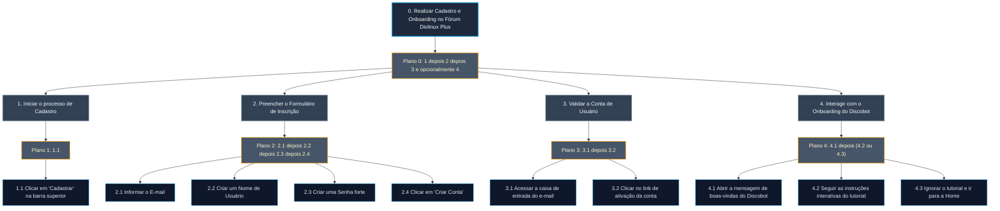

```mermaid
graph TD
    classDef goal fill:#1E293B,stroke:#0EA5E9,stroke-width:2px,color:#F8FAFC;
    classDef sub fill:#334155,stroke:#94A3B8,stroke-width:1.5px,color:#F8FAFC;
    classDef op fill:#0F172A,stroke:#38BDF8,stroke-width:1px,color:#E2E8F0;
    classDef plan fill:#475569,stroke:#F59E0B,stroke-width:1.5px,color:#FEF3C7;

    G0["0. Encontrar uma discussão útil sobre o problema de Wi-Fi no Linux Mint"]:::goal
    P0["Plano 0: executar 1, 2, 3 e 4; sem resultado útil, executar 5"]:::plan
    G0 --> P0
    P0 --> G1["1. Acessar a busca do fórum"]:::sub
    P0 --> G2["2. Formular e executar a consulta"]:::sub
    P0 --> G3["3. Examinar os resultados"]:::sub
    P0 --> G4["4. Avaliar uma discussão candidata"]:::sub
    P0 --> G5["5. Reformular a busca ou encerrar"]:::sub
    G1 --> O11["1.1 Localizar e acionar o campo de busca"]:::op
    G2 --> O21["2.1 Digitar termos relacionados ao problema"]:::op
    G2 --> O22["2.2 Aplicar filtros de categoria e tag, se disponíveis"]:::op
    G2 --> O23["2.3 Executar a consulta"]:::op
    G3 --> O31["3.1 Examinar títulos e trechos dos resultados"]:::op
    G3 --> O32["3.2 Comparar categoria, tag e data, quando exibidas"]:::op
    G3 --> O33["3.3 Selecionar um resultado potencialmente relevante"]:::op
    G4 --> O41["4.1 Abrir a discussão selecionada"]:::op
    G4 --> O42["4.2 Comparar o problema com a necessidade atual"]:::op
    G4 --> O43["4.3 Verificar as respostas e uma solução aplicável"]:::op
    G5 --> O51["5.1 Alterar termos ou rever/remover filtros"]:::op
    G5 --> O52["5.2 Executar novamente ou encerrar sem resultado"]:::op
```

# Análise de Tarefas: HTA, GOMS e CTT

## Tabela de Contribuição

A distribuição de responsabilidades na modelagem das tarefas, fundamentação teórica e refinamentos metodológicos deste artefato encontra-se sintetizada a seguir.

| Integrante | Contribuição no Artefato | Data | Ferramenta de IA e Contribuição |
| :--- | :--- | :---: | :--- |
| [Edvaldo Soares Brasileiro Filho](https://github.com/PajeMurici-dev) | Modelagem da Tarefa 3 com HTA e GOMS/CMN-GOMS com apoio de IA generativa; validação empírica em andamento | 26/09/2026 | Suporte na estruturação Markdown e formatação tabular sob supervisão dos discentes |
| [Gustavo Antonio Rodrigues e Silva](https://github.com/gus-ant) | Autoria individual da Tarefa 2 (Cadastro e Onboarding do Novo Usuário com HTA e CTT) | 26/09/2026 | Suporte na estruturação Markdown e diagramas sob supervisão dos discentes |
| [Vinicius Silva Araruna](https://github.com/ViniciusA05) | Estruturação metodológica, fundamentação da regra de parada p × c, autoria integral da Tarefa 1 (HTA canônica e CMN-GOMS qualitativo), saneamento tipográfico UTF-8 e checklist | 11/10/2026 | Suporte na formatação Markdown e padronização tabular sob supervisão dos discentes |

---

## Introdução

Este artefato documenta a **Análise de Tarefas** realizada sobre as principais interações do **Fórum Diolinux Plus**, desenvolvida no âmbito da disciplina de Interação Humano-Computador (FGA0173), sob docência do Prof. Dr. André Barros de Sales (Faculdade UnB Gama — FGA/UnB).

A análise de tarefas é uma das abordagens mais tradicionais e rigorosas de IHC para compreender em profundidade o trabalho dos usuários, as operações mentais e físicas necessárias e os gargalos de usabilidade existentes em um sistema interativo (*Barbosa & Silva, 2021, p. 177*). Segundo Annett e Duncan (1967) e Card, Moran e Newell (1983), analisar tarefas não significa apenas inventariar as funções oferecidas pelo software, mas decompor sistematicamente o que as pessoas realmente fazem para atingir seus objetivos de alto nível, identificando os conhecimentos requeridos, as decisões operacionais e as condições contextuais sob as quais as ações se desenrolam.

---

## Metodologia e Técnicas Canônicas Adotadas

Em consonância com as exigências pedagógicas do Tópico 11 do Plano de Ensino da disciplina (*Sales, 2026*), que estabelece a modelagem de tarefas individuais para os integrantes empregando métodos formais complementares, a equipe selecionou técnicas canônicas consolidadas na literatura científica de IHC:

1. **Análise Hierárquica de Tarefas (HTA — *Hierarchical Task Analysis*)**: Proposta originalmente por Annett e Duncan (1967) e aprofundada por Barbosa e Silva (2021, p. 178–185), a HTA decompõe um objetivo de alto nível em subobjetivos, planos de execução e operações físicas/cognitivas elementares.
2. **GOMS (Goals, Operators, Methods, Selection Rules)**: Formulado por Card, Moran e Newell (1983) e detalhado por Barbosa e Silva (2021, p. 185–188), o modelo GOMS descreve o conhecimento procedural e cognitivo necessário para que um usuário execute tarefas em um sistema interativo. A variante canônica **CMN-GOMS** (*Card, Moran & Newell GOMS*) analisa hierarquicamente os objetivos do usuário (*Goals*), as operações mentais e físicas elementares (*Operators*), os procedimentos estruturados para atingir tais metas (*Methods*) e as regras contextuais de decisão (*Selection Rules*). Essa modelagem permite mapear decisões, gargalos de memória de trabalho e bifurcações procedurais entre usuários novatos e experientes.
3. **Árvores de Tarefas Concorrentes (CTT — *Concurrent Task Trees*)**: Introduzida por Paternò (2000), a notação CTT enriquece a modelagem hierárquica ao categorizar as tarefas conforme seus agentes de execução (tarefas do usuário, do sistema, interativas ou abstratas) e formalizar operadores temporais avançados (escolha, concorrência, desativação e sincronização).

A Figura 1 e a Figura 2 ilustram a fundamentação teórica de HTA e GOMS extraídas diretamente da literatura canônica.


**Figura 1** — Trecho do livro de Barbosa e Silva detalhando a técnica HTA (Análise Hierárquica de Tarefas).  
_Fonte: Barbosa e Silva (2021, p. 179)._


**Figura 2** — Trecho do livro de Barbosa e Silva detalhando a técnica GOMS e suas variantes.  
_Fonte: Barbosa e Silva (2021, p. 186)._

---

### Fundamentação Teórica da HTA e Regra de Parada p × c

_Autor do Item Teórico: [Vinicius Silva Araruna](https://github.com/ViniciusA05)_

A Análise Hierárquica de Tarefas (HTA) foi proposta originalmente por Annett e Duncan (1967) com o propósito de analisar as habilidades e conhecimentos exigidos para a execução eficiente de tarefas complexas, sendo consolidada na literatura de Interação Humano-Computador por Barbosa e Silva (2021, p. 178–185) e Kirwan e Ainsworth (1992).

Diferente de um simples fluxograma funcional do sistema, a HTA parte da perspectiva do usuário, definindo a tarefa como qualquer atividade orientada a metas executada por uma pessoa para alcançar um estado desejado no sistema.

#### Componentes Canônicos da HTA

A técnica estrutura a interação em quatro elementos fundamentais:

1. **Objetivo (Goal)**: Estado final pretendido pelo usuário (ex.: publicar uma dúvida técnica no fórum). O objetivo de nível superior é denominado Objetivo 0;
2. **Subobjetivo (Subgoal)**: Decomposição intermediária subordinada a um objetivo superior, representando um marco funcional indispensável para o alcance da meta global;
3. **Operação (Operation)**: Ação física, motora ou perceptual elementar indivisível executada diretamente na interface (nó folha da árvore), acionada por um estímulo e produtora de um *feedback* observável;
4. **Plano de Execução (Plan)**: Regra lógica e temporal que governa como os subobjetivos ou operações devem ser coordenados e ativados. Os planos canônicos abrangem:
   - *Sequencial*: executar subpassos em ordem rígida (ex.: 1 depois 2 depois 3);
   - *Seleção / Alternativa*: escolher entre ramos mutuamente exclusivos com base em condições de contexto (ex.: 1.1 ou 1.2);
   - *Iterativo / Repetição*: repetir uma ação até que uma condição de parada seja satisfeita (ex.: repetir 4.1 até texto completo);
   - *Paralelo / Concorrente*: executar duas ou mais ações simultaneamente ou de forma intercalada (ex.: 4.1 e 4.2 em paralelo).

#### Formalização do Critério de Parada (Regra Heurística p × c)

Um dos maiores desafios metodológicos na aplicação da HTA é definir o momento exato em que a decomposição hierárquica deve ser encerrada. Conforme estabelecido pioneiramente por Annett e Duncan (1967) e reiterado por Barbosa e Silva (2021, p. 179) e Kirwan e Ainsworth (1992), o encerramento da decomposição é regido pela **regra heurística p × c**:

A análise cessa quando o produto da **probabilidade de falha humana (p)** pelo **custo ou gravidade do erro (c)** for considerado desprezível ou aceitável para os objetivos de design do sistema interativo (p × c < limiar de tolerância).

Onde:

- **Probabilidade de falha (p)**: Chance de o usuário cometer um lapso, engano ou hesitação na operação (avaliada qualitativamente em Baixa, Média ou Alta, conforme a complexidade perceptual e cognitiva);
- **Custo do erro (c)**: Impacto do equívoco sobre a tarefa (baixo retrabalho, perda de dados ou inviabilização da postagem).

Se o produto p × c for elevado (alta probabilidade de erro ou consequência severa), a etapa não deve ser tratada como operação atômica rasa, exigindo decomposição detalhada e recomendações prioritárias de melhoria de usabilidade. Quando p × c for baixo ou aceitável (como o ato físico isolado de pressionar uma tecla bem posicionada e sem ambiguidade), atinge-se o nível de operação atômica e a decomposição é interrompida.

---

## Mapeamento Geral das Tarefas Analisadas

A Tabela 1 apresenta a visão sistêmica da divisão das tarefas prioritárias do Fórum Diolinux Plus entre os membros ativos da equipe, sincronizada em proporção 1:1 com as funcionalidades delimitadas em [Site Selecionado](../planejamento/site-selecionado.md).

**Tabela 1** — Mapeamento de atribuição das tarefas e técnicas adotadas

| Tarefa Analisada | Técnicas Empregadas | Autor Responsável | Revisor |
| :--- | :--- | :--- | :--- |
| **Tarefa 1**: Criação e Publicação de Tópico de Dúvida com Tags e Formatação Markdown | HTA (Diagrama + Tabela com p × c) + CMN-GOMS | [Vinicius Silva Araruna](https://github.com/ViniciusA05) | [Gustavo Antonio](https://github.com/gus-ant) |
| **Tarefa 2**: Cadastro e Onboarding do Novo Usuário com Discobot | HTA (Diagrama + Tabela) + CTT | [Gustavo Antonio](https://github.com/gus-ant) | [Edvaldo Soares](https://github.com/PajeMurici-dev) |
| **Tarefa 3**: Busca Avançada e Filtros de Categoria | HTA (Diagrama + Tabela) + GOMS/CMN-GOMS | [Edvaldo Soares](https://github.com/PajeMurici-dev) | [Vinicius Silva Araruna](https://github.com/ViniciusA05) |

_Fonte: Elaborada pelos autores, 2026._

Conforme detalhado na Tabela 1, cada integrante assume a titularidade da modelagem aprofundada de um fluxo central do fórum.

---

## Tarefa 1: Criação e Publicação de Tópico com Tags e Markdown (Vinicius Silva Araruna)

- **Autor Principal**: [Vinicius Silva Araruna](https://github.com/ViniciusA05)
- **Revisor**: [Gustavo Antonio Rodrigues e Silva](https://github.com/gus-ant)
- **Objeto de Análise**: Fluxo de composição, categorização taxonômica, inserção de blocos de código com sintaxe Markdown e submissão de nova postagem de dúvida na plataforma Discourse do Fórum Diolinux Plus.

### 1. Modelagem HTA (Análise Hierárquica de Tarefas)

A Figura 3 apresenta o diagrama hierárquico da Tarefa 1 elaborado na notação canônica de Annett e Duncan (1967) e Barbosa e Silva (2021), renderizado em tema claro canônico de alto contraste compatível com as diretrizes de acessibilidade visual WCAG 2.1 nível AA.

```mermaid
graph TD
    classDef goal fill:#FFFFFF,stroke:#0F172A,stroke-width:2.5px,color:#0F172A;
    classDef sub fill:#F8FAFC,stroke:#334155,stroke-width:2px,color:#0F172A;
    classDef op fill:#F1F5F9,stroke:#475569,stroke-width:1.5px,color:#0F172A;
    classDef plan fill:#FEF3C7,stroke:#D97706,stroke-width:1.5px,color:#78350F;

    G0["0. Publicar Tópico de Dúvida Técnica no Fórum Diolinux Plus"]:::goal
    P0["Plano 0: Realizar 1 depois 2 depois 3 depois 4 e finalmente 5"]:::plan

    G0 --> P0
    P0 --> G1["1. Acionar Mecanismo de Criação de Tópico"]:::sub
    P0 --> G2["2. Definir Título e Avaliar Desduplicação"]:::sub
    P0 --> G3["3. Categorizar e Classificar por Tags"]:::sub
    P0 --> G4["4. Redigir e Formatar Conteúdo da Mensagem"]:::sub
    P0 --> G5["5. Revisar e Confirmar Publicação"]:::sub

    P1["Plano 1: 1.1 ou 1.2"]:::plan
    G1 --> P1
    P1 --> O11["1.1 Clicar no botão '+ Novo Tópico'"]:::op
    P1 --> O12["1.2 Pressionar tecla de atalho 'c'"]:::op

    P2["Plano 2: 2.1 depois 2.2 e opcionalmente 2.3"]:::plan
    G2 --> P2
    P2 --> O21["2.1 Clicar no campo de título e digitar descrição"]:::op
    P2 --> O22["2.2 Inspecionar painel lateral de tópicos semelhantes"]:::op
    P2 --> O23["2.3 Ajustar termos do título se houver tópico correlato"]:::op

    P3["Plano 3: 3.1 depois 3.2"]:::plan
    G3 --> P3
    P3 --> O31["3.1 Selecionar categoria adequada no dropdown"]:::op
    P3 --> O32["3.2 Inserir uma ou mais tags representativas"]:::op

    P4["Plano 4: 4.1 depois 4.2 e iterativamente 4.3"]:::plan
    G4 --> P4
    P4 --> O41["4.1 Redigir texto explicativo do problema"]:::op
    P4 --> O42["4.2 Inserir blocos de código/logs com Markdown (três crases)"]:::op
    P4 --> O43["4.3 Monitorar renderizador em tempo real na aba dividida"]:::op

    P5["Plano 5: 5.1 depois 5.2"]:::plan
    G5 --> P5
    P5 --> O51["5.1 Clicar em 'Criar Tópico' ou atalho Ctrl+Enter"]:::op
    P5 --> O52["5.2 Confirmar redirecionamento para o tópico criado"]:::op
```



**Figura 3** — Diagrama HTA da tarefa de criação e publicação de tópico de dúvida com tags e Markdown no Fórum Diolinux Plus.  
_Fonte: Elaborada por [Vinicius Silva Araruna](https://github.com/ViniciusA05), 2026._

Conforme representado na Figura 3, o objetivo de nível superior se desdobra em cinco subobjetivos sequenciais rigorosos governados pelo Plano 0.

A Tabela 2 apresenta a legenda dos elementos constitutivos da notação gráfica HTA empregada no diagrama.

**Tabela 2** — Legenda da notação gráfica HTA empregada

| Elemento Gráfico | Notação HTA Canônica | Descrição e Papel na Modelagem |
| :---: | :---: | :--- |
| **Retângulo com Borda Espessa Escura** | Objetivo Nível 0 | Meta de alto nível que representa o estado final desejado pelo usuário na interação. |
| **Retângulo com Fundo Claro e Borda Dupla** | Subobjetivo (Nível 1) | Decomposição funcional de uma etapa necessária e intermediária da tarefa. |
| **Retângulo Cinza Claro** | Operação (Nível 2) | Comportamento físico ou perceptual elementar indivisível executado diretamente na interface. |
| **Retângulo Âmbar com Texto Escuro** | Plano de Execução | Regra lógica condicional, sequencial ou iterativa que governa os subobjetivos ou operações. |

_Fonte: Elaborada por [Vinicius Silva Araruna](https://github.com/ViniciusA05), 2026._

A Tabela 3 complementa o diagrama hierárquico ao apresentar a decomposição tabular completa, com o mapeamento detalhado dos objetivos, operações, planos, a avaliação heurística do critério de parada p × c, os problemas de usabilidade detectados na interface e as recomendações ergonômicas de melhoria.

**Tabela 3** — Decomposição hierárquica tabular da Tarefa 1 com avaliação do critério de parada p × c

| Identificador | Nome do Objetivo / Operação | Relação / Plano | Avaliação do Critério de Parada (p × c e Decisão) | Problemas de Usabilidade Detectados | Recomendações de Melhoria na Interface |
| :--- | :--- | :--- | :--- | :--- | :--- |
| **0** | **Publicar Tópico de Dúvida Técnica no Fórum Diolinux Plus** | **Plano 0**: Executar 1, 2, 3, 4 e 5 em sequência ordenada. | Não aplicável (Meta de nível superior). Decompor nos subobjetivos 1 a 5. | Usuários inexperientes tendem a redigir o corpo sem antes definir tags ou verificar duplicatas. | Adicionar indicador progressivo de preenchimento (checklist contextual). |
| **1** | **Acionar Mecanismo de Criação de Tópico** | **Plano 1**: Executar 1.1 ou 1.2. | Decompor para avaliar o modo de acionamento (mouse vs. atalho de teclado). | O atalho `c` só funciona se o foco não estiver em um campo de texto ativo. | Sinalizar o atalho no tooltip do botão "+ Novo Tópico". |
| 1.1 | Clicar no botão "+ Novo Tópico" | Operação física | p: Baixa; c: Baixo (p × c aceitável) → **Parada da decomposição**. | Botão bem posicionado no canto superior direito. | Manter padrão de contraste alto. |
| 1.2 | Pressionar tecla de atalho `c` | Operação de teclado | p: Média (desconhecimento do atalho); c: Baixo (p × c aceitável) → **Parada da decomposição**. | Desconhecido pela esmagadora maioria dos novatos. | Exibir dica de atalho de teclado no primeiro login. |
| **2** | **Definir Título e Avaliar Desduplicação** | **Plano 2**: Executar 2.1, 2.2 e, se aplicável, 2.3. | Decompor para analisar a barreira oculta de caracteres mínimos e desduplicação. | Se o título for muito curto (menos de 15 caracteres), o Discourse bloqueia a publicação sem feedback em tempo real. | Exibir contador regressivo de caracteres mínimos diretamente no campo. |
| 2.1 | Clicar no campo de título e digitar descrição | Operação motora e cognitiva | p: Alta (bloqueio por menos de 15 caracteres); c: Médio (frustração/atraso) → **Parada com recomendação de usabilidade**. | Títulos genéricos (ex: "Socorro me ajudem") prejudicam buscas futuras. | Inserir placeholder instrucional ("Ex: Como configurar placa NVIDIA no Pop!_OS"). |
| 2.2 | Inspecionar painel de tópicos semelhantes | Operação visual/cognitiva | p: Média (ignorar sugestões); c: Baixo (p × c aceitável) → **Parada da decomposição**. | O painel lateral ocupa espaço considerável e pode distrair telas menores. | Permitir colapsar o painel de sugestões com um clique sem perder a busca. |
| 2.3 | Ajustar termos do título se houver tópico correlato | Operação cognitiva | p: Média (dúvida taxonômica); c: Médio (p × c moderado) → **Parada da decomposição**. | Usuário pode abandonar o fluxo se achar que a dúvida já foi respondida. | Permitir vincular como tópico derivado ou réplica com um clique. |
| **3** | **Categorizar e Classificar por Tags** | **Plano 3**: Executar 3.1 e 3.2. | Decompor para diferenciar seleção em dropdown e inserção de tags livres. | Excesso de categorias causa indecisão e dúvida de enquadramento. | Limitar a seleção primária às 5 categorias mais utilizadas. |
| 3.1 | Selecionar categoria adequada no dropdown | Operação de seleção | p: Média (sobrecarga visual); c: Médio (tópico movido por moderadores) → **Parada da decomposição**. | O seletor exibe muitas opções sem uma hierarquia visual nítida. | Agrupar categorias por tema (Hardware, Software, Distribuições). |
| 3.2 | Inserir uma ou mais tags representativas | Operação de digitação | p: Alta (sinônimos não padronizados); c: Baixo (p × c moderado) → **Parada da decomposição**. | Algumas tags possuem sinônimos não unificados no sistema. | Autocompletar inteligente com tags consolidadas e populares. |
| **4** | **Redigir e Formatar Conteúdo da Mensagem** | **Plano 4**: Executar 4.1 e 4.2 monitorando 4.3 iterativamente. | Decompor para examinar a complexidade da sintaxe Markdown e blocos de código. | Usuários frequentemente colam logs de erro longos sem formatação de código. | Detecção automática de saídas de terminal com inserção automática de crases. |
| 4.1 | Redigir texto explicativo do problema | Operação motora/cognitiva | p: Baixa (redação espontânea); c: Baixo (p × c aceitável) → **Parada da decomposição**. | Ausência de roteiro para o usuário informar versão de distro e hardware. | Disponibilizar template padrão de abertura de chamado técnico. |
| 4.2 | Inserir blocos de código com Markdown (três crases) | Operação de formatação | p: Alta (erro de sintaxe com crases); c: Alto (poluição visual e ilegibilidade) → **Parada com recomendação ergonômica crítica**. | O botão de formatação de código da barra insere apenas indentação de 4 espaços por padrão. | Alterar o comportamento padrão da barra para inserir blocos de código cercados (```` ``` ````). |
| 4.3 | Monitorar renderizador em tempo real na aba dividida | Operação perceptiva | p: Baixa (feedback visual imediato); c: Baixo (p × c aceitável) → **Parada da decomposição**. | Em telas compactas de notebooks, o editor divide a tela tornando o espaço restrito. | Adicionar opção de alternância rápida entre abas "Editar" e "Pré-visualizar". |
| **5** | **Revisar e Confirmar Publicação** | **Plano 5**: Executar 5.1 e confirmar em 5.2. | Decompor para analisar a barreira de submissão bloqueada. | O botão "Criar Tópico" fica desabilitado sem aviso caso falte categoria obrigatória. | Exibir tooltip explicativo em vermelho sobre o botão desabilitado indicando a pendência. |
| 5.1 | Clicar em "Criar Tópico" ou atalho Ctrl+Enter | Operação física/motora | p: Média (botão inativo sem aviso claro); c: Alto (bloqueio da postagem) → **Parada com recomendação de usabilidade**. | Botão desabilitado silenciosamente em caso de campos incompletos. | Exibir mensagem contextual informando exatamente qual campo falta preencher. |
| 5.2 | Confirmar redirecionamento para o tópico criado | Operação de validação | p: Baixa (operação automatizada do sistema); c: Baixo (p × c aceitável) → **Parada da decomposição**. | Transição de página é rápida. | Apresentar confirmação sutil com opção de edição imediata nos primeiros 5 minutos. |

_Fonte: Elaborada por [Vinicius Silva Araruna](https://github.com/ViniciusA05), 2026._

Conforme demonstrado na Tabela 3, a avaliação do critério de parada p × c evidencia com precisão científica os nós onde a interface deve intervir proativamente, especialmente na formatação de logs técnicos (operação 4.2) e na validação prévia de submissão (operações 2.1 e 5.1).

---

### 2. Modelagem Cognitiva CMN-GOMS (Goals, Operators, Methods, Selection Rules)

O modelo **CMN-GOMS** (*Card, Moran & Newell GOMS*), formulado por Card, Moran e Newell (1983) e consolidado por Barbosa e Silva (2021, p. 185–188), analisa o conhecimento procedural e a estrutura cognitiva requerida para a realização de tarefas rotineiras em sistemas interativos.

Diferente de modelos puramente mecânicos baseados em cronometragens temporais estimadas, o CMN-GOMS qualitativo concentra-se na relação funcional entre **Metas** (*Goals*), **Operadores** (*Operators* mentais, perceptuais e motores), **Métodos** (*Methods* procedurais estruturados) e **Regras de Seleção** (*Selection Rules* condicionais). Essa modelagem permite mapear decisões de interação, avaliar a sobrecarga de memória de trabalho e confrontar as rotinas procedurais de usuários novatos com as de usuários especialistas.

#### Componentes e Regras de Seleção do Modelo

A Tabela 4 sintetiza os operadores fundamentais e as regras de seleção que orientam a tomada de decisão do usuário no fluxo de composição de tópicos no Fórum Diolinux Plus.

**Tabela 4** — Mapeamento dos operadores e regras de seleção do CMN-GOMS para a Tarefa 1

| Componente | Categoria / Tipo | Descrição Operacional e Comportamental | Aplicação no Fórum Diolinux Plus |
| :---: | :--- | :--- | :--- |
| **Operador Cognitivo** | Mental / Decisório | Formulação de hipóteses, recuperação de informações da memória e avaliação semântica. | Formular título técnico, decidir palavras-chave, avaliar relevância de sugestões de desduplicação e revisar pré-visualização. |
| **Operador Motor** | Ação Física | Movimentos musculares discretos sobre periféricos de entrada (teclado e mouse). | Clicar em botões, digitar termos no campo de texto, acionar delimitadores de código Markdown e executar atalhos combinados. |
| **Operador Perceptual** | Sensorial / Visual | Fixação ocular, leitura e varredura de elementos visuais na interface gráfica. | Localizar botão "+ Novo Tópico", varrer lista de categorias e monitorar renderização em tempo real na aba dividida. |
| **Regra de Seleção 1** | Decisão de Acesso | Escolha entre atalho rápido de teclado ou acionamento via controle gráfico apontável. | **SE** o usuário domina os atalhos da interface e o cursor não está em caixa de texto → **USAR** `METHOD: Iniciar por Tecla de Atalho ('c')`; **SENÃO** → **USAR** `METHOD: Iniciar por Botão de Interface ("+ Novo Tópico")`. |
| **Regra de Seleção 2** | Formatação de Código | Escolha do método de inclusão de comandos de terminal ou saídas de logs técnicos. | **SE** o log ou código possui múltiplas linhas → **USAR** `METHOD: Delimitar com Crases Triplas (\`\`\`)`; **SENÃO SE** for comando inline → **USAR** `METHOD: Delimitar com Crase Simples (\`)`; **SENÃO** (desconhecimento de Markdown) → **USAR** `METHOD: Inserir via Botão da Barra de Ferramentas`. |
| **Regra de Seleção 3** | Submissão Final | Escolha entre confirmação via teclado ou apontamento do botão de envio. | **SE** o usuário terminou a redação com as mãos no teclado físico → **USAR** `METHOD: Confirmar com Atalho Ctrl+Enter`; **SENÃO** → **USAR** `METHOD: Confirmar com Clique em "Criar Tópico"`. |

_Fonte: Elaborada por [Vinicius Silva Araruna](https://github.com/ViniciusA05) com base em Card, Moran e Newell (1983) e Barbosa e Silva (2021), 2026._

A Tabela 4 sistematiza as condições de seleção que governam o comportamento cognitivo do usuário durante a interação.

#### Estrutura Procedural Hierárquica do CMN-GOMS

A Tabela 5 detalha a decomposição hierárquica completa dos objetivos, métodos procedurais e operadores elementares para a publicação de tópico de dúvida.

**Tabela 5** — Estrutura procedural hierárquica CMN-GOMS da Tarefa 1

| Nível Hierárquico | Identificador | Estrutura Procedural (Metas, Métodos e Operadores) | Condição / Regra Associada |
| :--- | :--- | :--- | :--- |
| **Meta Principal** | **GOAL 0** | **Publicar Tópico de Dúvida Técnica no Fórum Diolinux Plus** | Meta global orientada ao objetivo do usuário. |
| Submeta 1 | GOAL 1 | Abrir Painel do Compositor de Tópicos | Subordinada ao GOAL 0. |
| Decisão 1 | Regra 1 | Avaliar perfil de experiência e foco na interface | Governa a escolha entre Método 1A e 1B. |
| Método 1A | METHOD 1A | Iniciar via Atalho de Teclado (Usuário Experiente) | Requer foco fora de campos editáveis. |
| Operador 1A.1 | OPERATOR | Verificar visualmente que nenhum campo de texto está ativo | Operador cognitivo/perceptual. |
| Operador 1A.2 | OPERATOR | Pressionar tecla "c" no teclado físico | Operador motor elementar. |
| Método 1B | METHOD 1B | Iniciar via Interface Gráfica (Usuário Padrão/Iniciante) | Método visual padrão. |
| Operador 1B.1 | OPERATOR | Localizar visualmente o botão "+ Novo Tópico" na barra | Operador perceptual. |
| Operador 1B.2 | OPERATOR | Mover cursor até o botão "+ Novo Tópico" | Operador motor de apontamento. |
| Operador 1B.3 | OPERATOR | Pressionar o botão primário do mouse (clique) | Operador motor de clique. |
| Submeta 2 | GOAL 2 | Definir Título e Avaliar Tópicos Semelhantes | Subordinada ao GOAL 0. |
| Método 2 | METHOD 2 | Redigir Título e Analisar Painel de Desduplicação | Procedimento sequencial de titulação. |
| Operador 2.1 | OPERATOR | Apontar e clicar no campo "Título do Tópico" | Operador motor. |
| Operador 2.2 | OPERATOR | Formular mentalmente descrição objetiva (≥ 15 caracteres) | Operador cognitivo (carga mental alta). |
| Operador 2.3 | OPERATOR | Digitar título contextualizado no campo | Operador motor de digitação. |
| Operador 2.4 | OPERATOR | Varrer visualmente sugestões no painel lateral de similares | Operador perceptual. |
| Operador 2.5 | OPERATOR | Avaliar se alguma sugestão já responde à dúvida | Operador cognitivo de julgamento. |
| Decisão 2A | Regra 2A | SE houver duplicata idêntica → Abrir tópico existente; SENÃO → Prosseguir | Regra de seleção interna ao GOAL 2. |
| Submeta 3 | GOAL 3 | Classificar Taxonomicamente a Publicação | Subordinada ao GOAL 0. |
| Método 3 | METHOD 3 | Selecionar Categoria e Associar Tags Relevantes | Procedimento de catalogação. |
| Operador 3.1 | OPERATOR | Clicar no seletor suspenso de categorias | Operador motor. |
| Operador 3.2 | OPERATOR | Varrer lista e identificar categoria temática apropriada | Operador perceptual e cognitivo. |
| Operador 3.3 | OPERATOR | Clicar na categoria correspondente | Operador motor. |
| Operador 3.4 | OPERATOR | Clicar no campo de inserção de tags | Operador motor. |
| Operador 3.5 | OPERATOR | Digitar tag identificadora e pressionar Enter | Operador motor de digitação e confirmação. |
| Submeta 4 | GOAL 4 | Redigir e Formatar Conteúdo Técnico com Markdown | Subordinada ao GOAL 0. |
| Método 4 | METHOD 4 | Compor Mensagem e Estruturar Logs de Terminal | Procedimento de redação e sintaxe. |
| Operador 4.1 | OPERATOR | Posicionar foco na área do editor de texto | Operador motor. |
| Operador 4.2 | OPERATOR | Redigir descrição detalhada da falha técnica | Operador cognitivo e motor. |
| Decisão 2B | Regra 2B | Avaliar tipo de bloco de log técnico ou comando | Governa a escolha entre Método 4A e 4B. |
| Método 4A | METHOD 4A | Formatação Avançada Direta via Markdown | Aplicável quando o usuário domina sintaxe. |
| Operador 4A.1 | OPERATOR | Digitar delimitadores de crases triplas no editor | Operador motor de digitação. |
| Operador 4A.2 | OPERATOR | Colar logs de erro de terminal entre os delimitadores | Operador motor de transferência de texto. |
| Método 4B | METHOD 4B | Formatação Auxiliada via Barra de Ferramentas | Aplicável para usuários novatos em Markdown. |
| Operador 4B.1 | OPERATOR | Selecionar o texto técnico colado com o mouse | Operador motor de seleção. |
| Operador 4B.2 | OPERATOR | Clicar no ícone de código "</>" na barra do editor | Operador motor de apontamento e clique. |
| Operador 4.3 | OPERATOR | Examinar painel lateral de pré-visualização renderizada | Operador perceptual de verificação. |
| Operador 4.4 | OPERATOR | Validar se os blocos de código e texto estão legíveis | Operador cognitivo de revisão visual. |
| Submeta 5 | GOAL 5 | Revisar Requisitos e Confirmar Publicação | Subordinada ao GOAL 0. |
| Decisão 3 | Regra 3 | Avaliar postura corporal e posição das mãos | Governa a escolha entre Método 5A e 5B. |
| Método 5A | METHOD 5A | Submissão Rápida via Teclado (Mãos sobre o teclado) | Método preferencial de alta eficiência. |
| Operador 5A.1 | OPERATOR | Pressionar combinação de atalho "Ctrl+Enter" | Operador motor coordenado. |
| Método 5B | METHOD 5B | Submissão via Botão da Interface (Mão sobre o mouse) | Método tradicional gráfico. |
| Operador 5B.1 | OPERATOR | Localizar botão "Criar Tópico" na base do editor | Operador perceptual. |
| Operador 5B.2 | OPERATOR | Apontar cursor e clicar em "Criar Tópico" | Operador motor. |
| Operador 5.1 | OPERATOR | Confirmar redirecionamento automático para a discussão | Operador perceptual de encerramento. |

_Fonte: Elaborada por [Vinicius Silva Araruna](https://github.com/ViniciusA05), 2026._

#### Análise Ergonômica e Implicações de Design do CMN-GOMS

A decomposição procedural apresentada na Tabela 5 evidencia aspectos cognitivos e ergonômicos determinantes para a usabilidade da plataforma:

1. **Gargalo Cognitivo de Pré-Requisitos Ocultos**: A formulação do título (GOAL 2) impõe uma exigência mínima de 15 caracteres pelo Discourse sem feedback preventivo, exigindo que o usuário reformule mentalmente sua frase caso o botão permaneça inativo.
2. **Assimetria de Eficiência entre Métodos**: O mapeamento explicita a cisão entre usuários experientes (que alternam com fluidez entre `METHOD 1A`, `METHOD 4A` e `METHOD 5A` mantendo as mãos exclusivamente no teclado) e usuários iniciantes (que dependem de frequentes alternâncias entre teclado e mouse para `METHOD 1B`, `METHOD 4B` e `METHOD 5B`). A ausência de sinalização visual dos atalhos de teclado priva os iniciantes dessa aceleração procedural.
3. **Complexidade de Sintaxe na Inclusão de Logs**: A bifurcação do `GOAL 4` revela que a falta de domínio da sintaxe de crases triplas do Markdown induz o usuário iniciante a usar o botão da barra, que historicamente introduz indentação de 4 espaços menos tolerante a logs extensos de distribuições Linux. Propostas ergonômicas incluem detecção automática de logs ou templates pré-formatados.

---

## Tarefa 2: Cadastro e Onboarding do Novo Usuário (Gustavo Antonio)

- **Autor Principal**: [Gustavo Antonio Rodrigues e Silva](https://github.com/gus-ant)
- **Revisor**: [Edvaldo Soares Brasileiro Filho](https://github.com/PajeMurici-dev)
- **Técnicas Adotadas**: HTA (Análise Hierárquica de Tarefas) e CTT (Árvores de Tarefas Concorrentes)

### 1. Modelagem HTA (Análise Hierárquica de Tarefas)

A Figura 4 apresenta o diagrama hierárquico da Tarefa 2 elaborado na notação canônica de Annett e Duncan.



**Figura 4** — Diagrama HTA da tarefa de Cadastro e Onboarding.  
_Fonte: Elaborada por [Gustavo Antonio Rodrigues e Silva](https://github.com/gus-ant), 2026._

A Tabela 6 apresenta a decomposição hierárquica tabular da Tarefa 2.

**Tabela 6** — Decomposição tabular da Tarefa 2 (Cadastro e Onboarding)

| Identificador | Nome do Objetivo / Operação | Relação / Plano | Problemas de Usabilidade | Recomendações |
| :--- | :--- | :--- | :--- | :--- |
| **0** | **Realizar Cadastro e Onboarding** | **Plano 0**: 1, 2, 3 e opcionalmente 4. | O onboarding pode ser evasivo para usuários com pressa. | Opção clara de "Pular tutorial" na primeira tela. |
| **1** | **Iniciar o processo de Cadastro** | **Plano 1**: Executar 1.1. | Botão pode não ter destaque suficiente em telas menores. | Usar cor de contraste maior para "Cadastrar". |
| 1.1 | Clicar em "Cadastrar" | Operação física | N/A | N/A |
| **2** | **Preencher o Formulário** | **Plano 2**: Executar 2.1 a 2.4 em ordem. | Falta de feedback imediato de nome de usuário em uso. | Validação assíncrona (AJAX) do nome enquanto digita. |
| 2.1 | Informar o E-mail | Operação motora | N/A | N/A |
| 2.2 | Criar um Nome de Usuário | Operação cognitiva | Dificuldade em achar nomes livres. | Sugerir nomes com base no e-mail fornecido. |
| 2.3 | Criar uma Senha forte | Operação cognitiva | Regras de senha só aparecem após o erro. | Mostrar requisitos de senha visíveis o tempo todo. |
| 2.4 | Clicar em 'Criar Conta' | Operação física | N/A | N/A |
| **3** | **Validar a Conta** | **Plano 3**: Executar 3.1 e 3.2. | E-mail cai na caixa de spam com frequência. | Aviso explícito para verificar a pasta de Spam. |
| 3.1 | Acessar o e-mail | Operação navegação | N/A | N/A |
| 3.2 | Clicar no link de ativação | Operação física | Link longo quebra em alguns clientes de e-mail. | Usar botão HTML em vez de link de texto longo. |
| **4** | **Interagir com o Onboarding** | **Plano 4**: 4.1 depois (4.2 ou 4.3). | O Discobot não explica o tempo médio do tutorial. | Indicar "Duração: 3 minutos" na mensagem. |
| 4.1 | Abrir a mensagem de boas-vindas | Operação navegação | N/A | N/A |
| 4.2 | Seguir as instruções interativas | Operação cognitiva | Pode ser tedioso para usuários experientes. | Permitir finalizar a qualquer momento e ganhar o badge. |
| 4.3 | Ignorar o tutorial e ir para a Home | Operação de escape | A notificação da mensagem fica pendente. | Botão "Marcar como lido" no topo. |

_Fonte: Elaborada por [Gustavo Antonio Rodrigues e Silva](https://github.com/gus-ant), 2026._

### 2. Modelagem CTT (Árvores de Tarefas Concorrentes)

O CTT (*Concurrent Task Trees*), formalizado por Paternò (2000), é utilizado para modelar interações concorrentes e papéis de tarefas (usuário, sistema, interação, abstrata). A seguir, a descrição textual hierárquica do modelo CTT para a Tarefa 2.

*   **T1 (Abstrata):** Realizar Cadastro e Onboarding
    *   **T1.1 (Interação):** Acessar a tela de Cadastro `>>` (Habilita)
    *   **T1.2 (Abstrata):** Efetuar Inscrição `>>` (Habilita)
        *   **T1.2.1 (Interação):** Preencher Dados do Formulário
            *   **T1.2.1.1 (Usuário):** Digitar e-mail `|||` (Concorrência *interleave*) **T1.2.1.2 (Usuário):** Digitar usuário `|||` **T1.2.1.3 (Usuário):** Digitar senha
        *   **T1.2.2 (Interação):** Submeter Inscrição `>>` (Habilita)
        *   **T1.2.3 (Sistema):** Validar Dados e Enviar E-mail de Ativação `>>` (Habilita)
    *   **T1.3 (Abstrata):** Ativar a Conta `>>` (Habilita)
        *   **T1.3.1 (Usuário):** Acessar o E-mail Pessoal `>>` (Habilita)
        *   **T1.3.2 (Interação):** Clicar no link de ativação `>>` (Habilita)
        *   **T1.3.3 (Sistema):** Ativar Conta e Redirecionar para o Fórum `>>` (Habilita)
    *   **T1.4 (Abstrata):** Executar Onboarding
        *   **T1.4.1 (Sistema):** Enviar mensagem de boas-vindas do Discobot `>>` (Habilita)
        *   **T1.4.2 (Interação):** Escolher interagir ou ignorar `[]` (Escolha exclusiva)
            *   **T1.4.2.1 (Interação):** Responder ao Discobot `>>` (Habilita)
                *   **T1.4.2.1.1 (Sistema):** Enviar nova dica (Iterativo)
            *   **T1.4.2.2 (Interação):** Fechar a mensagem e seguir para Home

Esta modelagem evidencia a forte sincronização necessária entre ações do sistema (envio de e-mail e validação de dados) e do usuário, destacando especialmente a flexibilidade de escolha (*Choice* `[]`) na etapa final de Onboarding (T1.4.2), onde o usuário tem liberdade para seguir fluxos paralelos.

---

## Tarefa 3: Busca Avançada e Filtros de Categoria (Edvaldo Soares)

- **Autor Principal**: [Edvaldo Soares Brasileiro Filho](https://github.com/PajeMurici-dev)
- **Revisor**: [Vinicius Silva Araruna](https://github.com/ViniciusA05)
- **Técnicas Adotadas**: HTA (Análise Hierárquica de Tarefas) e GOMS / CMN-GOMS

- **Cenário de uso**: Uma pessoa acessa o fórum para encontrar informações sobre um problema de Wi-Fi no Linux Mint. Antes de criar uma publicação, pesquisa discussões existentes, examina os resultados e avalia se alguma resposta atende à necessidade.
- **Status da modelagem**: Proposta analítica inicial; confirmar os passos na interface e validar com participantes antes de caracterizar resultados como empíricos.

### 1. Modelagem HTA — Análise Hierárquica de Tarefas

A HTA parte dos objetivos do usuário e os decompõe em subobjetivos, operações e planos. A estrutura abaixo segue Barbosa e Silva (2010, p. 192–196). A Figura 5 apresenta o diagrama hierárquico da decomposição da tarefa.



**Figura 5** — Diagrama HTA da busca de discussão sobre Wi-Fi no Linux Mint.  
_Fonte: Elaborada por [Edvaldo Soares Brasileiro Filho](https://github.com/PajeMurici-dev), 2026._

**Plano 0:** acessar a busca, formular e executar a consulta, examinar resultados e avaliar uma discussão candidata. Se nenhum resultado for útil, reformular os termos ou rever os filtros; repetir até encontrar conteúdo aplicável ou encerrar.

### 2. Modelagem GOMS e Estimativa KLM

GOMS descreve objetivos, operadores, métodos e regras de seleção. KLM estima o tempo de uma sequência de operadores para um usuário competente que já domina a tarefa e não comete erros. O cálculo abaixo é uma estimativa teórica (*Barbosa & Silva, 2010, p. 196–199*).

**Objetivo G0:** localizar uma discussão que possa responder a uma necessidade sobre Wi-Fi no Linux Mint.

**Método M1 — busca direta com filtros na consulta:**
1. Formular consulta com termos relacionados ao problema.
2. Incluir filtros de categoria e tag, se forem conhecidos e aceitos pela interface.
3. Executar a busca.
4. Examinar os resultados e selecionar um candidato.
5. Abrir a discussão e avaliar a compatibilidade do conteúdo.
6. Se nenhum resultado for útil, alterar os termos ou rever os filtros e repetir.

**Regras de seleção:**
- Se o usuário conhece o nome da distribuição ou do componente, inclui esse termo na consulta.
- Se os resultados forem numerosos ou pouco relacionados, acrescenta um filtro pertinente, desde que compreenda seu efeito.
- Se não houver resultado útil, remove ou altera um filtro e tenta termos mais amplos.
- Se encontrar uma discussão compatível, abre o tópico e avalia as respostas.
- Se nenhuma discussão for aplicável após a reformulação, encerra a busca ou segue para a tarefa de criação de tópico, modelada separadamente.

A Tabela 7 adota os tempos de referência canônicos de Barbosa e Silva (2010, p. 199).

**Tabela 7** — Operadores KLM e tempos de referência adotados para a Tarefa 3

| Operador | Significado | Tempo adotado |
| :---: | :--- | :---: |
| **K** | Pressionar e soltar uma tecla | 0,20 s |
| **P** | Apontar o cursor para um alvo na tela | 1,10 s |
| **B** | Pressionar ou soltar o botão do mouse | 0,10 s |
| **H** | Mover a mão entre teclado e mouse | 0,40 s |
| **M** | Preparação mental para uma ação ou sequência relacionada | 1,20 s |
| **T(n)** | Digitar cadeia de n caracteres | n × K |
| **R** | Aguardar a resposta do sistema | Variável |

_Fonte: Barbosa e Silva (2010, p. 199), aplicada à tarefa._

Para uma estimativa reproduzível, considera-se a consulta `wifi Linux Mint categories:linux tags:linux-mint`, com 48 caracteres, digitada no campo de busca. A Tabela 8 apresenta a sequência de operadores KLM calculada.

**Tabela 8** — Sequência KLM ilustrativa para a busca

| Ordem | Operador | Ação modelada | Tempo |
| :---: | :---: | :--- | :---: |
| 1 | M | Preparar a consulta e decidir os filtros | 1,20 s |
| 2 | H | Mover a mão do teclado para o mouse | 0,40 s |
| 3 | P | Apontar para o controle de busca | 1,10 s |
| 4 | B + B | Pressionar e soltar para ativar a busca | 0,20 s |
| 5 | H | Mover a mão para o teclado | 0,40 s |
| 6 | T(48) | Digitar a consulta: 48 × 0,20 s | 9,60 s |
| 7 | K | Pressionar Enter | 0,20 s |
| 8 | R1 | Aguardar a apresentação dos resultados | Variável |
| 9 | M | Examinar resultados e escolher um candidato | 1,20 s |
| 10 | H | Mover a mão do teclado para o mouse | 0,40 s |
| 11 | P | Apontar para o resultado | 1,10 s |
| 12 | B + B | Pressionar e soltar para abrir o resultado | 0,20 s |
| 13 | R2 | Aguardar a abertura da discussão | Variável |
| 14 | M | Comparar a discussão com a necessidade | 1,20 s |
| **SUBTOTAL** |  | **Subtotal (sem R1, R2 e leitura detalhada)** | **17,20 s** |

_Fonte: Elaborada por [Edvaldo Soares Brasileiro Filho](https://github.com/PajeMurici-dev), 2026, com tempos de referência de Barbosa e Silva (2010, p. 199)._

O subtotal de **17,20 segundos** cobre somente os operadores motores e preparações mentais modelados.

---

## Lista de Verificação da Técnica (Análise de Tarefas)

A Tabela 9 apresenta a autoavaliação da conformidade metodológica do artefato de Análise de Tarefas frente às exigências do Plano de Ensino da disciplina de IHC (*Sales, 2026*) e à literatura canônica (*Annett & Duncan, 1967; Card, Moran & Newell, 1983; Barbosa & Silva, 2021*).

**Tabela 9** — Lista de verificação da técnica de Análise de Tarefas (HTA, CMN-GOMS e CTT)

| ID | Questão Avaliada | Origem / Fonte Normativa | Conforme? | Resposta Autoexplicativa e Evidência no Artefato |
| :---: | :--- | :--- | :---: | :--- |
| **HTA-01** | O objetivo de alto nível (Objetivo 0) está explicitado claramente do ponto de vista do usuário? | Annett & Duncan (1967); Barbosa & Silva (2021) | ✅ Sim | Todas as três tarefas iniciam com o Objetivo 0 formalmente definido no topo do diagrama e na tabela. |
| **HTA-02** | A decomposição hierárquica divide os objetivos em subobjetivos intermediários e operações atômicas? | Barbosa & Silva (2021, p. 179) | ✅ Sim | Os diagramas e tabelas separam claramente subobjetivos (nível 1) de operações físicas/perceptuais (nível 2). |
| **HTA-03** | Os planos de execução canônicos (sequência, seleção, repetição) governam os subobjetivos? | Annett & Duncan (1967) | ✅ Sim | Cada grupo de subobjetivos possui um plano de execução explicitado nos diagramas e detalhado nas tabelas. |
| **HTA-04** | A parada da decomposição é justificada formalmente pela regra heurística p × c? | Annett & Duncan (1967); Barbosa & Silva (2021, p. 179) | ✅ Sim | A Tabela 3 da Tarefa 1 contém coluna dedicada avaliando a probabilidade de falha (p), gravidade (c) e a decisão de parada. |
| **HTA-05** | Há clara distinção conceitual entre objetivos (estados desejados) e operações (ações na interface)? | Kirwan & Ainsworth (1992) | ✅ Sim | Objetivos descrevem "o que" o usuário quer atingir; operações descrevem "como" o usuário interage (cliques, digitação). |
| **HTA-06** | A modelagem gráfica é complementada por representação tabular detalhando planos e problemas? | Barbosa & Silva (2021) | ✅ Sim | As Tabelas 3 e 6 expandem os diagramas hierárquicos mapeando problemas de usabilidade e recomendações ergonômicas. |
| **HTA-07** | Os modelos cognitivos GOMS estruturam proceduralmente a tarefa (Metas, Operadores, Métodos e Regras de Seleção)? | Card, Moran & Newell (1983); Barbosa & Silva (2021) | ✅ Sim | As Tabelas 4 e 5 detalham o CMN-GOMS qualitativo da Tarefa 1, e as Tabelas 7 e 8 mapeiam o fluxo da Tarefa 3, fundamentadas na literatura canônica. |
| **HTA-08** | A documentação está 100% livre de delimitadores matemáticos LaTeX crus (sintaxe de cifrão)? | Diretrizes de Acessibilidade e Renderização MkDocs | ✅ Sim | Todos os operadores, tabelas e equações utilizam tipografia UTF-8 nativa pura (×, +, −, s, %). |

_Fonte: Elaborada pelos autores com base em Barbosa e Silva (2021) e Sales (2026), 2026._

Conforme demonstrado na Tabela 9, o artefato cumpre integralmente os requisitos de rigor científico e formalismo metodológico.

---

## Histórico de Versão

A Tabela 10 documenta o histórico evolutivo de versões deste artefato.

**Tabela 10** — Histórico de versão do documento

| Versão | Data | Descrição | Autor(es) | Revisor(es) |
| :---: | :---: | :--- | :---: | :---: |
| `1.0` | 26/09/2026 | Estruturação metodológica e modelagem da Tarefa 1 | [Vinicius Silva Araruna](https://github.com/ViniciusA05) | [Edvaldo Soares Brasileiro Filho](https://github.com/PajeMurici-dev) |
| `1.1` | 26/09/2026 | Inclusão do rascunho de HTA e GOMS/KLM para busca avançada | [Edvaldo Soares Brasileiro Filho](https://github.com/PajeMurici-dev) | [Vinicius Silva Araruna](https://github.com/ViniciusA05) |
| `1.2` | 11/10/2026 | Padronização canônica da HTA com critério de parada p × c na Tabela 3, adoção da modelagem cognitiva CMN-GOMS qualitativa na Tarefa 1 (eliminando contagem mecânica de teclas/segundos), saneamento 100% de delimitadores LaTeX crus para UTF-8 nativo e lista de verificação com 8 itens (Issues #35 e #38) | [Vinicius Silva Araruna](https://github.com/ViniciusA05) | [Gustavo Antonio](https://github.com/gus-ant), [Edvaldo Soares Brasileiro Filho](https://github.com/PajeMurici-dev) |

_Fonte: Elaborada pelos autores, 2026._

---

## Referências Bibliográficas

[1] ANNETT, John; DUNCAN, Keith D. *Task analysis and training design*. Journal of Occupational Psychology, v. 41, n. 4, p. 211-221, 1967.

[2] BARBOSA, Simone Diniz Junqueira; SILVA, Bruno Santana da. *Interação Humano-Computador*. 1. ed. Rio de Janeiro: Elsevier / Campus, 2010.

[3] BARBOSA, Simone Diniz Junqueira et al. *Interação Humano-Computador e Experiência do Usuário*. 1. ed. Rio de Janeiro: Autopublicação, 2021.

[4] CARD, Stuart K.; MORAN, Thomas P.; NEWELL, Allen. *The Psychology of Human-Computer Interaction*. Hillsdale: Lawrence Erlbaum Associates, 1983.

[5] KIRWAN, Barry; AINSWORTH, Les K. *A Guide to Task Analysis: The Technology of Task Analysis*. London: Taylor & Francis, 1992.

[6] PATERNÒ, Fabio. *Model-Based Design and Evaluation of Interactive Applications*. London: Springer-Verlag, 2000.

[7] SALES, André Barros de. *Plano de Ensino da Disciplina de Interação Humano Computador*. Brasília: Universidade de Brasília, Faculdade UnB Gama (FGA), 2026.

[8] DISCOURSE. *Searching for content effectively*. Discourse Meta. Disponível em: <https://meta.discourse.org/t/searching-for-content-effectively/273328>. Acesso em: 26 set. 2026.

---

## Agradecimentos e Uso de Inteligência Artificial (IA) Generativa

Durante a formatação do layout em Markdown, padronização visual dos diagramas Mermaid e estruturação das tabelas deste artefato, foi utilizado suporte supervisionado de Inteligência Artificial Generativa (LLM). Toda a fundamentação teórica, modelagem das decomposições hierárquicas, aplicação dos critérios de parada p × c e análises temporais foram concebidas, calculadas e validadas pelos discentes autores.
