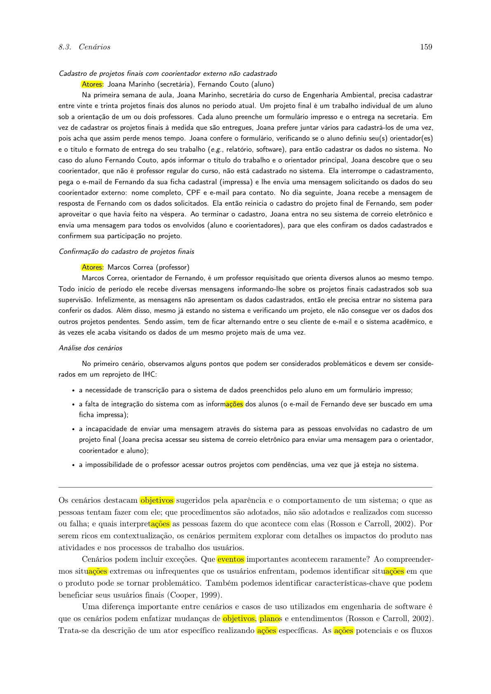
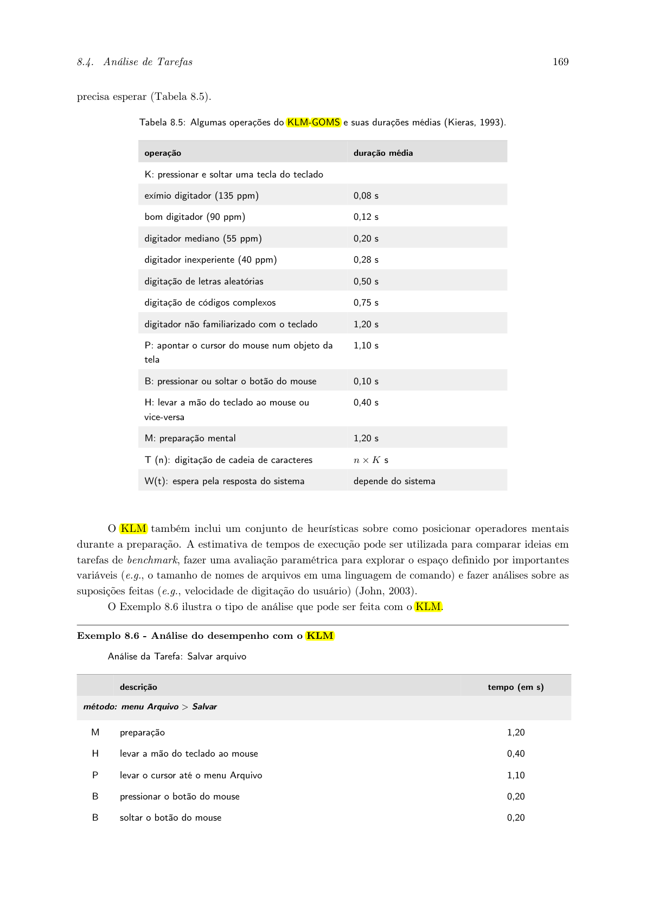
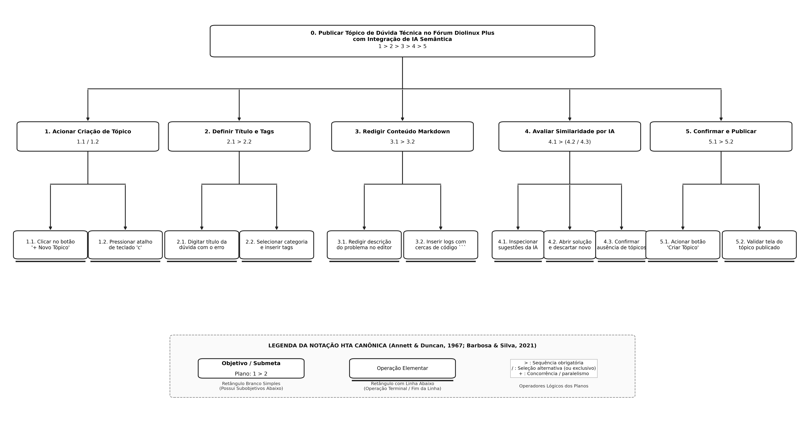
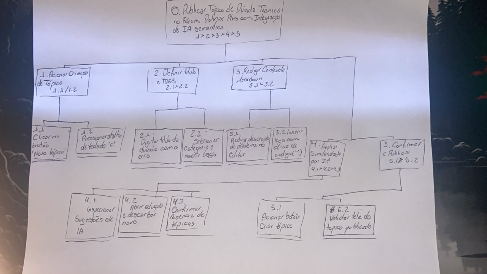
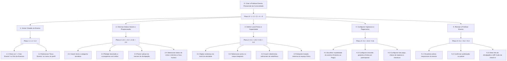
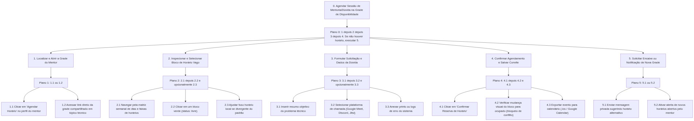
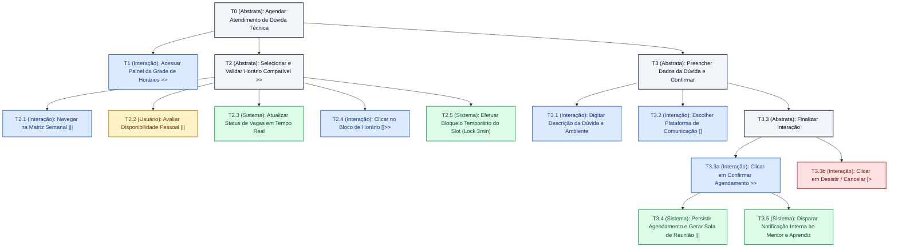

```mermaid
graph TD
    classDef goal fill:#1E293B,stroke:#0EA5E9,stroke-width:2px,color:#F8FAFC;
    classDef sub fill:#334155,stroke:#94A3B8,stroke-width:1.5px,color:#F8FAFC;
    classDef op fill:#0F172A,stroke:#38BDF8,stroke-width:1px,color:#E2E8F0;
    classDef plan fill:#475569,stroke:#F59E0B,stroke-width:1.5px,color:#FEF3C7;

    G0["0. Criar e Publicar Evento Presencial da Comunidade"]:::goal
    P0["Plano 0: 1 > 2 > 3 > 4 > 5"]:::plan

    G0 --> P0
    P0 --> G1["1. Iniciar Criação do Evento"]:::sub
    P0 --> G2["2. Informar Dados Gerais e Programação"]:::sub
    P0 --> G3["3. Definir Local Físico e Capacidade"]:::sub
    P0 --> G4["4. Configurar Ingressos e Pagamento"]:::sub
    P0 --> G5["5. Revisar e Publicar Evento"]:::sub

    P1["Plano 1: 1.1 / 1.2"]:::plan
    G1 --> P1
    P1 --> O11["1.1 Clicar em '+ Criar Evento' no Hub de Eventos"]:::op
    P1 --> O12["1.2 Selecionar 'Novo Evento' no menu do perfil"]:::op

    P2["Plano 2: (2.1 + 2.2 + 2.3) > 2.4"]:::plan
    G2 --> P2
    P2 --> O21["2.1 Inserir título e categoria temática"]:::op
    P2 --> O22["2.2 Redigir descrição e cronograma com editor"]:::op
    P2 --> O23["2.3 Fazer upload do banner de divulgação"]:::op
    P2 --> O24["2.4 Selecionar datas de início e término e fuso horário"]:::op

    P3["Plano 3: 3.1 > (3.2 / 3.3) > 3.4"]:::plan
    G3 --> P3
    P3 --> O31["3.1 Digitar endereço do local da atividade"]:::op
    P3 --> O32["3.2 Selecionar ponto no mapa integrado"]:::op
    P3 --> O33["3.3 Inserir referências adicionais de sala/bloco"]:::op
    P3 --> O34["3.4 Estipular lotação máxima do espaço físico"]:::op

    P4["Plano 4: 4.1 > (4.2 / 4.3)"]:::plan
    G4 --> P4
    P4 --> O41["4.1 Escolher modalidade do evento (Gratuito ou Pago)"]:::op
    P4 --> O42["4.2 Configurar emissão gratuita e limite por participante"]:::op
    P4 --> O43["4.3 Configurar lote pago, chave de repasse e checkout"]:::op

    P5["Plano 5: 5.1 > 5.2 > 5.3"]:::plan
    G5 --> P5
    P5 --> O51["5.1 Visualizar prévia responsiva do evento"]:::op
    P5 --> O52["5.2 Confirmar publicação no painel"]:::op
    P5 --> O53["5.3 Obter link de divulgação e QR Code de check-in"]:::op
```

```mermaid
graph TD
    classDef goal fill:#1E293B,stroke:#0EA5E9,stroke-width:2px,color:#F8FAFC;
    classDef sub fill:#334155,stroke:#94A3B8,stroke-width:1.5px,color:#F8FAFC;
    classDef op fill:#0F172A,stroke:#38BDF8,stroke-width:1px,color:#E2E8F0;
    classDef plan fill:#475569,stroke:#F59E0B,stroke-width:1.5px,color:#FEF3C7;

    G0["0. Agendar Sessão de Mentoria/Dúvida na Grade de Disponibilidade"]:::goal
    P0["Plano 0: 1 depois 2 depois 3 depois 4. Se não houver horário, executar 5."]:::plan
    G0 --> P0
    P0 --> G1["1. Localizar e Abrir a Grade do Mentor"]:::sub
    P0 --> G2["2. Inspecionar e Selecionar Bloco de Horário Vago"]:::sub
    P0 --> G3["3. Formular Solicitação e Dados da Dúvida"]:::sub
    P0 --> G4["4. Confirmar Agendamento e Salvar Convite"]:::sub
    P0 --> G5["5. Solicitar Encaixe ou Notificação de Nova Grade"]:::sub

    P1["Plano 1: 1.1 ou 1.2"]:::plan
    G1 --> P1
    P1 --> O11["1.1 Clicar no botão 'Agendar Horário' no perfil do mentor"]:::op
    P1 --> O12["1.2 Acessar link direto da grade compartilhado em tópico técnico"]:::op

    P2["Plano 2: 2.1 depois 2.2 e opcionalmente 2.3"]:::plan
    G2 --> P2
    P2 --> O21["2.1 Navegar pela matriz semanal de dias e faixas de horários"]:::op
    P2 --> O22["2.2 Clicar em um bloco verde (status: livre)"]:::op
    P2 --> O23["2.3 Ajustar fuso horário local se divergente do padrão"]:::op

    P3["Plano 3: 3.1 depois 3.2 e opcionalmente 3.3"]:::plan
    G3 --> P3
    P3 --> O31["3.1 Inserir resumo objetivo do problema técnico"]:::op
    P3 --> O32["3.2 Selecionar plataforma de chamada (Google Meet, Discord, Jitsi)"]:::op
    P3 --> O33["3.3 Anexar prints ou logs de erro do sistema"]:::op

    P4["Plano 4: 4.1 depois 4.2 e 4.3"]:::plan
    G4 --> P4
    P4 --> O41["4.1 Clicar em 'Confirmar Reserva de Horário'"]:::op
    P4 --> O42["4.2 Verificar mudança visual do bloco para ocupado (bloqueio de conflito)"]:::op
    P4 --> O43["4.3 Exportar evento para calendário (.ics / Google Calendar)"]:::op

    P5["Plano 5: 5.1 ou 5.2"]:::plan
    G5 --> P5
    P5 --> O51["5.1 Enviar mensagem privada sugerindo horário alternativo"]:::op
    P5 --> O52["5.2 Ativar alerta de novos horários abertos pelo mentor"]:::op
```

# Análise de Tarefas: HTA, GOMS e CTT

## Tabela de Contribuição

A Tabela 0 apresenta a distribuição de responsabilidades e as ferramentas utilizadas na elaboração deste artefato.

**Tabela 0** — Matriz de Contribuição da Análise de Tarefas

| Integrante | Contribuição no Artefato | Data | Ferramenta de IA e Contribuição |
| :--- | :--- | :---: | :--- |
| [Vinicius Silva Araruna](https://github.com/ViniciusA05) | [Estruturação metodológica, adequação da notação HTA canônica, modelagem CMN-GOMS e inclusão de IA semântica pré-envio na Tarefa 1](#tarefa-1-criacao-e-publicacao-de-topico-com-tags-e-markdown-vinicius-silva-araruna) | 20/10/2026 | Apoio na estruturação sintática Markdown e revisão de conformidade com Barbosa & Silva (2021) |
| [Gustavo Antonio Rodrigues e Silva](https://github.com/gus-ant) | [Modelagem e especificação integral da Tarefa 2: Criação de Eventos Presenciais (HTA e CTT) com Enquete e Quórum Mínimo](#tarefa-2-criacao-de-eventos-presenciais-da-comunidade-gustavo-antonio) | 22/10/2026 | Gemini: suporte na estruturação das tabelas e sintaxe dos diagramas Mermaid |
| [Edvaldo Soares Brasileiro Filho](https://github.com/PajeMurici-dev) | [Modelagem da Tarefa 3 com HTA e CTT](#tarefa-3-agendamento-de-horarios-de-duvidas-e-mentorias-na-grade-de-disponibilidade-edvaldo-soares) (Grade de Disponibilidade e Agendamento comunitário). | 22/10/2026 | LLM: apoio na modelagem conceitual HTA/CTT e sintaxe dos diagramas Mermaid. |

_Fonte: Elaborada pelos autores, 2026._

---

## Introdução

Este artefato documenta a **Análise de Tarefas** realizada sobre as principais interações do **Fórum Diolinux Plus**, desenvolvida no âmbito da disciplina de Interação Humano-Computador (FGA0173), sob docência do Prof. Dr. André Barros de Sales (Faculdade UnB Gama — FGA/UnB).

A análise de tarefas é uma das abordagens mais tradicionais e rigorosas de IHC para compreender em profundidade o trabalho dos usuários, as operações mentais e físicas necessárias e os gargalos de usabilidade existentes em um sistema interativo (*Barbosa & Silva, 2021, p. 177*). Segundo Annett e Duncan (1967) e Card, Moran e Newell (1983), analisar tarefas não significa apenas inventariar as funções oferecidas pelo software, mas decompor sistematicamente o que as pessoas realmente fazem para atingir seus objetivos de alto nível, identificando os conhecimentos requeridos, as decisões operacionais e as condições contextuais sob as quais as ações se desenrolam.

---

## Metodologia e Técnicas Canônicas Adotadas

Em consonância com as exigências pedagógicas do Tópico 11 do Plano de Ensino da disciplina (que estabelece a modelagem de pelo menos uma tarefa individual para cada integrante empregando no mínimo duas técnicas formais distintas), a equipe selecionou métodos canônicos amplamente consolidados na literatura científica de IHC:

1. **Análise Hierárquica de Tarefas (HTA — *Hierarchical Task Analysis*)**: Proposta originalmente por Annett e Duncan (1967) e aprofundada por Barbosa e Silva (2021, p. 178-185), a HTA decompõe um objetivo de alto nível em subobjetivos, planos de execução e operações físicas/cognitivas elementares. A técnica destaca-se por evidenciar a lógica de ordenação e dependência temporal entre ações e por identificar pontos críticos onde ocorrem falhas operacionais e custos de aprendizado.
2. **GOMS (Goals, Operators, Methods, Selection Rules) e CMN-GOMS**: Formulado por Card, Moran e Newell (1983) e detalhado por Barbosa e Silva (2021, p. 185–188), o modelo GOMS explicita formalmente o conhecimento procedural e as decisões cognitivas que um interagente mobiliza para atingir metas em um sistema computacional. A variante canônica **CMN-GOMS** (*Card-Moran-Newell GOMS*) organiza as metas em hierarquias estritas com métodos alternativos e regras de seleção condicionais (*Selection Rules*), possibilitando analisar tanto rotinas operacionais quanto tomadas de decisão ergonômicas complexas (como a prevenção de duplicidades pré-envio).
3. **Árvores de Tarefas Concorrentes (CTT — *Concurrent Task Trees*)**: Introduzida por Paternò (2000), a notação CTT enriquece a modelagem hierárquica ao categorizar as tarefas conforme seus agentes de execução (tarefas do usuário, do sistema, interativas ou abstratas) e formalizar operadores temporais avançados (escolha, concorrência, desativação e sincronização).

A Figura 1 e a Figura 2 ilustram a definição destas técnicas (HTA e GOMS, respectivamente) extraídas diretamente da bibliografia base.



**Figura 1** — Trecho do livro de Barbosa e Silva detalhando a técnica HTA (Análise Hierárquica de Tarefas).  
_Fonte: Barbosa e Silva (2021, p. 170)._



**Figura 2** — Trecho do livro de Barbosa e Silva detalhando a técnica GOMS e o KLM.  
_Fonte: Barbosa e Silva (2021, p. 180)._


---

## Mapeamento Geral das Tarefas Analisadas

A Tabela 1 apresenta a visão sistêmica da divisão das tarefas prioritárias do Fórum Diolinux Plus entre os membros da equipe, garantindo cobertura das principais jornadas da plataforma.

**Tabela 1** — Mapeamento de atribuição das tarefas e técnicas adotadas

| **Tarefa Analisada** | **Técnicas Empregadas** | **Autor Responsável** | **Revisor** |
| :--- | :--- | :--- | :--- |
| **Tarefa 1**: Criação e Publicação de Tópico de Dúvida com Tags e Formatação Markdown com Integração de IA Semântica | HTA Canônica (Diagrama + Tabela 8.4) + CMN-GOMS (com Módulo de IA Semântica Pré-Envio) | [Vinicius Silva Araruna](https://github.com/ViniciusA05) | [Gustavo Antonio](https://github.com/gus-ant) |
| **Tarefa 2**: Criação de Eventos Presenciais (Sondagem, Quórum e Agendamento) | HTA Canônica (Diagrama + Tabela 8.4) + CTT | [Gustavo Antonio](https://github.com/gus-ant) | [Vinicius Silva Araruna](https://github.com/ViniciusA05) |
| **Tarefa 3**: Agendamento de Horário para Dúvidas e Mentorias (Grade de Disponibilidade) | HTA (Diagrama + Tabela) + CTT | [Edvaldo Soares](https://github.com/PajeMurici-dev) | [Vinicius Silva Araruna](https://github.com/ViniciusA05) |

_Fonte: Elaborada pelos autores, 2026._

A Tabela 1 assegura que cada integrante assume a responsabilidade direta pela modelagem aprofundada de um fluxo crítico do fórum.

---

<a id="tarefa-1-criacao-e-publicacao-de-topico-com-tags-e-markdown-vinicius-silva-araruna"></a>
## Tarefa 1: Criação e Publicação de Tópico com Tags e Markdown com Integração de IA Semântica (Vinicius Silva Araruna)

- **Autor Principal**: [Vinicius Silva Araruna](https://github.com/ViniciusA05)
- **Revisor**: [Gustavo Antonio Rodrigues e Silva](https://github.com/gus-ant)
- **Objeto de Análise**: Fluxo de composição, categorização taxonômica, inserção de blocos de código com sintaxe Markdown, verificação semântica de tópicos similares por IA e submissão de nova postagem de dúvida na plataforma Discourse do Fórum Diolinux Plus.

### 1. Modelagem HTA (Análise Hierárquica de Tarefas)

A Figura 3 apresenta o diagrama hierárquico da Tarefa 1 elaborado estritamente na notação canônica de Annett e Duncan (1967) e Barbosa e Silva (2021, p. 177–185), na qual os objetivos se decompõem diretamente em subobjetivos sem intermediação de nós artificiais, os planos de execução governam formalmente as ramificações através de operadores lógicos normativos e as operações elementares representam a base da hierarquia (nós-folha). A representação contempla tanto o diagrama digital normativo (Figura 3a) quanto a prancha física original desenhada à mão em folha A4 por Vinicius Silva Araruna (Figura 3b), evidenciando a conformidade das linhas terminais nas operações (fim da linha).

<div style="text-align: center; margin: 1.5rem 0;">
    
    <p style="font-size: 0.85rem; color: #64748B; margin-top: 0.5rem;"><strong>Figura 3a</strong> — Diagrama HTA canônico digitalizado da Tarefa 1 (Criação e Publicação de Tópico de Dúvida com Tags e Formatação Markdown com Integração de IA Semântica). <em>Fonte: Elaborada por Vinicius Silva Araruna com base em Barbosa e Silva (2021), 2026.</em></p>
</div>

<div style="text-align: center; margin: 1.5rem 0;">
    
    <p style="font-size: 0.85rem; color: #64748B; margin-top: 0.5rem;"><strong>Figura 3b</strong> — Prancha original manuscrita em papel A4 do Diagrama HTA da Tarefa 1 com Integração de IA Semântica. <em>Fonte: Vinicius Silva Araruna, 2026.</em></p>
</div>

Conforme representado na Figura 3 (Figuras 3a e 3b), o objetivo de alto nível 0 ramifica-se diretamente em cinco subobjetivos coordenados pelo Plano 0 (`1 > 2 > 3 > 4 > 5`).

A Tabela 2 apresenta a legenda dos elementos constitutivos da notação HTA canônica empregada no diagrama, em estrita conformidade com Barbosa e Silva (2021, p. 177).

**Tabela 2** — Legenda da notação gráfica HTA canônica empregada

| Elemento Gráfico | Notação HTA Canônica | Descrição e Papel na Modelagem |
| :---: | :---: | :--- |
| **Retângulo Branco com Borda Espessa** | Objetivo Nível 0 | Meta de alto nível orientada ao estado final pretendido pelo usuário na interação. |
| **Retângulo Branco com Borda Simples** | Subobjetivo (Nível 1) | Decomposição funcional intermediária; possui plano associado que governa as ações subordinadas. |
| **Retângulo Branco com Linha Grossa na Base (Fim da Linha)** | Operação (Nível 2 — Folha) | Unidade fundamental indivisível em HTA (critério de parada p × c); ação física ou perceptual executada diretamente na interface sem decomposição posterior. |
| **Operador Lógico `>`** | Sequência Estrita | Dita a ordem temporal causal obrigatória de execução (executar A e depois B). |
| **Operador Lógico `/`** | Seleção Alternativa (Escolha) | Dita uma bifurcação condicional mútua (escolher entre A ou B com base nas circunstâncias). |
| **Operador Lógico `+`** | Concorrência / Paralelismo | Indica ações que podem ocorrer simultaneamente sem bloqueio recíproco. |

_Fonte: Elaborada por [Vinicius Silva Araruna](https://github.com/ViniciusA05) com base em Barbosa e Silva (2021), 2026._

A Tabela 3 complementa o diagrama hierárquico ao apresentar a decomposição tabular completa no formato normativo de Barbosa e Silva (2021, p. 179, Tabela 8.4), estruturada na tupla de inputs disparadores, ações procedurais e feedbacks observáveis de conclusão.

**Tabela 3** — Decomposição hierárquica tabular da Tarefa 1 (Criação e Publicação de Tópico de Dúvida com Tags e Formatação Markdown com Integração de IA Semântica)

| Identificador | Objetivo / Subobjetivo / Operação | Plano Formal | Circunstâncias Disparadoras (Inputs de Entrada) | Ações e Procedimentos Executados | Feedback Observável de Sucesso | Problemas de Usabilidade Detectados | Recomendações Ergonômicas de Melhoria |
| :--- | :--- | :--- | :--- | :--- | :--- | :--- | :--- |
| **0** | **Publicar Tópico de Dúvida Técnica no Fórum Diolinux Plus com Integração de IA Semântica** | **Plano 0:** 1 > 2 > 3 > 4 > 5 | Usuário autenticado enfrentando gargalo técnico de Linux sem solução imediata. | Execução sequencial ordenada das metas 1 a 5. | Tópico publicado com URL acessível e listado na respectiva categoria. | Postagem recorrente de dúvidas idênticas por pressa de novatos. | Adicionar verificação bloqueante de similaridade semântica por IA pré-envio. |
| **1** | **Acionar Mecanismo de Criação de Tópico** | **Plano 1:** 1.1 / 1.2 | Página inicial ou feed de tópicos do fórum completamente carregada. | Escolha alternativa entre acionamento via mouse ou teclado. | Modal inferior do composer expandido com foco no campo de título. | O atalho `c` é desconhecido por usuários iniciantes. | Sinalizar o atalho no tooltip do botão "+ Novo Tópico". |
| 1.1 | Clicar no botão "+ Novo Tópico" | Operação física | Botão visível no canto superior direito da interface. | Apontar o cursor e clicar com o botão primário. | Abertura imediata da gaveta do composer. | N/A (componente bem posicionado). | Preservar alto contraste WCAG AA. |
| 1.2 | Pressionar tecla de atalho `c` | Operação de teclado | Foco do teclado fora de campos de texto editáveis. | Pressionar e soltar a tecla `c`. | Abertura imediata do composer. | Falha de acionamento caso um input prévio retenha o foco. | Evidenciar estados de foco de forma nítida. |
| **2** | **Definir Título e Categorização Taxonômica** | **Plano 2:** 2.1 > 2.2 | Composer aberto e pronto para edição. | Digitação do título seguida da categorização. | Título preenchido e badges de categoria/tags renderizados. | Usuários inserem títulos vagos (ex: "Socorro"). | Contador de caracteres mínimos e placeholder instrucional. |
| 2.1 | Digitar título com sintaxe da dúvida | Operação de digitação | Campo de título em foco. | Inserir texto sintético descrevendo o software e o erro. | Texto renderizado e validação de tamanho mínimo. | Título com menos de 15 caracteres bloqueia o envio sem aviso prévio. | Feedback visual em tempo real sobre comprimento do título. |
| 2.2 | Selecionar categoria e inserir tags | Operação de seleção | Dropdowns taxonômicos disponíveis. | Selecionar "Desenvolvimento" e inserir tags (`fedora`, `podman`). | Chips coloridos de categoria e tags fixados no rascunho. | Lista de categorias extensa gera sobrecarga de escolha. | Categorias prioritárias agrupadas por finalidade. |
| **3** | **Redigir Conteúdo e Inserir Código Markdown** | **Plano 3:** 3.1 > 3.2 | Título e taxonomia definidos; foco na área de redação. | Composição explicativa e colagem de logs formatados. | Pré-visualização renderizada em tempo real no painel lateral direito. | Usuários colam saídas de terminal como texto puro sem cercas de código. | Interceptor de formatação com conversão automática de logs em Markdown. |
| 3.1 | Redigir descrição do problema no editor | Operação de digitação | Caixa de texto ativa. | Descrever a distribuição, versão do kernel e comportamento do erro. | Caracteres exibidos com contagem regressiva de mínimo de 20 caracteres. | Ausência de guia contextual para o usuário informar o hardware. | Disponibilizar templates de preenchimento estruturado. |
| 3.2 | Inserir blocos de logs com cercas Markdown | Operação de formatação | Logs copiados do terminal. | Inserir crases triplas (```` ```bash ````), colar o log e fechar cercas. | Bloco formatado com fundo escuro, fonte monoespaçada e realce sintático. | O botão da barra de ferramentas insere indentação em vez de cercas triplas. | Atualizar o botão padrão para inserir blocos cercados. |
| **4** | **Avaliar Tópicos Similares por IA Pré-Envio** | **Plano 4:** 4.1 > (4.2 / 4.3) | Usuário aciona a intenção de envio; sistema executa análise semântica. | Inspecionar a similaridade textual e decidir se persiste ou aborta. | Modal inteligente com tópicos parecidos e índice de afinidade semântica. | Tópicos duplicados poluem a busca do fórum e fragmentam respostas. | Apresentar modal bloqueante com destaque para tópicos que possuem solução aceita. |
| 4.1 | Inspecionar sugestões de similaridade por IA | Operação perceptual | Modal exibindo até 3 discussões correlatas identificadas pelo modelo NLP. | Leitura dos títulos e resumo das soluções aceitas sugeridas. | Destaque visual em verde para discussões com selo "✔ Solução Aceita". | Usuários podem ignorar o modal por pressa. | Botão de confirmação com temporizador breve de leitura consciente. |
| 4.2 | Selecionar solução similar e abortar criação | Operação de escolha | Existência de tópico idêntico já resolvido. | Clicar no link da solução existente e descartar rascunho redundante. | Navegação para o tópico resolvido; rascunho é descartado sem poluir o fórum. | N/A (resultado ótimo para a comunidade). | Recompensar o usuário com badge de "Pesquisador Consciente". |
| 4.3 | Confirmar ausência de solução prévia | Operação de escolha | Tópicos sugeridos não solucionam o caso específico. | Clicar em "Nenhum tópico resolveu: Prosseguir com Publicação". | Liberação do fluxo de envio definitivo. | N/A. | Manter transição fluida sem fricção desnecessária. |
| **5** | **Confirmar e Publicar Mensagem no Fórum** | **Plano 5:** 5.1 > 5.2 | Validação de similaridade concluída sem duplicata. | Acionamento de submissão e confirmação de resposta do servidor. | Redirecionamento da página e carregamento da nova thread na comunidade. | Falhas de rede podem causar dupla submissão. | Desabilitar botão no clique e exibir spinner de carregamento. |
| 5.1 | Acionar botão 'Criar Tópico' (ou Ctrl+Enter) | Operação física | Botão azul "Criar Tópico" ativo. | Clicar no botão ou acionar atalho de teclado. | Botão entra em estado de processamento (`Submetendo...`). | Ausência de aviso prévio se faltar campo obrigatório. | Tooltip explicativo com indicador de pendência. |
| 5.2 | Validar redirecionamento para o tópico criado | Operação perceptual | Resposta do servidor Discourse (HTTP 200). | Visualizar a thread aberta e verificar a correta formatação dos blocos. | Página renderizada com a mensagem publicada, tags e autor identificados. | N/A. | Opção sutil de edição rápida durante os primeiros 5 minutos. |

_Fonte: Elaborada por [Vinicius Silva Araruna](https://github.com/ViniciusA05) com base em Barbosa e Silva (2021), 2026._

Conforme evidenciado na Tabela 3, a reestruturação da análise hierárquica na tupla canônica de Barbosa e Silva (2021) torna manifestos os momentos precisos onde ocorrem disparos de ações e feedbacks sensoriais, consolidando a introdução do Subobjetivo 4 como um divisor ergonômico na prevenção de duplicidades.

---

### 2. Modelagem GOMS (CMN-GOMS)

O modelo **GOMS** (*Goals, Operators, Methods, Selection Rules*), formulado por Card, Moran e Newell (1983) e aprofundado por Barbosa e Silva (2021, p. 185–188), destina-se a explicitar formalmente o conhecimento procedural e as decisões cognitivas que um interagente competente mobiliza para realizar tarefas em um sistema computacional. 

Diferente de abordagens estritamente preditivas de tempo mecânico (como o KLM), a variante canônica **CMN-GOMS** (*Card-Moran-Newell GOMS*) possui uma estrutura hierárquica estrita de metas e submetas, com representação expressa de métodos alternativos e regras de seleção condicionais (*Selection Rules*), tornando-a a técnica de referência para analisar processos de tomada de decisão e resolução de problemas na interface Discourse do Diolinux Plus.

A Tabela 4 sintetiza a arquitetura dos componentes do CMN-GOMS aplicados à Tarefa 1.

**Tabela 4** — Componentes e Estrutura Geral do Modelo CMN-GOMS da Tarefa 1 com Integração de IA Semântica

| Componente GOMS | Conceituação Canônica (Card, Moran & Newell, 1983) | Instanciação Concreta na Tarefa 1 (Diolinux Plus) |
| :--- | :--- | :--- |
| **Metas (Goals)** | Estados finais simbólicos que o usuário deseja alcançar, estruturados de forma hierárquica. | `GOAL 0`: Publicar Dúvida Técnica Qualificada; `GOAL 1` a `GOAL 5`: Submetas procedurais. |
| **Operadores (Operators)** | Ações cognitivas, perceptuais e motoras elementares executadas para alterar o estado do sistema ou da mente do interagente. | `Mover cursor`, `Clicar`, `Digitar`, `Pressionar tecla`, `Inspecionar visualmente modal`, `Decidir relevância`. |
| **Métodos (Methods)** | Procedimentos bem aprendidos e ordenados de submetas e operadores que cumprem uma meta. | Método do Botão Principal vs. Método de Atalho de Teclado; Método de Redação com Cercas Markdown. |
| **Regras de Seleção (Selection Rules)** | Conjunto de condições lógicas (*se-então*) que governam qual método escolher em cenários com bifurcações. | `Selection Rule 1` (Solução Existente Encontrada) vs. `Selection Rule 2` (Publicação Inédita). |

_Fonte: Elaborada por [Vinicius Silva Araruna](https://github.com/ViniciusA05), 2026._

A Tabela 4 estabelece o vocabulário analítico que rege a representação formal do método procedural a seguir.

#### Decomposição Formal Hierárquica em CMN-GOMS

Considera-se o cenário onde o usuário estudante Lucas Mendonça (Persona Primária) encontra-se autenticado na página principal do fórum e precisa solucionar uma falha de permissão de containers Podman no Fedora 40:

```text
GOAL 0: PUBLICAR DÚVIDA TÉCNICA QUALIFICADA NO FÓRUM DIOLINUX PLUS
  . GOAL 1: ACIONAR MECANISMO DE CRIAÇÃO DE TÓPICO
    . [SELECTION RULE: Método de Acionamento]
      . Se preferir navegação por cursor/mouse:
        . Mover cursor até o botão "+ Novo Tópico"
        . Clicar no botão primário do mouse
      . Se preferir agilidade por atalhos de teclado:
        . Pressionar a tecla de atalho "c"
  . GOAL 2: DEFINIR TÍTULO E CATEGORIZAÇÃO TAXONÔMICA
    . Mover foco para o campo de título
    . Digitar título contextualizado: "Podman rootless: falha de permissão ao montar volumes no Fedora 40"
    . Clicar no seletor de Categoria
    . Selecionar categoria "Desenvolvimento"
    . Mover cursor para o campo de Tags
    . Digitar e confirmar tags ("fedora", "podman", "containers")
  . GOAL 3: COMPOR CONTEÚDO E INSERIR CÓDIGO MARKDOWN
    . Mover foco para a área de edição do composer
    . Redigir contextualização do cenário de uso e versões do sistema
    . Inserir cerca tripla de abertura com realce de sintaxe (```bash)
    . Colar logs de erro e stack trace do terminal
    . Inserir cerca tripla de fechamento (```)
    . Inspecionar visualmente o preview renderizado no painel lateral
  . GOAL 4: AVALIAR SUGESTÕES DE SIMILARIDADE SEMÂNTICA POR IA PRÉ-ENVIO
    . Clicar no botão "Criar Tópico" (disparando interceptor inteligente)
    . Inspecionar modal exibindo tópicos semanticamente correlatos gerados por IA
    . [SELECTION RULE 1: Resolução de Dúvida por Similaridade Semântica]
      . SE o modal exibir tópico com selo "✔ Solução Aceita" que resolva o erro do Podman:
        . GOAL 4.A: APROVEITAR SOLUÇÃO EXISTENTE
          . Mover cursor até o link do tópico sugerido
          . Clicar com o botão primário do mouse
          . Confirmar descarte do rascunho de dúvida
          . Concluir tarefa com a solução obtida (Abortar GOAL 0)
      . SENÃO (nenhum tópico aborda o erro de volume no Fedora 40):
        . GOAL 4.B: PROSSEGUIR COM A PUBLICAÇÃO INÉDITA
          . Mover cursor até o botão "Nenhum tópico resolveu: Prosseguir com Publicação"
          . Clicar com o botão primário do mouse
  . GOAL 5: CONFIRMAR E VALIDAR PUBLICAÇÃO
    . Aguardar transição de página do Discourse (resposta do servidor)
    . Inspecionar visualmente a thread oficial carregada na URL oficial
    . Validar que o bloco de código manteve indentação e cores de syntax highlighting
```

A Tabela 5 detalha a matriz de regras de seleção condicionais e operadores cognitivos mobilizados no Módulo de IA Semântica Pré-Envio.

**Tabela 5** — Matriz de Regras de Seleção e Ações Cognitivas com Módulo de IA Semântica Pré-Envio

| Regra de Seleção | Condição Lógica Disparadora | Método Procedural Acionado | Operadores Cognitivos e Físicos Mobilizados | Desfecho Ergonômico no Sistema |
| :--- | :--- | :--- | :--- | :--- |
| **Selection Rule 1** | Tópico similar encontrado com selo "✔ Solução Aceita" aplicável ao problema. | `Método de Consulta e Descarte de Rascunho` | Inspecionar modal → Reconhecer solução → Clicar no link → Confirmar descarte. | **Prevenção de Duplicidade:** O usuário obtém a resposta imediata em segundos e a base da comunidade permanece despoluída. |
| **Selection Rule 2** | Nenhum tópico sugerido atende à especificação de containers no Fedora. | `Método de Publicação Definitiva` | Inspecionar modal → Rejeitar equivalência → Clicar em Prosseguir → Validar URL. | **Publicação Inédita Qualificada:** O tópico é persistido com garantia de ineditismo, logs indentados e tags corretas. |

_Fonte: Elaborada por [Vinicius Silva Araruna](https://github.com/ViniciusA05), 2026._

#### Análise Ergonômica dos Resultados do CMN-GOMS

A decomposição formal em CMN-GOMS fundamenta conclusões de fatores humanos de elevado valor ergonômico:

1. **Eficiência no Controle de Carga Mental:** Ao explicitar os métodos de atalho (`c` para abertura rápida e `Ctrl+Enter` para submissão), o modelo comprova que interagentes experientes (como a Persona Lucas Mendonça) reduzem drasticamente as trocas de modo entre teclado e dispositivo apontador (*mouse/touchpad*), mantendo a fluência cognitiva durante a redação técnica.
2. **Resolução de Conflito Cognitivo via IA Semântica (Goal 4):** A inclusão do Módulo de IA pré-envio introduz uma bifurcação condicional governada pelas Regras de Seleção 1 e 2. Essa decisão não é deixada ao acaso: o sistema apoia ativamente a memória de reconhecimento do interagente ao sinalizar visualmente as soluções aceitas, eliminando o esforço de formular buscas manuais adicionais.
3. **Rastreabilidade Bidirecional com os Storyboards:** A estrutura de metas e decisões mapeada no CMN-GOMS reflete exatamente a progressão vivenciada por Lucas Mendonça no Storyboard 1 (onde o protagonista experimenta o dilema no terminal, compõe o texto e valida a solução com a comunidade), estabelecendo uma ponte conceitual perfeita entre prototipação de baixa fidelidade e análise formal de tarefas.

---

## Tarefa 2: Criação de Eventos Presenciais da Comunidade (Gustavo Antonio)

- **Autor Principal**: [Gustavo Antonio Rodrigues e Silva](https://github.com/gus-ant)
- **Revisor**: [Vinicius Silva Araruna](https://github.com/ViniciusA05)
- **Técnicas Adotadas**: HTA (Análise Hierárquica de Tarefas) e CTT (Árvores de Tarefas Concorrentes)
- **Objeto de Análise**: Fluxo de criação e publicação de eventos presenciais da comunidade (meetups, workshops, hackathons), abrangendo desde a iniciativa do organizador, inserção de programação e mídias, geolocalização com mapas e lotação física, até a precificação/gestão de ingressos (gratuitos ou pagos) e publicação integrada.

### 1. Especificação da Aplicação da Funcionalidade no Sistema

A funcionalidade **Criação de Eventos Presenciais (CF02)** proporciona um fluxo completo de gerenciamento de encontros comunitários no mundo real, estruturado em cinco etapas operacionais:

1. **Ponto de Entrada e Descoberta:**
   - Botão de destaque **"+ Criar Evento"** localizado no Hub/Calendário de Eventos da plataforma ou via atalho no menu de perfil do organizador (*"Meus Eventos > Novo"*).
2. **Dados Gerais e Programação:**
   - Título, categorias temáticas, upload de banner de divulgação (com compressão no front-end) e ementa do evento com blocos modulares de cronograma/palestrantes sem depender de formatação em texto puro.
3. **Local Físico, Geolocalização e Lotação:**
   - Busca de endereço assistida por autocompletar integrado a mapas (*OpenStreetMap/Google Maps*), ajuste fino de marcador visual, referências detalhadas de sala/auditório e definição da lotação máxima do espaço físico (com opção de lista de espera).
4. **Configuração de Ingressos e Pagamento:**
   - Suporte a eventos gratuitos (com cota máxima por usuário para evitar abusos) ou eventos com taxa de rateio de custos/ingresso pago (com discriminação transparente de taxas e checkout via Pix/Gateway).
5. **Revisão, Salvamento e Publicação:**
   - Pré-visualização responsiva (mobile e desktop), salvamento automático contínuo de rascunhos para prevenção de perda de dados e emissão imediata de link público e QR Code para check-in.

---

### 2. Modelagem HTA (Análise Hierárquica de Tarefas)

A Figura 4 apresenta o diagrama hierárquico da Tarefa 2 elaborado na notação canônica de Annett e Duncan (1967) e Barbosa e Silva (2021). A representação contempla a prancha digitalizada em alta resolução (Figura 4a) e a especificação declarativa interativa em Mermaid (Figura 4b).

<div style="text-align: center; margin: 1.5rem 0;">
    
    <p style="font-size: 0.85rem; color: #64748B; margin-top: 0.5rem;"><strong>Figura 4a</strong> — Diagrama HTA canônico da Tarefa 2 (Criação e Publicação de Evento Presencial da Comunidade). <em>Fonte: Elaborada por [Gustavo Antonio Rodrigues e Silva](https://github.com/gus-ant) com base em Barbosa e Silva (2021), 2026.</em></p>
</div>



**Figura 4b** — Diagrama HTA estrutural declarativo da Tarefa 2 (Criação e Publicação de Evento Presencial da Comunidade).  
_Fonte: Elaborada por [Gustavo Antonio Rodrigues e Silva](https://github.com/gus-ant) com base em Barbosa e Silva (2021), 2026._

A Tabela 6 apresenta a decomposição hierárquica tabular da Tarefa 2 estritamente no **formato canônico da Tabela 8.4 de Barbosa & Silva (2021, p. 179)**, contendo as tuplas de ⟨*input*, *ação*, *feedback*, *plano*⟩ e *problemas e recomendações* de IHC em 8 colunas normativas.

**Tabela 6** — Decomposição hierárquica tabular da Tarefa 2: Criar e Publicar Evento Presencial da Comunidade (Formato Canônico: Tabela 8.4 de Barbosa & Silva)

| Identificador | Objetivo / Subobjetivo / Operação | Plano Formal | Circunstâncias Disparadoras (Inputs de Entrada) | Ações e Procedimentos Executados | Feedback Observável de Sucesso | Problemas de Usabilidade Detectados | Recomendações Ergonômicas de Melhoria |
| :---: | :--- | :--- | :--- | :--- | :--- | :--- | :--- |
| **0** | **Criar e Publicar Evento Presencial da Comunidade** | **Plano 0:** 1 > 2 > 3 > 4 > 5 | Membro autenticado da comunidade com permissão de organizador desejando promover encontro presencial (meetup, hackathon, workshop). | Execução sequencial ordenada das metas 1 a 5. | Página pública do evento criada com mapa interativo, lote de ingressos ativo e tópico de discussão vinculado no fórum. | Risco de perda de dados extensos preenchidos se a aba for fechada acidentalmente. | Salvar rascunho automaticamente a cada etapa para prevenir perda de dados por fechamento acidental de aba ou falha de conectividade. |
| **1** | **Iniciar Criação do Evento** | **Plano 1:** 1.1 / 1.2 | Hub de Eventos ou perfil do usuário carregado no navegador. | Escolha alternativa entre botão na área de eventos ou menu de perfil. | Abertura do formulário de criação de evento em tela cheia com etapas sequenciais. | Aba 'Eventos' oculta na navegação secundária dificulta a descoberta por novos organizadores. | Inserir botão de fácil acesso no topo da barra de navegação global. |
| 1.1 | Clicar em "+ Criar Evento" no Hub de Eventos | Operação física | Botão "+ Criar Evento" visível no canto superior da listagem. | Apontar cursor e clicar com o botão primário do mouse. | Redirecionamento instantâneo para o assistente de criação de evento. | N/A (componente bem posicionado no calendário). | Preservar alto contraste WCAG AA. |
| 1.2 | Selecionar "Novo Evento" no menu de perfil | Operação de menu | Avatar do usuário visível na barra superior. | Clicar no avatar, expandir menu dropdown e selecionar "Meus Eventos > Novo". | Transição para a tela de composição de eventos. | Excesso de níveis de menu aninhados oculta a ação rápida. | Manter atalho direto no primeiro nível do menu de perfil do usuário. |
| **2** | **Informar Dados Gerais e Programação** | **Plano 2:** (2.1 + 2.2 + 2.3) > 2.4 | Formulário de criação de evento ativo e em foco. | Preenchimento concorrente de dados gerais seguido de seleção temporal estrita. | Campos validados com indicador visual verde e prévia do banner renderizada. | Títulos genéricos e cronogramas confusos desmotivam inscrições presenciais. | Disponibilizar templates de grade de programação e placeholders contextuais. |
| 2.1 | Inserir título e categoria temática | Operação de digitação e seleção | Campos de título e categoria vazios. | Digitar nome do evento e selecionar tags temáticas (Linux, DevOps, Hardware). | Contador de caracteres exibido e tags fixadas visualmente. | Títulos vagos (ex: "Encontro") geram eventos desordenados e de difícil indexação. | Exibir placeholder com exemplo claro: "Ex: 1º Meetup Linux & Kernel de Brasília". |
| 2.2 | Redigir descrição e cronograma com editor | Operação de digitação e formatação | Editor de texto ativo. | Inserir a ementa das palestras, horários e palestrantes convidados. | Texto renderizado na visualização com formatação de blocos e negrito. | Dificuldade em formatar tabelas de horários em Markdown para quem não domina a sintaxe. | Oferecer componente visual 'Adicionar Bloco de Horário/Palestrante' sem depender de texto puro. |
| 2.3 | Fazer upload do banner de divulgação | Operação de arquivo | Caixa de upload de mídia disponível. | Selecionar arquivo de imagem (JPG/PNG) do disco local ou arrastar imagem. | Thumbnail do banner renderizada com sucesso no cabeçalho do formulário. | Imagens muito pesadas falham sem aviso prévio de limite em megabytes. | Compressão automática no front-end e indicação visual das dimensões ideais (1200x630px). |
| 2.4 | Selecionar datas de início/término e fuso horário | Operação temporal | Datepicker e seletor de horários visíveis. | Escolher data inicial, hora de início, data final e hora de término. | Intervalo temporal validado e duração total calculada automaticamente. | Usuário pode acidentalmente selecionar horário de término anterior ao início. | Validação bloqueante imediata que ajusta a data final automaticamente caso seja anterior à inicial. |
| **3** | **Definir Local Físico e Capacidade** | **Plano 3:** 3.1 > (3.2 / 3.3) > 3.4 | Dados gerais validados; etapa de localização física ativa. | Busca de logradouro, ajuste de mapa/sala e dimensionamento de lotação. | Marcador posicionado no mapa, endereço formatado e capacidade definida. | Falhas na localização física impedem participantes de chegarem ao evento presencial. | Integração de mapas com botão de rota direta (Waze/Google Maps). |
| 3.1 | Digitar endereço do local da atividade | Operação de digitação | Campo de busca de localização em foco. | Digitar rua, número, bairro e cidade no campo de pesquisa. | Dropdown de autocompletar exibe endereços compatíveis geocodificados. | Digitação incorreta gera erros de geocodificação no mapa sem retorno explicativo. | Autocomplete integrado com API de mapas (OpenStreetMap / Google Maps). |
| 3.2 | Selecionar ponto no mapa integrado | Operação de arrastar/clicar | Mapa interativo renderizado com marcador. | Clicar ou arrastar o pin para o ponto exato da entrada do prédio. | Marcador fixado com coordenadas de latitude e longitude validadas. | Usuário perder o ponto de referência ao arrastar o mapa sem zoom adequado. | Botão visível para 'Recentralizar no endereço digitado'. |
| 3.3 | Inserir referências adicionais de sala/bloco | Operação de digitação | Campo de texto complementar ativo. | Informar sala, andar, bloco universitário ou ponto de referência específico. | Informações complementares gravadas no bloco de localização. | Ausência de campo de referência gera dúvidas em campi amplos (como FGA/UnB). | Campo com tooltip explicativo: 'Útil para auditórios e salas dentro de universidades ou coworkings'. |
| 3.4 | Estipular lotação máxima do espaço físico | Operação numérica | Campo de capacidade máxima ativo. | Digitar o número total de assentos físicos suportados no auditório. | Número de vagas fixado e indicador de lista de espera habilitado. | Falta de clareza sobre o comportamento do sistema quando a lotação atingir 100%. | Checkbox opcional: 'Habilitar lista de espera automática quando esgotar as vagas'. |
| **4** | **Configurar Ingressos e Pagamento** | **Plano 4:** 4.1 > (4.2 / 4.3) | Etapa de bilhetagem e modelo de acesso ativa. | Escolha da modalidade e configuração dos parâmetros de ingresso. | Lote de ingressos validado com regras de emissão e taxas transparentes. | Falhas na parametrização de ingressos geram superlotação ou fraudes de reserva. | Limitação de emissão por IP/conta autenticada e prévia detalhada de repasses. |
| 4.1 | Escolher modalidade do evento (Gratuito ou Pago) | Operação de seleção | Chave seletora (Toggle/Abas) disponível. | Clicar na opção desejada: "Evento Gratuito" ou "Evento com Ingresso Pago". | Interface atualizada com os campos específicos da modalidade selecionada. | Confusão entre eventos com taxa de rateio de custos e eventos lucrativos. | Explicação contextual em tooltip sobre modalidades de ingressos na comunidade. |
| 4.2 | Configurar emissão gratuita e limite por participante | Operação de parametrização | Painel de ingressos gratuitos ativo. | Definir cota máxima por usuário (ex: máx. 2) e prazo de encerramento do lote. | Parâmetros gravados; aviso de emissão via e-mail sem cobrança ativo. | Esgotamento rápido por cadastros automatizados ou reservas fantasmas (*no-show*). | Exigência de conta validada na comunidade para emissão de lote gratuito. |
| 4.3 | Configurar lote pago, chave de repasse e checkout | Operação financeira | Painel de ingressos pagos ativo. | Inserir valor monetário unitário, chave Pix/Gateway e data de virada de lote. | Demonstrativo financeiro de taxas exibido e gateway validado. | Falta de transparência imediata sobre taxas de intermediação financeira retidas. | Exibir demonstrativo em tempo real: 'Valor: R\$ 20,00 \| Taxa: R\$ 1,50 \| Repasse líquido: R\$ 18,50'. |
| **5** | **Revisar e Publicar Evento** | **Plano 5:** 5.1 > 5.2 > 5.3 | Todas as 4 etapas anteriores preenchidas com consistência. | Inspecionar prévia, acionar publicação definitiva e exportar convites. | Evento publicado oficialmente, tópico de debate criado no fórum e link ativo. | Publicação de dados incorretos ou links quebrados após submissão definitiva. | Permitir edição ágil do organizador e envio de kit de confirmação por e-mail. |
| 5.1 | Visualizar prévia responsiva do evento | Operação perceptual | Tela de revisão carregada com dados compilados. | Inspecionar layout em abas 'Visão Desktop' e 'Visão Mobile'. | Visualização idêntica à experiência final do participante renderizada. | Organizador notar erros visuais apenas após a publicação oficial no fórum. | Botão visível 'Voltar e Editar' direto da tela de prévia sem perda do preenchimento. |
| 5.2 | Confirmar publicação no painel | Operação física | Botão primário "Publicar Evento Agora" ativo. | Clicar no botão de publicação definitiva. | Botão exibe spinner de carregamento e transiciona para tela de sucesso. | Duplo clique acidental causando publicações duplicadas na base de dados. | Desabilitar o botão com estado de *loading* após o primeiro acionamento. |
| 5.3 | Obter link de divulgação e QR Code de check-in | Operação de utilidade | Modal de celebração e sucesso aberto. | Copiar link curto gerado e baixar arquivo de imagem do QR Code mestre. | URL copiada para a área de transferência e arquivo PNG baixado no disco. | Organizador não salvar o material no momento e ter dificuldade de reencontrar. | Enviar kit de divulgação e credencial mestre do organizador automaticamente por e-mail. |

_Fonte: Elaborada por [Gustavo Antonio Rodrigues e Silva](https://github.com/gus-ant) com base em Barbosa e Silva (2021), 2026. Estruturada segundo o modelo normativo da Tabela 8.4 de Barbosa & Silva (2021)._

---

### 3. Modelagem CTT (Árvores de Tarefas Concorrentes)

O CTT (*Concurrent Task Trees*), formalizado por Paternò (2000), é utilizado para modelar as relações temporais, concorrências e papéis dos atores na tarefa de Criação de Eventos Presenciais.

```mermaid
graph TD
    classDef abstract fill:#f0f0f0,stroke:#333,stroke-width:2px;
    classDef interaction fill:#d1e8ff,stroke:#0055aa,stroke-width:1.5px;
    classDef user fill:#ffefd5,stroke:#aa5500,stroke-width:1.5px;
    classDef system fill:#e0ffe0,stroke:#00aa00,stroke-width:1.5px;
    classDef choice fill:#ffe0e0,stroke:#aa0000,stroke-width:1.5px;

    %% Tarefa Raiz
    T0["T0: Criar e Publicar Evento Presencial"]:::abstract

    %% Subtarefas Nivel 1
    T1["T1: Iniciar Criação"]:::abstract
    T2["T2: Informar Dados e Programação"]:::abstract
    T3["T3: Definir Local e Lotação"]:::abstract
    T4["T4: Configurar Ingressos/Pagamento"]:::choice
    T5["T5: Revisar e Publicar"]:::abstract

    T0 --> T1
    T0 --> T2
    T0 --> T3
    T0 --> T4
    T0 --> T5

    %% Decomposicao T1 (Escolha de Ponto de Entrada)
    T1a["T1a: Clicar no botão do Hub de Eventos"]:::interaction
    T1b["T1b: Acessar menu do perfil"]:::interaction
    T1 --> T1a
    T1 --> T1b

    %% Decomposicao T2 (Concorrencia de preenchimento)
    T2a["T2a: Inserir título e tags"]:::interaction
    T2b["T2b: Redigir ementa e cronograma"]:::interaction
    T2c["T2c: Fazer upload de banner"]:::interaction
    T2d["T2d: Definir datas de início e término"]:::interaction
    T2 --> T2a
    T2 --> T2b
    T2 --> T2c
    T2 --> T2d

    %% Decomposicao T3 (Geolocalizacao e Capacidade)
    T3a["T3a: Digitar endereço"]:::interaction
    T3b["T3b: Posicionar marcador no mapa"]:::interaction
    T3c["T3c: Informar sala/referência"]:::interaction
    T3d["T3d: Estipular lotação máxima"]:::user
    T3 --> T3a
    T3 --> T3b
    T3 --> T3c
    T3 --> T3d

    %% Decomposicao T4 (Escolha de Modalidade)
    T4a["T4a: Configurar lote gratuito e cotas"]:::interaction
    T4b["T4b: Configurar lote pago, taxas e Pix"]:::interaction
    T4 -->|"Gratuito"| T4a
    T4 -->|"Pago"| T4b

    %% Decomposicao T5 (Publicacao e Conclusao)
    T5a["T5a: Inspecionar prévia responsiva"]:::user
    T5b["T5b: Confirmar submissão final"]:::interaction
    T5c["T5c: Gerar página pública e QR Code"]:::system
    T5 --> T5a
    T5 --> T5b
    T5 --> T5c
```



#### 3.1 Interpretação do Modelo CTT da Tarefa 2:
- **T1 `>>` T2 (Acesso Habilita Formulário):** O organizador escolhe o ponto de entrada (`[]` entre Hub ou menu do perfil), habilitando a etapa de preenchimento dos dados.
- **T2 `|||` T3 (Preenchimento Concorrente e Sequencial):** Os campos descritivos e o banner ocorrem de forma concorrente (`|||`), com salvamento contínuo de rascunhos pelo sistema em segundo plano.
- **T4 (Ponto de Escolha `[]` de Modalidade):** Alternância exclusiva entre emissão gratuita com limitação de cotas (T4a) ou configuração de lote pago com integração de taxas e gateway (T4b).
- **T5 (Revisão e Geração de Artefatos):** A inspeção da prévia habilita a confirmação definitiva (T5b), disparando compulsoriamente a criação da página e emissão de QR Code pelo sistema (T5c).
---

<a id="tarefa-3-agendamento-de-horarios-de-duvidas-e-mentorias-na-grade-de-disponibilidade-edvaldo-soares"></a>
<a id="tarefa-3-busca-avancada-e-filtros-de-categoria-edvaldo-soares"></a>
## Tarefa 3: Agendamento de Horário para Dúvidas e Mentorias na Grade de Disponibilidade (Edvaldo Soares)

- **Autor Principal**: [Edvaldo Soares Brasileiro Filho](https://github.com/PajeMurici-dev)
- **Revisor**: [Vinicius Silva Araruna](https://github.com/ViniciusA05)
- **Técnicas Adotadas**: HTA (Análise Hierárquica de Tarefas) e CTT (Árvores de Tarefas Concorrentes - Paternò)

- **Cenário de uso**: Um usuário aprendiz com dúvidas técnicas complexas (ex: falhas de boot, configuração de drivers ou particionamento de disco) acessa a grade interativa de disponibilidade (estilo *When2meet / Calendly*) disponibilizada por um membro experiente/mentor do Fórum Diolinux Plus, seleciona um bloco de horário vago, descreve a dúvida técnica e confirma a reserva com prevenção de conflitos de agenda e geração de link para sala síncrona.
- **Status da modelagem**: Proposta analítica inicial; confirmar os passos na interface e validar com participantes antes de caracterizar resultados como empíricos.

### 1. Modelagem HTA (Análise Hierárquica de Tarefas)

A HTA (Annett & Duncan, 1967; Barbosa & Silva, 2021) decompõe o objetivo de alto nível em subobjetivos, planos de execução e operações elementares, explicitando as condições de parada baseadas na relação p × c (probabilidade de falha vs. custo do erro). A representação contempla a prancha digitalizada em alta resolução (Figura 5a) e o diagrama estrutural declarativo em Mermaid (Figura 5b).

<div style="text-align: center; margin: 1.5rem 0;">
    
    <p style="font-size: 0.85rem; color: #64748B; margin-top: 0.5rem;"><strong>Figura 5a</strong> — Diagrama HTA canônico da Tarefa 3 (Agendamento de Horário para Dúvidas e Mentorias na Grade de Disponibilidade). <em>Fonte: Elaborada por [Edvaldo Soares Brasileiro Filho](https://github.com/PajeMurici-dev) com base em Barbosa e Silva (2021), 2026.</em></p>
</div>



**Figura 5b** — Diagrama HTA estrutural declarativo da Tarefa 3 (Agendamento de Mentoria e Dúvidas na Grade de Disponibilidade).  
_Fonte: Elaborada por [Edvaldo Soares Brasileiro Filho](https://github.com/PajeMurici-dev) com base em Barbosa e Silva (2021), 2026._

A Tabela 7 detalha a decomposição hierárquica completa estritamente no **formato canônico da Tabela 8.4 de Barbosa & Silva (2021, p. 179)**, estruturada nas tuplas de ⟨*input*, *ação*, *feedback*, *plano*⟩ e *problemas e recomendações* ergonômicas de IHC em 8 colunas normativas.

**Tabela 7** — Decomposição hierárquica tabular da Tarefa 3: Agendamento de Horário para Dúvidas e Mentorias na Grade de Disponibilidade (Formato Canônico: Tabela 8.4 de Barbosa & Silva)

| Identificador | Objetivo / Subobjetivo / Operação | Plano Formal | Circunstâncias Disparadoras (Inputs de Entrada) | Ações e Procedimentos Executados | Feedback Observável de Sucesso | Problemas de Usabilidade Detectados | Recomendações Ergonômicas de Melhoria |
| :---: | :--- | :--- | :--- | :--- | :--- | :--- | :--- |
| **0** | **Agendar Sessão de Mentoria/Dúvida na Grade de Disponibilidade** | **Plano 0:** 1 > 2 > 3 > 4 (se não houver vaga, executar 5) | Usuário aprendiz com dúvida técnica complexa necessitando de apoio síncrono de membro experiente. | Execução sequencial ordenada das etapas 1 a 4, ou acionamento de lista de espera (5). | Agendamento confirmado, slot bloqueado na grade, link de videochamada emitido e convite de calendário salvo. | Desistência por falta de horários coincidentes ou receio de exposição. | Exibir claramente as políticas de mentoria e duração do atendimento (ex: 20 ou 30 min). |
| **1** | **Localizar e Abrir a Grade do Mentor** | **Plano 1:** 1.1 / 1.2 | Perfil do membro mentor ou tópico técnico com link compartilhado aberto no navegador. | Escolha alternativa entre acionamento via card de perfil ou link direto. | Modal ou página da grade de disponibilidade carregada com visão semanal e fusos. | Botão de agendamento pouco visível no perfil padrão do Discourse. | Inserir badge destacado "Disponível para Mentoria" ao lado do nome do usuário. |
| 1.1 | Clicar no botão "Agendar Horário" no perfil | Operação motora | Botão de mentoria visível no card de perfil do usuário. | Apontar o cursor e clicar com o botão primário do mouse. | Abertura imediata do modal com a grade de horários do mentor. | Poluição visual de botões de interação padrão (Mensagem, Seguir, Convidar). | Destacar com cor de contraste primária o botão de mentoria. |
| 1.2 | Acessar link direto da grade via tópico | Operação de navegação | Link compartilhado em postagem ("Agende um horário comigo"). | Clicar na hiperligação inserida no corpo da mensagem. | Overlay com a grade semanal sobreposto ao tópico em leitura. | Links externos quebram o contexto de imersão do fórum. | Abrir a grade em modal integrado (overlay) sem desviar o usuário da leitura do tópico. |
| **2** | **Inspecionar e Selecionar Bloco de Horário Vago** | **Plano 2:** 2.1 > 2.2 (> 2.3 opcional) | Grade semanal carregada com matriz de dias e horários. | Inspeção visual dos blocos verdes, seleção de slot e ajuste opcional de timezone. | Bloco selecionado destacado com borda espessa e formulário de dados habilitado. | Dificuldade de identificar horários disponíveis se o contraste de cores for baixo. | Usar padrão visual WCAG: Verde com padrão de preenchimento para livre; Cinza hachurado para ocupado. |
| 2.1 | Navegar pela matriz semanal de dias/horas | Operação visual/cognitiva | Matriz de calendário visível com botões de paginação semanal. | Percorrer colunas de dias úteis e linhas de faixas horárias. | Atualização dinâmica dos blocos conforme a semana selecionada. | Matriz pode exigir rolagem horizontal excessiva em dispositivos móveis. | Design responsivo alternando de matriz ampla para visão em lista de dias no mobile. |
| 2.2 | Clicar em um bloco livre | Operação motora | Slots verdes sinalizados como "Disponível". | Clicar sobre o retângulo do horário pretendido. | Transição de estado para "Selecionado" com exibição do resumo (ex: Terça, 14:00 - 14:30). | Clique acidental em horário vizinho devido a alvos de toque pequenos (Lei de Fitts). | Área mínima de clique de 44x44 px com destaque visual (hover/focus ativo). |
| 2.3 | Ajustar fuso horário local | Operação cognitiva | Seletor de timezone visível no canto inferior da grade. | Escolher o fuso horário correspondente à sua localidade. | Horários da grade recalculados automaticamente para o horário local. | Conflito de fusos entre mentor e aprendiz gerando ausência na chamada (*no-show*). | Detecção automática do timezone pelo navegador com aviso explícito de conversão. |
| **3** | **Formular Solicitação e Dados da Dúvida** | **Plano 3:** 3.1 > 3.2 (> 3.3 opcional) | Horário selecionado; painel lateral de contextualização ativo. | Inserção do problema, escolha da ferramenta síncrona e envio facultativo de logs. | Formulário preenchido com validação de campos obrigatórios. | Usuários descrevem dúvidas de forma vaga (ex: "meu linux travou"). | Formulário com campos estruturados: "Qual a Distribuição?" e "Descrição do Erro". |
| 3.1 | Inserir resumo objetivo do problema | Operação de digitação | Campo de texto "Qual é a sua dúvida?" em foco. | Redigir texto sintético explicando software, versão e comportamento anormal. | Contador de caracteres atualizado indicando atendimento ao mínimo de 30 caracteres. | Usuário não sabe quanto detalhe deve fornecer antes do encontro. | Contador de caracteres e placeholder instrutivo com exemplos práticos. |
| 3.2 | Selecionar plataforma de chamada | Operação de seleção | Dropdown de salas virtuais disponíveis. | Escolher entre Google Meet, Discord comunitário ou Jitsi Meet. | Plataforma selecionada com orientações de conectividade associadas. | Falta de conta na plataforma escolhida (ex: participante não ter Discord). | Suporte a link público sem necessidade de conta (ex: Jitsi Meet institucional). |
| 3.3 | Anexar logs ou capturas de tela | Operação de upload | Área de drop de arquivos ativa. | Fazer upload de arquivo `.log` ou print `.png` do erro do terminal. | Miniatura do print renderizada e arquivo anexado à solicitação. | Limite de tamanho de arquivo opaco ou falha silenciosa no envio. | Indicação em tempo real de formato aceito (.png, .log, .txt) e barra de progresso. |
| **4** | **Confirmar Agendamento e Salvar Convite** | **Plano 4:** 4.1 > 4.2 > 4.3 | Dados de contextualização validados; botão de reserva ativo. | Disparo da confirmação, conferência de bloqueio e salvamento de calendário. | Slot bloqueado compulsoriamente na grade e modal com link da sala e arquivo .ics. | Incerteza se o mentor foi notificado ou se houve duplicidade de reserva. | Feedback imediato: toast de confirmação, card com resumo e envio de mensagem privada automática no fórum. |
| 4.1 | Clicar em "Confirmar Reserva de Horário" | Operação motora | Botão destacado "Confirmar Agendamento" ativo. | Pressionar o botão com o cursor ou tecla Enter. | Bloqueio temporário do slot e exibição de indicador de processamento. | Concorrência se outro usuário tentar o mesmo slot simultaneamente. | Trava temporária de 3 minutos no slot assim que o usuário abre o modal de preenchimento. |
| 4.2 | Verificar bloqueio do bloco na grade | Operação perceptual | Grade recarregada com o estado pós-reserva. | Inspecionar que o bloco selecionado mudou para "Ocupado / Reservado". | Certeza visual de que a agenda foi garantida sem duplicidade de chamadas. | Ausência de retorno visual imediato gerando múltiplos cliques repetidos. | Bloqueio imediato com animação e alteração de estado para "Reservado por você". |
| 4.3 | Exportar evento para calendário (.ics) | Operação de utilidade | Botões de sincronização de calendário visíveis. | Clicar em "Adicionar ao Google Agenda" ou "Baixar iCalendar (.ics)". | Evento salvo na agenda do interagente com link da sala e lembrete 15 min antes. | Esquecimento do compromisso agendado gerando ausência na mentoria. | Botão de 1 clique para "Adicionar ao Google Agenda" e envio de notificação push. |
| **5** | **Solicitar Encaixe ou Notificação de Nova Grade** | **Plano 5:** 5.1 / 5.2 | Todos os slots do mentor desejado estão preenchidos para a semana. | Escolha alternativa entre mensagem privada solicitando encaixe ou alerta automático. | Confirmação de entrada na lista de espera ou envio da mensagem para a caixa de entrada. | Frustração ao encontrar toda a grade ocupada levando à evasão do fórum. | Mecanismo de lista de espera com notificação automática quando abrir vacância. |
| 5.1 | Enviar mensagem privada sugerindo horário | Operação de comunicação | Link "Solicitar horário alternativo" visível no rodapé da grade. | Redigir mensagem curta sugerindo disponibilidade mútua. | Notificação enviada para a caixa de mensagens privadas do mentor. | Desconhecimento do protocolo aceito para solicitar horários extras. | Template pronto de mensagem pré-formatado pelo sistema. |
| 5.2 | Ativar alerta de novos horários abertos | Operação de notificação | Botão "Avisar-me quando abrir novos horários" disponível. | Clicar no botão de sino/inscrição de grade. | Badge de alerta ativado; notificação do sistema disparada assim que o mentor publicar nova semana. | Mentor abre novas datas e o usuário interessado perde a oportunidade por lentidão. | Envio instantâneo de notificação web push e menção no fórum. |

_Fonte: Elaborada por [Edvaldo Soares Brasileiro Filho](https://github.com/PajeMurici-dev) com base em Barbosa e Silva (2021), 2026. Estruturada segundo o modelo normativo da Tabela 8.4 de Barbosa & Silva (2021)._

---

### 2. Modelagem CTT (Árvores de Tarefas Concorrentes)

O CTT (*Concurrent Task Trees*), formalizado por Paternò (2000), é utilizado para modelar interações concorrentes, processos assíncronos e os papéis dos agentes envolvidos:
- **Tarefas Abstratas** (composição de alto nível);
- **Tarefas de Usuário** (cognição e julgamento pessoal);
- **Tarefas de Interação** (manipulação de elementos da interface);
- **Tarefas de Sistema** (processamento, *locks* transacionais e despachos).

A Figura 6 apresenta o diagrama CTT da Tarefa 3 elaborado na notação de Paternò.



**Figura 6** — Árvore de Tarefas Concorrentes (CTT) do Agendamento de Dúvidas / Mentorias.  
_Fonte: Elaborada por [Edvaldo Soares Brasileiro Filho](https://github.com/PajeMurici-dev), 2026._

#### Interpretação dos Operadores Temporais

1. **Paralelismo em `T2` (`|||`):** A navegação do usuário na matriz (`T2.1`), sua reflexão cognitiva sobre horários compatíveis (`T2.2`) e a escuta de eventos do sistema via WebSockets atualizando blocos ocupados (`T2.3`) ocorrem de forma concorrente (`|||`).
2. **Prevenção de Condição de Corrida (`T2.5`):** Ao clicar no slot (`T2.4`), o sistema executa um bloqueio transacional imediato (*lock* de 3 minutos) enquanto o formulário é exibido, evitando que outro usuário selecione o mesmo bloco no mesmo instante.
3. **Ponto de Desativação (`[>`):** A qualquer instante durante o preenchimento, o usuário pode clicar em Cancelar (`T3.3b`), o que desativa a tarefa e libera o slot temporariamente retido no sistema.
4. **Sincronização Pós-Confirmação (`T3.4` e `T3.5`):** Assim que a confirmação é despachada (`>>`), o sistema gera as credenciais da sala de reunião e emite as notificações de forma concorrente em segundo plano.

---

## Histórico de Versão

A Tabela 8 documenta o histórico de versões deste artefato.

**Tabela 8** — Histórico de versão do documento

| Versão | Data | Descrição | Autor(es) | Revisor(es) |
| :---: | :---: | :--- | :---: | :---: |
| `1.0` | 26/09/2026 | Estruturação metodológica e modelagem da Tarefa 1 por Vinicius Silva Araruna | [Vinicius Silva Araruna](https://github.com/ViniciusA05) | [Edvaldo Soares Brasileiro Filho](https://github.com/PajeMurici-dev) |
| `1.1` | 26/09/2026 | Inclusão do rascunho de HTA e GOMS/KLM para busca avançada; validação empírica pendente | [Edvaldo Soares Brasileiro Filho](https://github.com/PajeMurici-dev), com apoio de IA generativa | [Vinicius Silva Araruna](https://github.com/ViniciusA05) |
| `1.2` | 15/10/2026 | Saneamento tipográfico UTF-8 dos operadores KLM, padronização da Tabela 0 de contribuição e sequenciamento ordenado das Figuras 1 a 6 (com inclusão da Figura 6 CTT). | [Vinicius Silva Araruna](https://github.com/ViniciusA05) | [Gustavo Antonio](https://github.com/gus-ant) |
| `1.3` | 20/10/2026 | Adequação da notação canônica de HTA (expurgo de nós intermediários de plano, adoção de operadores lógicos formais e tabela com tupla analítica de inputs e feedbacks observáveis) e substituição de KLM por CMN-GOMS com Módulo de IA Semântica Pré-Envio e regras de seleção na Tarefa 1 (Issues #98 e #99). | [Vinicius Silva Araruna](https://github.com/ViniciusA05) | [Gustavo Antonio](https://github.com/gus-ant) |
| `1.4` | 22/10/2026 | Modelagem integral da Tarefa 2: Criação de Eventos Presenciais (HTA com diagrama Mermaid, Tabela 8.4 canônica de Barbosa & Silva e CTT) incorporando geolocalização e quórum/lotação (#104) | [Gustavo Antonio](https://github.com/gus-ant) | [Vinicius Silva Araruna](https://github.com/ViniciusA05) |
| `1.5` | 22/10/2026 | Substituição da Tarefa 3 pela Grade de Disponibilidade e Agendamento de Dúvidas/Mentorias (estilo When2meet) com modelagem completa em HTA e CTT | [Edvaldo Soares Brasileiro Filho](https://github.com/PajeMurici-dev) | [Vinicius Silva Araruna](https://github.com/ViniciusA05) |
| `1.6` | 29/10/2026 | Padronização integral das Tabelas 6 e 7 no formato normativo de 8 colunas da Tabela 8.4 de Barbosa & Silva (2021) e inclusão de diagramas HTA renderizados em alta resolução (Figuras 4a e 5a) para atendimento aos apontamentos da banca examinadora. | [Gustavo Antonio](https://github.com/gus-ant) | [Vinicius Silva Araruna](https://github.com/ViniciusA05) |

_Fonte: Elaborada pelos autores, 2026._

---

## Referências Bibliográficas

[1] ANNETT, John; DUNCAN, Keith D. *Task analysis and training design*. Journal of Occupational Psychology, v. 41, n. 4, p. 211-221, 1967.

[2] BARBOSA, Simone Diniz Junqueira; SILVA, Bruno Santana da. *Interação Humano-Computador*. 1. ed. Rio de Janeiro: Elsevier, 2010.

[3] BARBOSA, Simone Diniz Junqueira et al. *Interação Humano-Computador e Experiência do Usuário*. 1. ed. Rio de Janeiro: Autopublicação, 2021.

[4] CARD, Stuart K.; MORAN, Thomas P.; NEWELL, Allen. *The Psychology of Human-Computer Interaction*. Hillsdale: Lawrence Erlbaum Associates, 1983.

[5] PATERNÒ, Fabio. *Model-Based Design and Evaluation of Interactive Applications*. London: Springer-Verlag, 2000.

[6] DISCOURSE. *Searching for content effectively*. Discourse Meta. Disponível em: <https://meta.discourse.org/t/searching-for-content-effectively/273328>. Acesso em: 26 set. 2026.

---

## Agradecimentos e Uso de Inteligência Artificial (IA) Generativa

Durante a preparação deste artefato, foram utilizados recursos de Inteligência Artificial Generativa (Antigravity LLM / Gemini) para apoio na formatação sintática dos diagramas em Mermaid e na estruturação do modelo CTT. O embasamento metodológico, a definição dos fluxos concorrentes e a validação ergonômica da Tarefa 3 foram concebidos e validados pelo integrante Edvaldo Soares Brasileiro Filho. A Tarefa 1 e a coordenação metodológica foram concebidas por Vinicius Silva Araruna, e a Tarefa 2 por Gustavo Antonio Rodrigues e Silva.
