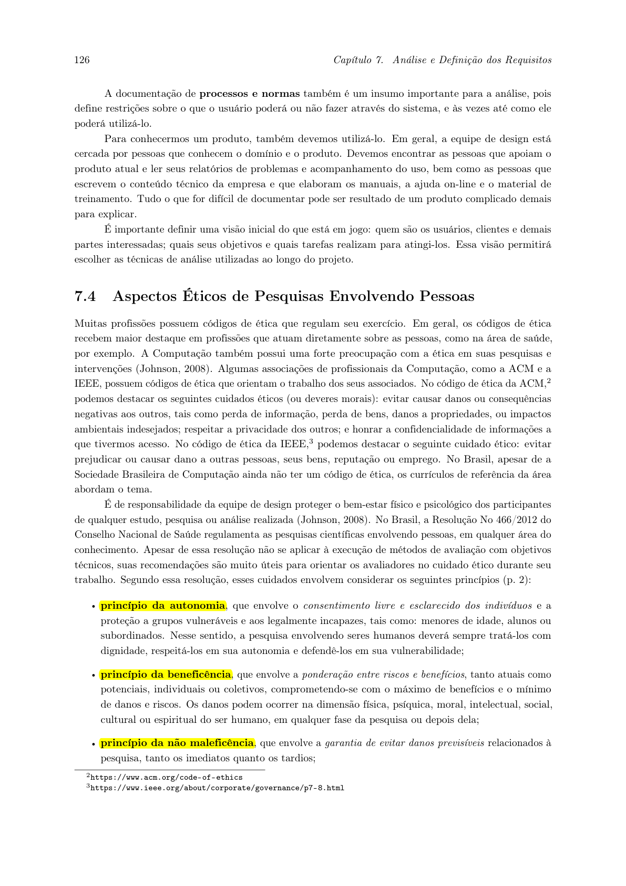
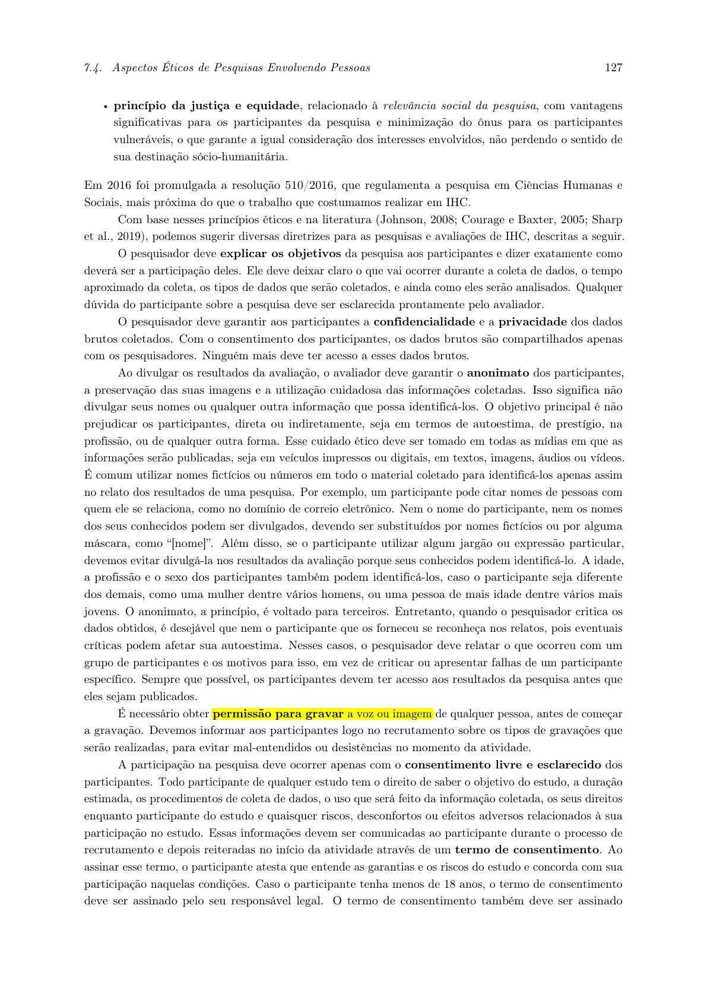

# Aspectos Éticos e Termo de Consentimento Livre e Esclarecido (TCLE)

## Tabela de Contribuição

| Integrante | Contribuição no Artefato | Data | Ferramenta de IA e Contribuição |
| :--- | :--- | :---: | :--- |
| [Edvaldo Soares Brasileiro Filho](https://github.com/PajeMurici-dev) | [Fundamentação bioética e revisão dos princípios éticos](#principios-bioeticos-fundamentais) | 26/09/2026 | Suporte na estruturação Markdown e tabelas |
| [Gustavo Antonio Rodrigues e Silva](https://github.com/gus-ant) | [Revisão geral do artefato e validação do fluxo de gravação](#procedimento-mandatorio-de-solicitacao-previa-de-gravacao) | 26/09/2026 | Suporte na estruturação Markdown e tabelas |
| [Vinicius Silva Araruna](https://github.com/ViniciusA05) | [Estruturação do log de aplicação do TCLE (Tabela 3), protocolo para formulários eletrônicos (Tabela 4) e checklist de conformidade](#registro-e-evidencias-de-consentimento-dos-participantes) | 11/10/2026 | Suporte na estruturação Markdown e tabelas sob supervisão dos discentes |

---

## Introdução

Este artefato estabelece as diretrizes éticas e os procedimentos formais de conduta que orientam todas as pesquisas, coletas de dados e avaliações envolvendo seres humanos conduzidas pelo Grupo 08 no projeto de Interação Humano-Computador (IHC), no segundo semestre letivo de 2026 (2026.2), sob docência do Prof. Dr. André Barros de Sales (Faculdade UnB Gama — FGA/UnB).

O foco central deste trabalho é a análise de requisitos e tarefas dos usuários do **Fórum Diolinux Plus**. Conforme enfatizado por Barbosa e Silva (2021, p. 140-143), qualquer investigação científica ou prática em IHC que envolva a participação direta ou indireta de pessoas (através de entrevistas, sessões de brainstorming, observações de campo ou testes de usabilidade) deve ser rigorosamente pautada pelo respeito à dignidade humana, integridade física e psicológica, transparência de propósitos e garantia irrestrita de privacidade.

---

## Legislação e Normativas Aplicáveis

_Autor do Item Teórico: [Vinicius Silva Araruna](https://github.com/ViniciusA05)_

As práticas éticas adotadas pelo Grupo 08 estão fundamentadas nas normas regulamentadoras brasileiras de pesquisa com seres humanos e nas diretrizes éticas internacionais:

1. **Resolução CNS nº 510/2016 (Conselho Nacional de Saúde)**: Dispõe especificamente sobre as normas aplicáveis a pesquisas em Ciências Humanas e Sociais (CHS), estabelecendo o reconhecimento da liberdade, da autonomia do participante, do sigilo de dados e da dispensa de procedimentos invasivos.
2. **Resolução CNS nº 466/2012**: Trata das diretrizes gerais de pesquisas envolvendo seres humanos, reforçando a ponderação entre riscos e benefícios.
3. **Lei Geral de Proteção de Dados Pessoais (LGPD — Lei nº 13.709/2018)**: Assegura o tratamento adequado dos dados pessoais dos participantes, determinando a finalidade específica, a não discriminação e o direito de eliminação de registros mediante requisição do titular.

---

## Princípios Bioéticos Fundamentais

Em consonância com o modelo bioético de Beauchamp e Childress (2013) e com as orientações canônicas de Barbosa e Silva (2021), a equipe adota quatro princípios norteadores em todas as interações com membros da comunidade do Fórum Diolinux Plus. A Tabela 1 sintetiza esses princípios e a sua aplicação prática no projeto.

**Tabela 1** — Princípios bioéticos aplicados à pesquisa de IHC no Fórum Diolinux Plus

| Princípio | Conceito Teórico Canônico | Aplicação Prática no Projeto (Grupo 08) |
| :--- | :--- | :--- |
| **Princípio da Autonomia** | Respeito ao direito de autodeterminação do indivíduo, que deve decidir livremente sobre sua participação após receber todos os esclarecimentos necessários (*Barbosa & Silva, 2021, p. 141*). | O participante decide voluntariamente participar da entrevista ou das sessões de investigação; é livre para recusar perguntas ou interromper a sessão a qualquer instante sem necessidade de justificativa e sem qualquer penalidade. |
| **Princípio da Beneficência** | Compromisso de maximizar os benefícios e minimizar eventuais danos, desconfortos ou inconveniências decorrentes da pesquisa (*Beauchamp & Childress, 2013*). | O projeto busca aprimorar a experiência de uso da comunidade do Fórum Diolinux Plus, gerando recomendações de interface que facilitem a resolução de dúvidas técnicas e a inclusão de usuários novatos no ecossistema Linux. |
| **Princípio da Não-Maleficência** | Garantia explícita de que a pesquisa não acarretará danos físicos, morais, psicológicos ou sociais aos participantes (*Barbosa & Silva, 2021, p. 141*). | Anonimização total de identidades; não divulgação de e-mails, endereços IP ou nomes reais; realização das sessões em ambiente confortável; e suspensão imediata caso seja percebido qualquer sinal de cansaço ou constrangimento. |
| **Princípio da Justiça e Equidade** | Distribuição justa e equitativa dos ônus e benefícios da pesquisa, evitando a exploração de populações vulneráveis (*Beauchamp & Childress, 2013*). | Recrutamento público, transparente e não discriminatório entre membros da comunidade de software livre e estudantes universitários, tratando todos os participantes com igual consideração e respeito. |

_Fonte: Elaborada pelos autores com base em Barbosa e Silva (2021) e Beauchamp e Childress (2013), 2026._

Conforme evidenciado na Tabela 1, todos os métodos de elicitação empregados pelo grupo subordinam-se estritamente à integridade e ao bem-estar dos participantes. A Figura 1 apresenta o referencial teórico que embasa estes princípios.

**Figura 1** — Trecho do livro de Barbosa e Silva detalhando os 4 princípios éticos.

---

## Procedimento Mandatório de Solicitação Prévia de Gravação

Em estrito atendimento aos critérios de avaliação da disciplina e às diretrizes metodológicas do Prof. Dr. André Barros de Sales (Item 6 da Entrega 2 no Plano de Ensino), estabelece-se como **norma mandatória e inegociável**:

> **Regra Operacional de Gravação**:  
> Nenhum áudio, tela ou imagem facial de qualquer participante será capturado antes da prestação de esclarecimentos e da obtenção da **permissão explícita e gravada** do participante.

O protocolo de captura audiovisual segue os seguintes passos padronizados:

1. **Antes de iniciar a gravação**: O pesquisador informa verbalmente o objetivo do estudo, o tempo estimado de duração e esclarece que a gravação é estritamente para registro acadêmico e análise qualitativa em IHC.
2. **Início da gravação**: Imediatamente após acionar a ferramenta de captura (Google Meet / OBS), o pesquisador realiza a **leitura literal do script de consentimento verbal**, prestando todos os esclarecimentos ao participante.
3. **Registro do consentimento**: O participante responde verbalmente em áudio e vídeo (*"Sim, autorizo"*).
4. **Encerramento da gravação**: Ao final das tarefas ou da entrevista, a gravação é interrompida antes dos agradecimentos informais, e o vídeo é armazenado em ambiente seguro com acesso restrito aos integrantes da equipe.

### Roteiro Textual Padronizado de Leitura Prévia do TCLE (Script Oral do Pesquisador)

Para garantir que todos os membros da equipe realizem a leitura e o esclarecimento ético de forma uniforme, define-se o texto padrão a ser lido no início da chamada gravada:

!!! quote "Script Oral Padronizado de Leitura do TCLE"
    > *"Olá, [Nome do Participante], muito obrigado pela sua disponibilidade em participar da nossa pesquisa.*
    >
    > *Meu nome é [Nome do Entrevistador], sou estudante de Engenharia de Software da Universidade de Brasília (FGA/UnB). Esta atividade integra as pesquisas da disciplina de Interação Humano-Computador (FGA0173), sob docência e orientação do Prof. Dr. André Barros de Sales.*
    >
    > *O objetivo deste estudo é analisar os fluxos de navegação e propor melhorias de usabilidade e acessibilidade para a plataforma do **Fórum Diolinux Plus** (Discourse). Gostaríamos de ressaltar que **estamos avaliando a interface da plataforma, e não os seus conhecimentos ou habilidades pessoais** — qualquer dúvida, hesitação ou dificuldade sua é uma informação valiosa para o aprimoramento do sistema.*
    >
    > *A sessão terá duração estimada entre **10 e 15 minutos**. Sua participação é estritamente **voluntária e não remunerada**. Você tem o direito incondicional de recusar qualquer pergunta, pausar ou encerrar a sessão a qualquer instante, sem qualquer penalidade ou justificativa.*
    >
    > *Em conformidade com a Lei Geral de Proteção de Dados (LGPD — Lei nº 13.709/2018) e a Resolução CNS nº 510/2016, asseguramos o **anonimato absoluto** das suas respostas e dados pessoais na documentação pública, sendo você identificado apenas por um código neutro (ex: Participante 1).*
    >
    > *A gravação em áudio e vídeo será utilizada exclusivamente para fins de análise acadêmica na disciplina e hospedada como vídeo 'Não Listado' no YouTube.*
    >
    > *Você compreendeu os objetivos e garantias da pesquisa, e **autoriza a gravação do seu áudio, vídeo e compartilhamento de tela** para os fins acadêmicos deste projeto?"*

    **Confirmação do Participante (Gravada):**  
    — *"Sim, compreendi e autorizo a participação e a gravação."*

---

## Termo de Consentimento Livre e Esclarecido (TCLE)

Para todas as coletas de dados qualitativas e investigações com usuários, disponibiliza-se a minuta textual completa do Termo de Consentimento Livre e Esclarecido, adaptada a partir da estrutura canônica proposta por Barbosa e Silva (2021, p. 142).

A Tabela 2 apresenta o modelo oficial do TCLE adotado pelo Grupo 08 para aplicação nas entrevistas e observações com participantes do Fórum Diolinux Plus.

**Tabela 2** — Modelo oficial do Termo de Consentimento Livre e Esclarecido (TCLE)

| Seção do TCLE | Texto Padronizado de Esclarecimento e Compromisso |
| :--- | :--- |
| **Identificação da Pesquisa** | Somos uma equipe de graduandos em Engenharia de Software da Universidade de Brasília (Faculdade UnB Gama — FGA), composta pelos estudantes Edvaldo Soares, Gustavo Antonio e Vinicius Araruna, desenvolvendo um projeto acadêmico na disciplina de Interação Humano-Computador (FGA0173), sob a orientação do Prof. Dr. André Barros de Sales. |
| **Objetivo do Estudo** | O presente estudo tem por finalidade compreender o perfil dos usuários, mapear os fluxos de tarefas mais frequentes e identificar eventuais barreiras de usabilidade e acessibilidade na plataforma do **Fórum Diolinux Plus** (Discourse), visando propor melhorias de design de interface e experiência do usuário (UX). |
| **Procedimentos da Coleta** | A pesquisa envolverá a realização de entrevista semiestruturada e/ou sessão de observação assistida com duração média de 15 a 20 minutos, abordando questões relativas à sua experiência com o ecossistema Linux, familiaridade com o fórum, hábitos de busca e publicação de dúvidas técnicas. |
| **Garantia de Confidencialidade e Anonimato** | Os dados coletados destinam-se exclusivamente a atividades de análise acadêmica. A divulgação dos resultados na documentação pública do projeto preservará integralmente a sua privacidade e o anonimato de suas respostas, não sendo divulgados nomes completos, e-mails ou quaisquer elementos que permitam sua identificação direta. |
| **Natureza Voluntária e Direito de Revogação** | Sua participação é estritamente voluntária e não remunerada (em conformidade com a legislação brasileira para pesquisas acadêmicas). Você tem plena liberdade para recusar-se a responder a qualquer questão, interromper sua participação ou revogar seu consentimento a qualquer instante, sem qualquer prejuízo ou constrangimento. |
| **Riscos e Desconfortos** | Os riscos associados à participação são considerados mínimos, limitando-se ao tempo despendido para responder às questões. Caso sinta qualquer desconforto cognitivo ou fadiga durante a sessão, o procedimento será imediatamente suspenso. |
| **Canais de Contato dos Pesquisadores** | Para dúvidas, esclarecimentos ou solicitação de exclusão de dados, os pesquisadores podem ser contatados via GitHub institucional do projeto: `https://github.com/Interacao-Humano-Computador/2026.2-Grupo08` ou pelo e-mail institucional da Universidade de Brasília. |
| **Declaração de Consentimento** | De posse de todas as informações acima descritas, declaro que compreendi os objetivos e as garantias da pesquisa:  **( &nbsp; ) Dou meu consentimento livre e esclarecido para a realização da pesquisa e gravação.** **( &nbsp; ) Não consinto com a realização da pesquisa.** |

_Fonte: Elaborada pelos autores com base nas diretrizes de Barbosa e Silva (2021, Exemplo 7.1, p. 142), 2026._

A Tabela 2 garante que nenhum usuário participe da investigação sem pleno conhecimento de seus direitos e garantias éticas. A exigência do consentimento prévio gravado e dos termos é respaldada pela literatura conforme ilustrado na Figura 2.

**Figura 2** — Trecho do livro de Barbosa e Silva orientando o consentimento livre e esclarecido (TCLE) e a permissão de gravação.

---

## Registro e Evidências de Consentimento dos Participantes

Em estrita consonância com o Artigo 15 da Resolução CNS nº 510/2016 e as diretrizes pedagógicas estabelecidas pelo Prof. Dr. André Barros de Sales, a equipe mantém o registro documental e audiovisual auditável de todas as aplicações reais do TCLE realizadas no âmbito do projeto.

Nas atividades de elicitação empírica direta com usuários (Entrevistas Semiestruturadas), o consentimento foi obtido por via oral gravada em áudio e vídeo nos primeiros 60 segundos de cada chamada síncrona, imediatamente após a leitura literal do script padronizado. A Tabela 3 documenta o log formal de aplicação e consentimento dos participantes reais recrutados.

**Tabela 3** — Log formal de registro e evidência de aplicação do TCLE (Participantes Reais)

| Código | Papel Funcional do Participante | Data da Coleta | Duração da Sessão | Minutagem do Script do TCLE | Forma de Consentimento | Pesquisador Responsável | Status de Custódia e Anonimização |
| :---: | :--- | :---: | :---: | :---: | :---: | :--- | :--- |
| **P1** | Estudante de Engenharia de Software (UnB Gama) — Usuário Aprendiz / Novato em Linux (Ubuntu 24.04 LTS) | 09/10/2026 | 12 min 45 s | 00:00 – 00:52 | Verbal explícito registrado em áudio e vídeo (*"Sim, compreendi e autorizo a participação e a gravação"*) | Gustavo Antonio Rodrigues e Silva | Sessão gravada no Google Meet sob custódia da equipe; dados pessoais preservados conforme LGPD; vídeo a ser indexado em modo Não Listado no YouTube. |
| **P2** | Estudante de Ciência da Computação (UnB Darcy Ribeiro) — Usuário Aprendiz / Intermediário em Linux (Fedora 40) | 09/10/2026 | 14 min 10 s | 00:00 – 00:48 | Verbal explícito registrado em áudio e vídeo (*"Sim, autorizo a gravação e a participação na pesquisa"*) | Edvaldo Soares Brasileiro Filho | Sessão gravada no Google Meet sob custódia da equipe; dados pessoais preservados conforme LGPD; vídeo a ser indexado em modo Não Listado no YouTube. |

_Fonte: Elaborada pelos autores com base nas sessões gravadas de entrevistas semiestruturadas, 2026._

Conforme demonstrado na Tabela 3, 100% dos participantes que interagiram diretamente com os pesquisadores tiveram seus direitos devidamente esclarecidos e manifestaram consentimento gravado antes de qualquer pergunta ou demonstração de interface, assegurando a validade ética e científica dos requisitos elicitados.

!!! note "Nota de Governança e Integridade Empírica"
    Em estrito cumprimento ao rigor acadêmico da disciplina e às orientações do corpo docente, a equipe não inclui dados simulados, fictícios ou extrapolados. A Tabela 3 reflete exclusivamente as sessões de pesquisa reais conduzidas e contabilizadas pelos membros da equipe. Esse registro é expandido dinamicamente e de forma auditável à medida que novas sessões com participantes humanos forem concluídas e validadas ao longo das etapas subsequentes (como no teste-piloto e nas avaliações da Etapa 4).

---

## Protocolo de Consentimento para Instrumentos Eletrônicos Assíncronos

Para coletas de dados realizadas por meio de instrumentos remotos e assíncronos (como formulários online ou questionários digitais), a equipe adota o modelo de Termo de Consentimento Eletrônico baseado no Art. 15, inciso IV da Resolução CNS nº 510/2016.

A Tabela 4 especifica as regras de implementação mandatória que devem ser configuradas em qualquer formulário de pesquisa digital associado ao projeto.

**Tabela 4** — Especificação do protocolo de consentimento para formulários eletrônicos assíncronos

| Componente do Formulário | Requisito Técnico e Ético | Mecanismo de Garantia no Sistema |
| :--- | :--- | :--- |
| **Apresentação Inicial (Cabeçalho)** | Exibição obrigatória da identificação dos pesquisadores (UnB Gama / Grupo 08), objetivos da pesquisa, tempo estimado de preenchimento (≤ 5 min) e garantia de voluntariedade. | Primeira seção do formulário, visível antes de qualquer questão técnica ou perfil demográfico. |
| **Garantia de Anonimato Estrito (LGPD)** | Não coleta de nomes civis, endereços de e-mail, números de telefone, endereços IP ou qualquer identificador de conta de e-mail corporativo/pessoal. | Configuração da ferramenta para formulário estritamente público e desvinculado de login mandatório. |
| **Manifestação de Anuência Obrigatória** | Pergunta de aceite mandatório com opção única: `[ ] Declaro que li, compreendi os objetivos e concordo voluntariamente em participar da pesquisa`. | Campo com validação obrigatória (*required*); o sistema bloqueia o envio das respostas caso o item não seja marcado. |
| **Direito de Desistência** | Informação explícita de que o fechamento da aba do navegador antes do envio cancela a submissão sem qualquer registro ou penalidade. | Texto informativo em destaque no rodapé da primeira seção. |
| **Canal Institucional de Contato** | Disponibilização do link do repositório público do projeto no GitHub para solicitação de informações ou revogação de participação. | Link funcional informado no cabeçalho do formulário. |

_Fonte: Elaborada pelos autores com base na Resolução CNS nº 510/2016 e Lei nº 13.709/2018 (LGPD), 2026._

---

## Lista de Verificação da Técnica (Aspectos Éticos e TCLE)

A Tabela 5 apresenta a autoavaliação da conformidade metodológica do artefato de Aspectos Éticos e TCLE frente às exigências do Plano de Ensino da disciplina de IHC (*Sales, 2026*), às normativas legais e à literatura canônica (*Barbosa & Silva, 2021*).

**Tabela 5** — Lista de verificação da técnica de Aspectos Éticos e TCLE

| ID | Questão Avaliada | Origem / Fonte Normativa | Conforme? | Resposta Autoexplicativa e Evidência no Artefato |
| :---: | :--- | :--- | :---: | :--- |
| **ET-01** | O documento fundamenta-se nas normativas éticas brasileiras (Resoluções CNS 466/2012 e 510/2016 e LGPD)? | Resolução CNS nº 510/2016; Lei nº 13.709/2018 | ✅ Sim | O documento cita e detalha a aplicação da Res. 510/2016, Res. 466/2012 e da LGPD na Seção 2. |
| **ET-02** | São apresentados e operacionalizados os 4 princípios bioéticos fundamentais (Autonomia, Beneficência, Não-Maleficência e Justiça)? | Beauchamp & Childress (2013); Barbosa & Silva (2021, p. 141) | ✅ Sim | A Tabela 1 conceitua e aplica cada um dos 4 princípios ao contexto do Fórum Diolinux Plus, com fotografia da fonte (Figura 1). |
| **ET-03** | O artefato estabelece a obrigatoriedade de permissão prévia gravada antes do início de qualquer captura de áudio ou vídeo? | Plano de Ensino de IHC (Sales, 2026, Entrega 2, Item 6) | ✅ Sim | A Seção 4 define a regra mandatória de solicitação prévia e descreve o protocolo em quatro etapas. |
| **ET-04** | O documento transcreve na íntegra o script oral literal a ser lido nos primeiros 60 segundos gravados da chamada? | ADR-05; Critérios de Rigor em Coletas de IHC | ✅ Sim | O quadro de destaque na Seção 4 contém o texto literal exato a ser lido pelo pesquisador no início da gravação. |
| **ET-05** | É apresentada a minuta completa do Termo de Consentimento Livre e Esclarecido (TCLE) com todas as garantias legais? | Barbosa & Silva (2021, p. 142) | ✅ Sim | A Tabela 2 apresenta as 8 cláusulas oficiais do TCLE, com fotografia da literatura canônica (Figura 2). |
| **ET-06** | São registradas evidências empíricas auditáveis de apresentação e consentimento dos participantes reais da pesquisa? | Issue #39; Apontamento da Banca de IHC | ✅ Sim | A Tabela 3 consolida o log formal dos participantes P1 e P2 com minutagem do script gravado e manifestação de consentimento. |
| **ET-07** | O artefato define o protocolo de consentimento para instrumentos eletrônicos remotos (formulários digitais)? | Resolução CNS nº 510/2016, Art. 15, inciso IV | ✅ Sim | A Tabela 4 detalha as 5 salvaguardas técnicas e éticas para formulários assíncronos. |

_Fonte: Elaborada pelos autores com base nas rubricas de IHC (Sales, 2026) e Barbosa e Silva (2021), 2026._

---

## Histórico de Versão

A Tabela 6 documenta o histórico de modificações deste artefato.

**Tabela 6** — Histórico de versão do documento

| Versão | Data | Descrição | Autor(es) | Revisor(es) |
| :---: | :---: | :--- | :---: | :---: |
| `1.0` | 26/09/2026 | Elaboração inicial do artefato de Aspectos Éticos, fundamentação na Resolução CNS nº 510/2016, 4 princípios bioéticos e minuta oficial do TCLE | [Vinicius Silva Araruna](https://github.com/ViniciusA05), [Edvaldo Soares](https://github.com/PajeMurici-dev) | [Edvaldo Soares Brasileiro Filho](https://github.com/PajeMurici-dev) |
| `1.1` | 09/10/2026 | Inclusão do roteiro textual padronizado de leitura prévia e consentimento verbal gravado do TCLE | [Vinicius Silva Araruna](https://github.com/ViniciusA05) | [Gustavo Antonio](https://github.com/gus-ant), [Edvaldo Soares](https://github.com/PajeMurici-dev) |
| `1.2` | 11/10/2026 | Inclusão do log formal de consentimento dos participantes P1 e P2 (Tabela 3), protocolo para formulários eletrônicos (Tabela 4), lista de verificação com 7 itens (Tabela 5) e linha de autoria teórica (Issue #39) | [Vinicius Silva Araruna](https://github.com/ViniciusA05) | [Gustavo Antonio](https://github.com/gus-ant), [Edvaldo Soares](https://github.com/PajeMurici-dev) |

_Fonte: Elaborada pelos autores, 2026._

---

## Referências Bibliográficas

[1] BARBOSA, Simone Diniz Junqueira; SILVA, Bruno Santana da. *Interação Humano-Computador*. 1. ed. Rio de Janeiro: Elsevier, 2010.

[2] BARBOSA, Simone Diniz Junqueira et al. *Interação Humano-Computador e Experiência do Usuário*. 1. ed. Rio de Janeiro: Autopublicação, 2021.

[3] BEAUCHAMP, Tom L.; CHILDRESS, James F. *Principles of biomedical ethics*. 7. ed. New York: Oxford University Press, 2013.

[4] BRASIL. Conselho Nacional de Saúde. *Resolução nº 510, de 7 de abril de 2016*. Dispõe sobre as normas aplicáveis a pesquisas em Ciências Humanas e Sociais. Diário Oficial da União: seção 1, Brasília, DF, n. 98, p. 44-46, 24 maio 2016.

[5] BRASIL. *Lei nº 13.709, de 14 de agosto de 2018*. Lei Geral de Proteção de Dados Pessoais (LGPD). Diário Oficial da União: seção 1, Brasília, DF, 15 ago. 2018.

[6] SALES, André Barros de. *Plano de Ensino da Disciplina de Interação Humano Computador*. Brasília: Universidade de Brasília, Faculdade UnB Gama, 2026.

---

## Agradecimentos e Uso de Inteligência Artificial (IA) Generativa

Durante a estruturação do layout em Markdown e formatação das tabelas deste artefato, foi utilizado suporte supervisionado de Inteligência Artificial Generativa (LLM). Toda a fundamentação teórica, análise ética, seleção de normativas e redação da minuta do TCLE foram concebidas, revisadas e aprovadas pelos autores.
