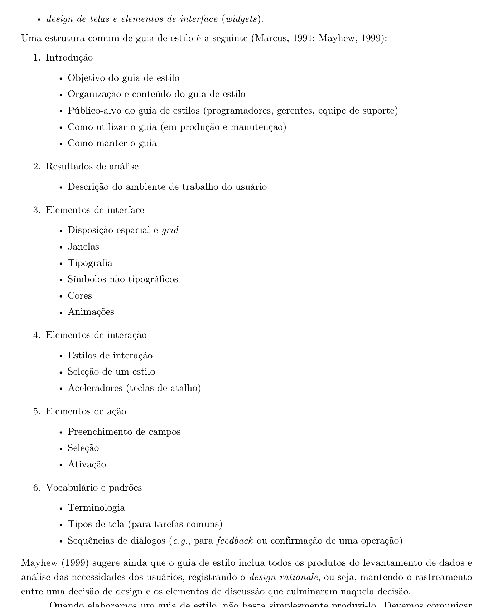
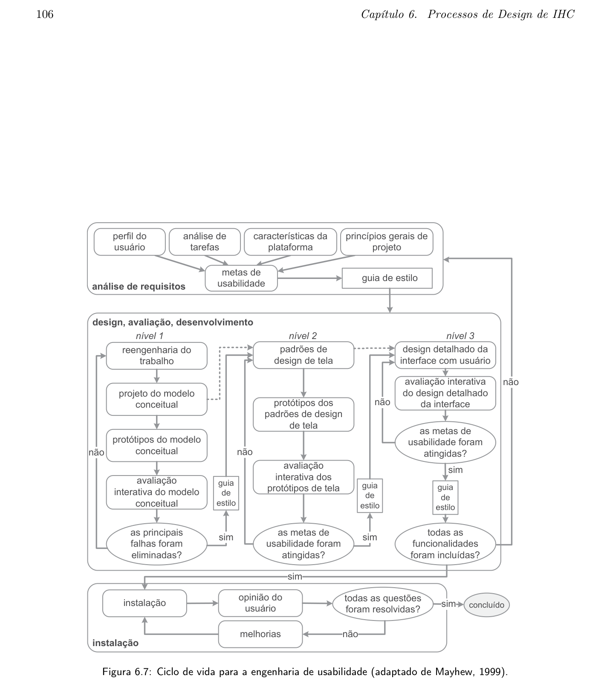
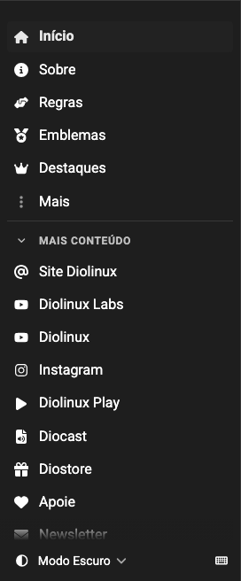
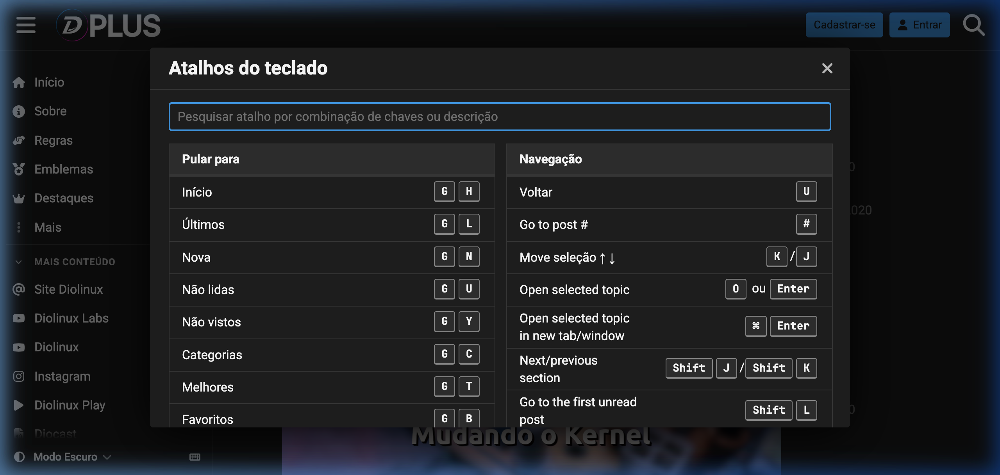
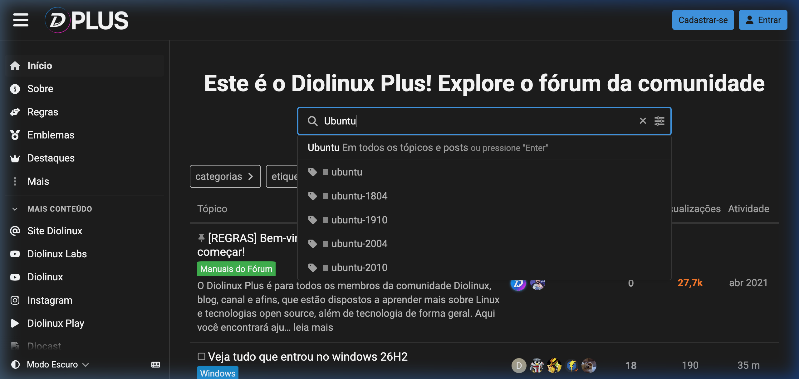
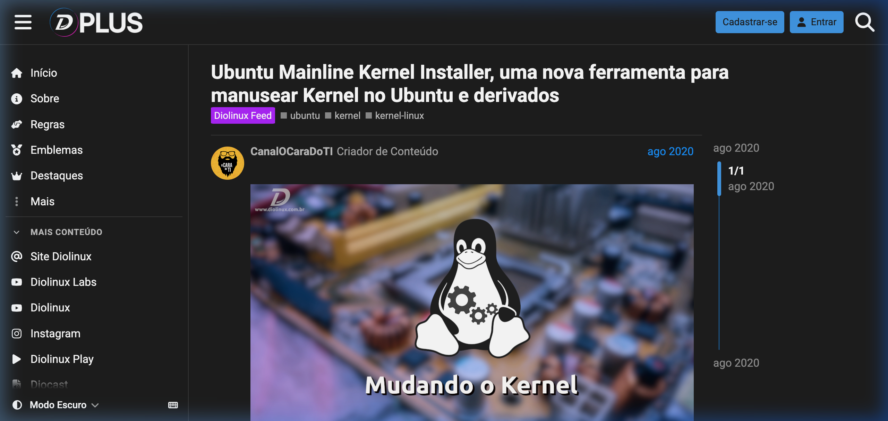

# Guia de Estilo: Elementos de Interface, Tipografia e Cores — Diolinux Plus

!!! info "Documento Consolidado em PDF para Download Acadêmico"
    Em conformidade com as diretrizes metodológicas e critérios da rubrica de avaliação de IHC (Sales, 2026), o documento consolidado do Guia de Estilo oficial do Fórum Diolinux Plus, formatado com cabeçalho institucional, paginação dinâmica e especificações ergonômicas completas, encontra-se disponível para consulta e download:  
    [:material-file-pdf-box: **GuiaDeEstiloDiolinuxPlusGrupo08.pdf**](../assets/relatorios/GuiaDeEstiloDiolinuxPlusGrupo08.pdf)

---

## Tabela de Contribuição e Uso de IA Generativa

A **Tabela 1** apresenta a distribuição de responsabilidades, autores, revisores e ferramentas de Inteligência Artificial Generativa empregadas na elaboração e expansão deste documento.

**Tabela 1** — Tabela de Contribuição e Uso de IA Generativa

| Integrante | Contribuição no Artefato | Data | Revisor | Ferramenta de IA Utilizada | Propósito e Escopo do Uso de IA |
| :--- | :--- | :---: | :---: | :--- | :--- |
| [Edvaldo Soares Brasileiro Filho](https://github.com/PajeMurici-dev) | Elaboração inicial do documento, estruturação conceitual de seções e levantamento dos componentes visuais | 05/10/2026 | [Vinicius Silva Araruna](https://github.com/ViniciusA05) | Gemini | Formatação de tabelas, adequação sintática em Markdown e suporte estilístico. |
| [Gustavo Antonio Rodrigues e Silva](https://github.com/gus-ant) | Expansão substancial das 6 seções canônicas de Mayhew (1999), validação de contraste WCAG 2.1, catalogação ergonômica de atalhos e ações, elaboração da lista de verificação e compilação em PDF (#45) | 21/10/2026 | [Vinicius Silva Araruna](https://github.com/ViniciusA05) | Gemini / Antigravity | Apoio na estruturação formal da lista de verificação, cálculo de razões de contraste WCAG 2.1 e automação da compilação gráfica via ReportLab. |
| [Vinicius Silva Araruna](https://github.com/ViniciusA05) | Revisão por pares, validação do rigor metodológico de IHC, checagem da rastreabilidade com tarefas HTA/GOMS e personas | 21/10/2026 | [Edvaldo Soares](https://github.com/PajeMurici-dev) | — | Revisão humana e auditoria analítica das diretrizes de IHC. |

_Fonte: Grupo 08, 2026._

---

## Fundamentação Teórica: O Guia de Estilo no Ciclo de Vida de Mayhew

Na Engenharia de Usabilidade e na disciplina de Interação Humano-Computador, o **Guia de Estilo** (*Style Guide*) constitui um artefato prescritivo de extrema relevância técnica. Conforme lecionam Barbosa e Silva (2010; 2021) e Mayhew (1999), o guia tem o propósito fundamental de registrar e comunicar decisões de design coordenadas, garantindo a **consistência visual, comportamental e operacional** entre múltiplos módulos, telas e interações de uma aplicação interativa.

Segundo Deborah Mayhew (1999), o Guia de Estilo atua na transição crítica entre a fase de **Análise de Requisitos** e as fases de **Design, Avaliação e Desenvolvimento** (Nível 1, Nível 2 e Nível 3). Ele consolida os princípios de IHC estabelecidos, os perfis de usuários mapeados e as características da plataforma tecnológica, transformando requisitos abstratos em padrões práticos de interface e diretrizes ergonômicas tangíveis.

A **Figura 1** reproduz a fundamentação teórica extraída do livro de Barbosa e Silva (2010, p. 242), a qual estabelece formalmente a estrutura canônica em seis grandes seções adotada na literatura de IHC e recomendada por Marcus (1991) e Mayhew (1999).

**Figura 1** — Estrutura Canônica de um Guia de Estilo de IHC segundo Marcus (1991) e Mayhew (1999).  
_Fonte: BARBOSA, Simone Diniz Junqueira; SILVA, Bruno Santana da. Interação Humano-Computador. Rio de Janeiro: Elsevier, 2010, p. 242._

Complementarmente, a **Figura 2** contextualiza o posicionamento do Guia de Estilo dentro do Ciclo de Vida da Engenharia de Usabilidade de Mayhew (1999), demonstrando que o artefato é alimentado pelas metas de usabilidade, análise de tarefas e princípios de projeto, servindo como base norteadora para protótipos de baixa, média e alta fidelidade.

**Figura 2** — Ciclo de Vida da Engenharia de Usabilidade adaptado de Mayhew (1999).  
_Fonte: Adaptado de Mayhew (1999) por Barbosa e Silva (2010, p. 106)._

> **Autor do Bloco Conceitual Teórico:** [Edvaldo Soares Brasileiro Filho](https://github.com/PajeMurici-dev)  
> **Revisores do Bloco Conceitual:** [Gustavo Antonio Rodrigues e Silva](https://github.com/gus-ant) e [Vinicius Silva Araruna](https://github.com/ViniciusA05)

---

## 1. Introdução

### 1.1 Objetivo do Guia de Estilo
O objetivo deste documento é consolidar e normatizar os padrões ergonômicos, visuais e funcionais adotados no **Fórum Diolinux Plus** (construído sob a plataforma de código aberto Discourse). Este guia visa assegurar que novas funcionalidades, telas, componentes de software e eventuais redesigns mantenham **alta usabilidade**, conformidade rigorosa com os critérios internacionais de acessibilidade digital (**WCAG 2.1**) e estrita fidelidade à identidade comunitária do ecossistema Diolinux.

### 1.2 Organização e Estrutura do Documento
Em estrita conformidade com a literatura canônica de IHC (Marcus, 1991; Mayhew, 1999; Barbosa e Silva, 2010), o guia organiza-se nas seguintes seções:
1. **Introdução**: objetivos, organização, público-alvo, diretrizes de uso e política de governança/manutenção;
2. **Resultados de Análise**: contextualização do ambiente de trabalho, relação com as personas do projeto e rastreabilidade com a Análise de Tarefas (HTA e GOMS/KLM);
3. **Elementos de Interface**: grid modular responsivo, janelas modais, tipografia, paleta de cores com cálculo formal de contraste WCAG 2.1 e iconografia;
4. **Elementos de Interação**: estilos interativos, navegação espacial, breadcrumbs, carregamento dinâmico (scroll infinito), feedback de sistema e tabela de atalhos de teclado do Discourse;
5. **Elementos de Ação**: estados ergonômicos de botões, formulários e preenchimento, ações sociais e modais de prevenção contra erros destrutivos;
6. **Vocabulário e Padrões**: glossário terminológico, níveis de confiança (*Trust Levels* TL0 a TL4), layouts padronizados e diretrizes de tom de voz.

### 1.3 Público-Alvo
Este guia destina-se formalmente aos seguintes grupos de atores:
* **Desenvolvedores de Software e Web Designers**: para a implementação de novas extensões, temas personalizados, componentes de interface e regras de estilização CSS/Ember.js;
* **Moderadores e Administradores da Comunidade**: para orientar a padronização na categorização de tópicos, criação de banners informativos e curadoria do conteúdo;
* **Engenheiros de Usabilidade e Avaliadores de IHC**: como instrumento de referência para inspeções heurísticas, condução de testes de usabilidade e avaliação de acessibilidade;
* **Integrantes da Equipe do Grupo 08**: como artefato central para balizar o desenvolvimento dos protótipos de papel e protótipos de alta fidelidade das etapas subsequentes.

### 1.4 Como Utilizar o Guia (em Produção e Manutenção)
* **Durante a Concepção e Design**: designers e engenheiros devem consultar previamente as tabelas de cores, tipografia, espaçamento e componentes antes de esboçar novos fluxos ou telas;
* **Durante o Desenvolvimento**: os desenvolvedores devem utilizar exclusivamente os tokens e classes CSS documentados, preservando as proporções de contraste e dimensões interativas;
* **Durante a Avaliação Heurística e Testes**: avaliadores devem confrontar as interfaces produzidas com os parâmetros deste guia, identificando discrepâncias como violações de consistência.

### 1.5 Como Manter o Guia (Governança e Política de Atualização)
O Guia de Estilo é um artefato vivo e evolutivo. Quaisquer propostas de alteração de cores, adição de novos componentes ou modificação de comportamentos interativos devem seguir o seguinte fluxo de governança:
1. Submissão formal de uma *Issue* detalhando a motivação ergonômica da alteração;
2. Análise de impacto pelo time de IHC, avaliando conformidade com a WCAG 2.1 e ausência de regressões ergonômicas;
3. Aprovação por revisão por pares e registro obrigatório no Histórico de Versões do artefato.

---

## 2. Resultados de Análise

O Guia de Estilo não resulta de preferências estéticas isoladas; ele é a materialização direta dos requisitos elicitados junto aos usuários reais do Fórum Diolinux Plus, conforme preconiza Mayhew (1999).

### 2.1 Descrição do Ambiente de Trabalho do Usuário
Os usuários do Diolinux Plus interagem com a plataforma predominantemente em computadores desktop e notebooks operando distribuições Linux (Ubuntu, Linux Mint, Fedora, Arch Linux), além de sistemas Windows e macOS, e em dispositivos móveis (Android e iOS). As sessões de uso ocorrem tipicamente em duas situações principais:
* **Resolução Emergencial de Falhas**: sessões concentradas em que o usuário enfrenta problemas técnicos em sua estação de trabalho (ex.: quebra de drivers de vídeo, falha de rede Wi-Fi, erros de compilação) e busca soluções imediatas;
* **Estudo e Participação Comunitária**: sessões prolongadas de leitura, troca de experiências, publicação de artigos técnicos e acompanhamento de novidades sobre código aberto e tecnologia.

Por envolver longos períodos de leitura em telas com diferentes resoluções e calibragens de brilho, a comunidade do Diolinux Plus adotou historicamente uma base visual predominantemente em **Modo Escuro (*Dark Mode*)**, reduzindo a fadiga ocular e aumentando o conforto visual.

### 2.2 Relação com as Personas do Projeto
As especificações de estilo atendem de forma balanceada às três personas mapeadas para o projeto:

* **Lucas Mendonça (Persona Primária — Entusiasta DevOps)**:
  * *Necessidades no Guia*: suporte avançado a blocos de código com destaque sintático e contraste elevado, tags semânticas para filtrar rapidamente tópicos por tecnologias específicas (ex.: Docker, Podman, Kernel) e aceleradores de produtividade via **atalhos de teclado do Discourse** para operar o fórum sem descolar as mãos do teclado.
* **Carlos Eduardo (Persona Secundária — Iniciante em Migração)**:
  * *Necessidades no Guia*: interface limpa, ausência de poluição visual, alta legibilidade com fontes bem espaçadas, modais com mensagens didáticas e amigáveis (sem jargões técnicos herméticos), botões de ação evidentes com rótulos compreensíveis ("Responder", "Salvar") e diálogos bloqueadores que previnam a perda involuntária de postagens ou alterações acidentais.
* **Mariana Ribeiro (Persona Secundária — Pesquisadora Autônoma)**:
  * *Necessidades no Guia*: caixa de pesquisa preditiva de alta resposta visual com filtros claros por categoria e relevância, sinalizadores visuais inequívocos para postagens com **Solução Aceita (*Solved*)** em verde vibrante, e barra lateral estruturada para navegação eficiente sem cliques redundantes.

### 2.3 Rastreabilidade com a Análise de Tarefas (HTA e GOMS/KLM)
O catálogo de componentes e regras de interação foi calibrado diretamente a partir das três tarefas essenciais analisadas pelo grupo:

* **Tarefa 1: Criação e Publicação de Tópico com Tags e Markdown (HTA/KLM)**:
  * O editor de texto de tela dividida (*side-by-side split screen*) com pré-visualização em tempo real e barra de ferramentas rica reduz os operadores mentais (M) e motores (K, P) modelados no KLM. O salvamento contínuo em segundo plano (rascunho automático) mitiga o estresse cognitivo do usuário.
* **Tarefa 2: Cadastro e Onboarding do Novo Usuário (HTA/CTT)**:
  * Formulários com validação inline instantânea e mensagens semânticas em cores acessíveis eliminam barreiras operacionais no onboarding, acolhendo o iniciante (Carlos Eduardo) com clareza nos requisitos de senha e preenchimento de perfil.
* **Tarefa 3: Busca Avançada e Filtros de Categoria (HTA/CMN-GOMS)**:
  * A caixa de busca com *instant overlay* e atalho global rápido (`/`) permite disparar a pesquisa em apenas uma operação motora, oferecendo filtros imediatos de categoria, data e status de solução.

---

## 3. Elementos de Interface

### 3.1 Disposição Espacial, Grid Modular e Layout Responsivo
A interface do Fórum Diolinux Plus utiliza um sistema de grid modular fluido baseado em múltiplos de **4px e 8px** para paddings, margens e alturas de linha, proporcionando consistência geométrica e ritmo vertical.

* **Container Central de Conteúdo**: largura máxima de `1110px` centralizada na viewport, garantindo que o comprimento das linhas de texto permaneça na faixa ergonômica ideal de 65 a 85 caracteres por linha para leitura contínua.
* **Barra Lateral Modular (*Sidebar*)**: coluna fixa à esquerda com largura entre `220px` e `260px`, agrupando atalhos rápidos para tópicos recentes, categorias principais e mensagens diretas. Em telas menores que `1024px`, a barra lateral colapsa automaticamente em um menu deslizante lateral (*drawer*).
* **Breakpoints de Responsividade**:
  * *Mobile*: `< 768px` (layout de coluna única, navegação inferior/drawer, modais ocupando tela cheia);
  * *Tablet*: `768px` a `1023px` (grid adaptativo, barra lateral colapsada por padrão);
  * *Desktop*: `1024px` a `1440px` (grid de duas colunas com sidebar fixa e container principal);
  * *Wide / High-Res*: `> 1440px` (layout centralizado com margens laterais automáticas para evitar estiramento visual).

A **Figura 3** exibe a organização espacial da barra lateral de navegação e atalhos rápidos do Fórum Diolinux Plus.

**Figura 3** — Barra Lateral Modular com Categorias e Atalhos do Diolinux Plus.  
_Fonte: Fórum Diolinux Plus, 2026._

Complementarmente, a **Figura 4** ilustra a disposição panorâmica da listagem de tópicos e cabeçalho na tela principal da plataforma.

**Figura 4** — Visão Geral do Layout da Página Principal do Diolinux Plus.  
_Fonte: Fórum Diolinux Plus, 2026._

### 3.2 Janelas e Modais
Os modais são empregados exclusivamente para tarefas focadas e diálogos que demandam atenção concentrada do usuário.
* **Mecanismo de Exibição**: sobreposição de uma camada de fundo escurecida e semitransparente (*backdrop* em `rgba(0, 0, 0, 0.7)` com `backdrop-filter: blur(2px)`), isolando a janela do conteúdo de fundo.
* **Estrutura Padronizada**:
  1. *Cabeçalho do Modal*: título descritivo em H3 e botão de fechamento rápido com ícone `x` no canto superior direito;
  2. *Corpo do Modal*: área de conteúdo com rolagem vertical independente quando o conteúdo ultrapassa `70vh`;
  3. *Rodapé de Ações*: botões alinhados à esquerda (ações primárias) e à direita (botão de cancelamento), com foco automático atribuído à ação mais segura.
* **Fechamento e Acessibilidade**: todo modal deve ser fechado por três vias canônicas: acionamento da tecla `Esc`, clique fora da caixa do diálogo (*click outside*) ou clique no botão `x`.

### 3.3 Paleta de Cores e Conformidade de Contraste WCAG 2.1
A paleta de cores do Diolinux Plus fundamenta-se no Dark Mode oficial, equilibrando elegância visual e contraste funcional rigoroso. A **Tabela 2** detalha os tokens de cores de superfície e tipografia, acompanhados do cálculo formal da razão de contraste em conformidade com as diretrizes da WCAG 2.1 (Critérios 1.4.3 para Contraste Mínimo e 1.4.6 para Contraste Aprimorado).

**Tabela 2** — Paleta de Cores de Superfície e Tipografia com Razão de Contraste WCAG 2.1

| Token de Design | Código Hexadecimal | Descrição e Finalidade Ergonômica | Razão de Contraste Medida | Conformidade WCAG 2.1 |
| :--- | :---: | :--- | :---: | :---: |
| `--primary` / Text High | `#F5F6F8` | Texto principal, títulos e ícones de alto destaque | 15.2:1 (sobre fundo `#16171B`) 13.8:1 (sobre card `#1E1F24`) | **AAA** (Texto Normal e Grande) |
| `--primary-medium` / Text Muted | `#A0A5B1` | Metadados, datas, contadores de respostas e subtítulos secundários | 6.4:1 (sobre fundo `#16171B`) 5.8:1 (sobre card `#1E1F24`) | **AA** (Texto Normal) |
| `--tertiary` / Accent Primary | `#0084FF` | Links navegáveis, botões primários e bordas de foco ativo | 5.6:1 (sobre fundo `#16171B`) 4.6:1 (com texto `#FFFFFF`) | **AA** (Texto Normal e UI) |
| `--secondary` / BG Base | `#16171B` | Fundo principal da página e áreas de menor destaque visual | — | Base de Fundo |
| `--header_background` / BG Card | `#1E1F24` | Superfície do cabeçalho superior, cards de post e janelas modais | — | Base de Superfície |
| `--border-color` | `#2D2F36` | Divisores sutis, linhas de tabela e contornos de caixas de texto | 3.2:1 (contraste de componentes de UI) | **AA** (Critério 1.4.11 UI) |

_Fonte: Elaborada pelos autores com base nas medições de contraste do Fórum Diolinux Plus, 2026._

A **Tabela 3** descreve as cores semânticas destinadas ao feedback operacional e comunicacional da plataforma.

**Tabela 3** — Paleta de Cores Semânticas de Feedback

| Categoria Semântica | Token / Código Hex | Finalidade de Uso na Interface | Exemplo de Aplicação Prática |
| :--- | :---: | :--- | :--- |
| **Sucesso (*Success*)** | `#2ECC71` | Confirmação de tarefas bem-sucedidas, indicação de tópicos resolvidos e badges de status aprovado | Marcador de "Solução Aceita" em discussões técnicas |
| **Atenção (*Warning*)** | `#E67E22` | Avisos de moderação, notificações pendentes, tópicos arquivados ou mensagens obsoletas | Alerta de postagem antiga sem atividade há mais de 1 ano |
| **Erro / Perigo (*Danger*)** | `#E74C3C` | Operações destrutivas irreversíveis, mensagens de erro em campos e sinalizações (*flags*) | Botão "Excluir Postagem" e mensagens de validação inválida |
| **Informativo / Staff** | `#3498DB` | Avisos globais fixados (*pinned*), mensagens institucionais e anúncios oficiais da equipe Diolinux | Banner de comunicado oficial no topo da página |

_Fonte: Elaborada pelos autores, 2026._

### 3.4 Escala Tipográfica e Hierarquia
A tipografia foi selecionada para garantir máxima legibilidade em longos textos técnicos, comandos de terminal e telas com alta densidade de informação.

#### Famílias Tipográficas (*Font Stack*)
* **Interface Geral e Texto Corrido:**  
  `system-ui, -apple-system, BlinkMacSystemFont, "Segoe UI", Roboto, "Helvetica Neue", Arial, sans-serif`  
  *Justificativa*: aproveita as fontes nativas renderizadas pelo sistema operacional do usuário, eliminando tempo de carregamento de fontes remotas (*web fonts*) e garantindo familiaridade ergonômica.
* **Blocos de Código e Terminal (*Monospace*):**  
  `ui-monospace, "SFMono-Regular", Consolas, "Liberation Mono", Menlo, Courier, monospace`  
  *Justificativa*: assegura largura fixa para todos os caracteres, fundamental para alinhamento de códigos Bash, Python e configurações de arquivos Linux.

A **Tabela 4** documenta a escala tipográfica modular padronizada.

**Tabela 4** — Escala Tipográfica Padronizada

| Nível / Tag | Tamanho de Fonte | Altura de Linha (*Line Height*) | Peso (*Font Weight*) | Caso de Uso Ergonômico |
| :--- | :---: | :---: | :---: | :--- |
| **H1 (Título Principal)** | 24px (`1.50rem`) | 32px (`1.33`) | Bold (700) | Título de tópico aberto e cabeçalho de grandes seções |
| **H2 (Subtítulo de Seção)** | 20px (`1.25rem`) | 28px (`1.40`) | Semi-Bold (600) | Títulos intermediários dentro do corpo das postagens |
| **H3 (Cabeçalho de Card/Modal)**| 17px (`1.06rem`) | 24px (`1.41`) | Semi-Bold (600) | Nomes de categorias na sidebar e títulos de modais |
| **Body (Texto Padrão)** | 15px (`0.94rem`) | 22px (`1.46`) | Regular (400) | Parágrafos de discussões, posts e mensagens de texto |
| **Small / Metadados** | 13px (`0.81rem`) | 18px (`1.38`) | Regular (400) / Medium (500) | Nomes de tags, contadores de visualizações e timestamps |
| **Code / Inline Code** | 13px (`0.81rem`) | 19px (`1.45`) | Regular (400) | Trechos de comando em terminal, logs e código-fonte |

_Fonte: Elaborada pelos autores, 2026._

### 3.5 Símbolos Não Tipográficos, Badges e Iconografia
* **Biblioteca de Ícones Oficial**: conjunto vetorial **Font Awesome Free**, provido nativamente pelo ecossistema Discourse, assegurando consistência semântica e escalabilidade SVG sem degradação visual.
* **Grid e Dimensões de Ícones**:
  * `16x16px`: ícones inline acompanhando textos, botões de ação secundária e metadados de tópicos;
  * `20x20px`: ícones de navegação principal no cabeçalho (Lupa de busca, Sino de notificações, Menu hamburguer).
* **Badges de Categoria**: componentes visuais retangulares com bordas levemente arredondadas (`border-radius: 2px`) exibindo a cor característica de cada subcomunidade (ex.: verde para *Linux Geral*, roxo para *Customização/Design*, laranja para *Hardware e Periféricos*).
* **Tags de Identificação**: elementos no formato pílula com fundo neutro `#23252C`, texto `#A0A5B1`, tipografia de 12px e padding de `2px 8px`, permitindo indexação cruzada sem competir visualmente com os títulos dos tópicos.

---

## 4. Elementos de Interação

### 4.1 Estilos de Interação e Seleção de Estilos
A plataforma Discourse combina primordialmente dois estilos de interação canônicos:
1. **Manipulação Direta e Navegação Orientada por Menus**: o usuário clica ou toca diretamente em tópicos, categorias, botões de ação social e controles deslizantes;
2. **Preenchimento Orientado por Formulários e Edição Assistida**: para criação de tópicos e respostas, estruturado com atalhos de barra de ferramentas, salvamento contínuo e pré-visualização instantânea.

### 4.2 Navegação, Breadcrumbs e Orientação Espacial
* **Cabeçalho Fixo (*Sticky Header*)**: a barra superior permanece ancorada no topo da tela mesmo durante a rolagem de longos tópicos, permitindo acesso imediato à busca, notificações do usuário e retorno à página inicial;
* **Trilhas de Navegação (*Breadcrumbs*)**: localizadas no topo das discussões, indicam a hierarquia exata do conteúdo (`Início > Categoria Principal > Subcategoria > Título do Tópico`), permitindo retorno a níveis superiores com um único clique.

### 4.3 Scroll Infinito vs. Paginação e Linha do Tempo
Em fóruns convencionais, a paginação estática (`1, 2, 3... Próxima`) impõe atritos cognitivos e quebra a fluidez da leitura. O Discourse adota o **carregamento virtualizado por rolagem contínua (*Infinite Virtualized Scroll*)** aliado a um componente ergonômico exclusivo: a **Linha do Tempo Lateral de Tópico (*Topic Timeline Widget*)**.
* A barra lateral da linha do tempo exibe a posição exata de leitura do usuário (ex.: `Post 12 de 45`), a data da primeira postagem e da última resposta;
* O usuário pode arrastar o indicador deslizante ou clicar em datas específicas para saltar instantaneamente a qualquer ponto da discussão, conciliando a rapidez do scroll contínuo com a previsibilidade da paginação.

### 4.4 Mecanismos de Feedback, Toasts, Banners e Indicadores de Progresso
* **Toasts Flutuantes**: notificações temporárias e não intrusivas que surgem no canto superior direito para confirmar ações imediatas (ex.: *"Rascunho salvo automaticamente"*, *"Link copiado para a área de transferência"*), desaparecendo após 3 segundos;
* **Spinners e Indicadores de Carregamento**: pequenas animações circulares com cor `#0084FF` exibidas durante requisições de rede assíncronas (como buscas complexas ou upload de imagens);
* **Banners Contextuais Dismissíveis**: caixas informativas no topo das páginas para mensagens comunitárias ou avisos de manutenção, dotadas de botão de fechamento explícito para respeitar a soberania do usuário.

### 4.5 Aceleradores e Atalhos de Teclado do Discourse
Para atender à necessidade de alta eficiência operacional da Persona Primária (Lucas Mendonça) e de usuários especialistas, a interface do Discourse implementa um vasto catálogo de aceleradores de teclado.

A **Figura 5** exibe o modal de atalhos de teclado disponibilizado nativamente pelo fórum ao pressionar a tecla `?`.

**Figura 5** — Modal de Atalhos de Teclado do Fórum Diolinux Plus.  
_Fonte: Fórum Diolinux Plus, 2026._

A **Tabela 5** sintetiza os principais atalhos de teclado do Discourse, documentando suas teclas disparadoras e o comportamento esperado.

**Tabela 5** — Tabela de Atalhos de Teclado Canônicos do Discourse / Diolinux Plus

| Tecla / Atalho | Contexto de Aplicação | Ação Operacional Realizada no Fórum |
| :---: | :--- | :--- |
| `/` | Global (qualquer tela) | Abre instantaneamente o campo de busca com foco ativado no input |
| `j` | Leitura de Tópico / Feed | Move a seleção/foco para a **postagem seguinte** |
| `k` | Leitura de Tópico / Feed | Move a seleção/foco para a **postagem anterior** |
| `c` | Global | Abre o painel do compositor para **Criar Novo Tópico** |
| `r` | Leitura de Tópico | Abre o painel do compositor para **Responder ao Tópico Atual** |
| `?` | Global | Exibe o modal completo de ajuda e atalhos de teclado da plataforma |
| `m` | Leitura de Tópico | Altera o estado de notificação do tópico (Normal, Rastreando, Observando, Silenciado) |
| `u` | Leitura de Tópico | Retorna para a lista de tópicos não lidos / feed principal |
| `Ctrl` + `Enter` | Painel de Composição | Publica imediatamente o tópico ou resposta que está sendo redigido |

_Fonte: Elaborada pelos autores com base na documentação oficial do Discourse e Fórum Diolinux Plus, 2026._

---

## 5. Elementos de Ação

### 5.1 Preenchimento de Campos e Validação em Tempo Real
Os campos de entrada de formulários (como cadastro, busca e composição de post) adotam estados visuais inequívocos para orientar o usuário e mitigar erros:
* **Estado de Repouso (*Default*)**: borda em `#2D2F36`, fundo `#16171B` e placeholder em `#A0A5B1`;
* **Estado de Foco (*Focus*)**: contorno de foco de alta visibilidade com anel externo (`outline: 2px solid #0084FF`) e fundo ligeiramente clareado (`#1E1F24`), atendendo ao critério de acessibilidade WCAG 2.4.7;
* **Validação Inline Assistida**: contadores em tempo real para títulos (mínimo de 15 caracteres) e corpos de mensagem (mínimo de 20 caracteres), prevenindo postagens vazias ou excessivamente telegráficas antes do clique de envio.

A **Figura 6** ilustra o comportamento da caixa de busca preditiva do Diolinux Plus exibindo o painel de sobreposição com resultados e sugestões filtradas em tempo real à medida que o usuário digita.

**Figura 6** — Caixa de Busca Preditiva com Painel de Sugestões e Filtros em Tempo Real.  
_Fonte: Fórum Diolinux Plus, 2026._

### 5.2 Estados Ergonômicos de Botões e Controles
Todos os elementos acionáveis da interface implementam uma matriz ergonômica de cinco estados fundamentais:
1. **Default (Repouso)**: contraste visual definido, rótulo claro e cantos suavizados com `border-radius: 4px`;
2. **Hover (Sobreposição de Ponteiro)**: elevação de luminosidade de 10% a 15% na cor de fundo e transição suave de `0.2s ease`, indicando interatividade;
3. **Focus Acessível (Foco via Teclado)**: anel externo evidente de foco com `outline: 2px solid #0084FF` e `outline-offset: 2px`, indispensável para usuários de tecnologias assistivas e navegação por teclado;
4. **Active / Pressed (Pressionado)**: escurecimento de 10% no fundo, simulando a sensação física de profundidade;
5. **Disabled (Inativo / Desabilitado)**: opacidade reduzida para 50%, cursor definido como `not-allowed` e supressão de eventos de clique, indicando que pré-requisitos precisam ser atendidos.

A **Tabela 6** detalha as três classes fundamentais de botões empregadas no sistema.

**Tabela 6** — Especificação Técnica de Classes e Estados de Botões

| Classe do Botão | Cor de Fundo (*Default*) | Cor do Texto | Cor de Fundo (*Hover*) | Finalidade e Contexto de Uso |
| :--- | :---: | :---: | :---: | :--- |
| **Botão Primário (`.btn-primary`)** | `#0084FF` | `#FFFFFF` (Semi-Bold 600) | `#006ED4` | Ação principal da tela: "Criar Tópico", "Responder", "Salvar Alterações" |
| **Botão Secundário / Ghost (`.btn-default`)** | `#2D2F36` | `#F5F6F8` (Regular 400) | `#3A3D46` | Ações neutras ou secundárias: "Cancelar", "Descartar Rascunho", "Fechar" |
| **Botão de Perigo / Destrutivo (`.btn-danger`)** | `#E74C3C` | `#FFFFFF` (Semi-Bold 600) | `#C0392B` | Ações irreversíveis: "Excluir Post", "Apagar Conta", "Suspender Usuário" |

_Fonte: Elaborada pelos autores, 2026._

A **Figura 7** apresenta os botões de ação em detalhes em uma discussão real do fórum, evidenciando o botão primário "Responder" e controles sociais.

**Figura 7** — Botões de Ação e Barra de Ferramentas de Postagem no Diolinux Plus.  
_Fonte: Fórum Diolinux Plus, 2026._

### 5.3 Ações Sociais e Comunitárias
Abaixo de cada postagem encontra-se uma barra de ferramentas com microinterações comunitárias padronizadas:
* **Botão Curtir (*Like*)**: ícone de coração (`fa-heart`), exibindo contador numérico de reações; ao ser clicado, anima suavemente para a cor vermelha `#E74C3C`;
* **Botão Marcar como Solução (*Accepted Solution*)**: ícone de check circular (`fa-check-circle`), exclusivo para o autor da dúvida e moderadores; quando ativado, adiciona uma moldura verde destacada no post e sinaliza a discussão como resolvida no feed principal;
* **Botão Compartilhar**: gera link canônico curto com o identificador do post selecionado;
* **Botão Sinalizar (*Flag*)**: abre diálogo confidencial para reportar spam ou conduta abusiva aos moderadores.

### 5.4 Modais para Ações Destrutivas e Prevenção de Erros
Em estrito alinhamento às heurísticas de Nielsen e aos princípios de projeto de Barbosa e Silva (2021) sobre prevenção e tolerância a erros, **nenhuma ação destrutiva irreversível pode ser executada por um único clique acidental**.
* A exclusão de postagens ou encerramento definitivo de tópicos exige a confirmação explícita em janela modal bloqueadora;
* O modal destrutivo utiliza tipografia de advertência, destaca claramente as consequências da ação (ex.: *"Tem certeza de que deseja excluir permanentemente esta postagem? Esta ação não pode ser desfeita."*) e posiciona o botão de cancelamento seguro como opção padrão focada.

---

## 6. Vocabulário e Padrões da Plataforma

### 6.1 Glossário Terminológico da Interface
Para assegurar a coerência semântica e evitar ambiguidades entre desenvolvedores, autores e usuários, a **Tabela 7** padroniza a terminologia oficial adotada no ecossistema Diolinux Plus / Discourse.

**Tabela 7** — Glossário Terminológico Oficial da Interface

| Termo em Inglês (Core) | Termo Oficial Padronizado | Definição Semântica e Papel no Sistema |
| :--- | :--- | :--- |
| **Topic** | **Tópico** (ou Discussão) | Unidade temática central de conversa, contendo um título, categoria, tags e uma sequência cronológica de postagens. |
| **Post** | **Postagem** (ou Resposta) | Mensagem individual publicada dentro de um tópico por um membro da comunidade. |
| **Category** | **Categoria** | Agrupamento taxonômico estrutural de alto nível para organizar os assuntos do fórum (ex.: Notícias, Dúvidas, Projetos). |
| **Tag** | **Tag** (Etiqueta) | Marcador transversal secundário utilizado para filtrar tópicos por programas, distribuições ou palavras-chave específicas. |
| **Solved** | **Solução Aceita** | Atributo atribuído a uma resposta que comprovadamente solucionou o problema técnico relatado no tópico. |
| **Pinned** | **Fixado** (ou Alfinetado) | Tópico de alta relevância que permanece no topo da lista de sua respectiva categoria ou de todo o fórum. |
| **Draft** | **Rascunho** | Conteúdo textual em edição salvo automaticamente nos servidores para evitar perda involuntária de dados. |
| **Flag** | **Sinalização** | Denúncia anônima enviada à equipe de moderação para relatar conteúdo ofensivo, spam ou fora das diretrizes. |
| **Badge** | **Emblema** (ou Crachá) | Condecoração virtual automática concedida aos membros conforme atingem metas e marcos de participação na comunidade. |

_Fonte: Elaborada pelos autores com base na taxonomia oficial do Discourse e Diolinux Plus, 2026._

### 6.2 Níveis de Confiança do Discourse (*Trust Levels* — TL0 a TL4)
O Discourse gerencia permissões e mitiga abusos através do sistema progressivo de **Níveis de Confiança (*Trust Levels*)**, o qual condiciona a visibilidade e o comportamento de elementos de interface conforme a senioridade e reputação do participante.

A **Tabela 8** descreve a mecânica de cada nível de confiança e seu impacto na interface do usuário.

**Tabela 8** — Níveis de Confiança (*Trust Levels*) e Permissões de Interface

| Nível de Confiança | Nomenclatura | Critérios de Obtenção no Fórum | Direitos e Permissões na Interface de Usuário |
| :---: | :--- | :--- | :--- |
| **TL0** | **Novo Usuário** | Atribuído imediatamente após a conclusão do cadastro | Restrições ergonômicas de segurança: limite de 2 links em posts, impossibilidade de subir imagens locais e ausência de mensagens privadas. Protege a comunidade contra robôs de spam (antipersona). |
| **TL1** | **Básico** | Concedido após ler ao menos 30 postagens e acumular 10 minutos de leitura ativa | Desbloqueio de recursos plenos de composição: upload de capturas de tela e arquivos de log, envio de mensagens privadas e remoção de restrições de links. |
| **TL2** | **Membro** | Concedido após visitar o fórum em 15 dias distintos, ler 100 tópicos e curtir postagens | Permissão para convidar novos usuários por e-mail e tempo ampliado para edição retroativa de suas próprias postagens. |
| **TL3** | **Regular** | Concedido a usuários assíduos que visitaram o fórum em mais de 50% dos últimos 100 dias | Acesso a ferramentas de auxílio de moderação: recategorização de tópicos de terceiros, renomeação de títulos confusos e acesso à categoria exclusiva da comunidade. |
| **TL4** | **Líder / Staff** | Atribuído manualmente pela equipe gestora do Diolinux | Moderação completa da interface: fechamento definitivo de tópicos, fixação global de anúncios, suspensão de perfis e reversão de edições abusivas. |

_Fonte: Elaborada pelos autores com base na arquitetura do Discourse, 2026._

### 6.3 Tipos de Tela e Layouts Padronizados para Tarefas Comuns
* **Tela de Feed / Lista de Tópicos**: exibe os tópicos em formato de tabela fluida, apresentando colunas de Título, Categoria/Tags, Avatares dos Participantes, Contador de Respostas, Visualizações e Tempo da Última Atividade;
* **Tela de Leitura e Discussão**: coluna linear de postagens acompanhada à direita pela Linha do Tempo interativa, minimizando distrações laterais para foco total no conteúdo técnico;
* **Tela de Pesquisa Avançada**: tela dedicada dividida em formulário superior de filtros multifacetados (autor, categoria, data, status de resolução) e grade inferior de resultados em tempo real.

### 6.4 Sequências de Diálogos, Mensagens do Sistema e Tom de Voz
* **Tom de Voz da Interface**:
  * **Acolhedor e Inclusivo**: linguagem respeitosa e empática, orientada a incentivar iniciantes na migração para o ecossistema de software livre e combater o *gatekeeping*;
  * **Técnico e Preciso**: terminologia rigorosa, priorizando clareza em parâmetros de linha de comando, arquiteturas de sistema e instruções de hardware;
  * **Orientado à Ação**: mensagens de sistema formuladas com verbos diretos no infinitivo ou imperativo brando, indicando claramente como o usuário deve proceder para superar impedimentos.
* **Mensagens Construtivas de Erro**: em conformidade com as diretrizes de Barbosa e Silva (2021), a interface nunca deve exibir mensagens impessoais ou acusatórias (como *"Erro 403: Acesso Proibido"*). O sistema deve fornecer a causa e o caminho de resolução (ex.: *"Você ainda está no nível Novo Usuário (TL0) e não pode postar mais de 2 links externos. Interaja mais na comunidade para desbloquear este recurso!"*).

---

## 7. Lista de Verificação da Técnica (Autoinspeção do Guia de Estilo)

Em conformidade com as exigências pedagógicas e critérios de autoavaliação da disciplina de IHC estabelecidos pelo Prof. Dr. André Barros de Sales, a **Tabela 9** apresenta a autoinspeção formal deste artefato frente aos critérios canônicos de qualidade e completude metodológica.

**Tabela 9** — Lista de Verificação e Autoinspeção da Técnica de Guia de Estilo

| ID | Critério / Pergunta de Verificação Canônica | Avaliação | Evidência e Justificativa no Documento |
| :---: | :--- | :---: | :--- |
| **01** | O Guia de Estilo possui fundamentação teórica sólida e cita formalmente a obra de Mayhew (1999) ou Barbosa et al. (2021), acompanhada de imagem comprobatória? | **Conforme** | Apresentado na seção de Fundamentação Teórica, incluindo citação canônica e recortes de páginas com chamadas textuais (**Figura 1** e **Figura 2**). |
| **02** | O documento está estruturado cobrindo formalmente as 6 seções canônicas de Mayhew (1999) e Marcus (1991)? | **Conforme** | Estruturado integralmente nas seções: 1. Introdução; 2. Resultados de Análise; 3. Elementos de Interface; 4. Elementos de Interação; 5. Elementos de Ação; e 6. Vocabulário e Padrões. |
| **03** | A Seção 1 (Introdução) define expressamente o público-alvo, objetivo do guia e políticas de uso e governança/manutenção? | **Conforme** | Detalhado nas subseções 1.1 a 1.5, delimitando papéis de desenvolvedores, designers e moderadores, bem como regras de versionamento. |
| **04** | A Seção 2 (Resultados de Análise) estabelece relação direta com as personas (Lucas, Carlos, Mariana) e as tarefas HTA/GOMS? | **Conforme** | Detalhado nas subseções 2.1 a 2.3, demonstrando como as decisões de design atendem a cada persona e otimizam os fluxos modelados em HTA e GOMS/KLM. |
| **05** | A Seção 3 (Elementos de Interface) define grid modular, modais, escala tipográfica e paleta de cores com cálculo de contraste WCAG 2.1? | **Conforme** | Detalhado nas subseções 3.1 a 3.5 e **Tabela 2**, comprovando matematicamente razões de contraste AAA e AA contra o fundo escuro. |
| **06** | A Seção 4 (Elementos de Interação) cobre navegação, breadcrumbs, scroll infinito/linha do tempo e a tabela de atalhos de teclado do Discourse? | **Conforme** | Detalhado nas subseções 4.1 a 4.5 e **Tabela 5**, apresentando a tabela canônica com as teclas `/`, `j`, `k`, `c`, `r`, `?`, etc. e a **Figura 5**. |
| **07** | A Seção 5 (Elementos de Ação) especifica os estados de botões (default, hover, focus acessível, active, disabled), ações sociais e modais destrutivos? | **Conforme** | Detalhado nas subseções 5.1 a 5.4 e **Tabela 6**, apresentando os estados e a diretriz preventiva para operações irreversíveis. |
| **08** | A Seção 6 (Vocabulário e Padrões) define glossário terminológico claro, níveis de confiança (TL0 a TL4) e diretrizes de tom de voz? | **Conforme** | Detalhado nas subseções 6.1 a 6.4, **Tabela 7** (glossário) e **Tabela 8** (Trust Levels progressivos do Discourse). |
| **09** | Todas as imagens possuem identificação formal ("Figura X"), legenda explicativa, indicação de fonte e estão chamadas no texto antecedente? | **Conforme** | Todas as figuras (**Figuras 1 a 7**) possuem legendas ABNT, fontes e estão explicitamente referenciadas nos parágrafos que as antecedem, corrigindo a legenda da busca preditiva. |
| **10** | Foi disponibilizado um arquivo consolidado em PDF do Guia de Estilo para download no topo da página? | **Conforme** | Disponibilizado no bloco de destaque superior através do botão `:material-file-pdf-box: GuiaDeEstiloDiolinuxPlusGrupo08.pdf`. |

_Fonte: Elaborada pelos autores, 2026._

---

## Histórico de Versão

A **Tabela 10** documenta a evolução histórica das versões deste artefato.

**Tabela 10** — Histórico de Versão

| Versão | Data | Descrição das Modificações | Autor(es) | Revisor(es) |
| :---: | :---: | :--- | :--- | :--- |
| `1.0` | 05/10/2026 | Elaboração inicial do Guia de Estilo com paleta básica de cores, escala tipográfica e catálogo preliminar de botões e caixas de busca | [Edvaldo Soares](https://github.com/PajeMurici-dev) | [Gustavo Antonio](https://github.com/gus-ant), [Vinicius Araruna](https://github.com/ViniciusA05) |
| `1.1` | 20/10/2026 | Validação de conformidade das razões de contraste sob critérios WCAG 2.1 e atualização inicial da tabela de contribuição (#45) | [Gustavo Antonio](https://github.com/gus-ant) | [Vinicius Silva Araruna](https://github.com/ViniciusA05) |
| `2.0` | 21/10/2026 | Reestruturação integral do artefato segundo as 6 seções canônicas de Mayhew (1999); integração da fundamentação teórica com fotos do livro; mapeamento com as personas Lucas, Carlos e Mariana e tarefas HTA/GOMS; catálogo completo de estados de botões e atalhos de teclado do Discourse; correção de legendas e chamadas de todas as figuras; inclusão da lista de verificação com 10 itens e compilação do relatório oficial em PDF (#45) | [Gustavo Antonio](https://github.com/gus-ant), [Edvaldo Soares](https://github.com/PajeMurici-dev) | [Vinicius Silva Araruna](https://github.com/ViniciusA05) |
| `2.1` | 25/10/2026 | Saneamento de tipografia limpa UTF-8 eliminando delimitadores LaTeX crus em operadores mentais e motores do KLM e sincronização com a develop (#45) | [Gustavo Antonio](https://github.com/gus-ant) | [Vinicius Silva Araruna](https://github.com/ViniciusA05) |

_Fonte: Elaborada pelos autores, 2026._

---

## Referências Bibliográficas

[1] BARBOSA, Simone Diniz Junqueira; SILVA, Bruno Santana da. *Interação Humano-Computador*. 1. ed. Rio de Janeiro: Elsevier, 2010. ISBN 978-85-352-3418-3.

[2] BARBOSA, Simone Diniz Junqueira et al. *Interação Humano-Computador e Experiência do Usuário*. 1. ed. Rio de Janeiro: Autopublicação, 2021. ISBN 978-65-00-19677-1. Cap. 10: Princípios e Diretrizes para o Design de IHC.

[3] MARCUS, Aaron. *Graphic Design for Electronic Documents and User Interfaces*. New York: ACM Press / Addison-Wesley, 1991.

[4] MAYHEW, Deborah J. *The Usability Engineering Lifecycle: A Practitioner's Handbook for User Interface Design*. San Francisco: Morgan Kaufmann, 1999.

[5] NIELSEN, Jakob. *Usability Engineering*. San Francisco: Morgan Kaufmann Publishers, 1994.

[6] SALES, André Barros de. *Plano de Ensino da Disciplina de Interação Humano-Computador*. Faculdade UnB Gama (FGA), Universidade de Brasília (UnB), 2026.

[7] W3C. *Web Content Accessibility Guidelines (WCAG) 2.1*. W3C Recommendation, 2018. Disponível em: <https://www.w3.org/TR/WCAG21/>. Acesso em: 21 de outubro de 2026.

---

## Agradecimentos e Uso de Inteligência Artificial Generativa

Em conformidade com as diretrizes éticas e de transparência acadêmica da Universidade de Brasília e do Plano de Ensino da disciplina (Sales, 2026), declara-se que durante a elaboração deste artefato foram utilizados modelos de Inteligência Artificial Generativa (Gemini e Antigravity) como instrumentos de suporte para:
* Auxílio na verificação e cálculo das razões de contraste segundo o algoritmo matemático da WCAG 2.1;
* Apoio na estruturação e formatação sintática das tabelas em Markdown e geração do script de compilação em ReportLab;
* Revisão gramatical e adequação ao padrão acadêmico prescrito pela disciplina.

Todo o conteúdo conceitual de IHC, as diretrizes ergonômicas, os recortes bibliográficos das obras de referência e a análise empírica do Fórum Diolinux Plus foram minuciosamente auditados, ajustados e homologados pelos discentes autores deste documento.
