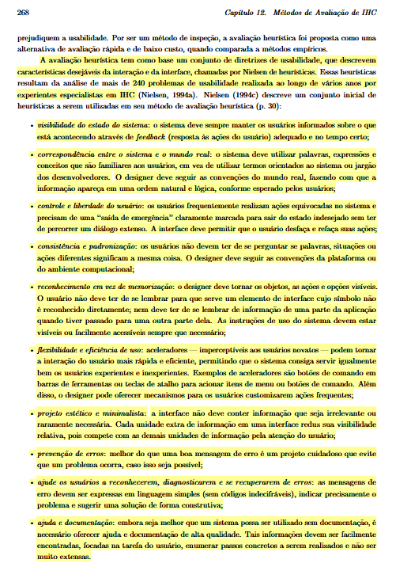

# Conteúdo Teórico e Avaliativo

## Tabela de Contribuição

A Tabela 0 apresenta a distribuição das contribuições dos integrantes ativos na elaboração dos referenciais teóricos e listas de verificação deste módulo.

**Tabela 0** — Matriz de Contribuição do Módulo de Conteúdo Teórico

| Integrante | Contribuição | Data | Ferramenta de IA | Propósito do Uso de IA |
| :--- | :--- | :---: | :--- | :--- |
| [Vinicius Silva Araruna](https://github.com/ViniciusA05) | Elaboração dos itens teóricos do Framework DECIDE, Avaliação Heurística, Prototipação em Papel (Nível 2) e consolidação das 5 Listas de Verificação Canônicas (`LV-01` a `LV-05`) | 29/10/2026 | Google Gemini (LLM) | Apoio na padronização sintática de tabelas Markdown e referências ABNT. |
| [Gustavo Antonio Rodrigues e Silva](https://github.com/gus-ant) | Elaboração completa do Item Teórico: Storyboarding em IHC e Lista de Verificação de 10 itens de Klemmer (Issue #63) | 13/10/2026 | Google Gemini (LLM) | Apoio na formatação Markdown. |
| [Edvaldo Soares Brasileiro Filho](https://github.com/PajeMurici-dev) | Elaboração do Item Teórico: Métodos de Avaliação em IHC (Investigação vs. Inspeção em Análise de Tarefas) | 22/10/2026 | — | Elaboração e revisão humana por pares. |

_Fonte: Elaborada pelos autores, 2026._

---

## Introdução

Este artefato destina-se à compilação e fundamentação científica dos tópicos teóricos de Interação Humano-Computador (IHC) elaborados individualmente pelos membros do Grupo 08, em estrito cumprimento aos critérios de avaliação da disciplina (Prof. Dr. André Barros de Sales, UnB Gama).

Cada integrante é responsável por desenvolver itens conceituais fundamentais para a condução do projeto prático, apresentando:
1. Conceituação teórica aprofundada baseada na literatura de referência (BARBOSA; SILVA, 2010; BARBOSA et al., 2021; NIELSEN, 1994);
2. Citação textual direta com indicação exata de autoria e numeração de página;
3. Fotografia / captura comprobatória em alta resolução da página correspondente na obra de referência;
4. Articulação prática explicando como o conceito teórico é operacionalizado nas atividades práticas do projeto do **Fórum Diolinux Plus (Discourse)**.

---

## 1. O Framework DECIDE no Planejamento da Avaliação de IHC

- **Autor do Item:** [Vinicius Silva Araruna](https://github.com/ViniciusA05)
- **Revisor Designado:** [Gustavo Antonio Rodrigues e Silva](https://github.com/gus-ant)
- **Referência Bibliográfica da Fonte:** BARBOSA, Simone Diniz Junqueira; SILVA, Bruno Santana da; SILVEIRA, Milene Selbach; GASPARINI, Isabela; DARIN, Ticianne; BARBOSA, Gabriel Diniz Junqueira. *Interação Humano-Computador e Experiência do Usuário*. Rio de Janeiro: Autopublicação, 2021. Capítulo 11: Planejamento da Avaliação de IHC, Seção 11.8: O Framework DECIDE, pp. 279–281.

### Fundamentação Teórica

O planejamento de uma avaliação de IHC é uma atividade crucial para orientar a coleta sistemática de dados e garantir que os resultados obtidos sejam válidos, confiáveis e úteis para o aprimoramento da interface. Avaliar sistemas interativos sem um planejamento formal prévio resulta frequentemente em desperdício de recursos, coleta de dados enviesados e incapacidade de responder às reais necessidades dos usuários.

Conforme ressaltam Barbosa et al. (2021, p. 279):

> *"Os critérios de qualidade de uso que podem ser analisados automaticamente por programas computacionais ainda são muito limitados, pois exigem uma definição a priori de regras definindo o que é 'bom' e 'ruim', e o que é 'certo' e 'errado'. A análise realizada por um avaliador humano ainda é fundamental para verificar a qualidade de uso, porque é difícil codificar num programa toda a visão que o avaliador pode adquirir sobre domínio, usuário, atividades e contexto, bem como sua capacidade de análise, principalmente diante de situações imprevistas."*

Para estruturar e operacionalizar o planejamento de avaliações de IHC, a literatura acadêmica adota amplamente o **Framework DECIDE**, proposto originalmente por Preece et al. (2002) e consolidado por Barbosa et al. (2021, p. 280). O framework organiza as atividades de planejamento em seis etapas interligadas e iterativas, cujas iniciais compõem o acrônimo DECIDE:

> *"As atividades do framework são interligadas e executadas iterativamente, à medida que o avaliador articula os objetivos da avaliação, os dados e recursos disponíveis. Então, quando o avaliador descobre uma necessidade de modificar os rumos da avaliação por algum motivo, as demais atividades são afetadas."* (BARBOSA et al., 2021, p. 280).

A Tabela 1 detalha os seis passos do framework DECIDE e o mapeamento de sua aplicação no projeto da disciplina.

**Tabela 1** — Estrutura operacional do Framework DECIDE e aplicação no projeto

| Letra | Etapa do Framework | Definição Metodológica (Barbosa et al., 2021, p. 280) | Aplicação no Projeto do Grupo 08 (Fórum Diolinux Plus) |
| :---: | :--- | :--- | :--- |
| **D** | **Determinar os objetivos da avaliação de IHC** | Identificar os objetivos gerais da avaliação e justificar por que e para quem tais metas são relevantes. | Avaliar a apropriação conceitual (Nível 1), a ergonomia tátil em papel (Nível 2) e a eficiência nos fluxos de Markdown/IA (CF01), Eventos Presenciais (CF02) e Grade de Mentorias (CF03) no Fórum Diolinux Plus. |
| **E** | **Explorar perguntas a serem respondidas** | Desdobrar os objetivos gerais em perguntas específicas de avaliação que orientem a coleta empírica ou analítica. | Formulação das matrizes investigativas `P01–P08` (Storyboards), `PT01–PT08` (Análise de Tarefas) e `PP01–PP08` (Protótipo de Papel). |
| **C** | **Escolher os métodos de avaliação** | Selecionar os métodos mais adequados considerando prazos, custo, perfil de usuário e fidelidade do artefato. | Entrevistas semiestruturadas com percurso guiado no Nível 1 e ensaios de interação com Protótipo de Papel (Facilitador e Computador Humano) no Nível 2. |
| **I** | **Identificar e administrar as questões práticas** | Dimensionar recursos humanos, prazos, infraestrutura técnica, ferramentas e seleção de participantes. | Condução presencial individual com discentes da UnB (Perfil 1 — Usuário Aprendiz em Linux), orçamento de custo zero e execução prévia de Teste-Piloto com dados isolados. |
| **D** | **Decidir como lidar com as questões éticas** | Garantir a integridade, privacidade, consentimento livre e esclarecido (TCLE) e respeito aos voluntários. | Aplicação dos 4 princípios bioéticos de Beauchamp & Childress, leitura literal do Script Oral do TCLE nos primeiros 60 segundos gravados e anonimização LGPD. |
| **E** | **Avaliar (*Evaluate*), interpretar e apresentar os dados** | Tratar os dados brutos coletados, identificar padrões, avaliar confiabilidade e gerar o relatório final de reprojeto. | Síntese analítica de conteúdo (*Bardin, 2011*), classificação de problemas na escala de severidade de Nielsen (0 a 4) e diretrizes de reprojeto entre os níveis de Mayhew. |

_Fonte: Vinicius Silva Araruna com base em Barbosa et al. (2021), 2026._

### Evidência Visual da Fonte Bibliográfica

A Figura 1 reproduz a página 280 da obra de referência, comprovando a definição conceitual do Framework DECIDE.

**Figura 1** — Registro textual do Framework DECIDE. (Fonte: Barbosa et al., 2021, p. 280).

---

## 2. Métodos de Inspeção: Avaliação Heurística de Usabilidade e Severidade

- **Autor do Item:** [Vinicius Silva Araruna](https://github.com/ViniciusA05)
- **Revisor Designado:** [Gustavo Antonio Rodrigues e Silva](https://github.com/gus-ant)
- **Referência Bibliográfica da Fonte:** BARBOSA, Simone Diniz Junqueira; SILVA, Bruno Santana da. *Interação Humano-Computador*. 1. ed. Rio de Janeiro: Elsevier, 2010. Capítulo 10: Métodos de Avaliação de IHC, Seção 10.2: Avaliação Heurística, pp. 268–272.

### Fundamentação Teórica

A Avaliação Heurística é um método de inspeção de usabilidade criado por Jakob Nielsen e Rolf Molich (1990) e amplamente consagrado na literatura internacional de Engenharia de Usabilidade (NIELSEN, 1994; BARBOSA; SILVA, 2010). Ao contrário dos testes empíricos que envolvem recrutamento de usuários finais, a inspeção heurística é conduzida por especialistas ou avaliadores treinados que percorrem a interface guiados por um conjunto sistemático de princípios ou regras práticas de design (heurísticas).

Barbosa e Silva (2010, p. 268) definem o método nos seguintes termos:

> *"A avaliação heurística é um método de inspeção de usabilidade em que especialistas em usabilidade ou os próprios designers examinam a interface procurando problemas que possam prejudicar a qualidade de seu uso. O objetivo é diagnosticar problemas pontuais de usabilidade na interface com base em um conjunto de princípios e diretrizes de design, conhecidos como heurísticas."*

Para assegurar consistência diagnóstica, adota-se o conjunto clássico das **10 Heurísticas de Usabilidade de Nielsen (1994)**, sintetizado na Tabela 2.

**Tabela 2** — As Dez Heurísticas de Usabilidade de Nielsen

| Número | Heurística | Descrição do Princípio |
| :---: | :--- | :--- |
| **H1** | **Visibilidade do status do sistema** | O sistema deve sempre manter os usuários informados sobre o que está acontecendo, por meio de feedback apropriado dentro de um tempo razoável. |
| **H2** | **Correspondência entre o sistema e o mundo real** | O sistema deve falar a linguagem dos usuários, com palavras, frases e conceitos familiares, seguindo as convenções do mundo real. |
| **H3** | **Controle do usuário e liberdade** | Os usuários frequentemente realizam ações por engano. O sistema deve fornecer uma "saída de emergência" clara, suportando desfazer e refazer. |
| **H4** | **Consistência e padrões** | Os usuários não devem ter que se perguntar se palavras, situações ou ações diferentes significam a mesma coisa. Padrões devem ser mantidos. |
| **H5** | **Prevenção de erros** | Melhor do que boas mensagens de erro é um design cuidadoso que previna a ocorrência do problema antes mesmo que o usuário o cometa. |
| **H6** | **Reconhecimento em vez de memorização** | Minimizar a carga de memória do usuário tornando objetos, ações e opções visíveis, reduzindo a sobrecarga cognitiva. |
| **H7** | **Flexibilidade e eficiência de uso** | Atalhos ocultos para usuários experientes podem acelerar a interação, permitindo que o sistema atenda tanto novatos quanto experts. |
| **H8** | **Design estético e minimalista** | Diálogos não devem conter informações irrelevantes ou raramente necessárias, pois cada unidade extra de informação compete por atenção. |
| **H9** | **Ajuda para reconhecer, diagnosticar e recuperar-se de erros** | As mensagens de erro devem ser expressas em linguagem clara (sem códigos técnicos), indicar precisamente o problema e sugerir uma solução construtiva. |
| **H10** | **Ajuda e documentação** | Embora seja melhor que o sistema possa ser usado sem documentação, pode ser necessário fornecer ajuda e documentação contextualizada e fácil de buscar. |

_Fonte: Vinicius Silva Araruna com base em Nielsen (1994) e Barbosa e Silva (2010), 2026._

### Escala de Severidade dos Problemas de Usabilidade

A identificação de um problema de usabilidade requer a atribuição de uma escala de severidade para orientar a alocação de esforço de desenvolvimento e a prioridade das correções de projeto. Barbosa e Silva (2010, p. 270) detalham a escala clássica de quatro níveis de severidade (Tabela 3).

**Tabela 3** — Escala de Severidade de Problemas de Usabilidade segundo Nielsen

| Nível de Severidade | Classificação | Impacto na Experiência do Usuário | Prioridade de Correção |
| :---: | :--- | :--- | :--- |
| **0** | **Falso problema** | Não afeta a usabilidade; questão puramente opinativa ou estética irrelevante. | Não necessita de intervenção. |
| **1** | **Problema cosmético** | Ocorre com pouca frequência ou causa pequenos incômodos que não prejudicam a execução da tarefa. | Baixa; corrigir se houver tempo extra. |
| **2** | **Problema pequeno** | Inconveniência que atrasa ou confunde moderadamente o usuário, mas não o impede de concluir o objetivo. | Média; deve ser corrigido nas iterações regulares. |
| **3** | **Problema grave** | Causa severa frustração, perda de dados ou grande desperdício de tempo; dificulta muito a tarefa. | Alta prioridade; correção mandatória. |
| **4** | **Problema catastrófico** | Impede totalmente a conclusão da tarefa pelo usuário ou causa falhas irreparáveis no sistema. | Urgência máxima; bloqueia o lançamento até ser corrigido. |

_Fonte: Vinicius Silva Araruna com base em Nielsen (1994) e Barbosa e Silva (2010), 2026._

### Evidência Visual da Fonte Bibliográfica

A Figura 2 comprova a fundamentação da Avaliação Heurística no livro-texto adotado.

**Figura 2** — Registro textual do método de Avaliação Heurística. (Fonte: Barbosa e Silva, 2010, p. 268).

---

## Tópicos Individuais dos Demais Integrantes

Conforme as diretrizes pedagógicas da disciplina, os demais integrantes do Grupo 08 documentam abaixo seus respectivos tópicos conceituais com base na literatura acadêmica:

### 3.1 Item Teórico e Listas de Verificação Avaliativas: Vinicius Silva Araruna

- **Autor do Item:** [Vinicius Silva Araruna](https://github.com/ViniciusA05)
- **Revisor Designado:** [Gustavo Antonio Rodrigues e Silva](https://github.com/gus-ant)
- **Documentos Detalhados Vinculados:**
  - [Conteúdo da Disciplina e 5 Listas de Verificação Canônicas (`LV-01` a `LV-05`)](../analise-requisitos/conteudo-disciplina.md)
  - [Fundamentação de Prototipação em Papel (Snyder, 2003; Rettig, 1994; Barbosa & Silva, 2021)](../design-avaliacao-desenvolvimento/nivel-2/prototipo-papel/planejamento-avaliacao.md#2-fundamentacao-teorica-canonica)
  - [Fundamentação do Método de Inspeção Formal de Fagan (1976) e Checklists de Entregas](../verificacao/lista-verificacao.md#2-fundamentacao-teorica-o-processo-de-inspecao-formal-de-software)

Além dos itens teóricos do **Framework DECIDE** (Seção 1) e da **Avaliação Heurística e Severidade de Nielsen** (Seção 2), Vinicius Silva Araruna estruturou o conjunto completo de **5 Listas de Verificação Canônicas** (`LV-01`: HTA com 9 itens; `LV-02`: Elenco de Personas com 6 itens; `LV-03`: Personas com 14 itens; `LV-04`: CTT com 9 itens; e `LV-05`: Storyboards e Protótipo de Papel com 9 itens), bem como a fundamentação teórica da **Prototipação de Baixa Fidelidade em Papel** (*Snyder, 2003; Rettig, 1994; Barbosa & Silva, 2021, p. 248–252*) aplicada à Tarefa 1 (`CF01`: Criação de Tópico com Markdown, Tags e IA Semântica Pré-Envio).

---

### 3.2 Item Teórico: Gustavo Antonio Rodrigues e Silva (Storyboarding em IHC)

#### Storyboarding em IHC: Prototipação Conceitual e Design Contextual

- **Autor do Item:** [Gustavo Antonio Rodrigues e Silva](https://github.com/gus-ant)
- **Revisor Designado:** [Vinicius Silva Araruna](https://github.com/ViniciusA05)
- **Documento Detalhado Individual:** [Item Teórico Completo: Storyboarding em IHC](item-teorico-storyboard.md)
- **Referência Bibliográfica da Fonte:** BARBOSA, Simone Diniz Junqueira; SILVA, Bruno Santana da. *Interação Humano-Computador*. 1. ed. Rio de Janeiro: Elsevier / Campus, 2010. / BARBOSA, Simone Diniz Junqueira et al. *Interação Humano-Computador e Experiência do Usuário*. 1. ed. Rio de Janeiro: Autopublicação, 2021. Capítulo 6: Processos de Design de IHC, Seção 6.3.4 (*Design Contextual e Storyboards*), p. 107; Capítulo 11: Planejamento da Avaliação de IHC, p. 251.

##### Fundamentação Teórica

O Storyboard é uma técnica de prototipação de baixa fidelidade originária da indústria cinematográfica e da animação que foi incorporada à Engenharia de Usabilidade e ao Design de Interação para explorar alternativas conceituais de design antes de qualquer implementação de código.

No processo de **Design Contextual** (*Contextual Design*), o storyboard desempenha papel crucial na etapa de **reprojeto do trabalho**, permitindo aos projetistas e às partes interessadas visualizarem como a tecnologia proposta se insere no ambiente cotidiano do usuário:

> *"A consolidação dos modelos de trabalho fornece insumos para o designer reprojetar a forma como os usuários trabalham. O designer utiliza storyboards para explorar ideias sobre como melhorar a prática de trabalho com o suporte oferecido pela tecnologia."* (BARBOSA; SILVA, 2021, p. 107).

Segundo Barbosa e Silva (2021, p. 251), o storyboard é um instrumento primordial da **avaliação formativa ou construtiva**, possibilitando que a equipe avalie com usuários reais o fluxo de atividades, os sentimentos, as reações e os desfechos antes do desenvolvimento de protótipos de média e alta fidelidade (Níveis 2 e 3 de Mayhew).

##### Evidência Visual da Fonte Bibliográfica

A Figura 3 comprova a fundamentação conceitual do Storyboard na obra de referência adotada.

**Figura 3** — Registro textual do uso de Storyboards no Design Contextual. (Fonte: Barbosa e Silva, 2021, p. 107).

##### Lista de Verificação Canônica do Storyboard (Item 14 do Plano de Ensino)

Em conformidade estrita com o critério 14 do Plano de Ensino, este item teórico desenvolveu uma [Lista de Verificação Oficial com 10 Itens](item-teorico-storyboard.md#5-lista-de-verificacao-do-storyboard-baseada-no-referencial-teorico) fundamentada na metodologia internacional de IHC ministrada por Scott Klemmer (Universidade da Califórnia em San Diego / UC Berkeley - Coursera) e Amal Dar Aziz, cobrindo:
1. **Setting (Cenário):** Atores envolvidos, ambiente de uso e tarefa em execução;
2. **Sequence (Sequência):** Passos da tarefa, gatilho inicial de uso e aderência ao sistema;
3. **Satisfaction (Satisfação):** Motivação de uso, conquistas alcançadas e atendimento à dor do usuário;
4. **Prototipação Rápida:** Duração ágil de confecção de aproximadamente **10 minutos** por fluxo narrativo.

---

### 3.3 Item Teórico: Edvaldo Soares Brasileiro Filho (Métodos de Investigação vs. Inspeção em Análise de Tarefas)

- **Autor do Item:** [Edvaldo Soares Brasileiro Filho](https://github.com/PajeMurici-dev)
- **Revisor Designado:** [Vinicius Silva Araruna](https://github.com/ViniciusA05)
- **Documento Detalhado Individual:** [Item Teórico Completo: Métodos de Avaliação em IHC — Investigação e Inspeção](../design-avaliacao-desenvolvimento/item-teorico-metodos-avaliacao.md)
- **Referência Bibliográfica da Fonte:** BARBOSA, Simone Diniz Junqueira; SILVA, Bruno Santana da. *Interação Humano-Computador*. 1. ed. Rio de Janeiro: Elsevier, 2010. Capítulo 9: Planejamento da Avaliação de IHC, Seção 9.6: Qual Tipo de Método de Avaliação Escolher?, pp. 301–302.

##### Síntese Conceitual e Operacionalização no Fórum Diolinux Plus

O item teórico elaborado por Edvaldo Soares contrapõe os **Métodos de Investigação (*Inquiry*)** — que envolvem diretamente usuários reais por meio de entrevistas, questionários e estudos de campo para compreender concepções, expectativas e apropriação tecnológica — aos **Métodos de Inspeção (*Inspection*)** — nos quais especialistas examinam a solução de IHC sem a presença do usuário para antever falhas potenciais (como Percurso Cognitivo e Avaliação Heurística). A fundamentação inclui citação direta e reprodução fotográfica da página 301 de Barbosa e Silva (2010), articulando sua aplicação direta na modelagem e avaliação da Tarefa 3 (*Grade de Disponibilidade e Agendamento de Dúvidas / Mentorias* no Fórum Diolinux Plus).

---

## Histórico de Versão

| Versão | Data | Descrição | Autor(es) | Revisor(es) |
| :---: | :---: | :--- | :---: | :---: |
| `1.0` | 04/09/2026 | Criação inicial da página de conteúdo teórico | [Gustavo Antonio](https://github.com/gus-ant) | [Pedro Paulo](https://github.com/Pedrop06) |
| `1.1` | 05/09/2026 | Inclusão da tabela de contribuição no início, padronização e bibliografia ABNT | [Jonathan Lourenço Carpaneda](https://github.com/Jonathan-Carpaneda) | [Gustavo Antonio](https://github.com/gus-ant) |
| `1.2` | 06/09/2026 | Desenvolvimento completo dos itens teóricos de Framework DECIDE e Avaliação Heurística com citações diretas, tabelas analíticas e fotos comprobatórias do livro | [Vinicius Araruna](https://github.com/ViniciusA05) | [Pedro Paulo](https://github.com/Pedrop06) |
| `1.3` | 13/10/2026 | Desenvolvimento completo do item teórico individual sobre Storyboarding em IHC com citação direta de Barbosa e Silva (2021) e evidência visual (Issue #63) | [Gustavo Antonio](https://github.com/gus-ant) | [Vinicius Araruna](https://github.com/ViniciusA05) |
| `1.4` | 13/10/2026 | Incorporação da Lista de Verificação Canônica de Storyboard baseada em Scott Klemmer (UC Berkeley / Coursera) com 10 itens normativos e saneamento nominal de fontes. | [Gustavo Antonio](https://github.com/gus-ant) | [Vinicius Araruna](https://github.com/ViniciusA05) |
| `1.5` | 29/10/2026 | Consolidação dos itens teóricos dos 3 membros ativos (Vinicius, Gustavo e Edvaldo), vinculação direta com as 5 Listas de Verificação (`LV-01` a `LV-05`) e Protótipo de Papel, atualização da Tabela 1 para o Fórum Diolinux Plus e remoção de seções placeholders de membros inativos (#118). | [Vinicius Silva Araruna](https://github.com/ViniciusA05) | [Gustavo Antonio](https://github.com/gus-ant) |

---

## Referências Bibliográficas

[1] AZIZ, Amal Dar. *Guide to Storyboarding*. HCI Institute, Stanford / Berkeley. Disponível em: <http://hci.st/story>. Acesso em: 13 out. 2026.

[2] BARBOSA, Simone Diniz Junqueira; SILVA, Bruno Santana da. *Interação Humano-Computador*. 1. ed. Rio de Janeiro: Elsevier, 2010.

[3] BARBOSA, Simone Diniz Junqueira; SILVA, Bruno Santana da; SILVEIRA, Milene Selbach; GASPARINI, Isabela; DARIN, Ticianne; BARBOSA, Gabriel Diniz Junqueira. *Interação Humano-Computador e Experiência do Usuário*. Rio de Janeiro: Autopublicação, 2021. ISBN 978-65-00-19677-1.

[4] KLEMMER, Scott. *Storyboards, Paper Prototypes and Mockups*. Videoaula do curso "Human-Computer Interaction Design". University of California, San Diego / UC Berkeley, disponibilizado via Coursera. Disponível em: <https://www.youtube.com/watch?v=h2H3oIQtddU>. Acesso em: 13 out. 2026.

[5] NIELSEN, Jakob. *Usability Engineering*. San Francisco: Morgan Kaufmann Publishers, 1994.

[6] NIELSEN, Jakob. Heuristic evaluation. In: NIELSEN, Jakob; MACK, Robert L. (Org.). *Usability Inspection Methods*. New York: John Wiley & Sons, 1994. p. 25–62.

[7] PREECE, Jennifer; ROGERS, Yvonne; SHARP, Helen. *Interaction Design: beyond human-computer interaction*. New York: John Wiley & Sons, 2002.

---

## Agradecimentos e Uso de Inteligência Artificial (IA) Generativa

Durante a organização e padronização visual deste artefato, foi utilizado suporte de Inteligência Artificial Generativa (LLM) como facilitador para a formatação sintática das tabelas e estruturação em Markdown. Todo o embasamento teórico, transcrição de citações com checagem de páginas, categorizações metodológicas e seleção das evidências visuais foram conferidos, verificados e validados pelo autor com base na leitura direta da literatura canônica de Interação Humano-Computador.
