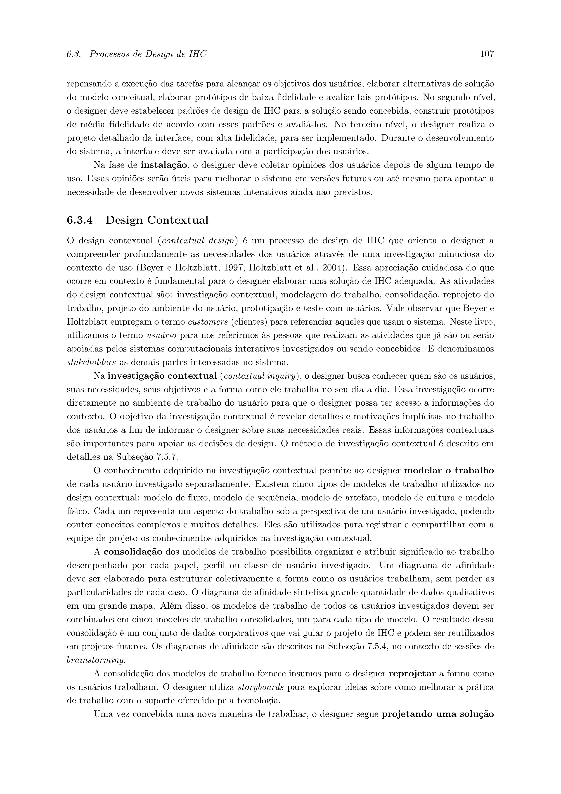
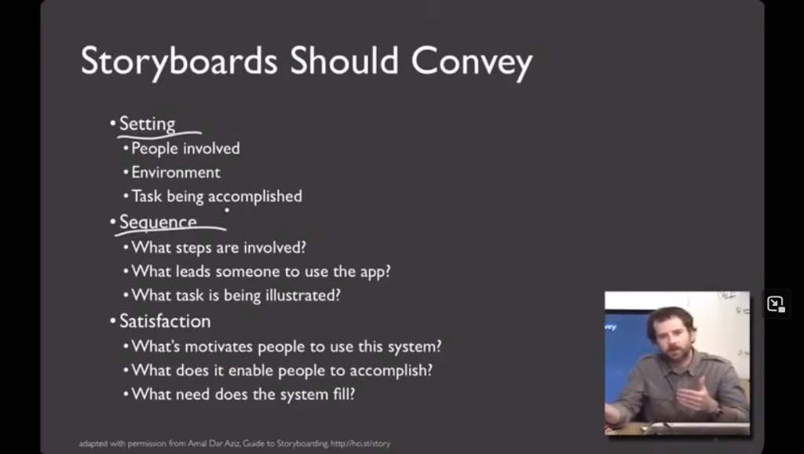

# Item Teórico: Storyboarding em IHC

## Tabela de Contribuição

A Tabela 1 apresenta as informações de autoria e revisão deste artefato teórico individual.

**Tabela 1** — Matriz de Contribuição do Item Teórico

| Integrante | Atribuição | Data | Horário | Ferramenta de IA e Contribuição |
| :--- | :--- | :---: | :---: | :--- |
| [Gustavo Antonio Rodrigues e Silva](https://github.com/gus-ant) | **Autor do Item Teórico**: Pesquisa bibliográfica, redação da fundamentação conceitual de Storyboarding, transcrição de citações e seleção da evidência imagética. | 13/10/2026 | 19:30 - 21:00 | Google Gemini (LLM): suporte na estruturação das tabelas Markdown e checagem ABNT. |
| [Vinicius Silva Araruna](https://github.com/ViniciusA05) | **Revisor Designado**: Auditoria conceitual, verificação de consistência metodológica frente ao Plano de Ensino e conferência da evidência visual. | 13/10/2026 | 21:00 - 21:30 | Nenhuma ferramenta utilizada (revisão humana por pares). |

_Fonte: Gustavo Antonio Rodrigues e Silva e Vinicius Silva Araruna, 2026._

---

## 1. Identificação e Metadados do Item Teórico

- **Autor do Item Teórico:** [Gustavo Antonio Rodrigues e Silva](https://github.com/gus-ant)
- **Revisor:** [Vinicius Silva Araruna](https://github.com/ViniciusA05)
- **Origem / Vínculo Pedagógico:** Plano de Ensino da Disciplina de IHC (Sales, 2026), Apresentação 4 (Item 4 e Item 14) — Ação 22 da Estrutura Analítica do Projeto (EAP).
- **Referência Bibliográfica da Fonte Canônica:**
  - BARBOSA, Simone Diniz Junqueira; SILVA, Bruno Santana da. *Interação Humano-Computador*. 1. ed. Rio de Janeiro: Elsevier / Campus, 2010.
  - BARBOSA, Simone Diniz Junqueira et al. *Interação Humano-Computador e Experiência do Usuário*. 1. ed. Rio de Janeiro: Autopublicação, 2021. Capítulo 6: Processos de Design de IHC, Seção 6.3.4 (*Design Contextual e Storyboards*), p. 107; Capítulo 11: Planejamento da Avaliação de IHC (Avaliação Formativa e Prototipação Conceitual), p. 251.

---

## 2. Fundamentação Teórica da Técnica de Storyboard

No contexto de Interação Humano-Computador (IHC) e Engenharia de Usabilidade, o **Storyboard** é uma técnica clássica de **prototipação de baixa fidelidade** que tem suas raízes históricas na indústria cinematográfica e na animação tradicional (criada pelos estúdios Disney na década de 1930). Em IHC, a técnica foi incorporada para apoiar projetistas e equipes multidisciplinares na exploração, ideação e comunicação de soluções de design antes de qualquer investimento em código de software ou em telas de alta fidelidade (Beyer & Holtzblatt, 1997; Mayhew, 1999; Barbosa & Silva, 2021).

### 2.1 O Papel do Storyboard no Processo de Design

Conforme explicitado por Barbosa e Silva (2021, p. 107), no âmbito do **Design Contextual** (*Contextual Design*), o storyboard desempenha uma função crucial na etapa de **reprojeto do trabalho**:

> *"A consolidação dos modelos de trabalho fornece insumos para o designer reprojetar a forma como os usuários trabalham. O designer utiliza storyboards para explorar ideias sobre como melhorar a prática de trabalho com o suporte oferecido pela tecnologia."* (BARBOSA; SILVA, 2021, p. 107).

Diferente de um mero esboço de interface gráfica (*wireframe*), o storyboard é essencialmente uma **narrativa em sequência de quadros (estilo história em quadrinhos)** que contextualiza:

1. **O Cenário e o Ambiente Físico:** Onde a interação ocorre (sala de aula, escritório, quarto do estudante, presença de barulho ou interrupções);
2. **A Persona e suas Motivações:** Quem é o usuário, qual problema inicial ele vivencia e qual o objetivo intrínseco que deseja alcançar;
3. **A Intervenção Tecnológica:** Como o sistema interativo interage com o usuário para desbloquear sua necessidade;
4. **As Reações e Emoções:** A experiência subjetiva, dúvidas, hesitações e a satisfação final ao atingir seu objetivo.

A Tabela 2 sintetiza as características essenciais do Storyboard frente a outras técnicas de prototipação em IHC.

**Tabela 2** — Comparativo do Storyboard frente a outras representações de design

| Dimensão de Análise | Storyboard (Nível 1) | Cenário Textual | Wireframe / Esboço de Tela |
| :--- | :--- | :--- | :--- |
| **Formato Principal** | Sequência gráfica em quadrinhos com ilustrações, balões e legendas. | Narrativa textual descritiva em linguagem natural. | Desenho estático da disposição espacial de botões, campos e menus. |
| **Foco da Comunicação** | Contexto de uso, fluxo da atividade e experiência emocional do usuário. | Motivações e passos lógicos da tarefa em detalhes narrativos. | Disposição visual de componentes na tela de um dispositivo. |
| **Fidelidade** | Baixa fidelidade conceitual. | Não aplicável (textual). | Média ou baixa fidelidade gráfica. |
| **Momento de Aplicação** | Nível 1 do Ciclo de Mayhew (concepção e ideação preliminar). | Análise de requisitos e elicitação. | Nível 2 do Ciclo de Mayhew (padrões de design de tela). |

_Fonte: Gustavo Antonio Rodrigues e Silva com base em Barbosa e Silva (2021) e Rogers et al. (2013), 2026._

---

## 3. Avaliação Formativa com Storyboards

De acordo com Barbosa e Silva (2021, p. 251), a avaliação de IHC realizada durante o desenvolvimento da solução conceitual — antes que haja uma implementação pronta — denomina-se **avaliação formativa ou construtiva**:

> *"A avaliação de IHC realizada durante a elaboração da solução, ou seja, antes de termos uma solução pronta, é chamada de avaliação formativa ou construtiva [...] tais como: cenários de uso, esboços de tela, storyboards, modelagem da interação e protótipos de baixa e média fidelidade."* (BARBOSA; SILVA, 2021, p. 251).

Nessa fase, os storyboards são avaliados junto aos usuários para:

- Identificar precocemente falhas na lógica de uso ou passos forçados na narrativa;
- Verificar se a solução proposta realmente atende aos objetivos reais do público-alvo;
- Elicitar novas alternativas e requisitos sem o custo proibitivo de refazer código de programação;
- Garantir a apropriação e aceitação da tecnologia antes do avanço para os protótipos de média e alta fidelidade (Níveis 2 e 3 de Mayhew).

---

## 4. Evidência Visual da Fonte Bibliográfica

A Figura 1 reproduz a página 107 da obra canônica de Simone Diniz Junqueira Barbosa e Bruno Santana da Silva (2021), evidenciando formalmente a definição do uso de storyboards na literatura acadêmica de IHC.

**Figura 1** — Registro textual do uso de Storyboards em IHC. (Fonte: Barbosa e Silva, 2021, p. 107).

---

## 5. Lista de Verificação do Storyboard (Baseada no Referencial Teórico)

Em atendimento estrito ao critério pedagógico da disciplina (Item 14 da avaliação do plano de ensino), este item teórico disponibiliza uma lista de verificação canônica estruturada a partir do referencial acadêmico internacional de IHC ministrado pelo Prof. Dr. Scott Klemmer (Universidade da Califórnia em San Diego e UC Berkeley / Coursera) no curso *"Storyboards, Paper Prototypes and Mockups"*, adaptado da metodologia de Amal Dar Aziz (*Guide to Storyboarding*).

### 5.1 Os Três Pilares da Comunicação em Storyboards (Klemmer & Aziz)

Segundo Klemmer (2012), um storyboard eficaz no design de interação não se destina a ser uma obra de arte gráfica requintada, mas sim uma ferramenta de comunicação de baixa fidelidade rápida e expressiva, estruturada em três pilares fundamentais (*Setting, Sequence, Satisfaction*):

1. **Cenário e Contexto (*Setting*):** Deve explicitar com clareza quem são os atores envolvidos (*people involved*), qual o ambiente físico/social onde a ação ocorre (*environment*) e qual a tarefa em execução (*task being accomplished*);
2. **Sequência e Encadeamento (*Sequence*):** Deve detalhar os passos fundamentais (*what steps are involved?*), o gatilho inicial que motivou o usuário a buscar a aplicação (*what leads someone to use the app?*) e a tarefa específica que está sendo ilustrada nos quadros (*what task is being illustrated?*);
3. **Satisfação e Desfecho (*Satisfaction*):** Deve evidenciar o que motiva o usuário a escolher este sistema (*what motivates people to use this system?*), o que a solução permitiu ao indivíduo alcançar ou desbloquear (*what does it enable people to accomplish?*) e qual necessidade humana ou prática o sistema atende (*what need does the system fill?*).

Adicionalmente, Klemmer enfatiza a **regra de ouro da prototipação rápida**: a confecção de cada storyboard deve levar **em torno de 10 minutos** (*rapid low-fidelity drafting*), garantindo que a equipe não desperdice tempo em detalhes gráficos antes de validar o modelo conceitual com o público-alvo.

### 5.2 Evidência Visual da Fonte Teórica (Scott Klemmer / Coursera)

A Figura 2 reproduz o slide canônico da videoaula do Prof. Scott Klemmer (UC San Diego / UC Berkeley) detalhando as 9 dimensões comunicacionais do storyboard.

**Figura 2** — Dimensões essenciais de comunicação em Storyboards (*Setting, Sequence e Satisfaction*).  
_Fonte: Scott Klemmer (Universidade da Califórnia em Berkeley / Coursera, 2012) adaptado de Amal Dar Aziz (Guide to Storyboarding, http://hci.st/story)._

---

### 5.3 Lista de Verificação Canônica para Storyboard

A Tabela 3 apresenta a lista de verificação oficial contendo os 10 itens analíticos derivados da literatura canônica de Scott Klemmer, Amal Dar Aziz e Barbosa & Silva (2021).

- **Data e Hora de Criação:** 13/10/2026, às 22:40
- **Autores:** [Gustavo Antonio Rodrigues e Silva](https://github.com/gus-ant) (autor) e [Vinicius Silva Araruna](https://github.com/ViniciusA05) (revisor)
- **Fonte Normativa Primária:** Klemmer (2012); Aziz (2010); Barbosa & Silva (2021, p. 107)

**Tabela 3** — Lista de Verificação para Elaboração e Avaliação de Storyboards em IHC

| ID | Dimensão Teórica | Item / Critério de Verificação | Fonte Normativa | Conforme? | Observações e Evidências no Projeto |
| :---: | :--- | :--- | :--- | :---: | :--- |
| **STB-01** | **Setting (Cenário)** | O storyboard identifica e contextualiza com clareza as pessoas e atores envolvidos na interação (*People involved*)? | Klemmer (2012); Aziz (2010) | ✅ Sim | O protagonista é contextualizado como estudante universitário aprendiz no Linux. |
| **STB-02** | **Setting (Cenário)** | O storyboard retrata o ambiente físico ou contexto real de uso onde a ação ocorre (*Environment*)? | Klemmer (2012); Aziz (2010); Barbosa & Silva (2021) | ✅ Sim | Ilustra a bancada de estudos com computador pessoal e mensagens de erro do sistema. |
| **STB-03** | **Setting (Cenário)** | A tarefa central que o usuário está tentando realizar está perfeitamente delimitada no início (*Task being accomplished*)? | Klemmer (2012); Aziz (2010) | ✅ Sim | Delimita a busca por suporte técnico e resolução de dúvidas no Fórum Diolinux Plus. |
| **STB-04** | **Sequence (Sequência)** | A narrativa apresenta uma sequência lógica e contínua dos passos da tarefa, sem saltos cognitivos (*What steps are involved?*)? | Klemmer (2012); Aziz (2010) | ✅ Sim | Os quadros conectam início, busca, triagem de tópicos e publicação sem rupturas temporais. |
| **STB-05** | **Sequence (Sequência)** | O storyboard demonstra o gatilho ou problema inicial que levou a pessoa a recorrer à aplicação (*What leads someone to use the app?*)? | Klemmer (2012); Aziz (2010) | ✅ Sim | O gatilho é um erro impeditivo no terminal/ambiente de desenvolvimento. |
| **STB-06** | **Sequence (Sequência)** | A tarefa ilustrada nos quadros é autoexplicativa e aderente ao modelo conceitual da interface (*What task is being illustrated?*)? | Klemmer (2012); Aziz (2010); Barbosa & Silva (2021) | ✅ Sim | Representa os recursos reais da plataforma Discourse (tags, categorias, preview e resposta). |
| **STB-07** | **Satisfaction (Satisfação)** | Fica explícito o que motiva o usuário a recorrer a este sistema interativo específico (*What motivates people to use this system?*)? | Klemmer (2012); Aziz (2010) | ✅ Sim | Motivação pela agilidade, precisão e acolhimento da comunidade técnica Diolinux Plus. |
| **STB-08** | **Satisfaction (Satisfação)** | O storyboard evidencia o que o sistema permitiu ao usuário solucionar, aprender ou conquistar (*What does it enable people to accomplish?*)? | Klemmer (2012); Aziz (2010) | ✅ Sim | O usuário supera o bloqueio técnico, compila o código e agradece aos membros do fórum. |
| **STB-09** | **Satisfaction (Satisfação)** | A narrativa comprova o atendimento da necessidade intrínseca do usuário, gerando alívio e satisfação (*What need does the system fill?*)? | Klemmer (2012); Aziz (2010) | ✅ Sim | A necessidade de auxílio qualificado é atendida com feedback comunitário satisfatório. |
| **STB-10** | **Prototipação Rápida** | A confecção do storyboard respeita a premissa de baixa fidelidade ágil, sendo elaborada em **torno de 10 minutos** por fluxo narrativo? | Klemmer (2012) | ✅ Sim | Os esboços priorizam a expressividade da história e a rapidez de ideação, sem preciosismos gráficos desnecessários. |

_Fonte: Gustavo Antonio Rodrigues e Silva e Vinicius Silva Araruna com base em Scott Klemmer (2012), Amal Dar Aziz (2010) e Barbosa & Silva (2021), 2026._

---

## 6. Histórico de Versão

A Tabela 4 documenta a evolução histórica deste documento.

**Tabela 4** — Histórico de Versão

| Versão | Data | Descrição Detalhada da Modificação | Autor(es) | Revisor(es) |
| :---: | :---: | :--- | :--- | :--- |
| `1.0` | 13/10/2026 | Elaboração do item teórico individual sobre Storyboarding em IHC (Issue #63), com fundamentação conceitual, contextualização no Ciclo de Mayhew e Design Contextual, citação direta de Barbosa e Silva (2021, p. 107 e p. 251) e evidência visual do livro em 300 DPI. | [Gustavo Antonio Rodrigues e Silva](https://github.com/gus-ant) | [Vinicius Silva Araruna](https://github.com/ViniciusA05) |
| `1.1` | 13/10/2026 | Inclusão da Seção 5 contendo a Lista de Verificação Canônica para Storyboard com 10 itens normativos baseados no referencial teórico de Scott Klemmer (UC Berkeley / Coursera) e Amal Dar Aziz (Setting, Sequence, Satisfaction e duração rápida de 10 minutos), com print do slide e referências. | [Gustavo Antonio Rodrigues e Silva](https://github.com/gus-ant) | [Vinicius Silva Araruna](https://github.com/ViniciusA05) |

_Fonte: Gustavo Antonio Rodrigues e Silva e Vinicius Silva Araruna, 2026._

---

## 7. Referências Bibliográficas

[1] AZIZ, Amal Dar. *Guide to Storyboarding*. HCI Institute, Stanford / Berkeley. Disponível em: <http://hci.st/story>. Acesso em: 13 out. 2026.

[2] BARBOSA, Simone Diniz Junqueira; SILVA, Bruno Santana da. *Interação Humano-Computador*. 1. ed. Rio de Janeiro: Elsevier / Campus, 2010.

[3] BARBOSA, Simone Diniz Junqueira et al. *Interação Humano-Computador e Experiência do Usuário*. 1. ed. Rio de Janeiro: Autopublicação, 2021. ISBN 978-65-00-19677-1.

[4] BEYER, Hugh; HOLTZBLATT, Karen. *Contextual Design: Defining Customer-Centered Systems*. San Francisco: Morgan Kaufmann, 1997.

[5] KLEMMER, Scott. *Storyboards, Paper Prototypes and Mockups*. Videoaula do curso "Human-Computer Interaction Design". University of California, San Diego / UC Berkeley, disponibilizado via Coursera. Disponível em: <https://www.youtube.com/watch?v=h2H3oIQtddU>. Acesso em: 13 out. 2026.

[6] MAYHEW, Deborah J. *The Usability Engineering Lifecycle: A Practitioner's Handbook for User Interface Design*. San Francisco: Morgan Kaufmann, 1999.

[7] ROGERS, Yvonne; SHARP, Helen; PREECE, Jennifer. *Design de Interação: além da interação humano-computador*. 3. ed. Porto Alegre: Bookman, 2013.

[8] SALES, André Barros de. *Plano de Ensino da Disciplina de Interação Humano-Computador*. Brasília: Universidade de Brasília, Faculdade UnB Gama, 2026.

---

## Agradecimentos e Uso de Inteligência Artificial (IA) Generativa

Durante a diagramação deste artefato, foram utilizados recursos de Inteligência Artificial Generativa (Google Gemini) exclusivamente para suporte de formatação sintática em tabelas Markdown e checagem de referências ABNT. A fundamentação teórica, a seleção das citações diretas, a análise crítica e a validação bibliográfica foram conduzidas e validadas integralmente pelo discente identificado no documento.

