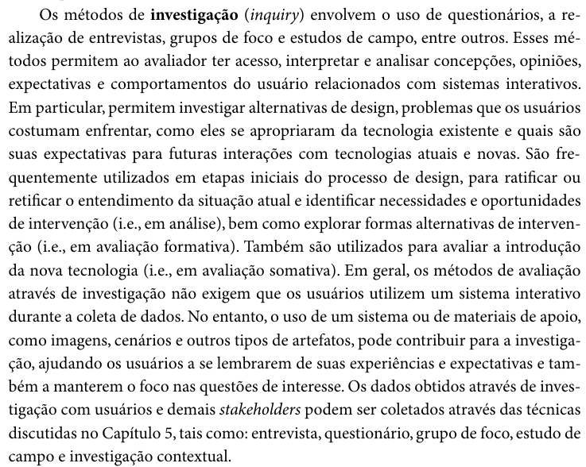

# Métodos de Avaliação em IHC: Investigação e Inspeção em Análise de Tarefas

- **Autor do Item Teórico:** [Edvaldo Soares Brasileiro Filho](https://github.com/PajeMurici-dev)
- **Revisor Designado:** [Vinicius Silva Araruna](https://github.com/ViniciusA05)
- **Referência Bibliográfica da Fonte:** BARBOSA, Simone Diniz Junqueira; SILVA, Bruno Santana da. *Interação Humano-Computador*. 1. ed. Rio de Janeiro: Elsevier, 2010. Capítulo 9: Planejamento da Avaliação de IHC, Seção 9.6: Qual Tipo de Método de Avaliação Escolher?, pp. 301–302.

---

## 1. Fundamentação Teórica

A avaliação de Interação Humano-Computador (IHC) é uma atividade essencial no ciclo de design e desenvolvimento para assegurar a qualidade de uso de sistemas interativos. Em projetos centrados no usuário, avaliar as tarefas executadas permite detectar problemas na interação e na interface antes que o produto final seja disponibilizado, reduzindo custos de retrabalho e prevenindo frustrações.

Segundo Barbosa e Silva (2010, p. 301), os métodos de avaliação de IHC subdividem-se classicamente em três grandes categorias: **métodos de investigação**, **métodos de inspeção** e **métodos de observação de uso**.

### 1.1 Métodos de Investigação (*Inquiry*)

Os métodos de investigação buscam coletar dados subjetivos e opiniões diretamente dos usuários e demais partes interessadas (*stakeholders*). Conforme conceituam Barbosa e Silva (2010, p. 301):

> *"Os métodos de investigação (inquiry) envolvem o uso de questionários, a realização de entrevistas, grupos de foco e estudos de campo, entre outros. Esses métodos permitem ao avaliador ter acesso, interpretar e analisar concepções, opiniões, expectativas e comportamentos do usuário relacionados com sistemas interativos. Em particular, permitem investigar alternativas de design, problemas que os usuários costumam enfrentar, como eles se apropriaram da tecnologia existente e quais são suas expectativas para futuras interações com tecnologias atuais e novas. São frequentemente utilizados em etapas iniciais do processo de design, para ratificar ou retificar o entendimento da situação atual e identificar necessidades e oportunidades de intervenção (i.e., em análise), bem como explorar formas alternativas de intervenção (i.e., em avaliação formativa). Também são utilizados para avaliar a introdução da nova tecnologia (i.e., em avaliação somativa). Em geral, os métodos de avaliação através de investigação não exigem que os usuários utilizem um sistema interativo durante a coleta de dados."* (BARBOSA; SILVA, 2010, p. 301).

Dentre as técnicas de investigação mais comuns no levantamento e análise de tarefas destacam-se:
- **Entrevistas e questionários:** para identificar o perfil dos usuários, suas motivações e suas queixas sobre os fluxos atuais;
- **Grupos de foco (*focus groups*):** para explorar divergências de expectativas em relação às tarefas apoiadas;
- **Investigação contextual e estudos de campo:** para analisar as tarefas no contexto real onde elas de fato acontecem.

### 1.2 Métodos de Inspeção (*Inspection*)

Os métodos de inspeção permitem aos avaliadores examinar a interface e o fluxo de tarefas guiados por princípios teóricos, sem necessariamente recrutar usuários finais em cada rodada de avaliação. Conforme ressaltam Barbosa e Silva (2010, p. 301):

> *"Os métodos de inspeção permitem ao avaliador examinar (ou inspecionar) uma solução de IHC para tentar antever as possíveis consequências de certas decisões de design sobre as experiências de uso. Em outras palavras, tentar identificar problemas que os usuários podem vir a ter quando interagirem com o sistema. Esses métodos geralmente não envolvem diretamente usuários e, portanto, tratam de experiências de uso potenciais, e não reais. Além de permitir comparar designs alternativos e buscar problemas em soluções de IHC, os métodos de inspeção permitem ainda avaliar a conformidade com um padrão ou guia de estilo."* (BARBOSA; SILVA, 2010, p. 301).

Dentre os métodos de inspeção mais aplicados à avaliação de tarefas na fase de design destacam-se:
- **Percurso Cognitivo (*Cognitive Walkthrough*):** inspeciona a interface passo a passo guiando-se estritamente pela sequência de ações que o usuário precisa executar para concluir uma tarefa (WHARTON et al., 1994; BARBOSA; SILVA, 2010, p. 322);
- **Avaliação Heurística:** verifica sistematicamente se diretrizes consagradas de usabilidade estão sendo respeitadas (NIELSEN, 1994; BARBOSA; SILVA, 2010, p. 316);
- **Método de Inspeção Semiótica (MIS):** analisa os signos e a metacomunicação da interface para avaliar se o sistema comunica adequadamente sua lógica ao usuário (DE SOUZA et al., 2006).

---

## 2. Quadro Comparativo: Investigação vs. Inspeção

A Tabela 1 sintetiza as distinções operacionais e os papéis dos métodos de investigação e de inspeção na avaliação da análise de tarefas em IHC.

**Tabela 1** — Comparativo entre Métodos de Investigação e Métodos de Inspeção (baseado em Barbosa e Silva, 2010)

| Dimensão de Análise | Métodos de Investigação (*Inquiry*) | Métodos de Inspeção (*Inspection*) |
| :--- | :--- | :--- |
| **Participação do Usuário** | Exige a participação direta de usuários ou stakeholders. | Não exige usuários; executado por especialistas/avaliadores. |
| **Natureza dos Dados** | Foco em opiniões, percepções, expectativas e relatos de experiência real. | Diagnóstico analítico de problemas potenciais e conformidade normativa. |
| **Momento Típico de Uso** | Etapas iniciais (análise de requisitos) e pós-implantação (avaliação somativa). | Ao longo de todo o ciclo de design iterativo (avaliação formativa rápida e de baixo custo). |
| **Exemplos Canônicos** | Entrevistas, questionários, grupos de foco, investigação contextual. | Percurso cognitivo, avaliação heurística, inspeção semiótica. |
| **Foco na Análise de Tarefas** | Compreender como as tarefas são concebidas e vivenciadas pelos usuários. | Avaliar se a sequência de passos da interface apoia com eficácia cada subobjetivo da tarefa (HTA). |

_Fonte: Elaborada pelo autor com base em Barbosa e Silva (2010, pp. 301–303, 362)._

---

## 3. Aplicação Prática no Projeto do Grupo 08 (Fórum Diolinux Plus)

No âmbito do projeto prático de IHC para o **Fórum Diolinux Plus**, a articulação entre investigação e inspeção de tarefas foi concretizada nas seguintes frentes da **Etapa 4**:

1. **Investigação da Tarefa:** A partir da análise dos questionários e do perfil de usuário levantados nas etapas anteriores, identificou-se que a tarefa de **Grade de Disponibilidade e Agendamento de Dúvidas / Mentorias** (Tarefa 3 do HTA) é crítica para o estudante aprendiz, viabilizando suporte síncrono estruturado para problemas técnicos complexos de Linux.
2. **Representação Visual e Cenários (Issue #64):** Os dados investigados fundamentaram a elaboração do Storyboard 3 em quadrinhos manuais (300 DPI), retratando o contexto situacional do estudante ao agendar um horário com um mentor voluntário.
3. **Planejamento do Relato e Severidade (Issue #65):** Estruturação do relatório formal de resultados categorizando as falhas identificadas segundo a escala clássica de severidade de Nielsen (0 a 4).
4. **Instrumentos de Observação e Registro (Issue #66):** Criação do roteiro comportamental e da planilha de anotações do avaliador (`observacao-avaliador.csv`), permitindo correlacionar a inspeção analítica com a posterior observação empírica de hesitações e erros.

---

## 4. Evidência Visual da Fonte Bibliográfica

A Figura 1 reproduz o trecho da **página 301** da obra *Interação Humano-Computador* (Barbosa & Silva, 2010), comprovando a conceituação acadêmica dos métodos de investigação e inspeção.

**Figura 1** — Registro textual dos Métodos de Investigação e Inspeção em IHC. (Fonte: Barbosa e Silva, 2010, p. 301).

---

## 5. Referências Bibliográficas

[1] BARBOSA, Simone Diniz Junqueira; SILVA, Bruno Santana da. *Interação Humano-Computador*. 1. ed. Rio de Janeiro: Elsevier, 2010. Capítulo 9: Planejamento da Avaliação de IHC, pp. 286–314.

[2] BARBOSA, Simone Diniz Junqueira; SILVA, Bruno Santana da; SILVEIRA, Milene Selbach; GASPARINI, Isabela; DARIN, Ticianne; BARBOSA, Gabriel Diniz Junqueira. *Interação Humano-Computador e Experiência do Usuário*. Rio de Janeiro: Autopublicação, 2021.

[3] DE SOUZA, Clarisse Sieckenius; LEITÃO, Carla Faria; PRATES, Raquel Oliveira; DA SILVA, Elton José. The Semiotic Inspection Method. *Anais do VII Simpósio Brasileiro de Fatores Humanos em Sistemas Computacionais (IHC 2006)*, pp. 148–157, 2006.

[4] NIELSEN, Jakob. Heuristic evaluation. In: NIELSEN, Jakob; MACK, Robert L. (Org.). *Usability Inspection Methods*. New York: John Wiley & Sons, 1994. pp. 25–62.

[5] WHARTON, Cathleen; RIEMAN, John; LEWIS, Clayton; POLSON, Peter. The Cognitive Walkthrough Method: A Practitioner's Guide. In: NIELSEN, Jakob; MACK, Robert L. (Org.). *Usability Inspection Methods*. New York: John Wiley & Sons, 1994. pp. 105–140.

---

**Autor do Item Teórico:** Edvaldo Soares Brasileiro Filho
