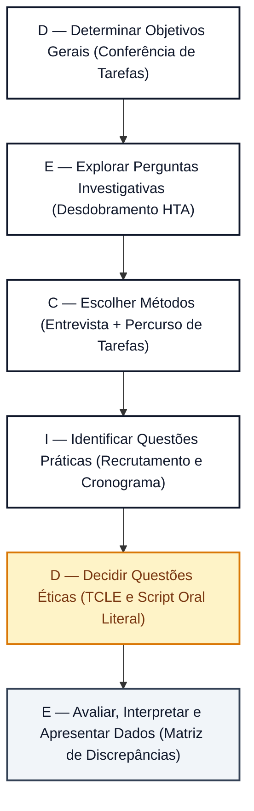

# Planejamento da Avaliação da Análise de Tarefas (Framework DECIDE)

## Tabela de Contribuição

A distribuição de responsabilidades na concepção metodológica, desdobramento dos objetivos e estruturação deste planejamento encontra-se detalhada na Tabela 1.

**Tabela 1** — Matriz de Contribuição e Transparência de IA Generativa

| Integrante | Atribuição no Artefato | Data | Horário | Ferramenta de IA | Propósito do Uso de IA |
| :--- | :--- | :---: | :---: | :--- | :--- |
| [Vinicius Silva Araruna](https://github.com/ViniciusA05) | Concepção metodológica, fundamentação do Framework DECIDE (Barbosa & Silva, 2021), elaboração das perguntas investigativas da Tarefa 1 (HTA/Markdown), script oral do TCLE e checklist | 12/10/2026 | 02:00 - 03:30 | Claude / Gemini | Apoio na organização sintática de tabelas Markdown e padronização visual. |
| [Gustavo Antonio Rodrigues e Silva](https://github.com/gus-ant) | Perguntas investigativas da Tarefa 2 (Cadastro e Onboarding com Discobot / Trust Levels), planejamento prático de sessões e revisão por pares | 12/10/2026 | 03:30 - 04:00 | Nenhuma | Auditoria humana cruzada dos critérios e adequação ao fluxo do novo usuário. |
| [Edvaldo Soares Brasileiro Filho](https://github.com/PajeMurici-dev) | Perguntas investigativas da Tarefa 3 (Busca Avançada e Filtros Facetados), matriz de discrepâncias de HTA e revisão ética | 12/10/2026 | 04:00 - 04:30 | Nenhuma | Verificação da rastreabilidade das questões de busca e conformidade do TCLE. |

_Fonte: Elaborada pelos autores, 2026._

---

## 1. Introdução

No Ciclo de Vida de Engenharia de Usabilidade preconizado por Mayhew (1999) e consolidado por Barbosa e Silva (2021, p. 115), a fase de **Design, Avaliação e Desenvolvimento** contempla a realização de avaliações formativas em estágios iniciais de concepção. No **Nível 1**, avaliam-se as modelagens conceituais preliminares antes da construção de protótipos de telas, assegurando que o entendimento da equipe sobre as necessidades do usuário esteja alinhado com o seu comportamento fático.

A **Análise de Tarefas** (representada pela Análise Hierárquica de Tarefas — HTA e modelos GOMS/CTT) constitui uma abordagem analítica que descreve como as pessoas realizam suas atividades em um sistema interativo em termos de objetivos, subobjetivos, operações e planos de execução (*Annett & Duncan, 1967; Card, Moran & Newell, 1983; Barbosa & Silva, 2021*). Contudo, por se tratar de uma modelagem inicialmente prescritiva, é indispensável confrontá-la empiricamente com usuários reais para verificar se os passos elementares e os caminhos de decisão modelados espelham a prática autêntica dos estudantes.

O presente documento estabelece o planejamento detalhado para a avaliação das três tarefas centrais do **Fórum Diolinux Plus** modeladas na Etapa 2, orientando-se estritamente para o papel de **Estudante / Usuário Aprendiz** (iniciante ou intermediário em Linux):

- **Tarefa 1:** Criação e Publicação de Tópico de Dúvida Técnica com Tags e Markdown (autor: Vinicius Silva Araruna);
- **Tarefa 2:** Cadastro e Onboarding do Novo Usuário com Discobot e Níveis de Confiança — Trust Levels (autor: Gustavo Antonio);
- **Tarefa 3:** Busca Avançada e Filtros Facetados de Categoria e Distribuição Linux (autor: Edvaldo Soares).

---

## 2. Fundamentação Teórica: O Framework DECIDE em IHC

Para assegurar validade científica e rigor metodológico, a avaliação da análise de tarefas foi estruturada no **Framework DECIDE**, desenvolvido por Preece, Rogers e Sharp (2002) e aprofundado por Rogers, Sharp e Preece (2013) e Barbosa e Silva (2021, Cap. 11, pp. 279–281).

O framework estrutura a condução da avaliação em seis etapas sequenciais interligadas:

- **D — Determinar (*Determine*)**: Fixar os objetivos gerais da avaliação de IHC e os impactos pretendidos no projeto;
- **E — Explorar (*Explore*)**: Desdobrar os objetivos gerais em questões investigativas objetivas e verificáveis;
- **C — Escolher (*Choose*)**: Selecionar métodos de avaliação compatíveis com a natureza conceitual das tarefas;
- **I — Identificar (*Identify*)**: Administrar questões práticas (recrutamento de participantes, infraestrutura, ferramentas e cronograma);
- **D — Decidir (*Decide*)**: Estabelecer salvaguardas bioéticas e legais (TCLE, LGPD e script oral de consentimento);
- **E — Avaliar (*Evaluate*)**: Definir previamente procedimentos de interpretação e consolidação dos achados para subsidiar o redesign da interface.

_Autor do Item Teórico: [Vinicius Silva Araruna](https://github.com/ViniciusA05)_  
*(Referencial teórico canônico fundamentado em Rogers, Sharp & Preece, 2013 e Barbosa & Silva, 2021, p. 280).*

A Figura 1 comprova a fundamentação teórica do Framework DECIDE na literatura canônica de IHC.

**Figura 1** — Trecho da literatura canônica de IHC detalhando as etapas do Framework DECIDE.  
_Fonte: Barbosa e Silva (2021, p. 280)._

A Figura 2 ilustra o fluxo de trabalho operacional do DECIDE adaptado à avaliação da Análise de Tarefas.

**Figura 2** — Fluxo das etapas do Framework DECIDE aplicado à avaliação da Análise de Tarefas.  
_Fonte: Elaborada pelos autores com base em Barbosa e Silva (2021), 2026._

---

## 3. D — Determinar os Objetivos da Avaliação da Análise de Tarefas

A avaliação formativa dos modelos de tarefas tem como finalidade contrastar a decomposição hierárquica construída pelos pesquisadores com o fluxo de raciocínio autêntico do usuário. Em consonância com Barbosa e Silva (2021, p. 281), foram estabelecidos quatro objetivos gerais:

1. **Validar a Completude e Acurácia dos Passos Operacionais:** Averiguar se todos os subobjetivos e operações elementares modelados nas Tarefas 1, 2 e 3 correspondem integralmente às ações necessárias para o alcance do objetivo final;
2. **Identificar se os Planos de Execução Hierárquicos são Naturais:** Avaliar se as regras lógicas e condicionais (sequência ordenada, seleção alternativa ou repetição) espelham a ordem espontânea de tomada de decisão do estudante;
3. **Mapear Lacunas Operacionais e Gargalos Cognitivos:** Descobrir etapas omitidas no modelo prescritivo, pontos de sobrecarga de memória de trabalho ou etapas da interface que induzem a erros recorrentes;
4. **Subsidiar a Prototipação com Recomendações de Automação:** Identificar operações redundantes ou complexas na HTA que possam ser simplificadas, automatizadas ou aceleradas na futura interface do sistema.

---

## 4. E — Explorar as Perguntas Investigativas

A Tabela 2 apresenta o desdobramento dos objetivos em perguntas investigativas específicas, distribuídas entre as três tarefas prioritárias do fórum para guiar a condução da sessão pelo entrevistador.

**Tabela 2** — Matriz de perguntas investigativas para avaliação da Análise de Tarefas

| Tarefa / Escopo | Nº | Pergunta Investigativa Específica | Foco de Observação e Critério de Sucesso |
| :--- | :---: | :--- | :--- |
| **Tarefa 1: Publicação com Tags e Markdown** | **PT01** | Ao precisar tirar uma dúvida técnica sobre Linux, você costuma redigir o corpo da dúvida antes ou depois de escolher a categoria e as tags? | Avaliar se a ordem sequencial do Plano 0 da HTA (título → categoria → tags → redação) reflete o fluxo espontâneo do usuário. |
| **Tarefa 1: Publicação com Tags e Markdown** | **PT02** | Quando você cola um comando ou log extenso do terminal, você utiliza a barra de ferramentas do editor ou atalhos de Markdown (como crases triplas)? | Confrontar os métodos alternativos modelados no CMN-GOMS e verificar o grau de conhecimento sobre blocos de código cercados. |
| **Tarefa 1: Publicação com Tags e Markdown** | **PT03** | O painel lateral de sugestão de tópicos semelhantes durante a digitação do título é útil ou interfere na sua concentração? | Avaliar a operação 2.2 da HTA e a receptividade do estudante frente aos mecanismos de desduplicação do Discourse. |
| **Tarefa 2: Cadastro e Onboarding Discobot** | **PT04** | Após criar a conta e ativá-la por e-mail, você prefere explorar o fórum imediatamente ou realizar o tutorial guiado do robô de boas-vindas? | Validar o ramo de escolha alternativa modelado na HTA (Operação 4.2 vs. 4.3) e no operador de escolha `[]` do CTT. |
| **Tarefa 2: Cadastro e Onboarding Discobot** | **PT05** | Você consideraria aceitável ter o upload de imagens e anexos bloqueado nas primeiras 24 horas após criar a conta? | Avaliar a percepção do estudante sobre as restrições antispam de Trust Level 0 (TL0) dissecadas na Análise Documental. |
| **Tarefa 3: Busca Avançada e Filtros** | **PT06** | Ao buscar solução para uma falha no Linux (ex.: problema de Wi-Fi), quais informações você busca primeiro na listagem de resultados? | Verificar a relevância atribuída a títulos, tags, data de postagem e ao badge de 'Solução Aceita' na HTA. |
| **Tarefa 3: Busca Avançada e Filtros** | **PT07** | Se a busca retornar muitos resultados genéricos, você costuma refinar os termos ou utilizar filtros de categoria e distribuição? | Avaliar a decisão de transição entre o Método de Busca Direta e o Método de Filtros Facetados no modelo GOMS. |
| **Geral / Modelo Mental** | **PT08** | Há alguma etapa no fluxo de realização dessas tarefas que parece desnecessária, confusa ou que está faltando? | Identificar operações atômicas ausentes na modelagem hierárquica ou passos que violam expectativas de usabilidade. |

_Fonte: Elaborada pelos autores com base em Barbosa e Silva (2021), 2026._

A Tabela 2 orienta a inquirição sobre a representação da HTA, permitindo confrontar a engenharia cognitiva da equipe com a realidade de campo.

---

## 5. C — Escolher os Métodos de Avaliação

Para a avaliação de Nível 1 da Análise de Tarefas, a equipe adotou a combinação entre **Entrevista Semiestruturada** e o método de **Percurso Conceitual Guiado de Tarefas (*Task Walkthrough*)** apoiado na técnica de verbalização concomitante adaptada (*Think Aloud*), conforme Barbosa e Silva (2021, p. 144) e Mayhew (1999).

!!! note "DIRETRIZ METODOLÓGICA MANDATÓRIA — INVESTIGAÇÃO VS. INSPEÇÃO (BARBOSA & SILVA, 2021)"
    O método adotado nesta avaliação é categoricamente de **INVESTIGAÇÃO EMPÍRICA (Entrevista Semiestruturada com Percurso Conceitual Guiado de Tarefas)**.  
    Como a avaliação de Nível 1 investiga a decomposição hierárquica e a lógica das operações (HTA/GOMS/CTT), **não se trata de teste de usabilidade em software** (não há código executável ou cronometragem mecânica de cliques) e **não se trata de método de inspeção analítica** (métodos de inspeção, como avaliação heurística ou percurso cognitivo por especialistas, dispensam usuários).  
    A sessão com o usuário é estritamente individual (1 Participante, 1 Entrevistador Condutor e 1 Observador/Anotador Silencioso), assegurando que o foco recaia sobre a verbalização do modelo mental do estudante e a validação das árvores de tarefas.

### Justificativa da Escolha Metodológica

1. **Percurso Procedural Passo a Passo:** O percurso conceitual permite que o entrevistador apresente cada subobjetivo e operação da HTA em sequência, solicitando que o estudante verbalize seu modelo mental e confirme se aquela é a forma mais lógica de agir;
2. **Identificação de Alternativas Ocultas:** A entrevista semiestruturada permite investigar por que o participante escolheria um caminho alternativo não previsto no plano de execução original;
3. **Economia de Recursos:** Método formativo de execução rápida e alta densidade qualitativa, viabilizando correções estruturais antes da prototipação interativa.

---

## 6. I — Identificar e Administrar as Questões Práticas

### 6.1 Perfil e Recrutamento dos Participantes

- **Público-Alvo:** Estudantes universitários de cursos de tecnologia (Engenharia de Software, Ciência da Computação, Engenharia de Redes ou correlatos) da Universidade de Brasília (campi FGA e Darcy Ribeiro);
- **Perfil de Experiência:** Usuários iniciantes ou intermediários em distribuições Linux e ferramentas colaborativas (Perfil 1 — Estudante Aprendiz);
- **Amostragem:** Serão recrutados **3 participantes voluntários reais** (P1, P2 e P3) para as sessões oficiais independentes (1 por tarefa), além de **1 discente voluntário para o Teste-Piloto prévio** (cujos dados não são computados nos resultados finais), em estrita conformidade com o modelo assintótico de Nielsen e Landauer (1993) e Krug (2010);
- **Critério de Inclusão:** Estar cursando graduação em computação ou tecnologia e já ter enfrentado dúvidas de terminal ou configuração no ecossistema Linux;
- **Critério de Exclusão e Imparcialidade:** Nenhum participante pode possuir vínculo com o desenvolvimento do projeto de IHC do Grupo 08.

### 6.2 Infraestrutura Tecnológica e Ferramentas

- **Ambiente:** Sessões síncronas remotas no Google Meet;
- **Visualização de Artefatos:** Compartilhamento de tela exibindo os diagramas HTA em tema claro e as tabelas analíticas de decomposição em alta resolução;
- **Instrumentos de Registro:** Gravação audiovisual em 1080p autorizada verbalmente nos primeiros 60 segundos, combinada com notas de observação tomadas em tempo real.

### 6.3 Cronograma Planejado das Sessões Integradas

A Tabela 3 apresenta a distribuição das sessões de avaliação da análise de tarefas. Em cada sessão de entrevista de 40 minutos, a Análise de Tarefas é **conduzida imediatamente após a validação do Storyboard** (Bloco 2 — 15 a 20 min), permitindo ao participante avaliar a estrutura dos planos lógicos e a decomposição operacional após já ter compreendido a narrativa e a ambientação geral da funcionalidade.

**Tabela 3** — Cronograma planejado das sessões de avaliação da Análise de Tarefas

| Sessão / Etapa | Data | Horário | Entrevistador Principal | Observador / Anotador | Participante Convidado / Papel |
| :---: | :---: | :---: | :--- | :--- | :--- |
| **Teste-Piloto** | 17/10/2026 | 14:00 - 14:40 | [Vinicius Silva Araruna](https://github.com/ViniciusA05) | [Gustavo Antonio](https://github.com/gus-ant) | Colega discente de TI (Simulação de Ensaio) |
| **ST01** | 19/10/2026 | 14:00 - 14:40 | [Vinicius Silva Araruna](https://github.com/ViniciusA05) | [Gustavo Antonio](https://github.com/gus-ant) | Participante 1 (P1 — Estudante de Graduação) |
| **ST02** | 20/10/2026 | 15:00 - 15:40 | [Gustavo Antonio](https://github.com/gus-ant) | [Vinicius Silva Araruna](https://github.com/ViniciusA05) | Participante 2 (P2 — Estudante de Graduação) |
| **ST03** | 21/10/2026 | 16:00 - 16:40 | [Edvaldo Soares](https://github.com/PajeMurici-dev) | [Vinicius Silva Araruna](https://github.com/ViniciusA05) | Participante 3 (P3 — Estudante de Graduação) |
| **ST04 (Reserva)** | 22/10/2026 | 14:00 - 14:40 | [Vinicius Silva Araruna](https://github.com/ViniciusA05) | [Edvaldo Soares](https://github.com/PajeMurici-dev) | Participante 4 (P4 — Estudante de Graduação) |

_Fonte: Elaborada pelos autores, 2026._

### 6.4 Papel do Teste-Piloto de Nível 1

Em consonância com as boas práticas metodológicas de avaliação em IHC (*Barbosa & Silva, 2021*):

> O teste-piloto destina-se exclusivamente a **testar e aprimorar o planejamento da avaliação** (temporização das perguntas, inteligibilidade do roteiro de tarefas, áudio, compartilhamento de tela e leitura do TCLE). O teste-piloto **NUNCA** avalia a interface ou o usuário, e **seus dados não são computados nos resultados finais da avaliação**.

O teste-piloto será conduzido no dia 17/10/2026 às 14:00 com um discente voluntário simulando o papel de participante para calibrar o roteiro de tarefas e o compartilhamento de tela dos diagramas HTA.

---

## 7. D — Decidir como Lidar com as Questões Éticas

A avaliação segue rigorosamente a **Resolução CNS nº 510/2016**, a **LGPD (Lei nº 13.709/2018)** e os **4 Princípios Bioéticos** de Beauchamp e Childress (1979/2013):

1. **Autonomia:** Voluntariedade plena, com direito de revogação a qualquer momento sem penalidades;
2. **Beneficência:** Contribuição direta para o aprimoramento da usabilidade e do suporte à comunidade de software livre;
3. **Não-Maleficência:** Garantia de ausência de julgamento ou desconforto frente a eventuais hesitações na análise dos diagramas;
4. **Justiça:** Respeito à igualdade de tratamento e confidencialidade irrestrita das opiniões manifestadas.

### Script Oral Padronizado de Leitura do TCLE (Primeiros 60 Segundos)

O entrevistador deve obrigatoriamente ler o texto em destaque a seguir nos **primeiros 60 segundos gravados** da chamada:

> **[INÍCIO DO SCRIPT ORAL — LEITURA OBRIGATÓRIA NOS PRIMEIROS 60 SEGUNDOS GRAVADOS]**  
> *"Olá, meu nome é [Nome do Entrevistador], sou discente de Engenharia de Software da Faculdade UnB Gama (FGA/UnB) e estou conduzindo esta avaliação no âmbito da disciplina de Interação Humano-Computador, sob docência do Prof. Dr. André Barros de Sales.*  
> *O propósito desta sessão é avaliar um modelo conceitual de análise de tarefas que descreve o fluxo de ações para uso do Fórum Diolinux Plus por estudantes universitários. Esclareço que o objeto de avaliação é exclusivamente o modelo de tarefas proposto pela equipe, e JAMAIS você ou suas capacidades.*  
> *Sua participação é completamente voluntária e você possui liberdade total para interromper a chamada ou revogar seu consentimento a qualquer instante, sem nenhum prejuízo. Todas as informações coletadas, bem como a gravação audiovisual desta sessão, serão tratadas sob anonimato e sigilo estrito conforme a Lei Geral de Proteção de Dados, para fins unicamente educacionais.*  
> *Você teve acesso prévio ao Termo de Consentimento Livre e Esclarecido e concorda formalmente em participar desta avaliação gravada nos termos descritos?"*  
> **[AGUARDAR CONSENTIMENTO VERBAL EXPLÍCITO DO PARTICIPANTE: "SIM, CONCORDO"]**

---

## 8. E — Avaliar, Interpretar e Apresentar os Dados

Os dados qualitativos coletados serão tratados através de **análise temática de discrepâncias** (*Barbosa & Silva, 2021*), confrontando o que foi prescrito nos diagramas com o relato do participante.

A Tabela 4 apresenta o modelo formal que será utilizado no documento de consolidação de resultados para documentar cada divergência encontrada e orientar a reestruturação da HTA e dos modelos GOMS.

**Tabela 4** — Modelo de registro de discrepâncias na modelagem HTA e sugestões de ajuste

| ID da Discrepância | Tarefa Avaliada | Elemento da HTA (Objetivo / Operação / Plano) | Descrição da Divergência com o Modelo Mental | Impacto na Eficiência do Usuário | Proposta de Reestruturação do Modelo de Tarefas |
| :---: | :--- | :--- | :--- | :---: | :--- |
| **DISC-HTA-01** | Tarefa 1 (Markdown e Tags) | Plano 0 (Sequência 1 a 5) | Exemplo: Usuário redige texto antes de preencher categoria/tags. | Médio | Flexibilizar Plano 0 para permitir ordem livre entre os passos 2, 3 e 4. |
| **DISC-HTA-02** | Tarefa 2 (Cadastro e Onboarding) | Operação 4.2 (Tutorial Discobot) | Exemplo: Participante desconhece a relação entre o Discobot e os Trust Levels. | Alto | Inserir feedback visual explícito relacionando o tutorial aos privilégios de TL1. |
| **DISC-HTA-03** | Tarefa 3 (Busca e Filtros) | Operação 2.2 (Filtros Avançados) | Exemplo: Usuário tenta digitar filtro de distro direto no campo simples. | Médio | Modelar suporte a operadores inline de busca (ex.: `distro:mint`). |

_Fonte: Elaborada pelos autores com base em Barbosa e Silva (2021), 2026._

---

## 9. Lista de Verificação da Técnica (Planejamento da Análise de Tarefas)

A Tabela 5 apresenta a autoavaliação da conformidade do planejamento da avaliação da análise de tarefas frente aos critérios do Plano de Ensino da disciplina (*Sales, 2026*) e da literatura canônica de IHC (*Barbosa & Silva, 2021; Preece et al., 2002*).

**Tabela 5** — Lista de verificação da técnica: Planejamento da Avaliação da Análise de Tarefas

| ID | Questão Avaliada | Origem / Fonte Normativa | Conforme? | Resposta Autoexplicativa e Evidência no Artefato |
| :---: | :--- | :--- | :---: | :--- |
| **CHK-AT-01** | O planejamento da avaliação fundamenta-se nas seis etapas do Framework DECIDE? | Preece et al. (2002); Barbosa & Silva (2021, p. 280) | ✅ Sim | As Seções 3 a 8 deste documento operacionalizam explicitamente as etapas D, E, C, I, D e E. |
| **CHK-AT-02** | O artefato apresenta fundamentação teórica com linha formal de autoria e print do livro canônico? | Padrão Pedagógico FGA/UnB (*Sales, 2026*) | ✅ Sim | A Seção 2 apresenta fundamentação, linha de autoria de Vinicius Silva Araruna e a Figura 1 com evidência imagética. |
| **CHK-AT-03** | As três tarefas centrais do projeto (Markdown/Tags, Onboarding/Discobot e Busca) são contempladas? | Diretrizes de IHC da Equipe | ✅ Sim | A Tabela 2 estrutura perguntas investigativas específicas para as Tarefas 1, 2 e 3 modeladas na Etapa 2. |
| **CHK-AT-04** | O método de avaliação selecionado combina entrevista com percurso guiado de tarefas (*Walkthrough*)? | Mayhew (1999); Barbosa & Silva (2021) | ✅ Sim | A Seção 5 detalha a condução da sessão com inspeção passo a passo dos subobjetivos da HTA. |
| **CHK-AT-05** | O público-alvo dos testes respeita os critérios do papel central de Estudante / Aprendiz em Linux? | Perfil de Usuário do Projeto | ✅ Sim | A Seção 6.1 restringe os participantes a estudantes de graduação iniciantes/intermediários. |
| **CHK-AT-06** | O documento inclui o Script Oral Literal de leitura prévia do TCLE nos primeiros 60 segundos gravados? | Resolução CNS nº 510/2016; Diretrizes da Disciplina | ✅ Sim | A Seção 7 transcreve o texto literal em destaque com a solicitação obrigatória de consentimento gravado. |
| **CHK-AT-07** | Todas as tabelas e figuras possuem numeração, legendas, fontes e chamadas formais no texto? | Padrão Editorial FGA/UnB | ✅ Sim | 100% das 5 tabelas e 2 figuras possuem chamadas nominais antecedentes no texto (zero tabelas/figuras órfãs). |

_Fonte: Elaborada pelos autores com base em Barbosa e Silva (2021) e Sales (2026), 2026._

---

## 10. Histórico de Versão

A Tabela 6 documenta o histórico evolutivo deste artefato.

**Tabela 6** — Histórico de versão do documento

| Versão | Data | Descrição Detalhada da Modificação | Autor(es) | Revisor(es) |
| :---: | :---: | :--- | :--- | :--- |
| `1.0` | 12/10/2026 | Elaboração inicial do Planejamento da Avaliação da Análise de Tarefas estruturado no Framework DECIDE, cobrindo objetivos, perguntas investigativas das Tarefas 1, 2 e 3 (Tabela 2), questões práticas, script oral do TCLE, modelo de discrepâncias de HTA (Tabela 4) e checklist com 7 itens (Issue #56). | [Vinicius Silva Araruna](https://github.com/ViniciusA05) | [Gustavo Antonio](https://github.com/gus-ant), [Edvaldo Soares Brasileiro Filho](https://github.com/PajeMurici-dev) |

_Fonte: Elaborada pelos autores, 2026._

---

## 11. Referências Bibliográficas

[1] ANNETT, John; DUNCAN, Keith D. *Task analysis and training design*. Journal of Occupational Psychology, v. 41, n. 4, p. 211-221, 1967.

[2] BARBOSA, Simone Diniz Junqueira; SILVA, Bruno Santana da. *Interação Humano-Computador*. 1. ed. Rio de Janeiro: Elsevier / Campus, 2010.

[3] BARBOSA, Simone Diniz Junqueira et al. *Interação Humano-Computador e Experiência do Usuário*. 1. ed. Rio de Janeiro: Autopublicação, 2021.

[4] BEAUCHAMP, Tom L.; CHILDRESS, James F. *Principles of Biomedical Ethics*. 7. ed. New York: Oxford University Press, 2013.

[5] BRASIL. *Resolução nº 510, de 7 de abril de 2016*. Dispõe sobre as normas aplicáveis a pesquisas em Ciências Humanas e Sociais. Conselho Nacional de Saúde, Brasília, DF, 2016.

[6] BRASIL. *Lei nº 13.709, de 14 de agosto de 2018*. Lei Geral de Proteção de Dados Pessoais (LGPD). Diário Oficial da União, Brasília, DF, 2018.

[7] CARD, Stuart K.; MORAN, Thomas P.; NEWELL, Allen. *The Psychology of Human-Computer Interaction*. Hillsdale: Lawrence Erlbaum Associates, 1983.

[8] MAYHEW, Deborah J. *The Usability Engineering Lifecycle: A Practitioner's Handbook for User Interface Design*. San Francisco: Morgan Kaufmann, 1999.

[9] NIELSEN, Jakob. *Usability Engineering*. San Francisco: Morgan Kaufmann, 1994.

[10] PREECE, Jennifer; ROGERS, Yvonne; SHARP, Helen. *Interaction Design: beyond human-computer interaction*. New York: John Wiley & Sons, 2002.

[11] ROGERS, Yvonne; SHARP, Helen; PREECE, Jennifer. *Design de Interação: além da interação humano-computador*. 3. ed. Porto Alegre: Bookman, 2013.

[12] SALES, André Barros de. *Plano de Ensino da Disciplina de Interação Humano Computador*. Brasília: Universidade de Brasília, Faculdade UnB Gama (FGA), 2026.

---

## Agradecimentos e Uso de Inteligência Artificial (IA) Generativa

Durante a organização sintática do Markdown e a diagramação visual das matrizes tabulares deste artefato, contou-se com o auxílio supervisionado de modelos de Inteligência Artificial Generativa (LLM). A concepção metodológica das metas DECIDE, formulação das questões investigativas de HTA, redação do script oral do TCLE e auditoria técnica foram concebidas e validadas integralmente pelos discentes do Grupo 08.
