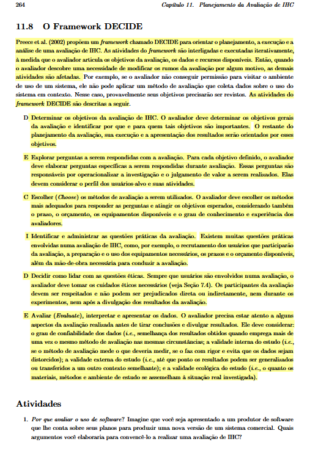
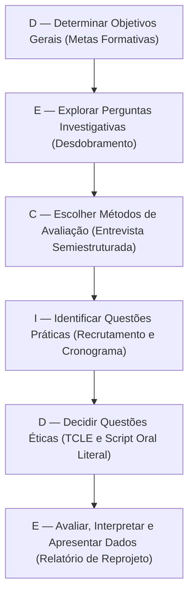

# Planejamento da Avaliação do Storyboard (Framework DECIDE)

## Tabela de Contribuição

A distribuição de responsabilidades na concepção metodológica, desdobramento dos objetivos e estruturação deste planejamento encontra-se detalhada na Tabela 1.

**Tabela 1** — Matriz de Contribuição e Transparência de IA Generativa

| Integrante | Atribuição no Artefato | Data | Horário | Ferramenta de IA | Propósito do Uso de IA |
| :--- | :--- | :---: | :---: | :--- | :--- |
| [Vinicius Silva Araruna](https://github.com/ViniciusA05) | Concepção metodológica, fundamentação do Framework DECIDE (Barbosa & Silva, 2021), elaboração das perguntas investigativas da Tarefa 1, script oral do TCLE e checklist | 12/10/2026 | 02:00 - 03:30 | Claude / Gemini | Apoio na organização sintática de tabelas Markdown e padronização visual. |
| [Gustavo Antonio Rodrigues e Silva](https://github.com/gus-ant) | Perguntas investigativas da Tarefa 2 (Criação de Eventos Presenciais — CF02), planejamento de infraestrutura e alinhamento metodológico (#104) | 22/10/2026 | 03:30 - 04:00 | Nenhuma | Auditoria humana cruzada dos critérios e adequação ao perfil de organizador da comunidade. |
| [Edvaldo Soares Brasileiro Filho](https://github.com/PajeMurici-dev) | Perguntas investigativas da Tarefa 3 (Busca Avançada e Filtros), matriz de consolidação qualitativa e revisão ética | 12/10/2026 | 04:00 - 04:30 | Nenhuma | Verificação da rastreabilidade das questões de busca e conformidade do TCLE. |

_Fonte: Vinicius Silva Araruna, Gustavo Antonio Rodrigues e Silva e Edvaldo Soares Brasileiro Filho, 2026._

---

## 1. Introdução

No Ciclo de Vida de Engenharia de Usabilidade proposto por Mayhew (1999) e aprofundado por Barbosa e Silva (2021, p. 115), a fase de **Design, Avaliação e Desenvolvimento** estrutura-se em níveis evolutivos de maturidade. No **Nível 1**, o foco analítico recai sobre a avaliação formativa de concepções preliminares de design, materializadas por meio de **Storyboards** e modelos de **Análise de Tarefas**.

O **Storyboard** consiste em uma técnica de prototipação de baixa fidelidade originária das artes cinematográficas, amplamente consolidada em Interação Humano-Computador para ilustrar narrativas contextuais de uso (*Cooper, 1999; Rogers, Sharp & Preece, 2013*). Por meio de uma sequência visual de quadros estáticos acompanhados de legendas descritivas, o storyboard contextualiza o usuário antes, durante e após a interação com o sistema, evidenciando suas motivações, frustrações e o desfecho proporcionado pela interface.

Avaliar os storyboards antes de avançar para a prototipação de telas e fluxos de alta complexidade assegura que premissas conceituais incorretas, incoerências na ordem das ações ou representações irreais do comportamento do usuário sejam identificadas e sanadas precocemente. Este documento estabelece o planejamento rigoroso da avaliação dos storyboards elaborados para o **Fórum Diolinux Plus**, direcionado estritamente ao papel funcional de **Estudante / Usuário Aprendiz** (iniciante ou intermediário no ecossistema Linux).

---

## 2. Fundamentação Teórica: O Framework DECIDE em IHC

Para assegurar validade científica, reprodutibilidade e abrangência, este planejamento foi estruturado com base no **Framework DECIDE**, concebido por Preece, Rogers e Sharp (2002) e reiterado por Rogers, Sharp e Preece (2013) e Barbosa e Silva (2021, Cap. 11, pp. 279–281).

O framework orienta o avaliador por meio de seis atividades interconectadas, cujas iniciais compõem o acrônimo **DECIDE**:

- **D — Determinar (*Determine*)**: Estabelecer os objetivos gerais da avaliação de IHC e identificar quem são as partes interessadas nos resultados;
- **E — Explorar (*Explore*)**: Decompor os objetivos gerais em questões investigativas específicas a serem respondidas durante as sessões;
- **C — Escolher (*Choose*)**: Selecionar os métodos de avaliação apropriados, ponderando custos, prazos, perfil dos usuários e fidelidade dos artefatos;
- **I — Identificar (*Identify*)**: Administrar as questões práticas da avaliação, incluindo seleção de participantes, ferramentas, infraestrutura e cronograma;
- **D — Decidir (*Decide*)**: Planejar as diretrizes éticas e bioéticas da pesquisa, garantindo respeito à dignidade, consentimento informado e privacidade dos voluntários;
- **E — Avaliar (*Evaluate*)**: Definir previamente as estratégias de interpretação e apresentação dos dados coletados, gerando recomendações acionáveis de reprojeto.

_Autor do Item Teórico: [Vinicius Silva Araruna](https://github.com/ViniciusA05)_  
*(Referencial teórico canônico fundamentado em Rogers, Sharp & Preece, 2013 e Barbosa & Silva, 2021, p. 280).*

A Figura 1 apresenta a comprovação teórica do Framework DECIDE extraída diretamente da literatura canônica de IHC.

**Figura 1** — Trecho da literatura canônica de IHC detalhando as etapas do Framework DECIDE.  
_Fonte: Barbosa e Silva (2021, p. 280)._

A Figura 2 sintetiza o fluxo relacional das seis dimensões operacionais do framework aplicadas a esta avaliação.

**Figura 2** — Fluxo sequencial das etapas do Framework DECIDE na avaliação do Storyboard.  
_Fonte: Vinicius Silva Araruna, Gustavo Antonio Rodrigues e Silva e Edvaldo Soares Brasileiro Filho com base em Barbosa e Silva (2021), 2026._

---

## 3. D — Determinar os Objetivos da Avaliação do Storyboard

A avaliação dos storyboards possui caráter **formativo**, orientando as decisões de design da equipe antes da confecção de protótipos de interface. Em conformidade com Barbosa e Silva (2021, p. 281), foram estabelecidos quatro objetivos gerais para a investigação:

1. **Avaliar a Apropriação Tecnológica e Verossimilhança:** Verificar se a narrativa visual espelha com fidelidade o cotidiano, as motivações e as barreiras reais enfrentadas por estudantes universitários ao utilizar o Fórum Diolinux Plus;
2. **Identificar Problemas de Interação e Compreensão Conceitual:** Detectar se a progressão dos quadros apresenta saltos lógicos, premissas de navegação confusas ou expectativas de resposta do sistema incompatíveis com o modelo mental do usuário;
3. **Avaliar a Clareza da Estrutura Narrativa:** Averiguar se o encadeamento dramático (contextualização do problema, busca de ajuda no fórum, interação com a comunidade e resolução da falha) é perfeitamente legível e compreensível para o participante;
4. **Coletar Ideias de Design e Oportunidades de Melhoria:** Extrair percepções e sugestões espontâneas dos participantes para enriquecer os requisitos de prototipação das três tarefas centrais do projeto.

---

## 4. E — Explorar as Perguntas Investigativas

Com base nos quatro objetivos gerais fixados, a Tabela 2 apresenta o desdobramento em perguntas investigativas específicas formuladas para guiar a condução da sessão pelo entrevistador.

**Tabela 2** — Matriz de perguntas investigativas para avaliação dos Storyboards

| Objetivo Associado | Nº | Pergunta Investigativa Específica | Foco de Observação e Critério de Sucesso |
| :--- | :---: | :--- | :--- |
| **Apropriação e Verossimilhança** | **P01** | A situação retratada no início do storyboard representa um problema plausível que você já vivenciou ou poderia vivenciar no Linux? | Avaliar se a dor contextualizada (ex.: falha de driver, erro de compilação ou dúvida de terminal) é percebida como autêntica. |
| **Apropriação e Verossimilhança** | **P02** | As reações, falas e comportamentos do personagem ao longo dos quadros soam naturais para um estudante? | Verificar se o perfil da persona expressa linguagem e frustrações realistas, sem artificialidade ou excesso de formalismo. |
| **Estrutura Narrativa** | **P03** | A sequência de acontecimentos entre o primeiro e o último quadro está clara e fácil de acompanhar? | Identificar se há rupturas no fluxo temporal ou passagens de cena que exigem explicação verbal externa do entrevistador. |
| **Estrutura Narrativa** | **P04** | Os elementos visuais (expressões dos personagens, telas de computador, balões de texto e legendas) são legíveis e autoexplicativos? | Avaliar a eficácia da comunicação gráfica, composição dos quadros e contraste das ilustrações. |
| **Problemas de Interação** | **P05** | A forma como o personagem resolve sua dúvida no Fórum Diolinux Plus corresponde ao que você esperaria fazer no sistema real? | Confrontar a solução retratada com o modelo mental do usuário frente aos recursos do Discourse (tags, formatação, busca e criação de eventos presenciais). |
| **Problemas de Interação** | **P06** | Houve alguma etapa na história que pareceu forçada, desnecessária ou que omitiu um passo essencial da tarefa? | Mapear lacunas operacionais nas três tarefas modeladas (Markdown/Tags, Criação de Eventos Presenciais ou Busca/Filtros). |
| **Oportunidades de Design** | **P07** | O desfecho da narrativa representou uma resolução satisfatória para a necessidade do personagem? | Averiguar se a intervenção proposta pela equipe proporciona percepção positiva de utilidade e eficácia. |
| **Oportunidades de Design** | **P08** | Que funcionalidade ou elemento de interface você acrescentaria ou modificaria para tornar essa interação mais ágil e intuitiva? | Elicitar requisitos refinados de design para os futuros protótipos de baixa e alta fidelidade. |

_Fonte: Vinicius Silva Araruna, Gustavo Antonio Rodrigues e Silva e Edvaldo Soares Brasileiro Filho com base em Rogers, Sharp e Preece (2013), 2026._

A Tabela 2 assegura que o entrevistador mantenha a investigação focada em respostas objetivas, sem desviar das metas de Engenharia de Usabilidade do projeto.

---

## 5. C — Escolher os Métodos de Avaliação

Para avaliar os storyboards no Nível 1, a equipe selecionou o método de **Investigação Empírica com Usuários por meio de Entrevistas Semiestruturadas** (*Barbosa & Silva, 2021, p. 144*), com apoio de roteiro visual dirigido.

!!! note "DIRETRIZ METODOLÓGICA MANDATÓRIA — INVESTIGAÇÃO VS. INSPEÇÃO (BARBOSA & SILVA, 2021)"
    O método adotado nesta avaliação é categoricamente de **INVESTIGAÇÃO EMPÍRICA (Entrevista Semiestruturada Individual)**.  
    Como a avaliação de Nível 1 trata de representações conceituais preliminares e estáticas (Storyboards), **não se trata de teste de usabilidade clássico** (não há software interativo ou métricas de cliques/tempo) e **não se trata de método de inspeção** (métodos de inspeção, como avaliação heurística ou percurso cognitivo, são executados exclusivamente por especialistas e avaliadores de IHC, sem a presença de usuários).  
    A dinâmica ocorre em sessões individuais com foco na concentração e acolhimento do voluntário: **1 Avaliador Responsável** (que conduz a inquirição e registra os apontamentos essenciais) e **1 Participante Voluntário**, garantindo um ambiente silencioso, livre de constrangimento ou intimidação, com foco absoluto na narrativa e no modelo mental do usuário.

### Justificativa da Escolha Metodológica

1. **Compatibilidade com Baixa Fidelidade:** Storyboards são representações estáticas e narrativas, não permitindo testes de usabilidade baseados em métricas quantitativas de desempenho (tempo de tarefa ou cliques). A entrevista semiestruturada permite explorar em profundidade os sentimentos, impressões e o raciocínio crítico do participante;
2. **Flexibilidade Investigativa:** O formato semiestruturado garante que o entrevistador siga o roteiro padronizado da Tabela 2, mas mantenha liberdade para formular perguntas de aprofundamento diante de reações inesperadas ou comentários ricos do usuário;
3. **Custo Operacional e Agilidade:** Permite sessões de curta duração (20 a 30 minutos), viabilizando rápida consolidação de dados e ciclos ágeis de retrabalho na equipe antes do fechamento da Entrega 4.

---

## 6. I — Identificar e Administrar as Questões Práticas

### 6.1 Perfil e Recrutamento dos Participantes

Em estrita consonância com o Perfil do Usuário e com as diretrizes metodológicas da equipe:

- **Público-Alvo:** Estudantes universitários de cursos de tecnologia (Engenharia de Software, Ciência da Computação, Engenharia de Redes ou correlatos) da Universidade de Brasília (campi FGA e Darcy Ribeiro);
- **Faixa Etária e Experiência:** 18 a 30 anos, classificados como usuários iniciantes ou intermediários no ecossistema Linux (Perfil 1 — Estudante Aprendiz);
- **Amostragem:** Serão recrutados **3 participantes voluntários reais** (P1, P2 e P3) para as sessões oficiais independentes (1 por tarefa), além de **1 discente voluntário para o Teste-Piloto prévio** (cujos dados não são computados nos resultados finais), em estrita conformidade com o modelo assintótico de Nielsen e Landauer (1993) e Krug (2010);
- **Critério de Inclusão:** Ter utilizado ao menos uma distribuição Linux nos últimos 12 meses e ter experiência prévia de consulta ou participação em fóruns técnicos na web;
- **Critério de Exclusão e Imparcialidade:** Nenhum participante pode possuir vínculo com o desenvolvimento do projeto de IHC do Grupo 08.

### 6.2 Infraestrutura Tecnológica e Ferramentas Presenciais

A realização presencial potencializa a **validade ecológica** da avaliação (Barbosa & Silva, 2021, p. 278), pois aproxima a experiência do voluntário de uma interação natural com artefatos de baixa fidelidade:

- **Ambiente Físico Silencioso:** Salas de estudo individuais ou mesas reservadas no Prédio UAC / Biblioteca da FGA/UnB, garantindo ambiente silencioso que favoreça a concentração e a naturalidade do participante;
- **Exibição e Manuseio Físico do Material:** Pranchas físicas de Storyboard impressas individualmente em folhas A4 com alta resolução gráfica (300 DPI), permitindo ao participante folhear, ordenar sequências, apontar detalhes dos quadrinhos sobre a mesa e expressar reações espontâneas;
- **Instrumentos de Registro Audiovisual:** Smartphone ou notebook posicionado de forma estável sobre a mesa capturando imagem e áudio com acústica natural da sala silenciosa, dispensando o uso de tripés ou microfones dedicados;
- **Instrumentos Éticos e de Anotação:** Vias impressas do TCLE para assinatura física e planilha de observação (`observacao-avaliador.csv`) para preenchimento pelo avaliador logo após a sessão.

### 6.3 Cronograma Planejado das Sessões

A Tabela 3 apresenta a distribuição das sessões de avaliação do storyboard, com os horários e a atribuição de papéis entre os integrantes da equipe.

**Tabela 3** — Cronograma planejado das sessões presenciais de avaliação do Storyboard (Condução Individual)

| Sessão | Data | Horário | Storyboard Avaliado | Avaliador Responsável | Participante Convidado | Local Físico (Ambiente Silencioso) |
| :---: | :---: | :---: | :--- | :--- | :--- | :--- |
| **S01** | 22/10/2026 | 14:00 - 14:40 | Storyboard 1 (Markdown e Tags com IA) | [Vinicius Silva Araruna](https://github.com/ViniciusA05) | Participante 1 (P1 — Graduando CIC/UnB) | Presencial — Residência do Participante P1 (Ambiente Domiciliar) |
| **S02** | 22/10/2026 | 15:00 - 15:40 | Storyboard 2 (Criação de Eventos Presenciais) | [Gustavo Antonio](https://github.com/gus-ant) | Participante 2 (P2 — Graduando UnB) | Presencial — FGA/UnB (Salas de Estudo UAC) |
| **S03** | 22/10/2026 | 16:00 - 16:40 | Storyboard 3 (Busca Avançada) | [Edvaldo Soares](https://github.com/PajeMurici-dev) | Participante 3 (P3 — Graduando UnB) | Presencial — FGA/UnB (Salas de Estudo UAC) |

_Fonte: Vinicius Silva Araruna, Gustavo Antonio Rodrigues e Silva e Edvaldo Soares Brasileiro Filho, 2026._

### 6.4 Papel e Execução do Teste-Piloto de Nível 1

Conforme preconizado pela literatura de IHC (*Barbosa & Silva, 2021, p. 280*) e pelo padrão metodológico adotado pela equipe:

> O teste-piloto tem como função exclusiva avaliar o **planejamento da avaliação** (clareza das perguntas, enquadramento do dispositivo sobre a mesa, ambiente silencioso para concentração do participante, manuseio prático das pranchas impressas e temporização do TCLE nos primeiros 60 segundos gravados). O teste-piloto **NUNCA** avalia o usuário ou o storyboard, e **os dados obtidos no teste-piloto JAMAIS são computados nos resultados finais da avaliação**.

O ensaio geral do teste-piloto será conduzido presencialmente no campus da FGA/UnB no dia 21/10/2026 às 14:00 com um discente voluntário simulando o papel de participante para calibrar a logística e a gravação antes da ida a campo oficial.

---

## 7. D — Decidir como Lidar com as Questões Éticas

A condução das entrevistas obedece com rigor à **Resolução CNS nº 510/2016** (Diretrizes Éticas para Pesquisas em Ciências Humanas e Sociais), à **Lei Geral de Proteção de Dados Pessoais (LGPD — Lei nº 13.709/2018)** e aos **4 Princípios Bioéticos** consolidados por Beauchamp e Childress (1979/2013):

1. **Princípio da Autonomia:** O participante tem plena liberdade de consentir ou recusar sua participação, podendo interromper a sessão a qualquer instante sem nenhuma penalidade;
2. **Princípio da Beneficência:** A pesquisa busca aprimorar a usabilidade e a experiência dos estudantes no Fórum Diolinux Plus, gerando conhecimento acadêmico benéfico à comunidade;
3. **Princípio da Não-Maleficência:** Garantia de que o voluntário não será exposto a riscos físicos, psicológicos, constrangimentos ou julgamento de suas capacidades cognitivas;
4. **Princípio da Justiça e Equidade:** Tratamento respeitoso, inclusivo e equitativo a todos os participantes, assegurando distribuição justa de benefícios e encargos.

### Script Oral Padronizado de Leitura do TCLE (Primeiros 60 Segundos)

Para garantir a validade jurídica e a conformidade ética da gravação, o entrevistador deve ler literalmente o texto em destaque a seguir nos **primeiros 60 segundos** de gravação, antes de qualquer exibição de material ou pergunta:

> **[INÍCIO DO SCRIPT ORAL — LEITURA OBRIGATÓRIA NOS PRIMEIROS 60 SEGUNDOS GRAVADOS]**  
> *"Olá, meu nome é [Nome do Entrevistador], sou estudante do curso de Engenharia de Software da Faculdade UnB Gama (FGA/UnB) e estou conduzindo esta avaliação no âmbito da disciplina de Interação Humano-Computador, ministrada pelo Prof. Dr. André Barros de Sales.*  
> *O objetivo desta sessão é avaliar um storyboard conceitual que ilustra situações de uso do Fórum Diolinux Plus por estudantes universitários. Ressalto que o que está sendo avaliado é exclusivamente o storyboard e o fluxo proposto, e JAMAIS você ou suas opiniões.*  
> *Sua participação é estritamente voluntária e você pode interromper a sessão ou revogar sua permissão a qualquer momento, sem nenhuma justificativa ou prejuízo. Todas as informações coletadas, bem como o áudio e vídeo desta sessão, serão utilizados exclusivamente para fins acadêmicos e terão sua identidade completamente anonimizada segundo a Lei Geral de Proteção de Dados.*  
> *Você teve acesso ao Termo de Consentimento Livre e Esclarecido e concorda formalmente em participar desta avaliação gravada sob as condições apresentadas?"*  
> **[AGUARDAR CONSENTIMENTO VERBAL EXPLÍCITO DO PARTICIPANTE: "SIM, CONCORDO"]**

---

## 8. E — Avaliar, Interpretar e Apresentar os Dados

Os dados qualitativos coletados durante as entrevistas serão analisados por meio de **análise temática de conteúdo** (*Bardin, 2011; Barbosa & Silva, 2021*). 

As falas gravadas e as anotações do observador serão transcritas e agrupadas por afinidade nas seguintes categorias analíticas:

1. Problemas de compreensão de narrativa e lacunas visuais;
2. Inconsistências de modelo mental ou passos operacionais implausíveis;
3. Recomendações espontâneas de funcionalidades e melhorias de design.

A Tabela 4 apresenta o modelo formal que será utilizado no documento de consolidação de resultados para documentar cada problema identificado e orientar o retrabalho dos storyboards.

**Tabela 4** — Modelo de consolidação de problemas e recomendações de reprojeto do Storyboard

| ID do Problema | Storyboard / Tarefa | Quadro Afetado | Descrição do Problema de Usabilidade | Gravidade Heurística (Leve / Média / Grave) | Recomendação de Reprojeto para a Equipe |
| :---: | :--- | :---: | :--- | :---: | :--- |
| **PROB-ST-01** | Tarefa 1 (Markdown e Tags com Integração de IA Semântica) | Quadro 3 | Exemplo: Usuário não entendeu por que o código de terminal quebrou ao ser colado. | Média | Adicionar no balão de fala menção explícita à ausência de delimitadores de código. |
| **PROB-ST-02** | Tarefa 2 (Criação de Eventos Presenciais) | Quadro 6 | Exemplo: Participante considerou confusa a transição entre o endereço digitado e o pin do mapa. | Média | Inserir campo de autocompletar e botão explícito 'Recentralizar mapa'. |
| **PROB-ST-03** | Tarefa 3 (Busca Avançada) | Quadro 2 | Exemplo: Participante esperava filtros automáticos por versão da distro Linux. | Leve | Exibir filtro de versão destacado na interface de busca do storyboard. |

_Fonte: Vinicius Silva Araruna, Gustavo Antonio Rodrigues e Silva e Edvaldo Soares Brasileiro Filho com base em Barbosa e Silva (2021), 2026._

---

## 9. Lista de Verificação da Técnica (Planejamento do Storyboard)

A Tabela 5 apresenta a autoavaliação da conformidade do planejamento da avaliação do storyboard frente às exigências do Plano de Ensino da disciplina (*Sales, 2026*) e da literatura canônica (*Barbosa & Silva, 2021; Rogers et al., 2013*).

**Tabela 5** — Lista de verificação da técnica: Planejamento da Avaliação do Storyboard

| ID | Questão Avaliada | Origem / Fonte Normativa | Conforme? | Resposta Autoexplicativa e Evidência no Artefato |
| :---: | :--- | :--- | :---: | :--- |
| **CHK-ST-01** | O planejamento foi estruturado integralmente com base nas seis etapas do Framework DECIDE? | Rogers et al. (2013); Barbosa & Silva (2021, p. 280) | ✅ Sim | As Seções 3 a 8 deste documento operacionalizam explicitamente as etapas D, E, C, I, D e E. |
| **CHK-ST-02** | Há fundamentação teórica formal com linha de autoria discente e evidência imagética do livro canônico? | Padrão Pedagógico FGA/UnB (*Sales, 2026*) | ✅ Sim | A Seção 2 apresenta fundamentação, linha de autoria de Vinicius Silva Araruna e a Figura 1 com print do livro. |
| **CHK-ST-03** | Foram formuladas perguntas investigativas desdobradas dos objetivos gerais da avaliação? | Barbosa & Silva (2021, p. 280) | ✅ Sim | A Tabela 2 apresenta 8 perguntas investigativas específicas articuladas com os 4 objetivos do passo D. |
| **CHK-ST-04** | O método selecionado é justificado e adequado para protótipos conceituais de Nível 1? | Mayhew (1999); Barbosa & Silva (2021) | ✅ Sim | A Seção 5 justifica a escolha do método de investigação empírica por entrevistas semiestruturadas com usuários reais, com diretriz mandatória contra confusão com inspeção. |
| **CHK-ST-05** | O público-alvo dos testes é aderente ao papel central de Estudante / Usuário Aprendiz em Linux? | Diretrizes de IHC FGA/UnB | ✅ Sim | A Seção 6.1 restringe o recrutamento a estudantes universitários de tecnologia iniciantes/intermediários. |
| **CHK-ST-06** | O documento transcreve na íntegra o Script Oral Literal do TCLE para leitura nos primeiros 60 segundos gravados? | Resolução CNS nº 510/2016; Diretrizes da Disciplina | ✅ Sim | A Seção 7 contém o bloco literal em destaque com a leitura obrigatória e solicitação de consentimento verbal. |
| **CHK-ST-07** | Todas as tabelas e figuras possuem legendas, fontes e chamadas formais no corpo do texto? | Padrão Editorial FGA/UnB | ✅ Sim | 100% das 6 tabelas e 2 figuras possuem chamadas nominais antecedentes no texto (zero tabelas/figuras órfãs). |
| **CHK-ST-08** | As perguntas investigativas cobrem as dimensões essenciais de Storyboards (*Setting, Sequence, Satisfaction*) e a premissa de prototipação rápida (~10 min)? | Scott Klemmer (2012); Amal Dar Aziz (2010) | ✅ Sim | A Tabela 2 e o Item Teórico articulam o cenário, sequência, gatilho, satisfação e a confecção ágil de baixa fidelidade. |
| **CHK-ST-09** | O planejamento estabelece o papel do teste-piloto e isola expressamente seus dados dos resultados finais da avaliação? | Barbosa & Silva (2021, p. 280) | ✅ Sim | A Seção 6.4 define que o teste-piloto avalia o planejamento e que seus dados jamais são somados aos resultados da avaliação. |
| **CHK-ST-10** | Há modelo estruturado para consolidação dos problemas encontrados com classificação de severidade de 0 a 4? | Nielsen (1994); Barbosa & Silva (2021) | ✅ Sim | A Seção 8 apresenta a Tabela 4 padronizada com a taxonomia de severidade de Nielsen (0 a 4) para orientar o reprojeto. |

_Fonte: Vinicius Silva Araruna e Gustavo Antonio Rodrigues e Silva com base em Barbosa e Silva (2021), Scott Klemmer (2012) e Sales (2026), 2026._

---

## 10. Histórico de Versão

A Tabela 6 documenta o histórico evolutivo deste artefato.

**Tabela 6** — Histórico de versão do documento

| Versão | Data | Descrição Detalhada da Modificação | Autor(es) | Revisor(es) |
| :---: | :---: | :--- | :--- | :--- |
| `1.0` | 12/10/2026 | Elaboração inicial do Planejamento da Avaliação do Storyboard estruturado no Framework DECIDE, contendo objetivos, perguntas investigativas (Tabela 2), questões práticas, script oral literal do TCLE e modelo de consolidação (Tabela 4). | [Vinicius Silva Araruna](https://github.com/ViniciusA05) | [Gustavo Antonio](https://github.com/gus-ant), [Edvaldo Soares Brasileiro Filho](https://github.com/PajeMurici-dev) |
| `1.1` | 13/10/2026 | Expansão da Lista de Verificação da Técnica (Tabela 5) para 10 itens normativos, incorporação dos critérios de Scott Klemmer (Setting, Sequence, Satisfaction e duração ágil de ~10 min), teste-piloto, severidade de Nielsen e saneamento de fontes nominais. | [Gustavo Antonio](https://github.com/gus-ant) | [Vinicius Silva Araruna](https://github.com/ViniciusA05) |
| `1.2` | 20/10/2026 | Adequação da modalidade para sessões presenciais no campus da FGA/UnB (Issue #100): manuseio tátil de pranchas impressas em papel A4 (300 DPI) com ancoragem em validade ecológica (Barbosa & Silva, 2021), condução autônoma individual em ambiente silencioso com gravação sobre a mesa, alinhamento do cronograma com sessões em 22/10 e realização do teste-piloto em 21/10. | [Vinicius Silva Araruna](https://github.com/ViniciusA05) | [Gustavo Antonio](https://github.com/gus-ant) |
| `1.3` | 22/10/2026 | Atualização das Tabelas 1, 2, 3 e 4 alinhando a Tarefa 2 e Storyboard 2 exclusivamente à Criação de Eventos Presenciais (CF02) (#104). | [Gustavo Antonio](https://github.com/gus-ant) | [Vinicius Silva Araruna](https://github.com/ViniciusA05) |

_Fonte: Vinicius Silva Araruna e Gustavo Antonio Rodrigues e Silva, 2026._

---

## 11. Referências Bibliográficas

[1] BARDIN, Laurence. *Análise de conteúdo*. São Paulo: Edições 70, 2011.

[2] BARBOSA, Simone Diniz Junqueira; SILVA, Bruno Santana da. *Interação Humano-Computador*. 1. ed. Rio de Janeiro: Elsevier / Campus, 2010.

[3] BARBOSA, Simone Diniz Junqueira et al. *Interação Humano-Computador e Experiência do Usuário*. 1. ed. Rio de Janeiro: Autopublicação, 2021.

[4] BEAUCHAMP, Tom L.; CHILDRESS, James F. *Principles of Biomedical Ethics*. 7. ed. New York: Oxford University Press, 2013.

[5] BRASIL. *Resolução nº 510, de 7 de abril de 2016*. Dispõe sobre as normas aplicáveis a pesquisas em Ciências Humanas e Sociais. Conselho Nacional de Saúde, Brasília, DF, 2016.

[6] BRASIL. *Lei nº 13.709, de 14 de agosto de 2018*. Lei Geral de Proteção de Dados Pessoais (LGPD). Diário Oficial da União, Brasília, DF, 2018.

[7] COOPER, Alan. *The Inmates Are Running the Asylum: Why High Tech Products Drive Us Crazy and How to Restore the Sanity*. Indianapolis: Sams Publishing, 1999.

[8] KLEMMER, Scott. *Storyboards, Paper Prototypes and Mockups*. Videoaula do curso "Human-Computer Interaction Design". University of California, San Diego / UC Berkeley, disponibilizado via Coursera. Disponível em: <https://www.youtube.com/watch?v=h2H3oIQtddU>. Acesso em: 13 out. 2026.

[9] MAYHEW, Deborah J. *The Usability Engineering Lifecycle: A Practitioner's Handbook for User Interface Design*. San Francisco: Morgan Kaufmann, 1999.

[10] NIELSEN, Jakob. *Usability Engineering*. San Francisco: Morgan Kaufmann, 1994.

[11] PREECE, Jennifer; ROGERS, Yvonne; SHARP, Helen. *Interaction Design: beyond human-computer interaction*. New York: John Wiley & Sons, 2002.

[12] ROGERS, Yvonne; SHARP, Helen; PREECE, Jennifer. *Design de Interação: além da interação humano-computador*. 3. ed. Porto Alegre: Bookman, 2013.

[13] SALES, André Barros de. *Plano de Ensino da Disciplina de Interação Humano Computador*. Brasília: Universidade de Brasília, Faculdade UnB Gama (FGA), 2026.

---

## Agradecimentos e Uso de Inteligência Artificial (IA) Generativa

Durante a organização sintática do Markdown e a diagramação visual das matrizes tabulares deste artefato, contou-se com o auxílio supervisionado de modelos de Inteligência Artificial Generativa (LLM). A concepção metodológica das metas DECIDE, formulação das questões investigativas, redação do script oral do TCLE e auditoria técnica foram concebidas e validadas integralmente pelos discentes do Grupo 08.
