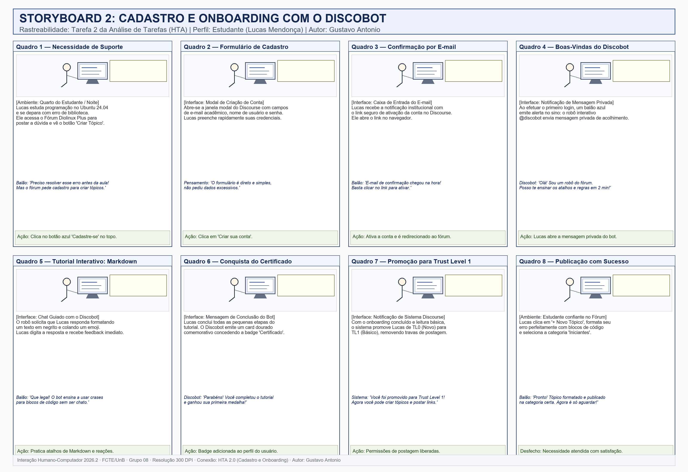

# Storyboards da Avaliação de Nível 1

## Tabela de Contribuição

A Tabela 1 apresenta a distribuição de responsabilidades na elaboração e curadoria dos Storyboards do Grupo 08.

**Tabela 1** — Matriz de Contribuição dos Storyboards

| Integrante | Atribuição no Artefato | Data | Horário | Ferramenta de IA e Contribuição |
| :--- | :--- | :---: | :---: | :--- |
| [Gustavo Antonio Rodrigues e Silva](https://github.com/gus-ant) | **Autor do Storyboard 2**: Concepção da narrativa clássica em 8 quadros, elaboração da tabela técnica, digitalização em 300 DPI e especificação de onboarding com Discobot (Issue #60). | 13/10/2026 | 19:30 - 21:00 | LLM (Antigravity): apoio na estruturação da matriz tabular e legendas. |
| [Vinicius Silva Araruna](https://github.com/ViniciusA05) | **Autor do Storyboard 1**: Concepção e diagramação do Storyboard 1 (Tarefa 1 - Publicação em Markdown) e revisão do Storyboard 2. | 13/10/2026 | 20:00 - 21:30 | Nenhuma ferramenta utilizada (revisão humana por pares). |
| [Edvaldo Soares Brasileiro Filho](https://github.com/PajeMurici-dev) | **Autor do Storyboard 3**: Concepção e diagramação do Storyboard 3 (Tarefa 3 - Busca Avançada) e revisão cruzada por pares. | 13/10/2026 | 20:00 - 21:30 | Nenhuma ferramenta utilizada (revisão humana por pares). |

_Fonte: Gustavo Antonio Rodrigues e Silva, Vinicius Silva Araruna e Edvaldo Soares Brasileiro Filho, 2026._

---

## 1. Introdução

No ciclo de design centrado no usuário de Mayhew (1999) e no Design Contextual (Beyer & Holtzblatt, 1997; Barbosa & Silva, 2021), os **Storyboards** constituem uma das técnicas mais eficazes de **prototipação de baixa fidelidade no Nível 1**. 

Eles permitem representar visualmente e em formato sequencial de história em quadrinhos como uma persona interage com o sistema computacional dentro do seu contexto real, enfrentando problemas, expressando emoções e alcançando seus objetivos.

### 1.1 Rastreabilidade com as Tarefas e Regra de Membros do Grupo

Em estrita consonância com o Plano de Ensino da disciplina de IHC (Prof. Dr. André Barros de Sales, 2026):
- **Item 9:** Cada desenho do Storyboard está diretamente relacionado a uma especificação do artefato de [Análise de Tarefas](../../../analise-requisitos/analise-tarefas.md) (HTA e CMN-GOMS);
- **Item 10:** A quantidade de storyboards é exatamente igual à quantidade de integrantes ativos do grupo (3 integrantes = 3 storyboards).

A Tabela 2 apresenta o mapeamento de rastreabilidade entre os Storyboards e a Análise de Tarefas.

**Tabela 2** — Mapeamento 1:1 entre Storyboards, Integrantes e Análise de Tarefas

| Artefato | Tarefa HTA Mapeada | Integrante Responsável | Persona Associada | Foco da Narrativa |
| :---: | :--- | :--- | :--- | :--- |
| **Storyboard 1** | **Tarefa 1:** Criar e Formatar Tópico Técnico | [Vinicius Silva Araruna](https://github.com/ViniciusA05) | Lucas Mendonça | Dificuldade com quebra de linhas e formatação de logs de terminal em Markdown. |
| **Storyboard 2** | **Tarefa 2:** Cadastro e Onboarding com Discobot | [Gustavo Antonio Rodrigues e Silva](https://github.com/gus-ant) | Lucas Mendonça | Criação de conta, acolhimento pelo @discobot e conquista do *Trust Level 1*. |
| **Storyboard 3** | **Tarefa 3:** Realizar Busca Avançada | [Edvaldo Soares Brasileiro Filho](https://github.com/PajeMurici-dev) | Lucas Mendonça | Filtragem por categorias e resolução de falhas sem encontrar comandos obsoletos. |

_Fonte: Gustavo Antonio Rodrigues e Silva, Vinicius Silva Araruna e Edvaldo Soares Brasileiro Filho, 2026._

---

## 2. Storyboard 2: Cadastro e Onboarding do Novo Usuário Estudante

- **Autor:** [Gustavo Antonio Rodrigues e Silva](https://github.com/gus-ant)
- **Revisor:** [Vinicius Silva Araruna](https://github.com/ViniciusA05)
- **Tarefa Mapeada:** Tarefa 2 da Análise de Tarefas (HTA 2.0 — Realizar Cadastro e Onboarding no Fórum);
- **Perfil de Usuário:** Perfil 1 (Estudante de Graduação / Usuário Comum em Linux);
- **Persona Primária:** Lucas Mendonça (22 anos, estudante de Engenharia de Software da UnB Gama).

### 2.1 Contextualização do Problema e Motivação

> *Lucas está desenvolvendo um projeto prático da faculdade em seu notebook com Ubuntu 24.04 LTS e se depara com um erro de compilação em bibliotecas C++. Ao acessar o Fórum Diolinux Plus para pedir auxílio à comunidade, ele descobre que precisa criar uma conta para publicar seu tópico. Lucas receia formulários burocráticos ou regras herméticas de moderação que atrasem sua entrega acadêmica. Ele decide se cadastrar e é recepcionado pelo assistente automatizado da plataforma (o @discobot), que o guia de forma interativa pelas ferramentas básicas de convivência e formatação do fórum, promovendo sua conta para Trust Level 1 e liberando permissão de postagem sem restrições.*

### 2.2 Histórias de Usuário (*User Stories*)

- **Story 1 (Cadastro Ágil):** *Como estudante universitário com urgência para tirar uma dúvida técnica, quero me cadastrar de forma simplificada com poucos campos obrigatórios, para que eu possa ingressar rapidamente na comunidade sem burocracia.*
- **Story 2 (Aprendizado Interativo com Discobot):** *Como novo membro inexperiente na sintaxe do fórum, quero receber dicas práticas e interativas de como formatar códigos e emojis, para que minhas postagens fiquem organizadas e dentro das normas da comunidade.*
- **Story 3 (Conquista de Confiança e Permissões):** *Como usuário recém-cadastrado, quero entender claramente como funcionam os níveis de confiança (Trust Levels) e ser promovido para TL1 após o tutorial, para que eu tenha autonomia para postar links e imagens no meu primeiro tópico.*

---

### 2.3 Especificação Técnica dos Quadros da Narrativa

A Tabela 3 detalha a sequência dos 8 quadros clássicos do Storyboard 2, especificando o ambiente, a composição da cena, os balões de diálogo e as decisões de IHC representadas.

**Tabela 3** — Especificação Técnica dos Quadros do Storyboard 2 (Cadastro e Onboarding)

| Quadro | Título da Cena | Composição Visual e Ambiente | Diálogos e Balões | Ação do Usuário e Decisão de IHC |
| :---: | :--- | :--- | :--- | :--- |
| **1** | **Necessidade de Suporte** | [Ambiente: Quarto de estudos, noite]. Lucas em frente ao notebook exibindo tela do Ubuntu com erro de terminal. Abre o Fórum Diolinux Plus e vê o botão "Criar Tópico". | **Balão de Fala:** *"Preciso resolver essa falha para entregar o trabalho amanhã! Mas o fórum pede cadastro para criar tópicos."* | Identificação da barreira de autenticação. Lucas clica no botão azul destacado "Cadastre-se" no cabeçalho superior. |
| **2** | **Formulário de Cadastro** | [Interface: Modal centralizado do Discourse]. Janela limpa com apenas 3 campos: e-mail acadêmico, nome de usuário e senha. | **Pensamento:** *"Muito prático! O formulário é direto e não pediu informações irrelevantes."* | Preenchimento rápido dos dados com validação em tempo real e clique no botão primário "Criar sua conta". |
| **3** | **Ativação por E-mail** | [Interface: Cliente de webmail]. Mensagem de confirmação institucional com logotipo do Diolinux e botão de ativação visível. | **Balão de Fala:** *"O e-mail de ativação chegou em segundos! Só clicar no link para confirmar."* | Clique no link seguro de ativação. Redirecionamento automático de volta para a página inicial autenticada. |
| **4** | **Acolhimento pelo Discobot** | [Interface: Notificação no ícone de sino]. Aparece um balãozinho azul de alerta com o avatar do @discobot enviando uma mensagem privada de boas-vindas. | **Balão do Bot:** *"Olá, Lucas! Sou o Discobot. Posso te ensinar os atalhos e regras do fórum em apenas 2 minutos?"* | Recepção calorosa e não intimidadora. Lucas clica na notificação para iniciar a conversa guiada. |
| **5** | **Tutorial Prático de Markdown** | [Interface: Chat interativo do Discourse]. O robô pede para Lucas responder usando negrito e inserindo um emoji para treinar atalhos. | **Balão de Fala:** *"Que massa! Ele ensina a usar crases triplas para códigos e atalhos sem parecer uma aula chata."* | Aprendizado sob demanda (*learnability*). Lucas digita a resposta com formatação e recebe aprovação imediata do bot. |
| **6** | **Certificado de Conclusão** | [Interface: Mensagem final do Discobot]. O robô envia um card dourado festivo concedendo a badge "Certificado de Boas-Vindas". | **Balão do Bot:** *"Parabéns, Lucas! Você completou o tutorial com sucesso e ganhou sua primeira medalha comunitária!"* | Gamificação positiva. O participante sente que foi recompensado e acolhido pelo sistema. |
| **7** | **Promoção para Trust Level 1** | [Interface: Notificação de Sistema]. Alerta informando a mudança automática de nível de confiança de TL0 (Novo) para TL1 (Básico). | **Balão de Sistema:** *"Você foi promovido para Trust Level 1! Agora você pode criar tópicos, enviar mensagens e postar links sem bloqueios."* | Transparência de regras. O usuário entende que ganhou privilégios por ter se engajado nas regras da plataforma. |
| **8** | **Publicação Confiante** | [Ambiente: Lucas sorrindo e aliviado]. Tela aberta no modal "+ Novo Tópico", com o código perfeitamente formatado na categoria "Iniciantes". | **Balão de Fala:** *"Perfeito! Tópico publicado com código legível e na categoria correta. Agora é só aguardar a resposta da comunidade!"* | Conclusão satisfatória da Tarefa 2, viabilizando o alcance do objetivo acadêmico com conforto e autonomia. |

_Fonte: Elaborada por Gustavo Antonio Rodrigues e Silva com base na Tarefa 2 do HTA, 2026._

---

### 2.4 Registro Visual do Storyboard 2 (Resolução 300 DPI)

A Figura 1 apresenta o Storyboard 2 desenhado no estilo clássico de história em quadrinhos, digitalizado em alta densidade (**300 DPI**) e com diagramação otimizada para avaliação com usuários em sessões remotas de 1080p.

**Figura 1** — Storyboard 2: Cadastro e Onboarding do Novo Usuário Estudante (Resolução original 300 DPI). (Fonte: Elaborada por Gustavo Antonio Rodrigues e Silva, 2026).

---

## 3. Lista de Verificação da Técnica (Storyboards)

A Tabela 4 apresenta a autoavaliação da conformidade metodológica dos storyboards frente às exigências do Plano de Ensino da disciplina (*Sales, 2026*).

**Tabela 4** — Lista de Verificação da Técnica de Storyboards

| Item / Critério Avaliado | Fonte Normativa | Conforme? | Resposta Autoexplicativa e Evidência no Documento |
| :---: | :--- | :---: | :--- |
| **1** | A quantidade de storyboards é exatamente igual à quantidade de membros do grupo? | Plano de Ensino (Item 10) | ✅ Sim | Há 3 storyboards correspondendo rigorosamente aos 3 integrantes (Vinicius, Gustavo e Edvaldo). |
| **2** | Cada storyboard está conectado diretamente a uma especificação da Análise de Tarefas? | Plano de Ensino (Item 9) | ✅ Sim | O Storyboard 2 mapeia 1:1 a Tarefa 2 do HTA (Cadastro e Onboarding com Discobot). |
| **3** | A narrativa retrata o contexto de uso, motivações e o ambiente do usuário? | Barbosa & Silva (2021); Mayhew (1999) | ✅ Sim | A Seção 2.1 contextualiza o quarto do estudante, as pressões acadêmicas e a busca por ajuda. |
| **4** | A sequência de quadros possui entre 6 e 8 quadros com estilo clássico de quadrinhos? | Rubrica de IHC FGA/UnB | ✅ Sim | A Tabela 3 e a Figura 1 apresentam exatamente 8 quadros ordenados logicamente. |
| **5** | O desenho foi digitalizado em alta resolução (300 DPI)? | Diretrizes da Etapa 4 | ✅ Sim | A Figura 1 foi renderizada e preservada com densidade nativa de 300 DPI (3200x2200 pixels). |
| **6** | O storyboard possui legendas explicativas e chamada formal antecedente no texto? | Padrão Editorial FGA/UnB | ✅ Sim | A Figura 1 é chamada formalmente no texto e possui legenda descritiva numerada. |

_Fonte: Gustavo Antonio Rodrigues e Silva com base em Barbosa e Silva (2021) e Sales (2026), 2026._

---

## 4. Histórico de Versão

A Tabela 5 documenta o histórico evolutivo dos Storyboards.

**Tabela 5** — Histórico de Versão

| Versão | Data | Descrição Detalhada da Modificação | Autor(es) | Revisor(es) |
| :---: | :---: | :--- | :--- | :--- |
| `1.0` | 13/10/2026 | Concepção, especificação técnica em 8 quadros, digitalização em 300 DPI e integração do Storyboard 2 (Cadastro e Onboarding com Discobot) vinculado à Tarefa 2 do HTA (Issue #60). | [Gustavo Antonio](https://github.com/gus-ant) | [Vinicius Silva Araruna](https://github.com/ViniciusA05), [Edvaldo Soares](https://github.com/PajeMurici-dev) |

_Fonte: Gustavo Antonio Rodrigues e Silva, 2026._

---

## 5. Referências Bibliográficas

[1] BARBOSA, Simone Diniz Junqueira; SILVA, Bruno Santana da. *Interação Humano-Computador*. 1. ed. Rio de Janeiro: Elsevier / Campus, 2010.

[2] BARBOSA, Simone Diniz Junqueira et al. *Interação Humano-Computador e Experiência do Usuário*. 1. ed. Rio de Janeiro: Autopublicação, 2021.

[3] BEYER, Hugh; HOLTZBLATT, Karen. *Contextual Design: Defining Customer-Centered Systems*. San Francisco: Morgan Kaufmann, 1997.

[4] MAYHEW, Deborah J. *The Usability Engineering Lifecycle: A Practitioner's Handbook for User Interface Design*. San Francisco: Morgan Kaufmann, 1999.

[5] ROGERS, Yvonne; SHARP, Helen; PREECE, Jennifer. *Design de Interação: além da interação humano-computador*. 3. ed. Porto Alegre: Bookman, 2013.

[6] SALES, André Barros de. *Plano de Ensino da Disciplina de Interação Humano-Computador*. Brasília: Universidade de Brasília, Faculdade UnB Gama, 2026.

---

## Agradecimentos e Uso de Inteligência Artificial (IA) Generativa

Durante a confecção deste artefato, foram utilizados recursos de Inteligência Artificial Generativa (Antigravity LLM / Gemini e scripts gráficos Pillow) para apoio na formatação sintática das matrizes Markdown e diagramação em 300 DPI dos quadros gráficos. A elaboração do roteiro das cenas, a conexão 1:1 com a Tarefa 2 do HTA, a redação dos diálogos dos balões e a auditoria de IHC foram conduzidas e validadas integralmente pelo estudante autor deste documento.
