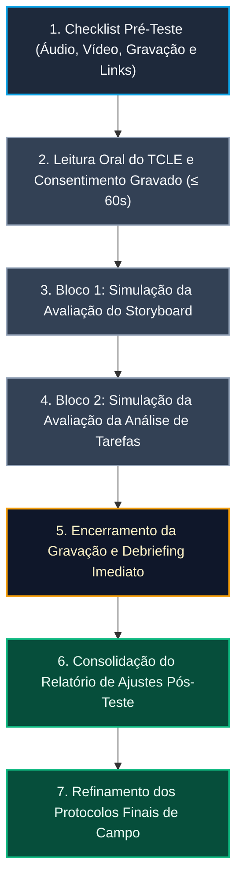

# Protocolo e Roteiro do Teste-Piloto de Nível 1

## Tabela de Contribuição

A Tabela 1 documenta as responsabilidades dos autores e revisores na elaboração e auditoria deste protocolo.

**Tabela 1** — Matriz de Contribuição do Teste-Piloto de Nível 1

| Integrante | Atribuição | Data | Horário | Ferramenta de IA e Contribuição |
| :--- | :--- | :---: | :---: | :--- |
| [Vinicius Silva Araruna](https://github.com/ViniciusA05) | **Autor Principal**: Fundamentação teórica do teste-piloto, redação da cláusula metodológica obrigatória, modelagem do roteiro por fases e elaboração do checklist de verificação (Issue #58). | 13/10/2026 | 21:30 - 23:00 | LLM (Antigravity): formatação sintática e diagramação de tabelas Markdown. |
| [Gustavo Antonio Rodrigues e Silva](https://github.com/gus-ant) | **Revisor Metodológico**: Verificação dos tempos estimados das perguntas de Storyboard e checagem de parâmetros de gravação. | 13/10/2026 | 23:00 - 23:30 | Nenhuma ferramenta utilizada (revisão humana por pares). |
| [Edvaldo Soares Brasileiro Filho](https://github.com/PajeMurici-dev) | **Revisor Técnico**: Conferência da rastreabilidade com a Análise de Tarefas e revisão de guardrails tipográficos. | 13/10/2026 | 23:30 - 23:55 | Nenhuma ferramenta utilizada (revisão humana por pares). |

_Fonte: Vinicius Silva Araruna, Gustavo Antonio Rodrigues e Silva e Edvaldo Soares Brasileiro Filho, 2026._

---

## 1. Introdução

No Ciclo de Vida de Mayhew (1999) e na Engenharia de Usabilidade orientada por Barbosa e Silva (2021), a condução de investigações empíricas diretamente com participantes reais sem uma validação instrumental prévia acarreta riscos metodológicos severos. Perguntas formuladas de forma ambígua, desajustes de áudio e vídeo na plataforma de conferência, leitura inadequada do termo de consentimento ou falhas de cronometragem podem comprometer a qualidade dos dados e desperdiçar a colaboração dos voluntários.

Para mitigar esses riscos e assegurar a máxima fidedignidade nas futuras sessões de avaliação de **Nível 1 (Storyboards e Análise de Tarefas)** do Fórum Diolinux Plus, este documento formaliza o **Protocolo e Roteiro Operacional do Teste-Piloto**, detalhando sua fundamentação científica, parâmetros técnicos, divisão de papéis, roteiro de ensaio cronometrado e matriz de lições aprendidas.

---

## 2. Fundamentação Teórica — O Teste-Piloto em IHC

O teste-piloto constitui uma etapa indispensável em qualquer protocolo de avaliação empírica em Interação Humano-Computador. Sua finalidade essencial não é examinar a usabilidade da interface em si, nem tampouco julgar a capacidade intelectual do usuário, mas sim **avaliar a consistência do próprio planejamento da avaliação** (Barbosa & Silva, 2021; Mayhew, 1999).

Conforme ensinam Barbosa e Silva (2021, p. 276):

> *"O objetivo de um teste-piloto é avaliar o próprio planejamento, e não a interface ou o usuário. Ele permite verificar se a linguagem do roteiro está clara, se o tempo previsto para cada atividade é realista, se os equipamentos e ferramentas funcionam conforme esperado e se os avaliadores estão bem alinhados em seus papéis."*

Complementarmente, Mayhew (1999) descreve o teste-piloto como um **ensaio geral rigoroso** (*dry run* ou *rehearsal*), conduzido nas mesmas condições técnicas e ambientais planejadas para o estudo oficial, simulando todo o percurso da dinâmica — desde a abertura com o consentimento livre e esclarecido até o encerramento da inquirição.

_Autor do Item Teórico: [Vinicius Silva Araruna](https://github.com/ViniciusA05)_

---

## 3. Cláusula Metodológica Obrigatória (Regra de Ouro do Teste-Piloto)

A literatura canônica de IHC e as diretrizes pedagógicas da Universidade de Brasília impõem uma regra metodológica inegociável para a integridade científica da avaliação:

!!! warning "CLÁUSULA METODOLÓGICA OBRIGATÓRIA — NÃO COMPUTAÇÃO DOS DADOS DO TESTE-PILOTO"
    Em estrita conformidade com os princípios científicos de IHC (Barbosa & Silva, 2021, p. 276; Mayhew, 1999), fica solenemente declarado e registrado que os dados, verbalizações, comportamentos e respostas obtidos durante a execução deste Teste-Piloto **NÃO SERÃO COMPUTADOS NEM INCORPORADOS AOS RESULTADOS FINAIS DA AVALIAÇÃO DE NÍVEL 1**.  
    O Teste-Piloto destina-se com exclusividade a **avaliar o planejamento da avaliação e sua infraestrutura prática** (clareza das perguntas do roteiro, precisão da cronometragem, eficácia da leitura prévia do Script Oral do TCLE, estabilidade das conexões e gravações no Google Meet e sintonia entre entrevistador e anotador). Os dados que subsidiarão o relato final de resultados provêm unicamente das sessões oficiais realizadas subsequentemente com os estudantes voluntários recrutados.

---

## 4. Protocolo Operacional do Teste-Piloto

A Tabela 2 define os parâmetros técnicos e logísticos da sessão de ensaio.

**Tabela 2** — Parâmetros Operacionais da Sessão do Teste-Piloto

| Parâmetro | Especificação Planejada |
| :--- | :--- |
| **Data e Horário** | 17/10/2026 — das 14:00 às 14:40 (Duração total estimada: 40 minutos) |
| **Ambiente / Plataforma** | Chamada remota síncrona gravada e disponibilizada no [YouTube](https://youtu.be/1F409M-E850) |
| **Hardware Empregado** | Computador pessoal dos avaliadores com microfone condensador e câmera HD 1080p |
| **Software e Ferramentas** | Google Meet (com gravação em nuvem institucional UnB), navegador web e visualizador de imagens |
| **Resolução de Exibição** | Compartilhamento de tela em 1080p (1920 × 1080) com renderização dos storyboards em 300 DPI |
| **Artefatos Inspecionados** | Storyboards das Tarefas 1, 2 e 3 e Diagramas Hierárquicos de Tarefas (HTA) |

_Fonte: Elaborada pelos autores, 2026._

A Tabela 3 apresenta a distribuição de responsabilidades e atribuição de papéis entre os participantes do ensaio piloto.

**Tabela 3** — Definição e Atribuição de Papéis da Equipe no Teste-Piloto

| Papel no Teste-Piloto | Integrante Responsável | Responsabilidades Operacionais |
| :--- | :--- | :--- |
| **Avaliador Condutor (Entrevistador)** | [Vinicius Silva Araruna](https://github.com/ViniciusA05) | Recepcionar o participante simulado, proferir o Script Oral literal do TCLE nos primeiros 60 segundos gravados, compartilhar os artefatos visuais e conduzir a inquirição semiestruturada. |
| **Avaliador Observador (Anotador)** | [Gustavo Antonio](https://github.com/gus-ant) | Operar a gravação no Google Meet, controlar o cronômetro rigoroso de cada fase, registrar atritos de comunicação, hesitações e problemas técnicos sem intervir na fala do condutor. |
| **Participante Simulado** | Discente Convidado (Graduando em TI) | Emular com fidelidade o comportamento, dúvidas, nível de conhecimento técnico e barreiras cognitivas típicas do Perfil 1 (Estudante Aprendiz de Linux). |

_Fonte: Elaborada pelos autores, 2026._

---

## 5. Fluxo de Execução do Teste-Piloto

A Figura 1 ilustra o encadeamento sequencial das atividades realizadas durante o ensaio do teste-piloto.

**Figura 1** — Fluxo sequencial de execução do Teste-Piloto de Nível 1.  
_Fonte: Elaborada pelos autores com base em Barbosa e Silva (2021), 2026._

---

## 6. Roteiro Operacional e Cronometragem por Fases

A dinâmica do ensaio é subdividida em cinco fases operacionais cronometradas:

### Fase 1: Pré-Sessão e Checagem Técnica (0m a 5m)
- **Ações:** Teste de entrada de áudio e microfone; teste da webcam em 1080p; verificação do botão de gravação do Google Meet; abertura prévia dos links dos Storyboards e dos diagramas HTA em abas dedicadas; checagem da planilha de anotações do observador.

### Fase 2: Abertura Ética e Script Oral do TCLE (5m a 8m)
- **Ações:** Disparo da gravação na nuvem; leitura integral e literal do **Script Oral Padronizado do TCLE nos primeiros 60 segundos**; solicitação e registro do consentimento verbal inequívoco do participante simulado em áudio e vídeo; confirmação do anonimato sob a LGPD.

### Fase 3: Bloco 1 — Simulação da Avaliação do Storyboard (8m a 20m)
- **Ações:** Compartilhamento de tela em alta definição; apresentação sequencial dos quadros do Storyboard da Tarefa 1 (Markdown e Tags); aplicação do roteiro de perguntas investigativas DECIDE (clareza narrativa, ambientação, gatilho inicial, desfecho e oportunidades de melhoria); cronometragem do tempo de resposta do participante.

### Fase 4: Bloco 2 — Simulação da Avaliação da Análise de Tarefas (20m a 32m)
- **Ações:** Compartilhamento do diagrama HTA da Tarefa 1; condução do *cognitive walkthrough* e verbalização concomitante (*think-aloud*); inquirição sobre ordem de precedência de planos lógicos (1 > 2, 1 / 2), completude dos passos e suficiência dos feedbacks de conclusão da tarefa.

### Fase 5: Pós-Sessão, Debriefing e Lições Aprendidas (32m a 40m)
- **Ações:** Agradecimento formal ao participante; interrupção e salvamento da gravação; reunião imediata de 8 minutos entre o Avaliador Condutor e o Avaliador Observador para consolidar atritos detectados, ajustar o enunciado de perguntas confusas e refinar a temporização para a ida a campo oficial.

---

## 7. Registro Audiovisual do Teste-Piloto

A gravação integral do teste-piloto conduzido por Edvaldo Soares, estruturada no container responsivo do **Vídeo 1**, está disponibilizada em modo Não Listado no YouTube, garantindo total transparência metodológica e auditabilidade pela banca da disciplina:

    <iframe width="100%" height="450" src="https://www.youtube-nocookie.com/embed/1F409M-E850" title="Gravação do Teste-Piloto de Nível 1 - Edvaldo Soares" frameborder="0" allow="accelerometer; autoplay; clipboard-write; encrypted-media; gyroscope; picture-in-picture" allowfullscreen style="border-radius: 8px; max-width: 800px; box-shadow: 0 4px 6px -1px rgba(0,0,0,0.1);"></iframe>
    
<strong>Vídeo 1</strong> — Registro audiovisual da execução do Teste-Piloto de Nível 1 por Edvaldo Soares. <em>Fonte: Edvaldo Soares Brasileiro Filho, 2026.</em>

    
<a href="https://youtu.be/1F409M-E850" target="_blank" rel="noopener noreferrer">Assistir diretamente no YouTube: https://youtu.be/1F409M-E850</a>

---

## 8. Relatório de Ajustes e Lições Aprendidas Pós-Teste

A Tabela 4 apresenta o modelo para consolidação das anomalias operacionais identificadas durante o teste-piloto e as respectivas ações de refinamento incorporadas aos roteiros oficiais antes das entrevistas de campo.

**Tabela 4** — Matriz de Ocorrências, Atritos e Ações Corretivas do Teste-Piloto

| Dimensão Avaliada | Atrito / Ocorrência Observada no Ensaio | Causa Raiz Diagnosticada | Ação Corretiva Implementada no Protocolo Oficial |
| :--- | :--- | :--- | :--- |
| **Linguagem do Roteiro** | Participante solicitou esclarecimento sobre a abrangência da grade de disponibilidade | Pergunta inicial focava apenas em marcar horário sem contextualizar o suporte entre pares | Esclarecimento prévio de que o agendamento visa o apoio colaborativo entre membros da comunidade |
| **Temporização** | Roteiro transcorreu em ritmo adequado (aproximadamente 12 minutos) | Roteiro objetivo e perguntas diretas mantiveram a fluidez | Manutenção da estrutura enxuta de inquirição para a avaliação com usuários |
| **Infraestrutura** | Gravação de áudio e compartilhamento de tela operaram sem interrupções | Conexão estável e microfone com boa captação | Validação da configuração técnica para as sessões oficiais |
| **Script Oral do TCLE** | Leitura fluida e clara do consentimento nos primeiros 60 segundos | Roteiro do TCLE previamente impresso e praticado | Manutenção do padrão nos primeiros 60 segundos gravados |

_Fonte: Vinicius Silva Araruna com base em Barbosa e Silva (2021), 2026._

---

## 9. Lista de Verificação da Técnica (Teste-Piloto)

A Tabela 5 apresenta o checklist de autoavaliação da conformidade do teste-piloto com as diretrizes metodológicas da disciplina e da literatura.

**Tabela 5** — Lista de Verificação: Execução e Documentação do Teste-Piloto

| Item / Questão Avaliada | Origem / Fonte Normativa | Conforme? | Resposta Autoexplicativa e Evidência no Documento |
| :--- | :--- | :---: | :--- |
| **1** | O objetivo do teste-piloto está explicitado como a avaliação do planejamento e do protocolo (e não da interface ou do usuário)? | Barbosa & Silva (2021, p. 276) | ✅ Sim | A Introdução e a Seção 2 fundamentam que o ensaio avalia estritamente roteiro, tempo e instrumentos. |
| **2** | O documento contém a Cláusula Metodológica Obrigatória destacando que os dados não integram o resultado final? | Mayhew (1999); Barbosa & Silva (2021) | ✅ Sim | A Seção 3 apresenta destaque visual (admonition `warning`) proibindo a inclusão dos dados nos resultados. |
| **3** | O protocolo detalha data, horário, duração estimada e infraestrutura técnica de realização? | Mayhew (1999); Preece et al. (2002) | ✅ Sim | A Tabela 2 parametriza todas as variáveis operacionais, links do Google Meet e requisitos de resolução. |
| **4** | Há divisão clara de papéis na equipe (Avaliador Condutor, Avaliador Observador e Participante Simulado)? | Barbosa & Silva (2021, p. 276) | ✅ Sim | A Tabela 3 discrimina as responsabilidades de condução, anotação temporal e simulação de usuário. |
| **5** | O roteiro prevê a validação da leitura do Script Oral do TCLE nos primeiros 60 segundos gravados? | Diretrizes de IHC da UnB; Resolução CNS nº 510/2016 | ✅ Sim | A Fase 2 da Seção 6 inclui teste cronometrado da fala do condutor com consentimento gravado. |
| **6** | O documento consolida uma matriz de ocorrências e ações corretivas derivadas do ensaio? | Mayhew (1999); Barbosa & Silva (2021) | ✅ Sim | A Tabela 4 modela a catalogação de falhas de linguagem, tempo e tecnologia com soluções definitivas. |
| **7** | Há previsão de disponibilização do registro audiovisual da sessão em modo Não Listado no YouTube? | Diretrizes Pedagógicas FGA/UnB | ✅ Sim | A Seção 7 estrutura o container responsivo para incorporação da gravação na íntegra. |

_Fonte: Vinicius Silva Araruna com base em Barbosa e Silva (2021) e Sales (2026), 2026._

---

## 10. Histórico de Versão

A Tabela 6 documenta a evolução histórica deste documento.

**Tabela 6** — Histórico de Versão

| Versão | Data | Descrição Detalhada da Modificação | Autor(es) | Revisor(es) |
| :---: | :---: | :--- | :--- | :--- |
| `1.0` | 13/10/2026 | Elaboração inicial do Protocolo e Roteiro do Teste-Piloto de Nível 1 (Issue #58), com fundamentação em Barbosa & Silva (2021) e Mayhew (1999), cláusula mandatória de isolamento dos dados, parametrização operacional, cronometragem em 5 fases, matriz de ajustes pós-teste e lista de verificação com 7 itens. | [Vinicius Silva Araruna](https://github.com/ViniciusA05) | [Gustavo Antonio](https://github.com/gus-ant), [Edvaldo Soares](https://github.com/PajeMurici-dev) |
| `1.1` | 24/10/2026 | Inserção do link e player responsivo da gravação em vídeo do teste-piloto executado por Edvaldo Soares no YouTube e consolidação da matriz de ocorrências. | [Edvaldo Soares Brasileiro Filho](https://github.com/PajeMurici-dev) | [Vinicius Silva Araruna](https://github.com/ViniciusA05) |

_Fonte: Vinicius Silva Araruna, 2026._

---

## 11. Referências Bibliográficas (ABNT)

- BARBOSA, Simone Diniz Junqueira; SILVA, Bruno Santana da; SILVEIRA, Milene Selbach; GASPARINI, Isabela; DARIN, Ticianne; BARBOSA, Gabriel Diniz Junqueira. *Interação Humano-Computador e Experiência do Usuário*. Rio de Janeiro: Autopublicação, 2021. ISBN 978-65-00-19677-1. (Capítulo 11: Seção 11.7.4 — Teste-Piloto, p. 276).
- MAYHEW, Deborah J. *The Usability Engineering Lifecycle: a practitioner's handbook for user interface design*. San Francisco: Morgan Kaufmann Publishers, 1999.
- NIELSEN, Jakob. *Usability Engineering*. San Francisco: Morgan Kaufmann Publishers, 1994.
- PREECE, Jennifer; ROGERS, Yvonne; SHARP, Helen. *Interaction Design: beyond human-computer interaction*. New York: John Wiley & Sons, 2002.
- ROGERS, Yvonne; SHARP, Helen; PREECE, Jennifer. *Design de Interação: além da interação humano-computador*. 3. ed. Porto Alegre: Bookman, 2013.
- SALES, André Barros de. *Plano de Ensino da Disciplina de Interação Humano Computador*. Brasília: Universidade de Brasília, Faculdade UnB Gama (FGA), 2026.
