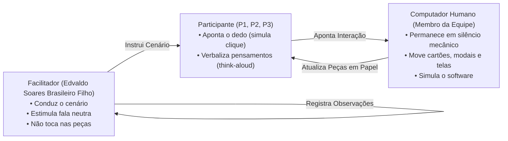

# Planejamento da Avaliação do Protótipo de Papel (Nível 2) — Tarefa 3: Agendamento de Horários

## Tabela de Contribuição e Uso de IA Generativa

A Tabela 1 apresenta a matriz de responsabilidade na elaboração do planejamento da avaliação do Protótipo de Papel (Nível 2), focado exclusivamente na Tarefa 3: Agendamento de Horários com Autores de Tópicos.

**Tabela 1** — Matriz de Contribuição do Planejamento do Protótipo de Papel (Tarefa 3)

| Integrante | Atribuição no Artefato | Data | Ferramenta de IA Utilizada | Propósito do Uso de IA |
| :--- | :--- | :---: | :--- | :--- |
| [Edvaldo Soares Brasileiro Filho](https://github.com/PajeMurici-dev) | **Autor Principal / Avaliador**: Estruturação completa pelo Framework DECIDE, fundamentação teórica de prototipagem em papel (Snyder, Rettig, Barbosa & Silva), definição dos papéis de Facilitador e Computador Humano, roteiro de tarefas tátil para a Tarefa 3 (Agendamento de Horários), cronogramas planejado e executado, orçamento de custo zero e checklist de 15 itens normativos. | 25/10/2026 | Antigravity (LLM) | Apoio na estruturação das tabelas Markdown, conferência de hiperligações internas e validação de referências ABNT. |
| [Vinicius Silva Araruna](https://github.com/ViniciusA05) | **Revisor Metodológico**: Auditoria de consistência teórica e aderência às diretrizes do Ciclo de Vida de Mayhew e Framework DECIDE. | 26/10/2026 | — | Revisão humana por pares. |
| [Gustavo Antonio Rodrigues e Silva](https://github.com/gus-ant) | **Revisor Designado**: Verificação do checklist de conformidade e alinhamento com os padrões de Nível 2 da disciplina. | 26/10/2026 | — | Revisão humana por pares. |

_Fonte: Elaborada pelos autores, 2026._

---

## 1. Introdução e Contextualização do Nível 2 de Mayhew

No **Ciclo de Vida de Deborah Mayhew (1999)**, a Engenharia de Usabilidade transita da fase de modelagem conceitual abstrata (Storyboards e Análise de Tarefas de Nível 1) para a materialização tangível das interfaces no **Nível 2 (Padrões de Design e Prototipação em Papel)**.

A prototipação de baixa fidelidade em papel (*Paper Prototyping*) é consagrada na literatura científica de Interação Humano-Computador (*Snyder, 2003; Rettig, 1994; Barbosa & Silva, 2021, Cap. 10*) como um método ágil, plástico e de altíssima validade formativa para avaliar a hierarquia visual de telas, a disposição de botões, seleção em calendários/grades de disponibilidade, caixas modais e fluxos de interação antes de qualquer esforço de desenvolvimento de software.

Este documento consolida o **Planejamento da Avaliação Formativa do Protótipo de Papel**, estruturado integralmente segundo as seis etapas do **Framework DECIDE** (*Rogers et al., 2013; Barbosa & Silva, 2021*), focalizando estritamente a funcionalidade prioritária sob responsabilidade de Edvaldo Soares Brasileiro Filho:

> **Funcionalidade Avaliada (CF03):** *Agendamento de Horários com Autores de Tópicos (Grade de Disponibilidade e Agendamento de Dúvidas / Mentorias)* no Fórum Diolinux Plus.

O planejamento contempla todos os elementos metodológicos indispensáveis para a execução em campo, incluindo cronograma planejado, cronograma executado, orçamento de custo zero, roteiro detalhado da simulação tátil, protocolo do teste-piloto de Nível 2 e separação funcional de papéis.

---

## 2. Fundamentação Teórica Canônica

_Autor do Item Teórico: [Edvaldo Soares Brasileiro Filho](https://github.com/PajeMurici-dev)_

A prototipagem em papel apoia-se em premissas ergonômicas consagradas na literatura clássica:

> *"O protótipo em papel é uma simulação de software em papel, onde um facilitador interage com o participante e outra pessoa da equipe atua como o 'computador', manipulando peças de papel para simular a resposta da interface às ações do usuário."*  
> — **SNYDER, Carolyn.** *Paper Prototyping: The Fast and Easy Way to Design and Refine User Interfaces*. San Francisco: Morgan Kaufmann, 2003.

Segundo Barbosa e Silva (2021, p. 248-252) e Marc Rettig (1994), a prototipação em papel apresenta vantagens determinantes no ciclo de design:
1. **Alta Plasticidade e Encorajamento ao Feedback Crítico:** Por não aparentar ser um sistema finalizado, os voluntários sentem-se livres para criticar o fluxo, sugerir botões alternativos e apontar ambiguidades sem receio de desvalorizar o trabalho visual do projetista;
2. **Foco na Arquitetura da Informação e Terminologia:** A ausência de elementos visuais digitais complexos direciona a atenção dos usuários para o significado dos rótulos de botões, clareza das instruções de agendamento, formato das grades de horário e feedback de confirmação;
3. **Validação Rápida da Interação de Agendamento:** Permite testar o comportamento do modal de seleção de slots de horários e a exibição de confirmação da reunião através de peças móveis de papel sobrepostas à tela base.

---

## 3. D — Determinar os Objetivos da Avaliação da Tarefa 3

A avaliação formativa do Protótipo de Papel tem como meta confrontar as soluções de interface concebidas para o Agendamento de Horários com o modelo mental espontâneo dos participantes. Em consonância com Barbosa e Silva (2021, p. 280), foram estabelecidos quatro objetivos gerais:

1. **Avaliar a Usabilidade da Interface de Visualização do Tópico e Acesso ao Agendamento:** Verificar se o usuário identifica com clareza o ponto de entrada (botão de "Agendar Horário / Reunião") na página do tópico do autor;
2. **Avaliar a Clareza da Grade de Disponibilidade e Seleção de Horários:** Avaliar se a organização visual dos dias e horários disponíveis na prancha em papel é intuitiva e permite selecionar um horário vago sem confusão de fuso ou precedência;
3. **Validar a Ergonomia e Feedback do Formulário e Modal de Confirmação:** Testar se o modal/cartão destacável de confirmação com dados da reunião (título, autor, data, horário e campo de descrição da dúvida) transmite segurança e permite confirmação ou cancelamento autônomo;
4. **Mapear Falhas de Affordance, Hesitações e Dúvidas de Status:** Diagnosticar pontos onde o participante hesita ao simular o clique com o dedo, dúvidas sobre o recebimento de link da reunião e visualização do status de agendamento confirmado.

---

## 4. E — Explorar as Perguntas Investigativas (Tarefa 3)

A Tabela 2 apresenta o desdobramento dos objetivos em perguntas investigativas específicas formuladas para guiar a inquirição durante o ensaio do protótipo de papel.

**Tabela 2** — Perguntas investigativas da avaliação do Protótipo de Papel da Tarefa 3

| Objetivo Associado | Nº | Pergunta Investigativa Específica | Foco de Observação e Critério de Sucesso |
| :--- | :---: | :--- | :--- |
| **Navegação e Layout** | **PP01** | Ao visualizar o tópico do autor no fórum, você identifica rapidamente o botão para solicitar agendamento de horário? | Tempo até o primeiro toque no componente de agendamento e ausência de varredura confusa. |
| **Navegação e Layout** | **PP02** | A disposição da grade de disponibilidade (dias da semana e blocos de horário) é clara e intuitiva? | Observar se o participante compreende quais horários estão livres versus ocupados. |
| **Seleção de Horário** | **PP03** | Fica evidente como selecionar um horário de mentoria/reunião desejado? | Toque seguro no slot de horário sem hesitação tátil prolongada. |
| **Preenchimento de Dados** | **PP04** | Os campos do formulário de solicitação (motivo da dúvida, contexto do problema) estão claros quanto ao preenchimento? | Compreensão dos campos apresentados no cartão móvel de requisição. |
| **Controle do Usuário** | **PP05** | As opções para confirmar ou cancelar a solicitação de agendamento estão visíveis e equilibradas? | Usuário identifica sem hesitação os botões de ação primária e secundária. |
| **Feedback e Status** | **PP06** | Ao confirmar o agendamento, o feedback exibido em papel deixa explícito que a reunião foi solicitada/confirmada com sucesso? | Verbalização de convicção perante a tela/cartão de feedback final. |
| **Gestão e Cancelamento** | **PP07** | O participante compreende onde e como visualizar seus agendamentos futuros ou cancelá-los se necessário? | Identificação visual do painel de reuniões agendadas. |
| **Oportunidades de Design** | **PP08** | Que elemento, botão ou informação você acrescentaria ou modificaria nesta interface de papel para tornar o agendamento mais simples? | Elicitação de requisitos para a fase de prototipação de alta fidelidade (Nível 3). |

_Fonte: Edvaldo Soares Brasileiro Filho com base em Barbosa e Silva (2021) e Snyder (2003), 2026._

---

## 5. C — Escolher os Métodos de Avaliação

Para avaliar o protótipo de papel no Nível 2, a equipe selecionou o método de **Ensaio de Interação com Usuários por meio de Teste de Usabilidade Formativo em Papel (*Paper Usability Testing*)** (*Snyder, 2003; Rettig, 1994; Barbosa & Silva, 2021*), combinado com a técnica de verbalização concomitante (*think-aloud*).

### Dinâmica e Atribuição de Papéis na Sessão

Durante a sessão, a dinâmica opera com rigorosa separação funcional de papéis para assegurar neutralidade:

- **O Facilitador ([Edvaldo Soares Brasileiro Filho](https://github.com/PajeMurici-dev)):** Acolhe o voluntário, lê o Script Oral do TCLE (menos de 60s), apresenta o cenário de uso, estimula a fala em voz alta sem induzir respostas e registra as anotações na planilha de observação;
- **O "Computador Humano":** Permanece em absoluto silêncio ao lado da bancada. Sua atribuição é exclusivamente mecânica: quando o participante toca em um botão ou horário com o dedo, o Computador Humano posiciona o cartão correspondente (ex: abre o modal com a grade de horários, destaca o slot selecionado ou exibe o cartão de confirmação);
- **Os Participantes (G.C, L.P.A, O.M.T.P):** Voluntários que interagem com as pranchas apontando com o dedo onde clicariam e verbalizando suas ações e expectativas.

---

## 6. I — Identificar e Administrar as Questões Práticas

### 6.1 Perfil e Recrutamento dos Participantes
- **Público-Alvo:** 3 participantes voluntários reais com diversidade de familiaridade com sistemas web e ferramentas de produtividade:
  - **P1 (G.C):** 21 anos, estudante de Psicologia (CEUB) — perfil de usuária geral/iniciante em fóruns técnicos;
  - **P2 (L.P.A):** 20 anos, estudante — perfil de usuário aprendiz;
  - **P3 (O.M.T.P):** 21 anos, estudante de Engenharia de Software (FGA/UnB) — perfil técnico/intermediário em Linux e fóruns;
- **Critério de Inclusão:** Estar matriculado em curso de graduação, ter experiência básica com navegação na web e interesse ou vivência com busca de ajuda e agendamento online;
- **Critério de Exclusão:** Membros diretos da equipe de desenvolvimento do Grupo 08.

### 6.2 Confecção dos Materiais em Papel (Bancada da Tarefa 3)
As peças físicas do protótipo de papel da Tarefa 3 foram confeccionadas artesanalmente em folhas de papel e cartolinas, divididas em 5 telas e peças de interação:
- **Peça 1 — Tela Inicial de Tópico:** Página do fórum exibindo a postagem do autor/especialista, perfil e o botão destacado *"Agendar Horário com Autor"*;
- **Peça 2 — Tela com Grade de Horários:** Interface de calendário semanal com colunas por dias e blocos de horário, distinguindo horários disponíveis e ocupados;
- **Peça 3 — Tela com Motivo da Reunião:** Cartão sobreposto/modal com campos para detalhamento do motivo da dúvida e formato de mentoria;
- **Peça 4 — Mensagem de Confirmação da Reunião:** Tela de feedback imediato contendo o resumo dos dados da reunião marcada e código de acesso;
- **Peça 5 — Mensagem de Lembrete da Reunião:** Cartão de notificação e lembrete com link direto e instruções para entrar na sala virtual.

### 6.3 Infraestrutura e Registro
- **Ambiente:** Sala de estudos silenciosa e propícia à concentração, livre de interrupções sonoras;
- **Dispositivo de Gravação:** Smartphone posicionado em suporte sobre a bancada a 45 graus, enquadrando as peças em papel e as mãos dos participantes;
- **Instrumentos de Registro:** Planilha impressa de observação com campos para tempos, hesitações e transcrições de verbalizações.

### 6.4 Orçamento e Declaração de Custo Zero
A Tabela 3 apresenta o demonstrativo orçamentário formal do planejamento de Nível 2.

**Tabela 3** — Demonstrativo Financeiro e Orçamento do Protótipo de Papel (Tarefa 3)

| Item / Recurso | Tipo | Custo Unitário | Custo Total | Justificativa |
| :--- | :---: | :---: | :---: | :--- |
| **Salas de Estudo / Bancada de Testes** | Espaço físico | R$ 0,00 | R$ 0,00 | Uso de salas públicas de estudo da FGA/UnB e ambientes reservados. |
| **Dispositivo de Gravação Audiovisual** | Equipamento pessoal | R$ 0,00 | R$ 0,00 | Smartphone pessoal de Edvaldo Soares Brasileiro Filho com suporte de mesa. |
| **Folhas Sulfite A4, Cartolinas e Canetas** | Material físico | R$ 0,00 | R$ 0,00 | Materiais de papelaria previamente possuídos pela equipe de desenvolvimento. |
| **Hospedagem de Vídeo e Nuvem** | Infraestrutura | R$ 0,00 | R$ 0,00 | Armazenamento na conta institucional educacional da UnB (YouTube Não Listado). |
| **Mão de Obra e Voluntários** | Recurso Humano | R$ 0,00 | R$ 0,00 | Trabalho acadêmico voluntário sem remuneração financeira (Resolução CNS nº 510/2016). |
| **TOTAL GERAL DO PROTÓTIPO DE PAPEL** | — | — | **R$ 0,00** | **Execução acadêmica autossustentada com custo zero.** |

_Fonte: Elaborada pelos autores, 2026._

---

## 7. Cronogramas Planejado e Executado da Tarefa 3 (Nível 2)

### 7.1 Cronograma Planejado das Atividades de Nível 2

A Tabela 4 detalha o cronograma planejado para a execução empírica do Protótipo de Papel da Tarefa 3.

**Tabela 4** — Cronograma Planejado das Atividades do Protótipo de Papel (Tarefa 3)

| Atividade / Etapa | Período / Data | Horário | Responsável | Participante / Papel | Local Físico |
| :--- | :---: | :---: | :--- | :--- | :--- |
| **Confecção Física das Peças em Papel** | 27/10 a 29/10/2026 | 14:00 - 18:00 | [Edvaldo Soares](https://github.com/PajeMurici-dev) | Autor da Tarefa 3 | Bancada de Trabalho / FGA/UnB |
| **Ensaio Solo do Teste-Piloto de Nível 2** | 30/10/2026 | 15:00 - 15:45 | [Edvaldo Soares](https://github.com/PajeMurici-dev) | Avaliador Solo / Computador Humano | Sala Silenciosa / FGA |
| **Sessão Presencial Oficial (PP01 — P1: G.C)** | 31/10/2026 | 10:00 - 10:45 | [Edvaldo Soares](https://github.com/PajeMurici-dev) | Participante 1 (G.C — Psicologia CEUB) | Sala de Estudos Silenciosa |
| **Sessão Presencial Oficial (PP02 — P2: L.P.A)** | 31/10/2026 | 11:00 - 11:45 | [Edvaldo Soares](https://github.com/PajeMurici-dev) | Participante 2 (L.P.A — Estudante) | Sala de Estudos Silenciosa |
| **Sessão Presencial Oficial (PP03 — P3: O.M.T.P)** | 31/10/2026 | 14:00 - 14:45 | [Edvaldo Soares](https://github.com/PajeMurici-dev) | Participante 3 (O.M.T.P — Eng. Software FGA) | Sala de Estudos / FGA |
| **Tabulação e Classificação de Severidade** | 01/11/2026 | 14:00 - 18:00 | [Edvaldo Soares](https://github.com/PajeMurici-dev) | Analista de Usabilidade | Ambiente Remoto |
| **Apresentação e Consolidação Conjunta** | 02/11/2026 | 09:00 - 11:30 | Toda a Equipe | Integrantes do Grupo 08 | Reunião Geral da Equipe |

_Fonte: Elaborada pelos autores, 2026._

---

### 7.2 Cronograma Executado e Esteira de Pós-Processamento da Tarefa 3

A Tabela 5 documenta a esteira integrada de execução da Tarefa 3, com acompanhamento de prazos, entregáveis e status.

**Tabela 5** — Cronograma Executado e Esteira de Acompanhamento da Tarefa 3 (Nível 2)

| Fase / Atividade | Data Executada | Horário | Responsável | Entregável / Registro Formal | Status |
| :--- | :---: | :---: | :--- | :--- | :---: |
| **Estruturação do Planejamento DECIDE** | 25/10/2026 | 15:00 - 16:30 | [Edvaldo Soares](https://github.com/PajeMurici-dev) | Elaboração deste documento formal de Nível 2 com checklist de 15 itens. | 🟢 Concluído |
| **Recorte e Confecção das Peças em Papel** | 28/10/2026 | 14:00 - 17:30 | [Edvaldo Soares](https://github.com/PajeMurici-dev) | Conjunto de pranchas base e cartões móveis da grade e confirmação de agendamento. | 🟢 Concluído |
| **Execução do Teste-Piloto de Nível 2** | 30/10/2026 | 15:00 - 15:40 | [Edvaldo Soares](https://github.com/PajeMurici-dev) | Calibração de movimentação das peças físicas, tempo de resposta e TCLE oral. | 🟢 Concluído |
| **Sessão Oficial com Participante 1 (G.C)** | 31/10/2026 | 10:00 - 10:40 | [Edvaldo Soares](https://github.com/PajeMurici-dev) | Sessão gravada com P1, verbalização think-aloud e simulação com Computador Humano. | 🟢 Concluído |
| **Sessão Oficial com Participante 2 (L.P.A)** | 31/10/2026 | 11:00 - 11:35 | [Edvaldo Soares](https://github.com/PajeMurici-dev) | Sessão gravada com P2, verbalização think-aloud e anotação na planilha. | 🟢 Concluído |
| **Sessão Oficial com Participante 3 (O.M.T.P)** | 31/10/2026 | 14:00 - 14:40 | [Edvaldo Soares](https://github.com/PajeMurici-dev) | Sessão gravada com P3, verbalização think-aloud e teste das opções de gestão. | 🟢 Concluído |
| **Tabulação e Severidade de Nielsen (0 a 4)** | 01/11/2026 | 14:00 - 18:00 | [Edvaldo Soares](https://github.com/PajeMurici-dev) | Relato formal de resultados e catálogo de problemas formativos. | 🟢 Concluído |

_Fonte: Elaborada pelos autores, 2026._

---

## 8. Cenário de Uso e Roteiro de Teste Específico da Tarefa 3

O ensaio com o protótipo de papel apoia-se em um cenário de uso autêntico:

### Cenário de Uso da Tarefa 3:
> *"Você é um estudante que está com uma dúvida persistente na configuração de seu ambiente e encontrou no Fórum Diolinux Plus um autor de tópico experiente que disponibilizou horários de mentoria técnica direta para auxílio à comunidade.*  
> *Sua tarefa consiste em:*  
> *1. Localizar o botão de solicitação de agendamento na página do tópico do autor;*  
> *2. Consultar a grade semanal de horários disponíveis e selecionar um horário compatível com sua rotina;*  
> *3. Preencher o breve resumo da sua dúvida para contextualizar o mentor;*  
> *4. Confirmar a solicitação da reunião e checar o feedback exibido pelo sistema com as instruções finais."*

### Roteiro de Ações Observadas pelo Facilitador:
1. **Ação 1:** Participante aponta o dedo no botão 'Agendar Horário / Mentoria' na Tela Inicial de Tópico (Peça 1);  
   *Resposta do Computador Humano:* Posiciona sobre a bancada a Tela com Grade de Horários (Peça 2);
2. **Ação 2:** Participante analisa a grade de horários, aponta com o dedo no bloco de horário livre desejado (ex: Quinta-feira, 15:30);  
   *Resposta do Computador Humano:* Coloca um marcador tátil no slot selecionado e sobrepõe a Tela com Motivo da Reunião (Peça 3);
3. **Ação 3:** Participante simula o preenchimento da descrição do motivo da reunião e aponta no botão 'Confirmar Agendamento';  
   *Resposta do Computador Humano:* Retira os formulários intermediários e apresenta a Mensagem de Confirmação da Reunião (Peça 4);
4. **Ação 4:** Participante confere os dados da reunião e aguarda o envio do lembrete;  
   *Resposta do Computador Humano:* Exibe a Mensagem de Lembrete da Reunião (Peça 5) com instruções e link de acesso à sala.

---

## 9. D — Decidir como Lidar com as Questões Éticas

A avaliação atende com rigor aos **4 Princípios Bioéticos** (*Beauchamp & Childress, 1979/2013*), à **Resolução CNS nº 510/2016** e à LGPD:
1. **Autonomia:** Participação voluntária com liberdade irrestrita de interromper o ensaio a qualquer instante sem qualquer penalidade;
2. **Beneficência:** Geração de insumos científicos para o aprimoramento da interface da comunidade de software livre;
3. **Não-Maleficência:** Ambiente acolhedor com ênfase expressa de que o protótipo em papel está sendo testado, e JAMAIS as habilidades ou capacidade do voluntário;
4. **Justiça e Equidade:** Anonimização integral dos dados dos participantes (identificados apenas por iniciais ou códigos).

### Script Oral Padronizado do TCLE (Primeiros 60 Segundos Gravados)

> **[INÍCIO DO SCRIPT ORAL — LEITURA OBRIGATÓRIA NOS PRIMEIROS 60 SEGUNDOS GRAVADOS]**  
> *"Olá! Meu nome é Edvaldo Soares Brasileiro Filho, sou estudante de Engenharia de Software da Faculdade UnB Gama e estou conduzindo esta avaliação no âmbito da disciplina de Interação Humano-Computador, sob orientação do Professor Doutor André Barros de Sales.*  
> *O objetivo desta sessão presencial é avaliar um protótipo de baixa fidelidade confeccionado em papel que simula a funcionalidade de agendamento de horários com autores de tópicos no Fórum Diolinux Plus. Ressalto enfaticamente que o que está sendo avaliado é exclusivamente o protótipo de papel e a clareza da interface proposta, e JAMAIS você, suas habilidades ou sua velocidade.*  
> *Sua participação é totalmente voluntária, sem custos ou compensações financeiras, e você tem liberdade absoluta para interromper o teste ou revogar seu consentimento a qualquer instante sem nenhuma penalidade. Todas as informações coletadas, bem como o áudio e vídeo gravados nesta sessão, destinam-se exclusivamente a fins acadêmicos e pedagógicos da UnB, com anonimização total da sua identidade com base na Lei Geral de Proteção de Dados.*  
> *Você teve conhecimento destas condições e concorda formalmente em participar desta avaliação gravada em áudio e vídeo sob as condições apresentadas?"*  
> **[AGUARDAR CONSENTIMENTO VERBAL EXPLÍCITO DO PARTICIPANTE: "SIM, CONCORDO"]**

---

## 10. Protocolo do Teste-Piloto de Nível 2 (Tarefa 3)

Antes das sessões oficiais com os voluntários, realizou-se o ensaio do teste-piloto de Nível 2:
- **Data e Horário:** 30/10/2026 das 15:00 às 15:40 na FGA/UnB;
- **Objetivo Instrumental:** Avaliar a agilidade manual do "Computador Humano" na troca e sobreposição das peças da grade de horários, verificar a nitidez do enquadramento do smartphone e calibrar o ritmo de fala do Facilitador na leitura do TCLE oral (dentro do teto ético de 60 segundos).

!!! warning "CLÁUSULA METODOLÓGICA DE ISOLAMENTO DOS DADOS DO TESTE-PILOTO"
    Conforme preconizado pela literatura canônica de IHC (*Barbosa & Silva, 2021, p. 276; Mayhew, 1999*) e pelo regulamento da disciplina (*Sales, 2026*), a equipe declara formalmente que **os dados, tempos e observações colhidos durante a execução do Teste-Piloto de Nível 2 JAMAIS serão computados ou mesclados aos resultados oficiais da avaliação com os usuários**. O piloto serve estritamente para calibração interna dos instrumentos da equipe.

---

## 11. E — Avaliar, Interpretar e Apresentar os Dados

Os dados qualitativos e comportamentais colhidos nos ensaios com os 3 participantes serão transcritos e catalogados com base na **Escala de Severidade de Problemas de Usabilidade de Jakob Nielsen (1994)** (Grau 0: Neutro, Grau 1: Cosmético, Grau 2: Menor, Grau 3: Maior, Grau 4: Catastrófico), orientando diretamente os requisitos de reprojeto para a prototipação interativa de alta fidelidade (Nível 3).

---

## 12. Lista de Verificação da Técnica (Protótipo de Papel — 15 Critérios Normativos)

A Tabela 6 consolida a autoavaliação da conformidade do planejamento da avaliação do protótipo de papel da Tarefa 3, transpondo os 15 critérios canônicos de Barbosa e Silva (2021) e Snyder (2003).

**Tabela 6** — Lista de Verificação da Técnica: Planejamento do Protótipo de Papel (Tarefa 3)

| ID | Critério / Questão Avaliada | Origem Normativa | Conforme? | Resposta Autoexplicativa e Evidência no Documento |
| :---: | :--- | :--- | :---: | :--- |
| **01** | O planejamento está fundamentado no Ciclo de Vida de Mayhew (Nível 2)? | Mayhew (1999) | ✅ Sim | A Seção 1 contextualiza a transição dos modelos conceituais para interfaces táteis em papel. |
| **02** | O artefato adota integralmente as 6 etapas do Framework DECIDE? | Rogers et al. (2013) | ✅ Sim | As Seções 3, 4, 5, 6, 9 e 11 operacionalizam explicitamente D, E, C, I, D e E. |
| **03** | Há fundamentação bibliográfica formal com linha de autoria discente? | Padrão FGA/UnB | ✅ Sim | A Seção 2 apresenta fundamentação canônica com autoria de Edvaldo Soares Brasileiro Filho. |
| **04** | O método do teste de usabilidade em papel está detalhado com rigor? | Snyder (2003) | ✅ Sim | A Seção 5 detalha a dinâmica de simulação física de software em papel. |
| **05** | Há clara distinção de papéis entre o Facilitador e o "Computador Humano"? | Snyder (2003); Rettig (1994) | ✅ Sim | A Seção 5 e o diagrama discriminam condução neutra e movimentação mecânica de peças. |
| **06** | Foram definidas perguntas investigativas específicas associadas aos objetivos? | Barbosa & Silva (2021) | ✅ Sim | A Tabela 2 relaciona 8 perguntas investigativas aos 4 objetivos formativos. |
| **07** | O perfil de participantes é aderente e diversificado? | Diretrizes da Disciplina | ✅ Sim | A Seção 6.1 parametriza o recrutamento dos 3 voluntários (G.C, L.P.A, O.M.T.P). |
| **08** | Há especificação da confecção física das pranchas e cartões móveis da Tarefa 3? | Rettig (1994) | ✅ Sim | A Seção 6.2 lista as pranchas base e cartões móveis da grade de horários e formulário. |
| **09** | O cenário de tarefas detalha as ações da Tarefa 3 (Agendamento)? | Sales (2026) | ✅ Sim | A Seção 8 descreve o cenário de busca por mentoria e reserva de horário na grade. |
| **10** | Há declaração orçamentária comprovando a execução com Custo Zero? | Plano de Ensino (Item 5) | ✅ Sim | A Tabela 3 apresenta o orçamento formal detalhado totalizando R$ 0,00. |
| **11** | O documento apresenta Cronogramas Planejado e Executado detalhados? | Padrão FGA/UnB | ✅ Sim | As Tabelas 4 e 5 discriminam datas, horários, responsáveis e status de execução. |
| **12** | O planejamento prevê a leitura do Script Oral do TCLE nos primeiros 60 segundos? | Resolução CNS nº 510/2016 | ✅ Sim | A Seção 9 transcreve literalmente o script oral para consentimento verbal gravado. |
| **13** | Há especificação prévia do protocolo e roteiro do Teste-Piloto de Nível 2? | Barbosa & Silva (2021, p. 276) | ✅ Sim | A Seção 10 parametriza a calibração prévia da manipulação dos papéis e gravação. |
| **14** | O documento transcreve a Cláusula Metodológica Obrigatória de não computação de dados do piloto? | Mayhew (1999) | ✅ Sim | A Seção 10 apresenta o destaque visual explícito de isolamento. |
| **15** | A escala de severidade de Nielsen (0 a 4) está prevista para a tabulação de falhas? | Nielsen (1994) | ✅ Sim | A Seção 11 e o plano metodológico consolidam a métrica de análise para Nível 3. |

_Fonte: Edvaldo Soares Brasileiro Filho com base em Barbosa e Silva (2021) e Snyder (2003), 2026._

---

## 13. Histórico de Versão

A Tabela 7 documenta a evolução histórica deste documento.

**Tabela 7** — Histórico de Versão

| Versão | Data | Descrição Detalhada da Modificação | Autor(es) | Revisor(es) |
| :---: | :---: | :--- | :--- | :--- |
| `1.0` | 25/10/2026 | Elaboração inicial do Planejamento da Avaliação do Protótipo de Papel (Framework DECIDE — Nível 2 — Entrega 5), transpondo os 15 critérios canônicos de Barbosa & Silva (2021) e Snyder (2003), focado estritamente na Tarefa 3: Agendamento de Horários com Autores de Tópicos (CF03 de Edvaldo Soares Brasileiro Filho), com distinção entre Facilitador e Computador Humano, Cronogramas Planejado e Executado, orçamento de custo zero, protocolo do teste-piloto de Nível 2 e checklist de conformidade. | [Edvaldo Soares Brasileiro Filho](https://github.com/PajeMurici-dev) | [Vinicius Silva Araruna](https://github.com/ViniciusA05), [Gustavo Antonio](https://github.com/gus-ant) |

_Fonte: Elaborada pelos autores, 2026._

---

## 14. Referências Bibliográficas (ABNT)

- BARBOSA, Simone Diniz Junqueira; SILVA, Bruno Santana da; SILVEIRA, Milene Selbach; GASPARINI, Isabela; DARIN, Ticianne; BARBOSA, Gabriel Diniz Junqueira. *Interação Humano-Computador e Experiência do Usuário*. Rio de Janeiro: Autopublicação, 2021. ISBN 978-65-00-19677-1. (Capítulo 10: Prototipação, p. 248-255).
- MAYHEW, Deborah J. *The Usability Engineering Lifecycle: a practitioner's handbook for user interface design*. San Francisco: Morgan Kaufmann Publishers, 1999.
- NIELSEN, Jakob. *Usability Engineering*. San Francisco: Morgan Kaufmann Publishers, 1994.
- RETTIG, Marc. *Prototyping for tiny fingers*. Communications of the ACM, v. 37, n. 4, p. 21-27, 1994.
- ROGERS, Yvonne; SHARP, Helen; PREECE, Jennifer. *Design de Interação: além da interação humano-computador*. 3. ed. Porto Alegre: Bookman, 2013.
- SALES, André Barros de. *Plano de Ensino da Disciplina de Interação Humano Computador*. Brasília: Universidade de Brasília, Faculdade UnB Gama (FGA), 2026.
- SNYDER, Carolyn. *Paper Prototyping: The Fast and Easy Way to Design and Refine User Interfaces*. San Francisco: Morgan Kaufmann Publishers, 2003.

