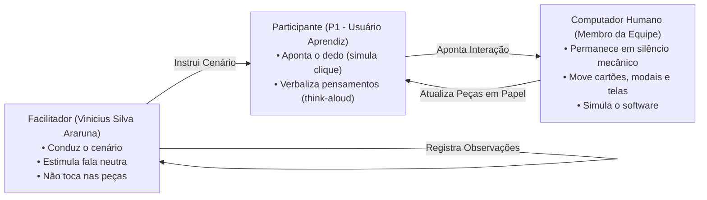

# Planejamento da Avaliação do Protótipo de Papel (Nível 2) — Tarefa 1

## Tabela de Contribuição e Uso de IA Generativa

A Tabela 1 apresenta a matriz de responsabilidade na elaboração do planejamento da avaliação do Protótipo de Papel (Nível 2), focado exclusivamente na Tarefa 1.

**Tabela 1** — Matriz de Contribuição do Planejamento do Protótipo de Papel (Tarefa 1)

| Integrante | Atribuição no Artefato | Data | Ferramenta de IA Utilizada | Propósito do Uso de IA |
| :--- | :--- | :---: | :--- | :--- |
| [Vinicius Silva Araruna](https://github.com/ViniciusA05) | **Autor Principal / Tech Lead**: Estruturação completa pelo Framework DECIDE, fundamentação teórica de prototipagem em papel (Snyder, Rettig, Barbosa & Silva), definição dos papéis de Facilitador e Computador Humano, roteiro de tarefas focado na Tarefa 1, cronogramas planejado e executado, orçamento e checklist de 15 itens normativos. | 24/10/2026 | Google Gemini (LLM) | Apoio na estruturação das tabelas Markdown, conferência de hiperligações internas e validação de referências ABNT. |
| [Gustavo Antonio Rodrigues e Silva](https://github.com/gus-ant) | **Revisor Designado**: Auditoria de consistência temporal e verificação da data de gravação em grupo em 02/11/2026. | 24/10/2026 | — | Revisão humana por pares. |
| [Edvaldo Soares Brasileiro Filho](https://github.com/PajeMurici-dev) | **Revisor Metodológico**: Checagem de aderência aos 15 critérios normativos da checklist de Barbosa & Silva e Snyder. | 24/10/2026 | — | Revisão humana por pares. |

_Fonte: Elaborada pelos autores, 2026._

---

## 1. Introdução e Contextualização do Nível 2 de Mayhew

No **Ciclo de Vida de Deborah Mayhew (1999)**, a Engenharia de Usabilidade transita da fase de modelagem conceitual abstrata (Storyboards e Análise de Tarefas de Nível 1) para a materialização tangível das interfaces no **Nível 2 (Padrões de Design e Prototipação em Papel)**.

A prototipação de baixa fidelidade em papel (*Paper Prototyping*) é consagrada na literatura científica de Interação Humano-Computador (*Snyder, 2003; Rettig, 1994; Barbosa & Silva, 2021, Cap. 10*) como um método rápido, plástico e de alta validade formativa para avaliar a hierarquia visual de telas, a disposição de botões, caixas de diálogo modais e estilos de interação antes de qualquer esforço de programação em código.

Este documento consolida o **Planejamento da Avaliação Formativa do Protótipo de Papel**, estruturado integralmente segundo as seis etapas do **Framework DECIDE** (*Rogers et al., 2013; Barbosa & Silva, 2021*), focalizando estritamente a funcionalidade prioritária sob responsabilidade de Vinicius Silva Araruna:

> **Funcionalidade Avaliada:** *Criação e Publicação de Tópico de Dúvida com Tags e Formatação Markdown com Integração de IA Semântica* (Fórum Diolinux Plus / Discourse).

O planejamento contempla todos os elementos metodológicos necessários para a execução em campo na FGA/UnB, incluindo cronograma planejado, cronograma executado, orçamento de custo zero, roteiro detalhado da simulação tátil, protocolo do teste-piloto de Nível 2 e a gravação oficial da equipe agendada para **2 de novembro de 2026**.

---

## 2. Fundamentação Teórica Canônica

_Autor do Item Teórico: [Vinicius Silva Araruna](https://github.com/ViniciusA05)_

A prototipagem em papel apoia-se em premissas ergonômicas consagradas na literatura clássica:

> *"O protótipo em papel é uma simulação de software em papel, onde um facilitador interage com o participante e outra pessoa da equipe atua como o 'computador', manipulando peças de papel para simular a resposta da interface às ações do usuário."*  
> — **SNYDER, Carolyn.** *Paper Prototyping: The Fast and Easy Way to Design and Refine User Interfaces*. San Francisco: Morgan Kaufmann, 2003.

Segundo Barbosa e Silva (2021, p. 248-252) e Marc Rettig (1994), a prototipação em papel apresenta vantagens determinantes no ciclo de design:
1. **Alta Plasticidade e Encorajamento ao Feedback Crítico:** Por não aparentar ser um sistema finalizado, os voluntários sentem-se livres para criticar o fluxo, propor botões alternativos e apontar ambiguidades sem receio de desvalorizar o trabalho visual do projetista;
2. **Foco na Arquitetura da Informação e Terminologia:** A ausência de cores sofisticadas ou renderização tipográfica digital direciona o foco do estudante para o significado dos rótulos de botões, clareza das instruções de formatação de código e visibilidade dos campos de preenchimento;
3. **Validação Rápida de Intervenções Inteligentes:** Permite testar o comportamento do novo **Modal Móvel de IA Semântica de Pré-Envio** como um cartão físico destacável sobreposto à tela base, avaliando se a recomendação de tags e desduplicação auxilia ou interrompe a jornada do usuário.

---

## 3. D — Determinar os Objetivos da Avaliação da Tarefa 1

A avaliação formativa do Protótipo de Papel tem como meta confrontar as soluções de interface concebidas para a Tarefa 1 com o modelo mental espontâneo dos estudantes universitários. Em consonância com Barbosa e Silva (2021, p. 280), foram estabelecidos quatro objetivos gerais:

1. **Avaliar a Usabilidade da Interface do Editor de Postagem (*Composer*):** Verificar se o discente identifica com rapidez onde inserir o título, como selecionar a categoria correta e onde redigir o corpo da dúvida;
2. **Avaliar a Clareza das Instruções e da Área de Visualização de Markdown:** Avaliar se a divisão visual entre a área de digitação e o painel de pré-visualização lado a lado (*split-view*) em papel é compreendida e se os botões de atalho de código (`&lt;/&gt;`) são intuitivos;
3. **Validar a Ergonomia e Aceitação do Modal da IA Semântica de Pré-Envio:** Testar se o cartão destacável com as sugestões automáticas da IA (tags técnicas e verificação de tópicos semelhantes) é percebido como um facilitador preventivo e se os botões de controle (*"Aplicar Sugestões e Enviar"* vs. *"Publicar como está"*) garantem autonomia ao usuário;
4. **Mapear Falhas de Affordance e Hesitações de Preenchimento:** Diagnosticar pontos onde o participante hesita ao simular o clique com o dedo, dúvidas sobre a obrigatoriedade de campos e dificuldades na seleção de tags técnicas.

---

## 4. E — Explorar as Perguntas Investigativas (Tarefa 1)

A Tabela 2 apresenta o desdobramento dos objetivos em perguntas investigativas específicas formuladas para guiar a inquirição durante o ensaio do protótipo de papel.

**Tabela 2** — Perguntas investigativas da avaliação do Protótipo de Papel da Tarefa 1

| Objetivo Associado | Nº | Pergunta Investigativa Específica | Foco de Observação e Critério de Sucesso |
| :--- | :---: | :--- | :--- |
| **Navegação e Layout** | **PP01** | Ao abrir a tela inicial do fórum em papel, você identifica imediatamente onde clicar para abrir o formulário de postagem de dúvida? | Tempo até o primeiro toque no botão 'Novo Tópico' e ausência de varredura visual confusa. |
| **Navegação e Layout** | **PP02** | A disposição física dos campos de Título, Categoria e Tags na folha base parece lógica e reflete sua ordem natural de preenchimento? | Observar se o participante preenche os campos na ordem proposta ou se prefere escrever o texto antes das tags. |
| **Formatação Markdown** | **PP03** | As instruções sobre como formatar comandos de terminal (bloco de código com três crases ou botão de ferramentas) ficaram legíveis e claras no protótipo? | Compreensão dos símbolos desenhados e identificação da área de pré-visualização lado a lado. |
| **Assistência de IA** | **PP04** | Quando o cartão da IA de pré-envio é posicionado sobre a tela antes da publicação, fica evidente o motivo dessa intervenção? | Verbalização espontânea de que a IA está analisando tags e prevenindo duplicatas de tópicos. |
| **Controle do Usuário** | **PP05** | As opções para 'Aplicar tags recomendadas' ou 'Publicar diretamente sem alterar' estão visualmente equilibradas e acessíveis? | Usuário identifica sem hesitação como enviar o post caso não queira acatar as sugestões da IA. |
| **Prevenção de Erros** | **PP06** | Se você tentar submeter o formulário sem preencher um campo mandatório, o feedback visual de erro em papel é claro sobre o que deve ser corrigido? | Usuário identifica verbalmente a ação corretiva necessária. |
| **Satisfação e Eficácia** | **PP07** | Ao término da tarefa, com a exibição do cartão do tópico publicado, você teve convicção imediata de que sua dúvida foi registrada com sucesso? | Verbalização de convicção perante a tela de feedback final. |
| **Oportunidades de Design** | **PP08** | Que elemento, botão ou instrução você acrescentaria ou modificaria nesta interface de papel para tornar a postagem mais intuitiva? | Elicitação de requisitos para a fase de prototipação de alta fidelidade (Nível 3). |

_Fonte: Vinicius Silva Araruna com base em Barbosa e Silva (2021) e Snyder (2003), 2026._

---

## 5. C — Escolher os Métodos de Avaliação

Para avaliar o protótipo de papel no Nível 2, a equipe selecionou o método de **Ensaio de Interação com Usuários por meio de Teste de Usabilidade Formativo em Papel (*Paper Usability Testing*)** (*Snyder, 2003; Rettig, 1994; Barbosa & Silva, 2021*), combinado com a técnica de verbalização concomitante (*think-aloud*).

### Dinâmica e Atribuição de Papéis na Sessão

Durante a sessão presencial, a dinâmica opera com clara separação funcional de papéis para não enviesar o participante:



- **O Facilitador ([Vinicius Silva Araruna](https://github.com/ViniciusA05)):** Acolhe o voluntário, lê o Script Oral do TCLE (menos de 60s), apresenta o cenário de uso, estimula a fala em voz alta sem induzir respostas e registra as anotações na planilha de observação;
- **O "Computador Humano":** Permanece em absoluto silêncio ao lado da mesa. Sua atribuição é exclusivamente mecânica: quando o participante toca em um botão com o dedo, o Computador Humano posiciona o cartão correspondente (ex: abre o modal de IA pré-envio, exibe o menu de tags ou troca para a tela de tópico publicado);
- **O Participante (P1):** Discente de tecnologia da UnB que interage com as pranchas apontando com o dedo onde clicaria e simulando a redação verbal dos comandos.

---

## 6. I — Identificar e Administrar as Questões Práticas

### 6.1 Perfil e Recrutamento do Participante
- **Público-Alvo:** 1 discente voluntário real (Perfil 1: Estudante / Usuário Aprendiz em Linux) do curso de Ciência da Computação (CIC/UnB — Campus Darcy Ribeiro);
- **Critério de Inclusão:** Estar matriculado em curso de tecnologia, já ter enfrentado dúvidas de terminal Linux e ter experiência com fóruns técnicos na web;
- **Critério de Exclusão:** Membros da equipe do Grupo 08 ou discentes envolvidos diretamente no projeto.

### 6.2 Confecção dos Materiais em Papel (Bancada da Tarefa 1)
As peças físicas do protótipo de papel da Tarefa 1 são confeccionadas artesanalmente em folhas sulfite A4 rígidas:
- **Prancha Base 1 (Tela Inicial do Fórum):** Layout da página inicial do Diolinux Plus com barra superior, lista de tópicos e botão destacado 'Novo Tópico';
- **Prancha Base 2 (Editor de Postagem - Composer):** Formulário aberto contendo campos de texto para Título, seletor de Categoria, campo de inserção de Tags e divisão lado a lado (*split-view*) entre caixa de digitação Markdown e tela de visualização renderizada;
- **Peça Móvel 1 (Menu Suspenso de Categorias):** Cartão recortado simulando as opções de categorias ('Iniciantes', 'Dúvidas Gerais', 'Customização');
- **Peça Móvel 2 (Menu Suspenso de Tags):** Cartão recortado contendo tags sugeridas pelo sistema ('terminal', 'ubuntu', 'drivers', 'apt');
- **Peça Móvel 3 (Modal Móvel da IA Semântica de Pré-Envio):** Cartão sobreposto simulando a caixa de diálogo da IA, contendo o resumo dos tópicos idênticos já resolvidos, as tags recomendadas e os botões de ação: *"Aplicar Sugestões e Enviar"* e *"Publicar como está"*;
- **Prancha Base 3 (Feedback de Tópico Publicado):** Tela final simulando a página do fórum com o novo tópico publicado e os comandos de terminal devidamente realçados com syntax highlighting.

### 6.3 Infraestrutura Presencial
- **Ambiente:** Residência do participante (ambiente domiciliar silencioso e propício à concentração), garantindo ausência de ruídos externos, privacidade e conforto para a verbalização espontânea;
- **Dispositivo de Gravação:** Smartphone posicionado em suporte sobre a mesa a 45 graus, enquadrando as mãos do participante e as peças de papel sobre a mesa;
- **Instrumentos de Registro:** Planilha padronizada de anotação de tempos, hesitações e verbalizações.

### 6.4 Orçamento e Declaração de Custo Zero
A Tabela 3 apresenta o demonstrativo orçamentário formal do planejamento de Nível 2.

**Tabela 3** — Demonstrativo Financeiro e Orçamento do Protótipo de Papel (Tarefa 1)

| Item / Recurso | Tipo | Custo Unitário | Custo Total | Justificativa |
| :--- | :---: | :---: | :---: | :--- |
| **Salas de Estudo / Bancada de Testes** | Espaço físico | R$ 0,00 | R$ 0,00 | Uso de salas públicas de estudo da Biblioteca / UAC da FGA/UnB com reserva discente. |
| **Dispositivo de Gravação Audiovisual** | Equipamento pessoal | R$ 0,00 | R$ 0,00 | Smartphone pessoal de Vinicius Silva Araruna posicionado em suporte sobre a mesa. |
| **Folhas Sulfite A4, Cartolinas e Canetas** | Material físico | R$ 0,00 | R$ 0,00 | Materiais de papelaria previamente possuídos pela equipe de desenvolvimento. |
| **Hospedagem de Vídeo e Nuvem** | Infraestrutura | R$ 0,00 | R$ 0,00 | Armazenamento na conta institucional educacional da UnB (Google Drive / YouTube Não Listado). |
| **Mão de Obra e Voluntário** | Recurso Humano | R$ 0,00 | R$ 0,00 | Trabalho acadêmico voluntário sem remuneração financeira (Resolução CNS nº 510/2016). |
| **TOTAL GERAL DO PROTÓTIPO DE PAPEL** | — | — | **R$ 0,00** | **Execução acadêmica autossustentada com custo zero.** |

_Fonte: Elaborada pelos autores, 2026._

---

## 7. Cronogramas Planejado e Executado da Tarefa 1 (Nível 2)

### 7.1 Cronograma Planejado das Atividades de Nível 2

A Tabela 4 detalha o cronograma planejado para a execução empírica do Protótipo de Papel da Tarefa 1, culminando na gravação oficial da equipe em **2 de novembro de 2026**.

**Tabela 4** — Cronograma Planejado das Atividades do Protótipo de Papel (Tarefa 1)

| Atividade / Etapa | Período / Data | Horário | Responsável | Participante / Papel | Local Físico (Ambiente Silencioso) |
| :--- | :---: | :---: | :--- | :--- | :--- |
| **Confecção Física das Peças em Papel** | 27/10 a 29/10/2026 | 14:00 - 18:00 | [Vinicius Silva Araruna](https://github.com/ViniciusA05) | Autor da Tarefa 1 | Bancada de Trabalho / FGA/UnB |
| **Ensaio Solo do Teste-Piloto de Nível 2** | 30/10/2026 | 14:00 - 14:45 | [Vinicius Silva Araruna](https://github.com/ViniciusA05) | Avaliador Solo / Computador Humano | Presencial — Residência do Avaliador / Ambiente Silencioso |
| **Sessão Presencial Oficial (PP01 — Tarefa 1)** | 31/10/2026 | 14:00 - 14:45 | [Vinicius Silva Araruna](https://github.com/ViniciusA05) | Participante 1 (P1 — Graduando CIC/UnB) | Presencial — Residência do Participante P1 (Ambiente Domiciliar) |
| **Tabulação e Classificação de Severidade** | 01/11/2026 | 09:00 - 13:00 | [Vinicius Silva Araruna](https://github.com/ViniciusA05) | Analista de Usabilidade | Ambiente Remoto / FGA |
| **Gravação Audiovisual Oficial da Equipe** | **02/11/2026** | **09:00 - 11:30** | **Toda a Equipe do Grupo 08** | **Apresentação Conjunta da Entrega** | **Sessão Síncrona Oficial da Equipe** |
| **Finalização Documental e Submissão** | 03/11/2026 | Até 23:59 | [Vinicius Silva Araruna](https://github.com/ViniciusA05) (PO) | Tech Lead / PO | Plataforma Aprender 3 |

_Fonte: Elaborada pelos autores, 2026._

---

### 7.2 Cronograma Executado e Esteira de Pós-Processamento da Tarefa 1

A Tabela 5 documenta a esteira integrada de execução da Tarefa 1, com acompanhamento de prazos, entregáveis e status.

**Tabela 5** — Cronograma Executado e Esteira de Acompanhamento da Tarefa 1 (Nível 2)

| Fase / Atividade | Data Executada | Horário | Responsável | Entregável / Registro Formal | Status |
| :--- | :---: | :---: | :--- | :--- | :---: |
| **Estruturação do Planejamento DECIDE** | 24/10/2026 | 13:00 - 14:00 | [Vinicius Silva Araruna](https://github.com/ViniciusA05) | Elaboração deste documento formal de Nível 2 com checklist de 15 itens. | 🟢 Concluído |
| **Recorte e Confecção dos Cartões em Papel** | 27/10 a 29/10/2026 | 14:00 - 18:00 | [Vinicius Silva Araruna](https://github.com/ViniciusA05) | Conjunto de 3 pranchas A4 e 3 cartões móveis (tags, menu e modal da IA). | 🟡 Agendado |
| **Execução do Teste-Piloto de Nível 2** | 30/10/2026 | 14:00 - 14:45 | [Vinicius Silva Araruna](https://github.com/ViniciusA05) | Calibração de movimentação das peças físicas, tempo de resposta e TCLE oral. | ⚪ Planejado |
| **Sessão Presencial Oficial de Interação** | 31/10/2026 | 14:00 - 14:45 | [Vinicius Silva Araruna](https://github.com/ViniciusA05) | Sessão presencial gravada com P1 (CIC/UnB) na residência do participante, think-aloud e simulação com Computador Humano. | ⚪ Planejado |
| **Tabulação e Severidade de Nielsen (0 a 4)** | 01/11/2026 | 09:00 - 13:00 | [Vinicius Silva Araruna](https://github.com/ViniciusA05) | Planilha de dados brutos e catálogo de falhas formativas de Nível 2. | ⚪ Planejado |
| **Gravação Audiovisual Oficial da Equipe** | **02/11/2026** | **09:00 - 11:30** | **Toda a Equipe** | **Vídeo oficial conjunto da apresentação da entrega gravado e hospedado no YouTube.** | ⚪ Planejado |
| **Submissão Oficial no Aprender 3** | 03/11/2026 | Até 23:59 | [Vinicius Silva Araruna](https://github.com/ViniciusA05) | Submissão dos links definitivos e documentação no ambiente acadêmico. | ⚪ Planejado |

_Fonte: Elaborada pelos autores, 2026._

---

## 8. Cenário de Uso e Roteiro de Teste Específico da Tarefa 1

O ensaio com o protótipo de papel apoia-se em um cenário de uso autêntico:

### Cenário de Uso da Tarefa 1:
> *"Você é um estudante de tecnologia que instalou recentemente o Linux em seu computador pessoal. Ao tentar compilar um projeto de disciplina, o terminal retornou um erro inesperado de permissão e falha de dependência de pacotes (`E: Could not get lock /var/lib/dpkg/lock-frontend`). Após pesquisar brevemente, você decide recorrer à comunidade do Fórum Diolinux Plus para pedir auxílio especializado.*  
> *Sua tarefa consiste em:*  
> *1. Localizar e acionar o comando para criar um novo tópico no fórum;*  
> *2. Preencher um título conciso e selecionar a categoria apropriada;*  
> *3. Associar tags técnicas relevantes;*  
> *4. Inserir o texto da dúvida e formatar os comandos do terminal com o bloco de código Markdown;*  
> *5. Submeter o post, analisar as recomendações preventivas sugeridas pelo modal da IA de pré-envio e confirmar a publicação."*

### Roteiro de Ações Observadas pelo Facilitador:
1. **Ação 1:** Participante toca com o dedo no botão 'Novo Tópico' na Prancha 1;  
   *Resposta do Computador Humano:* Retira a Prancha 1 e posiciona a Prancha 2 (Editor aberto);
2. **Ação 2:** Participante aponta o campo de Categoria;  
   *Resposta do Computador Humano:* Sobrepõe a Peça Móvel 1 (Menu de Categorias);
3. **Ação 3:** Participante aponta a área de texto e verbaliza a inserção de crases triplas (` ``` `);  
   *Resposta do Computador Humano:* Exibe na metade direita da Prancha 2 o bloco formatado em syntax highlighting;
4. **Ação 4:** Participante toca no botão 'Publicar';  
   *Resposta do Computador Humano:* Sobrepõe o cartão Peça Móvel 3 (Modal da IA Semântica de Pré-Envio);
5. **Ação 5:** Participante analisa as tags recomendadas e toca em *"Aplicar Sugestões e Enviar"*;  
   *Resposta do Computador Humano:* Remove as peças anteriores e apresenta a Prancha 3 (Página do tópico publicado com sucesso).

---

## 9. D — Decidir como Lidar com as Questões Éticas

A avaliação atende com rigor aos **4 Princípios Bioéticos** (*Beauchamp & Childress, 1979/2013*), à **Resolução CNS nº 510/2016** e à LGPD:
1. **Autonomia:** Participação voluntária com liberdade irrestrita de interromper o ensaio a qualquer instante;
2. **Beneficência:** Geração de insumos científicos para o aprimoramento da interface da comunidade Linux;
3. **Não-Maleficência:** Ambiente acolhedor com ênfase expressa de que o software em papel está sendo testado, jamais o discente;
4. **Justiça e Equidade:** Anonimização integral dos dados do participante (identificado apenas como P1).

### Script Oral Padronizado do TCLE (Primeiros 60 Segundos Gravados)

> **[INÍCIO DO SCRIPT ORAL — LEITURA OBRIGATÓRIA NOS PRIMEIROS 60 SEGUNDOS GRAVADOS]**  
> *"Olá! Meu nome é Vinicius Silva Araruna, sou estudante de Engenharia de Software da Faculdade UnB Gama e estou conduzindo esta avaliação no âmbito da disciplina de Interação Humano-Computador, sob orientação do Professor Doutor André Barros de Sales.*  
> *O objetivo desta sessão presencial é avaliar um protótipo de baixa fidelidade confeccionado em papel que simula a publicação de dúvidas técnicas e a assistência inteligente no Fórum Diolinux Plus. Ressalto que o que está em avaliação é exclusivamente o protótipo de papel e a clareza da interface proposta, e JAMAIS você, suas habilidades ou suas respostas.*  
> *Sua participação é totalmente voluntária, sem custos ou compensações financeiras, e você tem liberdade absoluta para interromper o teste ou revogar seu consentimento a qualquer instante sem nenhuma penalidade. Todas as informações coletadas, bem como o áudio e vídeo gravados nesta sessão, destinam-se exclusivamente a fins acadêmicos e pedagógicos da UnB, com anonimização total da sua identidade com base na Lei Geral de Proteção de Dados, sendo você identificado apenas como Participante 1.*  
> *Você teve conhecimento destas condições e concorda formalmente em participar desta avaliação gravada em áudio e vídeo sob as condições apresentadas?"*  
> **[AGUARDAR CONSENTIMENTO VERBAL EXPLÍCITO DO PARTICIPANTE: "SIM, CONCORDO"]**

---

## 10. Protocolo do Teste-Piloto de Nível 2 (Tarefa 1)

Antes da sessão oficial com o voluntário discente, será realizado o ensaio do teste-piloto de Nível 2:
- **Data e Horário:** 30/10/2026 das 14:00 às 14:45 na FGA/UnB;
- **Objetivo Instrumental:** Avaliar a agilidade manual do "Computador Humano" na troca das peças de papel, verificar a nitidez do enquadramento do smartphone a 45 graus e calibrar o ritmo de fala do Facilitador na leitura do TCLE (menos de 60s).

!!! warning "CLÁUSULA METODOLÓGICA DE ISOLAMENTO DOS DADOS DO TESTE-PILOTO"
    Conforme preconizado pela literatura canônica de IHC (*Barbosa & Silva, 2021, p. 276; Mayhew, 1999*) e pelo regulamento da disciplina (*Sales, 2026*), a equipe declara formalmente que **os dados, tempos e observações colhidos durante a execução do Teste-Piloto de Nível 2 JAMAIS serão computados ou mesclados aos resultados oficiais da avaliação com o usuário**. O piloto serve estritamente para calibração interna dos instrumentos da equipe.

---

## 11. E — Avaliar, Interpretar e Apresentar os Dados

Os dados qualitativos e comportamentais colhidos no ensaio serão transcritos e catalogados com base na **Escala de Severidade de Problemas de Usabilidade de Jakob Nielsen (1994)** (Grau 0: Neutro, Grau 1: Cosmético, Grau 2: Menor, Grau 3: Maior, Grau 4: Catastrófico), orientando diretamente os requisitos de reprojeto para a prototipação interativa no Figma (Nível 3).

---

## 12. Lista de Verificação da Técnica (Protótipo de Papel — 15 Critérios Normativos)

A Tabela 6 consolida a autoavaliação da conformidade do planejamento da avaliação do protótipo de papel da Tarefa 1, transpondo os 15 critérios canônicos de Barbosa e Silva (2021) e Snyder (2003).

**Tabela 6** — Lista de Verificação da Técnica: Planejamento do Protótipo de Papel (Tarefa 1)

| ID | Critério / Questão Avaliada | Origem Normativa | Conforme? | Resposta Autoexplicativa e Evidência no Documento |
| :---: | :--- | :--- | :---: | :--- |
| **01** | O planejamento está fundamentado no Ciclo de Vida de Mayhew (Nível 2)? | Mayhew (1999) | ✅ Sim | A Seção 1 contextualiza a transição dos modelos conceituais para interfaces em papel. |
| **02** | O artefato adota integralmente as 6 etapas do Framework DECIDE? | Rogers et al. (2013) | ✅ Sim | As Seções 3, 4, 5, 6, 9 e 11 operacionalizam explicitamente D, E, C, I, D e E. |
| **03** | Há fundamentação bibliográfica formal com linha de autoria discente? | Padrão FGA/UnB | ✅ Sim | A Seção 2 apresenta fundamentação canônica com autoria de Vinicius Silva Araruna. |
| **04** | O método do teste de usabilidade em papel está detalhado com rigor? | Snyder (2003) | ✅ Sim | A Seção 5 detalha a dinâmica de simulação física de software em papel. |
| **05** | Há clara distinção de papéis entre o Facilitador e o "Computador Humano"? | Snyder (2003); Rettig (1994) | ✅ Sim | A Seção 5 e o diagrama discriminam condução neutra e movimentação mecânica de peças. |
| **06** | Foram definidas perguntas investigativas específicas associadas aos objetivos? | Barbosa & Silva (2021) | ✅ Sim | A Tabela 2 relaciona 8 perguntas investigativas aos 4 objetivos formativos. |
| **07** | O perfil de participantes é aderente ao Perfil 1 (Estudante Aprendiz em Linux)? | Diretrizes da Disciplina | ✅ Sim | A Seção 6.1 parametriza o recrutamento de discente de Ciência da Computação (CIC/UnB) com sessão na residência do participante. |
| **08** | Há especificação da confecção física das pranchas e cartões móveis da Tarefa 1? | Rettig (1994) | ✅ Sim | A Seção 6.2 lista as 3 pranchas base e os 3 cartões móveis de diálogo e modal de IA. |
| **09** | O cenário de tarefas detalha as ações da Tarefa 1 (Markdown e IA)? | Sales (2026) | ✅ Sim | A Seção 8 descreve o cenário de erro de permissão no terminal e assistência da IA. |
| **10** | Há declaração orçamentária comprovando a execução com Custo Zero? | Plano de Ensino (Item 5) | ✅ Sim | A Tabela 3 apresenta o orçamento formal detalhado totalizando R$ 0,00. |
| **11** | O documento apresenta Cronogramas Planejado e Executado detalhados? | Padrão FGA/UnB | ✅ Sim | As Tabelas 4 e 5 discriminam datas, horários, responsáveis e a gravação em 02/11/2026. |
| **12** | O planejamento prevê a leitura do Script Oral do TCLE nos primeiros 60 segundos? | Resolução CNS nº 510/2016 | ✅ Sim | A Seção 9 transcreve literalmente o script oral para consentimento verbal gravado. |
| **13** | Há especificação prévia do protocolo e roteiro do Teste-Piloto de Nível 2? | Barbosa & Silva (2021, p. 276) | ✅ Sim | A Seção 10 parametriza a calibração prévia da manipulação dos papéis. |
| **14** | O documento transcreve a Cláusula Metodológica Obrigatória de não computação de dados do piloto? | Mayhew (1999) | ✅ Sim | A Seção 10 apresenta o destaque visual explícito de isolamento. |
| **15** | A escala de severidade de Nielsen (0 a 4) está prevista para a tabulação de falhas? | Nielsen (1994) | ✅ Sim | A Seção 11 e a Tabela 6 consolidam o método de análise e o checklist normativo. |

_Fonte: Vinicius Silva Araruna com base em Barbosa e Silva (2021) e Snyder (2003), 2026._

---

## 13. Histórico de Versão

A Tabela 7 documenta a evolução histórica deste documento.

**Tabela 7** — Histórico de Versão

| Versão | Data | Descrição Detalhada da Modificação | Autor(es) | Revisor(es) |
| :---: | :---: | :--- | :--- | :--- |
| `1.0` | 24/10/2026 | Elaboração inicial do Planejamento da Avaliação do Protótipo de Papel (Framework DECIDE — Nível 2 — Entrega 5), transpondo os 15 critérios canônicos de Barbosa & Silva (2021) e Snyder (2003), focado estritamente na Tarefa 1 (Markdown e IA Semântica de Vinicius Silva Araruna), com distinção entre Facilitador e Computador Humano, Cronogramas Planejado e Executado, orçamento de custo zero, data de gravação em grupo em 02/11/2026, protocolo do teste-piloto de Nível 2 e checklist de conformidade. | [Vinicius Silva Araruna](https://github.com/ViniciusA05) | [Gustavo Antonio](https://github.com/gus-ant), [Edvaldo Soares](https://github.com/PajeMurici-dev) |

_Fonte: Elaborada pelos autores, 2026._

---

## 14. Referências Bibliográficas (ABNT)

- BARBOSA, Simone Diniz Junqueira; SILVA, Bruno Santana da; SILVEIRA, Milene Selbach; GASPARINI, Isabela; DARIN, Ticianne; BARBOSA, Gabriel Diniz Junqueira. *Interação Humano-Computador e Experiência do Usuário*. Rio de Janeiro: Autopublicação, 2021. ISBN 978-65-00-19677-1. (Capítulo 10: Prototipação, p. 248-255).
- MAYHEW, Deborah J. *The Usability Engineering Lifecycle: a practitioner's handbook for user interface design*. San Francisco: Morgan Kaufmann Publishers, 1999.
- NIELSEN, Jakob. *Usability Engineering*. San Francisco: Morgan Kaufmann Publishers, 1994.
- RETTIG, Marc. *Prototyping for tiny fingers*. Communications of the ACM, v. 37, n. 4, p. 21-27, 1994.
- ROGERS, Yvonne; SHARP, Helen; PREECE, Jennifer. *Design de Interação: além da interação humano-computador*. 3. ed. Porto Alegre: Bookman, 2013.
- SALES, André Barros de. *Plano de Ensino da Disciplina de Interação Humano Computador*. Brasília: Universidade de Brasília, Faculdade UnB Gama (FGA), 2026.
- SNYDER, Carolyn. *Paper Prototyping: The Fast and Easy Way to Design and Refine User Interfaces*. San Francisco: Morgan Kaufmann Publishers, 2003.
