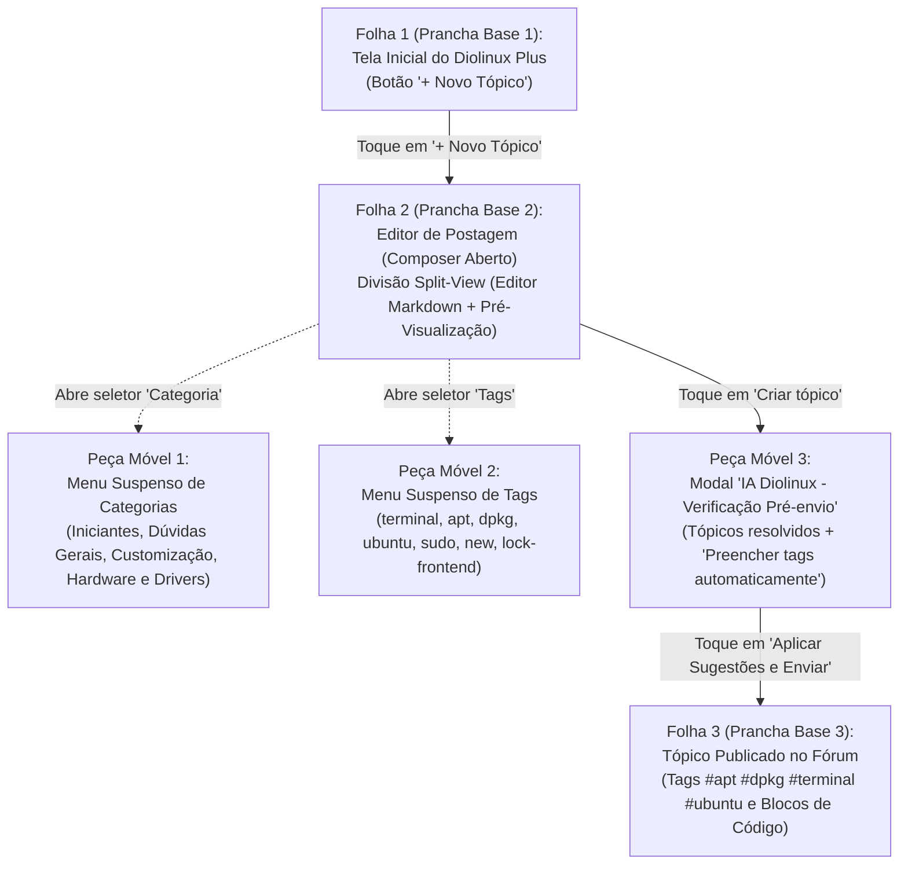
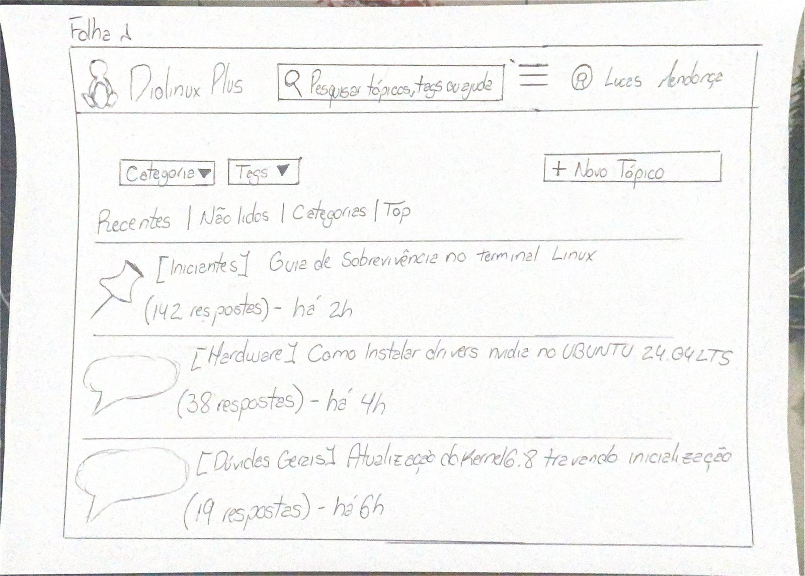
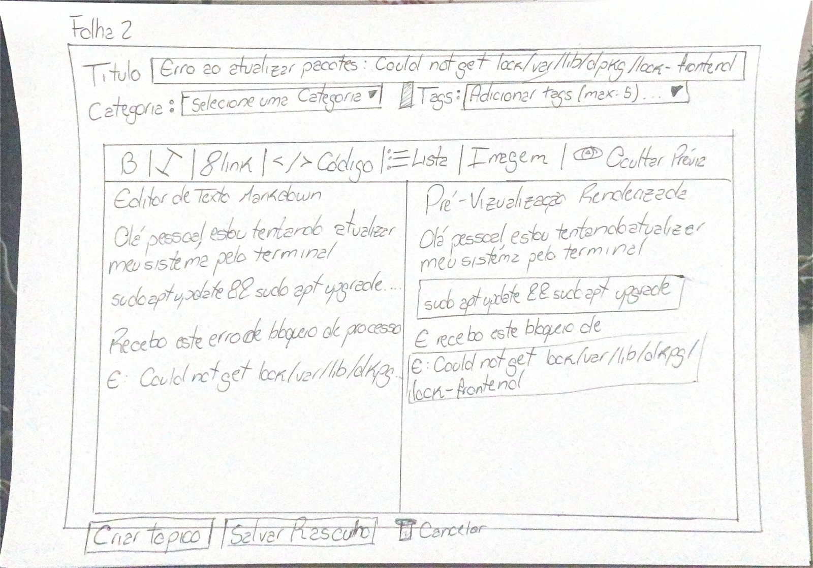
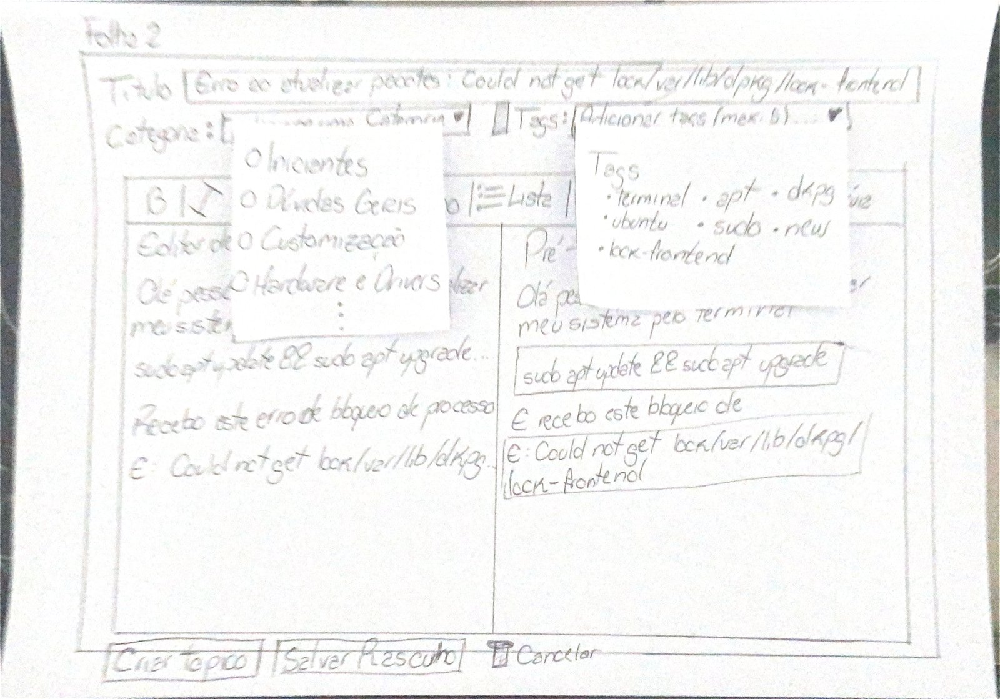
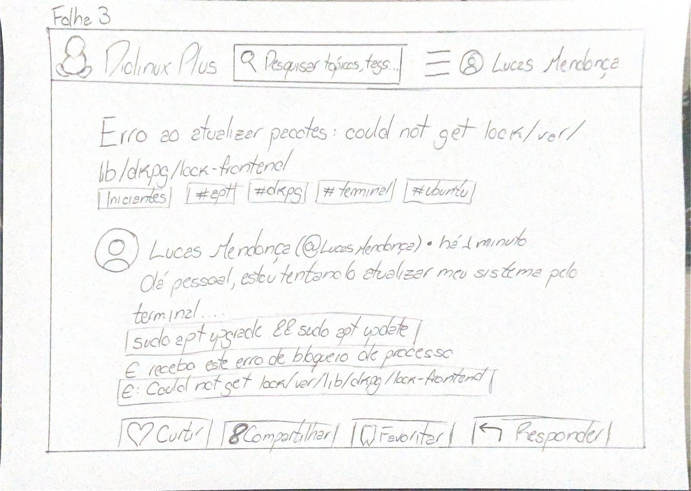

# Bancada e Artefatos Físicos do Protótipo de Papel (Tarefa 1)

## Tabela de Contribuição e Uso de IA Generativa

A Tabela 1 documenta a matriz de responsabilidade autoral e técnica na especificação e confecção dos artefatos físicos do Protótipo de Papel da Tarefa 1.

**Tabela 1** — Matriz de Contribuição dos Artefatos Físicos do Protótipo de Papel (Tarefa 1)

| Integrante | Atribuição no Artefato | Data | Ferramenta de IA Utilizada | Propósito do Uso de IA |
| :--- | :--- | :---: | :--- | :--- |
| [Vinicius Silva Araruna](https://github.com/ViniciusA05) | **Autor Principal / Tech Lead**: Especificação arquitetural e confecção física das 3 pranchas base (`Folha 1`, `Folha 2` e `Folha 3`) e 3 peças móveis sobrepostas, detalhamento do layout em modo split-view, modelagem visual do modal da IA semântica, registro fotográfico da bancada e lista de verificação de 8 itens normativos. | 30/10/2026 | Google Gemini (LLM) | Apoio na estruturação visual de tabelas Markdown e checagem de referências ABNT. |
| [Gustavo Antonio Rodrigues e Silva](https://github.com/gus-ant) | **Revisor Designado**: Auditoria de consistência das dimensões físicas, legibilidade dos wireframes de baixa fidelidade e aderência à literatura de Carolyn Snyder. | 30/10/2026 | — | Revisão humana por pares. |
| [Edvaldo Soares Brasileiro Filho](https://github.com/PajeMurici-dev) | **Revisor Metodológico**: Checagem de rastreabilidade com a Análise de Tarefas (HTA/GOMS) e conformidade com o Fórum Diolinux Plus. | 30/10/2026 | — | Revisão humana por pares. |

_Fonte: Elaborada pelos autores, 2026._

---

## 1. Introdução e Contextualização do Nível 2 de Mayhew

No **Ciclo de Vida de Deborah Mayhew (1999)**, a fase de **Design, Avaliação e Desenvolvimento** inicia-se no **Nível 2 (Padrões de Design e Prototipação em Papel)**, representando a transição crítica entre as representações conceituais preliminares de Nível 1 (Storyboards e Análise de Tarefas) e a tangibilização física das soluções de interface antes de qualquer investimento em programação.

A prototipação de baixa fidelidade em papel (*Paper Prototyping*) é uma metodologia clássica consagrada na literatura de Interação Humano-Computador (*Snyder, 2003; Rettig, 1994; Barbosa & Silva, 2021, Cap. 10*). Seu propósito essencial é permitir que designers e desenvolvedores simulem interações completas de software manipulando peças físicas sobre uma mesa, investigando a disposição de elementos, fluxo de navegação, clareza de rótulos e caixas de diálogo sobrepostas (*modais*).

Este documento formaliza as especificações de confecção artesanal, engenharia de papel e o registro fotográfico das peças reais da bancada de testes da **Tarefa 1 (`CF01`)**, sob liderança de Vinicius Silva Araruna:

> **Funcionalidade Central Avaliada:** *Criação e Publicação de Tópico de Dúvida com Tags, Formatação Markdown em Modo Split-View e Intervenção de IA Semântica Pré-Envio* no Fórum Diolinux Plus (Discourse).

---

## 2. Fundamentação Teórica Canônica — Prototipagem em Papel

_Autor do Item Teórico: [Vinicius Silva Araruna](https://github.com/ViniciusA05)_

A prototipagem em papel fundamenta-se nas recomendações seminais de **Carolyn Snyder (2003)** e **Marc Rettig (1994)**:

> *"O protótipo em papel é uma simulação de software em papel, onde um facilitador interage com o participante e outra pessoa da equipe atua como o 'computador', manipulando peças de papel para simular a resposta da interface às ações do usuário."*  
> — **SNYDER, Carolyn.** *Paper Prototyping: The Fast and Easy Way to Design and Refine User Interfaces*. San Francisco: Morgan Kaufmann, 2003.

Segundo Rettig (1994) e Barbosa e Silva (2021, p. 248–252), a técnica apresenta quatro pilares determinantes para o projeto:

1. **Plasticidade Formativa Imediata:** Por ser desenhado à mão com materiais de baixo custo, o protótipo pode ser alterado durante ou imediatamente após uma sessão de testes. Se um botão se mostrar confuso, ele pode ser riscado, recortado ou substituído em segundos;
2. **Redução da Inibição do Participante:** Interfaces digitais bem acabadas transmitem a ilusão de que o sistema está pronto, intimidando os voluntários a apontar defeitos. O papel convida o usuário a criticar abertamente, apontar falhas de affordance e rabiscar sugestões espontâneas;
3. **Foco Estrutural na Arquitetura da Informação:** A ausência de cores sofisticadas, tipografias digitais e animações força a atenção do estudante a se concentrar no que realmente importa: a clareza da linguagem, a ordem dos campos e a eficácia das mensagens de feedback;
4. **Simulação Dinâmica com o "Computador Humano":** A presença de um membro da equipe atuando silenciosamente como o mecanismo de processamento do software permite simular aberturas de menus suspensos, validações de erros e caixas de diálogo modais complexas com agilidade mecânica.

---

## 3. Especificação Técnica e Materiais da Bancada de Testes

Para viabilizar a simulação ergonômica da Tarefa 1, a equipe estabeleceu os padrões físicos descritos na Tabela 2.

**Tabela 2** — Especificações Técnicas dos Materiais da Bancada de Papel

| Item / Recurso | Tipo / Formato | Função Operacional na Simulação | Justificativa Ergonômica |
| :--- | :---: | :--- | :--- |
| **Folhas Sulfite A4 (90g/m²)** | Prancha Base (Paisagem / 297 × 210 mm) | Suporte estático para as telas de fundo do sistema (`Folha 1`, `Folha 2` e `Folha 3`). | Gramatura suficiente para não amassar durante o manuseio sobre a mesa. |
| **Papel Cartão / Sulfite Recortado** | Peças Móveis Sobrepostas | Cartões recortados para os menus suspensos de Categorias e Tags e para o Modal `IA Diolinux - Verificação Pré-envio`. | Rigidez e independência física para deslizamento rápido e posicionamento pelo Computador Humano. |
| **Notas Adesivas Reposicionáveis** | Fixação Temporária | Apoio de aderência no verso dos recortes móveis sobre a `Folha 2`. | Permite posicionar e remover menus sem deslocar a prancha base. |
| **Lápis Grafite Escuro e Caneta** | Instrumento de Desenho | Traçado à mão livre dos contornos de botões, caixas de código, ícones e rótulos textuais. | Contraste legível e estética autêntica de baixa fidelidade na filmagem a 45 graus. |
| **Suporte / Tripé a 45 Graus** | Registro Audiovisual | Posicionamento do smartphone focado nas pranchas e nas mãos sobre a mesa. | Captura integral dos toques sem filmar o rosto do voluntário (LGPD). |

_Fonte: Elaborada pelos autores com base em Snyder (2003), 2026._

---

## 4. Arquitetura e Registro Fotográfico das Peças Físicas da Tarefa 1

O conjunto completo do protótipo da Tarefa 1 compõe-se de **3 Pranchas Base Rígidas (`Folha 1`, `Folha 2` e `Folha 3`, em formato A4 paisagem)** e **3 Peças Móveis Sobrepostas (cartões recortados para Categorias, Tags e Modal da IA)**. A Figura 1 ilustra a arquitetura de transição entre as folhas base e as peças móveis.

**Figura 1** — Arquitetura e Relação entre Pranchas Base (`Folhas 1 a 3`) e Peças Móveis da Tarefa 1

_Fonte: Elaborada pelos autores, 2026._

---

### 4.1 Prancha Base 1 (`Folha 1`) — Tela Inicial do Fórum Diolinux Plus

A `Folha 1` representa a página inicial da comunidade Diolinux Plus no navegador web. Seu objetivo é verificar se o usuário localiza prontamente o comando de abertura do editor de dúvidas em meio aos filtros e tópicos recentes da comunidade. A Tabela 3 detalha os componentes visuais e rótulos manuscritos presentes na `Folha 1`.

**Tabela 3** — Componentes Visuais da Prancha Base 1 (`Folha 1`)

| Componente | Localização | Descrição e Rótulos Manuscritos na Folha 1 | Ação Esperada do Usuário |
| :--- | :---: | :--- | :--- |
| **Barra Superior (Header)** | Topo da folha | Ícone do pinguim Tux, título `Diolinux Plus`, campo `[ 🔍 Pesquisar tópicos, tags ou ajuda ]`, menu `[ ☰ ]` e perfil `👤 Lucas Mendonça`. | Reconhecimento imediato do estado de usuário autenticado. |
| **Seletores e Abas de Filtro** | Abaixo do header (esq.) | Seletores `[ Categoria ▼ ]` e `[ Tags ▼ ]`, seguidos das abas `Recentes | Não lidos | Categorias | Top`. | Varredura visual da estrutura de navegação do Discourse. |
| **Botão de Call-to-Action** | Abaixo do header (dir.) | Botão retangular destacado: `[ + Novo Tópico ]`. | **Toque principal com o dedo:** aciona o Computador Humano para substituir pela `Folha 2`. |
| **Listagem de Tópicos** | Corpo central | 1. `📌 [Iniciantes] Guia de Sobrevivência no terminal Linux (142 respostas) - há 2h` 2. `💬 [Hardware] Como instalar drivers nvidia no UBUNTU 24.04 LTS (38 respostas) - há 4h` 3. `💬 [Dúvidas Gerais] Atualização do Kernel 6.8 travando inicialização (19 respostas) - há 6h` | Contextualização realista do ecossistema colaborativo Linux. |

_Fonte: Elaborada pelos autores, 2026._

A Figura 2 apresenta o registro fotográfico da `Folha 1` confeccionada fisicamente para a bancada de testes.

**Figura 2** — Fotografia da Prancha Base 1 (`Folha 1`): Tela Inicial do Fórum Diolinux Plus

_Fonte: Vinicius Silva Araruna, 2026._

---

### 4.2 Prancha Base 2 (`Folha 2`) — Editor de Postagem (*Composer*) em Modo *Split-View*

A `Folha 2` materializa o formulário de criação de tópicos do Discourse, estruturado com divisão lateral lado a lado (*split-view*) entre o `Editor de Texto Markdown` (metade esquerda) e a `Pré-Visualização Renderizada` (metade direita). A Tabela 4 descreve todos os campos, atalhos e textos manuscritos na `Folha 2`.

**Tabela 4** — Componentes Visuais da Prancha Base 2 (`Folha 2`)

| Componente | Localização | Descrição e Rótulos Manuscritos na Folha 2 | Comportamento da Simulação |
| :--- | :---: | :--- | :--- |
| **Campo de Título** | Topo do Composer | Rótulo `Título` seguido da caixa: `[ Erro ao atualizar pacotes: Could not get lock /var/lib/dpkg/lock-frontend ]` | Participante aponta o campo e verbaliza a digitação do título da dúvida. |
| **Seletor de Categoria** | Abaixo do título (esq.) | Rótulo `Categoria:` seguido de `[ Selecione uma Categoria ▼ ]` | Toque aciona a sobreposição da **Peça Móvel 1**. |
| **Seletor de Tags** | Abaixo do título (dir.) | Ícone de etiqueta + `Tags:` seguido de `[ Adicionar tags (max: 5)... ▼ ]` | Toque aciona a sobreposição da **Peça Móvel 2**. |
| **Barra de Atalhos Markdown** | Acima da área dividida | `[ B | I | 🔗 Link | </> Código | ⋮≡ Lista | Imagem | 👁️ Ocultar Prévia ]` | Toque no atalho `[ </> Código ]` simula o isolamento sintático dos comandos de terminal. |
| **Editor de Texto Markdown** | Metade esquerda | Cabeçalho `Editor de Texto Markdown` com o texto: *"Olá pessoal, estou tentando atualizar meu sistema pelo terminal"* `sudo apt update && sudo apt upgrade....` *"Recebo este erro de bloqueio de processo"* `E: Could not get lock /var/lib/dpkg...` | Representa a entrada bruta de texto e código pelo estudante. |
| **Pré-Visualização Renderizada** | Metade direita | Cabeçalho `Pré-Visualização Renderizada` exibindo o parágrafo e **duas caixas retangulares destacadas (blocos de código)**: Caixa 1: `[ sudo apt update && sudo apt upgrade ]` Caixa 2: `[ E: Could not get lock /var/lib/dpkg/lock-frontend ]` | Permite ao usuário verificar em tempo real que seus comandos ficaram destacados em blocos de código. |
| **Barra de Ações Inferior** | Rodapé | Botões `[ Criar tópico ]`, `[ Salvar Rascunho ]` e `[ 🗑️ Cancelar ]` | Toque em `[ Criar tópico ]` engatilha a sobreposição da **Peça Móvel 3 (Modal da IA)**. |

_Fonte: Elaborada pelos autores, 2026._

A Figura 3 apresenta a fotografia da `Folha 2` confeccionada à mão com a divisão *split-view* entre o editor Markdown e a pré-visualização renderizada.

**Figura 3** — Fotografia da Prancha Base 2 (`Folha 2`): Editor de Postagem em Modo Split-View

_Fonte: Vinicius Silva Araruna, 2026._

---

### 4.3 Peças Móveis 1 e 2 — Menus Suspensos de Categorias e Tags Sobrepostos à `Folha 2`

As Peças Móveis 1 e 2 são cartões recortados independentes mantidos ao lado da bancada. Quando o voluntário toca nos seletores `Categoria` ou `Tags` da `Folha 2`, o Computador Humano posiciona imediatamente os recortes sobre a folha base. A Tabela 5 detalha os itens contidos em cada recorte.

**Tabela 5** — Especificação das Peças Móveis 1 e 2 (Menus Suspensos)

| Peça Móvel | Local de Sobreposição | Opções Manuscritas no Recorte | Regra de Interação |
| :--- | :---: | :--- | :--- |
| **Peça Móvel 1 (Menu de Categorias)** | Abaixo de `Categoria: [Selecione uma Categoria ▼]` na `Folha 2` | • `○ Iniciantes` • `○ Dúvidas Gerais` • `○ Customização` • `○ Hardware e Drivers` • `⋮` | Participante toca em `○ Iniciantes`. O Computador Humano recolhe o menu suspenso. |
| **Peça Móvel 2 (Menu de Tags)** | Abaixo de `Tags: [Adicionar tags (max: 5)... ▼]` na `Folha 2` | Cabeçalho `Tags`: • `terminal` • `apt` • `dpkg` • `ubuntu` • `sudo` • `new` • `lock-frontend` | Participante seleciona as tags pertinentes ao problema de bloqueio de pacotes e o Computador Humano recolhe o recorte. |

_Fonte: Elaborada pelos autores, 2026._

A Figura 4 ilustra o momento exato da simulação em que as Peças Móveis 1 e 2 encontram-se sobrepostas aos campos de Categoria e Tags da `Folha 2`.

**Figura 4** — Fotografia da `Folha 2` com as Peças Móveis 1 (Menu de Categorias) e 2 (Menu de Tags) Sobrepostas

_Fonte: Vinicius Silva Araruna, 2026._

---

### 4.4 Peça Móvel 3 — Modal `IA Diolinux - Verificação Pré-envio` Sobreposto à `Folha 2`

A Peça Móvel 3 materializa a intervenção assistiva de Inteligência Artificial Semântica antes da persistência do tópico. Quando o participante toca no botão `[ Criar tópico ]` no rodapé da `Folha 2`, o Computador Humano posiciona o cartão modal sobre a área de edição, apresentando tópicos resolvidos similares e recomendação automática de tags extraídas do código. Os blocos e controles do cartão são detalhados na Tabela 6.

**Tabela 6** — Elementos Manuscritos na Peça Móvel 3 (Modal `IA Diolinux - Verificação Pré-envio`)

| Bloco do Modal | Conteúdo Manuscrito no Cartão Sobreposto | Objetivo Formativo e Investigativo |
| :--- | :--- | :--- |
| **Cabeçalho e Fechamento** | `IA Diolinux - Verificação Pré-envio` com botão `[ X ]` no canto superior direito | Comunicar claramente a natureza assistiva da etapa de pré-envio e oferecer fechamento rápido. |
| **Diagnóstico e Tópicos Similares** | *"Detectamos que sua dúvida cita erro de bloqueio de pacotes (lock-frontend)... veja se algum destes tópicos já resolve seu problema:"* • `🔗 [Resolvido] Como liberar lock dpkg Ubuntu 24.04 (5 respostas)` • `🔗 [Guia] Corrigindo erros comuns de apt travado` | Avaliar se o usuário inspeciona soluções já documentadas pela comunidade antes de abrir um tópico repetido. |
| **Recomendação e Ação de 1 Toque em Tags** | *"Tags recomendadas pela IA com base no seu código:"* `[+apt] [+dpkg] [+terminal] [+permissões]` Botão de ação direta: `[ Preencher tags automaticamente ]` | Materialização direta da **sugestão empírica do Participante P1 no Nível 1**, reduzindo o esforço motor de classificação para um único toque. |
| **Botões de Decisão Final** | Botão 1 (esq.): `[ Aplicar Sugestões e Enviar ]` Botão 2 (dir.): `[ Publicar como está! (Prosseguir) ]` | Preservar a liberdade e controle do usuário (Heurística 3 de Nielsen, 1994), permitindo aceitar o enriquecimento da IA ou publicar o texto original. |

_Fonte: Elaborada pelos autores, 2026._

A Figura 5 apresenta o registro fotográfico da Peça Móvel 3 (`IA Diolinux - Verificação Pré-envio`) posicionada sobre a `Folha 2` após o acionamento do botão `Criar tópico`.

**Figura 5** — Fotografia da Peça Móvel 3 (Modal `IA Diolinux - Verificação Pré-envio`) Sobreposta à `Folha 2`

_Fonte: Vinicius Silva Araruna, 2026._

---

### 4.5 Prancha Base 3 (`Folha 3`) — Tela de Tópico Publicado com Sucesso

Após o participante tocar em `[ Aplicar Sugestões e Enviar ]` no modal da IA, o Computador Humano retira a `Folha 2` e apresenta a `Folha 3`, exibindo o tópico recém-publicado no Fórum Diolinux Plus com todas as tags aplicadas e os blocos de código formatados. A Tabela 7 sintetiza os elementos visuais da `Folha 3`.

**Tabela 7** — Componentes Visuais da Prancha Base 3 (`Folha 3`)

| Componente | Descrição e Rótulos Manuscritos na Folha 3 | Critério de Sucesso Formativo |
| :--- | :--- | :--- |
| **Cabeçalho Superior** | Ícone do pinguim Tux, `Diolinux Plus`, `[ 🔍 Pesquisar tópicos, tags... ]`, `[ ☰ ]` e `👤 Lucas Mendonça` | Consistência visual da navegação superior. |
| **Título do Tópico Publicado** | `Erro ao atualizar pacotes: could not get lock /var/lib/dpkg/lock-frontend` | Confirmação imediata da criação do tópico. |
| **Categoria e Tags Aplicadas** | Chips retangulares abaixo do título: `[ Iniciantes ]` `[ #apt ]` `[ #dpkg ]` `[ #terminal ]` `[ #ubuntu ]` | Comprovação visual da aplicação das tags sugeridas na etapa anterior. |
| **Autoria e Corpo Renderizado** | Avatar + `Lucas Mendonça (@LucasMendonça) • há 1 minuto` Texto introdutório e **duas caixas monoespaçadas de código**: 1. `[ sudo apt upgrade && sudo apt update ]` 2. `[ E: Could not get lock /var/lib/dpkg/lock-frontend ]` | Verificação da visibilidade do estado do sistema (Heurística 1 de Nielsen) e legibilidade do código. |
| **Barra de Ações da Comunidade** | Botões inferiores: `[ ♡ Curtir ]` `[ 🔗 Compartilhar ]` `[ 🔖 Favoritar ]` `[ ↩ Responder ]` | Encerramento completo do fluxo da Tarefa 1. |

_Fonte: Elaborada pelos autores, 2026._

A Figura 6 exibe a fotografia da `Folha 3` representando o estado final do tópico publicado na comunidade.

**Figura 6** — Fotografia da Prancha Base 3 (`Folha 3`): Tópico Publicado com Tags e Blocos de Código Formatados

_Fonte: Vinicius Silva Araruna, 2026._

---

## 5. Dinâmica Operacional e Separação de Papéis na Simulação

Para garantir o rigor preconizado por Carolyn Snyder (2003), a equipe atua durante a simulação presencial com divisão estrita de responsabilidades:

1. **O Facilitador ([Vinicius Silva Araruna](https://github.com/ViniciusA05)):**
   - Acolhe o participante, faz a leitura integral do Script Oral do TCLE (< 60s) e recolhe o consentimento gravado;
   - Explica que o que está sendo testado é o protótipo de papel e a clareza da interface, jamais o participante;
   - Apresenta o cenário de uso da dúvida de terminal Linux e estimula o participante a pensar em voz alta (*think-aloud*);
   - **Regra de Ouro do Facilitador:** Permanece com as mãos fora da bancada e não toca nas peças de papel durante a interação do voluntário.
2. **O "Computador Humano" (*Human Computer*):**
   - Posiciona-se silenciosamente ao lado da bancada com as `Folhas 1, 2 e 3` e as 3 peças móveis organizadas em sequência;
   - **Regra de Ouro do Computador Humano:** Permanece em absoluto silêncio mecânico (não responde perguntas, não dá dicas e não explica a tela);
   - Responde com agilidade mecânica (< 1s) aos toques do dedo do participante: quando o participante toca em um botão ou campo, o Computador Humano substitui a folha ou sobrepõe o cartão correspondente sobre a mesa.
3. **O Participante Discente (P1 — Usuário Aprendiz):**
   - Interage livremente com as pranchas, apontando com o dedo indicador os botões onde clicaria e simulando verbalmente o que digitaria em cada campo.

---

## 6. Lista de Verificação da Técnica (Confecção do Protótipo de Papel)

A Tabela 8 apresenta a lista de verificação com 8 critérios normativos fundamentados em Snyder (2003) e Rettig (1994) avaliando a conformidade dos artefatos físicos produzidos.

**Tabela 8** — Lista de Verificação da Técnica: Confecção do Protótipo de Papel (Tarefa 1)

| Item / Questão Avaliada | Origem Normativa | Conforme? | Resposta Autoexplicativa e Evidência no Documento |
| :--- | :--- | :---: | :--- |
| **1. As pranchas base foram confeccionadas em formato padronizado e resistente?** | Snyder (2003, Cap. 4) | ✅ Sim | As 3 pranchas base (`Folhas 1, 2 e 3`) foram desenhadas em folhas A4 paisagem e fotografadas em alta nitidez (Figuras 2, 3 e 6). |
| **2. O editor de postagem modela a divisão split-view (Markdown e Prévia)?** | Padrão Discourse; Barbosa & Silva (2021) | ✅ Sim | A `Folha 2` divide explicitamente o `Editor de Texto Markdown` à esquerda e a `Pré-Visualização Renderizada` à direita (Figura 3). |
| **3. Há peças móveis recortadas para elementos dinâmicos (menus e modais)?** | Rettig (1994); Snyder (2003) | ✅ Sim | Foram confeccionados 3 recortes móveis independentes para Categorias, Tags e Modal da IA (Figuras 4 e 5). |
| **4. O Modal da IA Semântica de Pré-Envio foi modelado como cartão sobreposto?** | Snyder (2003); Decisões de Design da Equipe | ✅ Sim | A Peça Móvel 3 (`IA Diolinux - Verificação Pré-envio`) sobrepõe-se à `Folha 2` ao acionar `Criar tópico` (Figura 5). |
| **5. O modal de IA incorpora a recomendação empírica real de tags com 1 clique?** | Relato da Avaliação do Storyboard (Nível 1); Nielsen (1994) | ✅ Sim | A Peça Móvel 3 inclui o botão `[ Preencher tags automaticamente ]` derivado dos achados empíricos de Nível 1 (Tabela 6 e Figura 5). |
| **6. Há garantia expressa de liberdade e controle ao usuário na intervenção de IA?** | Heurística 3 de Nielsen (1994) | ✅ Sim | O modal oferece o botão `[ Publicar como está! (Prosseguir) ]` e o botão `[ X ]` de fechamento (Figura 5). |
| **7. A tela de tópico publicado confirma a persistência e o destaque de código?** | Barbosa & Silva (2021, Cap. 10) | ✅ Sim | A `Folha 3` exibe o post consolidado com os chips `[Iniciantes] [#apt] [#dpkg] [#terminal] [#ubuntu]` e caixas de código (Figura 6). |
| **8. O protocolo prevê a separação rígida entre Facilitador e Computador Humano?** | Snyder (2003, Cap. 3) | ✅ Sim | A Seção 5 estipula as regras de conduta neutra do facilitador e silêncio mecânico do computador humano. |

_Fonte: Vinicius Silva Araruna com base em Snyder (2003), Rettig (1994) e Barbosa & Silva (2021), 2026._

---

## 7. Histórico de Versão

A Tabela 9 documenta o histórico de versões deste artefato.

**Tabela 9** — Histórico de Versão do Documento

| Versão | Data | Descrição Detalhada da Modificação | Autor(es) | Revisor(es) |
| :---: | :---: | :--- | :--- | :--- |
| `1.0` | 30/10/2026 | Elaboração inicial da especificação dos artefatos físicos do Protótipo de Papel da Tarefa 1 (Markdown e IA Semântica), detalhando as 3 pranchas base A4 (`Folhas 1, 2 e 3`), 3 peças móveis recortadas, registro fotográfico real da bancada (Figuras 2 a 6), modal inteligente de pré-envio com botão de preenchimento automático de tags, dinâmica de Facilitador/Computador Humano e checklist normativo de 8 itens. | [Vinicius Silva Araruna](https://github.com/ViniciusA05) | [Gustavo Antonio](https://github.com/gus-ant), [Edvaldo Soares](https://github.com/PajeMurici-dev) |

_Fonte: Elaborada pelos autores, 2026._

---

## 8. Referências Bibliográficas (ABNT)

- BARBOSA, Simone Diniz Junqueira; SILVA, Bruno Santana da; SILVEIRA, Milene Selbach; GASPARINI, Isabela; DARIN, Ticianne; BARBOSA, Gabriel Diniz Junqueira. *Interação Humano-Computador e Experiência do Usuário*. Rio de Janeiro: Autopublicação, 2021. ISBN 978-65-00-19677-1. (Capítulo 10: Prototipação, p. 248-255).
- MAYHEW, Deborah J. *The Usability Engineering Lifecycle: a practitioner's handbook for user interface design*. San Francisco: Morgan Kaufmann Publishers, 1999.
- NIELSEN, Jakob. *Usability Engineering*. San Francisco: Morgan Kaufmann Publishers, 1994.
- RETTIG, Marc. *Prototyping for tiny fingers*. Communications of the ACM, v. 37, n. 4, p. 21-27, 1994.
- SALES, André Barros de. *Plano de Ensino da Disciplina de Interação Humano Computador*. Brasília: Universidade de Brasília, Faculdade UnB Gama (FGA), 2026.
- SNYDER, Carolyn. *Paper Prototyping: The Fast and Easy Way to Design and Refine User Interfaces*. San Francisco: Morgan Kaufmann Publishers, 2003.

---

## Agradecimentos e Uso de Inteligência Artificial (IA) Generativa

Durante a estruturação do layout em Markdown e organização das tabelas descritivas das peças físicas de papel, foi utilizado suporte de Inteligência Artificial Generativa (LLM), tendo toda a confecção manuscrita das pranchas (`Folhas 1, 2 e 3`), recortes móveis, fotografia da bancada e listas de verificação sido realizada e validada pelo autor.
