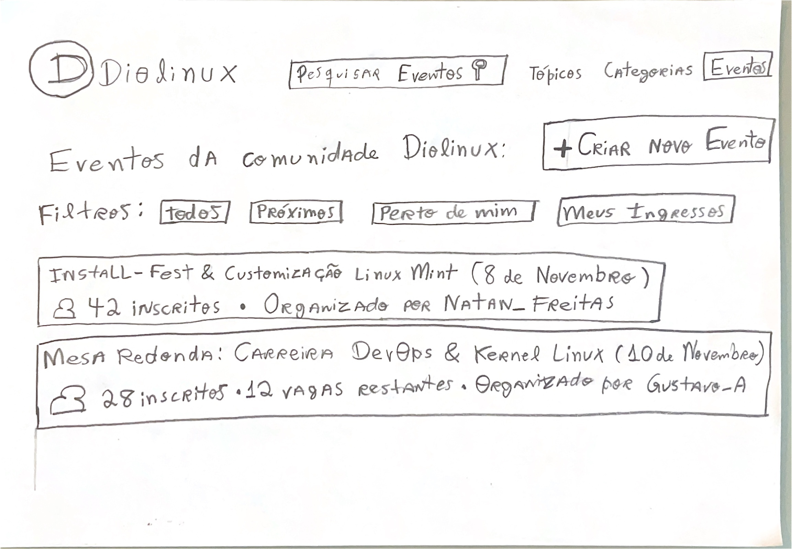
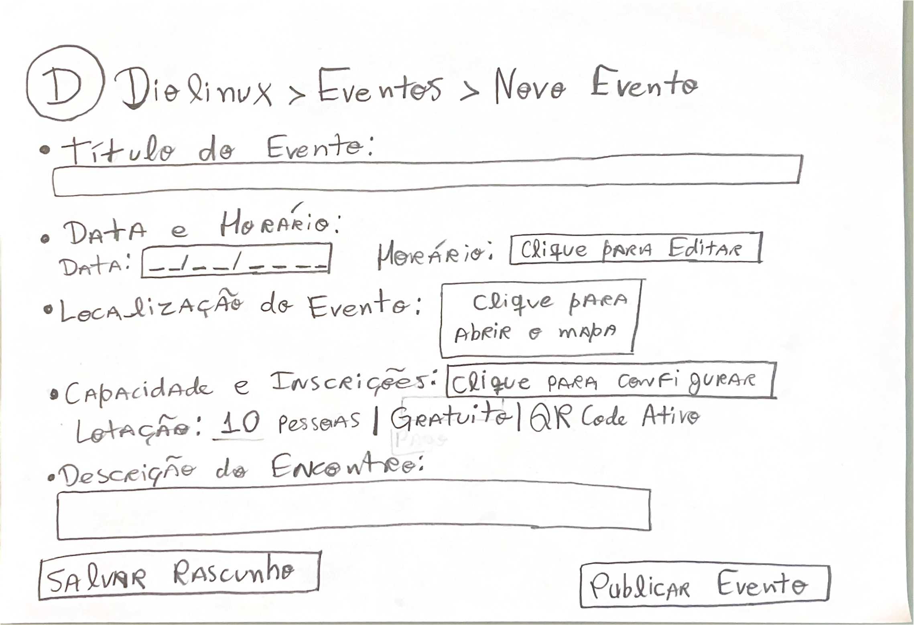
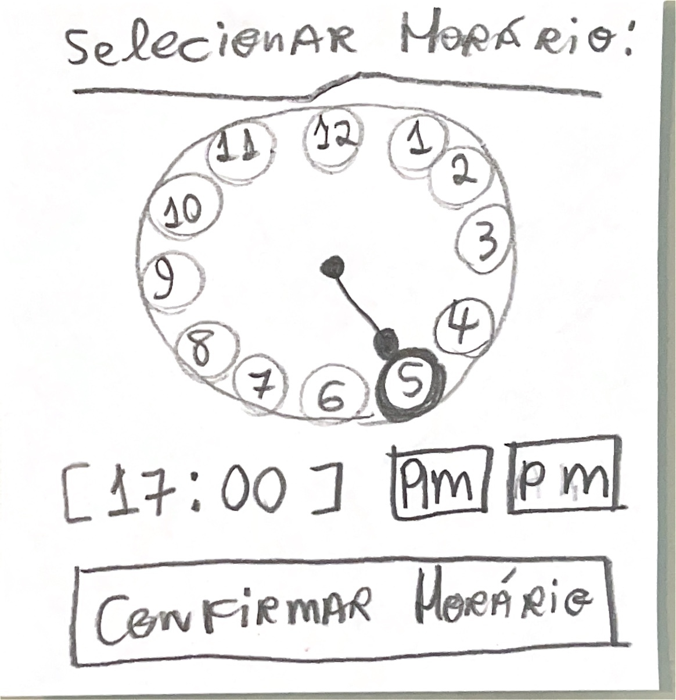
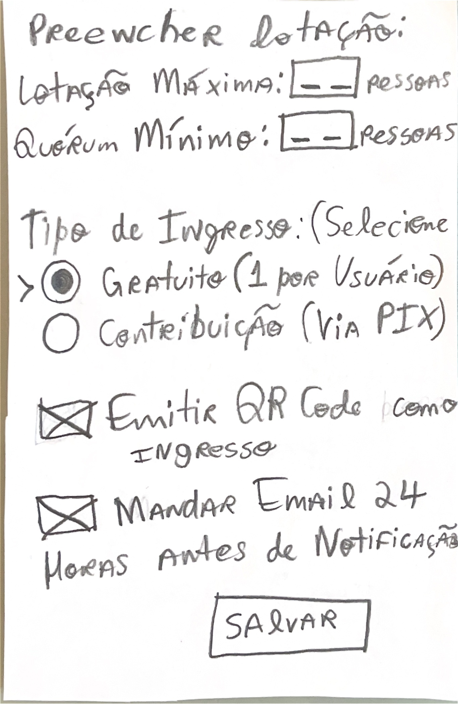
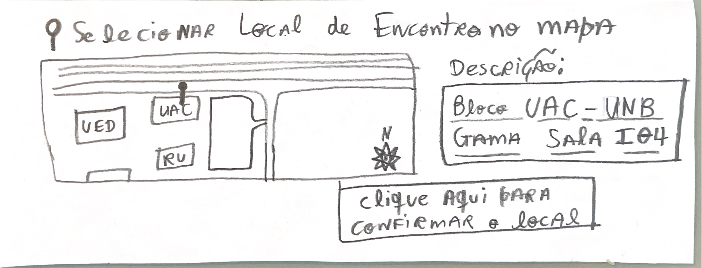
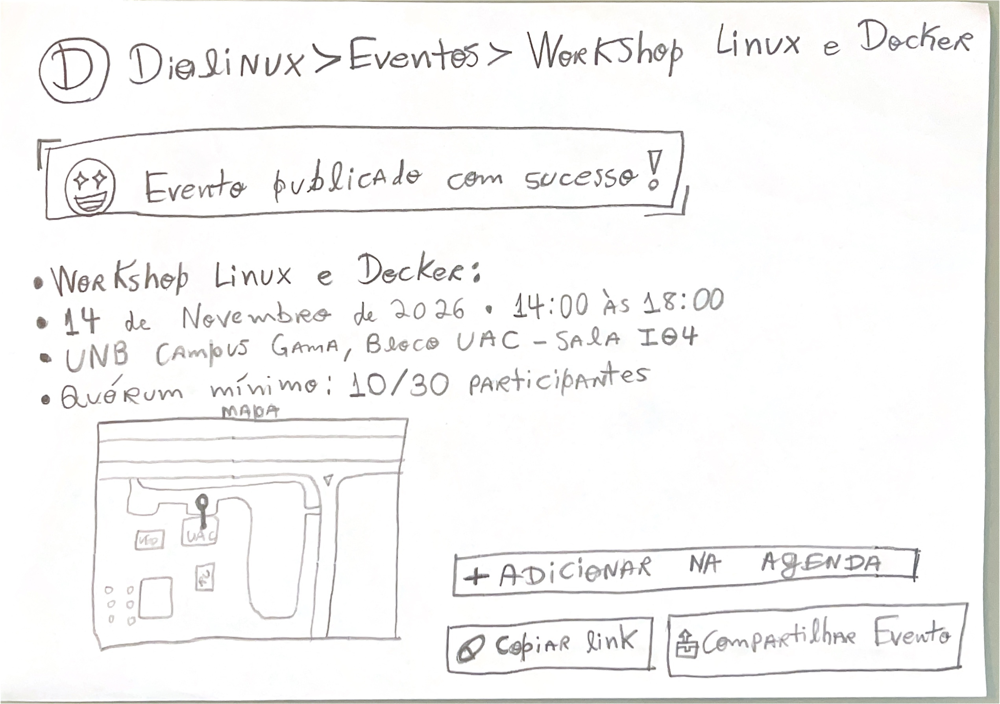

# Bancada e Artefatos Físicos do Protótipo de Papel (Tarefa 2)

## Tabela de Contribuição e Transparência no Uso de IA Generativa

A Tabela 1 documenta a matriz de responsabilidade autoral e técnica na especificação e confecção dos artefatos físicos do Protótipo de Papel da Tarefa 2.

**Tabela 1** — Matriz de Contribuição dos Artefatos Físicos do Protótipo de Papel (Tarefa 2)

| Integrante | Atribuição no Artefato | Data | Horário | Ferramenta de IA Utilizada | Propósito do Uso de IA | Hiperligação / Gravação |
| :--- | :--- | :---: | :---: | :--- | :--- | :---: |
| [Gustavo Antonio Rodrigues e Silva](https://github.com/gus-ant) | **Autor Principal / Designer**: Especificação técnica, desenho manuscrito e confecção física das 3 pranchas base (`Folhas 1, 2 e 3`) e 3 peças móveis sobrepostas (relógio timepicker, modal de lotação/ingressos e mapa com marcador destacável), digitalização em alta resolução e lista de verificação de 8 itens. | 03/11/2026 | 18:00 - 21:00 | Google Gemini (LLM) | Apoio na estruturação visual de tabelas Markdown e validação de referências ABNT. | [Seção 3](#3-especificacao-e-catalogo-das-pranchas-e-pecas-fisicas) |
| [Vinicius Silva Araruna](https://github.com/ViniciusA05) | **Revisor por Par Designado**: Revisão metodológica cruzada, conferência da rastreabilidade com a Tarefa 1 e checagem de consistência ergonômica. | 03/11/2026 | 21:00 - 21:30 | — | Revisão humana por pares. | [Histórico](#6-historico-de-versao) |
| [Edvaldo Soares Brasileiro Filho](https://github.com/PajeMurici-dev) | **Revisor Metodológico**: Checagem de conformidade com os critérios do Plano de Ensino da disciplina e auditoria de fontes nominais. | 03/11/2026 | 21:30 - 22:00 | — | Revisão humana por pares. | [Histórico](#6-historico-de-versao) |

_Fonte: Elaborada por Edvaldo Soares Brasileiro Filho, Gustavo Antonio Rodrigues e Silva e Vinicius Silva Araruna, 2026._

---

## 1. Introdução e Contextualização no Ciclo de Mayhew

No **Ciclo de Vida da Engenharia de Usabilidade de Deborah Mayhew (1999)**, a fase de **Design, Avaliação e Desenvolvimento** estrutura o refinamento da interface por meio de níveis iterativos. O **Nível 2 (Padrões de Design e Prototipação em Papel)** constitui o elo empírico indispensável entre os modelos conceituais abstratos de Nível 1 (Análise Hierárquica de Tarefas e Storyboards) e a construção detalhada em software interativo (Nível 3 no Figma).

A prototipagem em papel (*Paper Prototyping*), consagrada na literatura de Interação Humano-Computador por **Carolyn Snyder (2003)** e **Marc Rettig (1994)**, baseia-se na simulação tátil e física de sistemas interativos com materiais de baixo custo financeiro. Seu propósito basilar é viabilizar a exploração rápida de alternativas de layout, hierarquia de controles e sequenciamento de diálogos, colhendo o modelo mental do usuário por meio do toque com o dedo e verbalização concomitante (*think-aloud*).

Este documento formaliza as especificações de engenharia de papel, dimensões físicas e o registro visual dos artefatos confeccionados para a **Tarefa 2 (`CF02`)**, sob autoria e condução de [Gustavo Antonio Rodrigues e Silva](https://github.com/gus-ant):

> **Funcionalidade Central Avaliada:** *Criação e Divulgação de Encontros e Workshops Presenciais da Comunidade com Geolocalização em Mapa, Quórum Mínimo e Emissão de Ingressos com QR Code* no Fórum Diolinux Plus, orientada à persona **Carlos Eduardo (Estudante Iniciante em Linux / Integrador Comunitário)**.

---

## 2. Fundamentação Teórica Canônica — Prototipagem em Baixa Fidelidade

_Autor do Item Teórico: [Gustavo Antonio Rodrigues e Silva](https://github.com/gus-ant)_

A técnica do protótipo em papel apoia-se nas diretrizes metodológicas de **Carolyn Snyder (2003)**:

> *"O protótipo em papel é uma simulação de software em papel, onde um facilitador interage com o participante e outra pessoa da equipe atua como o 'computador', manipulando peças de papel para simular a resposta da interface às ações do usuário."*  
> — **SNYDER, Carolyn.** *Paper Prototyping: The Fast and Easy Way to Design and Refine User Interfaces*. San Francisco: Morgan Kaufmann, 2003, p. 185–190.

Segundo Rettig (1994) e Barbosa e Silva (2021, p. 248–252), a prototipagem em papel oferece benefícios decisivos:
1. **Desinibição Crítica do Usuário:** Interfaces de software polidas inibem o participante, transmitindo a sensação de que o produto está finalizado. O rascunho em papel deixa evidente o estado em construção, estimulando sugestões espontâneas e críticas honestas;
2. **Plasticidade e Iteração Imediata:** Dúvidas de navegação ou inconsistências de botões podem ser consertadas na própria folha entre uma sessão e outra, sem necessidade de reescrever código;
3. **Foco na Arquitetura da Informação e Affordance:** Sem a distração de cores avançadas, transições visuais ou efeitos gráficos, a atenção do participante e dos pesquisadores concentra-se exclusivamente na lógica dos campos, na clareza dos rótulos e no fluxo de decisão operacional.

---

## 3. Especificação e Catálogo das Pranchas e Peças Físicas

A bancada da Tarefa 2 foi confeccionada manualmente utilizando folhas em formato A4 rígido (gramatura 90g/m²) em orientação paisagem e peças móveis avulsas desenhadas e recortadas com precisão para representar componentes dinâmicos de sobreposição (*modais e pop-ups*).

A Tabela 2 sintetiza o inventário completo dos artefatos físicos produzidos.

**Tabela 2** — Inventário dos Artefatos Físicos da Tarefa 2 (Protótipo de Papel)

| ID do Artefato | Nome do Componente | Tipo Estrutural | Função Interativa na Simulação | Figura |
| :---: | :--- | :---: | :--- | :---: |
| **PB-01** | Hub Comunitário de Eventos | Prancha Base (A4) | Ponto de entrada, listagem de eventos com cartões informativos, filtros ('Todos', 'Próximos', 'Perto de mim', 'Meus Ingressos') e botão de ação primária `+ Criar Novo Evento`. | [Figura 1](#figura-1) |
| **PB-02** | Formulário de Criação de Novo Evento | Prancha Base (A4) | Estrutura central de preenchimento com campos de Título, Data/Horário, Localização, Lotação/Inscrições, Descrição e botões de `Salvar Rascunho` e `Publicar Evento`. | [Figura 2](#figura-2) |
| **PM-01** | Seletor de Horário (*Timepicker*) | Peça Móvel Sobreposta | Cartão sobreposto exibindo relógio analógico circular de 12 horas, display digital de hora e seleção de período (`Am` / `Pm`) e confirmação. | [Figura 3](#figura-3) |
| **PM-02** | Configuração de Lotação e Ingressos | Peça Móvel Sobreposta | Modal destacável para definição de Lotação Máxima, Quórum Mínimo, modalidade de ingresso (Gratuito / PIX) e opções de QR Code e lembretes por e-mail. | [Figura 4](#figura-4) |
| **PM-03** | Mapa de Localização e Marcador Móvel | Peça Móvel Sobreposta | Prancha do mapa do campus FGA/UnB com marcador móvel (*pin*) destacável, rosa dos ventos e caixa de confirmação de endereço formalizado. | [Figura 5](#figura-5) |
| **PB-03** | Página de Sucesso e Evento Publicado | Prancha Base (A4) | Tela de encerramento do fluxo exibindo banner de sucesso, síntese do workshop com quórum em tempo real, mapa de acesso, botão de agenda e compartilhamento. | [Figura 6](#figura-6) |

_Fonte: Elaborada por Gustavo Antonio Rodrigues e Silva, 2026._

---

### 3.1 Prancha Base 1: Hub de Eventos da Comunidade Diolinux (`PB-01`)

A Prancha Base 1 representa a página inicial da seção de Eventos do Fórum Diolinux Plus. O layout inclui o cabeçalho oficial do fórum com barra de pesquisa temática, abas de navegação (*Tópicos, Categorias, Eventos*) e o botão de destaque em alto relevo visual `+ Criar Novo Evento`.

Na área central, são disponibilizados botões de filtro rápido (*Todos, Próximos, Perto de mim, Meus Ingressos*) e dois cartões de eventos ativos simulados para verossimilhança de contexto:
- *"Install-Fest & Customização Linux Mint"* (42 inscritos, organizado por Natan Freitas);
- *"Mesa Redonda: Carreira DevOps & Kernel Linux"* (28 inscritos, 12 vagas restantes, organizado por Gustavo-A).

A Figura 1 apresenta o registro fotográfico digitalizado da Prancha Base 1.

    
    
<strong>Figura 1</strong> — Prancha Base 1 (Folha 1): Hub Comunitário de Eventos do Diolinux Plus com listagem e gatilho de criação.

    
<em>Fonte: Elaborada por Gustavo Antonio Rodrigues e Silva, 2026.</em>

---

### 3.2 Prancha Base 2: Formulário de Cadastro do Evento (`PB-02`)

A Prancha Base 2 representa a tela de composição de um novo evento (`Diolinux > Eventos > Novo Evento`). Ela estrutura a entrada sequencial de dados com os seguintes blocos funcionais:
1. **Título do Evento:** Caixa de texto livre para denominação do encontro;
2. **Data e Horário:** Campo de data em formato máscara (`--/--/----`) e botão disparador `Horário: [ Clique para Editar ]`;
3. **Localização do Evento:** Botão disparador `[ Clique para abrir o mapa ]` que aciona a peça móvel de geolocalização;
4. **Capacidade e Inscrições:** Botão disparador `[ Clique para configurar ]` com resumo dinâmico (*Lotação: 10 pessoas | Gratuito | QR Code Ativo*);
5. **Descrição do Encontro:** Área de texto expandida para ementa, programação e pré-requisitos;
6. **Ações de Rodapé:** Botões de `Salvar Rascunho` à esquerda e `Publicar Evento` destacado à direita.

A Figura 2 apresenta a digitalização da Prancha Base 2.

    
    
<strong>Figura 2</strong> — Prancha Base 2 (Folha 2): Formulário estruturado de cadastro de eventos presenciais.

    
<em>Fonte: Elaborada por Gustavo Antonio Rodrigues e Silva, 2026.</em>

---

### 3.3 Peças Móveis Sobrepostas (Modais Interativos)

Para simular o comportamento de caixas modais sobrepostas sem perder a referência da folha de fundo, foram confeccionadas três peças móveis recortadas:

#### A. Peça Móvel 1: Modal de Seleção de Horário (`PM-01`)
Contém um relógio analógico circular desenhado com números de 1 a 12 e ponteiros simulando a seleção de hora (5 horas / 17:00), display digital `[ 17:00 ]`, seletores de período `[ Am ]` e `[ Pm ]` e o botão `[ Confirmar Horário ]`.

    
    
<strong>Figura 3</strong> — Peça Móvel 1: Modal de relógio (*timepicker*) para parametrização temporal do encontro.

    
<em>Fonte: Elaborada por Gustavo Antonio Rodrigues e Silva, 2026.</em>

#### B. Peça Móvel 2: Modal de Lotação, Quórum e Ingressos (`PM-02`)
Permite ao organizador parametrizar a capacidade máxima do encontro e a viabilidade comunitária:
- Campos de entrada: `Lotação Máxima: [--] pessoas` e `Quórum Mínimo: [--] pessoas`;
- Radio buttons de modalidade: `( ) Gratuito (1 por usuário)` e `( ) Contribuição (via PIX)`;
- Checkboxes operacionais: `[X] Emitir QR Code como Ingresso` e `[X] Mandar Email 24 Horas Antes de Notificação`;
- Botão de confirmação: `[ SALVAR ]`.

    
    
<strong>Figura 4</strong> — Peça Móvel 2: Modal de parametrização de lotação, quórum mínimo e ingressos com QR Code.

    
<em>Fonte: Elaborada por Gustavo Antonio Rodrigues e Silva, 2026.</em>

#### C. Peça Móvel 3: Modal de Mapa e Marcador Móvel (`PM-03`)
Simula o componente de mapa interativo do campus da Universidade de Brasília (FGA/UnB), demarcando os prédios principais (*UED, UAC e RU*). Apresenta um marcador móvel (*pin*) recortado avulso que pode ser movimentado com os dedos até o bloco desejado, acompanhado da caixa descritiva com o endereço formalizado (*"Bloco UAC — UNB GAMA SALA I04"*) e o botão `[ Clique aqui para confirmar o local ]`.

    
    
<strong>Figura 5</strong> — Peça Móvel 3: Modal de geolocalização com mapa esquemático da UnB Gama e marcador móvel (*pin*).

    
<em>Fonte: Elaborada por Gustavo Antonio Rodrigues e Silva, 2026.</em>

---

### 3.4 Prancha Base 3: Tela de Sucesso e Evento Publicado (`PB-03`)

A Prancha Base 3 representa a página final de sucesso após o participante acionar `Publicar Evento`. Ela apresenta:
- Banner de confirmação visual: `[ ✨ Evento publicado com sucesso! ✨ ]`;
- Identificação do encontro: *"Workshop Linux e Docker"*;
- Data e horário confirmados: *"14 de Novembro de 2026 • 14:00 às 18:00"*;
- Endereço físico: *"UNB Campus Gama, Bloco UAC - Sala I04"*;
- Medidor de viabilidade: *"Quórum mínimo: 10/30 participantes"*;
- Miniatura do mapa de acesso com marcador no UAC;
- Controles de engajamento comunitário: botões `[ + ADICIONAR NA AGENDA ]`, `[ Copiar link ]` e `[ Compartilhar Evento ]`.

A Figura 6 exibe o registro fotográfico da Prancha Base 3.

    
    
<strong>Figura 6</strong> — Prancha Base 3 (Folha 3): Página final de divulgação do workshop com confirmação de publicação e mapa.

    
<em>Fonte: Elaborada por Gustavo Antonio Rodrigues e Silva, 2026.</em>

---

## 4. Dinâmica de Bancada com o "Computador Humano"

A condução dos ensaios com este conjunto de peças físicas seguiu rigorosamente o método de simulação com **Computador Humano** (*Snyder, 2003*), operando em bancada presencial com câmera fixada a 45 graus:

1. **Facilitador ([Gustavo Antonio Rodrigues e Silva](https://github.com/gus-ant)):** Explica o cenário de uso, aplica o TCLE oral gravado nos primeiros 60 segundos, incentiva o participante a pensar em voz alta e observa atentamente sem fornecer respostas;
2. **Computador Humano (Colega Discente):** Permanece em absoluto silêncio ao lado da mesa. Ao toque do participante nos botões, sobrepõe as peças móveis (`PM-01`, `PM-02` ou `PM-03`) com latência mecânica inferior a 1 segundo (< 1s), removendo-as após a confirmação;
3. **Participante:** Aponta com o dedo nos botões onde clicaria e verbaliza os dados que estaria digitando (evitando rasurar ou desgastar a prancha original).

---

## 5. Lista de Verificação da Técnica (Bancada do Protótipo de Papel)

A Tabela 3 apresenta a autoavaliação da conformidade da bancada da Tarefa 2 com a literatura e o Plano de Ensino da disciplina (*Sales, 2026; Fagan, 1976*).

**Tabela 3** — Lista de Verificação: Confecção e Bancada do Protótipo de Papel (Tarefa 2)

| Item / Questão Avaliada | Origem Normativa | Conforme? | Resposta Autoexplicativa e Evidência no Documento |
| :--- | :--- | :---: | :--- |
| **1. As pranchas base foram confeccionadas em formato padronizado e resistente?** | Snyder (2003, Cap. 4) | ✅ Sim | As 3 pranchas base (`Folhas 1, 2 e 3`) foram desenhadas à mão em folhas A4 e digitalizadas em alta nitidez (Figuras 1, 2 e 6). |
| **2. O fluxo modela a criação completa de eventos presenciais comunitários?** | Plano de Ensino; HTA Canônico | ✅ Sim | O percurso cobre desde a descoberta no Hub, parametrização de horário, quórum e mapa até a tela final de sucesso. |
| **3. Há peças móveis recortadas para elementos modais e sobreposições?** | Rettig (1994); Snyder (2003) | ✅ Sim | Foram produzidas 3 peças móveis destacáveis: seletor de relógio, modal de lotação e mapa com marcador (Figuras 3, 4 e 5). |
| **4. O componente de mapa permite a manipulação física de um marcador (*pin*)?** | Snyder (2003); Mayhew (1999) | ✅ Sim | O marcador físico móvel pode ser arrastado pelo usuário sobre o mapa do campus da UnB Gama (Figura 5). |
| **5. O formulário contempla a prevenção de cancelamento por falta de quórum?** | HTA Canônico (Tarefa 2); Nielsen (1994) | ✅ Sim | A Peça Móvel 2 inclui o campo explícito de *Quórum Mínimo* para viabilização comunitária do workshop (Figura 4). |
| **6. Há garantia de liberdade e controle ao usuário com opções de cancelamento?** | Heurística 3 de Nielsen (1994) | ✅ Sim | A Prancha Base 2 oferece a ação `Salvar Rascunho`, permitindo interromper o processo sem perda de dados (Figura 2). |
| **7. A tela final apresenta confirmação explícita de sucesso e mapa de localização?** | Barbosa & Silva (2021, Cap. 10) | ✅ Sim | A Prancha Base 3 exibe banner de sucesso, resumo do quórum, mapa e botões de compartilhamento e agenda (Figura 6). |
| **8. O protocolo prevê a separação rígida entre Facilitador e Computador Humano?** | Snyder (2003, Cap. 3) | ✅ Sim | A Seção 4 estipula a atuação neutra do facilitador e a agilidade silenciosa do manipulador mecânico de papéis. |

_Fonte: Elaborada por Gustavo Antonio Rodrigues e Silva com base em Snyder (2003), Rettig (1994) e Barbosa & Silva (2021), 2026._

---

## 6. Histórico de Versão

A Tabela 4 documenta o histórico de modificações deste artefato.

**Tabela 4** — Histórico de Versão do Documento

| Versão | Data | Descrição Detalhada da Modificação | Autor(es) | Revisor(es) |
| :---: | :---: | :--- | :--- | :--- |
| `1.0` | 03/11/2026 | Concepção inicial do artefato de bancada e peças físicas da Tarefa 2 (Eventos Presenciais): especificação das 3 pranchas base (`PB-01, PB-02, PB-03`), 3 peças móveis recortadas (`PM-01, PM-02, PM-03`), digitalização em alta resolução (Figuras 1 a 6), dinâmica de simulação e checklist normativo de 8 itens. | [Gustavo Antonio Rodrigues e Silva](https://github.com/gus-ant) | [Vinicius Silva Araruna](https://github.com/ViniciusA05), [Edvaldo Soares Brasileiro Filho](https://github.com/PajeMurici-dev) |
| `1.1` | 05/11/2026 | Correção e alinhamento dos caminhos relativos das imagens das Figuras 1 a 6 (`../../../../assets/...`) para compatibilidade com URLs limpas no MkDocs. | [Gustavo Antonio Rodrigues e Silva](https://github.com/gus-ant) | [Vinicius Silva Araruna](https://github.com/ViniciusA05) |

_Fonte: Elaborada por Edvaldo Soares Brasileiro Filho, Gustavo Antonio Rodrigues e Silva e Vinicius Silva Araruna, 2026._

---

## 7. Referências Bibliográficas (ABNT NBR 6023)

- BARBOSA, Simone Diniz Junqueira; SILVA, Bruno Santana da; SILVEIRA, Milene Selbach; GASPARINI, Isabela; DARIN, Ticianne; BARBOSA, Gabriel Diniz Junqueira. *Interação Humano-Computador e Experiência do Usuário*. Rio de Janeiro: Autopublicação, 2021. ISBN 978-65-00-19677-1. (Capítulo 10: Prototipação, p. 248–255).
- MAYHEW, Deborah J. *The Usability Engineering Lifecycle: A Practitioner's Handbook for User Interface Design*. San Francisco: Morgan Kaufmann Publishers, 1999.
- NIELSEN, Jakob. *Usability Engineering*. San Francisco: Morgan Kaufmann Publishers, 1994.
- RETTIG, Marc. *Prototyping for tiny fingers*. Communications of the ACM, v. 37, n. 4, p. 21–27, 1994.
- SALES, André Barros de. *Plano de Ensino da Disciplina de Interação Humano Computador*. Brasília: Universidade de Brasília, Faculdade UnB Gama (FGA), 2026.
- SNYDER, Carolyn. *Paper Prototyping: The Fast and Easy Way to Design and Refine User Interfaces*. San Francisco: Morgan Kaufmann Publishers, 2003.

---

## Agradecimentos e Declaração de Uso de IA Generativa

Em conformidade com as diretrizes da Sociedade Brasileira de Computação (SBC, 2023) e o Plano de Ensino da disciplina (Sales, 2026), declara-se que durante a elaboração deste artefato foram utilizados recursos de Inteligência Artificial Generativa (Google Gemini) exclusivamente para apoio à estruturação e validação sintática das tabelas em Markdown e conferência formal ABNT. Toda a concepção metodológica, o desenho manuscrito das pranchas físicas, o recorte das peças móveis, o escaneamento dos materiais e a auditoria ergonômica foram executados integralmente pelos autores humanos listados no Histórico de Versão.
