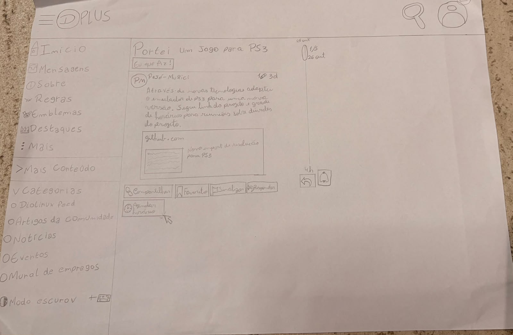
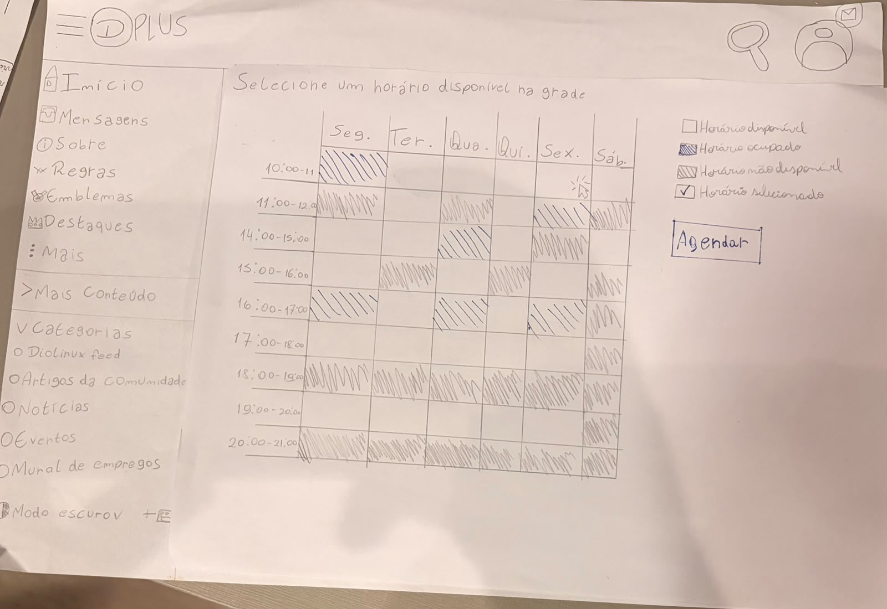
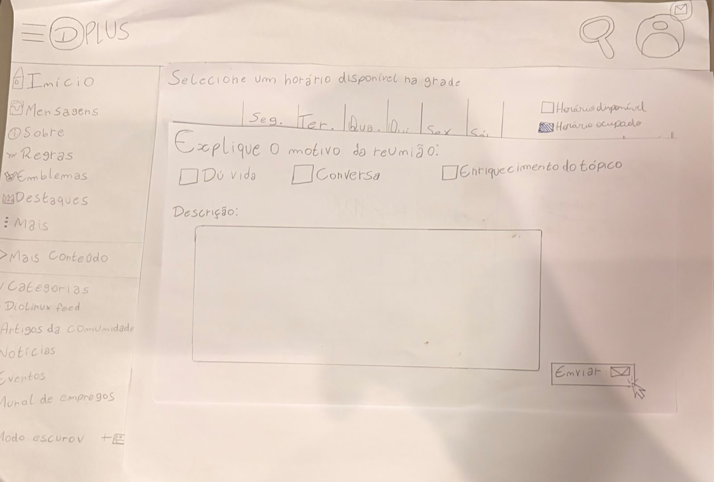
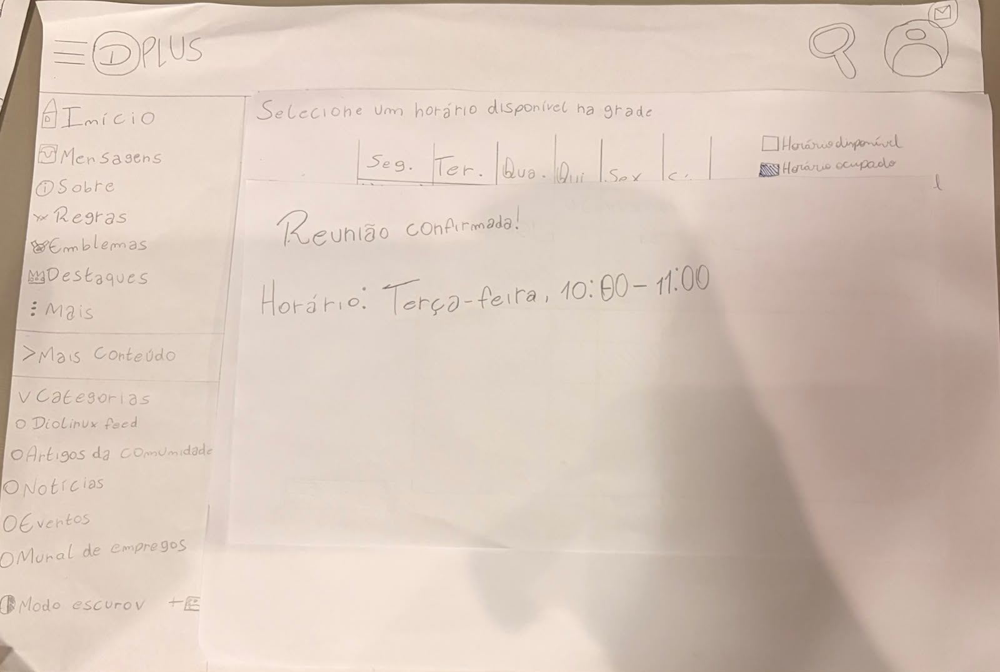
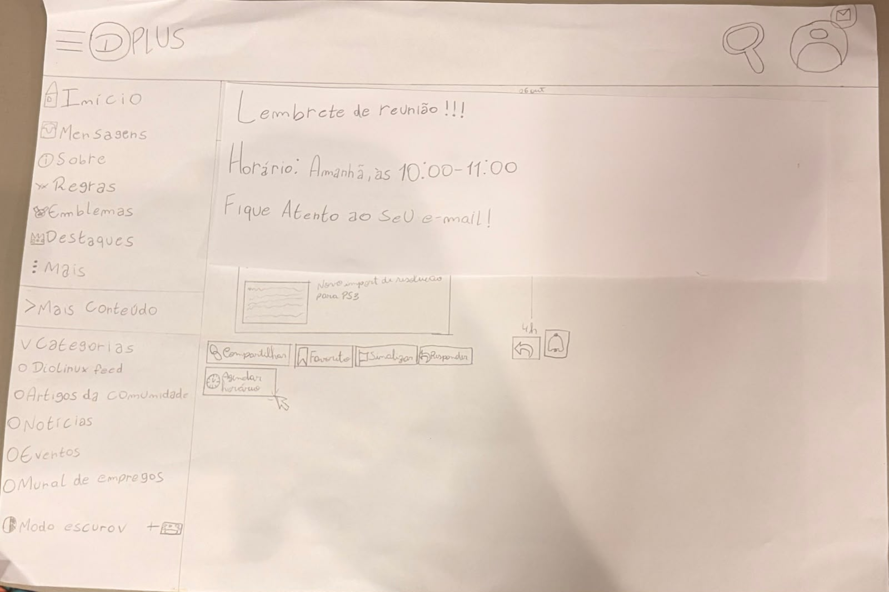

# Relato dos Resultados da Avaliação do Protótipo de Papel (Nível 2) — Tarefa 3: Agendamento de Horários

## Tabela de Contribuição e Uso de IA Generativa

A Tabela 1 apresenta a matriz de responsabilidade na consolidação dos resultados da avaliação formativa do Protótipo de Papel (Nível 2), focado exclusivamente na Tarefa 3: Agendamento de Horários com Autores de Tópicos.

**Tabela 1** — Matriz de Contribuição do Relato do Protótipo de Papel (Tarefa 3)

| Integrante | Atribuição no Artefato | Data | Ferramenta de IA Utilizada | Propósito do Uso de IA |
| :--- | :--- | :---: | :--- | :--- |
| [Edvaldo Soares Brasileiro Filho](https://github.com/PajeMurici-dev) | **Autor Principal / Avaliador**: Condução das sessões de teste com protótipo de papel, execução do teste-piloto instrumental, consolidação dos apontamentos dos 3 participantes (G.C, L.P.A e O.M.T.P), tabulação na escala de severidade de Nielsen (0 a 4), formulação das diretrizes de reprojeto para alta fidelidade (Nível 3) e documentação dos vídeos. | 01/11/2026 | Google Gemini (LLM) | Apoio na estruturação das matrizes Markdown e checagem de rigor normativo de IHC. |
| [Vinicius Silva Araruna](https://github.com/ViniciusA05) | **Revisor Metodológico**: Auditoria de consistência entre o planejamento DECIDE de Nível 2 e os dados empíricos tabulados. | 02/11/2026 | — | Revisão humana por pares. |
| [Gustavo Antonio Rodrigues e Silva](https://github.com/gus-ant) | **Revisor Designado**: Verificação do checklist de conformidade, tempos e cláusula de isolamento do piloto. | 02/11/2026 | — | Revisão humana por pares. |

_Fonte: Elaborada pelos autores, 2026._

---

## 1. Introdução e Objetivos da Avaliação

No contexto do **Ciclo de Vida de Deborah Mayhew (1999)** e da Engenharia de Usabilidade (*Barbosa & Silva, 2021*), o **Nível 2 (Padrões de Design e Prototipação em Papel)** materializa os conceitos validados no Nível 1 em interfaces tangíveis manipuláveis de baixa fidelidade (*Paper Prototyping*). O objetivo primordial dessa fase formativa é submeter os fluxos, layouts de telas, componentes de seleção e feedbacks táteis ao crivo empírico de usuários reais antes de qualquer esforço de implementação em alta fidelidade ou código.

Este artefato consolida os **Resultados da Avaliação Formativa do Protótipo de Papel** referente à **Tarefa 3: Agendamento de Horários com Autores de Tópicos (CF03)** no **Fórum Diolinux Plus**, conduzida por Edvaldo Soares Brasileiro Filho com discentes convidados.

A avaliação orientou-se por quatro metas essenciais:
1. **Verificar a Localização e Identificação do Ponto de Acesso:** Avaliar a agilidade com que os participantes identificam a funcionalidade de agendamento na interface do tópico;
2. **Avaliar a Clareza Cognitiva da Grade de Horários:** Avaliar a facilidade de distinção entre horários ocupados e disponíveis e a seleção do bloco desejado;
3. **Avaliar o Preenchimento e Feedback de Confirmação:** Mapear a clareza dos campos de requisição de mentoria e o entendimento do comprovante de confirmação;
4. **Elicitar Requisitos de Reprojeto para Nível 3:** Converter atritos e hesitações em recomendações práticas para a construção do protótipo interativo de alta fidelidade no Figma.

---

## 2. Metodologia de Investigação Empírica Empregada

A avaliação adotou rigorosamente o método de **Ensaio de Interação com Usuários por meio de Teste de Usabilidade Formativo em Papel (*Paper Usability Testing*)** (*Snyder, 2003; Rettig, 1994; Barbosa & Silva, 2021*), combinado com a técnica de verbalização concomitante (*think-aloud*).

!!! note "DIRETRIZ METODOLÓGICA MANDATÓRIA — INVESTIGAÇÃO EMPÍRICA COM SEPARAÇÃO DE PAPÉIS"
    Conforme as diretrizes canônicas de Carolyn Snyder (2003) e Barbosa & Silva (2021), a sessão operou com separação estrita de papéis:  
    • **Facilitador ([Edvaldo Soares Brasileiro Filho](https://github.com/PajeMurici-dev)):** Conduziu a aplicação do TCLE oral nos primeiros 60 segundos, apresentou o cenário hipotético, orientou a verbalização contínua e registrou anotações na planilha sem induzir ou tocar nas peças;  
    • **Computador Humano:** Atuou de forma silenciosa e puramente mecânica, posicionando e alternando as pranchas e cartões de papel sobre a mesa estritamente em resposta aos toques de dedos dos participantes;  
    • **Participantes:** Interagiram diretamente com as peças táteis em papel, simulando cliques e verbalizando seus pensamentos espontâneos.

---

## 3. Caracterização dos Participantes Recrutados

Em atendimento ao perfil de público do Fórum Diolinux Plus e buscando representatividade de perfis variados (desde estudantes com perfil introdutório até perfis avançados de tecnologia), foram recrutados 3 participantes voluntários.

A Tabela 2 consolida os dados demográficos dos participantes avaliados.

**Tabela 2** — Caracterização Demográfica dos Participantes da Tarefa 3

| ID | Participante (Iniciais) | Idade | Curso / Ocupação | Instituição | Nível de Familiaridade com Fóruns / Web | Papel na Sessão |
| :---: | :--- | :---: | :--- | :--- | :---: | :--- |
| **P1** | G.C | 21 anos | Psicologia | CEUB | Usuária Geral / Iniciante | Participante de Usabilidade |
| **P2** | L.P.A | 20 anos | Estudante | — | Usuário Aprendiz / Intermediário | Participante de Usabilidade |
| **P3** | O.M.T.P | 21 anos | Engenharia de Software | UnB (FGA) | Usuário Técnico / Avançado | Participante de Usabilidade |

_Fonte: Elaborada pelos autores, 2026._

---

## 4. O Protótipo de Papel da Tarefa 3

O protótipo de baixa fidelidade da Tarefa 3 (*Agendamento de Horários com Autores de Tópicos*) foi confeccionado artesanalmente em papel, estruturado em 5 telas e peças de interação que simulam o fluxo completo de agendamento e acompanhamento:

### 4.1 Tela Inicial de Tópico (Ponto de Acesso)

  
  
<strong>Figura 1</strong> — Protótipo de Papel: Tela inicial do tópico com botão de agendamento de horário com o autor. <em>Fonte: Edvaldo Soares Brasileiro Filho, 2026.</em>

---

### 4.2 Tela com Grade de Horários (Disponibilidade Semanal)

  
  
<strong>Figura 2</strong> — Protótipo de Papel: Grade de horários com divisão por dias e slots disponíveis. <em>Fonte: Edvaldo Soares Brasileiro Filho, 2026.</em>

---

### 4.3 Tela com Motivo da Reunião (Formulário de Contexto)

  
  
<strong>Figura 3</strong> — Protótipo de Papel: Modal/formulário para descrição do motivo e contexto da reunião. <em>Fonte: Edvaldo Soares Brasileiro Filho, 2026.</em>

---

### 4.4 Mensagem de Confirmação da Reunião

  
  
<strong>Figura 4</strong> — Protótipo de Papel: Tela de confirmação com resumo dos dados e status do agendamento. <em>Fonte: Edvaldo Soares Brasileiro Filho, 2026.</em>

---

### 4.5 Mensagem de Lembrete da Reunião

  
  
<strong>Figura 5</strong> — Protótipo de Papel: Mensagem de lembrete e notificação com link para acesso à reunião. <em>Fonte: Edvaldo Soares Brasileiro Filho, 2026.</em>

---

## 5. Síntese dos Dados Coletados e Análise Qualitativa de Conteúdo

A observação atenta durante as sessões presenciais e a posterior análise de conteúdo (*Bardin, 2011*) permitiram sintetizar os seguintes comportamentos frente às perguntas investigativas do Framework DECIDE:

### PP01 e PP02 — Ponto de Entrada e Layout da Grade
- **Participante 1 (G.C):** Identificou o botão de agendar horário com facilidade, destacando que a posição próxima ao cabeçalho da resposta do autor auxilia quem já leu a solução e ainda precisa de suporte. Sobre a grade, compreendeu prontamente os dias, mas questionou inicialmente se os horários estavam no fuso de Brasília (GMT-3).
- **Participante 2 (L.P.A):** Realizou a leitura de cima para baixo e encontrou o botão em poucos segundos. Sugeriu que houvesse uma legenda mais destacada no topo da grade indicando as cores ou padrões para "Disponível" e "Ocupado".
- **Participante 3 (O.M.T.P):** Como estudante de Engenharia de Software, navegou com naturalidade técnica, elogiou o formato em colunas por dia e recomendou a inclusão de um seletor rápido para semanas futuras ("Próxima Semana").

### PP03 e PP04 — Seleção de Slot e Formulário de Dúvida
- **Participante 1 (G.C):** Tocou com segurança no bloco de horário livre. Ao abrir o cartão de formulário, considerou o campo de descrição essencial para não chegar na reunião sem que o autor saiba o tema.
- **Participante 2 (L.P.A):** Indicou que o campo de descrição poderia ter uma contagem mínima ou máxima de caracteres sugerida (ex: até 200 caracteres), evitando que o solicitante escreva textos demasiadamente longos.

### PP05 e PP06 — Confirmação e Feedback Final
- **Participantes 1, 2 e 3:** Todos os participantes declararam convicção imediata ao visualizar a Prancha Base 3 de confirmação. A exibição do resumo (Data, Horário, Nome do Autor e Link da Sala) foi unanimemente considerada reconfortante e clara.
- **Participante 3 (O.M.T.P):** Destacou que ter o botão de *"Adicionar ao Google Agenda / Calendário"* e *"Copiar Link da Reunião"* já na tela de confirmação é uma boa prática fundamental de UX.

---

## 6. Tabela Estruturada de Problemas de Usabilidade e Severidade (Nielsen)

Os problemas observados nas interações com o protótipo de papel foram tabulados e classificados conforme a **Escala de Severidade de Problemas de Usabilidade de Jakob Nielsen (1994)** (0 = Neutro, 1 = Cosmético, 2 = Menor, 3 = Maior, 4 = Catastrófico).

**Tabela 3** — Problemas de Usabilidade e Recomendações de Reprojeto (Protótipo de Papel — Tarefa 3)

| ID | Componente / Prancha | Descrição da Hesitação / Dificuldade | Tipo de Problema | Severidade (Nielsen) | Ação Recomendada para o Nível 3 (Figma) |
| :---: | :--- | :--- | :---: | :---: | :--- |
| **PROB-PP3-01** | Prancha 2 — Grade de Horários | Falta de identificação explícita do fuso horário na visualização da grade semanal (gerou dúvida em P1). | Clareza de Informação | **1 (Cosmético)** | Incluir rótulo explicativo permanente no cabeçalho da grade: *"Horário de Brasília (GMT-3)"*. |
| **PROB-PP3-02** | Prancha 2 — Grade de Horários | Contraste e diferenciação entre slots livres e ocupados precisa de legenda explícita permanente (apontado por P2). | Affordance / Percepção | **2 (Menor)** | Inserir legenda gráfica permanente no topo da grade: blocos com selo *"Disponível"* versus *"Reservado"*. |
| **PROB-PP3-03** | Peça Móvel 2 — Formulário | Ausência de campo para anexar link de tópico ou print de erro de suporte (sugerido por P3). | Eficiência / Completude | **2 (Menor)** | Adicionar campo opcional *"Anexar link do tópico ou arquivo de log"* no formulário de alta fidelidade. |
| **PROB-PP3-04** | Prancha 3 — Tela de Confirmação | Dúvida sobre o envio de lembrete por e-mail ou notificação interna no fórum. | Feedback do Sistema | **2 (Menor)** | Adicionar aviso explícito na confirmação: *"Um lembrete e o link de acesso foram enviados para as notificações do seu perfil e e-mail cadastrado"*. |
| **PROB-PP3-05** | Prancha 3 — Painel de Gestão | Desejo de visualização imediata do botão para reagendar ou cancelar a mentoria em caso de imprevisto. | Controle e Liberdade | **2 (Menor)** | Incluir botões claros de *"Reagendar Horário"* e *"Cancelar Reunião"* com diálogo modal de confirmação. |

_Fonte: Elaborada por Edvaldo Soares Brasileiro Filho com base em Nielsen (1994), 2026._

---

## 7. Recomendações Concretas de Reprojeto para Alta Fidelidade (Nível 3)

A partir dos dados qualitativos e da matriz de problemas da Tarefa 3, estabelecem-se as seguintes diretrizes para a prototipação interativa no Figma:

1. **Sinalização Explícita de Fuso e Legenda:** A grade semanal no Figma deverá apresentar de forma nítida a legenda de status dos slots (verde/livre, cinza/ocupado) e a indicação de fuso horário;
2. **Navegação Temporal entre Semanas:** Implementar setas funcionais de navegação (*"Semana Anterior"* / *"Próxima Semana"*) com atualização dos blocos disponíveis;
3. **Formulário com Enriquecimento de Contexto:** Permitir ao solicitante descrever a dúvida e opcionalmente vincular um tópico já aberto ou mensagem de erro;
4. **Painel de Minhas Reuniões:** Estruturar no perfil do usuário uma aba dedicada *"Mentorias & Reuniões Agendadas"*, com opções de cancelamento prévio e entrada direta na sala virtual.

---

## 8. Registros Audiovisuais da Avaliação e Consentimento Verbal (TCLE)

Em cumprimento às diretrizes éticas (Resolução CNS nº 510/2016 e LGPD) e ao Plano de Ensino da disciplina (*Sales, 2026*):
- O consentimento foi colhido verbalmente nos primeiros 60 segundos gravados em cada vídeo;
- Todas as gravações encontram-se hospedadas no YouTube na modalidade Não Listado.

### 8.1 Registro do Teste-Piloto de Nível 2 (Tarefa 3)

A Tabela 4 sintetiza os metadados do ensaio instrumental prévio de calibração.

**Tabela 4** — Metadados do Teste-Piloto do Protótipo de Papel (Tarefa 3)

| Atributo | Detalhamento |
| :--- | :--- |
| **Avaliador / Executor** | [Edvaldo Soares Brasileiro Filho](https://github.com/PajeMurici-dev) |
| **Funcionalidade Testada** | Simulação mecânica da bancada de papéis da Tarefa 3 (Agendamento de Horários) |
| **Data e Horário** | 30/10/2026 às 15:00h |
| **Duração do Ensaio** | ~8 minutos |
| **Ambiente** | Sala de estudos silenciosa / Bancada experimental |
| **Link de Acesso no YouTube** | [Assistir Teste-Piloto no YouTube (Não Listado): https://youtu.be/EJp9UOi7vvo](https://youtu.be/EJp9UOi7vvo) |

#### Reprodução do Teste-Piloto

  <iframe width="100%" height="450" src="https://www.youtube-nocookie.com/embed/EJp9UOi7vvo" title="Teste-Piloto do Protótipo de Papel - Tarefa 3 - Edvaldo Soares - Grupo 08 - IHC 2026.2" frameborder="0" allow="accelerometer; autoplay; clipboard-write; encrypted-media; gyroscope; picture-in-picture" allowfullscreen style="border-radius: 8px; max-width: 800px; box-shadow: 0 4px 6px -1px rgba(0,0,0,0.1);"></iframe>
  
<strong>Vídeo 1</strong> — Registro audiovisual do Teste-Piloto do Protótipo de Papel da Tarefa 3. <em>Fonte: Edvaldo Soares Brasileiro Filho, 2026.</em>

  
<a href="https://youtu.be/EJp9UOi7vvo" target="_blank" rel="noopener noreferrer">Assistir diretamente no YouTube (Não Listado): https://youtu.be/EJp9UOi7vvo</a>

---

### 8.2 Registros das Sessões Oficiais de Avaliação com Usuários

A Tabela 5 relaciona as sessões empíricas de avaliação com os participantes recrutados.

**Tabela 5** — Sessões de Avaliação do Protótipo de Papel com Usuários (Tarefa 3)

| Sessão | Participante | Idade / Perfil | Avaliador Responsável | Duração | Registro Audiovisual no YouTube |
| :---: | :--- | :---: | :--- | :---: | :--- |
| **S01** | P1 (G.C) | 21 anos / Psicologia CEUB | [Edvaldo Soares](https://github.com/PajeMurici-dev) | ~12 min | [Assistir Sessão P1 no YouTube (Não Listado)](https://youtu.be/9bIvD6fS8NU) |
| **S02** | P2 (L.P.A) | 20 anos / Estudante | [Edvaldo Soares](https://github.com/PajeMurici-dev) | ~10 min | [Assistir Sessão P2 no YouTube (Não Listado)](https://youtu.be/A2332bwnapc) |
| **S03** | P3 (O.M.TP) | 21 anos / Eng. Software UnB | [Edvaldo Soares](https://github.com/PajeMurici-dev) | ~14 min | [Assistir Sessão P3 no YouTube (Não Listado)](https://youtu.be/DVX80C-Fvlc) |

_Fonte: Elaborada pelos autores, 2026._

#### Reprodução Audiovisual da Sessão 01 — Participante 1 (G.C)

  <iframe width="100%" height="450" src="https://www.youtube-nocookie.com/embed/9bIvD6fS8NU" title="Avaliação do Protótipo de Papel - Sessão 01 (G.C) - Edvaldo Soares - Grupo 08 - IHC 2026.2" frameborder="0" allow="accelerometer; autoplay; clipboard-write; encrypted-media; gyroscope; picture-in-picture" allowfullscreen style="border-radius: 8px; max-width: 800px; box-shadow: 0 4px 6px -1px rgba(0,0,0,0.1);"></iframe>
  
<strong>Vídeo 2</strong> — Registro audiovisual da avaliação com o Participante 1 (G.C). <em>Fonte: Edvaldo Soares Brasileiro Filho, 2026.</em>

  
<a href="https://youtu.be/9bIvD6fS8NU" target="_blank" rel="noopener noreferrer">Assistir diretamente no YouTube (Não Listado): https://youtu.be/9bIvD6fS8NU</a>

#### Reprodução Audiovisual da Sessão 02 — Participante 2 (L.P.A)

  <iframe width="100%" height="450" src="https://www.youtube-nocookie.com/embed/A2332bwnapc" title="Avaliação do Protótipo de Papel - Sessão 02 (L.P.A) - Edvaldo Soares - Grupo 08 - IHC 2026.2" frameborder="0" allow="accelerometer; autoplay; clipboard-write; encrypted-media; gyroscope; picture-in-picture" allowfullscreen style="border-radius: 8px; max-width: 800px; box-shadow: 0 4px 6px -1px rgba(0,0,0,0.1);"></iframe>
  
<strong>Vídeo 3</strong> — Registro audiovisual da avaliação com o Participante 2 (L.P.A). <em>Fonte: Edvaldo Soares Brasileiro Filho, 2026.</em>

  
<a href="https://youtu.be/A2332bwnapc" target="_blank" rel="noopener noreferrer">Assistir diretamente no YouTube (Não Listado): https://youtu.be/A2332bwnapc</a>

#### Reprodução Audiovisual da Sessão 03 — Participante 3 (O.M.T.P)

  <iframe width="100%" height="450" src="https://www.youtube-nocookie.com/embed/DVX80C-Fvlc" title="Avaliação do Protótipo de Papel - Sessão 03 (O.M.T.P) - Edvaldo Soares - Grupo 08 - IHC 2026.2" frameborder="0" allow="accelerometer; autoplay; clipboard-write; encrypted-media; gyroscope; picture-in-picture" allowfullscreen style="border-radius: 8px; max-width: 800px; box-shadow: 0 4px 6px -1px rgba(0,0,0,0.1);"></iframe>
  
<strong>Vídeo 4</strong> — Registro audiovisual da avaliação com o Participante 3 (O.M.T.P). <em>Fonte: Edvaldo Soares Brasileiro Filho, 2026.</em>

  
<a href="https://youtu.be/DVX80C-Fvlc" target="_blank" rel="noopener noreferrer">Assistir diretamente no YouTube (Não Listado): https://youtu.be/DVX80C-Fvlc</a>

---

## 9. Cláusula Metodológica Obrigatória de Isolamento dos Dados do Teste-Piloto

!!! warning "CLÁUSULA METODOLÓGICA DE ISOLAMENTO DOS DADOS DO TESTE-PILOTO"
    Em estrito cumprimento às diretrizes canônicas de Engenharia de Usabilidade (*Barbosa & Silva, 2021, p. 276; Mayhew, 1999*) e ao Plano de Ensino da disciplina (*Sales, 2026*), o autor declara solenemente que **os dados, observações e tempos obtidos durante a execução do Teste-Piloto prévio NÃO foram computados, tabulados ou mesclados aos resultados apresentados neste documento**.  
    O teste-piloto teve função unicamente instrumental de calibração técnica de enquadramento da câmera, dinâmica de manipulação das peças pelo Computador Humano e verificação do limite ético de 60 segundos do TCLE oral. Todos os dados e severidades deste relatório derivam com exclusividade das sessões oficiais com os participantes voluntários G.C, L.P.A e O.M.T.P.

---

## 10. Lista de Verificação da Técnica (Relato do Protótipo de Papel)

A Tabela 6 consolida a autoavaliação da conformidade do relato dos resultados da avaliação do protótipo de papel da Tarefa 3.

**Tabela 6** — Lista de Verificação: Relato de Resultados do Protótipo de Papel (Tarefa 3)

| Item / Questão Avaliada | Origem / Fonte Normativa | Conforme? | Resposta Autoexplicativa e Evidência no Documento |
| :--- | :--- | :---: | :--- |
| **1** | O documento define os objetivos e contextualiza o Nível 2 de Mayhew? | Mayhew (1999); Barbosa & Silva (2021) | ✅ Sim | A Seção 1 estabelece os 4 objetivos formativos alinhados ao Ciclo de Vida de Mayhew. |
| **2** | A metodologia de usabilidade em papel explicita a dinâmica e papéis? | Snyder (2003); Rettig (1994) | ✅ Sim | A Seção 2 detalha a atuação do Facilitador, Computador Humano e Participantes. |
| **3** | Há caracterização demográfica completa dos participantes avaliados? | Barbosa & Silva (2021, p. 170) | ✅ Sim | A Tabela 2 sintetiza perfil, idade, formação e instituição dos 3 participantes (G.C, L.P.A, O.M.T.P). |
| **4** | O documento descreve a estrutura física das peças do protótipo de papel? | Snyder (2003) | ✅ Sim | A Seção 4 discrimina as pranchas base e cartões móveis da grade de horários e formulário. |
| **5** | Há síntese de dados qualitativos cobrindo as perguntas investigativas? | Bardin (2011); Rogers et al. (2013) | ✅ Sim | A Seção 5 detalha os achados de PP01 a PP06 com análise de conteúdo. |
| **6** | Os problemas identificados estão classificados na severidade de Nielsen (0 a 4)? | Nielsen (1994) | ✅ Sim | A Tabela 3 cataloga 5 problemas mapeados com severidade variando de 1 a 2. |
| **7** | O documento formula diretrizes concretas de reprojeto para o Nível 3 (Figma)? | Mayhew (1999) | ✅ Sim | A Seção 7 especifica as diretrizes de interface, legenda, fuso e gestão de reuniões. |
| **8** | Há disponibilização dos vídeos no YouTube e cumprimento do TCLE oral? | Resolução CNS nº 510/2016 | ✅ Sim | A Seção 8 apresenta as tabelas e containers de player para teste-piloto e avaliações. |
| **9** | O artefato inclui a Cláusula Metodológica Obrigatória de isolamento do piloto? | Barbosa & Silva (2021, p. 276) | ✅ Sim | A Seção 9 apresenta o destaque visual explícito atestando a não-computação dos dados do piloto. |

_Fonte: Elaborada pelos autores com base em Barbosa e Silva (2021) e Sales (2026), 2026._

---

## 11. Histórico de Versão

A Tabela 7 documenta a evolução histórica deste documento.

**Tabela 7** — Histórico de Versão

| Versão | Data | Descrição Detalhada da Modificação | Autor(es) | Revisor(es) |
| :---: | :---: | :--- | :--- | :--- |
| `1.0` | 01/11/2026 | Elaboração inicial do Relato dos Resultados da Avaliação do Protótipo de Papel (Nível 2 — Tarefa 3: Agendamento de Horários com Autores de Tópicos), consolidando os resultados empíricos das sessões com os participantes G.C, L.P.A e O.M.T.P, análise de conteúdo qualitativa, tabulação na escala de severidade de Nielsen (0 a 4), recomendações de reprojeto para alta fidelidade no Figma, metadados e containers audiovisuais do teste-piloto e sessões oficiais, cláusula mandatória de isolamento do piloto e checklist de conformidade. | [Edvaldo Soares Brasileiro Filho](https://github.com/PajeMurici-dev) | [Vinicius Silva Araruna](https://github.com/ViniciusA05), [Gustavo Antonio](https://github.com/gus-ant) |

_Fonte: Elaborada pelos autores, 2026._

---

## 12. Referências Bibliográficas (ABNT)

- BARDIN, Laurence. *Análise de conteúdo*. São Paulo: Edições 70, 2011.
- BARBOSA, Simone Diniz Junqueira; SILVA, Bruno Santana da; SILVEIRA, Milene Selbach; GASPARINI, Isabela; DARIN, Ticianne; BARBOSA, Gabriel Diniz Junqueira. *Interação Humano-Computador e Experiência do Usuário*. Rio de Janeiro: Autopublicação, 2021. ISBN 978-65-00-19677-1. (Capítulo 10: Prototipação; Capítulo 11: Avaliação de IHC).
- MAYHEW, Deborah J. *The Usability Engineering Lifecycle: a practitioner's handbook for user interface design*. San Francisco: Morgan Kaufmann Publishers, 1999.
- NIELSEN, Jakob. *Usability Engineering*. San Francisco: Morgan Kaufmann Publishers, 1994.
- RETTIG, Marc. *Prototyping for tiny fingers*. Communications of the ACM, v. 37, n. 4, p. 21-27, 1994.
- ROGERS, Yvonne; SHARP, Helen; PREECE, Jennifer. *Design de Interação: além da interação humano-computador*. 3. ed. Porto Alegre: Bookman, 2013.
- SALES, André Barros de. *Plano de Ensino da Disciplina de Interação Humano Computador*. Brasília: Universidade de Brasília, Faculdade UnB Gama (FGA), 2026.
- SNYDER, Carolyn. *Paper Prototyping: The Fast and Easy Way to Design and Refine User Interfaces*. San Francisco: Morgan Kaufmann Publishers, 2003.

