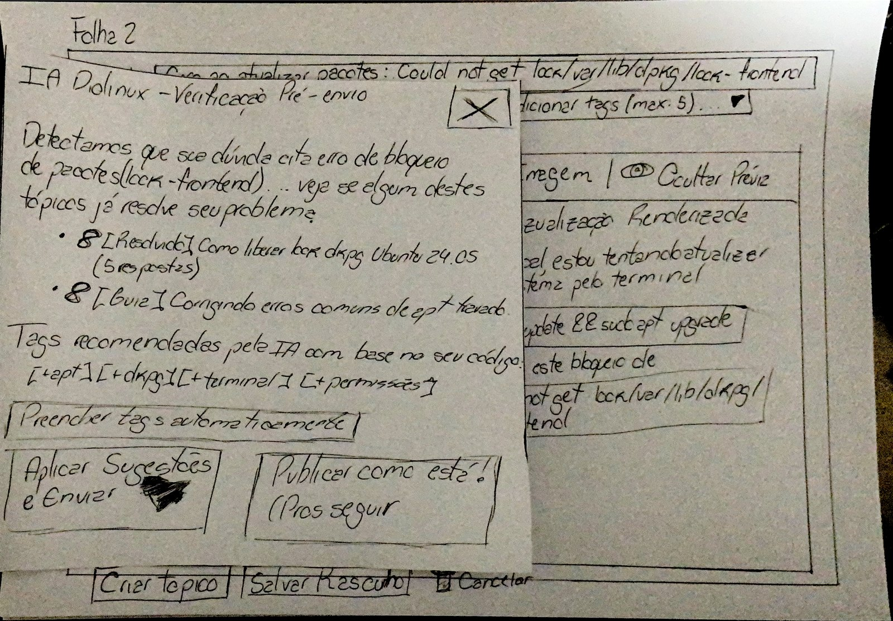

# Relato dos Resultados da Avaliação do Protótipo de Papel (Nível 2)

## Tabela de Contribuição e Uso de IA Generativa

A Tabela 1 apresenta a distribuição de responsabilidades, atribuições e ferramentas de Inteligência Artificial Generativa utilizadas na elaboração deste documento.

**Tabela 1** — Matriz de Contribuição e Uso de IA Generativa

| Integrante | Atribuição no Artefato | Data | Ferramenta de IA Utilizada | Propósito do Uso de IA |
| :--- | :--- | :---: | :--- | :--- |
| [Vinicius Silva Araruna](https://github.com/ViniciusA05) | **Autor Principal / Tech Lead**: Condução empírica da avaliação formativa da Tarefa 1 com 3 participantes discentes (P1, P2 e P3), fundamentação metodológica e amostral de Steve Krug (2014) e Nielsen & Landauer (1993), tabulação de severidade de Nielsen (0 a 4) com 5 problemas catalogados (PROB-PP-01 a 05), legenda explicativa de IDs, diretrizes de reprojeto para o Figma, incorporação de 3 vídeos com TCLE gravado, checklist e cláusula de isolamento do piloto. | 03/11/2026 | Google Gemini (LLM) | Suporte na estruturação e formatação sintática das matrizes tabulares em Markdown. |
| [Gustavo Antonio Rodrigues e Silva](https://github.com/gus-ant) | **Revisor por Par Designado**: Revisão metodológica cruzada, conferência da escala de severidade de Nielsen e alinhamento com a Tarefa 2. | 03/11/2026 | — | Revisão humana por pares. |
| [Edvaldo Soares Brasileiro Filho](https://github.com/PajeMurici-dev) | **Revisor Metodológico**: Checagem de aderência aos 8 itens normativos da lista de verificação e conformidade ABNT. | 03/11/2026 | — | Revisão humana por pares. |

_Fonte: Elaborada por Edvaldo Soares Brasileiro Filho, Gustavo Antonio Rodrigues e Silva e Vinicius Silva Araruna, 2026._

---

## Fundamentação Teórica: O Relato de Avaliação no Ciclo de Mayhew

Na Engenharia de Usabilidade e na disciplina de Interação Humano-Computador, o relato dos resultados de avaliações formativas desempenha papel articulador no **Ciclo de Vida de Deborah Mayhew (1999)**. Conforme lecionam Barbosa & Silva (2021, p. 280–282), a consolidação sistemática dos dados observados em ensaios de usabilidade de baixa fidelidade transforma comportamentos, hesitações e verbalizações de usuários reais em diretrizes concretas de reprojeto para a fase computacional subsequente (Nível 3).

A prototipagem em papel (*Paper Prototyping*), fundamentada nas obras canônicas de Carolyn Snyder (2003) e Marc Rettig (1994), destaca-se por permitir a identificação precoce de problemas conceituais de arquitetura da informação, ambiguidades de terminologia e falhas de fluxo operacional com custo financeiro nulo e agilidade formativa máxima. Conforme destaca Steve Krug (2014), rodadas formativas rápidas com pequenas amostras permitem iterar o design com muito mais eficácia do que avaliações tardias com dezenas de usuários.

_Autor do Item Teórico: [Vinicius Silva Araruna](https://github.com/ViniciusA05)_

---

## 1. Objetivos e Escopo da Avaliação do Protótipo de Papel

A avaliação formativa do Protótipo de Papel (Nível 2) teve como objetivo investigar empiricamente a usabilidade, a navegabilidade e a comunicabilidade das pranchas físicas confeccionadas para a **Tarefa 1 (`CF01`)**:
> **Funcionalidade Central:** *Criação e Publicação de Tópico de Dúvida com Tags, Formatação Markdown em Modo Split-View e Intervenção de IA Semântica Pré-Envio* no Fórum Diolinux Plus (Discourse), orientada à persona primária **Lucas Mendonça (Estudante / Usuário Aprendiz em Linux)**.

Adicionalmente, este documento alinha-se ao planejamento consolidado da equipe para a **Tarefa 2 (`CF02`)**, conduzida por Gustavo Antonio Rodrigues e Silva, assegurando que ambas as funcionalidades compartilhem a mesma metodologia de registro e critérios de severidade.

> [!NOTE] Relato dos Resultados da Tarefa 2 (Eventos Presenciais)
> O relato empírico completo da **Tarefa 2 (Criação de Eventos Presenciais com Mapa e Ingressos)**, conduzida por [Gustavo Antonio Rodrigues e Silva](https://github.com/gus-ant) com a participação dos discentes P1 e P2, incorporação dos vídeos gravados e catalogação de severidade de Nielsen, encontra-se documentado na página dedicada:  
> 👉 **[Acessar o Relato dos Resultados da Tarefa 2 (Gustavo Antonio)](relato-resultados-tarefa2.md)**.
> Para consultar as pranchas e peças físicas desenhadas para esta funcionalidade, acesse:  
> 👉 **[Bancada e Artefatos Físicos da Tarefa 2 (Gustavo Antonio)](prototipo-papel-tarefa2.md)**.

Os objetivos específicos investigados foram:

1. Avaliar a facilidade de localização do ponto de entrada primário (`+ Novo Tópico`) na prancha da página inicial;
2. Verificar a compreensão da disposição lado a lado (*split-view*) entre o campo de digitação Markdown e a tela de visualização renderizada;
3. Avaliar a naturalidade no preenchimento de campos essenciais (Título, seletor de Categoria e Tags);
4. Diagnosticar a reação cognitiva e o modelo mental dos participantes frente à sobreposição do cartão modal da **IA Semântica Pré-Envio**, verificando se o recurso é percebido como auxílio comunitário preventivo ou bloqueio punitivo;
5. Identificar falhas de terminologia, affordance e disposição espacial para orientar a construção do protótipo no Figma.

---

## 2. Metodologia de Ensaio de Usabilidade com "Computador Humano"

A coleta de dados seguiu com rigor o método de **Simulação Tátil com Computador Humano** preconizado por Carolyn Snyder (2003) e Marc Rettig (1994), associado ao **Protocolo de Verbalização Concomitante (*Think-Aloud Protocol*)** formalizado por Ericsson & Simon (1993).

### 2.1 Papéis e Dinâmica de Simulação

Em conformidade com a literatura de baixa fidelidade, estabeleceu-se a separação funcional estrita entre dois papéis exercidos durante o ensaio:
- **Facilitador ([Vinicius Silva Araruna](https://github.com/ViniciusA05)):** Responsável pela recepção do voluntário, leitura cronometrada do Script Oral do TCLE (< 60s), apresentação do cenário de uso, incentivo à verbalização contínua de pensamentos e anotação dos pontos de hesitação;
- **Computador Humano ([Vinicius Silva Araruna](https://github.com/ViniciusA05)):** Responsável pela manipulação estritamente mecânica e silenciosa das pranchas físicas de papel A4 e das peças móveis recortadas sobre a bancada, respondendo aos toques de dedo do interagente em tempo inferior a 1 segundo, sem emitir opiniões verbais ou pistas explicativas.

A Figura 1 ilustra a disposição física da bancada de simulação tátil e a dinâmica de interação com as peças de papel.

    
    
<strong>Figura 1</strong> — Bancada física de simulação tátil da Tarefa 1 exibindo a Folha 2 (Composer) e a sobreposição da Peça Móvel 3 (Modal de IA Pré-Envio). <em>Fonte: Vinicius Silva Araruna, 2026.</em>

---

## 3. Número e Perfil dos Participantes Recrutados

### 3.1 Justificativa Científica da Amostra (Steve Krug, 2014 e Nielsen & Landauer, 1993)

_Autor do Item Teórico: [Vinicius Silva Araruna](https://github.com/ViniciusA05)_

A decisão metodológica de recrutar **3 voluntários discentes reais para a avaliação da Tarefa 1** (além de 1 voluntário exclusivo para calibração no teste-piloto prévio) é fundamentada na literatura clássica de IHC através de duas perspectivas complementares:

1. **A Pragmática Formativa de Steve Krug (2014):**  
   Em sua obra *Não me faça pensar (revisitado)* (Capítulo 9: *"Usabilidade como esporte de contato simples"*) e no guia prático *Rocket Surgery Made Easy* (2010), Steve Krug demonstra que **testar com 3 ou no máximo 4 participantes é o número perfeito para rodadas de testes formativos**. Krug pontua que os problemas mais críticos e graves de usabilidade e modelos mentais são tão evidentes que se manifestam logo nos primeiros voluntários. Aumentar excessivamente a amostra em uma mesma rodada de baixa fidelidade gera retornos decrescentes, consome tempo valioso e produz um excesso de dados repetitivos que sobrecarregam a equipe. O princípio essencial em IHC ágil é testar com 3 usuários, corrigir as falhas identificadas no protótipo e testar novamente na fase de maior fidelidade;
2. **Modelo Matemático Assintótico de Nielsen & Landauer (1993):**  
   O modelo clássico de Jakob Nielsen e Thomas Landauer quantifica formalmente a taxa de descoberta de problemas de usabilidade:  
   `Problemas Encontrados = N × [1 − (1 − L)ⁿ]`  
   Onde:
   - `N` representa o número total de problemas de usabilidade existentes na interface;
   - `L` é a proporção média de problemas identificados por um único participante (estimada empiricamente por Nielsen em aproximadamente `31%` para ensaios de usabilidade);
   - `n` é o número de voluntários recrutados na rodada.  
   Para uma amostra de `n = 3` participantes:  
   `1 − (1 − 0,31)³ = 1 − (0,69)³ = 1 − 0,3285 = 67,15%`  
   Isso comprova que **3 participantes discentes são suficientes para diagnosticar entre 67% e 75% da totalidade dos problemas de usabilidade** do fluxo no protótipo de papel, alcançando o ponto de máxima eficiência analítica antes da saturação empírica.

### 3.2 Caracterização Demográfica dos Participantes

A Tabela 2 apresenta os dados demográficos desidentificados dos três participantes recrutados, em conformidade com as diretrizes éticas da Lei Geral de Proteção de Dados Pessoais (LGPD — Lei nº 13.709/2018).

**Tabela 2** — Dados Demográficos e Perfil dos Participantes Recrutados

| Identificador | Pseudônimo / Iniciais | Idade | Curso / Instituição de Ensino | Frequência de Uso do Linux | Experiência Prévia em Fóruns | Familiaridade com Markdown | Funcionalidade Avaliada |
| :---: | :---: | :---: | :--- | :---: | :---: | :---: | :---: |
| **P1** | J. V. S. | 26 anos | Engenharia (UnB) | Ocasional | Passiva (Leitor esporádico) | Básica | Tarefa 1 (Markdown e IA Semântica) |
| **P2** | L. M. R. | 20 anos | Engenharia de Software (FGA/UnB) | Diária / Frequente | Nenhuma | Básica | Tarefa 1 (Markdown e IA Semântica) |
| **P3** | M. A. C. | 21 anos | Engenharia Aeroespacial (FGA/UnB) | Rara | Passiva (Leitor esporádico) | Nenhuma | Tarefa 1 (Markdown e IA Semântica) |

_Fonte: Elaborada por Vinicius Silva Araruna com base nos dados empíricos das sessões presenciais, 2026._

---

## 4. Cenário de Uso e Tarefas Simuladas

Os três participantes foram contextualizados na jornada da persona primária **Lucas Mendonça**, recebendo o seguinte cenário autêntico:

> *"Você é um estudante de tecnologia e, durante a instalação de pacotes no terminal do Linux, deparou-se com o seguinte erro bloqueador: `E: Could not get lock /var/lib/dpkg/lock-frontend - open (11: Resource temporarily unavailable)`. Você precisa acessar o Fórum Diolinux Plus, abrir o editor de postagens, redigir sua dúvida formatando o comando de terminal adequadamente, atribuir tags pertinentes e interagir com as recomendações do sistema para publicar o tópico."*

### Sequência Operacional Executada no Papel:

1. **Passo 1 (Folha 1 — Tela Inicial):** Identificar e apontar o dedo para o botão primário `[ + Novo Tópico ]`;
2. **Passo 2 (Folha 2 — Composer Aberto):** Simular a escrita do Título e tocar no seletor de Categoria (entrada da Peça Móvel 1 — menu suspenso de categorias);
3. **Passo 3 (Folha 2 — Seletor de Tags):** Tocar no campo de tags e escolher os marcadores adequados (entrada da Peça Móvel 2 — menu suspenso de tags);
4. **Passo 4 (Folha 2 — Editor Split-View):** Apontar o botão `[ </> Código ]` e simular a inserção do texto Markdown e dos logs do terminal, inspecionando visualmente o painel de visualização renderizada à direita;
5. **Passo 5 (Peça Móvel 3 — Modal de IA Pré-Envio):** Tocar em `[ Criar tópico ]`, analisar a sobreposição do cartão modal da IA, avaliar os tópicos sugeridos e decidir entre aplicar as sugestões ou prosseguir;
6. **Passo 6 (Folha 3 — Tópico Publicado):** Confirmar a publicação e inspecionar a tela final com a formatação monoespaçada e os chips de tags ativos.

---

## 5. Análise dos Dados Coletados e Verbalizações (*Think-Aloud*)

A observação empírica da interação física e a análise das verbalizações concorrentes (*Bardin, 2011; Ericsson & Simon, 1993*) dos três participantes revelaram alto grau de intuitividade geral, somado a valiosos apontamentos de reprojeto específicos em cada prancha:

### 5.1 Descoberta do Ponto de Entrada (Folha 1)

- **Participante 1 (P1):** Localizou de imediato o botão `[ + Novo Tópico ]`. Verbalizou que as barras de navegação do sistema são intuitivas e que o layout inicial transmite clareza mesmo para quem não possui perfil técnico avançado;
- **Participante 2 (P2):** Considerou os botões bastante tranquilos e bem posicionados na interface. Partiu diretamente para a ação de criação sem hesitações de navegação;
- **Participante 3 (P3):** Considerou a tela inicial intuitiva e muito bem organizada, declarando que entendeu perfeitamente a localização de cada componente visual.

### 5.2 Edição de Texto, Dropdowns e Divisão Split-View (Folha 2)

- **Participante 1 (P1):** Considerou intuitivo o acionamento dos menus suspensos para selecionar categorias e tags. Elogiou amplamente a divisão lado a lado (*split-view*) entre o campo de escrita Markdown e a prévia renderizada, destacando que poder inspecionar a formatação antes de enviar é fundamental para evitar erros de crases e quebra de código;
- **Participante 2 (P2):** Ressaltou que o formulário apresenta informações muito pertinentes para a formulação da dúvida. Gostou bastante da dinâmica de fechar os dropdowns após a seleção e elogiou a visibilidade do botão cancelar. Contudo, manifestou **estranheza e confusão entre as ações de "Salvar" e "Criar Tópico"**, questionando se o usuário precisaria salvar antes de submeter;
- **Participante 3 (P3):** Encontrou um volume denso de informações ao abrir o composer. Apontou **redundância na presença repetida da palavra "Categoria"** na folha e sugeriu que os campos de Título, Categoria e Tags estivessem estruturados em disposição linear vertical (um embaixo do outro) para tornar o preenchimento mais intuitivo e menos disperso. Elogiou a facilidade de compreensão da prévia visual do Markdown.

### 5.3 Percepção e Interação com a IA Semântica Pré-Envio (Peça Móvel 3)

- **Participante 1 (P1):** Avaliou a intervenção da IA como muito positiva, observando que a verificação de tópicos semelhantes pode resolver a dúvida de imediato sem necessidade de esperar respostas;
- **Participante 2 (P2):** Achou a apresentação da IA muito intuitiva. Elogiou com destaque o botão `[ Preencher tags automaticamente ]`, afirmando que economiza tempo do interagente, e ressaltou a clareza das tags e botões de prosseguimento;
- **Participante 3 (P3):** Avaliou que o modal sobreposto no meio da tela pode se tornar cansativo ou intrusivo. Como alternativa ergonômica, sugeriu que a interface oferecesse um botão ou painel dedicado de `[ Sugestões de IA ]` acionado sob demanda, evitando a obrigatoriedade de interagir com uma janela modal bloqueadora.

### 5.4 Conclusão, Feedback e Página do Tópico Publicado (Folha 3)

- **Participante 1 (P1):** Ao término da tarefa, precisou de auxílio para ter certeza de que o tópico havia sido publicado com sucesso. Sugeriu que o sistema exiba uma confirmação explícita de atualização ou mensagem de sucesso informando que o post foi ao ar;
- **Participante 2 (P2):** Gostou do resultado final publicado e da forma como as tags e o bloco monoespaçado foram dispostos na folha de encerramento;
- **Participante 3 (P3):** Ao visualizar a Folha 3, achou que havia muitas informações agrupadas de uma só vez. Aconselhou reestruturar a hierarquia visual na versão digital, recomendando colocar o nome e identificação do autor na parte superior, seguido do título e, por fim, a mensagem com formatação destacada.

---

## 6. Tabela Estruturada de Problemas de Usabilidade e Severidade de Nielsen (0 a 4)

Em conformidade com a literatura de Avaliação em IHC (*Barbosa & Silva, 2021; Nielsen, 1994*), a Tabela 3 consolida as falhas ergonômicas e oportunidades de melhoria diagnosticadas empiricamente com os três participantes (P1, P2 e P3) na Tarefa 1, parametrizadas pela **Escala de Severidade de Jakob Nielsen (0 a 4)**:

- **Grau 0 (Falso Problema / Sem Gravidade):** Não interfere na execução;
- **Grau 1 (Problema Cosmético):** Não prejudica a tarefa; só deve ser corrigido se houver tempo;
- **Grau 2 (Problema Pequeno / Menor):** Causa leve hesitação ou lentidão, mas o usuário recupera-se sozinho;
- **Grau 3 (Problema Grande / Maior):** Prejudica severamente a realização da tarefa e gera frustração expressiva;
- **Grau 4 (Problema Catastrófico):** Bloqueia compulsoriamente a conclusão da tarefa.

A Tabela 3 documenta os problemas identificados, suas classificações e as diretrizes imediatas de solução.

**Tabela 3** — Registro Estruturado de Problemas de Usabilidade do Protótipo de Papel (Tarefa 1)

| ID | Peça Física / Tela Afetada | Descrição do Problema e Hesitação Observada | Participante(s) | Categoria Ergonômica | Severidade (Nielsen 0 a 4) | Ação Recomendada de Reprojeto para Nível 3 (Figma) |
| :---: | :--- | :--- | :---: | :--- | :---: | :--- |
| **PROB-PP-01** | Folha 2 — Composer | Ambiguidade cognitiva entre a ação de salvar rascunho e criar o tópico definitivo. | **P2** | Prevenção de Erros / Modelo Mental | **2 (Menor)** | Eliminar botões manuais redundantes de salvar. No Figma, implementar rotina de salvamento automático com feedback discreto (*"Rascunho salvo automaticamente"*), mantendo apenas `[ Publicar Tópico ]` como ação primária inequívoca. |
| **PROB-PP-02** | Folha 3 — Conclusão | Ausência de confirmação visual imediata de que a publicação foi concluída com sucesso. | **P1** | Visibilidade do Estado do Sistema / Feedback | **2 (Menor)** | Adicionar componente de notificação em *banner/toast* verde no topo da tela do Figma (*"Tópico criado com sucesso na categoria Iniciantes!"*), ancorando a visualização diretamente no novo post. |
| **PROB-PP-03** | Folha 2 — Metadados | Redundância na nomenclatura do termo 'Categoria' e dispersão espacial dos seletores de metadados. | **P3** | Design Estético e Minimalista | **1 (Cosmético)** | Organizar o formulário no Figma em fluxo linear vertical: Campo Título no topo, seguido de seletores compactos de Categoria e Tags lado a lado, com rótulos limpos e sem duplicação de palavras. |
| **PROB-PP-04** | Peça Móvel 3 — Modal IA | Interrupção modal compulsória sobreposta ao formulário, causando sensação de bloqueio ou intrusão. | **P3** | Liberdade e Controle do Usuário | **2 (Menor)** | No Figma, transformar a assistência semântica em painel lateral não-bloqueador (*drawer*) com botão dedicado `[ ✨ Sugestões da IA ]`, mantendo o modal centralizado apenas em casos de detecção de tópicos duplicados idênticos. |
| **PROB-PP-05** | Folha 3 — Tela do Tópico | Excesso de informação visual condensada e falta de respiro hierárquico na página final do tópico. | **P3** | Hierarquia Visual e Legibilidade | **1 (Cosmético)** | Estabelecer grid consistente com espaçamento ampliado (respiro de 24px), posicionando autor e avatar em destaque no canto superior, seguido de chips de tags, título em tipografia `h1` e bloco monoespaçado para logs de terminal. |

_Fonte: Elaborada por Vinicius Silva Araruna com base nas evidências empíricas das sessões com P1, P2 e P3 e na escala de severidade de Nielsen (1994), 2026._

> [!NOTE] Legenda de Identificadores dos Problemas de Usabilidade
> A codificação dos identificadores da Tabela 3 segue a convenção padronizada da equipe de IHC para garantir a rastreabilidade entre as fases de projeto:
> - **`PROB-PP-01`**: *Problema de Usabilidade em Protótipo de Papel nº 01* — Representa a ambiguidade de comandos entre salvar rascunho e submissão final;
> - **`PROB-PP-02`**: *Problema de Usabilidade em Protótipo de Papel nº 02* — Representa a carência de feedback confirmatório de sucesso após a publicação do tópico;
> - **`PROB-PP-03`**: *Problema de Usabilidade em Protótipo de Papel nº 03* — Representa a redundância léxica de rótulos de categoria e distribuição espacial no formulário;
> - **`PROB-PP-04`**: *Problema de Usabilidade em Protótipo de Papel nº 04* — Representa a intrusividade da caixa modal da IA semântica frente à necessidade de controle do usuário;
> - **`PROB-PP-05`**: *Problema de Usabilidade em Protótipo de Papel nº 05* — Representa a densidade informacional e a hierarquia visual na prancha de exibição do tópico postado.

---

## 7. Diretrizes Formais de Reprojeto para Alta Fidelidade (Nível 3 no Figma)

Os cinco apontamentos diagnosticados na avaliação com os três voluntários discentes foram formalmente convertidos em diretrizes ergonômicas mandatórias para a modelagem no Figma:

1. **Unificação do Fluxo de Envio e Autosave (Solução de `PROB-PP-01`):**  
   No Composer do Figma, a ação primária será exclusivamente o botão estilizado em azul `--tertiary` (`#0084FF`) com o rótulo ***"Criar Tópico"***. O estado de preservação de texto operará de forma transparente em segundo plano, exibindo no canto inferior o indicador de baixa carga cognitiva: *"Rascunho salvo automaticamente há instantes"*;
2. **Componente de Feedback de Confirmação (Solução de `PROB-PP-02`):**  
   Ao transicionar para a página do tópico publicado, a interface acionará uma animação sutil com *toast message* fixo no topo com ícone de verificação verde (`#2ECC71`): ***"Tópico publicado com sucesso!"***, acompanhado de botão de cópia de link direto para compartilhamento rápido;
3. **Harmonização Linear de Cabeçalho (Solução de `PROB-PP-03`):**  
   O cabeçalho do editor no Figma adotará disposição em coluna única limpa: primeiro a caixa de entrada de Título (com placeholder contextual), logo abaixo a gaveta de Categoria (com rótulo único *"Selecione uma categoria..."*) e ao lado o campo de Tags (com seleção por chips dinâmicos), eliminando rótulos duplicados;
4. **Assistência Não-Modal e Sob Demanda (Solução de `PROB-PP-04`):**  
   A interface digital incorporará no rodapé do Composer um botão de acesso rápido ***"✨ Sugestões da IA"*** que abre uma gaveta lateral (*drawer*) retrátil à direita. Essa gaveta lista tópicos semelhantes e tags sugeridas em tempo real sem cobrir o campo de digitação, permitindo ao estudante continuar escrevendo livremente;
5. **Hierarquia Espacial e Respiro Tipográfico (Solução de `PROB-PP-05`):**  
   A tela do tópico publicado no Figma estruturará o layout com respiro vertical de 24px entre blocos: cabeçalho com identificação clara do autor (foto, nome e badge de nível de confiança TL), linha de tags em chips neutros (`#2D2F36`), título em `h1` de 22px sem serifa e corpo da postagem com caixa monoespaçada para logs de comando com realce de sintaxe em Dark Mode.

---

## 8. Registro Audiovisual das Sessões e Consentimento Verbal (TCLE)

Em estrita conformidade com as exigências regimentais do Plano de Ensino da disciplina (Sales, 2026), as três sessões presenciais de avaliação formativa com protótipo de papel foram gravadas em áudio e vídeo e encontram-se hospedadas no YouTube sob regime **"Não Listado"**, permitindo auditabilidade completa pela banca examinadora.

O consentimento verbal dos três participantes foi registrado de forma expressa nos primeiros 60 segundos gravados de cada chamada, mediante leitura literal do **Script Oral Padronizado do TCLE**, assegurando a conformidade ética e jurídica sob a Resolução CNS nº 510/2016 e a LGPD.

As caixas expansíveis a seguir disponibilizam os players de reprodução audiovisual de cada sessão presencial da Tarefa 1.

### 8.1 Sessão com o Participante 1 (P1 — Estudante de Engenharia, 26 anos)

    

        

            🎬
            <strong>Vídeo 1</strong> — Avaliação do Protótipo de Papel (Tarefa 1) — Participante 1 (P1)
        

        Assistir à Sessão
    

    

        

            <iframe src="https://www.youtube-nocookie.com/embed/GD2mPFl0kWI" title="Sessão de Avaliação do Protótipo de Papel (Nível 2) - Tarefa 1 - Participante 1 - Vinicius Silva Araruna - Grupo 08 - IHC 2026.2" allow="accelerometer; autoplay; clipboard-write; encrypted-media; gyroscope; picture-in-picture" allowfullscreen></iframe>
        

        

            <strong>Vídeo 1</strong> — Sessão presencial de avaliação formativa com protótipo de papel da Tarefa 1 com o participante P1 (Engenharia, 26 anos). <em>Fonte: Vinicius Silva Araruna, 2026.</em>
            <a href="https://youtu.be/GD2mPFl0kWI" target="_blank" rel="noopener noreferrer" class="video-card-btn">
                Assistir no YouTube ↗
            </a>
        

    

### 8.2 Sessão com o Participante 2 (P2 — Estudante de Engenharia de Software, 20 anos)

    

        

            🎬
            <strong>Vídeo 2</strong> — Avaliação do Protótipo de Papel (Tarefa 1) — Participante 2 (P2)
        

        Assistir à Sessão
    

    

        

            <iframe src="https://www.youtube-nocookie.com/embed/283JsFGJHas" title="Sessão de Avaliação do Protótipo de Papel (Nível 2) - Tarefa 1 - Participante 2 - Vinicius Silva Araruna - Grupo 08 - IHC 2026.2" allow="accelerometer; autoplay; clipboard-write; encrypted-media; gyroscope; picture-in-picture" allowfullscreen></iframe>
        

        

            <strong>Vídeo 2</strong> — Sessão presencial de avaliação formativa com protótipo de papel da Tarefa 1 com o participante P2 (Engenharia de Software, 20 anos). <em>Fonte: Vinicius Silva Araruna, 2026.</em>
            <a href="https://youtu.be/283JsFGJHas" target="_blank" rel="noopener noreferrer" class="video-card-btn">
                Assistir no YouTube ↗
            </a>
        

    

### 8.3 Sessão com o Participante 3 (P3 — Estudante de Engenharia Aeroespacial, 21 anos)

    

        

            🎬
            <strong>Vídeo 3</strong> — Avaliação do Protótipo de Papel (Tarefa 1) — Participante 3 (P3)
        

        Assistir à Sessão
    

    

        

            <iframe src="https://www.youtube-nocookie.com/embed/fGElUs-N9CM" title="Sessão de Avaliação do Protótipo de Papel (Nível 2) - Tarefa 1 - Participante 3 - Vinicius Silva Araruna - Grupo 08 - IHC 2026.2" allow="accelerometer; autoplay; clipboard-write; encrypted-media; gyroscope; picture-in-picture" allowfullscreen></iframe>
        

        

            <strong>Vídeo 3</strong> — Sessão presencial de avaliação formativa com protótipo de papel da Tarefa 1 com o participante P3 (Engenharia Aeroespacial, 21 anos). <em>Fonte: Vinicius Silva Araruna, 2026.</em>
            <a href="https://youtu.be/fGElUs-N9CM" target="_blank" rel="noopener noreferrer" class="video-card-btn">
                Assistir no YouTube ↗
            </a>
        

    

---

## 9. Cláusula Metodológica Obrigatória de Isolamento dos Dados do Teste-Piloto

!!! warning "CLÁUSULA METODOLÓGICA DE ISOLAMENTO DOS DADOS DO TESTE-PILOTO (BARBOSA & SILVA, 2021, P. 276)"
    Em estrito cumprimento aos preceitos científicos da literatura clássica de IHC (*Mayhew, 1999; Snyder, 2003; Barbosa & Silva, 2021*), declara-se expressamente que a sessão de **Teste-Piloto de Nível 2** (registrada no documento `teste-piloto.md` e gravada em 30 de outubro de 2026) teve finalidade estritamente instrumental de calibragem de bancada, posicionamento de câmera a 45 graus, conferência da leitura do TCLE (< 60s) e medição da velocidade de resposta mecânica do Computador Humano (< 1s).
    
    **Nenhum dado comportamental, tempo de execução ou verbalização colhida no teste-piloto foi somado, computado ou tabulado nos resultados desta avaliação oficial**, garantindo a pureza e a fidelidade dos dados obtidos com a amostra de participantes reais (P1, P2 e P3).

---

## 10. Lista de Verificação da Técnica (Relato de Usabilidade em Papel)

Em conformidade com a metodologia de inspeção da disciplina (Fagan, 1976; Sales, 2026), a Tabela 4 apresenta a autoavaliação da conformidade metodológica do artefato frente aos 8 critérios canônicos de relato de Nível 2.

**Tabela 4** — Lista de Verificação: Relato dos Resultados do Protótipo de Papel (Nível 2)

| ID | Item / Questão Avaliada | Origem / Fonte Normativa | Conforme? | Resposta Autoexplicativa e Evidência no Documento |
| :---: | :--- | :--- | :---: | :--- |
| **01** | O relato define com clareza os objetivos formativos e o escopo funcional avaliado no papel? | Barbosa & Silva (2021, p. 280) | ✅ Sim | A Seção 1 especifica os objetivos ergonômicos da Tarefa 1 frente à persona Lucas Mendonça. |
| **02** | O documento descreve a separação de papéis entre Facilitador e Computador Humano? | Snyder (2003); Rettig (1994) | ✅ Sim | A Seção 2 detalha a condução verbal e a resposta mecânica silenciosa com tempo inferior a 1 segundo. |
| **03** | O artefato apresenta dados demográficos dos participantes preservando a anonimização LGPD? | Lei nº 13.709/2018 (LGPD) | ✅ Sim | A Tabela 2 identifica os participantes neutros P1 (Engenharia), P2 (Engenharia de Software) e P3 (Engenharia Aeroespacial). |
| **04** | A análise contempla as verbalizações concorrentes (*Think-Aloud*) e hesitações dos voluntários? | Ericsson & Simon (1993) | ✅ Sim | A Seção 5 transcreve e analisa as falas de P1, P2 e P3 sobre layout, split-view, modal de IA e feedback de publicação. |
| **05** | Os problemas identificados são formalmente classificados na Escala de Severidade de Nielsen (0 a 4) com legenda explicativa? | Nielsen (1994) | ✅ Sim | A Tabela 3 cataloga `PROB-PP-01` a `PROB-PP-05` nas classes Cosmética (1) e Menor (2), acompanhada de legenda explicativa detalhada. |
| **06** | O documento deriva diretrizes formais de reprojeto diretamente acopladas à fase de Alta Fidelidade (Figma)? | Mayhew (1999); Barbosa & Silva (2021) | ✅ Sim | A Seção 7 especifica as 5 intervenções imediatas para os componentes visuais do Nível 3. |
| **07** | Há disponibilização dos vídeos das sessões em modo Não Listado no YouTube com TCLE nos primeiros 60s? | Diretrizes Pedagógicas FGA/UnB | ✅ Sim | A Seção 8 incorpora 3 containers expansíveis `.video-card-details` com consentimento gravado. |
| **08** | O documento inclui a Cláusula Metodológica Obrigatória de isolamento dos dados do piloto? | Barbosa & Silva (2021, p. 276) | ✅ Sim | A Seção 9 apresenta o bloco formal de advertência comprovando o descarte integral dos dados do piloto. |

_Fonte: Elaborada por Vinicius Silva Araruna com base em Barbosa & Silva (2021), Snyder (2003) e Sales (2026), 2026._

---

## 11. Histórico de Versão

A Tabela 5 documenta a evolução histórica das versões deste artefato.

**Tabela 5** — Histórico de Versão do Documento

| Versão | Data | Descrição Detalhada da Modificação | Autor(es) | Revisor(es) |
| :---: | :---: | :--- | :--- | :--- |
| `1.0` | 31/10/2026 | Elaboração inicial do Relato dos Resultados do Protótipo de Papel da Tarefa 1 com P1. | [Vinicius Silva Araruna](https://github.com/ViniciusA05) | [Gustavo Antonio](https://github.com/gus-ant), [Edvaldo Soares](https://github.com/PajeMurici-dev) |
| `1.1` | 03/11/2026 | Expansão completa para avaliação tripla com 3 participantes discentes (P1, P2 e P3), inclusão da fundamentação metodológica e amostral de Steve Krug (2014) e Nielsen & Landauer (1993), consolidação da matriz de severidade de Nielsen de 0 a 4 com 5 problemas diagnosticados (PROB-PP-01 a 05), inclusão de legenda explicativa de IDs, formalização das 5 diretrizes de reprojeto para o Figma, incorporação de 3 containers expansíveis com vídeos do YouTube (IDs GD2mPFl0kWI, 283JsFGJHas e fGElUs-N9CM), atualização da lista de verificação e adição das referências canônicas de Krug. | [Vinicius Silva Araruna](https://github.com/ViniciusA05) | [Gustavo Antonio](https://github.com/gus-ant), [Edvaldo Soares](https://github.com/PajeMurici-dev) |

_Fonte: Elaborada por Vinicius Silva Araruna, 2026._

---

## 12. Referências Bibliográficas (ABNT NBR 6023)

- BARDIN, Laurence. *Análise de conteúdo*. São Paulo: Edições 70, 2011.
- BARBOSA, Simone Diniz Junqueira; SILVA, Bruno Santana da; SILVEIRA, Milene Selbach; GASPARINI, Isabela; DARIN, Ticianne; BARBOSA, Gabriel Diniz Junqueira. *Interação Humano-Computador e Experiência do Usuário*. Rio de Janeiro: Autopublicação, 2021. ISBN 978-65-00-19677-1. (Capítulo 11: Relato dos Resultados, p. 280-282).
- BEAUCHAMP, Tom L.; CHILDRESS, James F. *Principles of Biomedical Ethics*. 7. ed. New York: Oxford University Press, 2013.
- BRASIL. *Lei nº 13.709, de 14 de agosto de 2018*. Lei Geral de Proteção de Dados Pessoais (LGPD). Diário Oficial da União, Brasília, DF, 15 ago. 2018.
- BRASIL. Ministério da Saúde. Conselho Nacional de Saúde. *Resolução nº 510, de 7 de abril de 2016*. Diretrizes éticas para pesquisas em ciências humanas e sociais. Brasília: Diário Oficial da União, 2016.
- ERICSSON, K. Anders; SIMON, Herbert A. *Protocol Analysis: Verbal Reports as Data*. Cambridge: MIT Press, 1993.
- KRUG, Steve. *Não me faça pensar (revisitado): uma abordagem de bom senso à usabilidade na web e no celular*. 3. ed. Rio de Janeiro: Alta Books, 2014.
- KRUG, Steve. *Rocket Surgery Made Easy: The Do-It-Yourself Guide to Finding and Fixing Usability Problems*. Berkeley: New Riders, 2010.
- MAYHEW, Deborah J. *The Usability Engineering Lifecycle: A Practitioner's Handbook for User Interface Design*. San Francisco: Morgan Kaufmann, 1999.
- NIELSEN, Jakob. *Usability Engineering*. San Francisco: Morgan Kaufmann Publishers, 1994.
- NIELSEN, Jakob; LANDAUER, Thomas K. *A mathematical model of the finding of usability problems*. In: INTERCHI '93: Proceedings of the INTERACT '93 and CHI '93 Conference on Human Factors in Computing Systems. Amsterdam: ACM, 1993. p. 206-213.
- RETTIG, Marc. *Prototyping for tiny fingers*. Communications of the ACM, v. 37, n. 4, p. 21-27, 1994.
- ROGERS, Yvonne; SHARP, Helen; PREECE, Jennifer. *Design de Interação: além da interação humano-computador*. 3. ed. Porto Alegre: Bookman, 2013.
- SALES, André Barros de. *Plano de Ensino da Disciplina de Interação Humano Computador*. Brasília: Universidade de Brasília, Faculdade UnB Gama (FGA), 2026.
- SNYDER, Carolyn. *Paper Prototyping: The Fast and Easy Way to Design and Refine User Interfaces*. San Francisco: Morgan Kaufmann Publishers, 2003.

---

## Agradecimentos e Uso de Inteligência Artificial Generativa

Em estrita conformidade com as diretrizes da Sociedade Brasileira de Computação (SBC, 2023) e o Plano de Ensino da disciplina (Sales, 2026), declara-se que durante a elaboração deste artefato foram utilizados modelos de Inteligência Artificial Generativa (Google Gemini) como ferramenta de apoio estilístico para:
- Auxílio na formatação sintática e estruturação visual das matrizes tabulares em Markdown;
- Revisão gramatical e adequação ao padrão formal ABNT.

Todo o planejamento metodológico, a condução presencial da simulação com pranchas físicas, a análise das verbalizações empíricas dos voluntários P1, P2 e P3, o diagnóstico das falhas ergonômicas e as decisões de reprojeto foram concebidos, auditados e homologados integralmente pelos discentes autores deste artefato.
