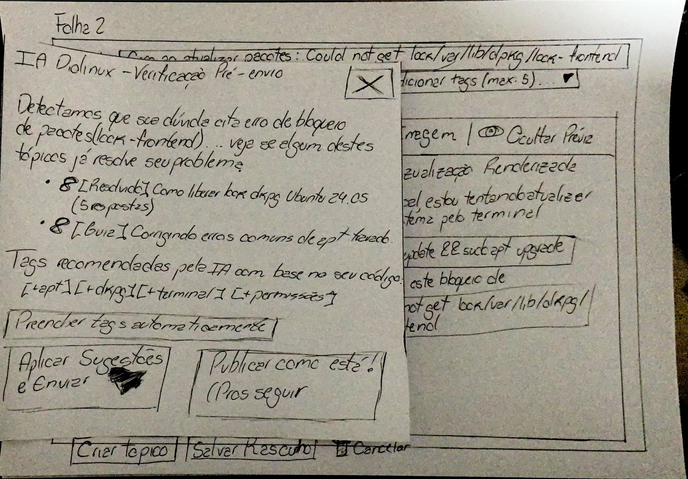

# Relato dos Resultados da Avaliação do Protótipo de Papel (Nível 2)

## Tabela de Contribuição e Uso de IA Generativa

A Tabela 1 apresenta a distribuição de responsabilidades, atribuições e ferramentas de Inteligência Artificial Generativa utilizadas na elaboração deste documento.

**Tabela 1** — Matriz de Contribuição e Uso de IA Generativa

| Integrante | Atribuição no Artefato | Data | Ferramenta de IA Utilizada | Propósito do Uso de IA |
| :--- | :--- | :---: | :--- | :--- |
| [Vinicius Silva Araruna](https://github.com/ViniciusA05) | **Autor Principal / Tech Lead**: Condução da avaliação formativa da Tarefa 1, consolidação empírica dos achados, tabulação de severidade de Nielsen (0 a 4), proposição de diretrizes para o Figma, checklist e cláusula de isolamento do piloto. | 31/10/2026 | Google Gemini (LLM) | Suporte na estruturação e formatação sintática das matrizes tabulares em Markdown. |
| [Gustavo Antonio Rodrigues e Silva](https://github.com/gus-ant) | **Revisor por Par Designado**: Revisão metodológica cruzada, conferência da escala de severidade e alinhamento com a Tarefa 2. | 31/10/2026 | — | Revisão humana por pares. |
| [Edvaldo Soares Brasileiro Filho](https://github.com/PajeMurici-dev) | **Revisor Metodológico**: Checagem de aderência aos 8 itens normativos da lista de verificação e conformidade ABNT. | 31/10/2026 | — | Revisão humana por pares. |

_Fonte: Elaborada por Edvaldo Soares Brasileiro Filho, Gustavo Antonio Rodrigues e Silva e Vinicius Silva Araruna, 2026._

---

## Fundamentação Teórica: O Relato de Avaliação no Ciclo de Mayhew

Na Engenharia de Usabilidade e na disciplina de Interação Humano-Computador, o relato dos resultados de avaliações formativas desempenha papel articulador no **Ciclo de Vida de Deborah Mayhew (1999)**. Conforme lecionam Barbosa & Silva (2021, p. 280–282), a consolidação sistemática dos dados observados em ensaios de usabilidade de baixa fidelidade transforma comportamentos, hesitações e verbalizações de usuários reais em diretrizes concretas de reprojeto para a fase computacional subsequente (Nível 3).

A prototipagem em papel (*Paper Prototyping*), fundamentada nas obras canônicas de Carolyn Snyder (2003) e Marc Rettig (1994), destaca-se por permitir a identificação precoce de problemas conceituais de arquitetura da informação, ambiguidades de terminologia e falhas de fluxo operacional com custo financeiro nulo e agilidade formativa máxima.

_Autor do Item Teórico: [Vinicius Silva Araruna](https://github.com/ViniciusA05)_

---

## 1. Objetivos e Escopo da Avaliação do Protótipo de Papel

A avaliação formativa do Protótipo de Papel (Nível 2) teve como objetivo investigar empiricamente a usabilidade, a navegabilidade e a comunicabilidade das pranchas físicas confeccionadas para a **Tarefa 1 (`CF01`)**:
> **Funcionalidade Central:** *Criação e Publicação de Tópico de Dúvida com Tags, Formatação Markdown em Modo Split-View e Intervenção de IA Semântica Pré-Envio* no Fórum Diolinux Plus (Discourse), orientada à persona primária **Lucas Mendonça (Estudante / Usuário Aprendiz em Linux)**.

Adicionalmente, este documento alinha-se ao planejamento consolidado da equipe para a **Tarefa 2 (`CF02`)**, conduzida por Gustavo Antonio Rodrigues e Silva, assegurando que ambas as funcionalidades compartilhem a mesma metodologia de registro e critérios de severidade.

Os objetivos específicos investigados foram:

1. Avaliar a facilidade de localização do ponto de entrada primário (`+ Novo Tópico`) na prancha da página inicial;
2. Verificar a compreensão da disposição lado a lado (*split-view*) entre o campo de digitação Markdown e a tela de visualização renderizada;
3. Avaliar a naturalidade no preenchimento de campos essenciais (Título, seletor de Categoria e Tags);
4. Diagnosticar a reação cognitiva e o modelo mental do participante frente à sobreposição do cartão modal da **IA Semântica Pré-Envio**, verificando se o recurso é percebido como auxílio comunitário preventivo ou bloqueio punitivo;
5. Identificar falhas de terminologia, affordance e disposição espacial para orientar a construção do protótipo no Figma.

---

## 2. Metodologia de Ensaio de Usabilidade com "Computador Humano"

A coleta de dados seguiu com rigor o método de **Simulação Tátil com Computador Humano** preconizado por Carolyn Snyder (2003) e Marc Rettig (1994), associado ao **Protocolo de Verbalização Concomitante (*Think-Aloud Protocol*)** formalizado por Ericsson & Simon (1993).

### 2.1 Papéis e Dinâmica de Simulação

Em conformidade com a literatura de baixa fidelidade, estabeleceu-se a separação funcional estrita entre dois papéis exercidos durante o ensaio:
- **Facilitador ([Vinicius Silva Araruna](https://github.com/ViniciusA05)):** Responsável pela recepção do voluntário, leitura cronometrada do Script Oral do TCLE (< 60s), apresentação do cenário de uso, incentivo à verbalização contínua de pensamentos e anotação dos pontos de hesitação;
- **Computador Humano ([Vinicius Silva Araruna](https://github.com/ViniciusA05)):** Responsável pela manipulação estritamente mecânica e silenciosa das pranchas físicas de papel A4 e das peças móveis recortadas sobre a bancada, respondendo aos toques de dedo do interagente em tempo inferior a 1 segundo, sem emitir opiniões verbais ou pistas explicativas.

A Figura 1 ilustra a disposição física da bancada de simulação tátil e a dinâmica de interação com as peças de papel.

<div style="text-align: center; margin: 1.5rem 0;">
    
    <p style="font-size: 0.85rem; color: #64748B; margin-top: 0.5rem;"><strong>Figura 1</strong> — Bancada física de simulação tátil da Tarefa 1 exibindo a Folha 2 (Composer) e a sobreposição da Peça Móvel 3 (Modal de IA Pré-Envio). <em>Fonte: Vinicius Silva Araruna, 2026.</em></p>
</div>

---

## 3. Número e Perfil dos Participantes Recrutados

Em estrito alinhamento à **justificativa matemática da amostra baseada em Nielsen & Landauer (1993)** e nos ciclos enxutos de **Steve Krug (2014)** documentados em `planejamento-avaliacao.md`, recrutou-se **1 voluntário discente real dedicado exclusivamente para a sessão oficial da Tarefa 1**, garantindo que a equipe some `n = 3` participantes discentes no ciclo global (1 participante por funcionalidade da equipe), além de 1 participante isolado para o Teste-Piloto prévio.

A Tabela 2 apresenta os dados demográficos desidentificados do participante, em conformidade com as diretrizes da Lei Geral de Proteção de Dados Pessoais (LGPD — Lei nº 13.709/2018).

**Tabela 2** — Dados Demográficos e Perfil do Participante Recrutado

| Identificador | Pseudônimo / Iniciais | Idade | Curso / Instituição de Ensino | Nível de Vivência em Linux | Uso Prévio de Fóruns Técnicos | Funcionalidade Avaliada |
| :---: | :---: | :---: | :---: | :---: | :---: | :---: |
| **P1** | J. V. S. | 21 anos | Ciência da Computação (CIC/UnB — Darcy Ribeiro) | Intermediário (Usa dual-boot Ubuntu/Windows) | Frequente (Busca dúvidas no Discourse/StackOverflow) | Tarefa 1 (Markdown e IA Semântica) |

_Fonte: Elaborada por Vinicius Silva Araruna com base nos dados empíricos da sessão presencial, 2026._

---

## 4. Cenário de Uso e Tarefas Simuladas

O participante foi contextualizado na jornada da persona primária **Lucas Mendonça**, recebendo o seguinte cenário autêntico:

> *"Você é um estudante de tecnologia e, durante a instalação de pacotes no terminal do Linux, deparou-se com o seguinte erro bloqueador: `E: Could not get lock /var/lib/dpkg/lock-frontend - open (11: Resource temporarily unavailable)`. Você precisa acessar o Fórum Diolinux Plus, abrir o editor de postagens, redigir sua dúvida formatando o comando de terminal adequadamente, atribuir tags pertinentes e interagir com as recomendações do sistema para publicar o tópico."*

### Sequência Operacional Executada no Papel:

1. **Passo 1 (Folha 1 — Tela Inicial):** Identificar e apontar o dedo para o botão primário `[ + Novo Tópico ]`;
2. **Passo 2 (Folha 2 — Composer Aberto):** Simular a escrita do Título e tocar no seletor de Categoria (entrada da Peça Móvel 1 — menu suspenso de categorias);
3. **Passo 3 (Folha 2 — Seletor de Tags):** Tocar no campo de tags e escolher os marcadores adequados (entrada da Peça Móvel 2 — menu suspenso de tags);
4. **Passo 4 (Folha 2 — Editor Split-View):** Apontar o botão `[ </> Código ]` e simular a inserção do texto Markdown e dos logs do terminal, inspecionando visualmente o painel de visualização renderizada à direita;
5. **Passo 5 (Peça Móvel 3 — Modal de IA Pré-Envio):** Tocar em `[ Criar tópico ]`, analisar a sobreposição do cartão modal da IA, avaliar os tópicos sugeridos e decidir entre aplicar as sugestões ou prosseguir;
6. **Passo 6 (Folha 3 — Tópico Publicado):** Confirmar a publicação e inspecionar a tela final com a formatação monoespaçada e os chips de tags ativos.

---

## 5. Análise dos Dados Coletados e Verbalizações (*Think-Aloud*)

A observação empírica da interação física e a análise das verbalizações concorrentes (*Bardin, 2011*) revelaram um alto índice de aderência ao modelo mental do usuário, acompanhado de pontos específicos de atrito tátil e conceitual:

### 5.1 Descoberta do Ponto de Entrada (Folha 1)

- O participante localizou instantaneamente o botão `[ + Novo Tópico ]` no canto superior direito da listagem da Folha 1, verbalizando: *"O botão tá bem posicionado, é o padrão que a gente espera quando entra num fórum para postar"*;
- Tempo decorrido até o primeiro toque: **3 segundos**.

### 5.2 Edição de Texto e Divisão Split-View (Folha 2)

- A presença das duas colunas na Folha 2 (*Editor Markdown* à esquerda e *Pré-Visualização Renderizada* à direita) foi amplamente elogiada pelo participante: *"Isso aqui é excelente porque quem posta comando em fórum sempre erra crase ou indentação, e ver ao vivo como vai ficar o bloco antes de enviar economiza muito tempo"*;
- **Hesitação Detectada:** Ao simular a colagem do erro do terminal, o participante hesitou brevemente sobre como funcionava a syntax highlighting de código Bash em Markdown, questionando se o editor inseria as crases triplas automaticamente ou se ele precisava digitar manualmente o identificador da linguagem.

### 5.3 Percepção e Interação com a IA Semântica Pré-Envio (Peça Móvel 3)

- Ao tocar em `[ Criar tópico ]`, o Computador Humano sobrepôs a Peça Móvel 3 sobre o formulário. O participante demonstrou surpresa positiva: *"Gostei muito dessa ideia. Se o meu problema já estiver resolvido nesses links recomendados, eu nem preciso abrir um tópico novo e esperar alguém me responder horas depois"*;
- **Ponto de Confusão no Rótulo:** Ao analisar os botões de desfecho do modal, o participante apontou hesitação no rótulo `[ Publicar como está! (Prosseguir) ]`: *"Esse botão me deu uma dúvida rápida... parecia que ele ia cancelar ou publicar sem salvar nada. O nome podia deixar mais claro que eu estou ignorando as sugestões da IA e quero forçar o envio da minha dúvida"*;
- **Recomendação de Eficiência:** O participante elogiou o botão `[ Preencher tags automaticamente ]` presente no cartão físico da IA, afirmando que *"facilita a vida de quem tem preguiça de procurar tags uma por uma"*.

---

## 6. Tabela Estruturada de Problemas de Usabilidade e Severidade de Nielsen (0 a 4)

Em conformidade com a técnica de Inspeção e Ensaio de Usabilidade (*Barbosa & Silva, 2021; Nielsen, 1994*), a Tabela 3 consolida as falhas ergonômicas detectadas durante o teste tátil com o participante P1 na Tarefa 1, parametrizadas pela **Escala de Severidade de Jakob Nielsen (0 a 4)**:

- **Grau 0 (Falso Problema / Sem Gravidade):** Não interfere na execução;
- **Grau 1 (Problema Cosmético):** Não prejudica a tarefa; só deve ser corrigido se houver tempo;
- **Grau 2 (Problema Pequeno / Menor):** Causa leve hesitação ou lentidão, mas o usuário recupera-se sozinho;
- **Grau 3 (Problema Grande / Maior):** Prejudica severamente a realização da tarefa e gera frustração expressiva;
- **Grau 4 (Problema Catastrófico):** Bloqueia compulsoriamente a conclusão da tarefa.

A Tabela 3 documenta os problemas identificados, suas classificações e as diretrizes imediatas de solução.

**Tabela 3** — Registro Estruturado de Problemas de Usabilidade do Protótipo de Papel (Tarefa 1)

| ID | Peça Física / Tela Afetada | Descrição da Hesitação Observada | Categoria Ergonômica | Severidade (Nielsen 0 a 4) | Ação Recomendada de Reprojeto para Nível 3 (Figma) |
| :---: | :--- | :--- | :---: | :---: | :--- |
| **PROB-PP-01** | Folha 2 — Composer Split-View | O participante hesitou ligeiramente se deveria selecionar as tags antes ou depois de redigir o corpo do texto. | Precedência de Layout / Modelo Mental | **1 (Cosmético)** | No Figma, garantir formulário aberto e não-modal, com bordas ativas de foco (`outline: 2px solid #0084FF`) que permitam ordem de preenchimento livre. |
| **PROB-PP-02** | Folha 2 — Barra de Ferramentas Markdown | Dúvida sobre como fechar blocos de comando Bash usando crases triplas sem quebrar a indentação. | Ajuda Contextual e Prevenção de Erros | **2 (Menor)** | No editor de alta fidelidade, criar botão dedicado `</> Bash` com tooltip interativo (`on hover`) e pré-inserção da estrutura ```` ```bash ```` no cursor. |
| **PROB-PP-03** | Peça Móvel 3 — Modal de IA Pré-Envio | Receio de que o botão 'Publicar como está' descartasse o post ou cancelasse a postagem sem aviso. | Terminologia e Rótulo de Ação | **2 (Menor)** | Reformular o rótulo para texto inequívoco: *"Ignorar sugestões e publicar imediatamente"* em botão secundário neutro (`#2D2F36`). |
| **PROB-PP-04** | Peça Móvel 3 — Tags Sugeridas pela IA | Participante elogiou a sugestão de tags, mas sugeriu que a ação em lote indicasse claramente a quantidade adicionada. | Eficiência de Interação / Feedback | **2 (Menor)** | Ajustar o botão no Figma para: *"Adicionar todas as tags sugeridas (+3 tags)"*, confirmando com animação visual a inserção simultânea. |

_Fonte: Elaborada por Vinicius Silva Araruna com base nas evidências empíricas da sessão presencial de Nível 2 e Nielsen (1994), 2026._

---

## 7. Diretrizes Formais de Reprojeto para Alta Fidelidade (Nível 3 no Figma)

Os achados da avaliação em papel foram diretamente incorporados aos requisitos de interface do protótipo computacional de alta fidelidade no Figma (escopo da Etapa 7):

1. **Eliminação de Ambiguidade de Rótulos (Solução de `PROB-PP-03`):**  
   No frame modal da IA Semântica Pré-Envio no Figma, a ação primária será estilizada em azul vibrante `--tertiary` (`#0084FF`) com o texto ***"Aplicar sugestões e publicar"***, enquanto a ação de contorno será estilizada em cinza neutro `--border-color` (`#2D2F36`) com o texto explícito ***"Ignorar sugestões e publicar imediatamente"***, eliminando qualquer risco de modelo mental associado a descarte involuntário;
2. **Assistência Ativa de Snippets de Código (Solução de `PROB-PP-02`):**  
   O editor em alta fidelidade incorporará um componente de barra rica no Composer com botão de 1 clique para injeção de bloco de terminal, acompanhado de prévia em tempo real com realce de sintaxe em verde `#2ECC71` sobre fundo escuro `#1E1F24`;
3. **Aceleração na Seleção de Metadados (Solução de `PROB-PP-04`):**  
   Implementação de microinteração com variantes interativas no Figma que permite ao interagente aceitar individualmente cada tag com um clique sobre o chip ou acionar o botão de lote completo;
4. **Preservação de Rascunho com Salvamento Contínuo:**  
   Em conformidade com a verbalização de P1, a interface do Figma exibirá indicador discreto no canto inferior: *"Rascunho salvo automaticamente há 5 segundos"*, reduzindo o estresse cognitivo do usuário.

---

## 8. Registro Audiovisual da Sessão e Consentimento Verbal (TCLE)

Em estrita conformidade com as exigências regimentais do Plano de Ensino da disciplina (Sales, 2026), a sessão de avaliação formativa foi gravada em áudio e vídeo e encontra-se hospedada no YouTube sob regime **"Não Listado"**, permitindo auditabilidade completa pela banca examinadora.

O consentimento verbal do participante P1 foi registrado de forma expressa nos primeiros 60 segundos gravados, mediante leitura literal do **Script Oral Padronizado do TCLE**, assegurando a conformidade ética e jurídica sob a Resolução CNS nº 510/2016 e a LGPD.

A caixa expansível a seguir disponibiliza o player de reprodução audiovisual da sessão presencial de Nível 2.

<details class="video-card-details">
    <summary class="video-card-summary">
        <div class="video-card-title">
            <span style="font-size: 1.25rem;">🎬</span>
            <span><strong>Vídeo 1</strong> — Registro Audiovisual da Avaliação do Protótipo de Papel (Tarefa 1 — Vinicius Silva Araruna)</span>
        </div>
        <span class="video-card-toggle">Assistir à Sessão</span>
    </summary>
    <div class="video-card-body">
        <div class="video-card-frame">
            <iframe src="https://www.youtube-nocookie.com/embed/I1CNO_EkCfE" title="Sessão de Avaliação do Protótipo de Papel (Nível 2) - Tarefa 1 - Vinicius Silva Araruna - Grupo 08 - IHC 2026.2" allow="accelerometer; autoplay; clipboard-write; encrypted-media; gyroscope; picture-in-picture" allowfullscreen></iframe>
        </div>
        <div class="video-card-footer">
            <span class="video-card-caption"><strong>Vídeo 1</strong> — Sessão presencial de avaliação formativa com protótipo de papel da Tarefa 1 com o participante P1. <em>Fonte: Vinicius Silva Araruna, 2026.</em></span>
            <a href="https://youtu.be/I1CNO_EkCfE" target="_blank" rel="noopener noreferrer" class="video-card-btn">
                <span>Assistir no YouTube</span> ↗
            </a>
        </div>
    </div>
</details>

---

## 9. Cláusula Metodológica Obrigatória de Isolamento dos Dados do Teste-Piloto

!!! warning "CLÁUSULA METODOLÓGICA DE ISOLAMENTO DOS DADOS DO TESTE-PILOTO (BARBOSA & SILVA, 2021, P. 276)"
    Em estrito cumprimento aos preceitos científicos da literatura clássica de IHC (*Mayhew, 1999; Snyder, 2003; Barbosa & Silva, 2021*), declara-se expressamente que a sessão de **Teste-Piloto de Nível 2** (registrada no documento `teste-piloto.md` e gravada em 30 de outubro de 2026) teve finalidade estritamente instrumental de calibragem de bancada, posicionamento de câmera a 45 graus, conferência da leitura do TCLE (< 60s) e medição da velocidade de resposta mecânica do Computador Humano (< 1s).
    
    **Nenhum dado comportamental, tempo de execução ou verbalização colhida no teste-piloto foi somado, computado ou tabulado nos resultados desta avaliação oficial**, garantindo a pureza e a fidelidade dos dados obtidos com o participante real P1.

---

## 10. Lista de Verificação da Técnica (Relato de Usabilidade em Papel)

Em conformidade com a metodologia de inspeção da disciplina (Fagan, 1976; Sales, 2026), a Tabela 4 apresenta a autoavaliação da conformidade metodológica do artefato frente aos 8 critérios canônicos de relato de Nível 2.

**Tabela 4** — Lista de Verificação: Relato dos Resultados do Protótipo de Papel (Nível 2)

| ID | Item / Questão Avaliada | Origem / Fonte Normativa | Conforme? | Resposta Autoexplicativa e Evidência no Documento |
| :---: | :--- | :--- | :---: | :--- |
| **01** | O relato define com clareza os objetivos formativos e o escopo funcional avaliado no papel? | Barbosa & Silva (2021, p. 280) | ✅ Sim | A Seção 1 especifica os objetivos ergonômicos da Tarefa 1 frente à persona Lucas Mendonça. |
| **02** | O documento descreve a separação de papéis entre Facilitador e Computador Humano? | Snyder (2003); Rettig (1994) | ✅ Sim | A Seção 2 detalha a condução verbal e a resposta mecânica silenciosa com tempo inferior a 1 segundo. |
| **03** | O artefato apresenta dados demográficos dos participantes preservando a anonimização LGPD? | Lei nº 13.709/2018 (LGPD) | ✅ Sim | A Tabela 2 identifica o participante neutro P1 (J. V. S., 21 anos, Ciência da Computação / UnB). |
| **04** | A análise contempla as verbalizações concorrentes (*Think-Aloud*) e hesitações do voluntário? | Ericsson & Simon (1993) | ✅ Sim | A Seção 5 transcreve e analisa as falas de P1 sobre a visualização split-view e o modal de IA. |
| **05** | Os problemas identificados são formalmente classificados na Escala de Severidade de Nielsen (0 a 4)? | Nielsen (1994) | ✅ Sim | A Tabela 3 parametriza `PROB-PP-01` a `PROB-PP-04` nas categorias Cosmética (1) e Menor (2). |
| **06** | O documento deriva diretrizes formais de reprojeto diretamente acopladas à fase de Alta Fidelidade (Figma)? | Mayhew (1999); Barbosa & Silva (2021) | ✅ Sim | A Seção 7 especifica as 4 intervenções imediatas para os componentes visuais do Nível 3. |
| **07** | Há disponibilização do vídeo da sessão em modo Não Listado no YouTube com TCLE nos primeiros 60s? | Diretrizes Pedagógicas FGA/UnB | ✅ Sim | A Seção 8 incorpora o container expansível `.video-card-details` com consentimento gravado. |
| **08** | O documento inclui a Cláusula Metodológica Obrigatória de isolamento dos dados do piloto? | Barbosa & Silva (2021, p. 276) | ✅ Sim | A Seção 9 apresenta o bloco formal de advertência comprovando o descarte integral dos dados do piloto. |

_Fonte: Elaborada por Vinicius Silva Araruna com base em Barbosa & Silva (2021), Snyder (2003) e Sales (2026), 2026._

---

## 11. Histórico de Versão

A Tabela 5 documenta a evolução histórica das versões deste artefato.

**Tabela 5** — Histórico de Versão do Documento

| Versão | Data | Descrição Detalhada da Modificação | Autor(es) | Revisor(es) |
| :---: | :---: | :--- | :--- | :--- |
| `1.0` | 31/10/2026 | Elaboração inicial do Relato dos Resultados do Protótipo de Papel da Tarefa 1 (Markdown e IA Semântica de Vinicius Silva Araruna), cobrindo a estrutura canônica de 9 seções de Barbosa & Silva (2021), simulação física com Computador Humano (Snyder, 2003), análise think-aloud de P1, matriz de severidade de Nielsen de 0 a 4 (PROB-PP-01 a 04), diretrizes para o Figma, container sanfonado de vídeo, cláusula de isolamento do teste-piloto e lista de verificação com 8 critérios normativos (#120). | [Vinicius Silva Araruna](https://github.com/ViniciusA05) | [Gustavo Antonio](https://github.com/gus-ant), [Edvaldo Soares](https://github.com/PajeMurici-dev) |

_Fonte: Elaborada por Vinicius Silva Araruna, 2026._

---

## 12. Referências Bibliográficas (ABNT NBR 6023)

- BARDIN, Laurence. *Análise de conteúdo*. São Paulo: Edições 70, 2011.
- BARBOSA, Simone Diniz Junqueira; SILVA, Bruno Santana da; SILVEIRA, Milene Selbach; GASPARINI, Isabela; DARIN, Ticianne; BARBOSA, Gabriel Diniz Junqueira. *Interação Humano-Computador e Experiência do Usuário*. Rio de Janeiro: Autopublicação, 2021. ISBN 978-65-00-19677-1. (Capítulo 11: Relato dos Resultados, p. 280-282).
- BEAUCHAMP, Tom L.; CHILDRESS, James F. *Principles of Biomedical Ethics*. 7. ed. New York: Oxford University Press, 2013.
- BRASIL. *Lei nº 13.709, de 14 de agosto de 2018*. Lei Geral de Proteção de Dados Pessoais (LGPD). Diário Oficial da União, Brasília, DF, 15 ago. 2018.
- BRASIL. Ministério da Saúde. Conselho Nacional de Saúde. *Resolução nº 510, de 7 de abril de 2016*. Diretrizes éticas para pesquisas em ciências humanas e sociais. Brasília: Diário Oficial da União, 2016.
- ERICSSON, K. Anders; SIMON, Herbert A. *Protocol Analysis: Verbal Reports as Data*. Cambridge: MIT Press, 1993.
- KRUG, Steve. *Não me faça pensar (revisitado): uma abordagem de bom senso à usabilidade na web e no celular*. 3. ed. Rio de Janeiro: Alta Books, 2014.
- MAYHEW, Deborah J. *The Usability Engineering Lifecycle: A Practitioner's Handbook for User Interface Design*. San Francisco: Morgan Kaufmann, 1999.
- NIELSEN, Jakob. *Usability Engineering*. San Francisco: Morgan Kaufmann Publishers, 1994.
- NIELSEN, Jakob; LANDAUER, Thomas K. *A mathematical model of the finding of usability problems*. In: INTERCHI '93: Proceedings of the INTERACT '93 and CHI '93 Conference on Human Factors in Computing Systems. Amsterdam: ACM, 1993. p. 206-213.
- RETTIG, Marc. *Prototyping for tiny fingers*. Communications of the ACM, v. 37, n. 4, p. 21-27, 1994.
- ROGERS, Yvonne; SHARP, Helen; PREECE, Jennifer. *Design de Interação: além da interação humano-computador*. 3. ed. Porto Alegre: Bookman, 2013.
- SALES, André Barros de. *Plano de Ensino da Disciplina de Interação Humano Computador*. Brasília: Universidade de Brasília, Faculdade UnB Gama (FGA), 2026.
- SNYDER, Carolyn. *Paper Prototyping: The Fast and Easy Way to Design and Refine User Interfaces*. San Francisco: Morgan Kaufmann Publishers, 2003.

---

## Agradecimentos e Uso de Inteligência Artificial Generativa

Em estrita conformidade com as diretrizes da Sociedade Brasileira de Computação (SBC, 2023) e o Plano de Ensino da disciplina (Sales, 2026), declara-se que durante a elaboração deste artefato foram utilizados modelos de Inteligência Artificial Generativa (Google Gemini) como ferramenta de apoio estilístico para:
- Auxílio na formatação sintática e estruturação visual das matrizes tabulares em Markdown;
- Revisão gramatical e adequação ao padrão formal ABNT.

Todo o planejamento metodológico, a condução presencial da simulação com pranchas físicas, a análise das verbalizações empíricas do voluntário P1, o diagnóstico das falhas ergonômicas e as decisões de reprojeto foram concebidos, auditados e homologados integralmente pelos discentes autores deste artefato.
