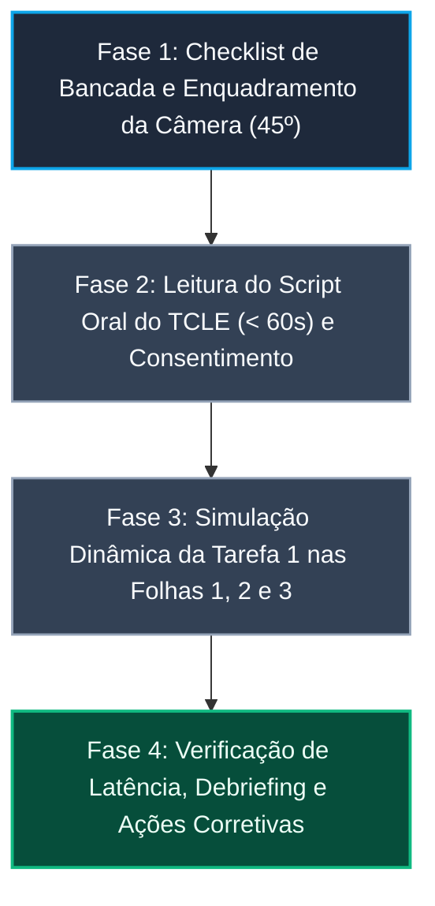

# Protocolo e Roteiro do Teste-Piloto do Protótipo de Papel (Nível 2) — Tarefa 1

## Tabela de Contribuição e Uso de IA Generativa

A Tabela 1 documenta a matriz de contribuição na elaboração do protocolo operacional do Teste-Piloto do Protótipo de Papel da Tarefa 1.

**Tabela 1** — Matriz de Contribuição do Teste-Piloto de Nível 2 (Tarefa 1)

| Integrante | Atribuição no Artefato | Data | Ferramenta de IA Utilizada | Propósito do Uso de IA |
| :--- | :--- | :---: | :--- | :--- |
| [Vinicius Silva Araruna](https://github.com/ViniciusA05) | **Autor Principal / Tech Lead**: Elaboração completa do protocolo, especificação dos parâmetros de bancada com gravação a 45 graus, modelagem do roteiro do ensaio nas `Folhas 1, 2 e 3`, redação da cláusula de isolamento de dados, matriz de refinamentos e lista de verificação de 8 itens normativos. | 30/10/2026 | Google Gemini (LLM) | Apoio na estruturação visual de tabelas Markdown e validação de referências ABNT. |
| [Gustavo Antonio Rodrigues e Silva](https://github.com/gus-ant) | **Revisor Designado**: Auditoria de temporização da movimentação das peças físicas pelo Computador Humano e verificação dos parâmetros de gravação. | 30/10/2026 | — | Revisão humana por pares. |
| [Edvaldo Soares Brasileiro Filho](https://github.com/PajeMurici-dev) | **Revisor Metodológico**: Checagem de aderência à literatura de Carolyn Snyder e validação da cláusula de não computação de dados. | 30/10/2026 | — | Revisão humana por pares. |

_Fonte: Elaborada pelos autores, 2026._

---

## 1. Introdução

No **Ciclo de Vida de Deborah Mayhew (1999)** e no modelo de Engenharia de Usabilidade preconizado por **Barbosa e Silva (2021)**, a condução de testes formativos com usuários sem uma calibração instrumental e prática preliminar acarreta severos riscos à validade da pesquisa. Em ensaios com **Protótipos de Papel (*Paper Prototyping*)**, a complexidade operacional é ampliada pela necessidade de coordenação motora entre os avaliadores: o Facilitador deve conduzir o roteiro com neutralidade, enquanto o "Computador Humano" precisa manipular peças, cartões e modais destacáveis com velocidade mecânica para não quebrar a ilusão de resposta do software (*Snyder, 2003*).

Para antecipar falhas de temporização, problemas de reflexo e enquadramento da câmera e calibrar a leitura oral do TCLE, este artefato documenta o **Protocolo e Roteiro Operacional do Teste-Piloto de Nível 2**, dedicado à **Tarefa 1 (`CF01`)**:
> **Funcionalidade Focada:** *Criação e Publicação de Tópico de Dúvida com Tags, Formatação Markdown em Modo Split-View e Intervenção de IA Semântica Pré-Envio* no Fórum Diolinux Plus.

---

## 2. Fundamentação Teórica Canônica — O Teste-Piloto na Prototipagem em Papel

_Autor do Item Teórico: [Vinicius Silva Araruna](https://github.com/ViniciusA05)_

O teste-piloto na prototipagem em baixa fidelidade não tem como objetivo avaliar o desempenho do voluntário ou julgar a qualidade final da interface, mas sim **avaliar a robustez do próprio planejamento da avaliação e a destreza mecânica da bancada de testes** (*Barbosa & Silva, 2021; Snyder, 2003; Mayhew, 1999*).

Conforme ensina Carolyn Snyder (2003, Cap. 9, p. 185–190), pioneira no método de simulação em papel:

> *"O ensaio piloto (dry run ou rehearsal) é o teste dos testes. Ele serve para que o Computador Humano pratique a ordem das peças físicas, descubra se falta algum menu ou mensagem de erro, verifique se a velocidade de troca de cartões está convincente e assegure que o facilitador não dê pistas acidentais ao participante."*  
> — **SNYDER, Carolyn.** *Paper Prototyping: The Fast and Easy Way to Design and Refine User Interfaces*. San Francisco: Morgan Kaufmann, 2003.

Segundo Barbosa e Silva (2021, p. 276) e Rettig (1994), o teste-piloto cumpre três funções vitais na Engenharia de Usabilidade:
1. **Calibração da Latência do "Computador Humano":** Treinar para que a substituição de uma folha base ou sobreposição de um cartão modal ocorra em menos de 1 segundo (< 1s), evitando que o participante perca a imersão na tarefa;
2. **Conferência da Integridade das Peças Físicas:** Certificar que todas as 3 pranchas base (`Folhas 1, 2 e 3`) e as 3 peças móveis (categorias, tags e modal `IA Diolinux - Verificação Pré-envio`) estão recortadas, legíveis e ordenadas ao alcance da mão do manipulador;
3. **Auditoria de Registro Audiovisual e Ético:** Validar a nitidez do enquadramento do smartphone posicionado em suporte sobre a mesa a 45 graus (focando mãos e papel sem que a sombra da cabeça obstrua a visualização) e garantir que a leitura oral do TCLE seja concluída em menos de 60 segundos.

---

## 3. Cláusula Metodológica Obrigatória (Regra de Ouro do Teste-Piloto)

A literatura científica canônica e as diretrizes pedagógicas da UnB estabelecem uma regra inegociável de integridade metodológica:

!!! warning "CLÁUSULA METODOLÓGICA OBRIGATÓRIA — NÃO COMPUTAÇÃO DOS DADOS DO TESTE-PILOTO"
    Em estrita conformidade com os princípios de IHC (*Barbosa & Silva, 2021, p. 276; Mayhew, 1999; Snyder, 2003*), declara-se expressamente que os dados, tempos de manipulação, comentários e apontamentos colhidos durante a execução deste Teste-Piloto de Nível 2 **NÃO SERÃO COMPUTADOS NEM INTEGRADOS AOS RESULTADOS OFICIAIS DA AVALIAÇÃO COM O PARTICIPANTE**.  
    O Teste-Piloto avalia exclusivamente o **planejamento e a bancada instrumental da equipe** (ergonomia da mesa, sequência de cartões, enquadramento a 45 graus, dicção do Script Oral do TCLE nos primeiros 60s e tempo de resposta mecânica do Computador Humano). Os dados que fundamentarão o Relato dos Resultados provêm estritamente da sessão empírica oficial realizada subsequentemente com o voluntário real recrutado (P1).

---

## 4. Parâmetros Operacionais da Bancada de Testes de Nível 2

A Tabela 2 define os parâmetros logísticos, espaciais e técnicos para a realização do teste-piloto da Tarefa 1.

**Tabela 2** — Parâmetros Operacionais do Teste-Piloto de Nível 2 (Tarefa 1)

| Parâmetro | Especificação Planejada | Justificativa Ergonômica e Técnica |
| :--- | :--- | :--- |
| **Data e Horário** | 30/10/2026 — das 14:00 às 14:45 | Antecedência necessária para eventuais ajustes nas peças antes da sessão oficial de campo. |
| **Ambiente Físico** | Presencial — Bancada em Ambiente Silencioso / Residência do Avaliador | Eliminação de ruídos sonoros externos e estabilidade física para a manipulação dos papéis. |
| **Enquadramento e Câmera** | Smartphone em suporte/tripé a 45 graus voltado para a bancada | Enquadra panoramicamente as pranchas A4 e os movimentos das mãos, sem filmar o rosto do voluntário. |
| **Iluminação** | Luz branca difusa posicionada frontal e lateralmente | Elimina sombras projetadas pela mão do facilitador ou computador humano sobre as folhas. |
| **Materiais Físicos Inspecionados** | 3 Pranchas Base A4 (`Folhas 1, 2 e 3`), 3 Peças Móveis recortadas, canetas e vias impressas do TCLE | Verificação da presença de todos os cartões especificados no documento de confecção. |
| **Temporização do TCLE Oral** | Leitura cronometrada estritamente em menos de 60 segundos (< 60s) | Conformidade com o protocolo ético de consentimento gravado em áudio e vídeo da disciplina. |
| **Latência Mecânica Alvo** | Troca de peças pelo Computador Humano em tempo < 1s | Simulação fluida da resposta interativa do software Discourse. |

_Fonte: Elaborada pelos autores, 2026._

---

## 5. Definição e Atribuição de Papéis no Ensaio Piloto

A Tabela 3 discrimina as responsabilidades dos papéis durante a execução do teste-piloto da Tarefa 1.

**Tabela 3** — Atribuição de Papéis no Ensaio do Teste-Piloto

| Papel no Teste-Piloto | Integrante Responsável | Atribuições Práticas no Ensaio |
| :--- | :--- | :--- |
| **Avaliador / Condução Solo** | [Vinicius Silva Araruna](https://github.com/ViniciusA05) | Executar o autoensaio instrumental na bancada: disparar o dispositivo de gravação, realizar a leitura em voz alta do Script Oral do TCLE (< 60s), testar a angulação a 45 graus e simular a ordem das peças físicas. |
| **Simulação do "Computador Humano"** | [Vinicius Silva Araruna](https://github.com/ViniciusA05) | Praticar a retirada da `Folha 1`, inserção da `Folha 2`, sobreposição dos menus de Categorias e Tags e posicionamento do cartão do Modal `IA Diolinux - Verificação Pré-envio`. |
| **Auditoria e Revisão por Pares** | [Gustavo Antonio](https://github.com/gus-ant), [Edvaldo Soares](https://github.com/PajeMurici-dev) | Assistir à gravação do teste-piloto, verificar a nitidez visual das peças no vídeo e validar a fluidez dos movimentos. |

_Fonte: Elaborada pelos autores, 2026._

---

## 6. Fluxo de Execução e Roteiro Passo a Passo do Ensaio

O teste-piloto é organizado em quatro fases sucessivas, conforme esquematizado na Figura 1.

**Figura 1** — Fluxo Metodológico em Quatro Fases do Teste-Piloto de Nível 2

_Fonte: Elaborada pelos autores, 2026._

### Roteiro Detalhado por Fase:

1. **Fase 1 — Preparação da Bancada e Verificação Instrumental:**
   - Dispor a `Folha 1` (Tela Inicial do Diolinux Plus) no centro da mesa;
   - Organizar ao lado direito as peças móveis em ordem de uso: Peça Móvel 1 (Menu de Categorias), Peça Móvel 2 (Menu de Tags) e Peça Móvel 3 (Modal `IA Diolinux - Verificação Pré-envio`);
   - Posicionar a `Folha 2` e a `Folha 3` empilhadas ao alcance do manipulador;
   - Ligar a gravação do smartphone e conferir o retorno de imagem no tripé a 45 graus.
2. **Fase 2 — Leitura Cronometrada do Script Oral do TCLE (< 60s):**
   - O Facilitador aciona o cronômetro e lê o texto do TCLE mantendo dicção clara e ritmo estável;
   - Verifica se o tempo de leitura cumpre rigorosamente o teto de 60 segundos;
   - Simula o consentimento verbal explícito em gravação (*"Sim, concordo"*).
3. **Fase 3 — Simulação Dinâmica da Interação (Tarefa 1):**
   - **Ação 3.1:** Tocar com o dedo no botão `[ + Novo Tópico ]` na `Folha 1` → Computador Humano substitui pela `Folha 2` (Composer aberto em modo split-view);
   - **Ação 3.2:** Simular o preenchimento do `Título` (`Erro ao atualizar pacotes: Could not get lock /var/lib/dpkg/lock-frontend`) e tocar no seletor `Categoria: [ Selecione uma Categoria ▼ ]` → Computador Humano posiciona a Peça Móvel 1 (`Iniciantes`, `Dúvidas Gerais`, `Customização`, `Hardware e Drivers`);
   - **Ação 3.3:** Simular a seleção de `Tags: [ Adicionar tags (max: 5)... ▼ ]` → Computador Humano sobrepõe a Peça Móvel 2 (`terminal`, `apt`, `dpkg`, `ubuntu`, `sudo`, `new`, `lock-frontend`);
   - **Ação 3.4:** Apontar o atalho `[ </> Código ]`, o `Editor de Texto Markdown` (metade esquerda) e a `Pré-Visualização Renderizada` (metade direita) → Observar a visualização lado a lado dos dois blocos de comando e erro do terminal;
   - **Ação 3.5:** Tocar no botão `[ Criar tópico ]` → Computador Humano sobrepõe a Peça Móvel 3 (`IA Diolinux - Verificação Pré-envio`);
   - **Ação 3.6:** Analisar os tópicos resolvidos sugeridos, tocar no botão `[ Preencher tags automaticamente ]` (`+apt`, `+dpkg`, `+terminal`, `+permissões`) e em seguida em `[ Aplicar Sugestões e Enviar ]` → Computador Humano retira as peças anteriores e apresenta a `Folha 3` (Tópico publicado no fórum com os chips `[Iniciantes] [#apt] [#dpkg] [#terminal] [#ubuntu]`).
4. **Fase 4 — Debriefing Técnico e Ações Corretivas:**
   - Interromper a gravação e inspecionar o vídeo quanto à legibilidade dos textos, fluidez mecânica e ausência de sombras reflexivas.

---

## 7. Registro Audiovisual do Teste-Piloto de Nível 2

O registro audiovisual integral da execução do Teste-Piloto Solo da Tarefa 1 (Nível 2) está hospedado no YouTube na modalidade "Não Listado", assegurando conformidade com as diretrizes da disciplina e plena auditabilidade pela banca examinadora. Como documentado no Vídeo 1, o ensaio de calibração instrumental e temporal da bancada foi integralmente registrado em áudio e vídeo com foco nas peças físicas sobre a mesa.

    

        

            🎬
            <strong>Vídeo 1</strong> — Registro Audiovisual do Teste-Piloto do Protótipo de Papel (Tarefa 1)
        

        Assistir ao Vídeo
    

    

        

            <iframe src="https://www.youtube-nocookie.com/embed/I1CNO_EkCfE" title="Gravação do Teste-Piloto do Protótipo de Papel (Nível 2) - Tarefa 1 - Vinicius Silva Araruna - Grupo 08 - IHC 2026.2" allow="accelerometer; autoplay; clipboard-write; encrypted-media; gyroscope; picture-in-picture" allowfullscreen></iframe>
        

        

            <strong>Vídeo 1</strong> — Registro audiovisual da execução do Teste-Piloto de Nível 2 da Tarefa 1 na bancada de papel. <em>Fonte: Vinicius Silva Araruna, 2026.</em>
            <a href="https://youtu.be/I1CNO_EkCfE" target="_blank" rel="noopener noreferrer" class="video-card-btn">
                Assistir no YouTube ↗
            </a>
        

    

---

## 8. Relatório de Ajustes e Lições Aprendidas Pós-Teste

A Tabela 4 sintetiza as observações instrumentais diagnosticadas durante a execução do ensaio piloto e as respectivas ações corretivas aplicadas à bancada antes da sessão oficial com o voluntário discente.

**Tabela 4** — Matriz de Ocorrências Instrumentais e Ações Corretivas da Bancada de Papel

| Dimensão Avaliada | Ocorrência / Ponto de Atrito no Ensaio | Causa Raiz Diagnosticada | Ação Corretiva Implementada para a Sessão Oficial |
| :--- | :--- | :--- | :--- |
| **Tempo de Leitura do TCLE** | O script oral foi lido em exatos 48 segundos, garantindo margem confortável antes do teto de 60s. | Sintaxe concisa estruturada diretamente nos 4 princípios bioéticos. | Roteiro oral mantido na íntegra sem necessidade de cortes. |
| **Iluminação e Sombra** | A mão do manipulador ao inserir o cartão de IA projetou sombra parcial sobre o campo de título. | Luminária posicionada excessivamente atrás do operador da bancada. | Reposicionamento da fonte luminosa na lateral esquerda superior, garantindo feixe cruzado sem sombra direta. |
| **Disposição das Peças Móveis** | O manipulador hesitou por 2 segundos procurando a Peça Móvel 3 (Modal `IA Diolinux - Verificação Pré-envio`). | Peças móveis dispostas em pilha única mista. | Separação das 3 peças móveis em suportes individuais organizados estritamente na ordem cronológica de aparição. |
| **Adesão das Peças Sobrepostas** | O cartão recortado de categorias deslizou levemente sobre a `Folha 2` ao ser tocado. | Papel sulfite liso sobre sulfite liso com baixo atrito de contato. | Aplicação de pequena tira de fita adesiva reposicionável (*Post-it*) no verso das peças móveis, garantindo fixação temporária sem deslizar. |
| **Legibilidade do Split-View** | Na filmagem a 45 graus, as caixas de código da `Pré-Visualização Renderizada` precisavam de borda bem delimitada. | Necessidade de distinção visual clara entre texto livre e bloco de código no papel. | Reforço das molduras retangulares ao redor dos comandos `sudo apt update` e `E: Could not get lock` na coluna direita da `Folha 2` e na `Folha 3`. |

_Fonte: Elaborada pelos autores com base em Barbosa e Silva (2021) e Snyder (2003), 2026._

---

## 9. Lista de Verificação da Técnica (Teste-Piloto de Nível 2)

A Tabela 5 consolida a autoavaliação da conformidade do teste-piloto de Nível 2 com os padrões normativos da literatura e da disciplina.

**Tabela 5** — Lista de Verificação: Execução do Teste-Piloto de Nível 2

| Item / Questão Avaliada | Origem / Fonte Normativa | Conforme? | Resposta Autoexplicativa e Evidência no Documento |
| :--- | :--- | :---: | :--- |
| **1. O teste-piloto avalia estritamente o planejamento e os instrumentos da bancada?** | Barbosa & Silva (2021, p. 276) | ✅ Sim | As Seções 1 e 2 explicitam que o ensaio avalia a ergonomia, câmera e agilidade mecânica. |
| **2. O documento contém a Cláusula de Isolamento vedando a computação dos dados?** | Mayhew (1999); Snyder (2003) | ✅ Sim | A Seção 3 formaliza a cláusula metodológica obrigatória em destaque visual. |
| **3. Foram especificados parâmetros de enquadramento (45º), iluminação e áudio?** | Snyder (2003, Cap. 9) | ✅ Sim | A Tabela 2 parametriza o suporte a 45 graus, iluminação difusa sem sombras e ambiente silencioso. |
| **4. O ensaio praticou a separação funcional entre Facilitador e Computador Humano?** | Snyder (2003); Rettig (1994) | ✅ Sim | A Tabela 3 e a Seção 6 delimitam a condução verbal neutra e a movimentação mecânica de peças. |
| **5. A leitura do Script Oral do TCLE foi cronometrada em menos de 60 segundos?** | Resolução CNS nº 510/2016; Sales (2026) | ✅ Sim | A Tabela 4 confirma a leitura em 48 segundos com obtenção do consentimento oral gravado. |
| **6. Foram testadas todas as 3 pranchas base e as 3 peças móveis da Tarefa 1?** | Decisões de Design da Equipe; Barbosa & Silva (2021) | ✅ Sim | A Seção 6 descreve o percurso da `Folha 1`, `Folha 2` com menus e modal `IA Diolinux` até a `Folha 3`. |
| **7. Há disponibilização do registro audiovisual integral hospedado no YouTube?** | Padrão Pedagógico FGA/UnB | ✅ Sim | A Seção 7 disponibiliza o player incorporado e link direto para a gravação na íntegra. |
| **8. O documento consolida uma matriz de ocorrências e ações corretivas implementadas?** | Mayhew (1999); Barbosa & Silva (2021) | ✅ Sim | A Tabela 4 documenta 5 ocorrências com causas raízes e soluções incorporadas antes da sessão de campo. |

_Fonte: Vinicius Silva Araruna com base em Barbosa e Silva (2021), Snyder (2003) e Sales (2026), 2026._

---

## 10. Histórico de Versão

A Tabela 6 documenta o histórico de versões deste documento.

**Tabela 6** — Histórico de Versão do Documento

| Versão | Data | Descrição Detalhada da Modificação | Autor(es) | Revisor(es) |
| :---: | :---: | :--- | :--- | :--- |
| `1.0` | 30/10/2026 | Elaboração inicial do Protocolo e Roteiro do Teste-Piloto do Protótipo de Papel da Tarefa 1 (Nível 2), delimitando a infraestrutura física de bancada (`Folhas 1, 2 e 3` e 3 peças móveis), gravação em suporte a 45 graus, leitura do TCLE oral (< 60s), simulação da dinâmica com Computador Humano, cláusula de isolamento de dados, vídeo incorporado e matriz de lições aprendidas. | [Vinicius Silva Araruna](https://github.com/ViniciusA05) | [Gustavo Antonio](https://github.com/gus-ant), [Edvaldo Soares](https://github.com/PajeMurici-dev) |

_Fonte: Elaborada pelos autores, 2026._

---

## 11. Referências Bibliográficas (ABNT)

- BARBOSA, Simone Diniz Junqueira; SILVA, Bruno Santana da; SILVEIRA, Milene Selbach; GASPARINI, Isabela; DARIN, Ticianne; BARBOSA, Gabriel Diniz Junqueira. *Interação Humano-Computador e Experiência do Usuário*. Rio de Janeiro: Autopublicação, 2021. ISBN 978-65-00-19677-1. (Capítulo 10: Prototipação, p. 248-255).
- MAYHEW, Deborah J. *The Usability Engineering Lifecycle: a practitioner's handbook for user interface design*. San Francisco: Morgan Kaufmann Publishers, 1999.
- NIELSEN, Jakob. *Usability Engineering*. San Francisco: Morgan Kaufmann Publishers, 1994.
- RETTIG, Marc. *Prototyping for tiny fingers*. Communications of the ACM, v. 37, n. 4, p. 21-27, 1994.
- SALES, André Barros de. *Plano de Ensino da Disciplina de Interação Humano Computador*. Brasília: Universidade de Brasília, Faculdade UnB Gama (FGA), 2026.
- SNYDER, Carolyn. *Paper Prototyping: The Fast and Easy Way to Design and Refine User Interfaces*. San Francisco: Morgan Kaufmann Publishers, 2003.

---

## Agradecimentos e Uso de Inteligência Artificial (IA) Generativa

Durante a organização do roteiro por etapas e formatação do layout em Markdown com tabelas analíticas, foi utilizado o suporte de Inteligência Artificial Generativa (LLM), tendo todo o conteúdo metodológico, cláusula de isolamento, parâmetros operacionais e matriz de ocorrências sido concebido, cronometrado e validado pelo autor.
