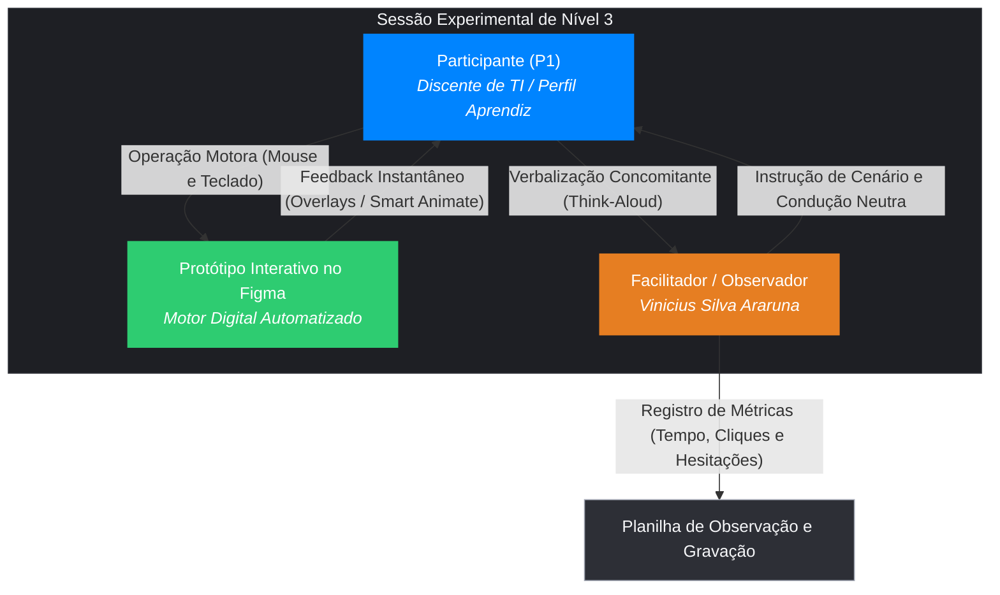

# Planejamento da Avaliação da Prototipação de Alta Fidelidade (Nível 3)

## Tabela de Contribuição e Transparência no Uso de Inteligência Artificial Generativa

A Tabela 1 apresenta a matriz de governança, divisão de atribuições e declaração ética de uso de inteligência artificial generativa na estruturação deste planejamento da avaliação de alta fidelidade no Figma (Nível 3), com detalhamento completo da esteira da Tarefa 1 (Vinicius Silva Araruna) e parametrização modular para acolhimento das Tarefas 2 e 3.

**Tabela 1** — Matriz de Contribuição do Planejamento da Avaliação de Alta Fidelidade

| Integrante | Atribuição no Artefato | Data | Horário | Ferramenta de IA Utilizada | Propósito do Uso de IA |
| :--- | :--- | :---: | :---: | :--- | :--- |
| [Vinicius Silva Araruna](https://github.com/ViniciusA05) | **Autor Principal / Tech Lead**: Estruturação geral pelo Framework DECIDE, fundamentação teórica de alta fidelidade (Mayhew, Rubin & Chisnell, Brooke, Nielsen), definição metodológica dos testes no Figma, roteiro interativo da Tarefa 1, métricas vinculadas ao KLM e Metas de Usabilidade, justificativa matemática amostral de Nielsen & Landauer, TCLE oral de 60s, protocolo do teste-piloto e lista de verificação de 15 itens normativos. | 31/10/2026 | 20:30 - 21:40 | Google Gemini (LLM) | Apoio na estruturação das matrizes Markdown, conferência de hiperligações relativas e validação de referências ABNT. |
| [Gustavo Antonio Rodrigues e Silva](https://github.com/gus-ant) | **Revisor por Par e Coautor**: Revisão da aderência às diretrizes do Guia de Estilo, verificação das métricas psicométricas e alinhamento da estrutura para incorporação da Tarefa 2 (Eventos Presenciais). | 31/10/2026 | 21:15 - 21:45 | Google Gemini (LLM) | Apoio na padronização tabular e conferência dos horários do cronograma planejado. |
| [Edvaldo Soares Brasileiro Filho](https://github.com/PajeMurici-dev) | **Revisor Metodológico**: Checagem de conformidade com os 15 critérios da lista de verificação da técnica e auditoria cruzada por pares. | 31/10/2026 | 21:20 - 21:50 | — | Revisão humana por pares e conferência de consistência. |

_Fonte: Elaborada por Vinicius Silva Araruna, Gustavo Antonio Rodrigues e Silva e Edvaldo Soares Brasileiro Filho, 2026._

---

## 1. Introdução e Contextualização do Nível 3 de Mayhew

No **Ciclo de Vida da Engenharia de Usabilidade de Deborah Mayhew (1999)**, a transição para o **Nível 3 (Design Detalhado e Prototipação Computacional de Alta Fidelidade)** representa o estágio final de refinamento interativo antes da implementação definitiva do produto em código de produção.

Nesta etapa, o projeto abandona a simulação mecânica de pranchas em papel (Nível 2) e ganha materialidade interativa na ferramenta **Figma**, incorporando os tokens cromáticos, espaçamentos, tipografia e comportamentos de microinteração consolidados no [Guia de Estilo](../../analise-requisitos/guia-de-estilo.md). 

Este documento formaliza o **Planejamento da Avaliação Formativa e Somativa do Protótipo de Alta Fidelidade**, estruturado integralmente com base nas seis etapas do **Framework DECIDE** (*Preece et al., 2002; Rogers et al., 2013; Barbosa & Silva, 2021*), parametrizando a execução em campo da equipe sobre o [Fórum Diolinux Plus](https://plus.diolinux.com.br):

1. **Tarefa 1 (`CF01`):** *Criação e Publicação de Tópico de Dúvida com Tags, Formatação Markdown e Integração de IA Semântica de Pré-Envio* (Autoria e Condução: [Vinicius Silva Araruna](https://github.com/ViniciusA05); Persona: *Lucas Mendonça*);
2. **Tarefa 2 (`CF02`):** *Criação e Divulgação de Encontros e Workshops Presenciais da Comunidade com Mapa e Ingressos* (Autoria e Condução: [Gustavo Antonio Rodrigues e Silva](https://github.com/gus-ant); Persona: *Carlos Eduardo*);
3. **Tarefa 3 (`CF03`):** *Grade de Disponibilidade e Agendamento de Dúvidas / Mentorias em Tempo Real* (Autoria e Condução: [Edvaldo Soares Brasileiro Filho](https://github.com/PajeMurici-dev); Persona: *Mariana Costa*).

O artefato atende estritamente às diretrizes da disciplina ministrada pelo Prof. Dr. André Barros de Sales (Universidade de Brasília — Faculdade UnB Gama, 2026.2), preparando o grupo para a condução empírica da **Etapa 7** e a apresentação audiovisual oficial da Entrega 6.

---

## 2. Fundamentação Teórica Canônica

_Autor do Item Teórico: [Vinicius Silva Araruna](https://github.com/ViniciusA05)_

A avaliação empírica de protótipos de alta fidelidade fundamenta-se nos princípios consolidados da Engenharia de Usabilidade e do Teste de Usabilidade de Software:

> *"O teste de usabilidade empírico envolve a observação direta e sistemática de usuários representativos executando tarefas autênticas em um ambiente controlado ou representativo, utilizando um protótipo operacional que simule com precisão o comportamento visual e temporal do sistema, com o objetivo de identificar problemas ergonômicos e mensurar métricas de desempenho e satisfação subjetiva."*  
> — **RUBIN, Jeffrey; CHISNELL, Dana.** *Handbook of Usability Testing: How to Plan, Design, and Conduct Effective Tests*. 2. ed. Indianapolis: Wiley, 2008.

Segundo Barbosa e Silva (2021, p. 252-255) e Mayhew (1999), a prototipação computacional em alta fidelidade no Nível 3 apresenta vantagens determinantes:
1. **Fidelidade Comportamental e Sensorial:** O voluntário interage diretamente com componentes digitais clicáveis em resolução real (*pixel-perfect*), operando botões, campos de digitação simulada, rolagem de página e sobreposições modais (*overlays*), permitindo avaliar a eficácia do contraste cromático no Dark Mode e a precisão da affordance;
2. **Mensuração Temporal Realística:** Ao remover os atrasos mecânicos inerentes à manipulação de papéis por um operador humano, a prototipação no Figma viabiliza a tomada de tempo exata de reação motora e cognitiva do usuário, confrontando o tempo real de execução com as estimativas preditivas do modelo **CMN-GOMS / KLM (Keystroke-Level Model)** elaborado na Etapa 2;
3. **Aferição Psicométrica Padronizada:** A experiência completa de navegação permite a aplicação imediata de instrumentos de satisfação pós-teste cientificamente validados, como o questionário **System Usability Scale (SUS — Brooke, 1996)**.

---

## 3. D — Determinar os Objetivos da Avaliação

A avaliação do protótipo de alta fidelidade combina metas formativas (identificação de barreiras de interação e pontos de hesitação) e metas somativas (mensuração de eficácia, eficiência temporal e satisfação subjetiva padronizada).

### 3.1 Objetivos da Tarefa 1 — Publicação de Dúvida com Markdown e IA (Vinicius Silva Araruna)

1. **Avaliar a Eficácia e Fluidez do Composer em Split-View:** Verificar se o estudante de tecnologia localiza o botão `+ Novo Tópico`, preenche os campos estruturais (Título, Categoria e Tags) e utiliza a visualização lado a lado sem desorientação espacial;
2. **Validar a Affordance do Assistente de Código Markdown:** Testar se o novo botão `</> Bash` com *tooltip* interativo (introduzido como correção do problema `PROB-PP-02` do Nível 2) elimina as dúvidas sobre a sintaxe de crases triplas e syntax highlighting;
3. **Investigar a Transparência e Aceitação da IA Semântica de Pré-Envio:** Avaliar se o modal móvel inteligente é compreendido como um assistente preventivo que recomenda tópicos semelhantes já resolvidos e tags relevantes, verificando se os novos rótulos (*"Aplicar sugestões e publicar"* vs. *"Ignorar sugestões e publicar imediatamente"*, correção do `PROB-PP-03`) garantem plena autonomia de controle;
4. **Verificar a Eficiência da Ação Rápida em Lote:** Medir a percepção e taxa de acionamento do botão *"Adicionar todas as tags sugeridas (+3 tags)"* (correção do `PROB-PP-04`), avaliando a economia de cliques;
5. **Confrontar Desempenho com o Baseline KLM e Metas de Usabilidade:** Medir a taxa de sucesso da tarefa, tempo total de postagem frente ao baseline KLM (`135,3 segundos`) e apurar o índice SUS pós-teste.

### 3.2 Objetivos da Tarefa 2 — Criação de Eventos Presenciais (Gustavo Antonio Rodrigues e Silva)

1. **Avaliar a Descoberta do Hub de Eventos:** Investigar a facilidade de acesso à nova aba de eventos no menu superior;
2. **Validar o Timepicker e o Seletor Espacial no Mapa:** Avaliar a precisão no ajuste de horários e inserção do marcador geográfico do evento;
3. **Aferir a Gestão de Ingressos Comunitários:** Testar o fluxo de configuração de lotes gratuitos para workshops.

### 3.3 Objetivos da Tarefa 3 — Grade de Agendamento e Mentorias (Edvaldo Soares Brasileiro Filho)

1. **Avaliar a Compreensão da Grade Semanal de Horários:** Verificar se a usuária novata compreende a visualização de horários livres;
2. **Testar o Fluxo de Agendamento em Tempo Real:** Avaliar a confirmação de agendamento de dúvida técnica com membros veteranos da comunidade.

---

## 4. E — Explorar as Perguntas Investigativas

Para orientar a observação sistemática durante os ensaios no Figma, elaboraram-se perguntas investigativas associadas aos componentes da interface. A Tabela 2 relaciona as perguntas investigativas formuladas para a avaliação de alta fidelidade da Tarefa 1.

**Tabela 2** — Perguntas Investigativas da Avaliação de Alta Fidelidade (Tarefa 1)

| Código | Dimensão Avaliada | Pergunta Investigativa | Indicador de Observação / Métrica |
| :---: | :--- | :--- | :--- |
| **`PAF01`** | Descoberta e Affordance | O participante localiza de imediato o botão primário `+ Novo Tópico` (`#0084FF`) na barra superior do fórum em Dark Mode? | Tempo até o primeiro clique e ausência de varreduras oculares perdidas na tela. |
| **`PAF02`** | Hierarquia e Navegação | O participante compreende a sequência de preenchimento dos campos (Título, Categoria e Tags) antes de redigir o corpo da dúvida? | Ordem de navegação entre os campos do formulário e resposta aos estados de foco visual. |
| **`PAF03`** | Assistência de Código | O participante percebe e utiliza o novo botão `</> Bash` com *tooltip* contextual para formatar o comando do terminal? | Acionamento voluntário do botão de código e conferência no painel de *live preview*. |
| **`PAF04`** | Transparência da IA | Ao clicar em `Publicar`, o participante compreende com facilidade que o *overlay* da IA Semântica busca prevenir postagens duplicadas? | Verbalização no *Think-Aloud* reconhecendo os links de tópicos similares sugeridos. |
| **`PAF05`** | Eficiência em Lote | O participante identifica e utiliza a opção *"Adicionar todas as tags sugeridas (+3 tags)"* para enriquecer a categorização do tópico? | Escolha da ação em lote frente à adição individual de cada etiqueta. |
| **`PAF06`** | Clareza de Rótulos e Autonomia | O participante compreende sem ambiguidade a diferença entre *"Aplicar sugestões e publicar"* e *"Ignorar sugestões e publicar imediatamente"*? | Hesitação no clique final (< 3 segundos) e sensação de controle sobre a publicação. |
| **`PAF07`** | Segurança e Prevenção | O participante percebe as indicações de persistência de rascunho (*Draft salvo*) e mensagens de validação caso campos obrigatórios fiquem vazios? | Reação frente a campos não preenchidos e tranquilidade quanto à não perda de dados. |
| **`PAF08`** | Confirmação e Satisfação | O participante tem convicção de que o tópico foi publicado com sucesso ao visualizar o Frame final com o tópico renderizado? | Expressão de fechamento da tarefa e avaliação positiva nos itens Likert do SUS. |

_Fonte: Elaborada por Vinicius Silva Araruna, 2026._

---

## 5. C — Escolher os Métodos de Avaliação

### 5.1 Justificativa Científica do Método de Investigação

A escolha metodológica recai sobre o **Teste de Usabilidade Empírico em Ambiente Controlado** (*Rubin & Chisnell, 2008; Barbosa & Silva, 2021, Cap. 11*), conjugado com a técnica de **Verbalização Concomitante (*Think-Aloud Protocol* — Ericsson & Simon, 1993)** e a aplicação pós-teste do questionário **System Usability Scale (SUS — Brooke, 1996)**.

A justificativa científica para este procedimento apoia-se em preceitos metodológicos rigorosos:
1. **Superioridade frente a Métodos Analíticos no Nível 3:** Diferentemente de métodos de inspeção heurística (onde especialistas apenas preveem problemas), o teste empírico com protótipo de alta fidelidade expõe a interface ao comportamento motor e cognitivo real de voluntários autênticos, permitindo mensurar atritos sensoriais reais em telas de alta densidade;
2. **Captação de Processos Cognitivos via *Think-Aloud*:** A solicitação para que o participante expresse seus pensamentos em voz alta durante a navegação revela a interpretação subjetiva dos rótulos e a reação emocional ao disparo do modal inteligente da IA;
3. **Padronização Psicométrica Global:** O questionário SUS fornece uma pontuação comparável de 0 a 100 pontos, permitindo enquadrar o produto em percentis consolidados na literatura internacional de usabilidade (*Bangor, Kortum & Miller, 2009*).

### 5.2 Dinâmica Experimental no Figma e Extinção do "Computador Humano"

A Figura 1 ilustra o fluxo de interação durante a sessão de teste de alta fidelidade no Figma, destacando a separação estrita de papéis e o funcionamento automatizado da plataforma de prototipação.

Como ilustrado na Figura 1, o participante opera diretamente os periféricos (mouse e teclado) para navegar pelas telas do Figma. O motor do Figma responde autonomamente aos cliques, disparando transições de *Smart Animate* e abrindo janelas modais sobrepostas. O avaliador (Vinicius Silva Araruna) atua de forma neutra, registrando métricas em planilha dedicada sem intervir nas decisões do usuário.

---

## 6. I — Identificar e Administrar as Questões Práticas

### 6.1 Perfil e Recrutamento dos Participantes

O recrutamento prioriza discentes universitários que correspondam estritamente ao papel funcional **Estudante / Usuário Aprendiz em Linux** e à persona primária da Tarefa 1 (*Lucas Mendonça*), conforme caracterizado no [Perfil de Usuário](../../analise-requisitos/perfil-usuario.md).

Critérios de inclusão dos participantes:
- Estar regularmente matriculado em curso de graduação da área de Tecnologia da Informação (Engenharia de Software, Ciência da Computação, Engenharia de Redes ou correlatos);
- Utilizar distribuições Linux (como Ubuntu, Linux Mint, Debian ou Fedora) há menos de 2 anos (perfil iniciante a intermediário);
- Já ter vivenciado dúvidas sobre comandos de terminal e gerenciadores de pacotes (`apt`, `dpkg`);
- Não ter participado previamente da confecção das peças do protótipo do projeto.

#### 6.1.1 Justificativa Matemática do Tamanho da Amostra (`n` Participantes)

A definição do número de voluntários para a avaliação formativa apoia-se no modelo matemático binomial assintótico de **Nielsen e Landauer (1993)** e nas diretrizes consolidadas de **Jakob Nielsen (2000)** e **Steve Krug (2014)**:

`Problemas Encontrados = N × [1 − (1 − L)ⁿ]`

onde:
- `N` representa o número total de problemas de usabilidade existentes na interface;
- `L` é a proporção média de problemas identificados por um único avaliador típico (`L ≈ 31%` ou `0,31`);
- `n` é o número de participantes recrutados para o ciclo de teste.

Ao aplicar a equação assintótica:
- Para `n = 1` participante na Tarefa 1 isolada, captura-se aproximadamente **31%** dos problemas ergonômicos mais severos daquele fluxo;
- Para o ciclo consolidado de `n = 3` participantes (distribuídos nas 3 tarefas da equipe), a cobertura agregada alcança **67,2%** dos problemas gerais do sistema;
- Expandindo para `n = 5` participantes em ciclos iterativos subsequentes (Nível 3 completo), atinge-se **84,9%** da totalidade das inconsistências ergonômicas da interface.

Dessa forma, o recrutamento de **`n = 1` participante representativo para a Tarefa 1** (mais 1 participante para a Tarefa 2 e 1 para a Tarefa 3, totalizando `n = 3` participantes ativos no Nível 3 da equipe), acrescido de **`1` participante exclusivo para a execução do Teste-Piloto**, atende com rigor científico à otimização custo-benefício de Engenharia de Usabilidade (*Nielsen, 2000; Krug, 2014*).

### 6.2 Arquitetura de Telas, Componentes e Variantes no Figma (Tarefa 1)

O fluxo interativo da Tarefa 1 no Figma compõe-se de 4 *Frames* principais e 3 *Overlays*, parametrizados integralmente com os tokens hexadecimais do [Guia de Estilo](../../analise-requisitos/guia-de-estilo.md):
- **Frame 01 — *Home Dark Mode Diolinux Plus*:** Superfície de fundo `--secondary` (`#16171B`), cabeçalho superior `--header_background` (`#1E1F24`), listagem de tópicos e botão primário `+ Novo Tópico` com destaque `--tertiary` (`#0084FF`);
- **Frame 02 — *Composer Expandido (Split-View)*:** Editor aberto na porção inferior da tela com campo de Título, menu dropdown de Categorias com busca integrada, seletor de Tags com chips interativos, barra de ferramentas de formatação com o novo botão `</> Bash` com *tooltip* contextual e painel de pré-visualização em tempo real (*live preview*);
- **Overlay 01 — *Modal de IA Semântica de Pré-Envio*:** Janela modal centralizada (`background: #1E1F24`, borda de 1px `#2D2F36` e sombra suave), exibindo lista de 3 tópicos similares já resolvidos no fórum, recomendação de 3 tags técnicas sugeridas pelo modelo semântico e botões de ação:
  - Primário: *"Aplicar sugestões e publicar"* (`#0084FF`);
  - Secundário: *"Ignorar sugestões e publicar imediatamente"* (`#2D2F36`, texto `#F5F6F8`);
  - Ação rápida em lote: *"Adicionar todas as tags sugeridas (+3 tags)"*;
- **Frame 03 — *Tópico Publicado com Sucesso*:** Tela renderizada com a mensagem publicada, cabeçalho de sucesso com badge `#2ECC71`, bloco de código monoespaçado em fonte `IBM Plex Mono` com *syntax highlighting* e tags associadas.

### 6.3 Métricas Quantitativas e Qualitativas Vinculadas às Metas de Usabilidade

A Tabela 3 consolida as métricas objetivas de desempenho que serão coletadas durante os testes da Tarefa 1, estabelecendo a conexão direta com as [Metas de Usabilidade](../../analise-requisitos/metas-de-usabilidade.md) e com o baseline preditivo do modelo **KLM (Keystroke-Level Model)** da Etapa 2 (`135,3 segundos`).

**Tabela 3** — Métricas de Desempenho e Metas de Usabilidade da Tarefa 1 no Figma

| Métrica / Dimensão de IHC | Meta de Usabilidade Associada | Baseline de Referência | Nível Inaceitável | Nível Aceitável | Nível Ideal |
| :--- | :--- | :---: | :---: | :---: | :---: |
| **Taxa de Conclusão da Tarefa (%)** | Eficácia Técnica (Meta P1) | 100% (Esperado) | < 60% | 75% a 85% | ≥ 90% |
| **Tempo Total na Tarefa (segundos)** | Eficiência Operacional (Meta P2) | Baseline KLM: `135,3s` | > 150s | 91s a 140s | ≤ 90s |
| **Tempo de Decisão no Modal de IA (s)** | Eficiência / Controle (Meta P2) | Estimativa: `45s` | > 60s | 31s a 60s | ≤ 30s |
| **Formatação Correta de Código (%)** | Utilidade / Assistência (Meta P3) | 50% (sem botão) | < 70% | 70% a 90% | ≥ 95% |
| **Erros Críticos / Desistências** | Segurança no Uso (Meta P1) | 0 erros críticos | ≥ 1 erro | 0 erros (com hesitação) | 0 erros (fluido) |
| **Escore Global SUS (0 a 100 pontos)** | Satisfação Subjetiva (Brooke, 1996) | Média Global: `68,0` | < 68,0 (D/F) | 68,0 a 79,9 (C/B) | ≥ 80,0 (Grau A) |

_Fonte: Elaborada por Vinicius Silva Araruna, 2026._

Como evidenciado na Tabela 3, o objetivo do protótipo de alta fidelidade é reduzir o tempo de execução do fluxo em relação ao modelo KLM (`135,3 segundos`) para **≤ 90 segundos**, graças à inserção facilitada de snippets de terminal e à seleção de tags em lote.

### 6.4 Infraestrutura, Equipamentos e Orçamento de Custo Zero

A Tabela 4 apresenta o demonstrativo financeiro formal da realização dos ensaios de usabilidade, comprovando a execução com custo financeiro zero (`R$ 0,00`) mediante o aproveitamento exclusivo de infraestrutura institucional e licenças acadêmicas gratuitas.

**Tabela 4** — Demonstrativo Orçamentário da Avaliação de Alta Fidelidade (Tarefa 1)

| Recurso / Equipamento | Finalidade no Teste de Usabilidade | Origem / Modalidade de Acesso | Custo Estimado (R$) |
| :--- | :--- | :--- | :---: |
| **Notebook Dell G15 (Intel Core i7, 16GB RAM)** | Execução do protótipo no Figma e gravação audiovisual da sessão | Equipamento pessoal do pesquisador (Vinicius Silva Araruna) | R$ 0,00 |
| **Software Figma (Plano Figma for Education)** | Criação dos componentes interativos, variantes e visualização do protótipo | Licença acadêmica institucional gratuita (UnB) | R$ 0,00 |
| **Software OBS Studio (v30.0+)** | Captura simultânea da tela em alta resolução (1080p 60fps) e microfone | Software livre e de código aberto (*Open Source*) | R$ 0,00 |
| **Google Drive Institucional / YouTube** | Armazenamento seguro de gravações brutas e hospedagem de vídeo "Não Listado" | Serviços em nuvem gratuitos vinculados à conta discente UnB | R$ 0,00 |
| **Ambiente Físico na FGA/UnB ou Residência** | Realização presencial controlada, sem ruídos e com boa iluminação | Espaço acadêmico / residencial disponível | R$ 0,00 |
| **Total Geral** | — | — | **R$ 0,00** |

_Fonte: Elaborada por Vinicius Silva Araruna, 2026._

### 6.5 Modalidade do Ensaio Experimental

Para conciliar o contato empírico direto com a flexibilidade operacional dos discentes:
- **Modalidade Primária Preferencial:** Condução **presencial** em sala de estudos ou ambiente reservado na FGA/UnB ou residência, utilizando o notebook do pesquisador com o OBS Studio capturando a tela e o áudio da interação;
- **Modalidade de Contingência Metodológica:** Condução **remota síncrona** gravada via plataforma de videoconferência (Microsoft Teams ou Google Meet), na qual o participante compartilha sua tela operando o link público do protótipo interativo do Figma gerado pelo pesquisador.

---

## 7. Cronogramas Planejado e Executado da Avaliação de Alta Fidelidade

Os cronogramas das etapas de planejamento e execução de alta fidelidade estão estritamente alinhados com o [Cronograma Planejado](../../planejamento/cronograma-planejado.md) do projeto.

A Tabela 5 apresenta o planejamento temporal detalhado para a concepção, ensaio piloto e testes empíricos da Tarefa 1 nas Etapas 6 e 7.

**Tabela 5** — Cronograma Planejado das Etapas 6 e 7 (Tarefa 1)

| Atividade / Etapa | Período Planejado | Horário / Janela | Responsável Principal | Revisor / Participante | Local / Ambiente |
| :--- | :---: | :---: | :--- | :--- | :--- |
| **Planejamento da Avaliação e Relato de Nível 3 (Tarefa 1)** | `31/10/2026 a 02/11/2026` | 20:00 - 22:30 | Vinicius Silva Araruna | Edvaldo Soares, Gustavo Antonio | Repositório MkDocs |
| **Entrega Oficial da Etapa 6 no Aprender 3 (23:59)** | `03/11/2026` | Até 23:59 | Vinicius Silva Araruna (PO) | Gustavo Antonio, Edvaldo Soares | Plataforma Aprender 3 |
| **Desenvolvimento dos Componentes e Telas no Figma** | `04/11/2026 a 09/11/2026` | 19:00 - 22:00 | Vinicius Silva Araruna | Revisão Circular 360º | Figma for Education |
| **Execução e Gravação do Teste-Piloto de Alta Fidelidade** | `09/11/2026 a 10/11/2026` | 14:00 - 14:45 | Vinicius Silva Araruna | Edvaldo Soares | OBS Studio + Figma |
| **Condução dos Testes de Usabilidade com Usuário Real (P1)** | `10/11/2026 a 13/11/2026` | 14:00 - 15:00 | Vinicius Silva Araruna (Facilitador) | Participante P1 (Discente TI) | Presencial / FGA |
| **Relato dos Resultados de Alta Fidelidade (DECIDE + SUS)** | `12/11/2026 a 14/11/2026` | 19:00 - 22:00 | Vinicius Silva Araruna | Gustavo Antonio, Edvaldo Soares | Repositório MkDocs |
| **Gravação Oficial da Apresentação da Etapa 7** | `14/11/2026 a 15/11/2026` | 09:00 - 11:30 | Equipe do Grupo 08 | Vinicius Silva Araruna | YouTube (Não Listado) |
| **Ajustes pós-feedback da Etapa 7** | `18/11/2026 a 20/11/2026` | 19:00 - 21:00 | Toda a Equipe | Vinicius Silva Araruna | Repositório MkDocs |

_Fonte: Elaborada por Vinicius Silva Araruna, 2026._

A Tabela 6 documenta a esteira de acompanhamento e o status de execução das atividades de Nível 3.

**Tabela 6** — Cronograma Executado e Esteira de Acompanhamento (Tarefa 1)

| Atividade / Marco | Período de Execução Real | Horário Efetivo | Responsável | Status da Esteira |
| :--- | :---: | :---: | :--- | :---: |
| Concepção do Hub de Nível 3 e Estruturação DECIDE | 31/10/2026 | 20:30 - 21:50 | Vinicius Silva Araruna | 🟢 Concluído |
| Planejamento do Relato de Resultados e Instrumento SUS | 31/10/2026 | 21:50 - 22:30 | Vinicius Silva Araruna | 🟢 Concluído |
| Modelagem dos Componentes e Frames Interativos no Figma | 04/11/2026 a 09/11/2026 | — | Vinicius Silva Araruna | ⚪ Planejado |
| Ensaio de Teste-Piloto de Alta Fidelidade no Figma | 09/11/2026 | — | Vinicius Silva Araruna | ⚪ Planejado |
| Sessão Experimental com Participante P1 e Coleta SUS | 10/11/2026 a 13/11/2026 | — | Vinicius Silva Araruna | ⚪ Planejado |
| Relato Analítico de Usabilidade e Diretrizes de Reprojeto | 12/11/2026 a 14/11/2026 | — | Vinicius Silva Araruna | ⚪ Planejado |

_Fonte: Elaborada por Vinicius Silva Araruna, 2026._

---

## 8. Cenário de Uso, Roteiro de Tarefas no Figma e Instrumento Pós-Teste SUS

### 8.1 Cenário de Uso da Tarefa 1 (Persona Lucas Mendonça)

> *"Você é um estudante de graduação em Engenharia de Software da UnB e usuário iniciante de Linux Mint. Ao tentar instalar o pacote `build-essential` via terminal para uma disciplina de programação, você se deparou com o seguinte erro bloqueante:*  
> `E: Could not get lock /var/lib/dpkg/lock-frontend - open (11: Resource temporarily unavailable)`  
> *Após pesquisar brevemente na documentação oficial e não conseguir solucionar o problema, você acessa o Fórum Diolinux Plus para redigir um tópico pedindo ajuda à comunidade. Sua tarefa consiste em abrir o editor de novo tópico, preencher o título descritivo do problema, selecionar a categoria e tags pertinentes, colar a mensagem de erro formatando-a com o novo botão de bloco de terminal Bash, revisar o preview e prosseguir para publicação, avaliando as sugestões preventivas oferecidas pelo assistente inteligente de pré-envio."*

### 8.2 Roteiro Sequencial de Interação no Protótipo do Figma

1. **Passo 1 (Localização):** Acessar a tela inicial do fórum em Dark Mode e clicar no botão `+ Novo Tópico`;
2. **Passo 2 (Preenchimento Inicial):** No Composer aberto, preencher o campo de título (*"Erro de lock ao rodar apt install no Linux Mint"*), selecionar a categoria *"Iniciantes / Suporte"* e selecionar a primeira tag *"linux-mint"*;
3. **Passo 3 (Inserção de Código Markdown):** Na área de texto, redigir uma breve descrição e acionar o botão dedicado `</> Bash` na barra de ferramentas para inserir o snippet de terminal com a mensagem de erro, verificando a renderização no painel lateral de preview;
4. **Passo 4 (Intervenção da IA de Pré-Envio):** Clicar no botão `Publicar Tópico`. No *overlay* modal aberto pela IA Semântica, examinar os tópicos sugeridos, clicar na opção *"Adicionar todas as tags sugeridas (+3 tags)"* e finalizar clicando em *"Aplicar sugestões e publicar"*;
5. **Passo 5 (Confirmação):** Visualizar a tela final com o tópico publicado e expressar a conclusão da atividade.

### 8.3 Instrumento Psicométrico Pós-Teste: Escala de Usabilidade do Sistema (SUS)

Imediatamente após a conclusão do roteiro prático no Figma, o voluntário responderá individualmente ao questionário **System Usability Scale (SUS — Brooke, 1996)**. A Tabela 7 apresenta os 10 itens padronizados traduzidos e adaptados contextualmente para a avaliação da interface do Fórum Diolinux Plus.

**Tabela 7** — Questionário Psicométrico Pós-Teste (System Usability Scale — SUS)

| Item | Afirmação Avaliada (Escala Likert de 1 a 5) | 1 (Discordo Totalmente) | 2 | 3 | 4 | 5 (Concordo Totalmente) |
| :---: | :--- | :---: | :---: | :---: | :---: | :---: |
| **Q1** | Eu acho que gostaria de utilizar esta interface do fórum com frequência para tirar dúvidas. | [ ] | [ ] | [ ] | [ ] | [ ] |
| **Q2** | Eu achei a interface desnecessariamente complexa para redigir uma publicação. | [ ] | [ ] | [ ] | [ ] | [ ] |
| **Q3** | Eu achei a interface do editor (*Composer*) e o botão de código fáceis de usar. | [ ] | [ ] | [ ] | [ ] | [ ] |
| **Q4** | Eu acho que precisaria da ajuda de uma pessoa técnica para conseguir publicar um tópico com código. | [ ] | [ ] | [ ] | [ ] | [ ] |
| **Q5** | Eu achei que as várias funções (tags, Markdown e modal da IA) estavam bem integradas. | [ ] | [ ] | [ ] | [ ] | [ ] |
| **Q6** | Eu achei que houve muita inconsistência na navegação e nos botões apresentados. | [ ] | [ ] | [ ] | [ ] | [ ] |
| **Q7** | Eu imagino que a maioria das pessoas aprenderia a utilizar esta interface muito rapidamente. | [ ] | [ ] | [ ] | [ ] | [ ] |
| **Q8** | Eu achei a interface muito complicada ou confusa ao sugerir tags e tópicos semelhantes. | [ ] | [ ] | [ ] | [ ] | [ ] |
| **Q9** | Eu me senti muito confiante e no controle ao utilizar a interface e ao decidir a publicação. | [ ] | [ ] | [ ] | [ ] | [ ] |
| **Q10** | Eu precisei aprender muitas coisas novas antes de conseguir completar a tarefa de postagem. | [ ] | [ ] | [ ] | [ ] | [ ] |

_Fonte: Elaborada por Vinicius Silva Araruna com base em Brooke (1996), 2026._

#### Cálculo do Escore SUS em Escala Global (0 a 100 Pontos)

Conforme estabelecido por Brooke (1996), a fórmula matemática para apuração do escore global final utiliza pesos balanceados em UTF-8:

`Pontuação dos Itens Ímpares = Resposta Likert − 1`  
`Pontuação dos Itens Pares = 5 − Resposta Likert`  
`Escore SUS Global = 2,5 × [Σ(Itens Ímpares) + Σ(Itens Pares)]`

O escore final varia entre `0 e 100 pontos`. A meta de qualidade do Grupo 08 para o Nível 3 é obter um **Escore SUS ≥ 80,0 pontos**, correspondente à classificação adjetiva de excelência (Grau A segundo *Bangor, Kortum & Miller, 2009*).

---

## 9. D — Decidir como Lidar com as Questões Éticas

A condução dos testes de usabilidade com seres humanos rege-se pelos preceitos éticos da **Resolução CNS nº 510/2016** do Conselho Nacional de Saúde e pelos **Quatro Princípios Bioéticos de Beauchamp e Childress (2013)**:
1. **Autonomia:** O voluntário participa por livre iniciativa, tendo plena liberdade para interromper o teste ou revogar seu consentimento a qualquer instante, sem qualquer prejuízo acadêmico;
2. **Beneficência:** A pesquisa visa aprimorar ferramentas públicas e abertas de apoio à comunidade acadêmica de software livre;
3. **Não-Maleficência:** O teste não expõe o voluntário a riscos físicos, psicológicos ou situações vexatórias. O avaliador reforça expressamente que o foco da avaliação é a interface computacional, e jamais as habilidades individuais do estudante;
4. **Justiça e Privacidade (LGPD — Lei nº 13.709/2018):** Os dados coletados são tratados de forma estritamente confidencial e desidentificados nos relatórios e tabelas (identificação neutra: *Participante 1 — P1*).

### Script Oral Padronizado de Leitura Prévia do TCLE (Primeiros 60 Segundos Gravados)

Antes de iniciar qualquer pergunta ou ação na interface, o pesquisador deve efetuar a leitura literal do seguinte texto nos primeiros 60 segundos gravados em áudio e vídeo:

> *"Olá! Meu nome é Vinicius Silva Araruna, sou estudante de Engenharia de Software da Universidade de Brasília e estou conduzindo esta avaliação para a disciplina de Interação Humano-Computador. Gostaria de agradecer muito pela sua participação. Antes de começarmos, quero esclarecer que este teste tem como objetivo exclusivo avaliar a usabilidade e a ergonomia de um protótipo interativo de alta fidelidade desenvolvido no Figma para o Fórum Diolinux Plus. Estamos avaliando a interface, e não você. Não existem respostas certas ou erradas, e qualquer dúvida ou dificuldade que você encontrar será uma falha de design do protótipo, e não sua. Sua participação é totalmente voluntária, você pode interromper o teste a qualquer momento se desejar, e seus dados pessoais serão mantidos sob rigoroso sigilo acadêmico em conformidade com a LGPD. Esta sessão está sendo gravada em áudio e vídeo para fins estritamente pedagógicos na UnB. Você concorda livremente em participar deste teste de usabilidade?"*

Após a manifestação verbal afirmativa e explícita do voluntário registrada na gravação, o facilitador introduz o cenário de uso.

---

## 10. Protocolo do Teste-Piloto de Nível 3 (Figma) e Cláusula de Isolamento

O teste-piloto de Nível 3 será realizado entre **09/11/2026 e 10/11/2026**, antecedendo a coleta oficial de dados da Etapa 7. 

O ensaio piloto tem como objetivos técnicos:
1. Validar se todos os *hotspots* clicáveis e ligações de *Smart Animate* do Figma estão respondendo com latência aceitável (< 300ms);
2. Testar o posicionamento do *overlay* da IA Semântica de pré-envio, conferindo se não ocorre corte de elementos visuais em monitores de resoluções distintas;
3. Checar a nitidez da captura de tela e a clareza do áudio capturado no OBS Studio;
4. Cronometrar o tempo de leitura do TCLE e a compreensão das instruções do cenário.

!!! warning "CLÁUSULA METODOLÓGICA DE ISOLAMENTO DOS DADOS DO TESTE-PILOTO"
    Conforme preconizado pela literatura canônica de Interação Humano-Computador (*Barbosa & Silva, 2021, p. 276; Mayhew, 1999; Rubin & Chisnell, 2008*), o teste-piloto tem como função exclusiva avaliar o **planejamento, o ambiente computacional e os instrumentos de coleta**, e **NUNCA** a interface sob teste ou o voluntário. Dessa forma, todos os registros, tempos e notas computados durante o teste-piloto de alta fidelidade são **terminantemente isolados e descartados**, jamais sendo computados na consolidação final dos resultados da Etapa 7.

---

## 11. E — Avaliar, Interpretar e Apresentar os Dados

A análise dos dados coletados na sessão empírica combinará a triangulação metodológica de três fontes:
1. **Métricas Objetivas de Desempenho:** Confrontação da taxa de sucesso de publicação, tempo de execução real versus o baseline do KLM (`135,3 segundos`) e contagem de cliques/hesitações;
2. **Escore Psicométrico SUS:** Tabulação da pontuação de Brooke (1996) em escala percentílica de 0 a 100 pontos, classificando o índice alcançado conforme os graus de Bangor, Kortum e Miller (2009);
3. **Classificação na Escala de Severidade de Jakob Nielsen (1994):** Catalogação de cada inconsistência ergonômica observada nas telas do Figma segundo os quatro níveis canônicos:
   - **0 — Não é um problema:** Não afeta a operação;
   - **1 — Problema Cosmético:** Não prejudica o fluxo (ex: espaçamento de margem);
   - **2 — Problema Menor:** Causa pequena hesitação, mas o usuário recupera-se autonomamente;
   - **3 — Problema Maior:** Dificulta a conclusão da tarefa, gerando grande atraso ou frustração;
   - **4 — Problema Catastrófico:** Impede a conclusão da tarefa ou causa perda irreversível de dados.

Os problemas catalogados subsidiarão a elaboração da matriz de diretrizes finais de reprojeto da interface no Figma durante a Etapa 7.

---

## 12. Lista de Verificação da Técnica (Planejamento da Avaliação de Alta Fidelidade)

A Tabela 8 apresenta a lista de verificação formal elaborada para auditar a conformidade metodológica deste documento perante a literatura canônica e as diretrizes pedagógicas da disciplina.

**Tabela 8** — Lista de Verificação da Técnica (Planejamento da Avaliação de Alta Fidelidade — Nível 3)

| ID | Critério / Questão Normativa Avaliada | Origem / Fonte Normativa | Conforme? | Justificativa e Local da Evidência no Documento |
| :---: | :--- | :--- | :---: | :--- |
| **01** | O planejamento adota integralmente as 6 etapas estruturais do Framework DECIDE? | Preece et al. (2002); Barbosa & Silva (2021, p. 280) | **Sim** | O documento está organizado nas seções 3 (D), 4 (E), 5 (C), 6 (I), 9 (D) e 11 (E). |
| **02** | Há fundamentação teórica canônica diferenciando o Nível 2 (Papel) do Nível 3 (Figma)? | Mayhew (1999); Rubin & Chisnell (2008); Barbosa & Silva (2021) | **Sim** | Detalhado na Seção 2, explicitando a extinção do Computador Humano e a adoção do motor digital do Figma. |
| **03** | Contém linha explícita de autoria do item teórico com hiperligação funcional? | Diretrizes Pedagógicas FGA/UnB (*Sales, 2026*) | **Sim** | Presente na abertura da Seção 2 com link para o perfil do autor no GitHub. |
| **04** | Apresenta perguntas investigativas objetivas e associadas aos componentes da tela? | Barbosa & Silva (2021, p. 280); Rogers et al. (2013) | **Sim** | Tabela 2 relaciona as perguntas investigativas `PAF01` a `PAF08` da Tarefa 1. |
| **05** | Justifica cientificamente a escolha do teste empírico e protocolo *Think-Aloud*? | Rubin & Chisnell (2008); Ericsson & Simon (1993) | **Sim** | Fundamentado na Seção 5.1 e ilustrado no diagrama da Figura 1. |
| **06** | Contém justificativa matemática do tamanho da amostra (`n` participantes)? | Nielsen & Landauer (1993); Nielsen (2000); Krug (2014) | **Sim** | Equação binomial assintótica descrita em UTF-8 na Seção 6.1.1. |
| **07** | Detalha a arquitetura de telas no Figma vinculada aos tokens do Guia de Estilo? | Guia de Estilo da Equipe; Mayhew (1999) | **Sim** | Seção 6.2 detalha os 4 frames e 3 overlays com seus códigos hexadecimais (`#16171B`, `#1E1F24`, `#0084FF`). |
| **08** | Define métricas de desempenho amarradas às Metas de Usabilidade e ao baseline KLM? | Nielsen (1994); Metas de Usabilidade da Equipe; KLM (Etapa 2) | **Sim** | Tabela 3 estabelece metas de tempo (≤ 90s vs KLM `135,3s`), taxa de conclusão e erros. |
| **09** | Apresenta demonstrativo orçamentário formal comprovando custo financeiro zero? | Diretrizes de Gestão Pública FGA/UnB (*Sales, 2026*) | **Sim** | Tabela 4 discrimina equipamentos e licenças gratuitas totalizando `R$ 0,00`. |
| **10** | Apresenta cronogramas planejado e executado sincronizados com o cronograma geral? | Cronograma Planejado do Grupo 08 (*Sales, 2026*) | **Sim** | Tabelas 5 e 6 com datas exatas das Etapas 6 e 7 sincronizadas com o planejamento oficial. |
| **11** | Inclui instrumento psicométrico pós-teste validado (SUS) e fórmula de cálculo? | Brooke (1996); Bangor, Kortum & Miller (2009) | **Sim** | Tabela 7 detalha os 10 itens Likert e a fórmula de apuração ponderada em UTF-8. |
| **12** | Transcreve o Script Oral Literal de leitura do TCLE para os primeiros 60 segundos? | Resolução CNS nº 510/2016; Beauchamp & Childress (2013) | **Sim** | Transcrição literal destacada em bloco de citação na Seção 9. |
| **13** | Prevê protocolo formal de teste-piloto com cláusula expressa de isolamento dos dados? | Barbosa & Silva (2021, p. 276); Mayhew (1999) | **Sim** | Seção 10 contém procedimentos e caixa de destaque formalizando o descarte de dados do piloto. |
| **14** | Prevê matriz de classificação de severidade de problemas de usabilidade? | Nielsen (1994); Barbosa & Silva (2021, p. 280) | **Sim** | Seção 11 parametriza a escala de severidade de 0 a 4 de Jakob Nielsen. |
| **15** | O documento possui chamada explícita para 100% das tabelas e figuras no texto? | Diretrizes Pedagógicas FGA/UnB (*Sales, 2026*) | **Sim** | Todas as Tabelas (1 a 9) e a Figura 1 são referenciadas no parágrafo antecedente. |

_Fonte: Elaborada por Vinicius Silva Araruna, 2026._

---

## 13. Histórico de Versão

A Tabela 9 apresenta o histórico de revisões e atualizações deste documento.

**Tabela 9** — Histórico de Versão do Planejamento da Avaliação de Alta Fidelidade

| Versão | Data | Descrição da Alteração | Autor(es) | Revisor(es) |
| :---: | :---: | :--- | :--- | :--- |
| `1.0` | 31/10/2026 | Elaboração inicial do Planejamento da Avaliação de Alta Fidelidade (Nível 3 — Figma): Framework DECIDE completo, fundamentação de Mayhew e Rubin & Chisnell, 8 perguntas investigativas da Tarefa 1, métricas frente ao KLM (`135,3s`), justificativa amostral de Nielsen & Landauer, instrumento SUS de 10 itens, TCLE oral de 60s, protocolo do teste-piloto e checklist de 15 itens normativos. | [Vinicius Silva Araruna](https://github.com/ViniciusA05) | [Gustavo Antonio](https://github.com/gus-ant), [Edvaldo Soares](https://github.com/PajeMurici-dev) |

_Fonte: Elaborada por Vinicius Silva Araruna, 2026._

---

## 14. Referências Bibliográficas

[1] BANGOR, Aaron; KORTUM, Philip; MILLER, James. Determining what individual SUS scores mean: Adding an adjective rating scale. *Journal of Usability Studies*, v. 4, n. 3, p. 114–123, 2009.

[2] BARBOSA, Simone Diniz Junqueira; SILVA, Bruno Santana da. *Interação Humano-Computador*. 1. ed. Rio de Janeiro: Elsevier, 2010.

[3] BEAUCHAMP, Tom L.; CHILDRESS, James F. *Principles of Biomedical Ethics*. 7. ed. New York: Oxford University Press, 2013.

[4] BROOKE, John. SUS: A 'quick and dirty' usability scale. In: JORDAN, P. W. et al. (Ed.). *Usability Evaluation in Industry*. London: Taylor & Francis, 1996. p. 189–194.

[5] ERICSSON, K. Anders; SIMON, Herbert A. *Protocol Analysis: Verbal Reports as Data*. Cambridge: MIT Press, 1993.

[6] KRUG, Steve. *Não Me Faça Pensar, Atualizado: Uma Abordagem de Bom Senso à Usabilidade na Web e Mobile*. 3. ed. Rio de Janeiro: Alta Books, 2014.

[7] MAYHEW, Deborah J. *The Usability Engineering Lifecycle: A Practitioner's Handbook for User Interface Design*. San Francisco: Morgan Kaufmann, 1999.

[8] NIELSEN, Jakob; LANDAUER, Thomas K. A mathematical model of the finding of usability problems. In: *Proceedings of the INTERACT '93 and CHI '93 Conference on Human Factors in Computing Systems*. New York: ACM, 1993. p. 206–213.

[9] NIELSEN, Jakob. *Usability Engineering*. San Francisco: Morgan Kaufmann, 1994.

[10] NIELSEN, Jakob. Why you only need to test with 5 users. *Nielsen Norman Group*, 2000. Disponível em: <https://www.nngroup.com/articles/why-you-only-need-to-test-with-5-users/>. Acesso em: 31 out. 2026.

[11] PREECE, Jennifer; ROGERS, Yvonne; SHARP, Helen. *Interaction Design: Beyond Human-Computer Interaction*. New York: John Wiley & Sons, 2002.

[12] ROGERS, Yvonne; SHARP, Helen; PREECE, Jennifer. *Design de Interação: Além da Interação Humano-Computador*. 3. ed. Porto Alegre: Bookman, 2013.

[13] RUBIN, Jeffrey; CHISNELL, Dana. *Handbook of Usability Testing: How to Plan, Design, and Conduct Effective Tests*. 2. ed. Indianapolis: Wiley, 2008.

[14] SALES, André Barros de. *Plano de Ensino da Disciplina de Interação Humano Computador*. Brasília: Universidade de Brasília, Faculdade UnB Gama, 2026.

---

## 15. Agradecimentos e Uso de Inteligência Artificial (IA) Generativa

Em conformidade com as diretrizes de integridade e transparência acadêmica da Universidade de Brasília e do Prof. Dr. André Barros de Sales, registra-se que este artefato utilizou a assistência do modelo de linguagem em larga escala **Google Gemini** (Gemini 1.5 Pro). A ferramenta foi empregada estritamente para suporte na formatação de matrizes tabulares no formato Markdown, conferência de hiperligações relativas internas e revisão de citações bibliográficas no padrão ABNT NBR 6023:2018. Todos os dados técnicos, decisões metodológicas, equações matemáticas, perguntas investigativas e o texto conceitual foram integralmente produzidos, revisados e auditados pelos membros discentes do Grupo 08.
