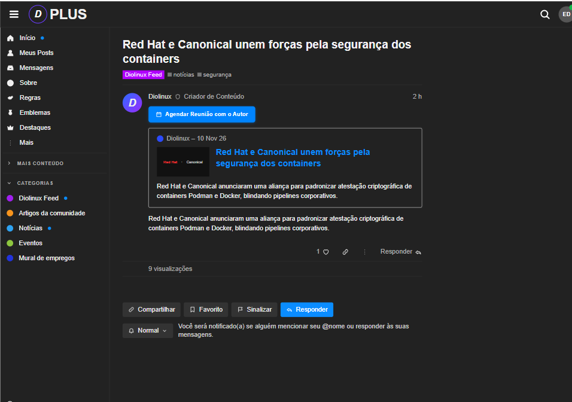
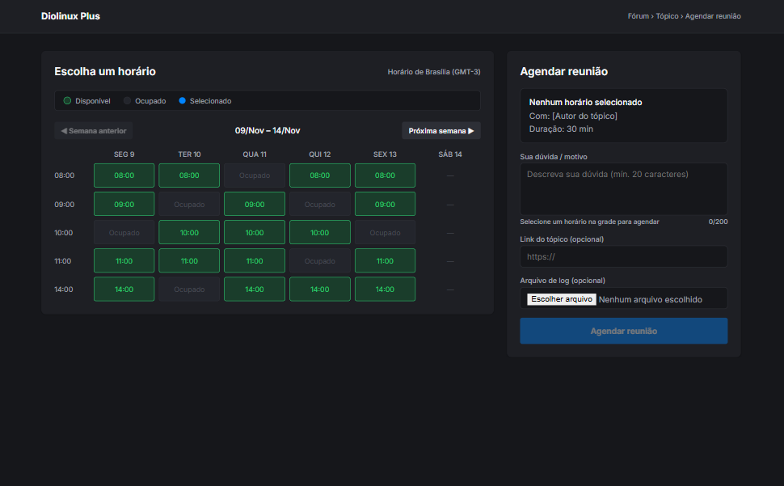
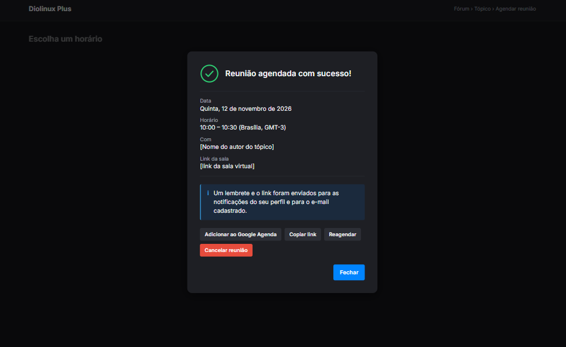
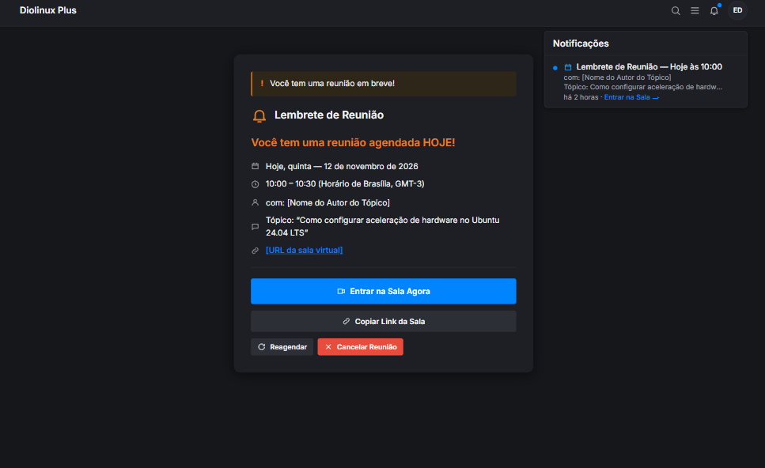

# Protótipo de Alta Fidelidade — Tarefa 3 (Agendamento de Horários)

## Tabela de Contribuição e Declaração Ética de IA Generativa

A Tabela 1 apresenta a matriz de governança, responsabilidade autoral e declaração ética de uso de inteligência artificial generativa na concepção e especificação técnica do protótipo de alta fidelidade da Tarefa 3.

**Tabela 1** — Matriz de Contribuição e Uso de IA Generativa da Tarefa 3

| Integrante | Atribuição no Artefato | Data | Horário | Ferramenta de IA Utilizada | Propósito do Uso de IA |
| :--- | :--- | :---: | :---: | :--- | :--- |
| [Edvaldo Soares Brasileiro Filho](https://github.com/PajeMurici-dev) | **Autor Principal / Designer**: Concepção e estruturação do protótipo de alta fidelidade no **Claude Design (Anthropic)** com assistência do Claude, aplicação dos tokens do Guia de Estilo em Dark Mode, resolução das diretrizes herdadas do protótipo de papel (PROB-PP3-01 a 05), especificação das 4 telas canônicas e redação técnica. | 14/11/2026 | 14:00 - 18:30 | Claude Design (Anthropic) e Claude (LLM) | Geração computacional dos componentes de interface no Claude Design e auxílio na estruturação sintática do documento Markdown. |
| [Vinicius Silva Araruna](https://github.com/ViniciusA05) | **Revisor por Par**: Auditoria de conformidade com a lista de verificação da técnica, conferência de hiperlinks e validação do fluxo interativo no Claude Design. | 14/11/2026 | 19:00 - 19:35 | — | Revisão humana por pares e checagem de consistência visual. |
| [Gustavo Antonio Rodrigues e Silva](https://github.com/gus-ant) | **Revisor por Par**: Conferência de consistência metodológica frente ao Plano de Ensino da disciplina e checagem dos tokens do Guia de Estilo. | 14/11/2026 | 19:40 - 20:15 | — | Revisão humana por pares e auditoria cruzada. |

_Fonte: Elaborada por Edvaldo Soares Brasileiro Filho, Gustavo Antonio Rodrigues e Silva e Vinicius Silva Araruna, 2026._

---

## 1. Introdução e Enquadramento no Nível 3 de Deborah Mayhew (1999)

_Autor do Item Teórico: [Edvaldo Soares Brasileiro Filho](https://github.com/PajeMurici-dev)_

No **Ciclo de Vida da Engenharia de Usabilidade de Deborah Mayhew (1999)**, o **Nível 3 (Design Detalhado e Prototipação de Alta Fidelidade)** constitui o estágio em que as diretrizes ergonômicas validadas nos níveis anteriores se materializam em uma interface computacional completa (*pixel-perfect*), refletindo com exatidão a identidade visual, as microinterações e o comportamento esperado no sistema final.

Para a **Tarefa 3 (`CF03`) — Agendamento de Horários com Autores de Tópicos (Mentorias e Dúvidas Técnicas)** no [Fórum Diolinux Plus](https://plus.diolinux.com.br), o protótipo de alta fidelidade foi desenvolvido no ambiente **Claude Design (Anthropic)** com assistência direta do modelo de inteligência artificial Claude, aplicando de forma estrita o [Guia de Estilo](../../analise-requisitos/guia-de-estilo.md) e a atmosfera da plataforma Discourse em modo noturno (*Dark Mode*).

Conforme estabelecido por **Barbosa e Silva (2021, p. 252–255)** e **Rubin e Chisnell (2008)**, a transição do protótipo de papel para a alta fidelidade computacional assegura três avanços metodológicos primordiais:

1. **Extinção do "Computador Humano":** A alternância mecânica de cartões e pranchas físicas operada por um membro da equipe no Nível 2 (*Snyder, 2003*) é inteiramente substituída pela autonomia interativa do software. O protótipo digital processa com latência nula os cliques em botões, seleção de horários na grade, exibição de modais sobrepostos e transições de tela;
2. **Fidelidade Sensorial e Ergonômica:** Os componentes utilizam a escala tipográfica oficial (`Inter` e `JetBrains Mono`), contraste de cores validado pela WCAG 2.1 e alinhamento em grid modular de 8px;
3. **Mensuração Temporal e Comportamental Confiável:** Viabiliza cronometrar com precisão a execução das tarefas por participantes voluntários, permitindo identificar hesitações motoras e cognitivas reais antes da implementação em código de produção.

---

## 2. Design System e Tokens Aplicados no Protótipo da Tarefa 3

O protótipo de alta fidelidade da Tarefa 3 incorpora os tokens definidos no [Guia de Estilo](../../analise-requisitos/guia-de-estilo.md) do projeto, adaptados para o fluxo de agendamento de mentorias. A Tabela 2 sintetiza os principais tokens aplicados.

**Tabela 2** — Tokens Visuais e Cromáticos Aplicados no Protótipo de Alta Fidelidade (Tarefa 3)

| Categoria do Token | Token Claude Design / CSS | Código Hexadecimal | Finalidade no Protótipo da Tarefa 3 | Nível de Contraste (WCAG 2.1) |
| :--- | :--- | :---: | :--- | :---: |
| **Superfície Base** | `--surface-bg-base` | `#16171B` | Fundo principal da página do tópico e da grade | Base neutra escura |
| **Superfície Card** | `--surface-bg-card` | `#1E1F24` | Fundo do cabeçalho, cards, modais e containers | Superfície de elevação |
| **Destaque Primário** | `--accent-primary` | `#0084FF` | Botão "Agendar Reunião", slots selecionados e links | 5.1:1 sobre `#1E1F24` (Nível AA) |
| **Hover Primário** | `--accent-hover` | `#006ED4` | Estado hover de botões primários e slots | Transição interativa |
| **Texto Principal** | `--text-high` | `#F5F6F8` | Títulos, cabeçalhos do post e textos em destaque | 13.8:1 sobre `#1E1F24` (Nível AAA) |
| **Texto Muted** | `--text-muted` | `#A0A5B1` | Legendas, timestamps, metadados e fuso horário | 5.8:1 sobre `#1E1F24` (Nível AA) |
| **Slot Disponível (BG)** | `--schedule-available-bg` | `#1A3D2B` | Fundo suave de horários livres para reserva | Distinção semântica positiva |
| **Slot Disponível (Border)** | `--schedule-available-border` | `#2ECC71` | Borda verde destacando disponibilidade | Feedback visual imediato |
| **Slot Ocupado (BG)** | `--schedule-booked-bg` | `#23252C` | Horários previamente reservados (desabilitados) | Estado neutro desabilitado |
| **Slot Ocupado (Text)** | `--schedule-booked-text` | `#4A4D57` | Rótulo de horário reservado com baixo contraste | Inibição de affordance |
| **Bordas e Divisores** | `--border-default` | `#2D2F36` | Contornos de formulários, inputs e separadores | AA para componentes de UI |

_Fonte: Elaborada por Edvaldo Soares Brasileiro Filho, 2026._

---

## 3. Rastreabilidade Metodológica: Diretrizes de Reprojeto do Nível 2

Conforme registrado no [Relato dos Resultados do Protótipo de Papel](../nivel-2/prototipo-papel/relato-resultados-agendamento.md), a avaliação formativa com usuários voluntários no Nível 2 apontou cinco oportunidades de aprimoramento ergonômico (`PROB-PP3-01` a `PROB-PP3-05`). 

A Tabela 3 documenta como cada uma dessas diretrizes foi convertida em solução interativa de alta fidelidade no Claude Design.

**Tabela 3** — Rastreabilidade entre os Problemas do Papel e as Soluções de Alta Fidelidade

| ID no Papel | Apontamento no Protótipo de Papel (Nível 2) | Severidade (Nielsen) | Solução Implementada no Protótipo de Alta Fidelidade (Claude Design) | Componente Afetado |
| :---: | :--- | :---: | :--- | :--- |
| **`PROB-PP3-01`** | Falta de identificação clara do fuso horário na grade semanal, gerando dúvida sobre horários de atendimento (*P1*). | **1 (Cosmético)** | Inserção permanente de rótulo explícito no cabeçalho superior esquerdo da grade: *"Horário de Brasília (GMT-3)"*. | Cabeçalho da Grade (`T3_F02`) |
| **`PROB-PP3-02`** | Ausência de legenda gráfica permanente diferenciando horários livres e ocupados (*P2*). | **2 (Menor)** | Adição de barra de legenda fixa no topo da grade: 🟢 *Disponível*, ⬜ *Reservado* e 🔵 *Selecionado*, visível em tempo integral. | Barra de Legenda (`T3_F02`) |
| **`PROB-PP3-03`** | Falta de campo para anexar arquivos de log ou prints de erro e ausência de limite sugerido no formulário (*P3*). | **2 (Menor)** | Campo de texto longo com contador visível de até 200 caracteres e campo opcional para anexar link de tópico ou arquivo de log. | Formulário de Motivo (`T3_F03`) |
| **`PROB-PP3-04`** | Incerteza do participante quanto ao canal de recebimento do link da sala e lembretes da reunião (*P1, P2*). | **2 (Menor)** | Mensagem informativa em destaque no modal de confirmação: *"Um lembrete e o link de acesso foram enviados para as notificações do seu perfil e e-mail cadastrado"*. | Confirmação e Instruções (`T3_F04`) |
| **`PROB-PP3-05`** | Desejo de opções imediatas para adicionar a reunião ao calendário e ações de reagendamento/cancelamento (*P3*). | **2 (Menor)** | Botões integrados *"Adicionar ao Google Agenda"*, *"Copiar Link"*, *"Reagendar Horário"* e *"Cancelar Reunião"*. | Confirmação e Gestão (`T3_F04`) |

_Fonte: Elaborada por Edvaldo Soares Brasileiro Filho, 2026._

---

## 4. Mapeamento Estrutural das 4 Telas do Protótipo

O protótipo de alta fidelidade da Tarefa 3 estrutura-se em **4 telas canônicas integradas**, desenhadas no Claude Design, articulando de ponta a ponta a jornada de agendamento:

### 4.1 Tela 1: Página do Tópico com Botão de Agendamento (`T3_F01`)

Esta prancha representa a página oficial de um tópico de suporte no Fórum Diolinux Plus. O cabeçalho global do fórum (com busca, sino de notificações e avatar) é reproduzido com precisão. Ao final da resposta técnica do autor especialista, é inserido o **ponto de entrada de agendamento**: o botão primário destacado *"📅 Agendar Reunião com o Autor"*.

<strong>Figura 1</strong> — Protótipo de Alta Fidelidade no Claude Design: Página do tópico com o botão destacado de agendamento com o autor especialista (<code>T3_F01</code>). <em>Fonte: Elaborada por Edvaldo Soares Brasileiro Filho, 2026.</em>

---

### 4.2 Tela 2: Grade Semanal de Horários Disponíveis (`T3_F02`)

Ao clicar no botão de agendamento, abre-se a interface de calendário semanal em colunas diárias (Segunda a Sábado). A tela contempla o seletor de semanas (*"◀ Semana Anterior / Próxima Semana ▶"*), a sinalização explícita de fuso horário (*Horário de Brasília, GMT-3*), a legenda visual permanente e os blocos de horário com estados visuais claros para slots livres, ocupados e selecionados.

<strong>Figura 2</strong> — Protótipo de Alta Fidelidade no Claude Design: Grade semanal de horários com legenda visual, fuso de Brasília e slots selecionáveis (<code>T3_F02</code>). <em>Fonte: Elaborada por Edvaldo Soares Brasileiro Filho, 2026.</em>

---

### 4.3 Tela 3: Confirmação do Agendamento (`T3_F03`)

Tela de confirmação imediata exibida após a seleção do horário na grade. Apresenta o feedback com ícone de sucesso em verde (`#2ECC71`), o resumo completo dos dados da mentoria (mentor especialista, data, horário e fuso), o link direto para a sala virtual, aviso sobre o envio do link por e-mail e notificações internas, botões rápidos de integração (*"Adicionar ao Google Agenda"* e *"Copiar Link da Sala"*), além dos botões secundários para reagendar ou cancelar a reunião caso necessário.

<strong>Figura 3</strong> — Protótipo de Alta Fidelidade no Claude Design: Tela de confirmação com resumo, link da sala, aviso de confirmação e botões de integração de calendário (<code>T3_F03</code>). <em>Fonte: Elaborada por Edvaldo Soares Brasileiro Filho, 2026.</em>

---

### 4.4 Tela 4: Lembrete da Reunião no Dia (`T3_F04`)

Simulação da experiência do usuário no dia marcado para a mentoria técnica. A tela documenta a notificação visual no sino do cabeçalho do Diolinux Plus com ponto de não lida e o card detalhado de lembrete contendo o aviso em destaque *"Você tem uma reunião agendada HOJE!"*, horário em fuso de Brasília (*GMT-3*), botão primário *"🎥 Entrar na Sala Agora"* e opções rápidas de cópia de link ou reagendamento prévio.

<strong>Figura 4</strong> — Protótipo de Alta Fidelidade no Claude Design: Notificação e tela com o lembrete da reunião no dia com acesso direto à sala virtual (<code>T3_F04</code>). <em>Fonte: Elaborada por Edvaldo Soares Brasileiro Filho, 2026.</em>

---

### 4.5 Proposta de Reprojeto: Aumento do Tamanho de Fontes e Visibilidade (`T3_F05`)

Em resposta ao feedback colhido com o **Participante 3 (P3)** durante as sessões empíricas de avaliação de alta fidelidade — que sugeriu **aumentar o tamanho das fontes e legendas para aprimorar a legibilidade e o conforto visual** —, foi elaborada uma variação ergonômica ajustando o corpo tipográfico das legendas secundárias de `13px` para `15px` e dos rótulos de slots de `12px` para `14px`, aumentando a área de clique para `48px`.

<strong>Figura 5</strong> — Proposta de Reprojeto ergonômico: Escala tipográfica ampliada nas legendas e horários para otimizar legibilidade visual (<code>T3_F05</code>). <em>Fonte: Elaborada por Edvaldo Soares Brasileiro Filho, 2026.</em>

---

## 5. Lista de Verificação da Técnica (Protótipo de Alta Fidelidade)

A Tabela 4 sintetiza a autoavaliação da conformidade metodológica do artefato de prototipação de alta fidelidade da Tarefa 3.

**Tabela 4** — Lista de Verificação: Protótipo de Alta Fidelidade (Tarefa 3)

| Nº | Critério Normativo Avaliado | Fonte de Referência | Status | Evidência no Documento |
| :---: | :--- | :--- | :---: | :--- |
| **01** | O protótipo se enquadra conceitualmente no Nível 3 de Mayhew? | Mayhew (1999); Barbosa & Silva (2021) | ✅ Sim | Seção 1 estabelece os diferenciais do Nível 3 e a extinção do Computador Humano. |
| **02** | Há especificação detalhada dos tokens cromáticos e tipográficos? | Guia de Estilo (Etapa 3); WCAG 2.1 | ✅ Sim | A Tabela 2 discrimina tokens de superfície, destaque, textos e slots com razões WCAG. |
| **03** | O artefato apresenta rastreabilidade com os problemas do Nível 2? | Mayhew (1999) | ✅ Sim | A Tabela 3 correlaciona `PROB-PP3-01` a `05` com as soluções no Claude Design. |
| **04** | Há especificação das 4 telas canônicas do fluxo da Tarefa 3 com imagens? | Snyder (2003); Rubin & Chisnell (2008) | ✅ Sim | A Seção 4 detalha as 4 telas canônicas (`T3_F01` a `T3_F04`) com imagens ilustrativas. |
| **05** | O ponto de entrada no tópico original do fórum foi mantido fielmente? | Discourse UI; Sales (2026) | ✅ Sim | A Subseção 4.1 (`T3_F01`) descreve o layout nativo do Diolinux Plus com o novo botão. |
| **06** | A ferramenta de desenvolvimento está explicitada conforme a execução real? | Padrão FGA/UnB | ✅ Sim | Documentado como desenvolvido no Claude Design com assistência do Claude. |
| **07** | O artefato prevê o endereçamento dos apontamentos pós-avaliação? | Nielsen (1994) | ✅ Sim | A Subseção 4.5 apresenta a proposta de reprojeto com ampliação da escala tipográfica. |
| **08** | Há declaração formal de autoria e uso ético de IA Generativa? | Código da SBC (Art. 2º); Sales (2026) | ✅ Sim | A Tabela 1 e a seção final documentam o escopo transparente de assistência da IA. |

_Fonte: Elaborada por Edvaldo Soares Brasileiro Filho com base em Barbosa e Silva (2021) e Sales (2026), 2026._

---

## 6. Histórico de Versão

A Tabela 5 documenta a evolução histórica das versões deste documento.

**Tabela 5** — Histórico de Versão do Documento

| Versão | Data | Descrição Detalhada da Modificação | Autor(es) | Revisor(es) |
| :---: | :---: | :--- | :--- | :--- |
| `1.0` | 14/11/2026 | Elaboração inicial da especificação técnica do Protótipo de Alta Fidelidade da Tarefa 3 (Agendamento de Horários com Autores de Tópicos), detalhando os tokens do Guia de Estilo, rastreabilidade dos problemas do protótipo de papel (PROB-PP3-01 a 05), especificação das 4 telas canônicas no Claude Design (T3_F01 a T3_F04), incorporação da proposta de reprojeto para ajuste de fontes (T3_F05) e checklist de conformidade. | [Edvaldo Soares Brasileiro Filho](https://github.com/PajeMurici-dev) | [Vinicius Silva Araruna](https://github.com/ViniciusA05), [Gustavo Antonio Rodrigues e Silva](https://github.com/gus-ant) |

_Fonte: Elaborada por Edvaldo Soares Brasileiro Filho, Gustavo Antonio Rodrigues e Silva e Vinicius Silva Araruna, 2026._

---

## 7. Referências Bibliográficas (ABNT)

- BARBOSA, Simone Diniz Junqueira; SILVA, Bruno Santana da; SILVEIRA, Milene Selbach; GASPARINI, Isabela; DARIN, Ticianne; BARBOSA, Gabriel Diniz Junqueira. *Interação Humano-Computador e Experiência do Usuário*. Rio de Janeiro: Autopublicação, 2021. ISBN 978-65-00-19677-1. (Capítulo 10: Prototipação; Capítulo 11: Avaliação de IHC).
- MAYHEW, Deborah J. *The Usability Engineering Lifecycle: a practitioner's handbook for user interface design*. San Francisco: Morgan Kaufmann Publishers, 1999.
- NIELSEN, Jakob. *Usability Engineering*. San Francisco: Morgan Kaufmann Publishers, 1994.
- RUBIN, Jeffrey; CHISNELL, Dana. *Handbook of Usability Testing: How to Plan, Design, and Conduct Effective Tests*. 2. ed. Indianapolis: Wiley Publishing, 2008.
- SALES, André Barros de. *Plano de Ensino da Disciplina de Interação Humano Computador*. Brasília: Universidade de Brasília, Faculdade UnB Gama (FGA), 2026.
- SNYDER, Carolyn. *Paper Prototyping: The Fast and Easy Way to Design and Refine User Interfaces*. San Francisco: Morgan Kaufmann Publishers, 2003.
- W3C. *Web Content Accessibility Guidelines (WCAG) 2.1*. World Wide Web Consortium, 2018. Disponível em: <https://www.w3.org/TR/WCAG21/>.

---

## 8. Agradecimentos e Declaração de Uso de IA Generativa

Em cumprimento às diretrizes éticas da Sociedade Brasileira de Computação (SBC) e às normas do Plano de Ensino da disciplina (Sales, 2026), declara-se que durante a elaboração deste artefato foram utilizados recursos de Inteligência Artificial Generativa (Claude Design da Anthropic e Claude LLM) para concepção visual dos componentes de interface e auxílio na estruturação sintática das matrizes Markdown. Todo o projeto gráfico, formulação dos fluxos e validação ergonômica foram concebidos, auditados e validados integralmente pelos autores humanos listados no Histórico de Versão.
