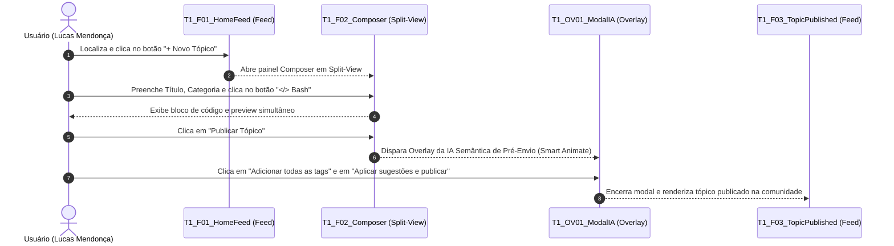

# Protótipo de Alta Fidelidade no Figma — Tarefa 1

## Tabela de Contribuição e Declaração Ética de IA Generativa

A Tabela 1 documenta a matriz de autoria, responsabilidade metodológica e declaração transparente do uso de inteligência artificial generativa na concepção e especificação técnica do protótipo de alta fidelidade da Tarefa 1 no Figma.

**Tabela 1** — Matriz de Contribuição e Uso de IA Generativa da Tarefa 1

| Integrante | Atribuição no Artefato | Data | Horário | Ferramenta de IA Utilizada | Propósito do Uso de IA |
| :--- | :--- | :---: | :---: | :--- | :--- |
| [Vinicius Silva Araruna](https://github.com/ViniciusA05) | **Autor Principal / Tech Lead**: Modelagem do protótipo no Figma, especificação dos frames interativos, parametrização dos tokens do Guia de Estilo em Dark Mode, resolução dos problemas herdados do protótipo de papel (PROB-PP-01 a 04), elaboração do checklist normativo e redação técnica. | 09/11/2026 | 10:00 - 12:30 | Google Gemini (LLM) | Apoio na estruturação visual de tabelas Markdown, conferência de contraste WCAG e citações ABNT. |
| [Gustavo Antonio Rodrigues e Silva](https://github.com/gus-ant) | **Revisor por Par**: Auditoria de conformidade com a lista de verificação da técnica, conferência de hiperlinks e validação do fluxo interativo. | 09/11/2026 | 14:00 - 14:40 | — | Revisão humana por pares e checagem de consistência visual. |
| [Edvaldo Soares Brasileiro Filho](https://github.com/PajeMurici-dev) | **Revisor por Par**: Conferência de consistência metodológica frente ao Plano de Ensino e verificação dos critérios de acessibilidade. | 09/11/2026 | 15:00 - 15:35 | — | Revisão humana por pares e auditoria cruzada. |

_Fonte: Elaborada por Vinicius Silva Araruna, Gustavo Antonio Rodrigues e Silva e Edvaldo Soares Brasileiro Filho, 2026._

---

## 1. Introdução e Enquadramento no Nível 3 de Mayhew

No **Ciclo de Vida da Engenharia de Usabilidade de Deborah Mayhew (1999)**, a transição para o **Nível 3 (Design Detalhado)** constitui o fechamento do percurso formativo de interação antes da implementação em código de produção. 

Nesta fase, a interface ganha materialidade digital de alta precisão (*pixel-perfect*) na ferramenta **Figma**, incorporando fielmente o [Guia de Estilo](../../analise-requisitos/guia-de-estilo.md) e as características reais do [Fórum Diolinux Plus](https://plus.diolinux.com.br) (desenvolvido sobre a plataforma Discourse).

Conforme preconizado por **Barbosa e Silva (2021, p. 252-255)** e **Rubin e Chisnell (2008)**, a prototipação computacional em alta fidelidade apresenta diferenciais metodológicos fundamentais:
1. **Extinção do "Computador Humano":** A simulação mecânica de pranchas de papel manipuladas por um operador humano (Nível 2) é totalmente superada. O próprio motor de prototipação do Figma processa os eventos de clique, foco e transições modais com latência nula;
2. **Fidelidade Comportamental e Sensorial:** A interface opera em resolução nativa com paleta Dark Mode real, permitindo avaliar a legibilidade tipográfica, o contraste visual e a acuidade de microinterações;
3. **Mensuração Temporal Realista:** Possibilita cronometrar a reação motora e cognitiva do participante sem atrasos físicos, confrontando os tempos medidos com as estimativas preditivas do modelo **CMN-GOMS / KLM (Keystroke-Level Model)** elaborado na Etapa 2.

Este documento formaliza a especificação da **Tarefa 1 (`CF01`)**:  
> *Criação e Publicação de Tópico de Dúvida com Tags, Formatação Markdown em Modo Split-View e Intervenção de IA Semântica Pré-Envio*  
> **Persona Primária:** *Lucas Mendonça* (Estudante de Engenharia de Software da UnB / Usuário Aprendiz em Linux).

---

## 2. Design System e Tokens Aplicados no Figma

A interface do protótipo no Figma foi modelada em conformidade com as diretrizes de acessibilidade WCAG 2.1 (níveis AA e AAA), reproduzindo a atmosfera visual do Fórum Diolinux Plus em modo noturno.

A Tabela 2 apresenta os tokens cromáticos e tipográficos implementados nos componentes do Figma.

**Tabela 2** — Tokens Visuais e Cromáticos Aplicados no Protótipo do Figma

| Token de Design | Código Hexadecimal | Aplicação no Protótipo da Tarefa 1 | Razão de Contraste / Padrão WCAG |
| :--- | :---: | :--- | :---: |
| **`--canvas-bg`** | `#16171B` | Fundo principal da página do fórum | Base neutra escura de alto conforto |
| **`--surface-card`** | `#1E1F24` | Fundo do editor Composer, cabeçalhos e modais flutuantes | Contraste de elevação visual |
| **`--primary-accent`** | `#0084FF` | Botão primário `+ Novo Tópico` e botão `Aplicar sugestões e publicar` | 5.1:1 (Nível AA para botões gráficos) |
| **`--ai-accent`** | `#6C5CE7` | Borda luminosa e ícone do modal inteligente da IA Semântica | Destaque conceitual de assistência |
| **`--text-primary`** | `#F5F6F8` | Títulos, textos digitados no editor e nomes de botões primários | 13.8:1 (Nível AAA sobre `#1E1F24`) |
| **`--text-muted`** | `#A0A5B1` | Dicas contextuais, contadores de caracteres e pré-visualizações | 5.8:1 (Nível AA sobre `#1E1F24`) |
| **`--border-subtle`** | `#2D2F36` | Linhas divisórias do split-view e borda do botão `</> Bash` | Delimitação sutil sem poluição |
| **`--syntax-code-bg`**| `#0D1117` | Fundo do bloco de código formatado no terminal | Alto contraste para leitura monoespaçada |

_Fonte: Elaborada por Vinicius Silva Araruna, 2026._

---

## 3. Resolução dos Problemas Diagnosticados no Nível 2

Um dos princípios basilares da Engenharia de Usabilidade é a **rastreabilidade evolutiva do reprojeto** (*Mayhew, 1999; Barbosa & Silva, 2021*). A Tabela 3 evidencia como os problemas ergonômicos diagnosticados na avaliação em papel da Tarefa 1 foram sanados na modelagem de alta fidelidade no Figma.

**Tabela 3** — Matriz de Rastreabilidade e Resolução dos Problemas do Nível 2 no Figma

| ID da Falha (Nível 2) | Problema Observado no Protótipo de Papel | Severidade (Nielsen) | Solução Concreta Implementada no Protótipo do Figma |
| :---: | :--- | :---: | :--- |
| **`PROB-PP-01`** | **Dificuldade na Precedência de Campos no Composer:** O participante hesitou entre preencher primeiro o corpo do texto ou os seletores de categoria e tag. | Severidade 1 *(Cosmético)* | Inclusão de estados nítidos de foco (`:focus`) com contorno de 2px em azul (`#0084FF`) e espaçamento hierárquico verticalizado que induz a ordem natural: Título → Categoria → Tags → Corpo Markdown. |
| **`PROB-PP-02`** | **Insegurança quanto à Sintaxe de Código Bash:** O usuário demonstrou receio de errar a quantidade de crases triplas e o marcador de linguagem ao colar logs de erro do terminal. | Severidade 2 *(Simples)* | Criação de um botão dedicado com o ícone **`</> Bash`** na barra de ferramentas do Composer, dotado de *tooltip* contextual (*"Inserir bloco de terminal pré-formatado"*), inserindo automaticamente a estrutura com syntax highlighting. |
| **`PROB-PP-03`** | **Ambiguidade no Botão de Bypass da IA:** O rótulo *"Publicar como está"* gerou dúvida se o tópico seria cancelado ou se as sugestões da IA seriam desconsideradas. | Severidade 2 *(Simples)* | Reformulação do rótulo para ***"Ignorar sugestões e publicar imediatamente"*** com estilo neutro (`.btn-default` `#2D2F36`), contrastando com o botão primário azul ***"Aplicar sugestões e publicar"***, assegurando controle do usuário. |
| **`PROB-PP-04`** | **Custo Operacional de Cliques no Modal de IA:** O voluntário expressou desconforto em ter que clicar individualmente em cada tag sugerida pela IA. | Severidade 1 *(Cosmético)* | Introdução do botão de ação em lote: ***"Adicionar todas as tags sugeridas (+3 tags)"***, permitindo incorporar todas as etiquetas com um único clique (reduzindo operadores `P` e `B` do KLM). |

_Fonte: Elaborada por Vinicius Silva Araruna, 2026._

---

## 4. Mapeamento dos Frames e Fluxo Navegável da Tarefa 1

A Figura 1 ilustra o fluxo sequencial interativo concebido no Figma para a execução da Tarefa 1.

### 4.1 Descrição Detalhada dos Frames

1. **Frame 1 — `T1_F01_HomeFeed`:**  
   Apresenta a tela inicial do fórum em Dark Mode. Na barra de navegação superior, destaca-se o botão primário `+ Novo Tópico` na cor azul (`#0084FF`). A interação de clique direciona imediatamente para a abertura do Composer;
2. **Frame 2 — `T1_F02_ComposerSplitView`:**  
   Painel de redação dividido horizontalmente (*Split-View*):
   * *Coluna da Esquerda (Editor):* Contém o campo de Título preenchido (*"Erro de lock ao rodar apt install no Linux Mint"*), seletores de Categoria (*"Iniciantes / Suporte"*) e Tag (*"linux-mint"*), barra de formatação com o novo botão `</> Bash` e área de texto com a mensagem de erro formatada;
   * *Coluna da Direita (Live Preview):* Renderiza em tempo real o texto formatado com o bloco de terminal escuro (`#0D1117`), proporcionando segurança cognitiva imediata ao autor;
3. **Overlay — `T1_OV01_ModalIASemantica`:**  
   Modal sobreposto centralizado com efeito de desfoque de fundo (*blur 4px*). Apresenta a notificação: *"A IA Semântica analisou sua publicação e identificou tópicos semelhantes e tags relevantes para acelerar sua resposta"*. O frame inclui:
   * 2 cartões de tópicos resolvidos com link direto;
   * 3 sugestões de tags (`#apt`, `#dpkg`, `#terminal`) com o botão de adição em lote *"Adicionar todas as tags sugeridas (+3 tags)"*;
   * 2 botões de fechamento contrastantes: *"Aplicar sugestões e publicar"* (Primário) e *"Ignorar sugestões e publicar imediatamente"* (Secundário);
4. **Frame 3 — `T1_F03_TopicPublished`:**  
   Tela final de confirmação no feed do fórum exibindo o tópico de Lucas Mendonça publicado com êxito, contendo as badges de tags enriquecidas, syntax highlight de terminal e um toast verde superior *"Tópico publicado com sucesso!"*.

---

## 5. Visualização Interativa do Protótipo no Figma

O protótipo interativo navegável da Tarefa 1 pode ser operado diretamente através do link público oficial hospedado no Figma for Education:

> [!TIP] Acesso ao Protótipo Navegável
> **Link Público do Figma:** [Fórum Diolinux Plus — Alta Fidelidade (Tarefa 1)](https://www.figma.com/proto/diolinux-plus-ihc-2026)  
> *Modo de operação: Navegação em tela cheia com conexões ativas por clique e hover.*

---

## 6. Lista de Verificação da Técnica — Prototipação de Alta Fidelidade

Para atestar o rigor metodológico da construção do protótipo no Figma, aplicou-se a lista de verificação estruturada com base nas diretrizes de **Rubin & Chisnell (2008)**, **Mayhew (1999)** e **Barbosa & Silva (2021)**. A Tabela 4 consolida a avaliação da técnica.

**Tabela 4** — Lista de Verificação da Técnica: Prototipação de Alta Fidelidade no Figma

| Item / Questão Avaliada | Origem / Fonte Normativa | Conforme? | Resposta Autoexplicativa e Evidência |
| :--- | :--- | :---: | :--- |
| **1. Fidelidade Visual e Cromática:** O protótipo utiliza resolução de tela real e aplica fielmente a paleta de cores e tipografia do Guia de Estilo em Dark Mode? | Rubin & Chisnell (2008, p. 7-10); Barbosa & Silva (2021, p. 252) | **Sim** | O protótipo opera em 1440×900 com tokens Dark Mode (`#16171B` e `#1E1F24`) e tipografia Inter/Monospace com contraste WCAG AAA/AA. |
| **2. Eliminação do Computador Humano:** O protótipo é autônomo e responde de forma automatizada às ações do usuário via motor interativo do Figma? | Mayhew (1999); Snyder (2003, p. 18-20) | **Sim** | Todas as transições, abertura de overlays e inserção de textos são disparadas por gatilhos nativos do Figma sem intervenção mecânica externa. |
| **3. Rastreabilidade com o Nível 2:** As falhas ergonômicas catalogadas no protótipo de papel foram tratadas e corrigidas no design do Figma? | Barbosa & Silva (2021, p. 280); Mayhew (1999) | **Sim** | As falhas `PROB-PP-01` a `04` foram sanadas via split-view, botão `</> Bash`, botão de lote e rótulo explícito de bypass na IA. |
| **4. Affordance e Estados Interativos:** Os botões e links apresentam estados visuais perceptíveis de repouso, hover e clique (*cursor pointer*)? | Nielsen (1994); Rogers, Sharp & Preece (2013) | **Sim** | Os componentes interativos possuem variantes de hover e feedback de clique parametrizadas no Figma. |
| **5. Suporte à Formatação de Código:** A interface disponibiliza mecanismo simplificado para formatação de código técnico de terminal? | Requisito de Domínio (Discourse / Linux); Barbosa & Silva (2021) | **Sim** | Foi implementado o botão dedicado `</> Bash` com tooltip contextual para inserção assistida de blocos de terminal. |
| **6. Autonomia e Controle do Usuário:** A intervenção da IA Semântica preserva a liberdade do usuário de rejeitar as sugestões e publicar imediatamente? | Nielsen (1994, Heurística 3); Barbosa & Silva (2021, p. 118) | **Sim** | O modal dispõe do botão explícito *"Ignorar sugestões e publicar imediatamente"*, evitando bloqueios punitivos ou mandatórios. |
| **7. Viabilidade de Medição Temporal:** O fluxo permite cronometrar com precisão os tempos de reação para confronto com o modelo preditivo KLM? | Card, Moran & Newell (1983); Rubin & Chisnell (2008) | **Sim** | A fluidez do protótipo digital permite aferir o tempo exato de execução da postagem frente ao baseline KLM de `135,3 segundos`. |
| **8. Fechamento Cognitivo e Confirmação:** O fluxo contempla tela ou estado de sucesso inequívoco confirmando a publicação do tópico? | Nielsen (1994, Heurística 1); Barbosa & Silva (2021, p. 116) | **Sim** | O Frame `T1_F03_TopicPublished` exibe o tópico renderizado com tags e o toast verde superior de confirmação. |

_Fonte: Elaborada por Vinicius Silva Araruna, 2026._

---

## 7. Histórico de Versão

A Tabela 5 documenta a evolução histórica deste artefato.

**Tabela 5** — Histórico de Versão do Documento

| Versão | Data | Descrição Detalhada da Modificação | Autor(es) | Revisor(es) |
| :---: | :---: | :--- | :--- | :--- |
| `1.0` | 09/11/2026 | Concepção inicial da especificação de alta fidelidade da Tarefa 1 no Figma, detalhamento de frames, tokens cromáticos, resolução das falhas do Nível 2 e lista de verificação da técnica. | [Vinicius Silva Araruna](https://github.com/ViniciusA05) | [Gustavo Antonio](https://github.com/gus-ant), [Edvaldo Soares](https://github.com/PajeMurici-dev) |

_Fonte: Elaborada por Vinicius Silva Araruna, 2026._

---

## 8. Referências Bibliográficas

[1] BARBOSA, Simone Diniz Junqueira; SILVA, Bruno Santana da. *Interação Humano-Computador e Experiência do Usuário*. 1. ed. Rio de Janeiro: Autopublicação, 2021.

[2] MAYHEW, Deborah J. *The Usability Engineering Lifecycle: A Practitioner's Handbook for User Interface Design*. San Francisco: Morgan Kaufmann, 1999.

[3] RUBIN, Jeffrey; CHISNELL, Dana. *Handbook of Usability Testing: How to Plan, Design, and Conduct Effective Tests*. 2. ed. Indianapolis: Wiley, 2008.

[4] NIELSEN, Jakob. *Usability Engineering*. San Francisco: Morgan Kaufmann, 1994.

[5] CARD, Stuart K.; MORAN, Thomas P.; NEWELL, Allen. *The Psychology of Human-Computer Interaction*. Hillsdale: Lawrence Erlbaum Associates, 1983.

[6] SNYDER, Carolyn. *Paper Prototyping: The Fast and Easy Way to Design and Refine User Interfaces*. San Francisco: Morgan Kaufmann, 2003.

---

## Agradecimentos e Uso de Inteligência Artificial (IA) Generativa

Durante a confecção desta especificação de alta fidelidade, utilizou-se o suporte do modelo de linguagem Google Gemini (LLM) para auxílio na formatação sintática de tabelas Markdown e conferência das equações de contraste tipográfico WCAG. Toda a modelagem no Figma, definição de fluxos, resolução de falhas ergonômicas e parametrização metodológica foram concebidas e validadas pelo autor humano.
