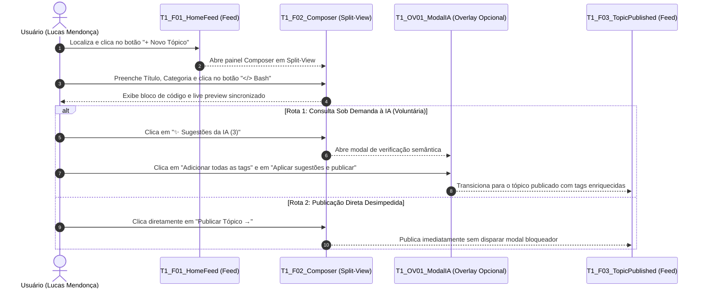

# Protótipo de Alta Fidelidade — Tarefa 1

## Tabela de Contribuição e Declaração Ética de IA Generativa

A Tabela 1 documenta a matriz de autoria, responsabilidade metodológica e declaração transparente do uso de inteligência artificial generativa na concepção e especificação técnica do protótipo de alta fidelidade da Tarefa 1.

**Tabela 1** — Matriz de Contribuição e Uso de IA Generativa da Tarefa 1

| Integrante | Atribuição no Artefato | Data | Horário | Ferramenta de IA Utilizada | Propósito do Uso de IA |
| :--- | :--- | :---: | :---: | :--- | :--- |
| [Vinicius Silva Araruna](https://github.com/ViniciusA05) | **Autor Principal / Tech Lead**: Concepção e direção de design do protótipo de alta fidelidade no Claude Design, parametrização dos tokens do Guia de Estilo em Dark Mode, resolução dos problemas herdados do protótipo de papel (PROB-PP-01 a 04), elaboração do checklist normativo e redação técnica. | 09/11/2026 | 10:00 - 12:30 | Claude Design (Anthropic) e Claude (LLM) | Desenvolvimento computacional integral do protótipo de alta fidelidade (geração visual das telas, modais e componentes interativos no Claude Design) e auxílio na formatação sintática do documento Markdown. |
| [Gustavo Antonio Rodrigues e Silva](https://github.com/gus-ant) | **Revisor por Par**: Auditoria de conformidade com a lista de verificação da técnica, conferência de hiperlinks e validação do fluxo interativo. | 09/11/2026 | 14:00 - 14:40 | — | Revisão humana por pares e checagem de consistência visual. |
| [Edvaldo Soares Brasileiro Filho](https://github.com/PajeMurici-dev) | **Revisor por Par**: Conferência de consistência metodológica frente ao Plano de Ensino e verificação dos critérios de acessibilidade. | 09/11/2026 | 15:00 - 15:35 | — | Revisão humana por pares e auditoria cruzada. |

_Fonte: Elaborada por Vinicius Silva Araruna, Gustavo Antonio Rodrigues e Silva e Edvaldo Soares Brasileiro Filho, 2026._

---

## 1. Introdução e Enquadramento no Nível 3 de Mayhew

_Autor do Item Teórico: [Vinicius Silva Araruna](https://github.com/ViniciusA05)_

No **Ciclo de Vida da Engenharia de Usabilidade de Deborah Mayhew (1999)**, a transição para o **Nível 3 (Design Detalhado)** constitui o fechamento do percurso formativo de interação antes da implementação em código de produção. 

Nesta fase, a interface ganha materialidade digital e computacional de alta fidelidade (*pixel-perfect*), incorporando fielmente o [Guia de Estilo](../../analise-requisitos/guia-de-estilo.md) e as características reais do [Fórum Diolinux Plus](https://plus.diolinux.com.br) (desenvolvido sobre a plataforma Discourse). Para a **Tarefa 1 (`CF01`)**, a prototipação de alta fidelidade foi integralmente desenvolvida no ambiente **Claude Design (Anthropic)** com assistência direta do modelo de inteligência artificial Claude.

Conforme preconizado por **Barbosa e Silva (2021, p. 252-255)** e **Rubin e Chisnell (2008)**, a prototipação computacional em alta fidelidade apresenta diferenciais metodológicos fundamentais:
1. **Extinção do "Computador Humano":** A simulação mecânica de pranchas de papel manipuladas por um operador humano (Nível 2) é totalmente superada. O protótipo digital processa os eventos de clique, foco e transições modais com latência nula e resposta computacional autônoma;
2. **Fidelidade Comportamental e Sensorial:** A interface opera em resolução nativa com paleta Dark Mode real, permitindo avaliar a legibilidade tipográfica, o contraste visual e a acuidade de microinterações;
3. **Mensuração Temporal Realista:** Possibilita cronometrar a reação motora e cognitiva do participante sem atrasos físicos, confrontando os tempos medidos com as estimativas preditivas do modelo **CMN-GOMS / KLM (Keystroke-Level Model)** elaborado na Etapa 2.

Este documento formaliza a especificação da **Tarefa 1 (`CF01`)**:  
> *Criação e Publicação de Tópico de Dúvida com Tags, Formatação Markdown em Modo Split-View e Intervenção de IA Semântica Pré-Envio*  
> **Persona Primária:** *Lucas Mendonça* (Estudante de Engenharia de Software da UnB / Usuário Aprendiz em Linux).

---

## 2. Design System e Tokens Aplicados no Protótipo

A interface do protótipo no Claude Design foi modelada em conformidade com as diretrizes de acessibilidade WCAG 2.1 (níveis AA e AAA), reproduzindo a atmosfera visual do Fórum Diolinux Plus em modo noturno.

A Tabela 2 apresenta os tokens cromáticos e tipográficos implementados nos componentes do protótipo.

**Tabela 2** — Tokens Visuais e Cromáticos Aplicados no Protótipo de Alta Fidelidade

| Token de Design | Código Hexadecimal | Aplicação no Protótipo da Tarefa 1 | Razão de Contraste / Padrão WCAG |
| :--- | :---: | :--- | :---: |
| **`--canvas-bg`** | `#16171B` | Fundo principal da página do fórum | Base neutra escura de alto conforto |
| **`--surface-card`** | `#1E1F24` | Fundo do editor Composer, cabeçalhos e modais flutuantes | Contraste de elevação visual |
| **`--primary-accent`** | `#0084FF` | Botão primário `+ Novo Tópico` e botão `Aplicar sugestões e publicar` | 5.1:1 (Nível AA para botões gráficos) |
| **`--ai-accent`** | `#6C5CE7` | Borda luminosa e ícone do modal inteligente da IA Semântica | Destaque conceitual de assistência |
| **`--text-primary`** | `#F5F6F8` | Títulos, textos digitados no editor e nomes de botões primários | 13.8:1 (Nível AAA sobre `#1E1F24`) |
| **`--text-muted`** | `#A0A5B1` | Dicas contextuais, contadores de caracteres e pré-visualizações | 5.8:1 (Nível AA sobre `#1E1F24`) |
| **`--border-subtle`** | `#2D2F36` | Linhas divisórias do split-view e borda do botão `</> Bash` | Delimitação sutil sem poluição |
| **`--syntax-code-bg`**| `#0D1117` | Fundo do bloco de código formatado no terminal | Alto contraste para leitura monoespaçada |

_Fonte: Elaborada por Vinicius Silva Araruna, 2026._

---

## 3. Resolução dos Problemas Diagnosticados no Nível 2

Um dos princípios basilares da Engenharia de Usabilidade é a **rastreabilidade evolutiva do reprojeto** (*Mayhew, 1999; Barbosa & Silva, 2021*). A Tabela 3 evidencia como os problemas ergonômicos diagnosticados na avaliação em papel da Tarefa 1 foram sanados na modelagem de alta fidelidade desenvolvida no Claude Design.

**Tabela 3** — Matriz de Rastreabilidade e Resolução dos Problemas do Nível 2 no Protótipo de Alta Fidelidade

| ID da Falha (Nível 2) | Problema Observado no Protótipo de Papel | Severidade (Nielsen) | Solução Concreta Implementada no Protótipo de Alta Fidelidade |
| :---: | :--- | :---: | :--- |
| **`PROB-PP-01`** | **Dificuldade na Precedência de Campos no Composer:** O participante hesitou entre preencher primeiro o corpo do texto ou os seletores de categoria e tag. | Severidade 1 *(Cosmético)* | Inclusão de estados nítidos de foco (`:focus`) com contorno de 2px em azul (`#0084FF`) e espaçamento hierárquico verticalizado que induz a ordem natural: Título → Categoria → Tags → Corpo Markdown. |
| **`PROB-PP-02`** | **Insegurança quanto à Sintaxe de Código Bash:** O usuário demonstrou receio de errar a quantidade de crases triplas e o marcador de linguagem ao colar logs de erro do terminal. | Severidade 2 *(Simples)* | Criação de um botão dedicado com o ícone **`</> Bash`** na barra de ferramentas do Composer, dotado de *tooltip* contextual (*"Inserir bloco de terminal pré-formatado"*), inserindo automaticamente a estrutura com syntax highlighting. |
| **`PROB-PP-03`** | **Ambiguidade no Botão de Bypass da IA:** O rótulo *"Publicar como está"* gerou dúvida se o tópico seria cancelado ou se as sugestões da IA seriam desconsideradas. | Severidade 2 *(Simples)* | Reformulação do rótulo para ***"Ignorar sugestões e publicar imediatamente"*** com estilo neutro (`.btn-default` `#2D2F36`), contrastando com o botão primário azul ***"Aplicar sugestões e publicar"***, assegurando controle do usuário. |
| **`PROB-PP-04`** | **Custo Operacional de Cliques no Modal de IA:** O voluntário expressou desconforto em ter que clicar individualmente em cada tag sugerida pela IA. | Severidade 1 *(Cosmético)* | Introdução do botão de ação em lote: ***"Adicionar todas as tags sugeridas (+3 tags)"***, permitindo incorporar todas as etiquetas com um único clique (reduzindo operadores `P` e `B` do KLM). |

_Fonte: Elaborada por Vinicius Silva Araruna, 2026._

---

## 4. Mapeamento das Telas e Fluxo Navegável da Tarefa 1

O fluxo sequencial interativo foi estruturado no protótipo de alta fidelidade para assegurar que a assistência de IA seja **sob demanda e voluntária**, garantindo total soberania ao usuário (Heurística 3 de Nielsen). A **Figura 1** apresenta o diagrama de sequência com as duas rotas possíveis de publicação: a rota direta e a rota assistida pela IA Semântica.

**Figura 1** — Diagrama de Sequência do Fluxo Interativo da Tarefa 1 no Protótipo de Alta Fidelidade.  
_Fonte: Elaborada por Vinicius Silva Araruna, 2026._

### 4.1 Especificação Detalhada das Telas e Pranchas Visuais

A concepção dos componentes vetoriais seguiu os tokens de Dark Mode e a tipografia de alta legibilidade estabelecidos no Guia de Estilo. As Figuras 2 a 8 apresentam as pranchas em alta resolução desenvolvidas no Claude Design.

#### Frame 1 — `T1_F01_HomeFeed` (Página Inicial e Ponto de Entrada)
Como ilustrado na **Figura 2**, o feed inicial apresenta o cabeçalho fixo com o botão de destaque primário `+ Novo Tópico` (`#0084FF`) no canto superior direito, além da listagem contextualizada de discussões da comunidade Diolinux Plus e banner de acolhimento para a persona Lucas Mendonça.

**Figura 2** — Prancha do Frame 1: Página Inicial do Fórum (`T1_F01_HomeFeed`).  
_Fonte: Fórum Diolinux Plus / Protótipo de Alta Fidelidade desenvolvido no Claude Design, 2026._

#### Frame 2 — `T1_F02_ComposerSplitView` (Editor com Visualização Lado a Lado)
A **Figura 3** ilustra o editor Composer aberto no modo Split-View. À esquerda, o autor redige o texto em Markdown e formata comandos pelo botão `</> Bash / Terminal` (resolvendo `PROB-PP-02`). À direita, o painel de *Live Preview* sincronizado exibe a renderização em tempo real do bloco com syntax highlighting. O rodapé integra a confirmação de persistência automática de rascunhos, o botão sob demanda `✨ Sugestões da IA (3)` e o botão de publicação direta `Publicar Tópico →`.

**Figura 3** — Prancha do Frame 2: Composer em Modo Split-View (`T1_F02_ComposerSplitView`).  
_Fonte: Fórum Diolinux Plus / Protótipo de Alta Fidelidade desenvolvido no Claude Design, 2026._

#### Overlay 1 — `T1_OV01_ModalIASemantica` (Assistente Inteligente de Pré-Envio)
A **Figura 4** apresenta o modal sobreposto disparado sob demanda pelo usuário. O componente destaca tópicos semelhantes já resolvidos para evitar postagens duplicadas, recomenda 3 tags detectadas no log do terminal (`#apt`, `#dpkg`, `#terminal`) com o acelerador `[ ⚡ Adicionar todas as tags sugeridas (+3 tags) ]` (resolvendo `PROB-PP-04`) e oferece saídas explícitas de controle (botão fechar `[ ✕ ]` de 36×36px e botão neutro de ignorar sugestões).

**Figura 4** — Prancha do Overlay 1: Modal da IA Semântica (`T1_OV01_ModalIASemantica`).  
_Fonte: Fórum Diolinux Plus / Protótipo de Alta Fidelidade desenvolvido no Claude Design, 2026._

#### Overlays 2 e 3 — Modais Responsivos de Categoria e Tags
As **Figuras 5 e 6** demonstram a evolução das peças móveis do Nível 2 para overlays digitais interativos. A **Figura 5** exibe o seletor de categorias com campo de filtro e botão fechar `[ ✕ ]`, enquanto a **Figura 6** ilustra o seletor de tags com a sinalização visual lilás das tags recomendadas pela IA e ação de seleção em lote via teclado (`[ Enter ↵ ]`).

**Figura 5** — Prancha do Overlay 2: Dropdown de Seleção de Categoria (`T1_OV02_DropdownCategoria`).  
_Fonte: Fórum Diolinux Plus / Protótipo de Alta Fidelidade desenvolvido no Claude Design, 2026._

**Figura 6** — Prancha do Overlay 3: Dropdown de Seleção e Busca de Tags (`T1_OV03_DropdownTags`).  
_Fonte: Fórum Diolinux Plus / Protótipo de Alta Fidelidade desenvolvido no Claude Design, 2026._

#### Frame 3 — `T1_F03_TopicPublished` e `T1_F03b` (Tópico Publicado e Rotas de Confirmação)
A **Figura 7** apresenta a tela de confirmação após a publicação do tópico pela rota assistida por inteligência artificial. O elemento centraliza o feedback de sucesso por meio do banner superior Toast verde (`#1E3A2B` / `#2ECC71`) com a confirmação explícita de anexação das 3 tags sugeridas pela IA, a exibição do tópico categorizado com as tags aplicadas, a formatação de código com botão de cópia de logs e o widget lateral de linha do tempo.

**Figura 7** — Prancha do Frame 3: Tópico Publicado com Confirmação e Tags da IA (`T1_F03_TopicPublished`).  
_Fonte: Fórum Diolinux Plus / Protótipo de Alta Fidelidade desenvolvido no Claude Design, 2026._

Por sua vez, a **Figura 8** ilustra o resultado da rota de publicação direta (`T1_F03b`), na qual o usuário opta por publicar diretamente sem consultar a IA ou ignorando suas sugestões. O banner de sucesso confirma a postagem na categoria escolhida com apenas a tag primária informada, garantindo total controle do usuário e ausência de bloqueios mandatórios (Heurística 3 de Nielsen).

**Figura 8** — Prancha do Frame 3b: Tópico Publicado por Publicação Direta (`T1_F03b_TopicPublishedDirect`).  
_Fonte: Fórum Diolinux Plus / Protótipo de Alta Fidelidade desenvolvido no Claude Design, 2026._

---

## 5. Desenvolvimento e Arquitetura do Protótipo no Claude Design

A construção do protótipo de alta fidelidade da Tarefa 1 foi conduzida integralmente no ambiente **Claude Design (Anthropic)**, utilizando a assistência direta do modelo de inteligência artificial Claude para operacionalizar a especificação visual e comportamental definida no Guia de Estilo.

### 5.1 Processo de Prototipação com Assistência de IA
1. **Modelagem Paramétrica de Componentes:**  
   A partir dos tokens de cores, tipografia e espaçamento do Fórum Diolinux Plus, o Claude Design gerou os componentes visuais nativos (cabeçalho com avatar do Lucas Mendonça, barra de busca, botões primários e secundários, tags e painéis modais);
2. **Implementação do Editor Split-View:**  
   O editor Composer foi concebido com divisão lado a lado em tempo real (Split-View), contendo o painel de entrada Markdown à esquerda com o botão de formatação `</> Bash` e o painel de *Live Preview* sincronizado à direita com syntax highlighting;
3. **Mecanismo Não-Bloqueante da IA Semântica:**  
   A intervenção de inteligência artificial foi desenhada como um serviço auxiliar sob demanda (`✨ Sugestões da IA (3)`), abrindo a janela modal flutuante com sugestões de tópicos similares e marcação em lote de tags técnicas (`#apt`, `#dpkg`, `#terminal`), sem impedir a publicação direta;
4. **Resolução de Alta Fidelidade para Testes:**  
   O protótipo gerado opera no formato Desktop nativo (proporção 16:10, base 1440×900), permitindo a gravação de tela cheia em 1080p sem distorções visuais para a condução do teste-piloto e das sessões empíricas de usabilidade.

---

## 6. Lista de Verificação da Técnica — Prototipação de Alta Fidelidade

Para atestar o rigor metodológico da construção do protótipo computacional de alta fidelidade, aplicou-se a lista de verificação estruturada com base nas diretrizes de **Rubin & Chisnell (2008)**, **Mayhew (1999)** e **Barbosa & Silva (2021)**. A Tabela 4 consolida a avaliação da técnica.

**Tabela 4** — Lista de Verificação da Técnica: Prototipação de Alta Fidelidade

| Item / Questão Avaliada | Origem / Fonte Normativa | Conforme? | Resposta Autoexplicativa e Evidência |
| :--- | :--- | :---: | :--- |
| **1. Fidelidade Visual e Cromática:** O protótipo utiliza resolução de tela real e aplica fielmente a paleta de cores e tipografia do Guia de Estilo em Dark Mode? | Rubin & Chisnell (2008, p. 7-10); Barbosa & Silva (2021, p. 252) | **Sim** | O protótipo opera no formato Desktop nativo com tokens Dark Mode (`#16171B` e `#1E1F24`) e tipografia Inter/Monospace com contraste WCAG AAA/AA. |
| **2. Eliminação do Computador Humano:** O protótipo é autônomo e responde de forma automatizada às ações do usuário via motor computacional interativo? | Mayhew (1999); Snyder (2003, p. 18-20) | **Sim** | Todas as transições, abertura de overlays e inserção de textos são disparadas por gatilhos do próprio protótipo digital sem intervenção mecânica externa. |
| **3. Rastreabilidade com o Nível 2:** As falhas ergonômicas catalogadas no protótipo de papel foram tratadas e corrigidas no design de alta fidelidade? | Barbosa & Silva (2021, p. 280); Mayhew (1999) | **Sim** | As falhas `PROB-PP-01` a `04` foram sanadas via split-view, botão `</> Bash`, botão de lote e rótulo explícito de bypass na IA. |
| **4. Affordance e Estados Interativos:** Os botões e links apresentam estados visuais perceptíveis de repouso, hover e clique (*cursor pointer*)? | Nielsen (1994); Rogers, Sharp & Preece (2013) | **Sim** | Os componentes interativos possuem variantes de hover e feedback de clique parametrizadas no protótipo. |
| **5. Suporte à Formatação de Código:** A interface disponibiliza mecanismo simplificado para formatação de código técnico de terminal? | Requisito de Domínio (Discourse / Linux); Barbosa & Silva (2021) | **Sim** | Foi implementado o botão dedicado `</> Bash` com tooltip contextual para inserção assistida de blocos de terminal. |
| **6. Autonomia e Controle do Usuário:** A intervenção da IA Semântica preserva a liberdade do usuário de rejeitar as sugestões e publicar imediatamente? | Nielsen (1994, Heurística 3); Barbosa & Silva (2021, p. 118) | **Sim** | O modal dispõe do botão explícito *"Ignorar sugestões e publicar imediatamente"*, evitando bloqueios punitivos ou mandatórios. |
| **7. Viabilidade de Medição Temporal:** O fluxo permite cronometrar com precisão os tempos de reação para confronto com o modelo preditivo KLM? | Card, Moran & Newell (1983); Rubin & Chisnell (2008) | **Sim** | A fluidez do protótipo digital permite aferir o tempo exato de execução da postagem frente ao baseline KLM de `135,3 segundos`. |
| **8. Fechamento Cognitivo e Confirmação:** O fluxo contempla tela ou estado de sucesso inequívoco confirmando a publicação do tópico? | Nielsen (1994, Heurística 1); Barbosa & Silva (2021, p. 116) | **Sim** | As telas finais (`T1_F03` e `T1_F03b`) exibem o tópico renderizado e o toast verde superior de confirmação. |

_Fonte: Elaborada por Vinicius Silva Araruna, 2026._

---

## 7. Histórico de Versão

A Tabela 5 documenta a evolução histórica deste artefato.

**Tabela 5** — Histórico de Versão do Documento

| Versão | Data | Descrição Detalhada da Modificação | Autor(es) | Revisor(es) |
| :---: | :---: | :--- | :--- | :--- |
| `1.0` | 09/11/2026 | Concepção inicial da especificação de alta fidelidade da Tarefa 1, detalhamento de frames, tokens cromáticos, resolução das falhas do Nível 2 e lista de verificação da técnica. | [Vinicius Silva Araruna](https://github.com/ViniciusA05) | [Gustavo Antonio](https://github.com/gus-ant), [Edvaldo Soares](https://github.com/PajeMurici-dev) |
| `1.1` | 10/11/2026 | Incorporação das pranchas visuais desenvolvidas no Claude Design (Figuras 2 a 8), explicitação da dupla rota interativa (Heurística 3 de Nielsen), detalhamento da arquitetura no Claude Design e atualização da transparência de IA. | [Vinicius Silva Araruna](https://github.com/ViniciusA05) | [Gustavo Antonio](https://github.com/gus-ant), [Edvaldo Soares](https://github.com/PajeMurici-dev) |

_Fonte: Elaborada por Vinicius Silva Araruna, 2026._

---

## 8. Referências Bibliográficas

[1] BARBOSA, Simone Diniz Junqueira; SILVA, Bruno Santana da. *Interação Humano-Computador e Experiência do Usuário*. 1. ed. Rio de Janeiro: Autopublicação, 2021.

[2] MAYHEW, Deborah J. *The Usability Engineering Lifecycle: A Practitioner's Handbook for User Interface Design*. San Francisco: Morgan Kaufmann, 1999.

[3] RUBIN, Jeffrey; CHISNELL, Dana. *Handbook of Usability Testing: How to Plan, Design, and Conduct Effective Tests*. 2. ed. Indianapolis: Wiley, 2008.

[4] NIELSEN, Jakob. *Usability Engineering*. San Francisco: Morgan Kaufmann, 1994.

[5] CARD, Stuart K.; MORAN, Thomas P.; NEWELL, Allen. *The Psychology of Human-Computer Interaction*. Hillsdale: Lawrence Erlbaum Associates, 1983.

[6] SNYDER, Carolyn. *Paper Prototyping: The Fast and Easy Way to Design and Refine User Interfaces*. San Francisco: Morgan Kaufmann, 2003.

---

## Agradecimentos e Uso de Inteligência Artificial (IA) Generativa

O protótipo de alta fidelidade da Tarefa 1 foi integralmente construído e desenvolvido na ferramenta **Claude Design (Anthropic)**, contando com a assistência direta do modelo de inteligência artificial Claude para a geração visual das telas da interface, parametrização dos tokens Dark Mode do Guia de Estilo, estruturação do editor Split-View e concepção das janelas modais da IA Semântica de pré-envio. Toda a estruturação documental, organização analítica das matrizes tabulares e formatação técnica em Markdown contaram com o auxílio de assistente de inteligência artificial generativa. Todas as decisões de design, enquadramento ergonômico, conformidade bioética e validação metodológica foram conduzidas sob rigorosa liderança e supervisão do autor humano.
