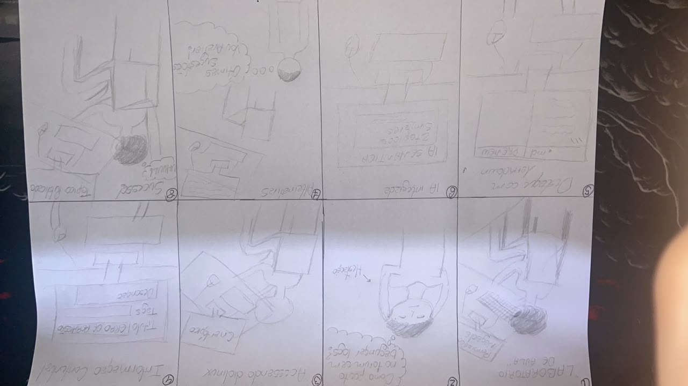
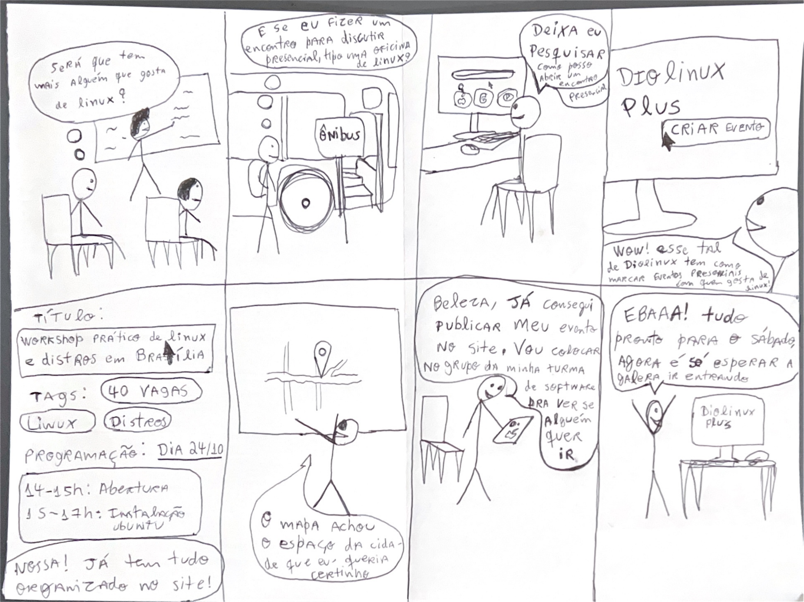
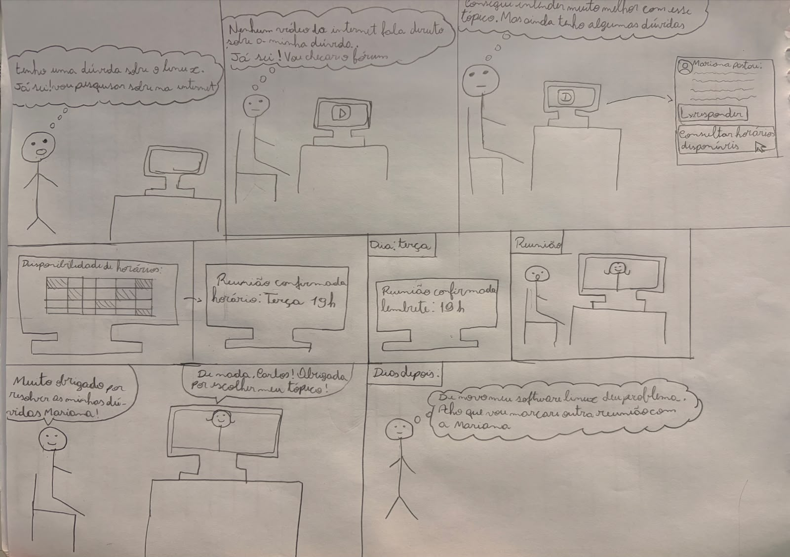

# Storyboards da Equipe (Nível 1)

## Tabela de Contribuição e Transparência de IA Generativa

A Tabela 1 apresenta a autoria e responsabilidade individual na elaboração dos storyboards da equipe.

**Tabela 1** — Matriz de Contribuição dos Storyboards

| Integrante | Atribuição no Artefato | Data | Revisor | Ferramenta de IA Utilizada | Propósito do Uso de IA |
| :--- | :--- | :---: | :---: | :--- | :--- |
| [Vinicius Silva Araruna](https://github.com/ViniciusA05) | **Autor do Storyboard 1**: Concepção narrativa, elaboração da prancha física em papel (8 quadros, 300 DPI), roteiro de cenas com integração de IA semântica e documentação detalhada. | 24/10/2026 | [Gustavo Antonio](https://github.com/gus-ant) | Antigravity (LLM) | Apoio na estruturação sintática de tabelas e alinhamento de rastreabilidade HTA. |
| [Gustavo Antonio Rodrigues e Silva](https://github.com/gus-ant) | **Autor do Storyboard 2**: Concepção narrativa, desenho manual em prancha física (8 quadros), digitalização em 300 DPI, redação das histórias e decomposição das cenas. | 22/10/2026 | [Vinicius Silva Araruna](https://github.com/ViniciusA05) | — | Desenho manual autoral em papel e digitalização via scanner óptico. |
| [Edvaldo Soares Brasileiro Filho](https://github.com/PajeMurici-dev) | **Autor do Storyboard 3**: Concepção e estruturação da narrativa da Grade de Disponibilidade e Agendamento de Reuniões/Mentorias no fórum. | 24/10/2026 | [Gustavo Antonio Rodrigues e Silva](https://github.com/gus-ant) | LLM (Antigravity) | Apoio na estruturação dos cenários e tabela de quadros. |

_Fonte: Elaborada pelos autores, 2026._

---

## 1. Introdução e Fundamentação Metodológica

No âmbito do **Ciclo de Vida de Engenharia de Usabilidade de Mayhew (1999)** adotado na disciplina de Interação Humano-Computador (FGA0173), a fase de **Design, Avaliação e Desenvolvimento** inicia-se no **Nível 1 (Prototipação de Baixa Fidelidade e Modelagem Conceitual)** (*Barbosa & Silva, 2021, p. 115*).

Nesta etapa, o **Storyboard** atua como uma técnica primordial de ideação e comunicação visual rápida. Originário da indústria cinematográfica e incorporado a IHC por pioneiros como Alan Cooper (1999) e Beyer & Holtzblatt (1997), o storyboard consiste em uma série de ilustrações dispostas em sequência temporal em formato de quadrinhos, acompanhadas de balões de fala, pensamentos e legendas contextuais (*Rogers, Sharp & Preece, 2013*).

Conforme documentado no [Item Teórico: Storyboard em IHC](../conteudo-teorico/item-teorico-storyboard.md) (*Silva, 2026*), a eficácia de um storyboard não repousa em virtuosismo artístico, mas em sua capacidade de comunicar fielmente os **três pilares canônicos de Scott Klemmer (2012)**:

1. **Cenário e Contexto (*Setting*):** Quem é o usuário, onde ele está fisicamente (sala de aula, transporte público, quarto) e qual problema ou necessidade inicial dispara a interação;
2. **Sequência e Encadeamento (*Sequence*):** Quais passos são executados, como a interface interage com o usuário e quais decisões práticas ocorrem em cada etapa da jornada;
3. **Satisfação e Desfecho (*Satisfaction*):** O que motivou o usuário a escolher o sistema, qual necessidade prática foi atendida e qual o estado emocional positivo após atingir o objetivo pretendido.

Em estrito atendimento aos critérios de avaliação do Plano de Ensino da disciplina (*Sales, 2026, pp. 12-13*):
- Cada storyboard ilustra a jornada de um integrante da equipe aplicada ao **Fórum Diolinux Plus**, garantindo a proporção de 1 storyboard por membro ativo;
- Os cenários dialogam diretamente com as especificações da [Análise de Tarefas (HTA e CTT)](../analise-requisitos/analise-tarefas.md) e com os perfis de discentes mapeados nas [Personas](../analise-requisitos/personas.md).

---

## 2. Storyboard 1 – Criação e Publicação de Tópico de Dúvida com Tags e Formatação Markdown com Integração de IA Semântica (Vinicius Silva Araruna)

- **Autor**: [Vinicius Silva Araruna](https://github.com/ViniciusA05)
- **Revisor**: [Gustavo Antonio Rodrigues e Silva](https://github.com/gus-ant)
- **Funcionalidade Mapeada**: `CF01` / `F01` — Criação e Publicação de Tópico com Tags, Markdown e Verificação Semântica por IA Pré-Envio
- **Persona Representada**: Lucas Mendonça (Estudante de Engenharia de Software e Estagiário DevOps)
- **Metodologia de Referência**: Buxton (2007), Scott Klemmer (2012) e Barbosa & Silva (2021)
- **Formato**: Opção B (Ilustração manual em papel A4 a 300 DPI e digitalização fotográfica tratada)
- **Documentação Aprofundada**: [Artefato Completo do Storyboard da Tarefa 1](nivel-1/storyboard/storyboard-topico-markdown.md)

### 2.1 Contexto e Motivação

> *Lucas Mendonça, estudante de Engenharia de Software e estagiário DevOps, depara-se tarde da noite com uma falha de permissão ao montar volumes no Podman rootless no Fedora 40. Após exaurir tentativas locais, decide recorrer à comunidade técnica do Fórum Diolinux Plus para relatar a dúvida com logs formatados em Markdown e tags precisas, beneficiando-se da verificação inteligente de tópicos similares pré-envio para não gerar duplicatas.*

### 2.2 Por que o estudante utiliza essa funcionalidade?

- **Story 1 – Resolução de Gargalos Técnicos Acadêmicos e Profissionais:**  
  > *Como estudante e estagiário, preciso submeter logs de terminal e comandos de configuração sem perda de indentação ou quebra de sintaxe, para que desenvolvedores experientes consigam diagnosticar meu problema com precisão.*
- **Story 2 – Prevenção de Redundâncias e Desduplicação Inteligente:**  
  > *Como membro consciente da comunidade, quero que a interface me alerte caso outra pessoa já tenha publicado uma dúvida idêntica com solução aceita, poupando meu tempo e evitando poluir o fórum.*
- **Story 3 – Retribuição Colaborativa e Registro de Solução:**  
  > *Como usuário beneficiado pelo apoio comunitário, faço questão de validar a solução no terminal e marcar o selo oficial de Solução Aceita na postagem, auxiliando futuros estudantes que pesquisarem a mesma falha.*

---

### 2.3 Visão Geral da Prancha Física (Opção B)

A Figura 1 apresenta a prancha desenhada à mão em folha de papel sulfite A4 por Vinicius Silva Araruna, contendo a sequência cronológica completa dos 8 quadros da Tarefa 1.

<b>Figura 1</b> — Prancha original manuscrita do Storyboard 1 (Opção B, 300 DPI) com verificação semântica de IA. 
<i>Fonte: Vinicius Silva Araruna, 2026.</i>

---

### 2.4 Roteiro Cênico Sequencial (8 Quadros)

A Tabela 2 apresenta o detalhamento de cada cena, explicitando a ação do interagente, o feedback da interface e a conformidade ergonômica.

**Tabela 2** — Roteiro de Cenas do Storyboard 1 (Criação de Tópico com Tags, Markdown e IA Semântica)

| # | Cena / Ambiente (*Setting*) | Ação do Interagente e Comportamento do Sistema | Princípio Ergonômico e Usabilidade |
| :-: | :--- | :--- | :--- |
| **1** | **Ambiente de Trabalho / Terminal:** Lucas no terminal do Fedora 40 recebe erro de permissão ao subir container Podman rootless. | Lucas tenta resolver com comandos locais, mas sem sucesso. Decide pedir ajuda no fórum. | Evidencia a necessidade real (*Trigger* motivacional) e o contexto técnico de uso. |
| **2** | **Acesso ao Fórum Diolinux:** Tela inicial do fórum com foco no botão primário de nova postagem. | Lucas clica no botão "+ Novo Tópico". | Visibilidade do estado do sistema e consistência com padrões de fóruns modernos. |
| **3** | **Seleção Taxonômica:** Modal de criação com seleção de categoria e tags técnicas. | Lucas seleciona a categoria `#suporte-tecnico` e digita as tags `podman`, `fedora` e `permissoes`. | Prevenção de ambiguidades e organização semântica facilitando a busca futura. |
| **4** | **Composição Estruturada com Markdown:** Editor de texto com visualização em duas colunas (*split-view*). | Lucas insere o título objetivo, redige a descrição e cola os blocos de comando formatados com crases triplas. A pré-visualização em tempo real mostra a formatação rica renderizada. | Correspondência com as expectativas do usuário e redução da carga cognitiva (*WYSIWYG preview*). |
| **5** | **Assistente Semântico de IA Pré-Envio:** Caixa flutuante inteligente exibindo tópicos correlatos antes da submissão final. | Ao terminar de digitar o título e descrição, a IA analisa semanticamente o texto e apresenta uma lista: *"Identificamos 2 tópicos semelhantes com solução aceita. Deseja consultá-los antes de postar?"*. | Antecipação das necessidades do usuário e economia de esforço cognitivo comunitário (desduplicação). |
| **6** | **Publicação Concluída:** Lucas clica em "Criar Tópico" após confirmar que seu caso tem particularidades não resolvidas nos tópicos sugeridos. | O sistema publica o tópico instantaneamente, atribui as tags e exibe confirmação visual não obstrutiva. | Fechamento de ciclo de ação e sensação de controle do usuário. |
| **7** | **Notificação e Colaboração:** Lucas recebe notificação de resposta de um colega da comunidade com o ajuste de permissão do SELinux. | Lucas aplica a instrução no terminal e verifica que o container subiu com sucesso. | Valor prático da comunidade e satisfação imediata no uso do sistema. |
| **8** | **Marcação de Solução Aceita e Desfecho Positivo:** Lucas retorna ao fórum, clica no botão "Marcar como Solução" e expressa gratidão na thread. | A resposta ganha destaque visual verde de solução e o tópico é marcado como resolvido na listagem geral. | Satisfação final (*Satisfaction* de Scott Klemmer) e ciclo virtuoso de compartilhamento de conhecimento. |

_Fonte: Elaborada por [Vinicius Silva Araruna](https://github.com/ViniciusA05), 2026._

---

### 2.5 Alinhamento com as Dimensões de Scott Klemmer (2012)

- **Cenário (*Setting*):** O storyboard inicia no ambiente de desenvolvimento do estudante universitário (terminal de sistema operacional Linux), avança pela interface web da comunidade e encerra com o teste real executado no terminal.
- **Sequência (*Sequence*):** Ordem causal estrita em 8 passos lógicos: Erro no terminal → Decisão de recorrer à comunidade → Categorização → Composição em Markdown → Verificação de IA pré-envio → Publicação → Notificação de resposta → Validação e marcação de solução aceita.
- **Satisfação (*Satisfaction*):** O desfecho cumpre o propósito de IHC: resolver a frustração do usuário com agilidade, empoderando-o a retribuir à comunidade através da marcação oficial de solução.

---

### 2.6 Registros Audiovisuais (Teste-Piloto e Avaliação Oficial)

A Tabela 3 consolida os registros audiovisuais em vídeo das sessões práticas de validação do Storyboard 1 conduzidas por Vinicius Silva Araruna, disponibilizadas no YouTube sob o regime Não Listado.

**Tabela 3** — Registros audiovisuais do Storyboard 1 (Teste-Piloto e Avaliação com Usuário)

| Etapa | Objetivo / Atividade | Responsável | Participante | Data | Vídeo no YouTube |
| :---: | :--- | :--- | :---: | :---: | :--- |
| **Teste-Piloto** | Calibração instrumental de enquadramento, iluminação, áudio e temporização do script oral do TCLE (< 60s) | [Vinicius Silva Araruna](https://github.com/ViniciusA05) | Autoensaio Solo | 21/10/2026 | [Assistir no YouTube (e4annKBJd3I)](https://youtu.be/e4annKBJd3I) |
| **Avaliação Oficial** | Sessão de avaliação formativa presencial do Storyboard 1 e HTA via entrevista semiestruturada | [Vinicius Silva Araruna](https://github.com/ViniciusA05) | Participante J.V.S (CIC/UnB) | 22/10/2026 | [Assistir no YouTube (_4nQ50nN7b8)](https://youtu.be/_4nQ50nN7b8) |

_Fonte: Elaborada por [Vinicius Silva Araruna](https://github.com/ViniciusA05), 2026._

#### Vídeo 1 — Teste-Piloto do Storyboard 1 (Vinicius Silva Araruna)

    <iframe width="100%" height="450" src="https://www.youtube-nocookie.com/embed/e4annKBJd3I" title="Teste-Piloto do Storyboard 1 - Vinicius Silva Araruna" frameborder="0" allow="accelerometer; autoplay; clipboard-write; encrypted-media; gyroscope; picture-in-picture" allowfullscreen style="border-radius: 8px; max-width: 800px; box-shadow: 0 4px 6px -1px rgba(0,0,0,0.1);"></iframe>
    
<strong>Vídeo 1</strong> — Registro em vídeo do Teste-Piloto do Storyboard 1 (autoensaio solo). <em>Fonte: Vinicius Silva Araruna, 2026.</em>

    
<a href="https://youtu.be/e4annKBJd3I" target="_blank" rel="noopener noreferrer">Assistir diretamente no YouTube: https://youtu.be/e4annKBJd3I</a>

#### Vídeo 2 — Gravação da Avaliação Oficial do Storyboard 1 (Vinicius Silva Araruna)

    <iframe width="100%" height="450" src="https://www.youtube-nocookie.com/embed/_4nQ50nN7b8" title="Avaliação do Storyboard 1 - Vinicius Silva Araruna" frameborder="0" allow="accelerometer; autoplay; clipboard-write; encrypted-media; gyroscope; picture-in-picture" allowfullscreen style="border-radius: 8px; max-width: 800px; box-shadow: 0 4px 6px -1px rgba(0,0,0,0.1);"></iframe>
    
<strong>Vídeo 2</strong> — Registro em vídeo da Avaliação Formativa com Participante (J.V.S) do Storyboard 1. <em>Fonte: Vinicius Silva Araruna, 2026.</em>

    
<a href="https://youtu.be/_4nQ50nN7b8" target="_blank" rel="noopener noreferrer">Assistir diretamente no YouTube: https://youtu.be/_4nQ50nN7b8</a>

---

## 3. Storyboard 2 – Criação e Divulgação de Workshop Presencial de Linux (Gustavo Antonio)

- **Autor Responsável:** [Gustavo Antonio Rodrigues e Silva](https://github.com/gus-ant)
- **Revisor Designado:** [Vinicius Silva Araruna](https://github.com/ViniciusA05)
- **Perfil de Usuário Atendido:** Estudante universitário da FGA/UnB, iniciante/intermediário em ecossistema Linux (*Lucas Mendonça — Persona Primária*).
- **Técnica de Confecção:** Desenho manual em prancha física estruturada em 8 quadros conforme recomendação de confecção ágil (~10 min) de Klemmer (2012), posteriormente digitalizada em scanner óptico em resolução nativa de 300 DPI.

### 3.1 Contexto e Problema Identificado

> *Lucas, estudante de graduação em Engenharia de Software da Faculdade UnB Gama (FGA/UnB), sente-se solitário no aprendizado e uso diário do sistema operacional Linux. Em sua sala de aula, poucos colegas compartilham o interesse por distribuições e configuração de ambientes de desenvolvimento. Durante o trajeto de volta para casa no transporte público, Lucas tem o desejo de organizar um encontro prático presencial (workshop) com seus colegas para instalar o Ubuntu e debater configurações de distros, mas não sabe como viabilizar as inscrições, organizar os horários e definir o local físico de forma estruturada. Ele decide buscar uma plataforma comunitária e descobre que o Fórum Diolinux Plus possui uma funcionalidade nativa de agendamento e criação de eventos com mapa integrado.*

### 3.2 Motivação e Histórias de Usuário (*User Stories*)

- **Story 1 – Conexão Comunitária e Troca Presencial:**  
  > *Como estudante de computação apaixonado por software livre, quero organizar um workshop presencial para reunir colegas de faculdade e trocar experiências sobre distros, para que eu não me sinta isolado em meus estudos de Linux.*
- **Story 2 – Estruturação de Informações da Oficina:**  
  > *Como organizador discente de um evento acadêmico, preciso de um formulário limpo onde possa especificar o título do encontro, limite de vagas (40 vagas), tags de busca (Linux, Distros), data do encontro (24/10) e a grade horária detalhada (abertura e instalação prática).*
- **Story 3 – Geolocalização e Compartilhamento Móvel:**  
  > *Como promotor da oficina, necessito de um mapa interativo integrado para demarcar exatamente o espaço físico na cidade e de um link rápido para compartilhar a página do evento pelo celular nos grupos de mensagens da faculdade.*

---

### 3.3 Visão Geral das Cenas do Storyboard (Sequência de 8 Quadros)

A Tabela 4 descreve a narrativa visual quadro a quadro do Storyboard 2, articulando as falas originais transcritas do desenho manual com os comentários ergonômicos e decisões de design.

**Tabela 4** — Decomposição analítica dos quadros do Storyboard 2 (Criação de Evento no Diolinux Plus)

| # | Cena / Ambiente (*Setting*) | Transcrição Literal dos Balões | Comentários Ergonômicos e Decisões de Design |
| :-: | :--- | :--- | :--- |
| **1** | **Sala de Aula Universitária:** Lucas sentado em sua carteira durante aula expositiva, olhando para o professor junto ao quadro-negro. | *(Pensamento):* “Será que tem mais alguém que gosta de Linux?” | Evidencia o problema inicial de isolamento social e a falta de canais de identificação mútua entre pares acadêmicos. |
| **2** | **Transporte Público (Ônibus):** Lucas a caminho de casa em pé/sentado junto à porta de desembarque do coletivo. | *(Pensamento):* “E se eu fizer um encontro para discutir presencial, tipo uma oficina de Linux?” | Ideação espontânea e gatilho motivador (*trigger*). O usuário define o objetivo de alto nível: criar um evento prático presencial. |
| **3** | **Quarto / Mesa de Estudos:** Lucas sentado em sua escrivaninha em frente ao computador desktop, iniciando navegação web. | *(Fala):* “Deixa eu pesquisar como posso abrir um encontro presencial” | Início da jornada de busca digital de ferramentas que suportem a criação e divulgação de eventos técnicos comunitários. |
| **4** | **Descoberta no Fórum Diolinux Plus:** Tela do monitor exibindo a página inicial do fórum com o botão primário destacado **“CRIAR EVENTO”**. | *(Fala):* “Wow! Esse tal de Diolinux tem como marcar eventos presenciais com quem gosta de Linux!” | Ponto de apropriação tecnológica. O usuário descobre que a comunidade possui funcionalidade nativa para eventos presenciais de software livre. |
| **5** | **Preenchimento do Formulário:** Painel de cadastro com campos preenchidos: • **Título:** *Workshop prático de Linux e distros em Brasília* • **Tags:** *40 Vagas*, *Linux*, *Distros* • **Programação:** *Dia 24/10 \| 14–15h: Abertura \| 15–17h: Instalação Ubuntu* | *(Fala):* “Nossa! Já tem tudo organizado no site!” | Redução da carga cognitiva. Formulário estruturado com suporte a metadados essenciais (lotação, categorização por tags e cronograma horário). |
| **6** | **Seleção Espacial no Mapa:** Interface com visualizador de mapa geográfico integrado com marcador (*pin*) posicionado no ponto exato. | *(Fala):* “O mapa achou o espaço da cidade que eu queria certinho” | Feedback visual imediato de geolocalização. Elimina ambiguidades de endereço físico para os participantes do evento. |
| **7** | **Disseminação via Smartphone:** Lucas em pé segurando o celular, conferindo a página publicada e disparando o link para seus contatos. | *(Fala):* “Beleza, já consegui publicar meu evento no site. Vou colocar no grupo da minha turma de software pra ver se alguém quer ir.” | Continuidade de experiência entre plataformas (Desktop → Mobile) e compartilhamento ágil em canais de comunicação acadêmica. |
| **8** | **Desfecho e Comemoração:** Lucas comemora de braços abertos diante do computador com a mensagem de confirmação do evento no Diolinux Plus. | *(Fala):* “EBAAA! Tudo pronto para o sábado, agora é só esperar a galera ir entrando” | Desfecho emocional positivo (*Satisfaction*). Sensação de dever cumprido e expectativa positiva para a realização da oficina. |

_Fonte: Elaborada por [Gustavo Antonio Rodrigues e Silva](https://github.com/gus-ant), 2026._

---

### 3.4 Alinhamento com os Três Pilares de Scott Klemmer

Conforme preconizado por Klemmer (2012) e demonstrado na lista de verificação de Storyboards:
- **Cenário (*Setting*):** O storyboard não se isola na tela do computador. Ele retrata o contexto sociocultural completo do aluno: a sala de aula da faculdade (FGA), o trajeto no ônibus urbano de Brasília, o quarto com o computador desktop e o uso subsequente do smartphone na palma da mão.
- **Sequência (*Sequence*):** A narrativa possui uma ordem causal estrita em 8 passos sem saltos lógicos bruscos: Sentimento de isolamento → Ideação de workshop → Busca no PC → Descoberta da funcionalidade no Fórum → Preenchimento dos dados estruturados → Seleção do local no mapa → Compartilhamento mobile → Confirmação e alívio.
- **Satisfação (*Satisfaction*):** O sistema atende à necessidade essencial de conectar entusiastas de Linux. A satisfação é transmitida visualmente pelo alívio no Quadro 5 e pelo entusiasmo gestual e textual no Quadro 8.

---

### 3.5 Evidência Visual em Alta Resolução (300 DPI)

A Figura 2 reproduz a prancha física do Storyboard 2 elaborada por Gustavo Antonio Rodrigues e Silva, digitalizada em alta resolução gráfica (300 DPI) para inspeção e avaliação com os participantes convidados.

<b>Figura 2</b> — Prancha original do Storyboard 2 desenhada manualmente por Gustavo Antonio Rodrigues e Silva (8 quadros, 300 DPI). 
<i>Fonte: Gustavo Antonio Rodrigues e Silva, 2026.</i>

---

### 3.6 Registros Audiovisuais (Teste-Piloto e Avaliação Oficial)

A Tabela 5 consolida os registros audiovisuais em vídeo das sessões práticas de validação do Storyboard 2 conduzidas por Gustavo Antonio, disponibilizadas no YouTube sob o regime Não Listado.

**Tabela 5** — Registros audiovisuais do Storyboard 2 (Teste-Piloto e Avaliação com Usuário)

| Etapa | Objetivo / Atividade | Responsável | Participante | Data | Vídeo no YouTube |
| :---: | :--- | :--- | :---: | :---: | :--- |
| **Teste-Piloto** | Calibração instrumental de enquadramento, áudio e temporização do script oral do TCLE (< 60s) | [Gustavo Antonio](https://github.com/gus-ant) | Simulação Solo | 22/10/2026 | [Assistir no YouTube (K5jVAyq4hAY)](https://youtu.be/K5jVAyq4hAY) |
| **Avaliação Oficial** | Sessão de avaliação formativa presencial do Storyboard 2 via entrevista semiestruturada | [Gustavo Antonio](https://github.com/gus-ant) | Participante P2 | 23/10/2026 | [Assistir no YouTube (VhGgpfX9Rqk)](https://youtu.be/VhGgpfX9Rqk) |

_Fonte: Elaborada por [Gustavo Antonio Rodrigues e Silva](https://github.com/gus-ant), 2026._

#### Vídeo 3 — Teste-Piloto do Storyboard 2 (Gustavo Antonio)

    <iframe width="100%" height="450" src="https://www.youtube-nocookie.com/embed/K5jVAyq4hAY" title="Teste-Piloto do Storyboard 2 - Gustavo Antonio" frameborder="0" allow="accelerometer; autoplay; clipboard-write; encrypted-media; gyroscope; picture-in-picture" allowfullscreen style="border-radius: 8px; max-width: 800px; box-shadow: 0 4px 6px -1px rgba(0,0,0,0.1);"></iframe>
    
<strong>Vídeo 3</strong> — Registro em vídeo do Teste-Piloto do Storyboard 2. <em>Fonte: Gustavo Antonio Rodrigues e Silva, 2026.</em>

#### Vídeo 4 — Gravação da Avaliação do Storyboard 2 (Gustavo Antonio)

    <iframe width="100%" height="450" src="https://www.youtube-nocookie.com/embed/VhGgpfX9Rqk" title="Avaliação do Storyboard 2 - Gustavo Antonio" frameborder="0" allow="accelerometer; autoplay; clipboard-write; encrypted-media; gyroscope; picture-in-picture" allowfullscreen style="border-radius: 8px; max-width: 800px; box-shadow: 0 4px 6px -1px rgba(0,0,0,0.1);"></iframe>
    
<strong>Vídeo 4</strong> — Registro em vídeo da Avaliação Formativa com Participante do Storyboard 2. <em>Fonte: Gustavo Antonio Rodrigues e Silva, 2026.</em>

---

## 4. Storyboard 3 – Grade de Disponibilidade e Agendamento de Reuniões no Fórum Diolinux (Edvaldo Soares)

- **Autor Responsável:** [Edvaldo Soares Brasileiro Filho](https://github.com/PajeMurici-dev)
- **Revisor Designado:** [Gustavo Antonio Rodrigues e Silva](https://github.com/gus-ant)
- **Perfil de Usuário Atendido:** Estudante/pesquisadora experiente e usuário iniciante em busca de suporte e mentoria técnica (*Mariana Ribeiro e Carlos Eduardo — Personas da Comunidade*).
- **Técnica de Confecção:** Roteirização sequencial em 8 quadros com comentários ergonômicos e de usabilidade, resolução gráfica de 300 DPI (Issue #64).

### 4.1 Contexto e Problema Identificado

> *Mariana, membro da comunidade Diolinux, publica um tópico no fórum com o objetivo de compartilhar conhecimentos e ajudar outros usuários com dúvidas sobre Linux. Para facilitar a comunicação e oferecer um atendimento mais organizado, ela deseja disponibilizar datas e horários em que pode realizar reuniões. Carlos, um usuário iniciante que encontra o tópico, precisa consultar os horários disponíveis, selecionar um período compatível com sua agenda e confirmar o agendamento para conversar com Mariana sobre suas dúvidas. A funcionalidade permite organizar esses encontros diretamente a partir do tópico, facilitando a colaboração entre os membros da comunidade e evitando conflitos de horários.*

### 4.2 Motivação e Histórias de Usuário (*User Stories*)

- **Story 1 – Suporte técnico por meio de reuniões:**  
  > *Como usuário iniciante de distribuições Linux, preciso agendar uma reunião com um membro experiente da comunidade para receber orientações sobre a recuperação do sistema, selecionando um horário disponibilizado pelo autor do tópico.*
- **Story 2 – Disponibilização de horários pelo autor do tópico:**  
  > *Como membro experiente da comunidade Diolinux, desejo disponibilizar horários para reuniões diretamente no tópico que publiquei, permitindo que outros usuários agendem conversas para esclarecer dúvidas e compartilhar conhecimentos.*
- **Story 3 – Organização e confirmação de reuniões:**  
  > *Como usuário do fórum, preciso visualizar os horários disponíveis, confirmar o agendamento e receber os detalhes da reunião, garantindo que o horário escolhido seja reservado e não possa ser agendado por outra pessoa.*

---

### 4.3 Visão Geral das Cenas do Storyboard (Sequência de 8 Quadros)

A Tabela 6 apresenta a sequência de quadros da funcionalidade de Grade de Disponibilidade e Agendamento de Reuniões vinculada aos tópicos do Fórum Diolinux Plus.

**Tabela 6** — Sequência de quadros do Storyboard 3 (Grade de Disponibilidade e Agendamento no Fórum)

| # | Cena (descrição da ação) | Comentários de Design e Usabilidade |
| :-: | :--- | :--- |
| **1** | **Publicação do tópico e disponibilização de horários:** Mariana publica um tópico no fórum Diolinux para ajudar outros usuários com dúvidas sobre Linux. Na página do tópico, ela acessa a opção "Disponibilizar Horários" e seleciona os períodos em que pode realizar reuniões. | Botão de fácil identificação e formulário simples para cadastrar datas e horários. |
| **2** | **Visualização dos horários disponíveis:** Carlos acessa o tópico de Mariana e encontra a opção "Agendar Reunião". Ao clicar, visualiza a grade com os dias e horários disponibilizados pela autora. | Calendário organizado, legenda clara e diferenciação visual entre horários disponíveis e reservados. |
| **3** | **Seleção de um horário livre:** Carlos consulta a grade e seleciona o horário de quinta-feira, às 19h30. O sistema destaca o bloco selecionado para que ele confira a data e o horário antes de continuar. | Feedback visual imediato, áreas de clique adequadas e prevenção de seleções equivocadas. |
| **4** | **Descrição do motivo da reunião:** O sistema apresenta um formulário para que Carlos informe o assunto da reunião, descrevendo brevemente a falha de inicialização do Linux e as tentativas de solução realizadas. | Campos objetivos, instruções claras e indicação dos campos obrigatórios. |
| **5** | **Revisão dos dados do agendamento:** Carlos visualiza um resumo contendo o título do tópico, o nome da autora, a data, o horário e a descrição da dúvida. Em seguida, clica em "Confirmar Agendamento". | Resumo das informações antes da confirmação e possibilidade de voltar para corrigir os dados. |
| **6** | **Confirmação e reserva do horário:** O sistema verifica se o horário continua disponível e registra o agendamento. O bloco selecionado passa para o estado "Reservado", impedindo que outro usuário marque o mesmo horário. | Prevenção de agendamentos duplicados e feedback imediato sobre o resultado da operação. |
| **7** | **Exibição dos detalhes da reunião:** Carlos recebe uma mensagem de sucesso e visualiza um resumo com a data, o horário, o tópico relacionado e as informações de acesso à reunião, quando disponibilizadas pela autora. | Mensagem de confirmação clara e acesso fácil aos detalhes do agendamento. |
| **8** | **Realização da reunião:** No horário combinado, Carlos e Mariana se encontram na plataforma de comunicação definida para a reunião e discutem a falha de inicialização. Com as orientações recebidas, Carlos consegue avançar na resolução do problema. | Conclusão satisfatória da tarefa, incentivo à colaboração e fortalecimento da comunidade Diolinux. |

_Fonte: Elaborada por [Edvaldo Soares Brasileiro Filho](https://github.com/PajeMurici-dev), 2026._

---

### 4.4 Evidência Visual

A Figura 3 apresenta a representação gráfica do Storyboard 3 (Grade de Disponibilidade e Agendamento).

<b>Figura 3</b> — Sequência de quadros da funcionalidade de Grade de Disponibilidade e Agendamento de Reuniões vinculada aos tópicos do fórum Diolinux (Issue #64). 
<i>Fonte: Edvaldo Soares Brasileiro Filho, 2026.</i>

---

### 4.5 Registros Audiovisuais (Teste-Piloto e Avaliação Oficial)

A Tabela 7 consolida os registros audiovisuais em vídeo das sessões práticas de validação do Storyboard 3 conduzidas por Edvaldo Soares, disponibilizadas no YouTube sob o regime Não Listado.

**Tabela 7** — Registros audiovisuais do Storyboard 3 (Teste-Piloto e Avaliação com Usuário)

| Etapa | Objetivo / Atividade | Responsável | Participante | Data | Vídeo no YouTube |
| :---: | :--- | :--- | :--- | :---: | :--- |
| **Teste-Piloto** | Calibração instrumental de gravação, roteiro e temporização da sessão de avaliação | [Edvaldo Soares](https://github.com/PajeMurici-dev) | Simulação Solo | 24/10/2026 | [Assistir no YouTube (1F409M-E850)](https://youtu.be/1F409M-E850) |
| **Avaliação Oficial** | Sessão de avaliação formativa do Storyboard 3 via entrevista semiestruturada | [Edvaldo Soares](https://github.com/PajeMurici-dev) | Participante Voluntário | 24/10/2026 | [Assistir no YouTube (gqZ3yJ3ZYUc)](https://youtu.be/gqZ3yJ3ZYUc) |

_Fonte: Elaborada por [Edvaldo Soares Brasileiro Filho](https://github.com/PajeMurici-dev), 2026._

#### Vídeo 5 — Teste-Piloto do Storyboard 3 (Edvaldo Soares)

    <iframe width="100%" height="450" src="https://www.youtube-nocookie.com/embed/1F409M-E850" title="Teste-Piloto do Storyboard 3 - Edvaldo Soares" frameborder="0" allow="accelerometer; autoplay; clipboard-write; encrypted-media; gyroscope; picture-in-picture" allowfullscreen style="border-radius: 8px; max-width: 800px; box-shadow: 0 4px 6px -1px rgba(0,0,0,0.1);"></iframe>
    
<strong>Vídeo 5</strong> — Registro audiovisual do Teste-Piloto do Storyboard 3. <em>Fonte: Edvaldo Soares Brasileiro Filho, 2026.</em>

    
<a href="https://youtu.be/1F409M-E850" target="_blank" rel="noopener noreferrer">Assistir diretamente no YouTube: https://youtu.be/1F409M-E850</a>

#### Vídeo 6 — Gravação da Avaliação Oficial do Storyboard 3 (Edvaldo Soares)

    <iframe width="100%" height="450" src="https://www.youtube-nocookie.com/embed/gqZ3yJ3ZYUc" title="Avaliação do Storyboard 3 - Edvaldo Soares" frameborder="0" allow="accelerometer; autoplay; clipboard-write; encrypted-media; gyroscope; picture-in-picture" allowfullscreen style="border-radius: 8px; max-width: 800px; box-shadow: 0 4px 6px -1px rgba(0,0,0,0.1);"></iframe>
    
<strong>Vídeo 6</strong> — Registro audiovisual da avaliação com participante do Storyboard 3. <em>Fonte: Edvaldo Soares Brasileiro Filho, 2026.</em>

    
<a href="https://youtu.be/gqZ3yJ3ZYUc" target="_blank" rel="noopener noreferrer">Assistir diretamente no YouTube: https://youtu.be/gqZ3yJ3ZYUc</a>

---

## 5. Integração com as Avaliações Formativas de Nível 1

Os storyboards documentados nesta página constituem o objeto central de investigação empírica com usuários planejado no [Planejamento da Avaliação do Storyboard (Framework DECIDE)](nivel-1/storyboard/planejamento-avaliacao.md). As pranchas físicas impressas em alta resolução são utilizadas pelos avaliadores nas entrevistas semiestruturadas com os discentes voluntários, cujos resultados e propostas de reprojeto serão consolidados no [Planejamento do Relato dos Resultados do Storyboard](nivel-1/storyboard/planejamento-relato-resultados.md) e na síntese da **Entrega 5**.

---

## 6. Lista de Verificação da Técnica (Storyboards de Baixa Fidelidade)

Em atendimento às diretrizes pedagógicas da disciplina e aos instrumentos normativos de inspeção da equipe, a Tabela 8 apresenta a Lista de Verificação da Técnica aplicada sobre os 3 Storyboards desenvolvidos pelo Grupo 08 (Storyboard 1: Vinicius Silva Araruna; Storyboard 2: Gustavo Antonio; Storyboard 3: Edvaldo Soares).

**Tabela 8** — Lista de Verificação da Técnica de Storyboard (Nível 1 de Mayhew)

| ID | Critério e Questão Avaliada | Origem / Fonte Normativa | Conforme? | Resposta Autoexplicativa e Evidência no Artefato |
| :---: | :--- | :--- | :---: | :--- |
| **SB-01** | **Cobertura Individual por Integrante Ativo:** A quantidade de storyboards confeccionados corresponde exatamente ao número de integrantes ativos da equipe (1 por funcionalidade)? | Plano de Ensino da Disciplina (*Sales, 2026*) | ✅ Sim | Foram elaborados 3 storyboards distintos de 8 quadros: Storyboard 1 (Vinicius — CF01), Storyboard 2 (Gustavo — CF02) e Storyboard 3 (Edvaldo — CF03). |
| **SB-02** | **Articulação do Cenário Físico e Gatilho (*Setting*):** Os quadros iniciais retratam o ambiente humano, o contexto de uso e o problema disparador antes da interação com a interface? | Klemmer (2012); Buxton (2007, p. 112); Barbosa & Silva (2021, p. 238) | ✅ Sim | As Seções 2, 3 e 4 contextualizam a dor inicial do estudante no laboratório/transporte antes do acesso ao Fórum Diolinux Plus. |
| **SB-03** | **Progressão Causal da Jornada (*Sequence*):** Os quadros demonstram passo a passo as ações do interagente e as respostas visuais do sistema sem saltos lógicos? | Klemmer (2012); Carroll (2000); Barbosa & Silva (2021, p. 239) | ✅ Sim | As Tabelas 2, 4 e 6 decompõem sequencialmente os 8 quadros de cada narrativa, discriminando a ação do usuário e o estado da interface Discourse. |
| **SB-04** | **Desfecho e Fechamento de Valor (*Satisfaction*):** O encerramento da narrativa evidencia a resolução da dor inicial e o benefício alcançado pelo estudante? | Klemmer (2012); Mayhew (1999) | ✅ Sim | O Quadro 8 de cada prancha ilustra a conclusão bem-sucedida da tarefa (tópico publicado após revisão da IA, workshop divulgado e mentoria realizada). |
| **SB-05** | **Rastreabilidade Estrita com Personas e Papel Funcional:** Os protagonistas são ancorados no elenco de personas e no papel de Estudante / Usuário Aprendiz? | Cooper (1999); Barbosa & Silva (2021, p. 167) | ✅ Sim | Os storyboards materializam a jornada da Persona Primária Lucas Mendonça e dos perfis discentes modelados em `personas.md`. |
| **SB-06** | **Alinhamento Bidirecional com a Análise de Tarefas (HTA):** As cenas retratadas nos quadros correspondem diretamente aos subobjetivos modelados na HTA? | Barbosa & Silva (2021, p. 180 e 238) | ✅ Sim | Os 8 quadros de cada storyboard espelham os subobjetivos das Tarefas 1, 2 e 3 documentadas em `analise-tarefas.md`. |
| **SB-07** | **Fidelidade Visual e Legibilidade das Pranchas (300 DPI):** As pranchas foram desenhadas e digitalizadas em alta resolução com contraste nítido para leitura pelos voluntários? | Buxton (2007); Plano de Ensino (*Sales, 2026*) | ✅ Sim | As Figuras 1, 2 e 3 apresentam as pranchas completas digitalizadas em alta definição e chamadas formalmente no texto. |
| **SB-08** | **Comprovação Audiovisual de Teste-Piloto e Avaliação Oficial:** Cada storyboard possui registro em vídeo do ensaio piloto e da entrevista formativa com usuário real em modo Não Listado? | Barbosa & Silva (2021, p. 276); Sales (2026) | ✅ Sim | As Tabelas 3, 5 e 7 e os Vídeos 1 a 6 disponibilizam as gravações integrais no YouTube com leitura prévia do TCLE oral (< 60s). |

_Fonte: Elaborada por [Vinicius Silva Araruna](https://github.com/ViniciusA05) com base em Barbosa e Silva (2021), Klemmer (2012) e Buxton (2007), 2026._

---

## 7. Histórico de Versão

A Tabela 9 documenta o histórico evolutivo deste artefato.

**Tabela 9** — Histórico de versão do documento

| Versão | Data | Descrição Detalhada da Modificação | Autor(es) | Revisor(es) |
| :---: | :---: | :--- | :--- | :--- |
| 1.0 | 12/10/2026 | Estruturação inicial do artefato com o Storyboard 3 (Busca Avançada). | [Edvaldo Soares](https://github.com/PajeMurici-dev) | [Vinicius Silva Araruna](https://github.com/ViniciusA05) |
| 1.1 | 22/10/2026 | Inclusão do Storyboard 2 autoral de Gustavo Antonio Rodrigues e Silva (digitalização em 300 DPI da prancha física com 8 quadros), detalhamento de User Stories, tabela analítica de cenas, alinhamento com os 3 pilares de Klemmer e atualização da matriz de contribuição. | [Gustavo Antonio](https://github.com/gus-ant) | [Vinicius Silva Araruna](https://github.com/ViniciusA05) |
| 1.2 | 23/10/2026 | Incorporação dos registros em vídeo da execução do Teste-Piloto (YouTube Não Listado) e da gravação da Avaliação Oficial do Storyboard 2 com participante. | [Gustavo Antonio](https://github.com/gus-ant) | [Vinicius Silva Araruna](https://github.com/ViniciusA05) |
| 1.3 | 24/10/2026 | Inclusão dos registros audiovisuais (teste-piloto e avaliação oficial) do Storyboard 3 de Edvaldo Soares. | [Edvaldo Soares](https://github.com/PajeMurici-dev) | [Vinicius Silva Araruna](https://github.com/ViniciusA05) |
| 1.4 | 24/10/2026 | Adição do Storyboard 1 de Vinicius Silva Araruna (digitalização em 300 DPI da prancha física A4 com 8 quadros da Tarefa 1 com IA semântica pré-envio), alinhamento com os 3 pilares de Klemmer e consolidação da tríade de storyboards da equipe. | [Vinicius Silva Araruna](https://github.com/ViniciusA05) | [Gustavo Antonio](https://github.com/gus-ant) |
| 1.5 | 25/10/2026 | Saneamento de delimitadores LaTeX para caracteres UTF-8 nativos e expurgo de arquivos de instrução interna (Leak-Free). | [Vinicius Silva Araruna](https://github.com/ViniciusA05) | [Gustavo Antonio](https://github.com/gus-ant) |
| 1.6 | 25/10/2026 | Incorporação dos registros em vídeo da execução do Teste-Piloto (e4annKBJd3I) e da gravação da Avaliação Oficial do Storyboard 1 com o participante J.V.S (_4nQ50nN7b8), e renumeração harmônica e sequencial de todas as tabelas e vídeos da tríade de storyboards. | [Vinicius Silva Araruna](https://github.com/ViniciusA05) | [Gustavo Antonio](https://github.com/gus-ant) |
| 1.7 | 25/10/2026 | Correção da sintaxe do caminho relativo da imagem da prancha física do Storyboard 1 para correta renderização pelo MkDocs e alinhamento de orientação da imagem (180°). | [Gustavo Antonio](https://github.com/gus-ant) | [Vinicius Silva Araruna](https://github.com/ViniciusA05) |

_Fonte: Elaborada pelos autores, 2026._

---

## 8. Referências Bibliográficas

[1] AZIZ, Amal Dar. *Guide to Storyboarding*. HCI Institute, Stanford / Berkeley. Disponível em: <http://hci.st/story>. Acesso em: 13 out. 2026.

[2] BARBOSA, Simone Diniz Junqueira; SILVA, Bruno Santana da. *Interação Humano-Computador*. 1. ed. Rio de Janeiro: Elsevier / Campus, 2010.

[3] BARBOSA, Simone Diniz Junqueira; SILVA, Bruno Santana da; SILVEIRA, Milene Selbach; GASPARINI, Isabela; DARIN, Ticianne; BARBOSA, Gabriel Diniz Junqueira. *Interação Humano-Computador e Experiência do Usuário*. Rio de Janeiro: Autopublicação, 2021. ISBN 978-65-00-19677-1.

[4] BEYER, Hugh; HOLTZBLATT, Karen. *Contextual Design: Defining Customer-Centered Systems*. San Francisco: Morgan Kaufmann, 1997.

[5] BUXTON, Bill. *Sketching User Experiences: getting the design right and the right design*. San Francisco: Morgan Kaufmann, 2007.

[6] COOPER, Alan. *The Inmates Are Running the Asylum: Why High Tech Products Drive Us Crazy and How to Restore the Sanity*. Indianapolis: Sams Publishing, 1999.

[7] KLEMMER, Scott. *Storyboards, Paper Prototypes and Mockups*. Videoaula do curso "Human-Computer Interaction Design". University of California, San Diego / UC Berkeley, disponibilizado via Coursera. Disponível em: <https://www.youtube.com/watch?v=h2H3oIQtddU>. Acesso em: 13 out. 2026.

[8] MAYHEW, Deborah J. *The Usability Engineering Lifecycle: A Practitioner's Handbook for User Interface Design*. San Francisco: Morgan Kaufmann, 1999.

[9] NIELSEN, Jakob. *Usability Engineering*. San Francisco: Morgan Kaufmann Publishers, 1994.

[10] OCR. *The OCR Guide to Storyboards (Skills Guide Version 2)*. Cambridge: Oxford Cambridge and RSA Examinations, 2020.

[11] ROGERS, Yvonne; SHARP, Helen; PREECE, Jennifer. *Design de Interação: além da interação humano-computador*. 3. ed. Porto Alegre: Bookman, 2013.

[12] SALES, André Barros de. *Plano de Ensino da Disciplina de Interação Humano-Computador*. Brasília: Universidade de Brasília, Faculdade UnB Gama (FGA), 2026.

---

## Agradecimentos e Uso de Inteligência Artificial (IA) Generativa

Durante a organização do roteiro e tabelas deste documento, utilizou-se suporte supervisionado de Inteligência Artificial Generativa (LLM) exclusivamente para estruturação sintática de Markdown e alinhamento visual de colunas. As narrativas de uso, definições de personas e decisões de interface foram concebidas e validadas pelos discentes autores.
