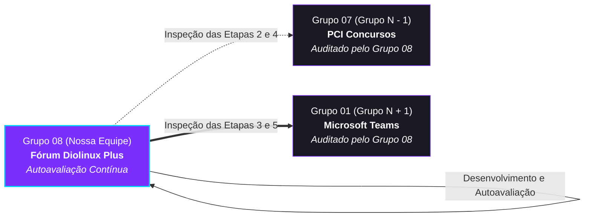

# Verificação e Garantia da Qualidade de IHC

## Tabela de Contribuição e Transparência de IA Generativa

A Tabela 1 apresenta a distribuição de responsabilidades, papéis e ferramentas utilizadas pelos discentes do Grupo 08 na concepção, estruturação e governança do módulo geral de Verificação e Validação do projeto.

**Tabela 1** — Matriz de Contribuição do Portal Geral de Verificação

| Integrante | Atribuição no Artefato | Data | Horário | Ferramenta de IA Utilizada | Propósito do Uso de IA |
| :--- | :--- | :---: | :---: | :--- | :--- |
| [Vinicius Silva Araruna](https://github.com/ViniciusA05) | **Tech Lead / Auditor Principal**: Concepção metodológica, arquitetura modular de verificação (ADR-07), fundamentação canônica em Fagan (1976), Mayhew (1999) e redação técnica do portal | 27/10/2026 | 00:30 - 01:20 | Google Gemini (LLM) | Apoio na estruturação sintática de Markdown e alinhamento ABNT |
| [Gustavo Antonio Rodrigues e Silva](https://github.com/gus-ant) | **Auditor Técnico**: Curadoria dos artefatos de Nível 1 e governança de repositório; co-apresentador das auditorias audiovisuais | 27/10/2026 | 00:45 - 01:20 | Google Gemini (LLM) | Apoio na padronização de diagramas Mermaid e checagem de links |
| [Edvaldo Soares Brasileiro Filho](https://github.com/PajeMurici-dev) | **Auditor Técnico**: Curadoria dos artefatos de Nível 2 e checagem cruzada das matrizes de conformidade e métricas ponderadas | 27/10/2026 | 01:00 - 01:20 | — | Revisão humana por pares e conferência de consistência |

_Fonte: Elaborada pelos autores (Grupo 08), 2026._

---

## 1. Introdução e Contextualização Metodológica

Na Engenharia de Usabilidade e na Garantia da Qualidade de Software, as atividades de **Verificação e Validação (V&V)** asseguram que os produtos de trabalho concebidos estejam em estrita conformidade com as diretrizes pedagógicas, requisitos de especificação e padrões ergonômicos canônicos (*Barbosa & Silva, 2021; Fagan, 1976; Sommerville, 2011*).

Este portal constitui o **Hub Integrado de Verificação e Auditoria Técnica do Grupo 08** na disciplina de Interação Humano-Computador (FGA0173 — Turma 01), ministrada pelo Prof. Dr. André Barros de Sales na Faculdade de Ciências e Tecnologias em Engenharia (FCTE/FGA) da Universidade de Brasília (UnB).

A sistemática adotada segue as melhores práticas da literatura de IHC e Engenharia de Software, combinando o **Método de Inspeção Formal de Software de Michael E. Fagan (1976)** com o modelo em três níveis do **Ciclo de Vida de Deborah Mayhew (1999)**:
1. **Instrumentos Normativos Autônomos (*Checklists*)**: As listas de verificação atuam como instrumentos formais neutros, reutilizáveis e desacoplados dos relatórios empíricos (sanando o apontamento metodológico pós-Entrega 2);
2. **Autoavaliação Contínua da Equipe**: Auditoria interna dos produtos de trabalho desenvolvidos pelo próprio Grupo 08 sobre o [Fórum Diolinux Plus](https://plus.diolinux.com.br);
3. **Inspeção Cíclica por Pares (*Peer Review*)**: Auditoria externa rigorosa e construtiva sobre o Grupo Precedente (Grupo N − 1: Grupo 07 — PCI Concursos) e sobre o Grupo Sucessor (Grupo N + 1: Grupo 01 — Microsoft Teams).

_Autor do Item Teórico: [Vinicius Silva Araruna](https://github.com/ViniciusA05)_  
*(Fundamentação teórica de inspeção formal em Fagan, 1976 e Barbosa & Silva, 2021, p. 286).*

---

## 2. A Sistemática Cíclica de Avaliação por Pares

Conforme estabelecido pela dinâmica didática da disciplina, cada equipe é responsável por auditar formalmente seus pares na escala cíclica da turma. A Figura 1 ilustra a posição do **Grupo 08** nessa cadeia de garantia da qualidade:

<strong>Figura 1</strong> — Diagrama de fluxo da sistemática cíclica de avaliação por pares na disciplina. <em>Fonte: Autores (Grupo 08), 2026.</em>

---

## 3. Navegação Rápida pelos Módulos de Inspeção

A Tabela 2 sintetiza os acessos diretos aos instrumentos de verificação, relatórios de autoavaliação e hubs de auditoria por pares mantidos pela equipe.

**Tabela 2** — Matriz de navegação dos módulos de verificação do Grupo 08

| Módulo / Escopo | Objeto / Finalidade | Etapas Cobertas | Acesso Direto |
| :--- | :--- | :---: | :---: |
| **Checklists Normativos** | Instrumentos em branco padronizados com perguntas objetivas e fontes canônicas | Etapas 1, 2, 3, 4 e 5 | [:material-format-list-checks: Acessar Checklists](lista-verificacao.md) |
| **Auto-Avaliação (Grupo 08)** | Relatório conclusivo de conformidade dos artefatos desenvolvidos pelo Grupo 08 | Etapas 1, 2, 3, 4 e 5 | [:material-check-decagram: Acessar Autoavaliação](grupo08.md) |
| **Avaliação do Grupo -1** | Auditoria técnica e pedagógica do Grupo 07 (Portal PCI Concursos) | Hub Central, Etapa 4 e Etapa 2 | [:material-account-arrow-left: Acessar Auditoria Grupo 07](grupo07/index.md) |
| **Avaliação do Grupo +1** | Auditoria técnica e pedagógica do Grupo 01 (Microsoft Teams) | Hub Central, Etapa 5 e Etapa 3 | [:material-account-arrow-right: Acessar Auditoria Grupo 01](grupo01/index.md) |

_Fonte: Elaborada pelos autores (Grupo 08), 2026._

---

## 4. Destaques das Auditorias Realizadas

  

    

      <h3 style="margin-top: 0; color: var(--dp-purple); font-size: 1.05rem;">📋 Listas de Verificação</h3>
      
Instrumentos neutros baseados nas rubricas oficiais do Plano de Ensino e na literatura canônica (Barbosa et al., Nielsen, Mayhew, Snyder).

    

    <a href="lista-verificacao.md" class="md-button md-button--primary" style="margin-top: 0.8rem; font-size: 0.82rem; text-align: center;">Consultar Checklists</a>
  

  

    

      <h3 style="margin-top: 0; color: var(--dp-cyan); font-size: 1.05rem;">🔍 Auto-Avaliação (Grupo 08)</h3>
      
Diagnóstico contínuo dos artefatos do Fórum Diolinux Plus frente às listas de verificação, métricas ponderadas e planejamento de retrabalho.

    

    <a href="grupo08.md" class="md-button" style="margin-top: 0.8rem; font-size: 0.82rem; text-align: center;">Ver Relatório Interno</a>
  

  

    

      <h3 style="margin-top: 0; font-size: 1.05rem;">👥 Grupo -1: Grupo 07 (PCI)</h3>
      
Auditorias da Etapa 2 (Perfil e Tarefas) e Etapa 4 (Planejamento de Nível 1), vídeos de apresentação e relatórios em PDF para download.

    

    <a href="grupo07/index.md" class="md-button" style="margin-top: 0.8rem; font-size: 0.82rem; text-align: center;">Acessar Hub Grupo 07</a>
  

  

    

      <h3 style="margin-top: 0; font-size: 1.05rem;">🚀 Grupo +1: Grupo 01 (Teams)</h3>
      
Auditorias da Etapa 3 (Análise de Requisitos) e Etapa 5 (Relatos de Nível 1 e Protótipo de Papel), gravação oficial e PDF padronizado.

    

    <a href="grupo01/index.md" class="md-button md-button--primary" style="margin-top: 0.8rem; font-size: 0.82rem; text-align: center;">Acessar Hub Grupo 01</a>
  

---

## 5. Histórico de Versão

A Tabela 3 documenta a evolução histórica deste Portal de Verificação.

**Tabela 3** — Histórico de Versão do Documento

| Versão | Data | Descrição Detalhada da Modificação | Autor(es) | Revisor(es) |
| :---: | :---: | :--- | :--- | :--- |
| `1.0` | 27/10/2026 | Estruturação inicial do Portal Geral de Verificação e Garantia da Qualidade (ADR-07): integração metodológica de Fagan (1976), fluxo cíclico de avaliação por pares e navegação rápida pelos módulos. | [Vinicius Silva Araruna](https://github.com/ViniciusA05) | [Gustavo Antonio](https://github.com/gus-ant), [Edvaldo Soares](https://github.com/PajeMurici-dev) |

_Fonte: Elaborada pelos autores (Grupo 08), 2026._

---

## 6. Referências Bibliográficas (ABNT)

[1] BARBOSA, Simone Diniz Junqueira; SILVA, Bruno Santana da; SILVEIRA, Milene Selbach; GASPARINI, Isabela; DARIN, Ticianne; BARBOSA, Gabriel Diniz Junqueira. *Interação Humano-Computador e Experiência do Usuário*. Rio de Janeiro: Autopublicação, 2021. ISBN 978-65-00-19677-1.

[2] FAGAN, Michael E. Design and code inspections to reduce errors in program development. *IBM Systems Journal*, v. 15, n. 3, p. 182-211, 1976.

[3] MAYHEW, Deborah J. *The Usability Engineering Lifecycle: A Practitioner's Handbook for User Interface Design*. San Francisco: Morgan Kaufmann, 1999.

[4] NIELSEN, Jakob. *Usability Engineering*. San Francisco: Morgan Kaufmann Publishers, 1994.

[5] SALES, André Barros de. *Plano de Ensino da Disciplina de Interação Humano-Computador*. Faculdade UnB Gama (FGA), Universidade de Brasília (UnB), 2026.

[6] SOMMERVILLE, Ian. *Engenharia de Software*. 9. ed. São Paulo: Pearson Prentice Hall, 2011.

---

## Agradecimentos e Declaração de Uso de IA Generativa

A estruturação textual e a formatação dos cartões visuais em Markdown/HTML contaram com suporte supervisionado de Inteligência Artificial Generativa exclusivamente para auxílio na formatação sintática. Todas as análises críticas, métricas e deliberações de governança foram concebidas, auditadas e validadas integralmente pelos discentes do Grupo 08.
