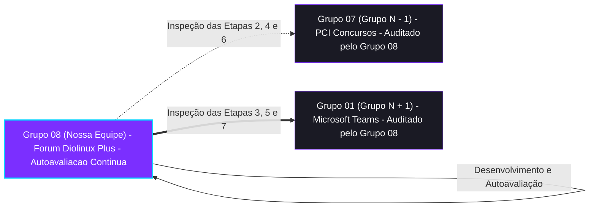

# Verificação e Garantia da Qualidade de IHC

## Tabela de Contribuição e Transparência de IA Generativa

A Tabela 1 apresenta a distribuição de responsabilidades, papéis e ferramentas utilizadas pelos discentes do Grupo 08 na concepção, estruturação e governança do módulo geral de Verificação e Validação do projeto.

**Tabela 1** — Matriz de Contribuição do Portal Geral de Verificação

| Integrante | Atribuição no Artefato | Data | Horário | Ferramenta de IA Utilizada | Propósito do Uso de IA |
| :--- | :--- | :---: | :---: | :--- | :--- |
| [Vinicius Silva Araruna](https://github.com/ViniciusA05) | **Tech Lead / Auditor Principal**: Concepção metodológica, arquitetura modular de verificação (ADR-07), fundamentação canônica em Fagan (1976), Mayhew (1999) e redação técnica do portal | 04/11/2026 | 20:30 - 22:45 | Google Gemini (LLM) | Apoio na estruturação sintática de Markdown e alinhamento ABNT |
| [Gustavo Antonio Rodrigues e Silva](https://github.com/gus-ant) | **Auditor Técnico**: Curadoria dos artefatos de Nível 1 e governança de repositório; co-apresentador das auditorias audiovisuais | 04/11/2026 | 20:30 - 22:30 | Google Gemini (LLM) | Apoio na padronização de diagramas Mermaid e checagem de links |
| [Edvaldo Soares Brasileiro Filho](https://github.com/PajeMurici-dev) | **Auditor Técnico**: Curadoria dos artefatos de Nível 2 e checagem cruzada das matrizes de conformidade e métricas ponderadas | 04/11/2026 | 20:30 - 22:15 | — | Revisão humana por pares e conferência de consistência |

_Fonte: Elaborada por Edvaldo Soares Brasileiro Filho, Gustavo Antonio Rodrigues e Silva e Vinicius Silva Araruna, 2026._

---

## 1. Introdução e Contextualização Metodológica

Na Engenharia de Usabilidade e na Garantia da Qualidade de Software, as atividades de **Verificação e Validação (V&V)** asseguram que os produtos de trabalho concebidos estejam em estrita conformidade com as diretrizes pedagógicas, requisitos de especificação e padrões ergonômicos canônicos (*Barbosa & Silva, 2021; Fagan, 1976; Sommerville, 2011*).

Este portal constitui o **Hub Integrado de Verificação e Auditoria Técnica do Grupo 08** na disciplina de Interação Humano-Computador (FGA0173 — Turma 01), ministrada pelo Prof. Dr. André Barros de Sales na Faculdade de Ciências e Tecnologias em Engenharia (FCTE/FGA) da Universidade de Brasília (UnB).

A sistemática adotada segue as melhores práticas da literatura de IHC e Engenharia de Software, combinando o **Método de Inspeção Formal de Software de Michael E. Fagan (1976)** com o modelo em três níveis do **Ciclo de Vida de Deborah Mayhew (1999)**:
1. **Instrumentos Normativos Autônomos (*Checklists*)**: As listas de verificação atuam como instrumentos formais neutros, reutilizáveis e desacoplados dos relatórios empíricos (sanando o apontamento metodológico pós-Entrega 2);
2. **Autoavaliação Contínua da Equipe**: Auditoria interna dos produtos de trabalho desenvolvidos pelo próprio Grupo 08 sobre o [Fórum Diolinux Plus](https://plus.diolinux.com.br);
3. **Inspeção Cíclica por Pares (*Peer Review*)**: Auditoria externa rigorosa e construtiva sobre o Grupo Precedente (Grupo N − 1: Grupo 07 — PCI Concursos) e sobre o Grupo Sucessor (Grupo N + 1: Grupo 01 — Microsoft Teams).

_Autor do Item Teórico: [Vinicius Silva Araruna](https://github.com/ViniciusA05)_  
*(Fundamentação teórica de inspeção formal em Fagan, 1976 e Barbosa & Silva, 2021, p. 286).*

---

## 2. A Sistemática Cíclica de Avaliação por Pares

Conforme estabelecido pela dinâmica didática da disciplina, cada equipe é responsável por auditar formalmente seus pares na escala cíclica da turma. A Figura 1 ilustra a posição do **Grupo 08** nessa cadeia de garantia da qualidade:

<strong>Figura 1</strong> — Diagrama de fluxo da sistemática cíclica de avaliação por pares na disciplina. <em>Fonte: Diagrama elaborado por Edvaldo Soares Brasileiro Filho, Gustavo Antonio Rodrigues e Silva e Vinicius Silva Araruna, 2026.</em>

---

## 3. Navegação Rápida pelos Módulos de Inspeção

A Tabela 2 sintetiza os acessos diretos aos instrumentos de verificação, relatórios de autoavaliação e hubs de auditoria por pares mantidos pela equipe.

**Tabela 2** — Matriz de navegação dos módulos de verificação do Grupo 08

| Módulo / Escopo | Objeto / Finalidade | Etapas Cobertas | Acesso Direto |
| :--- | :--- | :---: | :---: |
| **Listas de Verificação por Artefato** | 16 listas temáticas (`v1.0` a `v2.2` — 414 itens e 325 recortes) com autoria nominal por item (Prof. André e equipe), citações diretas e mais de 200 recortes da literatura | Etapas 1 a 8 | [:material-folder-multiple: Acessar Listas por Artefato](listas/index.md) |
| **Checklists Normativos (Por Entrega)** | Instrumentos em branco padronizados agrupados por entrega com perguntas objetivas, fontes canônicas e colunas de autoria e data/hora | Etapas 1 a 8 | [:material-format-list-checks: Acessar Checklists](lista-verificacao.md) |
| **Auto-Avaliação (Grupo 08)** | Relatório conclusivo de conformidade e retrabalho dos artefatos desenvolvidos pelo Grupo 08 | Etapas 1 a 8 | [:material-check-decagram: Acessar Autoavaliação](grupo08/index.md) |
| **Avaliação do Grupo -1** | Auditoria técnica e pedagógica do Grupo 07 (Portal PCI Concursos) | Hub Central, Etapas 2, 4, 6 e 8 (Auditoria Global) | [:material-account-arrow-left: Acessar Auditoria Grupo 07](grupo07/index.md) |
| **Avaliação do Grupo +1** | Auditoria técnica e pedagógica do Grupo 01 (Microsoft Teams) | Hub Central, Etapas 3, 5, 7 e 8 (Auditoria Global) | [:material-account-arrow-right: Acessar Auditoria Grupo 01](grupo01/index.md) |
| **Entrega 8 (Consolidação)** | Síntese oficial da Entrega 8 e acesso unificado aos instrumentos normativos e auditorias | Etapa 8 | [:material-flag-checkered: Acessar Entrega 8](../entregas/entrega8.md) |

_Fonte: Elaborada por Edvaldo Soares Brasileiro Filho, Gustavo Antonio Rodrigues e Silva e Vinicius Silva Araruna, 2026._

---

## 4. Destaques das Auditorias Realizadas

  

    

      <h3 style="margin-top: 0; color: var(--dp-purple); font-size: 1.05rem;">📋 Listas de Verificação por Artefato &amp; Checklists</h3>
      
16 listas temáticas (`v1.0` a `v2.2` — 414 itens e 325 recortes) por artefato organizadas pelo Ciclo de Mayhew com coluna de autor por item (Prof. André e discentes da equipe) e recortes da literatura.

    

    <a href="listas/" class="md-button md-button--primary" style="margin-top: 0.8rem; font-size: 0.82rem; text-align: center;">Acessar 16 Listas por Artefato</a>
  

  

    

      <h3 style="margin-top: 0; color: var(--dp-cyan); font-size: 1.05rem;">🔍 Auto-Avaliação (Grupo 08)</h3>
      
Diagnóstico contínuo dos artefatos do Fórum Diolinux Plus frente às listas de verificação, métricas ponderadas e planejamento de retrabalho.

    

    <a href="grupo08/" class="md-button" style="margin-top: 0.8rem; font-size: 0.82rem; text-align: center;">Ver Relatório Interno</a>
  

  

    

      <h3 style="margin-top: 0; font-size: 1.05rem;">👥 Grupo -1: Grupo 07 (PCI)</h3>
      
Auditorias da Etapa 2 (Perfil e Tarefas), Etapa 4 (Planejamento de Nível 1) e Etapa 6 (Relato em Papel e Alta Fidelidade), vídeos de apresentação e relatórios em PDF para download.

    

    <a href="grupo07/" class="md-button" style="margin-top: 0.8rem; font-size: 0.82rem; text-align: center;">Acessar Hub Grupo 07</a>
  

  

    

      <h3 style="margin-top: 0; font-size: 1.05rem;">🚀 Grupo +1: Grupo 01 (Teams)</h3>
      
Auditorias da Etapa 3 (Análise de Requisitos), Etapa 5 (Relatos de Nível 1 e Protótipo de Papel) e Etapa 7 (Relato de Alta Fidelidade — Nível 3), com relatórios em PDF padronizado.

    

    <a href="grupo01/" class="md-button md-button--primary" style="margin-top: 0.8rem; font-size: 0.82rem; text-align: center;">Acessar Hub Grupo 01</a>
  

---

## 5. Validação do Portal pela Lista de Governança do Prof. Dr. André Barros de Sales (`DG-01` a `DG-11`)

A **Tabela 3** aplica os 11 critérios oficiais de desenvolvimento e governança do Plano de Ensino (*Sales, 2026, pp. 8–9*) sobre este próprio Portal de Verificação.

**Tabela 3** — Autoavaliação de Governança do Portal de Verificação (`DG-01` a `DG-11`)

| ID | Critério de Governança do Plano de Ensino | Autor do Item | Resposta | Versão, Data e Hora da Avaliação | Evidência de Conformidade neste Portal |
| :---: | :--- | :--- | :---: | :---: | :--- |
| **DG-01** | O histórico de versão padronizado? | **Prof. Dr. André Barros de Sales** *(Plano de Ensino FGA0173, 2026)* | ✅ **Sim (Conforme)** | `v2.0` — 20/11/2026 às 15:05 | **Tabela 4** padronizada na Seção 6. |
| **DG-02** | O(s) autor(es) e o(s) revisor(es) para cada artefato? | **Prof. Dr. André Barros de Sales** *(Plano de Ensino FGA0173, 2026)* | ✅ **Sim (Conforme)** | `v2.0` — 20/11/2026 às 15:05 | Indicados com hyperlinks GitHub na **Tabela 1**, linha de autoria teórica e **Tabela 4**. |
| **DG-03** | Referências bibliográficas e/ou bibliografia em todos os artefatos? | **Prof. Dr. André Barros de Sales** *(Plano de Ensino FGA0173, 2026)* | ✅ **Sim (Conforme)** | `v2.0` — 20/11/2026 às 15:05 | Seção 7 completa no padrão ABNT. |
| **DG-04** | As tabelas e imagens possuem legenda e fonte e são chamadas dentro do texto? | **Prof. Dr. André Barros de Sales** *(Plano de Ensino FGA0173, 2026)* | ✅ **Sim (Conforme)** | `v2.0` — 20/11/2026 às 15:05 | **Figura 1** e **Tabelas 1 a 4** devidamente numeradas, com fonte e chamadas textuais. |
| **DG-05** | Um texto fazendo uma introdução dos artefatos? | **Prof. Dr. André Barros de Sales** *(Plano de Ensino FGA0173, 2026)* | ✅ **Sim (Conforme)** | `v2.0` — 20/11/2026 às 15:05 | Seção 1 contextualiza V&V, Fagan (1976) e Mayhew (1999). |
| **DG-06** | O cronograma executado com quem realizou cada atividade e datas? | **Prof. Dr. André Barros de Sales** *(Plano de Ensino FGA0173, 2026)* | ✅ **Sim (Conforme)** | `v2.0` — 20/11/2026 às 15:05 | Vinculado a [Cronograma Executado](../planejamento/cronograma-executado.md). |
| **DG-07** | Ata(s) da(s) reuniões (data, horário, participantes, objetivo, atividades)? | **Prof. Dr. André Barros de Sales** *(Plano de Ensino FGA0173, 2026)* | ✅ **Sim (Conforme)** | `v2.0` — 20/11/2026 às 15:05 | Linkada via [Atas de Reunião](../atas/index.md). |
| **DG-08** | A gravação da reunião do grupo? | **Prof. Dr. André Barros de Sales** *(Plano de Ensino FGA0173, 2026)* | ✅ **Sim (Conforme)** | `v2.0` — 20/11/2026 às 15:05 | Disponibilizada nas páginas individuais de [Atas de Reunião](../atas/index.md). |
| **DG-09** | Vídeo de apresentação na categoria 'Não Listado' no YouTube? | **Prof. Dr. André Barros de Sales** *(Plano de Ensino FGA0173, 2026)* | ⚠️ **Em preparação (Etapa 8)** | `v2.0` — 20/11/2026 às 15:05 | Vídeos das Entregas 1–7 publicados; apresentação da [Entrega 8](../entregas/entrega8.md) (20–30 min, Não Listado) prevista após conclusão das inspeções da etapa. |
| **DG-10** | Tabela de contribuição no início do artefato com hiperligações? | **Prof. Dr. André Barros de Sales** *(Plano de Ensino FGA0173, 2026)* | ✅ **Sim (Conforme)** | `v2.0` — 20/11/2026 às 15:05 | **Tabela 1** presente no topo da página. |
| **DG-11** | Seção de agradecimentos apresentando o uso de IA Generativa? | **Prof. Dr. André Barros de Sales** *(Plano de Ensino FGA0173, 2026)* | ✅ **Sim (Conforme)** | `v2.0` — 20/11/2026 às 15:05 | Seção final explícita sobre uso supervisionado de IA. |

_Fonte: Elaborada por Edvaldo Soares Brasileiro Filho, Gustavo Antonio Rodrigues e Silva e Vinicius Silva Araruna com base no Plano de Ensino (Prof. Dr. André Barros de Sales, 2026, pp. 8–9), 2026._

---

## 6. Histórico de Versão

A **Tabela 4** documenta a evolução histórica deste Portal de Verificação.

**Tabela 4** — Histórico de Versão do Documento

| Versão | Data | Descrição Detalhada da Modificação | Autor(es) | Revisor(es) |
| :---: | :---: | :--- | :--- | :--- |
| `1.0` | 27/10/2026 | Estruturação inicial do Portal Geral de Verificação e Garantia da Qualidade (ADR-07): integração metodológica de Fagan (1976), fluxo cíclico de avaliação por pares e navegação rápida pelos módulos. | [Vinicius Silva Araruna](https://github.com/ViniciusA05) | [Gustavo Antonio](https://github.com/gus-ant), [Edvaldo Soares](https://github.com/PajeMurici-dev) |
| `1.1` | 04/11/2026 | Atualização do fluxo cíclico e dos módulos de inspeção com a inclusão da auditoria da Etapa 6 do Grupo -1 (Grupo 07). | [Vinicius Silva Araruna](https://github.com/ViniciusA05) | [Gustavo Antonio](https://github.com/gus-ant), [Edvaldo Soares](https://github.com/PajeMurici-dev) |
| `1.2` | 16/11/2026 | Atualização do fluxo cíclico, Tabela 2 e destaques com a inclusão da auditoria da Etapa 7 do Grupo +1 (Grupo 01 — Microsoft Teams). | [Vinicius Silva Araruna](https://github.com/ViniciusA05) | [Gustavo Antonio](https://github.com/gus-ant), [Edvaldo Soares](https://github.com/PajeMurici-dev) |
| `1.3` | 19/11/2026 | Atualização da cobertura dos módulos de Checklists Normativos e Auto-Avaliação do Grupo 08 para as Etapas 1 a 8 (Entrega 8 — Auditoria Global). | [Gustavo Antonio Rodrigues e Silva](https://github.com/gus-ant) | [Vinicius Silva Araruna](https://github.com/ViniciusA05), [Edvaldo Soares Brasileiro Filho](https://github.com/PajeMurici-dev) |
| `2.0` | 20/11/2026 | Integração do Catálogo de Listas de Verificação por Artefato (15 módulos temáticos), vínculo com a Entrega 8 e inclusão da validação pela lista de governança `DG-01` a `DG-11` do Prof. André Barros de Sales. | [Vinicius Silva Araruna](https://github.com/ViniciusA05) | [Gustavo Antonio Rodrigues e Silva](https://github.com/gus-ant), [Edvaldo Soares Brasileiro Filho](https://github.com/PajeMurici-dev) |

_Fonte: Elaborada por Edvaldo Soares Brasileiro Filho, Gustavo Antonio Rodrigues e Silva e Vinicius Silva Araruna, 2026._

---

## 7. Referências Bibliográficas (ABNT)

[1] BARBOSA, Simone Diniz Junqueira; SILVA, Bruno Santana da; SILVEIRA, Milene Selbach; GASPARINI, Isabela; DARIN, Ticianne; BARBOSA, Gabriel Diniz Junqueira. *Interação Humano-Computador e Experiência do Usuário*. Rio de Janeiro: Autopublicação, 2021. ISBN 978-65-00-19677-1.

[2] FAGAN, Michael E. Design and code inspections to reduce errors in program development. *IBM Systems Journal*, v. 15, n. 3, p. 182-211, 1976.

[3] MAYHEW, Deborah J. *The Usability Engineering Lifecycle: A Practitioner's Handbook for User Interface Design*. San Francisco: Morgan Kaufmann, 1999.

[4] NIELSEN, Jakob. *Usability Engineering*. San Francisco: Morgan Kaufmann Publishers, 1994.

[5] SALES, André Barros de. *Plano de Ensino da Disciplina de Interação Humano-Computador*. Faculdade UnB Gama (FGA), Universidade de Brasília (UnB), 2026.

[6] SOMMERVILLE, Ian. *Engenharia de Software*. 9. ed. São Paulo: Pearson Prentice Hall, 2011.

---

## Agradecimentos e Declaração de Uso de IA Generativa

A estruturação textual e a formatação dos cartões visuais em Markdown/HTML contaram com suporte supervisionado de Inteligência Artificial Generativa exclusivamente para auxílio na formatação sintática. Todas as análises críticas, métricas e deliberações de governança foram concebidas, auditadas e validadas integralmente pelos discentes do Grupo 08.
