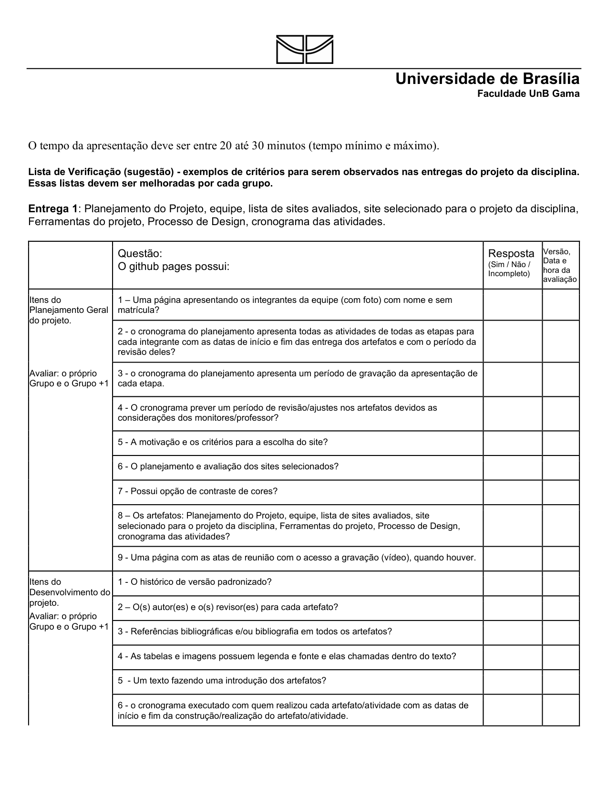
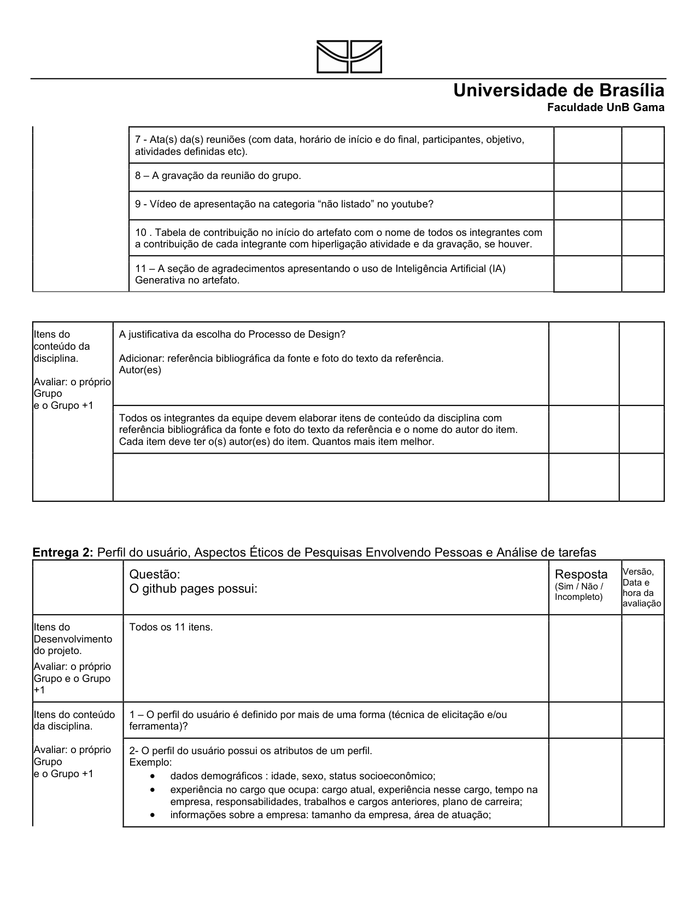

# Lista de Verificação — Governança e Plano de Ensino Geral (Prof. Dr. André Barros de Sales)

## Tabela de Contribuição e Transparência de IA Generativa

A **Tabela 1** apresenta a distribuição de responsabilidades na elaboração, curadoria e revisão de **Governança e Plano de Ensino Geral (Prof. Dr. André Barros de Sales)**.

**Tabela 1** — Matriz de Contribuição e Transparência de IA Generativa — Governança e Plano de Ensino Geral (Prof. Dr. André Barros de Sales)

| Integrante | Atribuição no Artefato | Data | Horário | Ferramenta de IA | Propósito do Uso de IA |
| :--- | :--- | :---: | :---: | :--- | :--- |
| [Vinicius Silva Araruna](https://github.com/ViniciusA05) | Catalogação integral dos itens `PG-01..09`, `DG-01..11` e `PE-E1-01..02` do Plano de Ensino com autoria nominal do Prof. Dr. André Barros de Sales e prints oficiais | 20/11/2026 | 14:00 - 15:30 | Google Gemini | Suporte na organização estrutural, formatação de tabelas em Markdown e conferência cruzada com o Plano de Ensino |
| [Gustavo Antonio Rodrigues e Silva](https://github.com/gus-ant) | Revisão de conformidade estrutural, navegação e checagem de links | 20/11/2026 | 15:30 - 16:00 | — | Revisão por pares e validação editorial |
| [Edvaldo Soares Brasileiro Filho](https://github.com/PajeMurici-dev) | Auditoria de rastreabilidade frente ao Plano de Ensino (`DG-01` a `DG-11`) e referências ABNT | 20/11/2026 | 15:30 - 16:00 | — | Revisão por pares e conferência documental |

_Fonte: Elaborada pelos autores, 2026._

---

## 1. Introdução e Contextualização Metodológica

Esta página centraliza os **critérios transversais e estruturais de autoria do Prof. Dr. André Barros de Sales** definidos nas páginas 8 e 9 do *Plano de Ensino da Disciplina de Interação Humano-Computador (FGA0173 — 02/2026)*. Conforme especificado pelo docente na rubrica da disciplina, os **11 Itens de Desenvolvimento do Projeto (`DG-01` a `DG-11`)** se repetem em **todas as entregas e artefatos**, sendo utilizados nesta estrutura organizada por artefato tanto para auditar os produtos do projeto quanto para **autovalidar todas as páginas de Listas de Verificação**.

---

## 2. Instrumento Normativo de Verificação — Plano de Ensino Geral

### 2.1 Itens de Planejamento Geral da Entrega 1 (`PG-01` a `PG-09`)

A **Tabela 2** detalha os 9 critérios estruturais de planejamento e acessibilidade de portal atribuídos ao Prof. Dr. André Barros de Sales.

**Tabela 2** — Critérios de Planejamento Geral do Projeto (`PG-01` a `PG-09`)

| ID | Critério / Pergunta de Verificação | Autor do Item | Fundamentação Normativa | Evidência Visual (Figura) | Resposta | Versão, Data e Hora da Avaliação |
| :---: | :--- | :--- | :--- | :---: | :---: | :---: |
| **PG-01** | Uma página apresentando os integrantes da equipe (com foto), nome completo e sem matrícula? | **Prof. Dr. André Barros de Sales** *(Plano de Ensino FGA0173, 2026)* | Plano de Ensino (Sales, 2026, p. 8) | [Ver Figura 1](#figura-1) | `[ ] Sim (Conforme)` `[ ] Não (Não Conforme)` `[ ] Incompleto` `[ ] N/A` | *(Preencher na inspeção)* |
| **PG-02** | O cronograma do planejamento apresenta todas as atividades de todas as etapas para cada integrante com datas de início/fim e período de revisão? | **Prof. Dr. André Barros de Sales** *(Plano de Ensino FGA0173, 2026)* | Plano de Ensino (Sales, 2026, p. 8) | [Ver Figura 1](#figura-1) | `[ ] Sim (Conforme)` `[ ] Não (Não Conforme)` `[ ] Incompleto` `[ ] N/A` | *(Preencher na inspeção)* |
| **PG-03** | O cronograma do planejamento apresenta um período de gravação da apresentação de cada etapa? | **Prof. Dr. André Barros de Sales** *(Plano de Ensino FGA0173, 2026)* | Plano de Ensino (Sales, 2026, p. 8) | [Ver Figura 1](#figura-1) | `[ ] Sim (Conforme)` `[ ] Não (Não Conforme)` `[ ] Incompleto` `[ ] N/A` | *(Preencher na inspeção)* |
| **PG-04** | O cronograma prevê um período de revisão/ajustes nos artefatos devidos às considerações dos monitores/professor? | **Prof. Dr. André Barros de Sales** *(Plano de Ensino FGA0173, 2026)* | Plano de Ensino (Sales, 2026, p. 8) | [Ver Figura 1](#figura-1) | `[ ] Sim (Conforme)` `[ ] Não (Não Conforme)` `[ ] Incompleto` `[ ] N/A` | *(Preencher na inspeção)* |
| **PG-05** | A motivação e os critérios para a escolha do site selecionado? | **Prof. Dr. André Barros de Sales** *(Plano de Ensino FGA0173, 2026)* | Plano de Ensino (Sales, 2026, p. 8) | [Ver Figura 1](#figura-1) | `[ ] Sim (Conforme)` `[ ] Não (Não Conforme)` `[ ] Incompleto` `[ ] N/A` | *(Preencher na inspeção)* |
| **PG-06** | O planejamento e avaliação dos sites candidatos antes da escolha final? | **Prof. Dr. André Barros de Sales** *(Plano de Ensino FGA0173, 2026)* | Plano de Ensino (Sales, 2026, p. 8) | [Ver Figura 1](#figura-1) | `[ ] Sim (Conforme)` `[ ] Não (Não Conforme)` `[ ] Incompleto` `[ ] N/A` | *(Preencher na inspeção)* |
| **PG-07** | O site de documentação possui opção de contraste de cores (acessibilidade)? | **Prof. Dr. André Barros de Sales** *(Plano de Ensino FGA0173, 2026)* | Plano de Ensino (Sales, 2026, p. 8) | [Ver Figura 1](#figura-1) | `[ ] Sim (Conforme)` `[ ] Não (Não Conforme)` `[ ] Incompleto` `[ ] N/A` | *(Preencher na inspeção)* |
| **PG-08** | Estão publicados os artefatos: Planejamento, Equipe, Lista de Sites Avaliados, Site Selecionado, Ferramentas, Processo de Design e Cronograma? | **Prof. Dr. André Barros de Sales** *(Plano de Ensino FGA0173, 2026)* | Plano de Ensino (Sales, 2026, p. 8) | [Ver Figura 1](#figura-1) | `[ ] Sim (Conforme)` `[ ] Não (Não Conforme)` `[ ] Incompleto` `[ ] N/A` | *(Preencher na inspeção)* |
| **PG-09** | Uma página com as atas de reunião e acesso à gravação em vídeo, quando houver? | **Prof. Dr. André Barros de Sales** *(Plano de Ensino FGA0173, 2026)* | Plano de Ensino (Sales, 2026, p. 8) | [Ver Figura 1](#figura-1) | `[ ] Sim (Conforme)` `[ ] Não (Não Conforme)` `[ ] Incompleto` `[ ] N/A` | *(Preencher na inspeção)* |

_Fonte: Plano de Ensino da Disciplina (Prof. Dr. André Barros de Sales, 2026, p. 8)._

### 2.2 Itens Transversais de Desenvolvimento e Governança (`DG-01` a `DG-11` — Repetidos em Toda Etapa)

A **Tabela 3** formaliza os 11 critérios obrigatórios em toda entrega e artefato da disciplina.

**Tabela 3** — Itens Transversais de Desenvolvimento e Governança (`DG-01` a `DG-11`)

| ID | Critério / Pergunta de Verificação | Autor do Item | Fundamentação Normativa | Evidência Visual (Figura) | Resposta | Versão, Data e Hora da Avaliação |
| :---: | :--- | :--- | :--- | :---: | :---: | :---: |
| **DG-01** | O histórico de versão padronizado? | **Prof. Dr. André Barros de Sales** *(Plano de Ensino FGA0173, 2026)* | Plano de Ensino (Sales, 2026, p. 8) | [Ver Figura 1](#figura-1) | `[ ] Sim (Conforme)` `[ ] Não (Não Conforme)` `[ ] Incompleto` `[ ] N/A` | *(Preencher na inspeção)* |
| **DG-02** | O(s) autor(es) e o(s) revisor(es) para cada artefato? | **Prof. Dr. André Barros de Sales** *(Plano de Ensino FGA0173, 2026)* | Plano de Ensino (Sales, 2026, p. 8) | [Ver Figura 1](#figura-1) | `[ ] Sim (Conforme)` `[ ] Não (Não Conforme)` `[ ] Incompleto` `[ ] N/A` | *(Preencher na inspeção)* |
| **DG-03** | Referências bibliográficas e/ou bibliografia em todos os artefatos? | **Prof. Dr. André Barros de Sales** *(Plano de Ensino FGA0173, 2026)* | Plano de Ensino (Sales, 2026, p. 8) | [Ver Figura 1](#figura-1) | `[ ] Sim (Conforme)` `[ ] Não (Não Conforme)` `[ ] Incompleto` `[ ] N/A` | *(Preencher na inspeção)* |
| **DG-04** | As tabelas e imagens possuem legenda e fonte e são chamadas dentro do texto? | **Prof. Dr. André Barros de Sales** *(Plano de Ensino FGA0173, 2026)* | Plano de Ensino (Sales, 2026, p. 8) | [Ver Figura 1](#figura-1) | `[ ] Sim (Conforme)` `[ ] Não (Não Conforme)` `[ ] Incompleto` `[ ] N/A` | *(Preencher na inspeção)* |
| **DG-05** | Um texto fazendo uma introdução dos artefatos? | **Prof. Dr. André Barros de Sales** *(Plano de Ensino FGA0173, 2026)* | Plano de Ensino (Sales, 2026, p. 8) | [Ver Figura 1](#figura-1) | `[ ] Sim (Conforme)` `[ ] Não (Não Conforme)` `[ ] Incompleto` `[ ] N/A` | *(Preencher na inspeção)* |
| **DG-06** | O cronograma executado com quem realizou cada artefato/atividade e as datas de início e fim da construção/realização? | **Prof. Dr. André Barros de Sales** *(Plano de Ensino FGA0173, 2026)* | Plano de Ensino (Sales, 2026, p. 8) | [Ver Figura 1](#figura-1) | `[ ] Sim (Conforme)` `[ ] Não (Não Conforme)` `[ ] Incompleto` `[ ] N/A` | *(Preencher na inspeção)* |
| **DG-07** | Ata(s) da(s) reuniões (com data, horário de início e do final, participantes, objetivo, atividades definidas etc.)? | **Prof. Dr. André Barros de Sales** *(Plano de Ensino FGA0173, 2026)* | Plano de Ensino (Sales, 2026, p. 9) | [Ver Figura 2](#figura-2) | `[ ] Sim (Conforme)` `[ ] Não (Não Conforme)` `[ ] Incompleto` `[ ] N/A` | *(Preencher na inspeção)* |
| **DG-08** | A gravação da reunião do grupo? | **Prof. Dr. André Barros de Sales** *(Plano de Ensino FGA0173, 2026)* | Plano de Ensino (Sales, 2026, p. 9) | [Ver Figura 2](#figura-2) | `[ ] Sim (Conforme)` `[ ] Não (Não Conforme)` `[ ] Incompleto` `[ ] N/A` | *(Preencher na inspeção)* |
| **DG-09** | Vídeo de apresentação na categoria 'Não Listado' no YouTube (duração entre 20 e 30 minutos)? | **Prof. Dr. André Barros de Sales** *(Plano de Ensino FGA0173, 2026)* | Plano de Ensino (Sales, 2026, pp. 8–9) | [Ver Figura 2](#figura-2) | `[ ] Sim (Conforme)` `[ ] Não (Não Conforme)` `[ ] Incompleto` `[ ] N/A` | *(Preencher na inspeção)* |
| **DG-10** | Tabela de contribuição no início do artefato com o nome de todos os integrantes, contribuição com hiperligação da atividade e da gravação? | **Prof. Dr. André Barros de Sales** *(Plano de Ensino FGA0173, 2026)* | Plano de Ensino (Sales, 2026, p. 9) | [Ver Figura 2](#figura-2) | `[ ] Sim (Conforme)` `[ ] Não (Não Conforme)` `[ ] Incompleto` `[ ] N/A` | *(Preencher na inspeção)* |
| **DG-11** | A seção de agradecimentos apresentando o uso de Inteligência Artificial (IA) Generativa no artefato? | **Prof. Dr. André Barros de Sales** *(Plano de Ensino FGA0173, 2026)* | Plano de Ensino (Sales, 2026, pp. 3 e 9) | [Ver Figura 2](#figura-2) | `[ ] Sim (Conforme)` `[ ] Não (Não Conforme)` `[ ] Incompleto` `[ ] N/A` | *(Preencher na inspeção)* |

_Fonte: Plano de Ensino da Disciplina (Prof. Dr. André Barros de Sales, 2026, pp. 8–9)._

### 2.3 Itens de Conteúdo Inicial da Entrega 1 (`PE-E1-01` e `PE-E1-02`)

A **Tabela 4** registra os 2 critérios de conteúdo teórico exigidos desde a Entrega 1 (justificativa do Processo de Design e exigência de autoria, referência e foto por integrante).

**Tabela 4** — Critérios de Conteúdo Inicial da Entrega 1 (`PE-E1-01` e `PE-E1-02`)

| ID | Critério / Pergunta de Verificação | Autor do Item | Fundamentação Normativa | Evidência Visual (Figura) | Resposta | Versão, Data e Hora da Avaliação |
| :---: | :--- | :--- | :--- | :---: | :---: | :---: |
| **PE-E1-01** | A justificativa da escolha do Processo de Design? *(Adicionar referência bibliográfica da fonte, foto do texto da referência e autor(es))* | **Prof. Dr. André Barros de Sales** *(Plano de Ensino FGA0173, 2026)* | Plano de Ensino (Sales, 2026, p. 9) | [Ver Figura 2](#figura-2) | `[ ] Sim (Conforme)` `[ ] Não (Não Conforme)` `[ ] Incompleto` `[ ] N/A` | *(Preencher na inspeção)* |
| **PE-E1-02** | Todos os integrantes da equipe elaboram itens de conteúdo da disciplina com referência bibliográfica, foto do texto da referência e nome do autor de cada item? | **Prof. Dr. André Barros de Sales** *(Plano de Ensino FGA0173, 2026)* | Plano de Ensino (Sales, 2026, p. 9) | [Ver Figura 2](#figura-2) | `[ ] Sim (Conforme)` `[ ] Não (Não Conforme)` `[ ] Incompleto` `[ ] N/A` | *(Preencher na inspeção)* |

_Fonte: Plano de Ensino da Disciplina (Prof. Dr. André Barros de Sales, 2026, p. 9)._

### Evidências Visuais da Literatura e do Plano de Ensino

Cada figura a seguir é chamada explicitamente e vinculada ao respectivo critério na tabela normativa acima.

A **Figura 1** reproduz o trecho comprobatório de referência referente ao critério **PG-01..PG-09 / DG-01..DG-06**.

**Figura 1** — Evidência documental referente ao item `PG-01..PG-09 / DG-01..DG-06`.  
_Fonte: SALES, André Barros de. Plano de Ensino IHC (FGA0173), UnB/FGA, 2026, p. 8._

A **Figura 2** reproduz o trecho comprobatório de referência referente ao critério **DG-07..DG-11 / PE-E1-01..02**.

**Figura 2** — Evidência documental referente ao item `DG-07..DG-11 / PE-E1-01..02`.  
_Fonte: SALES, André Barros de. Plano de Ensino IHC (FGA0173), UnB/FGA, 2026, p. 9._

---

## 3. Validação desta Lista pela Lista de Governança do Prof. Dr. André Barros de Sales (`DG-01` a `DG-11`)

Em estrito cumprimento às diretrizes de qualidade do Plano de Ensino (*Sales, 2026, pp. 8–9*), a **Tabela 5** submete esta própria página (`00-plano-ensino-geral.md`) aos **11 Itens de Desenvolvimento do Projeto** formulados pelo Prof. Dr. André Barros de Sales.

**Tabela 5** — Autoavaliação de `00-plano-ensino-geral.md` frente aos critérios `DG-01` a `DG-11`

| ID | Critério de Governança do Plano de Ensino | Autor do Item | Resposta | Versão, Data e Hora da Avaliação | Evidência de Conformidade nesta Lista |
| :---: | :--- | :--- | :---: | :---: | :--- |
| **DG-01** | O histórico de versão padronizado? | **Prof. Dr. André Barros de Sales** *(Plano de Ensino FGA0173, 2026)* | ✅ **Sim (Conforme)** | `v1.0` — 20/11/2026 às 14:30 | Seção **Histórico de Versão** (**Tabela 6**) padronizada ao final de `00-plano-ensino-geral.md` registrando `v1.0`. |
| **DG-02** | O(s) autor(es) e o(s) revisor(es) para cada artefato? | **Prof. Dr. André Barros de Sales** *(Plano de Ensino FGA0173, 2026)* | ✅ **Sim (Conforme)** | `v1.0` — 20/11/2026 às 14:30 | Colunas **Autor(es)** e **Revisor(es)** preenchidas com links GitHub no Histórico de Versão, além da coluna **`Autor do Item`** em 100% dos critérios da lista. |
| **DG-03** | Referências bibliográficas e/ou bibliografia em todos os artefatos? | **Prof. Dr. André Barros de Sales** *(Plano de Ensino FGA0173, 2026)* | ✅ **Sim (Conforme)** | `v1.0` — 20/11/2026 às 14:30 | Seção **Referências Bibliográficas (ABNT NBR 6023)** completa ao final do documento com obras, edições e páginas exatas. |
| **DG-04** | As tabelas e imagens possuem legenda e fonte e são chamadas dentro do texto? | **Prof. Dr. André Barros de Sales** *(Plano de Ensino FGA0173, 2026)* | ✅ **Sim (Conforme)** | `v1.0` — 20/11/2026 às 14:30 | 100% das tabelas (`Tabela 1` a `Tabela 6`) e figuras (`Figura 1` e `Figura 2`) possuem numeração, legenda, fonte e chamadas textuais prévias. Reproduz integralmente as páginas 8 e 9 do Plano de Ensino oficial. |
| **DG-05** | Um texto fazendo uma introdução dos artefatos? | **Prof. Dr. André Barros de Sales** *(Plano de Ensino FGA0173, 2026)* | ✅ **Sim (Conforme)** | `v1.0` — 20/11/2026 às 14:30 | Seção **1. Introdução e Contextualização Metodológica** situa o instrumento no Ciclo de Mayhew (1999) e na Inspeção Formal de Fagan (1976). |
| **DG-06** | O cronograma executado com quem realizou cada artefato/atividade e as datas de início e fim da construção/realização? | **Prof. Dr. André Barros de Sales** *(Plano de Ensino FGA0173, 2026)* | ✅ **Sim (Conforme)** | `v1.0` — 20/11/2026 às 14:30 | Registros de elaboração e revisão vinculados ao [Cronograma Executado](../../planejamento/cronograma-executado.md) e ao histórico Git da equipe. |
| **DG-07** | Ata(s) da(s) reuniões (com data, horário de início e do final, participantes, objetivo, atividades definidas etc.)? | **Prof. Dr. André Barros de Sales** *(Plano de Ensino FGA0173, 2026)* | ✅ **Sim (Conforme)** | `v1.0` — 20/11/2026 às 14:30 | Deliberações e alinhamentos documentados nas [Atas de Reunião](../../atas/index.md). |
| **DG-08** | A gravação da reunião do grupo? | **Prof. Dr. André Barros de Sales** *(Plano de Ensino FGA0173, 2026)* | ✅ **Sim (Conforme)** | `v1.0` — 20/11/2026 às 14:30 | Links funcionais de gravações das reuniões de planejamento e auditoria indexados em [Atas de Reunião](../../atas/index.md). |
| **DG-09** | Vídeo de apresentação na categoria 'Não Listado' no YouTube (duração entre 20 e 30 minutos)? | **Prof. Dr. André Barros de Sales** *(Plano de Ensino FGA0173, 2026)* | ⚠️ **Em preparação (Etapa 8)** | `v1.0` — 20/11/2026 às 14:30 | Vídeos das Entregas 1–7 publicados; vídeo oficial da [Entrega 8 — Verificação dos Artefatos](../../entregas/entrega8.md) (20–30 min, Não Listado) agendado após consolidação das inspeções da equipe. |
| **DG-10** | Tabela de contribuição no início do artefato com o nome de todos os integrantes, contribuição com hiperligação da atividade e da gravação? | **Prof. Dr. André Barros de Sales** *(Plano de Ensino FGA0173, 2026)* | ✅ **Sim (Conforme)** | `v1.0` — 20/11/2026 às 14:30 | **Tabela 1** posicionada no topo do documento discriminando cada integrante ativo com hiperligação GitHub e escopo de atuação. |
| **DG-11** | A seção de agradecimentos apresentando o uso de Inteligência Artificial (IA) Generativa no artefato? | **Prof. Dr. André Barros de Sales** *(Plano de Ensino FGA0173, 2026)* | ✅ **Sim (Conforme)** | `v1.0` — 20/11/2026 às 14:30 | Seção **Agradecimentos e Declaração de Uso de IA Generativa** ao final do documento em estrita conformidade com o Código da SBC e Sales (2026). |

_Fonte: Validação elaborada por Vinicius Silva Araruna com base na rubrica oficial de Prof. Dr. André Barros de Sales (Plano de Ensino, 2026, pp. 8–9)._

---

## 4. Histórico de Versão

A **Tabela 6** registra a evolução histórica e o controle de versionamento deste instrumento normativo.

**Tabela 6** — Histórico de Versão do Documento

| Versão | Data | Descrição Detalhada da Modificação | Autor(es) | Revisor(es) |
| :---: | :---: | :--- | :--- | :--- |
| `1.0` | 20/11/2026 | Extração e catalogação integral dos critérios transversais e estruturais do Prof. Dr. André Barros de Sales (`PG-01..09`, `DG-01..11`, `PE-E1-01..02`), com recortes originais do Plano de Ensino e autovalidação de governança. | [Vinicius Silva Araruna](https://github.com/ViniciusA05) | [Gustavo Antonio Rodrigues e Silva](https://github.com/gus-ant), [Edvaldo Soares Brasileiro Filho](https://github.com/PajeMurici-dev) |

_Fonte: Elaborada pelos autores, 2026._

---

## 5. Referências Bibliográficas (ABNT NBR 6023)

[1] BARBOSA, Simone Diniz Junqueira et al. *Interação Humano-Computador e Experiência do Usuário*. 1. ed. Rio de Janeiro: Autopublicação, 2021. ISBN 978-65-00-19677-1.

[2] BARBOSA, Simone Diniz Junqueira; SILVA, Bruno Santana da. *Interação Humano-Computador*. 1. ed. Rio de Janeiro: Elsevier / Campus, 2010.

[3] FAGAN, Michael E. Design and code inspections to reduce errors in program development. *IBM Systems Journal*, v. 15, n. 3, p. 182–211, 1976.

[4] MAYHEW, Deborah J. *The Usability Engineering Lifecycle: A Practitioner's Handbook for User Interface Design*. San Francisco: Morgan Kaufmann, 1999.

[5] SALES, André Barros de. *Plano de Ensino da Disciplina de Interação Humano Computador (FGA0173 — 02/2026)*. Brasília: Universidade de Brasília, Faculdade UnB Gama (FGA), 2026.

[6] SOCIEDADE BRASILEIRA DE COMPUTAÇÃO (SBC). *Código de Conduta da Sociedade Brasileira de Computação*. Porto Alegre: SBC, 2023.

---

## 6. Agradecimentos e Declaração de Uso de Inteligência Artificial (IA) Generativa

Em conformidade com o Código de Conduta da Sociedade Brasileira de Computação (SBC, Art. 2º, parágrafo III) e com as diretrizes do Plano de Ensino da disciplina (*Sales, 2026, p. 3*), declara-se que a organização das tabelas em Markdown e a revisão ortográfica contaram com suporte supervisionado da ferramenta de Inteligência Artificial Generativa Google Gemini. Toda a concepção metodológica, verificação bibliográfica nas obras originais, revisão técnica e validação de conformidade foram realizadas pelos discentes identificados no Histórico de Versão.
