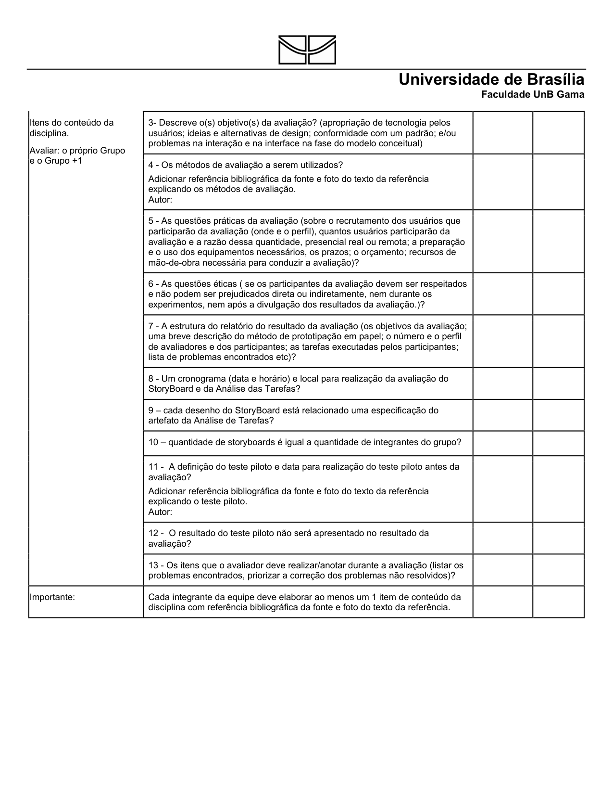
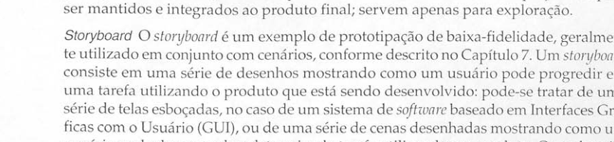
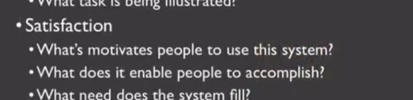
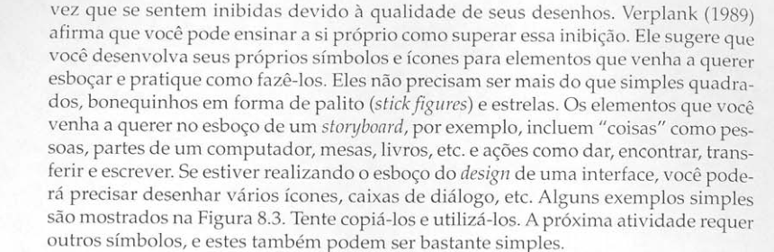
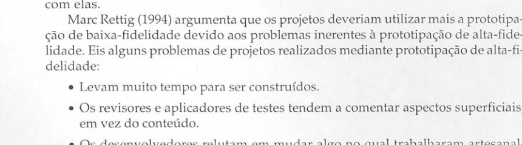
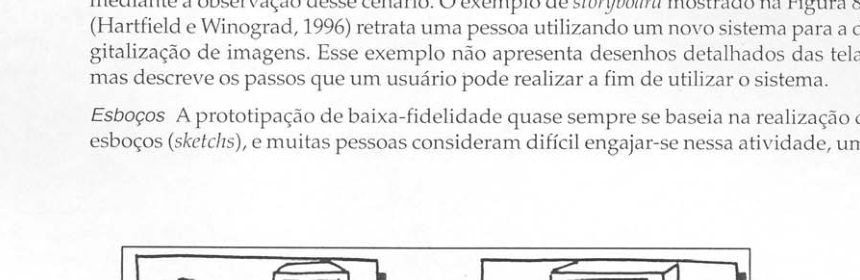
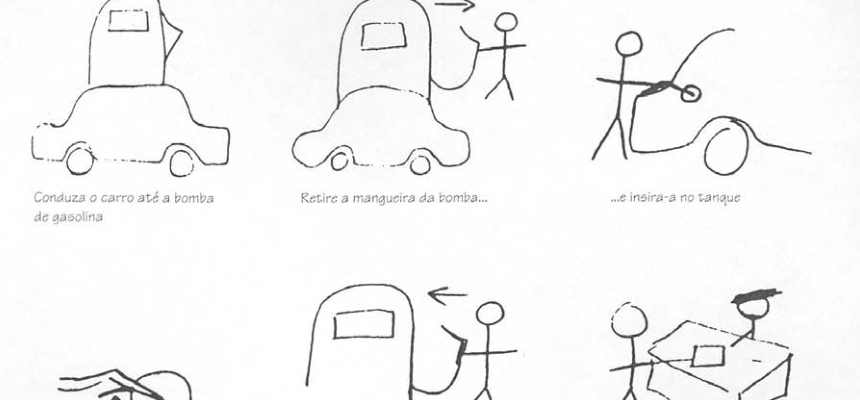
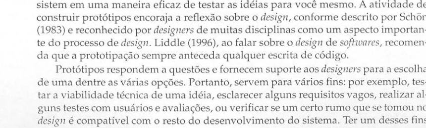
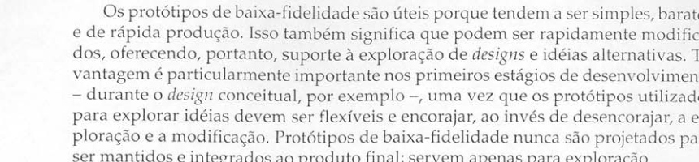
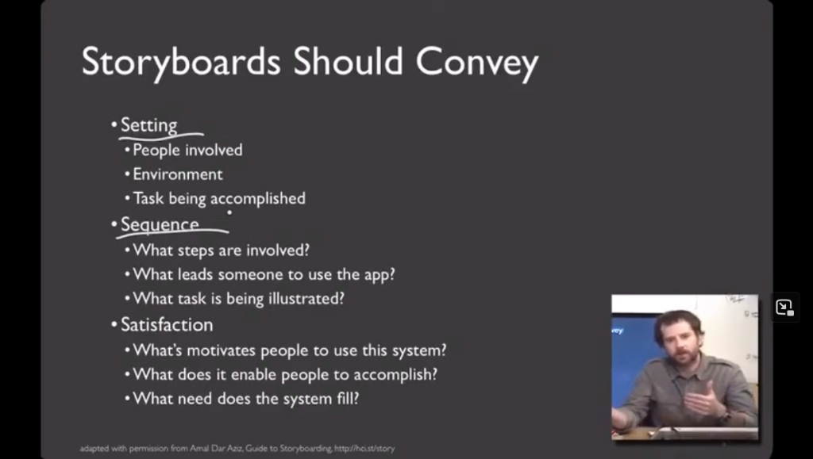

# Lista de Verificação — Nível 1 — Storyboard

## Tabela de Contribuição e Transparência de IA Generativa

A **Tabela 1** apresenta a distribuição de responsabilidades na elaboração, curadoria e revisão de **Nível 1 — Storyboard**.

**Tabela 1** — Matriz de Contribuição e Transparência de IA Generativa — Nível 1 — Storyboard

| Integrante | Atribuição no Artefato | Data | Horário | Ferramenta de IA | Propósito do Uso de IA |
| :--- | :--- | :---: | :---: | :--- | :--- |
| [Vinicius Silva Araruna](https://github.com/ViniciusA05) | Elaboração modular dos critérios de `SB`, citação direta, recortes da obra e autoavaliação pela rubrica `DG-01` a `DG-11` | 20/11/2026 | 14:00 - 15:30 | Google Gemini | Suporte na organização estrutural, formatação de tabelas em Markdown e conferência cruzada com o Plano de Ensino |
| [Gustavo Antonio Rodrigues e Silva](https://github.com/gus-ant) | Revisão de conformidade estrutural, navegação e checagem de links | 20/11/2026 | 15:30 - 16:00 | — | Revisão por pares e validação editorial |
| [Edvaldo Soares Brasileiro Filho](https://github.com/PajeMurici-dev) | Auditoria de rastreabilidade frente ao Plano de Ensino (`DG-01` a `DG-11`) e referências ABNT | 20/11/2026 | 15:30 - 16:00 | — | Revisão por pares e conferência documental |

_Fonte: Elaborada pelos autores, 2026._

---

## 1. Introdução e Contextualização Metodológica

Este módulo verifica exclusivamente os artefatos de **Storyboard** (Nível 1 do Ciclo de Mayhew), reunindo os **2 critérios do Prof. André Barros de Sales** (Plano p. 13: rastreabilidade com Análise de Tarefas e 1 storyboard por integrante), os **12 critérios** baseados em Preece, Rogers & Sharp (2005, Cap. 8) e Klemmer (2012), e os **10 critérios complementares (`STB-01` a `STB-10`)** elaborados por Gustavo Antonio em `item-teorico-storyboard.md`.

Este instrumento normativo atua segundo o **Método de Inspeção Formal de Michael E. Fagan (1976)** e encontra-se desacoplado dos relatórios empíricos de aplicação. Toda inspeção registrada aqui identifica obrigatoriamente o **`Autor do Item`**, a **fundamentação bibliográfica com recorte visual** e a coluna **`Versão, Data e Hora da Avaliação`** exigida pelo Plano de Ensino (*Sales, 2026, pp. 8–13*).

!!! info "Pré-requisito Transversal de Governança (Prof. Dr. André Barros de Sales)"
    Além dos critérios específicos deste artefato listados na **Seção 2**, todo produto de trabalho avaliado deve cumprir integralmente os **11 Itens de Desenvolvimento Geral (`DG-01` a `DG-11`)** definidos pelo Prof. Dr. André Barros de Sales em [00. Governança e Plano de Ensino Geral](00-plano-ensino-geral.md).

---

## 2. Instrumento Normativo de Verificação — Nível 1 — Storyboard

### 2.1 Critérios do Plano de Ensino (Prof. Dr. André Barros de Sales — Rubrica Oficial)

A **Tabela 2** reúne os critérios oficiais estipulados pelo docente para este artefato no Plano de Ensino (*Sales, 2026*).

**Tabela 2** — Critérios oficiais do Plano de Ensino para Nível 1 — Storyboard

| ID | Critério / Pergunta de Verificação | Autor do Item | Fundamentação Canônica e Fonte | Evidência Visual (Figura) | Resposta | Versão, Data e Hora da Avaliação |
| :---: | :--- | :--- | :--- | :---: | :---: | :---: |
| **PE-E4-09** | Cada desenho do StoryBoard está relacionado a uma especificação do artefato da Análise de Tarefas? | **Prof. Dr. André Barros de Sales** *(Plano de Ensino FGA0173, 2026)* | Plano de Ensino (Sales, 2026, p. 13, Item 9) | [Ver Figura 1](#figura-1) | `[ ] Sim (Conforme)` `[ ] Não (Não Conforme)` `[ ] Incompleto` `[ ] N/A` | *(Preencher na inspeção)* |
| **PE-E4-10** | A quantidade de storyboards é igual à quantidade de integrantes do grupo? | **Prof. Dr. André Barros de Sales** *(Plano de Ensino FGA0173, 2026)* | Plano de Ensino (Sales, 2026, p. 13, Item 10) | [Ver Figura 1](#figura-1) | `[ ] Sim (Conforme)` `[ ] Não (Não Conforme)` `[ ] Incompleto` `[ ] N/A` | *(Preencher na inspeção)* |

_Fonte: Plano de Ensino da Disciplina (Prof. Dr. André Barros de Sales, 2026)._

### 2.2 Critérios Técnicos da Literatura Canônica (Lista de Verificação `SB`)

A **Tabela 3** apresenta os **12 itens normativos** fundamentados na literatura científica com citação direta literal e recorte visual da página.

**Tabela 3** — Lista de verificação normativa de Nível 1 — Storyboard (12 itens)

| ID | Critério / Pergunta de Verificação | Autor do Item | Fundamentação Canônica (Obra, Ed., Cap., Pág.) e Citação Literal | Evidência Visual (Figura) | Resposta | Versão, Data e Hora da Avaliação |
| :---: | :--- | :--- | :--- | :---: | :---: | :---: |
| **SB-01** | **Definição e Natureza do Storyboard como Prototipação de Baixa-Fidelidade** O artefato define o storyboard como uma técnica de prototipação de baixa-fidelidade que consiste em uma série de desenhos sequenciais ilustrando como o usuário progride em uma tarefa no produto interativo, funcionando como um instrumento flexível de exploração conceitual que não visa ser integrado ao produto final em código? • **Prototipação de baixa-fidelidade:** reconhecimento explícito de que o storyboard utiliza representações de baixa precisão e baixo custo para explorar ideias preliminares; • **Série encadeada de desenhos:** presença de cenas visuais sequenciadas demonstrando a evolução das ações do usuário durante a tarefa; • **Exploração vs. produto final:** foco na discussão e ideação com stakeholders, sem pretensão de implementar código-fonte ou telas definitivas. | [Vinicius Silva Araruna](https://github.com/ViniciusA05) | *"Storyboard: O storyboard é um exemplo de prototipação de baixa-fidelidade, geralmente utilizado em conjunto com cenários... Um storyboard consiste em uma série de desenhos mostrando como um usuário pode progredir em uma tarefa utilizando o produto que está sendo desenvolvido... não são projetados para ser mantidos e integrados ao produto final; servem apenas para exploração."* PREECE, Jennifer; ROGERS, Yvonne; SHARP, Helen. Design de Interação: Além da interação homem-computador. 1. ed. Porto Alegre: Bookman, 2005, p. 263 (Capítulo 8). | [Ver Figura 2](#figura-2) | `[ ] Sim (Conforme)` `[ ] Não (Não Conforme)` `[ ] Incompleto` `[ ] N/A` | *(Preencher na inspeção)* |
| **SB-02** | **Ambientação Narrativa e Contexto de Uso (Dimensão Setting)** O storyboard explicita de maneira clara a dimensão de ambientação (Setting), caracterizando com clareza quais são as pessoas envolvidas (papel de usuário/persona), o ambiente físico e contextual onde a ação se desenvolve (ex: sala de estudos, laboratório, terminal Linux) e a tarefa ou necessidade de partida que motivou a interação? • **Pessoas envolvidas (People involved):** identificação nítida dos atores humanos presentes na cena e seu papel de utilizador; • **Ambiente de uso (Environment):** representação visual ou textual do espaço físico, ferramentas de trabalho e circunstâncias contextuais; • **Tarefa em execução (Task being accomplished):** indicação explícita do objetivo prático de partida que a pessoa busca realizar. | [Vinicius Silva Araruna](https://github.com/ViniciusA05) | *"Storyboards Should Convey: Setting • People involved • Environment • Task being accomplished"* KLEMMER, Scott. Human-Computer Interaction: Design of Interactive Systems. Stanford University / Coursera, 2012; PREECE, J. et al., 2005, p. 263. | [Ver Figura 3](#figura-3) | `[ ] Sim (Conforme)` `[ ] Não (Não Conforme)` `[ ] Incompleto` `[ ] N/A` | *(Preencher na inspeção)* |
| **SB-03** | **Encadeamento Causal e Progressão Temporal (Dimensão Sequence)** O storyboard estrutura uma progressão narrativa contínua e causal (Sequence), esclarecendo quais são os passos consecutivos executados pelo usuário, qual evento disparador ou gatilho situacional levou o indivíduo a acionar o sistema e qual tarefa específica está sendo ilustrada em cada transição de quadro? • **Passos envolvidos (What steps are involved?):** encadeamento lógico passo a passo entre os quadros sem saltos temporais inexplicáveis; • **Gatilho disparador (What leads someone to use the app?):** contextualização do evento inicial ou dúvida que compeliu o usuário a recorrer à interface; • **Tarefa ilustrada (What task is being illustrated?):** foco temático claro na operacionalização da tarefa sob investigação. | [Vinicius Silva Araruna](https://github.com/ViniciusA05) | *"Storyboards Should Convey: Sequence • What steps are involved? • What leads someone to use the app? • What task is being illustrated?"* KLEMMER, Scott. Human-Computer Interaction: Design of Interactive Systems. Stanford University / Coursera, 2012; PREECE, J. et al., 2005, p. 263. | [Ver Figura 4](#figura-4) | `[ ] Sim (Conforme)` `[ ] Não (Não Conforme)` `[ ] Incompleto` `[ ] N/A` | *(Preencher na inspeção)* |
| **SB-04** | **Desfecho da Narrativa e Resolução da Necessidade (Dimensão Satisfaction)** O quadro final ou clímax do storyboard evidencia a satisfação do usuário (Satisfaction), demonstrando o que motivou a pessoa a utilizar o sistema, o que ela conseguiu alcançar e qual necessidade real, dúvida técnica ou problema prático foi plenamente solucionado? • **Motivação atendida (What motivates people to use this system?):** demonstração de que a motivação original encontrou resposta efetiva; • **Realização alcançada (What does it enable people to accomplish?):** explicitação do resultado benéfico ou ganho de produtividade obtido; • **Atendimento da necessidade (What need does the system fill?):** fechamento positivo do ciclo interativo com a entrega do valor pretendido. | [Vinicius Silva Araruna](https://github.com/ViniciusA05) | *"Storyboards Should Convey: Satisfaction • What motivates people to use this system? • What does it enable people to accomplish? • What need does the system fill?"* KLEMMER, Scott. Human-Computer Interaction: Design of Interactive Systems. Stanford University / Coursera, 2012; PREECE, J. et al., 2005, p. 263. | [Ver Figura 5](#figura-5) | `[ ] Sim (Conforme)` `[ ] Não (Não Conforme)` `[ ] Incompleto` `[ ] N/A` | *(Preencher na inspeção)* |
| **SB-05** | **Rastreabilidade e Integração com Cenários de Uso e Personas** O storyboard demonstra vinculação direta com um cenário de uso e com as personas previamente documentadas no projeto, atuando como uma concretização visual que adiciona detalhes espaciais e atitudinais à narrativa escrita sem divergir do perfil e das motivações dos usuários? • **Complementaridade com cenários:** o storyboard é concebido em conjunto com cenários, enriquecendo o texto narrativo com representações gráficas; • **Simulação para stakeholders:** capacidade de proporcionar aos interessados uma oportunidade de vivenciar e simular a interação; • **Consistência de personas:** correspondência entre o comportamento do personagem desenhado e os dados demográficos e metas da persona do projeto. | [Vinicius Silva Araruna](https://github.com/ViniciusA05) | *"Quando utilizado juntamente com um cenário, o storyboard traz mais detalhes ao cenário escrito e oferece aos stakeholders uma oportunidade de simular uma interação com o produto mediante a observação desse cenário."* PREECE, Jennifer; ROGERS, Yvonne; SHARP, Helen. Design de Interação: Além da interação homem-computador. 1. ed. Porto Alegre: Bookman, 2005, p. 263 (Capítulo 8). | [Ver Figura 6](#figura-6) | `[ ] Sim (Conforme)` `[ ] Não (Não Conforme)` `[ ] Incompleto` `[ ] N/A` | *(Preencher na inspeção)* |
| **SB-06** | **Correspondência Unívoca com a Análise Hierárquica de Tarefas (HTA)** Cada desenho e cena do storyboard está explicitamente correlacionado a um subobjetivo, operação ou plano formal da Análise de Tarefas (HTA) da funcionalidade, garantindo que as ações ilustradas possuam correspondência direta com o modelo hierárquico concebido? • **Rastreabilidade de subobjetivos:** identificação de qual nó da árvore HTA (ex: subobjetivo 1.1, 1.2 ou 2) está representado em cada quadro; • **Respeito aos planos operacionais:** fidelidade à lógica de planos (sequencial, seleção condicional ou laço) especificada na modelagem HTA; • **Critério de conformidade curricular:** cumprimento estrito da diretriz do Plano de Ensino da disciplina (questão 9 da rubrica de avaliação). | [Vinicius Silva Araruna](https://github.com/ViniciusA05) | *"9 – cada desenho do StoryBoard está relacionado uma especificação do artefato da Análise de Tarefas?"* SALES, André Barros de. Plano de Ensino da Disciplina de Interação Humano Computador. Universidade de Brasília, FGA, 2026, p. 13 (Item 9). | [Ver Figura 7](#figura-7) | `[ ] Sim (Conforme)` `[ ] Não (Não Conforme)` `[ ] Incompleto` `[ ] N/A` | *(Preencher na inspeção)* |
| **SB-07** | **Simplicidade dos Esboços e Linguagem Visual (Diretriz de Verplank)** Os desenhos do storyboard utilizam técnicas de esboço simplificado (sketches), como bonecos-palito (stick figures), quadrados, setas e ícones básicos conforme preconizado por Verplank (1989), priorizando a expressão clara de ações fundamentais (dar, encontrar, transferir, escrever) sobre o refinamento artístico? • **Uso de figuras simplificadas:** emprego de stick figures e símbolos básicos sem exigência de ilustrações hiper-realistas; • **Representação de verbos de ação:** clareza na demonstração de movimentos e operações do usuário (olhar, digitar, clicar, receber feedback); • **Superação da inibição gráfica:** foco no valor comunicativo da ideia de design e na reflexão crítica de equipe. | [Vinicius Silva Araruna](https://github.com/ViniciusA05) | *"Ele sugere que você desenvolva seus próprios símbolos e ícones para elementos que venha a querer esboçar e pratique como fazê-los. Eles não precisam ser mais do que simples quadrados, bonequinhos em forma de palito (stick figures) e estrelas. Os elementos... incluem 'coisas' como pessoas, partes de um computador... e ações como dar, encontrar, transferir e escrever..."* PREECE, Jennifer; ROGERS, Yvonne; SHARP, Helen. Design de Interação: Além da interação homem-computador. 1. ed. Porto Alegre: Bookman, 2005, p. 264 (Capítulo 8). | [Ver Figura 8](#figura-8) | `[ ] Sim (Conforme)` `[ ] Não (Não Conforme)` `[ ] Incompleto` `[ ] N/A` | *(Preencher na inspeção)* |
| **SB-08** | **Ausência de Distrações Cosméticas e Cores Excessivas (Diretriz de Rettig)** O storyboard adota estética de baixa-fidelidade (preto e branco, escala de cinza ou monocromático com traços simples), evitando cores chamativas ou acabamentos estilísticos que possam desviar a atenção do avaliador para detalhes cosméticos superficiais em vez da lógica de uso e dos requisitos? • **Evitação de ruído cromático:** não utilização de cores saturadas que atuem como elementos de distração cognitiva durante a avaliação; • **Foco no conteúdo substantivo:** garantia de que as sessões de validação gerem comentários sobre a tarefa e não sobre a beleza estética; • **Princípio de Rettig:** preservação da flexibilidade para modificação rápida sem apego emocional por designs artesanais excessivos. | [Vinicius Silva Araruna](https://github.com/ViniciusA05) | *"Marc Rettig (1994) argumenta que os projetos deveriam utilizar mais a prototipação de baixa-fidelidade... Os revisores e aplicadores de testes tendem a comentar aspectos superficiais, em vez do conteúdo. Os desenvolvedores relutam em mudar algo no qual trabalharam artesanalmente por horas."* RETTIG, Marc (1994) apud PREECE, J. et al. Design de Interação: Além da interação homem-computador. Bookman, 2005, p. 265. | [Ver Figura 9](#figura-9) | `[ ] Sim (Conforme)` `[ ] Não (Não Conforme)` `[ ] Incompleto` `[ ] N/A` | *(Preencher na inspeção)* |
| **SB-09** | **Representação do Diálogo Interativo (Ações do Usuário e Respostas do Sistema)** As cenas do storyboard expressam adequadamente o diálogo bidirecional entre usuário e sistema, representando tanto a conduta e os comandos efetuados pelo participante quanto as alterações visíveis de estado e os feedbacks exibidos pelo produto (conforme modelo de Hartfield e Winograd, 1996)? • **Ação física ou motora:** representação perceptível do momento em que o usuário digita, seleciona ou clica na interface; • **Resposta do sistema:** indicação visual do comportamento da interface frente à ação do operador (telas de diálogo, confirmação, mensagens); • **Transparência situacional:** clareza de como o usuário interpreta o estado do sistema a cada instante. | [Vinicius Silva Araruna](https://github.com/ViniciusA05) | *"O exemplo de storyboard mostrado na Figura 8.2 (Hartfield e Winograd, 1996) retrata uma pessoa utilizando um novo sistema para a digitalização de imagens. Esse exemplo não apresenta desenhos detalhados das telas, mas descreve os passos que um usuário pode realizar a fim de utilizar o sistema."* HARTFIELD, B.; WINOGRAD, T. (1996) apud PREECE, J. et al. Design de Interação. Bookman, 2005, p. 263. | [Ver Figura 10](#figura-10) | `[ ] Sim (Conforme)` `[ ] Não (Não Conforme)` `[ ] Incompleto` `[ ] N/A` | *(Preencher na inspeção)* |
| **SB-10** | **Anotações Textuais e Legendas Descritivas em Cada Quadro** Cada quadro ou vinheta gráfica do storyboard é estruturado com uma legenda explicativa textual sucinta posicionada logo abaixo da imagem, narrando em palavras simples a ação em curso, o contexto operativo ou o estado mental do personagem para evitar interpretações equivocadas? • **Presença universal de legendas:** 100% dos quadros apresentam texto descritivo correlato; • **Concisão e clareza:** sentenças curtas e informativas que direcionam o olhar do observador para o núcleo da interação ilustrada; • **Padrão editorial consolidado:** estrutura visual similar aos storyboards clássicos de cinema e de design de interação (ex: Figura 8.4). | [Vinicius Silva Araruna](https://github.com/ViniciusA05) | *"Figura 8.4 Um storyboard demonstrando como abastecer um carro com gasolina [apresentando legendas textuais explicativas sob cada um dos 6 quadros sequenciais]."* PREECE, Jennifer; ROGERS, Yvonne; SHARP, Helen. Design de Interação: Além da interação homem-computador. 1. ed. Porto Alegre: Bookman, 2005, p. 265. | [Ver Figura 11](#figura-11) | `[ ] Sim (Conforme)` `[ ] Não (Não Conforme)` `[ ] Incompleto` `[ ] N/A` | *(Preencher na inspeção)* |
| **SB-11** | **Foco no Perfil Real do Usuário e Complexidade Não-Trivial (Anti-CRUD)** A narrativa retratada no storyboard aborda cenários complexos e interações realistas aderentes ao perfil do Estudante/Aprendiz Linux no Fórum Diolinux Plus (como formatação técnica, busca de soluções ou onboarding com bot), distanciando-se de simples formulários triviais de cadastro de dados (CRUD básico)? • **Resolução de problemas reais:** situações verossímeis de usuários enfrentando barreiras conceituais no terminal ou buscando auxílio comunitário; • **Relevância para os objetivos de negócio e comunidade:** estímulo à participação colaborativa, categorização adequada e boas práticas; • **Alinhamento à literatura de personas:** operacionalização dos objetivos pessoais e práticos elicitados sem caricaturas superficiais. | [Vinicius Silva Araruna](https://github.com/ViniciusA05) | *"Protótipos respondem a questões e fornecem suporte aos designers para a escolha de uma dentre as várias opções... Assim, se você, por exemplo, está tentando esclarecer como os usuários podem realizar um conjunto de tarefas e se o aparelho que você propôs oferece suporte a eles nisto, você pode então fazer uma maquete de papel..."* PREECE, Jennifer; ROGERS, Yvonne; SHARP, Helen. Design de Interação: Além da interação homem-computador. 1. ed. Porto Alegre: Bookman, 2005, p. 261 (Capítulo 8). | [Ver Figura 12](#figura-12) | `[ ] Sim (Conforme)` `[ ] Não (Não Conforme)` `[ ] Incompleto` `[ ] N/A` | *(Preencher na inspeção)* |
| **SB-12** | **Autonomia Cognitiva e Viabilidade de Avaliação por Terceiros** O storyboard possui fechamento cognitivo e autonomia de leitura suficientes para que qualquer inspetor, usuário participante ou membro da banca examinadora compreenda a história completa e identifique os principais gargalos da interação sem necessidade de explicações verbais externas por parte do autor? • **Autossuficiência narrativa:** coerência intrínseca com começo, meio e fim claramente demarcados; • **Facilidade de avaliação formativa:** possibilidade de elicitar críticas e sugestões de aprimoramento diretamente da observação da sequência gráfica; • **Clareza para simulação:** o artefato cumpre seu papel de dispositivo comunicacional entre designers, desenvolvedores e usuários. | [Vinicius Silva Araruna](https://github.com/ViniciusA05) | *"Os protótipos são muito úteis quando se estão discutindo idéias com stakeholders; são dispositivos que facilitam a comunicação entre os membros das equipes e que consistem em uma maneira eficaz de testar as idéias para você mesmo... servem para esclarecer alguns requisitos vagos, realizar alguns testes com usuários e avaliações..."* PREECE, Jennifer; ROGERS, Yvonne; SHARP, Helen. Design de Interação: Além da interação homem-computador. 1. ed. Porto Alegre: Bookman, 2005, p. 261 (Capítulo 8). | [Ver Figura 13](#figura-13) | `[ ] Sim (Conforme)` `[ ] Não (Não Conforme)` `[ ] Incompleto` `[ ] N/A` | *(Preencher na inspeção)* |

_Fonte: Elaborada por [Vinicius Silva Araruna](https://github.com/ViniciusA05), 2026._

### 2.3 Critérios Complementares da Equipe no Repositório

A **Tabela 4** integra os **10 critérios** complementares elaborados pela equipe nos artefatos correspondentes de Nível 1 — Storyboard.

**Tabela 4** — Critérios complementares da equipe para Nível 1 — Storyboard

| ID | Critério / Pergunta de Verificação | Autor do Item | Fundamentação Canônica / Fonte | Evidência Visual (Figura) | Resposta | Versão, Data e Hora da Avaliação |
| :---: | :--- | :--- | :--- | :---: | :---: | :---: |
| **STB-01** | Setting (Cenário): O storyboard identifica e contextualiza com clareza as pessoas e atores envolvidos na interação (*People involved*)? | [Gustavo Antonio Rodrigues e Silva](https://github.com/gus-ant) | KLEMMER (2012); AZIZ (2010); PREECE et al. (2005, Cap. 8, p. 262) | [Ver Figura 14](#figura-14) | `[ ] Sim (Conforme)` `[ ] Não (Não Conforme)` `[ ] Incompleto` `[ ] N/A` | *(Preencher na inspeção)* |
| **STB-02** | Setting (Cenário): O storyboard retrata o ambiente físico ou contexto real de uso onde a ação ocorre (*Environment*)? | [Gustavo Antonio Rodrigues e Silva](https://github.com/gus-ant) | KLEMMER (2012); AZIZ (2010); BARBOSA et al. (2021, Cap. 10, p. 238) | [Ver Figura 14](#figura-14) | `[ ] Sim (Conforme)` `[ ] Não (Não Conforme)` `[ ] Incompleto` `[ ] N/A` | *(Preencher na inspeção)* |
| **STB-03** | Setting (Cenário): A tarefa central que o usuário está tentando realizar está claramente delimitada no início (*Task being accomplished*)? | [Gustavo Antonio Rodrigues e Silva](https://github.com/gus-ant) | KLEMMER (2012); AZIZ (2010); PREECE et al. (2005, Cap. 8, p. 263) | [Ver Figura 14](#figura-14) | `[ ] Sim (Conforme)` `[ ] Não (Não Conforme)` `[ ] Incompleto` `[ ] N/A` | *(Preencher na inspeção)* |
| **STB-04** | Sequence (Sequência): A narrativa apresenta uma sequência lógica e contínua dos passos da tarefa, sem saltos cognitivos (*What steps are involved?*)? | [Gustavo Antonio Rodrigues e Silva](https://github.com/gus-ant) | KLEMMER (2012); AZIZ (2010); PREECE et al. (2005, Cap. 8, p. 263) | [Ver Figura 14](#figura-14) | `[ ] Sim (Conforme)` `[ ] Não (Não Conforme)` `[ ] Incompleto` `[ ] N/A` | *(Preencher na inspeção)* |
| **STB-05** | Sequence (Sequência): O storyboard demonstra o gatilho ou problema inicial que levou a pessoa a recorrer à aplicação (*What leads someone to use the app?*)? | [Gustavo Antonio Rodrigues e Silva](https://github.com/gus-ant) | KLEMMER (2012); AZIZ (2010); PREECE et al. (2005, Cap. 8, p. 263) | [Ver Figura 14](#figura-14) | `[ ] Sim (Conforme)` `[ ] Não (Não Conforme)` `[ ] Incompleto` `[ ] N/A` | *(Preencher na inspeção)* |
| **STB-06** | Sequence (Sequência): A tarefa ilustrada nos quadros é autoexplicativa e aderente ao modelo conceitual da interface (*What task is being illustrated?*)? | [Gustavo Antonio Rodrigues e Silva](https://github.com/gus-ant) | KLEMMER (2012); AZIZ (2010); BARBOSA et al. (2021, Cap. 10, p. 238) | [Ver Figura 14](#figura-14) | `[ ] Sim (Conforme)` `[ ] Não (Não Conforme)` `[ ] Incompleto` `[ ] N/A` | *(Preencher na inspeção)* |
| **STB-07** | Satisfaction (Satisfação): Fica explícito o que motiva o usuário a recorrer a este sistema interativo específico (*What motivates people to use this system?*)? | [Gustavo Antonio Rodrigues e Silva](https://github.com/gus-ant) | KLEMMER (2012); AZIZ (2010); BARBOSA et al. (2021, Cap. 10, p. 239) | [Ver Figura 14](#figura-14) | `[ ] Sim (Conforme)` `[ ] Não (Não Conforme)` `[ ] Incompleto` `[ ] N/A` | *(Preencher na inspeção)* |
| **STB-08** | Satisfaction (Satisfação): O storyboard evidencia o que o sistema permitiu ao usuário solucionar, aprender ou conquistar (*What does it enable people to accomplish?*)? | [Gustavo Antonio Rodrigues e Silva](https://github.com/gus-ant) | KLEMMER (2012); AZIZ (2010); BARBOSA et al. (2021, Cap. 10, p. 239) | [Ver Figura 14](#figura-14) | `[ ] Sim (Conforme)` `[ ] Não (Não Conforme)` `[ ] Incompleto` `[ ] N/A` | *(Preencher na inspeção)* |
| **STB-09** | Satisfaction (Satisfação): A narrativa comprova o atendimento da necessidade do usuário, gerando alívio e satisfação (*What need does the system fill?*)? | [Gustavo Antonio Rodrigues e Silva](https://github.com/gus-ant) | KLEMMER (2012); AZIZ (2010); BARBOSA et al. (2021, Cap. 10, p. 239) | [Ver Figura 14](#figura-14) | `[ ] Sim (Conforme)` `[ ] Não (Não Conforme)` `[ ] Incompleto` `[ ] N/A` | *(Preencher na inspeção)* |
| **STB-10** | Prototipação Rápida: A confecção do storyboard respeita a premissa de baixa fidelidade ágil, sendo elaborada em torno de 10 minutos por fluxo narrativo? | [Gustavo Antonio Rodrigues e Silva](https://github.com/gus-ant) | KLEMMER (2012); PREECE et al. (2005, Cap. 8, pp. 264–265) | [Ver Figura 14](#figura-14) | `[ ] Sim (Conforme)` `[ ] Não (Não Conforme)` `[ ] Incompleto` `[ ] N/A` | *(Preencher na inspeção)* |

_Fonte: Consolidada a partir dos artefatos produzidos pela equipe no repositório do Grupo 08, 2026._

### Evidências Visuais da Literatura e do Plano de Ensino

Cada figura a seguir é chamada explicitamente e vinculada ao respectivo critério na tabela normativa acima.

A **Figura 1** reproduz o trecho comprobatório de referência referente ao critério **PE-E4-09**.

**Figura 1** — Evidência documental referente ao item `PE-E4-09`.  
_Fonte: Plano de Ensino (Sales, 2026, p. 13, Item 9)_

A **Figura 2** reproduz o trecho comprobatório de referência referente ao critério **SB-01**.

**Figura 2** — Evidência documental referente ao item `SB-01`.  
_Fonte: PREECE, Jennifer; ROGERS, Yvonne; SHARP, Helen. Design de Interação: Além da interação homem-computador. 1. ed. Porto Alegre: Bookman, 2005, p. 263 (Capítulo 8)._

A **Figura 3** reproduz o trecho comprobatório de referência referente ao critério **SB-02**.

**Figura 3** — Evidência documental referente ao item `SB-02`.  
_Fonte: KLEMMER, Scott. Human-Computer Interaction: Design of Interactive Systems. Stanford University / Coursera, 2012; PREECE, J. et al., 2005, p. 263._

A **Figura 4** reproduz o trecho comprobatório de referência referente ao critério **SB-03**.

**Figura 4** — Evidência documental referente ao item `SB-03`.  
_Fonte: KLEMMER, Scott. Human-Computer Interaction: Design of Interactive Systems. Stanford University / Coursera, 2012; PREECE, J. et al., 2005, p. 263._

A **Figura 5** reproduz o trecho comprobatório de referência referente ao critério **SB-04**.

**Figura 5** — Evidência documental referente ao item `SB-04`.  
_Fonte: KLEMMER, Scott. Human-Computer Interaction: Design of Interactive Systems. Stanford University / Coursera, 2012; PREECE, J. et al., 2005, p. 263._

A **Figura 6** reproduz o trecho comprobatório de referência referente ao critério **SB-05**.

**Figura 6** — Evidência documental referente ao item `SB-05`.  
_Fonte: PREECE, Jennifer; ROGERS, Yvonne; SHARP, Helen. Design de Interação: Além da interação homem-computador. 1. ed. Porto Alegre: Bookman, 2005, p. 263 (Capítulo 8)._

A **Figura 7** reproduz o trecho comprobatório de referência referente ao critério **SB-06**.

**Figura 7** — Evidência documental referente ao item `SB-06`.  
_Fonte: SALES, André Barros de. Plano de Ensino da Disciplina de Interação Humano Computador. Universidade de Brasília, FGA, 2026, p. 13 (Item 9)._

A **Figura 8** reproduz o trecho comprobatório de referência referente ao critério **SB-07**.

**Figura 8** — Evidência documental referente ao item `SB-07`.  
_Fonte: PREECE, Jennifer; ROGERS, Yvonne; SHARP, Helen. Design de Interação: Além da interação homem-computador. 1. ed. Porto Alegre: Bookman, 2005, p. 264 (Capítulo 8)._

A **Figura 9** reproduz o trecho comprobatório de referência referente ao critério **SB-08**.

**Figura 9** — Evidência documental referente ao item `SB-08`.  
_Fonte: RETTIG, Marc (1994) apud PREECE, J. et al. Design de Interação: Além da interação homem-computador. Bookman, 2005, p. 265._

A **Figura 10** reproduz o trecho comprobatório de referência referente ao critério **SB-09**.

**Figura 10** — Evidência documental referente ao item `SB-09`.  
_Fonte: HARTFIELD, B.; WINOGRAD, T. (1996) apud PREECE, J. et al. Design de Interação. Bookman, 2005, p. 263._

A **Figura 11** reproduz o trecho comprobatório de referência referente ao critério **SB-10**.

**Figura 11** — Evidência documental referente ao item `SB-10`.  
_Fonte: PREECE, Jennifer; ROGERS, Yvonne; SHARP, Helen. Design de Interação: Além da interação homem-computador. 1. ed. Porto Alegre: Bookman, 2005, p. 265._

A **Figura 12** reproduz o trecho comprobatório de referência referente ao critério **SB-11**.

**Figura 12** — Evidência documental referente ao item `SB-11`.  
_Fonte: PREECE, Jennifer; ROGERS, Yvonne; SHARP, Helen. Design de Interação: Além da interação homem-computador. 1. ed. Porto Alegre: Bookman, 2005, p. 261 (Capítulo 8)._

A **Figura 13** reproduz o trecho comprobatório de referência referente ao critério **SB-12**.

**Figura 13** — Evidência documental referente ao item `SB-12`.  
_Fonte: PREECE, Jennifer; ROGERS, Yvonne; SHARP, Helen. Design de Interação: Além da interação homem-computador. 1. ed. Porto Alegre: Bookman, 2005, p. 261 (Capítulo 8)._

A **Figura 14** reproduz o trecho comprobatório de referência referente ao critério **STB-01**.

**Figura 14** — Evidência documental referente ao item `STB-01`.  
_Fonte: KLEMMER, Scott. Storyboards, Paper Prototypes and Mockups. Stanford University / Coursera, 2012; AZIZ, Amal Dar. A Guide to Storyboarding, 2010; PREECE, ROGERS & SHARP (2005, Cap. 8, pp. 261–265); BARBOSA et al. (2021, Cap. 10, pp. 238–239)._

---

## 3. Validação desta Lista pela Lista de Governança do Prof. Dr. André Barros de Sales (`DG-01` a `DG-11`)

Em estrito cumprimento às diretrizes de qualidade do Plano de Ensino (*Sales, 2026, pp. 8–9*), a **Tabela 5** submete esta própria página (`01-storyboard.md`) aos **11 Itens de Desenvolvimento do Projeto** formulados pelo Prof. Dr. André Barros de Sales.

**Tabela 5** — Autoavaliação de `01-storyboard.md` frente aos critérios `DG-01` a `DG-11`

| ID | Critério de Governança do Plano de Ensino | Autor do Item | Resposta | Versão, Data e Hora da Avaliação | Evidência de Conformidade nesta Lista |
| :---: | :--- | :--- | :---: | :---: | :--- |
| **DG-01** | O histórico de versão padronizado? | **Prof. Dr. André Barros de Sales** *(Plano de Ensino FGA0173, 2026)* | ✅ **Sim (Conforme)** | `v2.0` — 20/11/2026 às 14:30 | Seção **Histórico de Versão** (**Tabela 6**) padronizada ao final de `01-storyboard.md` registrando `v2.0`. |
| **DG-02** | O(s) autor(es) e o(s) revisor(es) para cada artefato? | **Prof. Dr. André Barros de Sales** *(Plano de Ensino FGA0173, 2026)* | ✅ **Sim (Conforme)** | `v2.0` — 20/11/2026 às 14:30 | Colunas **Autor(es)** e **Revisor(es)** preenchidas com links GitHub no Histórico de Versão, além da coluna **`Autor do Item`** em 100% dos critérios da lista. |
| **DG-03** | Referências bibliográficas e/ou bibliografia em todos os artefatos? | **Prof. Dr. André Barros de Sales** *(Plano de Ensino FGA0173, 2026)* | ✅ **Sim (Conforme)** | `v2.0` — 20/11/2026 às 14:30 | Seção **Referências Bibliográficas (ABNT NBR 6023)** completa ao final do documento com obras, edições e páginas exatas. |
| **DG-04** | As tabelas e imagens possuem legenda e fonte e são chamadas dentro do texto? | **Prof. Dr. André Barros de Sales** *(Plano de Ensino FGA0173, 2026)* | ✅ **Sim (Conforme)** | `v2.0` — 20/11/2026 às 14:30 | 100% das tabelas (`Tabela 1` a `Tabela 6`) e figuras (`Figura 1` a `Figura 14`) possuem numeração, legenda, fonte e chamadas textuais prévias. |
| **DG-05** | Um texto fazendo uma introdução dos artefatos? | **Prof. Dr. André Barros de Sales** *(Plano de Ensino FGA0173, 2026)* | ✅ **Sim (Conforme)** | `v2.0` — 20/11/2026 às 14:30 | Seção **1. Introdução e Contextualização Metodológica** situa o instrumento no Ciclo de Mayhew (1999) e na Inspeção Formal de Fagan (1976). |
| **DG-06** | O cronograma executado com quem realizou cada artefato/atividade e as datas de início e fim da construção/realização? | **Prof. Dr. André Barros de Sales** *(Plano de Ensino FGA0173, 2026)* | ✅ **Sim (Conforme)** | `v2.0` — 20/11/2026 às 14:30 | Registros de elaboração e revisão vinculados ao [Cronograma Executado](../../planejamento/cronograma-executado.md) e ao histórico Git da equipe. |
| **DG-07** | Ata(s) da(s) reuniões (com data, horário de início e do final, participantes, objetivo, atividades definidas etc.)? | **Prof. Dr. André Barros de Sales** *(Plano de Ensino FGA0173, 2026)* | ✅ **Sim (Conforme)** | `v2.0` — 20/11/2026 às 14:30 | Deliberações e alinhamentos documentados nas [Atas de Reunião](../../atas/index.md). |
| **DG-08** | A gravação da reunião do grupo? | **Prof. Dr. André Barros de Sales** *(Plano de Ensino FGA0173, 2026)* | ✅ **Sim (Conforme)** | `v2.0` — 20/11/2026 às 14:30 | Links funcionais de gravações das reuniões de planejamento e auditoria indexados em [Atas de Reunião](../../atas/index.md). |
| **DG-09** | Vídeo de apresentação na categoria 'Não Listado' no YouTube (duração entre 20 e 30 minutos)? | **Prof. Dr. André Barros de Sales** *(Plano de Ensino FGA0173, 2026)* | ⚠️ **Em preparação (Etapa 8)** | `v2.0` — 20/11/2026 às 14:30 | Vídeos das Entregas 1–7 publicados; vídeo oficial da [Entrega 8 — Verificação dos Artefatos](../../entregas/entrega8.md) (20–30 min, Não Listado) agendado após consolidação das inspeções da equipe. |
| **DG-10** | Tabela de contribuição no início do artefato com o nome de todos os integrantes, contribuição com hiperligação da atividade e da gravação? | **Prof. Dr. André Barros de Sales** *(Plano de Ensino FGA0173, 2026)* | ✅ **Sim (Conforme)** | `v2.0` — 20/11/2026 às 14:30 | **Tabela 1** posicionada no topo do documento discriminando cada integrante ativo com hiperligação GitHub e escopo de atuação. |
| **DG-11** | A seção de agradecimentos apresentando o uso de Inteligência Artificial (IA) Generativa no artefato? | **Prof. Dr. André Barros de Sales** *(Plano de Ensino FGA0173, 2026)* | ✅ **Sim (Conforme)** | `v2.0` — 20/11/2026 às 14:30 | Seção **Agradecimentos e Declaração de Uso de IA Generativa** ao final do documento em estrita conformidade com o Código da SBC e Sales (2026). |

_Fonte: Validação elaborada por Vinicius Silva Araruna com base na rubrica oficial de Prof. Dr. André Barros de Sales (Plano de Ensino, 2026, pp. 8–9)._

---

## 4. Histórico de Versão

A **Tabela 6** registra a evolução histórica e o controle de versionamento deste instrumento normativo.

**Tabela 6** — Histórico de Versão do Documento

| Versão | Data | Descrição Detalhada da Modificação | Autor(es) | Revisor(es) |
| :---: | :---: | :--- | :--- | :--- |
| `1.0` | 13/10/2026 | Lista de Verificação original de Storyboard com 12 itens (`LVGrupo08ViniciusSilvaArarunaStoryBoard01.pdf`) e publicação de `STB-01..10` por Gustavo Antonio em `item-teorico-storyboard.md`. | [Vinicius Silva Araruna](https://github.com/ViniciusA05) | [Gustavo Antonio Rodrigues e Silva](https://github.com/gus-ant) |
| `2.0` | 20/11/2026 | Consolidação em `01-storyboard.md` integrando os 12 itens principais + 2 itens do Prof. André + 10 itens de Gustavo Antonio (`item-teorico-storyboard.md`) e validação `DG-01..11`. | [Vinicius Silva Araruna](https://github.com/ViniciusA05) | [Gustavo Antonio Rodrigues e Silva](https://github.com/gus-ant), [Edvaldo Soares Brasileiro Filho](https://github.com/PajeMurici-dev) |

_Fonte: Elaborada pelos autores, 2026._

---

## 5. Referências Bibliográficas (ABNT NBR 6023)

[1] AZIZ, Amal Dar. *A Guide to Storyboarding*. Coursera / Stanford University, 2010.

[2] KLEMMER, Scott. *Storyboards, Paper Prototypes and Mockups*. Human-Computer Interaction, Stanford University / Coursera, 2012.

[3] PREECE, Jennifer; ROGERS, Yvonne; SHARP, Helen. *Design de Interação: Além da interação homem-computador*. 1. ed. Porto Alegre: Bookman, 2005. Cap. 8, pp. 261–265.

[4] RETTIG, Marc. Prototyping for tiny fingers. *Communications of the ACM*, v. 37, n. 4, p. 21–27, 1994.

[5] VERPLANK, William. *Graphics in Human-Computer Interaction* (1989) apud PREECE, J. et al. *Design de Interação*. Bookman, 2005, p. 264.

[6] BARBOSA, Simone Diniz Junqueira et al. *Interação Humano-Computador e Experiência do Usuário*. 1. ed. Rio de Janeiro: Autopublicação, 2021. ISBN 978-65-00-19677-1.

[7] BARBOSA, Simone Diniz Junqueira; SILVA, Bruno Santana da. *Interação Humano-Computador*. 1. ed. Rio de Janeiro: Elsevier / Campus, 2010.

[8] FAGAN, Michael E. Design and code inspections to reduce errors in program development. *IBM Systems Journal*, v. 15, n. 3, p. 182–211, 1976.

[9] MAYHEW, Deborah J. *The Usability Engineering Lifecycle: A Practitioner's Handbook for User Interface Design*. San Francisco: Morgan Kaufmann, 1999.

[10] SALES, André Barros de. *Plano de Ensino da Disciplina de Interação Humano Computador (FGA0173 — 02/2026)*. Brasília: Universidade de Brasília, Faculdade UnB Gama (FGA), 2026.

[11] SOCIEDADE BRASILEIRA DE COMPUTAÇÃO (SBC). *Código de Conduta da Sociedade Brasileira de Computação*. Porto Alegre: SBC, 2023.

---

## 6. Agradecimentos e Declaração de Uso de Inteligência Artificial (IA) Generativa

Em conformidade com o Código de Conduta da Sociedade Brasileira de Computação (SBC, Art. 2º, parágrafo III) e com as diretrizes do Plano de Ensino da disciplina (*Sales, 2026, p. 3*), declara-se que a organização das tabelas em Markdown e a revisão ortográfica contaram com suporte supervisionado da ferramenta de Inteligência Artificial Generativa Google Gemini. Toda a concepção metodológica, verificação bibliográfica nas obras originais, revisão técnica e validação de conformidade foram realizadas pelos discentes identificados no Histórico de Versão.
