# Lista de Verificação — Cenários

## Tabela de Contribuição e Transparência de IA Generativa

A **Tabela 1** apresenta a distribuição de responsabilidades na elaboração, curadoria e revisão de **Cenários**.

**Tabela 1** — Matriz de Contribuição e Transparência de IA Generativa — Cenários

| Integrante | Atribuição no Artefato | Data | Horário | Ferramenta de IA | Propósito do Uso de IA |
| :--- | :--- | :---: | :---: | :--- | :--- |
| [Vinicius Silva Araruna](https://github.com/ViniciusA05) | Elaboração modular dos critérios de `CN`, citação direta, recortes da obra e autoavaliação pela rubrica `DG-01` a `DG-11` | 20/11/2026 | 14:00 - 15:30 | Google Gemini | Suporte na organização estrutural, formatação de tabelas em Markdown e conferência cruzada com o Plano de Ensino |
| [Gustavo Antonio Rodrigues e Silva](https://github.com/gus-ant) | Revisão de conformidade estrutural, navegação e checagem de links | 20/11/2026 | 15:30 - 16:00 | — | Revisão por pares e validação editorial |
| [Edvaldo Soares Brasileiro Filho](https://github.com/PajeMurici-dev) | Auditoria de rastreabilidade frente ao Plano de Ensino (`DG-01` a `DG-11`) e referências ABNT | 20/11/2026 | 15:30 - 16:00 | — | Revisão por pares e conferência documental |

_Fonte: Elaborada pelos autores, 2026._

---

## 1. Introdução e Contextualização Metodológica

Este módulo verifica a qualidade narrativa e estrutural dos **Cenários de Uso** (Análise de Requisitos — Entrega 2), cobrindo definição concreta, *setting* ambiental, atores vinculados às personas, objetivos e subobjetivos, *planning*, *plot/actions*, eventos disparadores, avaliação cognitiva, priorização de uso diário × periódico (Cooper, 1999) e anotações de perguntas de design (Paula, 2003; de Souza, 2005).

Este instrumento normativo atua segundo o **Método de Inspeção Formal de Michael E. Fagan (1976)** e encontra-se desacoplado dos relatórios empíricos de aplicação. Toda inspeção registrada aqui identifica obrigatoriamente o **`Autor do Item`**, a **fundamentação bibliográfica com recorte visual** e a coluna **`Versão, Data e Hora da Avaliação`** exigida pelo Plano de Ensino (*Sales, 2026, pp. 8–13*).

!!! info "Pré-requisito Transversal de Governança (Prof. Dr. André Barros de Sales)"
    Além dos critérios específicos deste artefato listados na **Seção 2**, todo produto de trabalho avaliado deve cumprir integralmente os **11 Itens de Desenvolvimento Geral (`DG-01` a `DG-11`)** definidos pelo Prof. Dr. André Barros de Sales em [00. Governança e Plano de Ensino Geral](00-plano-ensino-geral.md).

---

## 2. Instrumento Normativo de Verificação — Cenários

### 2.1 Critérios do Plano de Ensino (Prof. Dr. André Barros de Sales — Rubrica Oficial)

A **Tabela 2** reúne os critérios oficiais estipulados pelo docente para este artefato no Plano de Ensino (*Sales, 2026*).

**Tabela 2** — Critérios oficiais do Plano de Ensino para Cenários

| ID | Critério / Pergunta de Verificação | Autor do Item | Fundamentação Canônica e Fonte | Evidência Visual (Figura) | Resposta | Versão, Data e Hora da Avaliação |
| :---: | :--- | :--- | :--- | :---: | :---: | :---: |
| **PE-E2-09** | Os Cenários? *(Adicionar referência bibliográfica da fonte, foto do texto da referência e autor)* | **Prof. Dr. André Barros de Sales** *(Plano de Ensino FGA0173, 2026)* | Plano de Ensino (Sales, 2026, pp. 10–11, Item 9) | [Ver Figura 1](#figura-1) | `[ ] Sim (Conforme)` `[ ] Não (Não Conforme)` `[ ] Incompleto` `[ ] N/A` | *(Preencher na inspeção)* |

_Fonte: Plano de Ensino da Disciplina (Prof. Dr. André Barros de Sales, 2026)._

### 2.2 Critérios Técnicos da Literatura Canônica (Lista de Verificação `CN`)

A **Tabela 3** apresenta os **10 itens normativos** fundamentados na literatura científica com citação direta literal e recorte visual da página.

**Tabela 3** — Lista de verificação normativa de Cenários (10 itens)

| ID | Critério / Pergunta de Verificação | Autor do Item | Fundamentação Canônica (Obra, Ed., Cap., Pág.) e Citação Literal | Evidência Visual (Figura) | Resposta | Versão, Data e Hora da Avaliação |
| :---: | :--- | :--- | :--- | :---: | :---: | :---: |
| **CN-01** | **Definição e Natureza Concreta do Cenário em IHC** O artefato define e estrutura os cenários como narrativas concretas, ricas em detalhes contextuais, sobre pessoas realizando atividades específicas no sistema, capturando a realidade do domínio e descrevendo situações verossímeis de uso em vez de especificações técnicas abstratas ou fluxos genéricos descontextualizados? • **Narrativa concreta e contextual:** presença explícita de detalhes circunstanciais, temporais e espaciais que motivam e justificam a situação de uso; • **Pessoas realizando atividades:** foco central nos indivíduos interagindo com processos, ferramentas e dados reais ou potenciais da aplicação; • **Exploração e captura de requisitos:** utilização do cenário para compreender a atividade humana e levantar requisitos antes da implementação definitiva. | [Vinicius Silva Araruna](https://github.com/ViniciusA05) | *"Como visto na Subseção 6.3.5, um cenário é basicamente uma história sobre pessoas realizando uma atividade (Rosson e Carroll, 2002). É uma narrativa, textual ou pictórica, concreta, rica em detalhes contextuais, de uma situação de uso da aplicação, envolvendo usuários, processos e dados reais ou potenciais. Os cenários podem ser utilizados em diversas etapas do processo, com diferentes objetivos: para descrever uma história num domínio de atividade, visando capturar requisitos e auxiliar no entendimento da atividade, levantar questões sobre a introdução de tecnologia, explorar diferentes soluções de design e avaliar se um produto satisfaz a necessidade dos seus usuários..."* BARBOSA, Simone Diniz Junqueira; SILVA, Bruno Santana da. Interação Humano-Computador. 1. ed. Rio de Janeiro: Elsevier, 2010, p. 158 (Capítulo 8 — Organização do Espaço de Problema). | [Ver Figura 2](#figura-2) | `[ ] Sim (Conforme)` `[ ] Não (Não Conforme)` `[ ] Incompleto` `[ ] N/A` | *(Preencher na inspeção)* |
| **CN-02** | **Contexto Situacional e Ambiente Físico/Social (Dimensão Setting)** O cenário descreve explicitamente o ambiente ou contexto da interação (Setting), caracterizando as circunstâncias físicas, organizacionais, temporais e sociais que motivam e explicam os objetivos, as decisões, as ações e as reações do ator principal ao longo da narrativa? • **Circunstâncias motivadoras:** explicitação dos fatores externos ou condições do ambiente de trabalho que induzem a necessidade de ação; • **Espaço físico e instrumentos:** detalhamento do local onde o ator se encontra (laboratório, terminal, escritório) e recursos materiais disponíveis; • **Pressões e restrições contextuais:** consideração de prazos, interrupções, ruídos ou fatores organizacionais que afetam o ritmo da atividade. | [Vinicius Silva Araruna](https://github.com/ViniciusA05) | *"• ambiente ou contexto: detalhes da situação que motivam ou explicam os objetivos, ações e reações dos atores do cenário;"* BARBOSA, Simone Diniz Junqueira; SILVA, Bruno Santana da. Interação Humano-Computador. Rio de Janeiro: Elsevier, 2010, p. 158; ROSSON, Mary Beth; CARROLL, John M. Usability Engineering: Scenario-Based Development of Human-Computer Interaction. San Francisco: Morgan Kaufmann, 2002. | [Ver Figura 3](#figura-3) | `[ ] Sim (Conforme)` `[ ] Não (Não Conforme)` `[ ] Incompleto` `[ ] N/A` | *(Preencher na inspeção)* |
| **CN-03** | **Identificação dos Atores e Vinculação Direta com as Personas do Projeto** Os atores do cenário são identificados nominalmente e apresentam vínculo direto com as personas previamente documentadas no projeto, incorporando suas características demográficas, traços psicológicos, competências técnicas, objetivos subjetivos e restrições de experiência? • **Atores ancorados em personas:** quando utilizados em conjunto com personas, os atores dos cenários são as personas elaboradas previamente; • **Características pessoais pertinentes:** explicitação de conhecimentos prévios, atitudes frente a erros e limitações funcionais relevantes ao enredo; • **Diferenciação clara de papéis:** quando múltiplos atores participam da história, cada personagem mantém atribuições condizentes com seu papel funcional. | [Vinicius Silva Araruna](https://github.com/ViniciusA05) | *"• atores: pessoas interagindo com o computador ou outros elementos do ambiente; características pessoais relevantes ao cenário... A descrição de um ator no cenário deve incluir as suas características pessoais que forem relevantes ao cenário. Caso os cenários sejam utilizados em conjunto com personas, os atores dos cenários são as personas elaboradas previamente. Na atividade de análise, em particular, utilizamos cenários de análise..."* BARBOSA, Simone Diniz Junqueira; SILVA, Bruno Santana da. Interação Humano-Computador. 1. ed. Rio de Janeiro: Elsevier, 2010, p. 158 (Capítulo 8). | [Ver Figura 4](#figura-4) | `[ ] Sim (Conforme)` `[ ] Não (Não Conforme)` `[ ] Incompleto` `[ ] N/A` | *(Preencher na inspeção)* |
| **CN-04** | **Objetivos e Subobjetivos Claramente Delimitados e Rastreáveis** O cenário delimita de forma clara o objetivo principal que move o ator e expressa seu desdobramento em subobjetivos claros, articulando o efeito desejado na situação que orienta o curso de conduta da pessoa e justificando cada tarefa executada? • **Objetivo principal explícito:** clareza sobre o estado final ou efeito na situação que motiva as tarefas desempenhadas pelo ator; • **Desdobramento em subobjetivos:** decomposição lógica do objetivo em etapas intermediárias articuladas mentalmente; • **Foco teleológico:** cada evento ou ação na narrativa contribui, atrapalha ou se relaciona diretamente com o atingimento do objetivo. | [Vinicius Silva Araruna](https://github.com/ViniciusA05) | *"• objetivos: efeitos na situação que motivam as ações realizadas pelos atores; ... Cada ator possui objetivos que dirigem as tarefas que ele realiza... Em geral, cada cenário apresenta um ator principal e um objetivo principal. Tal objetivo pode ser desdobrado em subobjetivos, numa atividade de planejamento que se passa na cabeça dos atores..."* BARBOSA, Simone Diniz Junqueira; SILVA, Bruno Santana da. Interação Humano-Computador. 1. ed. Rio de Janeiro: Elsevier, 2010, p. 158; CARROLL, John M. Making Use: Scenario-Based Design of Human-Computer Interactions. MIT Press, 2000. | [Ver Figura 5](#figura-5) | `[ ] Sim (Conforme)` `[ ] Não (Não Conforme)` `[ ] Incompleto` `[ ] N/A` | *(Preencher na inspeção)* |
| **CN-05** | **Atividade Mental de Planejamento e Raciocínio Tático (Dimensão Planning)** O cenário explicita os processos cognitivos de planejamento e tomada de decisão do ator (dimensão Planning), tornando visível a atividade mental dirigida para transformar a intenção subjetiva em um plano concreto de comportamento ou sequência de ações? • **Visibilidade do modelo mental:** explicitação de como o participante formula internamente sua estratégia para resolver a demanda; • **Ponderação de rotas e alternativas:** revelação de eventuais dilemas, dúvidas ou critérios de escolha antes de acionar a interface; • **Superação da mera descrição física:** o cenário não se limita a relatar cliques mecânicos, articulando o raciocínio subjacente a cada decisão. | [Vinicius Silva Araruna](https://github.com/ViniciusA05) | *"• planejamento: atividade mental dirigida para transformar um objetivo em um comportamento ou conjunto de ações; ... Quando essa atividade mental for importante para uma situação, o cenário pode incluir informações sobre planejamento e avaliação das ações realizadas."* BARBOSA, Simone Diniz Junqueira; SILVA, Bruno Santana da. Interação Humano-Computador. 1. ed. Rio de Janeiro: Elsevier, 2010, p. 158; ROSSON, M. B.; CARROLL, J. M., 2002. | [Ver Figura 6](#figura-6) | `[ ] Sim (Conforme)` `[ ] Não (Não Conforme)` `[ ] Incompleto` `[ ] N/A` | *(Preencher na inspeção)* |
| **CN-06** | **Sequência de Ações Observáveis e Enredo Narrativo Coerente (Dimensão Actions)** O enredo narrativo (Plot) detalha uma sequência cronológica e causal de comportamentos observáveis executados pelo ator (Actions), demonstrando com nitidez as operações concretas realizadas na interface e como essas etapas concorrem para o avanço da história? • **Comportamento observável:** discriminação precisa dos passos práticos e ações motoras (digitação, seleção em listas, comandos); • **Encadeamento causal contínuo:** sucessão lógica de atos onde cada ação decorre naturalmente do estado anterior do sistema; • **Tratamento de desvios e obstáculos:** registro transparente de ações que auxiliam, atrapalham ou exigem contorno pelo usuário. | [Vinicius Silva Araruna](https://github.com/ViniciusA05) | *"• ações: comportamento observável; ... Um cenário possui um enredo, que inclui sequências de ações e eventos: o que os usuários fazem, o que acontece com eles, que mudanças ocorrem no ambiente, e assim por diante. Essas ações e eventos podem ajudar, atrapalhar ou ser irrelevantes para o atingimento do objetivo."* BARBOSA, Simone Diniz Junqueira; SILVA, Bruno Santana da. Interação Humano-Computador. 1. ed. Rio de Janeiro: Elsevier, 2010, p. 158; CARROLL, John M., 2000. | [Ver Figura 7](#figura-7) | `[ ] Sim (Conforme)` `[ ] Não (Não Conforme)` `[ ] Incompleto` `[ ] N/A` | *(Preencher na inspeção)* |
| **CN-07** | **Eventos Disparadores e Reações Responsivas do Sistema (Dimensão Events)** O cenário identifica com precisão quais eventos disparam a necessidade de alcançar o objetivo (gatilhos situacionais), bem como as reações e respostas produzidas pelo sistema computacional frente às ações do usuário, incluindo processos internos relevantes para o contexto? • **Gatilho disparador da necessidade:** explicitação do evento inicial que motivou o ator a interagir com a aplicação computacional; • **Respostas reativas do sistema:** exibição de mensagens, caixas de diálogo, alterações visuais de estado ou avisos operacionais; • **Eventos em segundo plano:** consideração de ações do sistema que, embora invisíveis ou automáticas, condicionam o progresso da tarefa. | [Vinicius Silva Araruna](https://github.com/ViniciusA05) | *"• eventos: ações externas ou reações produzidas pelo computador ou outras características do ambiente; algumas delas podem ser ocultas ao ator mas importantes para o cenário; ... evento: • Quais eventos disparam a necessidade de alcançar o objetivo? • Quais eventos são (ou deveriam ser) disparados pela conclusão desse objetivo?"* BARBOSA, Simone Diniz Junqueira; SILVA, Bruno Santana da. Interação Humano-Computador. 1. ed. Rio de Janeiro: Elsevier, 2010, p. 158 e 161 (Capítulo 8). | [Ver Figura 8](#figura-8) | `[ ] Sim (Conforme)` `[ ] Não (Não Conforme)` `[ ] Incompleto` `[ ] N/A` | *(Preencher na inspeção)* |
| **CN-08** | **Avaliação Cognitiva do Resultado e Interpretação Situacional (Dimensão Evaluation)** O cenário documenta a atividade mental de avaliação (Evaluation), descrevendo como o ator interpreta a resposta da interface, como reconhece que uma ação ou objetivo intermediário foi concluído com sucesso e qual o resultado efetivo proporcionado pelo sistema? • **Interpretação e percepção:** explicitação de como o participante examina os indícios fornecidos pelo sistema para validar seu avanço; • **Confirmação de êxito:** demonstração dos elementos visuais ou operacionais que asseguram ao usuário a conclusão bem-sucedida; • **Desfecho e impacto:** indicação clara do resultado tangível alcançado e da resolução da necessidade de partida. | [Vinicius Silva Araruna](https://github.com/ViniciusA05) | *"• avaliação: atividade mental dirigida para interpretar a situação... avaliação: • [de uma ação] Como os atores conseguem saber se uma ação foi concluída e realizada com sucesso? • [do objetivo] Como os atores conseguem saber se o objetivo foi concluído e alcançado com sucesso? • [do objetivo] Qual é o resultado do alcance do objetivo?"* BARBOSA, Simone Diniz Junqueira; SILVA, Bruno Santana da. Interação Humano-Computador. 1. ed. Rio de Janeiro: Elsevier, 2010, p. 158 e 161; ROSSON, M. B.; CARROLL, J. M., 2002. | [Ver Figura 9](#figura-9) | `[ ] Sim (Conforme)` `[ ] Não (Não Conforme)` `[ ] Incompleto` `[ ] N/A` | *(Preencher na inspeção)* |
| **CN-09** | **Representatividade e Cobertura de Cenários de Uso Diário vs. Periódico** O conjunto de cenários reflete as diretrizes de Cooper (1999), priorizando e detalhando cenários de uso diário (tarefas primárias de maior frequência e impacto ergonômico) e distinguindo-os analiticamente de cenários periódicos ou de suporte que prescindem de atalhos rápidos? • **Prioridade para uso diário:** foco e robustez nas ações essenciais mais frequentes executadas pelos utilizadores habituais; • **Adequação de suporte de interface:** diferenciação de mecanismos de apoio (instruções didáticas contextuais vs. atalhos de eficiência para experientes); • **Parcimônia e representatividade:** concentração do esforço nos cenários responsáveis pelo sucesso prático do produto sem dispersão desnecessária. | [Vinicius Silva Araruna](https://github.com/ViniciusA05) | *"Ele destaca os cenários de uso diário, que envolvem as principais ações que os usuários vão realizar, e com a maior frequência. Em geral, a maioria dos usuários possui poucos cenários de uso diário. Esses cenários são os que precisam de um apoio mais robusto do sistema sendo projetado... Algumas tarefas são realizadas periodicamente mas com pouca frequência... geralmente podem prescindir de atalhos..."* BARBOSA, Simone Diniz Junqueira; SILVA, Bruno Santana da. Interação Humano-Computador. Rio de Janeiro: Elsevier, 2010, p. 162; COOPER, Alan. The Inmates Are Running the Asylum. Indianapolis: Sams Publishing, 1999. | [Ver Figura 10](#figura-10) | `[ ] Sim (Conforme)` `[ ] Não (Não Conforme)` `[ ] Incompleto` `[ ] N/A` | *(Preencher na inspeção)* |
| **CN-10** | **Anotação de Perguntas de Design e Articulação com a Metamensagem de IHC** O cenário incorpora a técnica de Paula (2003) e de Souza (2005), associando perguntas exploratórias numeradas aos trechos da narrativa (ex: [1], [2]) para revelar as intenções de design, explicitar hipóteses a ratificar junto aos usuários e estruturar a metamensagem de IHC? • **Intenção explícita do designer:** revelação clara das hipóteses e dúvidas de projeto que o cenário visa investigar ou validar; • **Anotações indexadas no texto:** inclusão de números de referência entre colchetes vinculados a pontos críticos de interação na história; • **Contribuição para a metamensagem:** apoio direto ao entendimento mútuo de 'quem o usuário é, o que precisa fazer e como prefere fazer'. | [Vinicius Silva Araruna](https://github.com/ViniciusA05) | *"Para melhor coletar as informações necessárias à elaboração da metamensagem, Paula (2003) propõe complementar os cenários com perguntas que revelem a intenção do designer ao elaborar os cenários e identifiquem os pontos que o designer almeja descobrir, explorar ou ratificar junto aos usuários. O designer pode gerar uma lista única de perguntas para um conjunto de cenários, numeradas para que estes possam se referir a cada pergunta individualmente, incluindo o número da pergunta entre colchetes, logo após o trecho correspondente no cenário..."* BARBOSA, Simone Diniz Junqueira; SILVA, Bruno Santana da. Interação Humano-Computador. 1. ed. Rio de Janeiro: Elsevier, 2010, p. 162-163; DE SOUZA, Clarisse Sieckenius. The Semiotic Engineering of Human-Computer Interaction. MIT Press, 2005; PAULA, M. G. de. Cenários como Suporte ao Design e Avaliação de Sistemas de Informação Baseados na Web. 2003. | [Ver Figura 11](#figura-11) | `[ ] Sim (Conforme)` `[ ] Não (Não Conforme)` `[ ] Incompleto` `[ ] N/A` | *(Preencher na inspeção)* |

_Fonte: Elaborada por [Vinicius Silva Araruna](https://github.com/ViniciusA05), 2026._

### Evidências Visuais da Literatura e do Plano de Ensino

Cada figura a seguir é chamada explicitamente e vinculada ao respectivo critério na tabela normativa acima.

A **Figura 1** reproduz o trecho comprobatório de referência referente ao critério **PE-E2-09**.

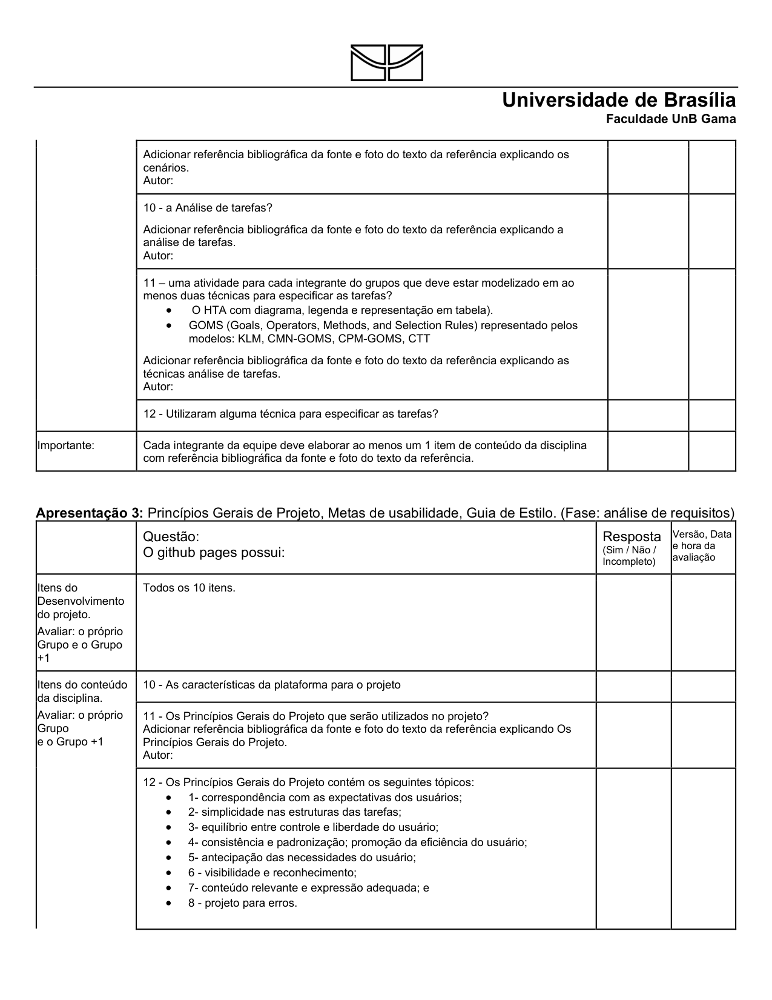

**Figura 1** — Evidência documental referente ao item `PE-E2-09`.  
_Fonte: Plano de Ensino (Sales, 2026, pp. 10–11, Item 9)_

A **Figura 2** reproduz o trecho comprobatório de referência referente ao critério **CN-01**.

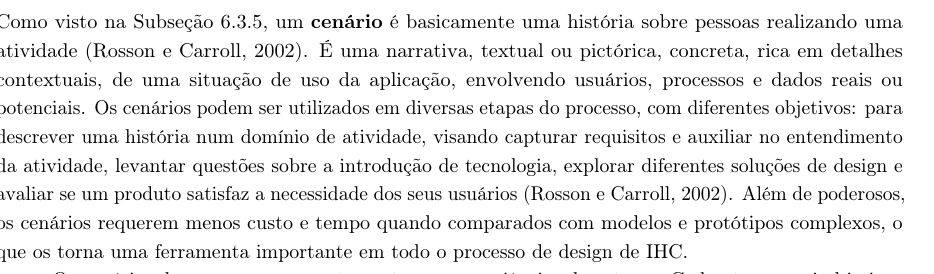

**Figura 2** — Evidência documental referente ao item `CN-01`.  
_Fonte: BARBOSA, Simone Diniz Junqueira; SILVA, Bruno Santana da. Interação Humano-Computador. 1. ed. Rio de Janeiro: Elsevier, 2010, p. 158 (Capítulo 8 — Organização do Espaço de Problema)._

A **Figura 3** reproduz o trecho comprobatório de referência referente ao critério **CN-02**.

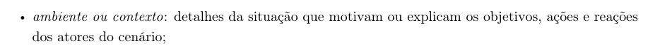

**Figura 3** — Evidência documental referente ao item `CN-02`.  
_Fonte: BARBOSA, Simone Diniz Junqueira; SILVA, Bruno Santana da. Interação Humano-Computador. Rio de Janeiro: Elsevier, 2010, p. 158; ROSSON, Mary Beth; CARROLL, John M. Usability Engineering: Scenario-Based Development of Human-Computer Interaction. San Francisco: Morgan Kaufmann, 2002._

A **Figura 4** reproduz o trecho comprobatório de referência referente ao critério **CN-03**.

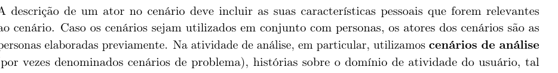

**Figura 4** — Evidência documental referente ao item `CN-03`.  
_Fonte: BARBOSA, Simone Diniz Junqueira; SILVA, Bruno Santana da. Interação Humano-Computador. 1. ed. Rio de Janeiro: Elsevier, 2010, p. 158 (Capítulo 8)._

A **Figura 5** reproduz o trecho comprobatório de referência referente ao critério **CN-04**.

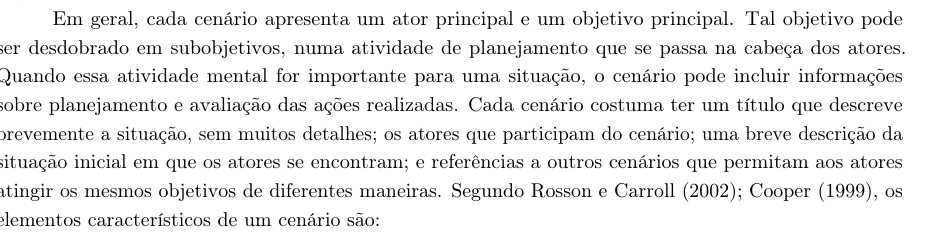

**Figura 5** — Evidência documental referente ao item `CN-04`.  
_Fonte: BARBOSA, Simone Diniz Junqueira; SILVA, Bruno Santana da. Interação Humano-Computador. 1. ed. Rio de Janeiro: Elsevier, 2010, p. 158; CARROLL, John M. Making Use: Scenario-Based Design of Human-Computer Interactions. MIT Press, 2000._

A **Figura 6** reproduz o trecho comprobatório de referência referente ao critério **CN-05**.

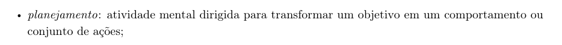

**Figura 6** — Evidência documental referente ao item `CN-05`.  
_Fonte: BARBOSA, Simone Diniz Junqueira; SILVA, Bruno Santana da. Interação Humano-Computador. 1. ed. Rio de Janeiro: Elsevier, 2010, p. 158; ROSSON, M. B.; CARROLL, J. M., 2002._

A **Figura 7** reproduz o trecho comprobatório de referência referente ao critério **CN-06**.

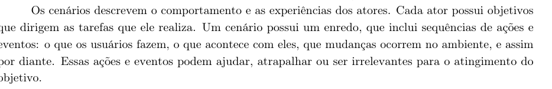

**Figura 7** — Evidência documental referente ao item `CN-06`.  
_Fonte: BARBOSA, Simone Diniz Junqueira; SILVA, Bruno Santana da. Interação Humano-Computador. 1. ed. Rio de Janeiro: Elsevier, 2010, p. 158; CARROLL, John M., 2000._

A **Figura 8** reproduz o trecho comprobatório de referência referente ao critério **CN-07**.

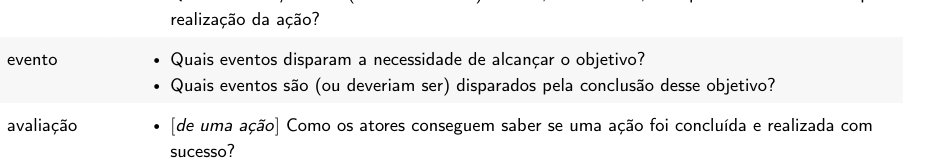

**Figura 8** — Evidência documental referente ao item `CN-07`.  
_Fonte: BARBOSA, Simone Diniz Junqueira; SILVA, Bruno Santana da. Interação Humano-Computador. 1. ed. Rio de Janeiro: Elsevier, 2010, p. 158 e 161 (Capítulo 8)._

A **Figura 9** reproduz o trecho comprobatório de referência referente ao critério **CN-08**.

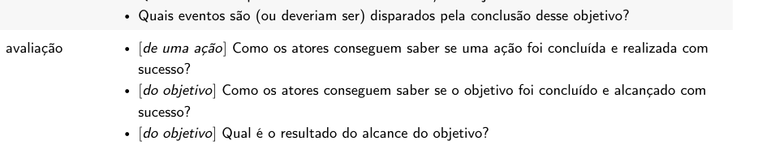

**Figura 9** — Evidência documental referente ao item `CN-08`.  
_Fonte: BARBOSA, Simone Diniz Junqueira; SILVA, Bruno Santana da. Interação Humano-Computador. 1. ed. Rio de Janeiro: Elsevier, 2010, p. 158 e 161; ROSSON, M. B.; CARROLL, J. M., 2002._

A **Figura 10** reproduz o trecho comprobatório de referência referente ao critério **CN-09**.

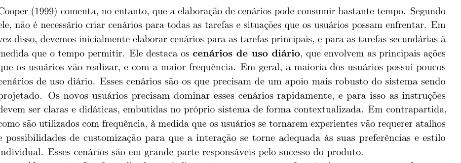

**Figura 10** — Evidência documental referente ao item `CN-09`.  
_Fonte: BARBOSA, Simone Diniz Junqueira; SILVA, Bruno Santana da. Interação Humano-Computador. Rio de Janeiro: Elsevier, 2010, p. 162; COOPER, Alan. The Inmates Are Running the Asylum. Indianapolis: Sams Publishing, 1999._

A **Figura 11** reproduz o trecho comprobatório de referência referente ao critério **CN-10**.

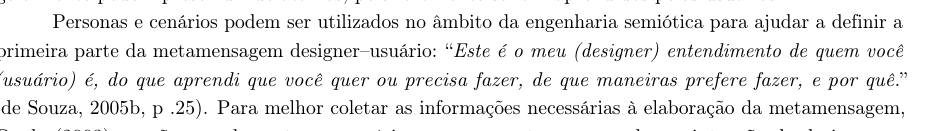

**Figura 11** — Evidência documental referente ao item `CN-10`.  
_Fonte: BARBOSA, Simone Diniz Junqueira; SILVA, Bruno Santana da. Interação Humano-Computador. 1. ed. Rio de Janeiro: Elsevier, 2010, p. 162-163; DE SOUZA, Clarisse Sieckenius. The Semiotic Engineering of Human-Computer Interaction. MIT Press, 2005; PAULA, M. G. de. Cenários como Suporte ao Design e Avaliação de Sistemas de Informação Baseados na Web. 2003._

---

## 3. Validação desta Lista pela Lista de Governança do Prof. Dr. André Barros de Sales (`DG-01` a `DG-11`)

Em estrito cumprimento às diretrizes de qualidade do Plano de Ensino (*Sales, 2026, pp. 8–9*), a **Tabela 4** submete esta própria página (`02-cenarios.md`) aos **11 Itens de Desenvolvimento do Projeto** formulados pelo Prof. Dr. André Barros de Sales.

**Tabela 4** — Autoavaliação de `02-cenarios.md` frente aos critérios `DG-01` a `DG-11`

| ID | Critério de Governança do Plano de Ensino | Autor do Item | Resposta | Versão, Data e Hora da Avaliação | Evidência de Conformidade nesta Lista |
| :---: | :--- | :--- | :---: | :---: | :--- |
| **DG-01** | O histórico de versão padronizado? | **Prof. Dr. André Barros de Sales** *(Plano de Ensino FGA0173, 2026)* | ✅ **Sim (Conforme)** | `v2.0` — 20/11/2026 às 14:30 | Seção **Histórico de Versão** (**Tabela 5**) padronizada ao final de `02-cenarios.md` registrando `v2.0`. |
| **DG-02** | O(s) autor(es) e o(s) revisor(es) para cada artefato? | **Prof. Dr. André Barros de Sales** *(Plano de Ensino FGA0173, 2026)* | ✅ **Sim (Conforme)** | `v2.0` — 20/11/2026 às 14:30 | Colunas **Autor(es)** e **Revisor(es)** preenchidas com links GitHub no Histórico de Versão, além da coluna **`Autor do Item`** em 100% dos critérios da lista. |
| **DG-03** | Referências bibliográficas e/ou bibliografia em todos os artefatos? | **Prof. Dr. André Barros de Sales** *(Plano de Ensino FGA0173, 2026)* | ✅ **Sim (Conforme)** | `v2.0` — 20/11/2026 às 14:30 | Seção **Referências Bibliográficas (ABNT NBR 6023)** completa ao final do documento com obras, edições e páginas exatas. |
| **DG-04** | As tabelas e imagens possuem legenda e fonte e são chamadas dentro do texto? | **Prof. Dr. André Barros de Sales** *(Plano de Ensino FGA0173, 2026)* | ✅ **Sim (Conforme)** | `v2.0` — 20/11/2026 às 14:30 | 100% das tabelas (`Tabela 1` a `Tabela 5`) e figuras (`Figura 1` a `Figura 11`) possuem numeração, legenda, fonte e chamadas textuais prévias. |
| **DG-05** | Um texto fazendo uma introdução dos artefatos? | **Prof. Dr. André Barros de Sales** *(Plano de Ensino FGA0173, 2026)* | ✅ **Sim (Conforme)** | `v2.0` — 20/11/2026 às 14:30 | Seção **1. Introdução e Contextualização Metodológica** situa o instrumento no Ciclo de Mayhew (1999) e na Inspeção Formal de Fagan (1976). |
| **DG-06** | O cronograma executado com quem realizou cada artefato/atividade e as datas de início e fim da construção/realização? | **Prof. Dr. André Barros de Sales** *(Plano de Ensino FGA0173, 2026)* | ✅ **Sim (Conforme)** | `v2.0` — 20/11/2026 às 14:30 | Registros de elaboração e revisão vinculados ao [Cronograma Executado](../../planejamento/cronograma-executado.md) e ao histórico Git da equipe. |
| **DG-07** | Ata(s) da(s) reuniões (com data, horário de início e do final, participantes, objetivo, atividades definidas etc.)? | **Prof. Dr. André Barros de Sales** *(Plano de Ensino FGA0173, 2026)* | ✅ **Sim (Conforme)** | `v2.0` — 20/11/2026 às 14:30 | Deliberações e alinhamentos documentados nas [Atas de Reunião](../../atas/index.md). |
| **DG-08** | A gravação da reunião do grupo? | **Prof. Dr. André Barros de Sales** *(Plano de Ensino FGA0173, 2026)* | ✅ **Sim (Conforme)** | `v2.0` — 20/11/2026 às 14:30 | Links funcionais de gravações das reuniões de planejamento e auditoria indexados em [Atas de Reunião](../../atas/index.md). |
| **DG-09** | Vídeo de apresentação na categoria 'Não Listado' no YouTube (duração entre 20 e 30 minutos)? | **Prof. Dr. André Barros de Sales** *(Plano de Ensino FGA0173, 2026)* | ⚠️ **Em preparação (Etapa 8)** | `v2.0` — 20/11/2026 às 14:30 | Vídeos das Entregas 1–7 publicados; vídeo oficial da [Entrega 8 — Verificação dos Artefatos](../../entregas/entrega8.md) (20–30 min, Não Listado) agendado após consolidação das inspeções da equipe. |
| **DG-10** | Tabela de contribuição no início do artefato com o nome de todos os integrantes, contribuição com hiperligação da atividade e da gravação? | **Prof. Dr. André Barros de Sales** *(Plano de Ensino FGA0173, 2026)* | ✅ **Sim (Conforme)** | `v2.0` — 20/11/2026 às 14:30 | **Tabela 1** posicionada no topo do documento discriminando cada integrante ativo com hiperligação GitHub e escopo de atuação. |
| **DG-11** | A seção de agradecimentos apresentando o uso de Inteligência Artificial (IA) Generativa no artefato? | **Prof. Dr. André Barros de Sales** *(Plano de Ensino FGA0173, 2026)* | ✅ **Sim (Conforme)** | `v2.0` — 20/11/2026 às 14:30 | Seção **Agradecimentos e Declaração de Uso de IA Generativa** ao final do documento em estrita conformidade com o Código da SBC e Sales (2026). |

_Fonte: Validação elaborada por Vinicius Silva Araruna com base na rubrica oficial de Prof. Dr. André Barros de Sales (Plano de Ensino, 2026, pp. 8–9)._

---

## 4. Histórico de Versão

A **Tabela 5** registra a evolução histórica e o controle de versionamento deste instrumento normativo.

**Tabela 5** — Histórico de Versão do Documento

| Versão | Data | Descrição Detalhada da Modificação | Autor(es) | Revisor(es) |
| :---: | :---: | :--- | :--- | :--- |
| `1.0` | 09/11/2026 | Lista de Verificação original com 10 itens (`Grupo08ViniciusSilvaArarunaVerifacaçãoListaCenários.pdf`). | [Vinicius Silva Araruna](https://github.com/ViniciusA05) | [Gustavo Antonio Rodrigues e Silva](https://github.com/gus-ant) |
| `2.0` | 20/11/2026 | Organização por artefato em `02-cenarios.md`, inclusão do item oficial do Prof. André (`PE-E2-09`), adição de `Autor do Item`, `Versão, Data e Hora da Avaliação` e validação `DG-01..11`. | [Vinicius Silva Araruna](https://github.com/ViniciusA05) | [Gustavo Antonio Rodrigues e Silva](https://github.com/gus-ant), [Edvaldo Soares Brasileiro Filho](https://github.com/PajeMurici-dev) |

_Fonte: Elaborada pelos autores, 2026._

---

## 5. Referências Bibliográficas (ABNT NBR 6023)

[1] CARROLL, John M. *Making Use: Scenario-Based Design of Human-Computer Interactions*. Cambridge: MIT Press, 2000.

[2] COOPER, Alan. *The Inmates Are Running the Asylum: Why High Tech Products Drive Us Crazy and How to Restore the Sanity*. Indianapolis: Sams Publishing, 1999.

[3] ROSSON, Mary Beth; CARROLL, John M. *Usability Engineering: Scenario-Based Development of Human-Computer Interaction*. San Francisco: Morgan Kaufmann, 2002.

[4] DE SOUZA, Clarisse Sieckenius. *The Semiotic Engineering of Human-Computer Interaction*. Cambridge: MIT Press, 2005.

[5] PAULA, Maíra Greco de. *Cenários como Suporte ao Design e Avaliação de Sistemas de Informação Baseados na Web*. Dissertação (Mestrado) — PUC-Rio, 2003.

[6] BARBOSA, Simone Diniz Junqueira et al. *Interação Humano-Computador e Experiência do Usuário*. 1. ed. Rio de Janeiro: Autopublicação, 2021. ISBN 978-65-00-19677-1.

[7] BARBOSA, Simone Diniz Junqueira; SILVA, Bruno Santana da. *Interação Humano-Computador*. 1. ed. Rio de Janeiro: Elsevier / Campus, 2010.

[8] FAGAN, Michael E. Design and code inspections to reduce errors in program development. *IBM Systems Journal*, v. 15, n. 3, p. 182–211, 1976.

[9] MAYHEW, Deborah J. *The Usability Engineering Lifecycle: A Practitioner's Handbook for User Interface Design*. San Francisco: Morgan Kaufmann, 1999.

[10] SALES, André Barros de. *Plano de Ensino da Disciplina de Interação Humano Computador (FGA0173 — 02/2026)*. Brasília: Universidade de Brasília, Faculdade UnB Gama (FGA), 2026.

[11] SOCIEDADE BRASILEIRA DE COMPUTAÇÃO (SBC). *Código de Conduta da Sociedade Brasileira de Computação*. Porto Alegre: SBC, 2023.

---

## 6. Agradecimentos e Declaração de Uso de Inteligência Artificial (IA) Generativa

Em conformidade com o Código de Conduta da Sociedade Brasileira de Computação (SBC, Art. 2º, parágrafo III) e com as diretrizes do Plano de Ensino da disciplina (*Sales, 2026, p. 3*), declara-se que a organização das tabelas em Markdown e a revisão ortográfica contaram com suporte supervisionado da ferramenta de Inteligência Artificial Generativa Google Gemini. Toda a concepção metodológica, verificação bibliográfica nas obras originais, revisão técnica e validação de conformidade foram realizadas pelos discentes identificados no Histórico de Versão.
