# Lista de Verificação — Perfil de Usuário

## Tabela de Contribuição e Transparência de IA Generativa

A **Tabela 1** apresenta a distribuição de responsabilidades na elaboração, curadoria e revisão de **Perfil de Usuário**.

**Tabela 1** — Matriz de Contribuição e Transparência de IA Generativa — Perfil de Usuário

| Integrante | Atribuição no Artefato | Data | Horário | Ferramenta de IA | Propósito do Uso de IA |
| :--- | :--- | :---: | :---: | :--- | :--- |
| [Vinicius Silva Araruna](https://github.com/ViniciusA05) | Elaboração modular dos critérios de `PU`, citação direta, recortes da obra e autoavaliação pela rubrica `DG-01` a `DG-11` | 20/11/2026 | 14:00 - 15:30 | Google Gemini | Suporte na organização estrutural, formatação de tabelas em Markdown e conferência cruzada com o Plano de Ensino |
| [Gustavo Antonio Rodrigues e Silva](https://github.com/gus-ant) | Revisão de conformidade estrutural, navegação e checagem de links | 20/11/2026 | 15:30 - 16:00 | — | Revisão por pares e validação editorial |
| [Edvaldo Soares Brasileiro Filho](https://github.com/PajeMurici-dev) | Auditoria de rastreabilidade frente ao Plano de Ensino (`DG-01` a `DG-11`) e referências ABNT | 20/11/2026 | 15:30 - 16:00 | — | Revisão por pares e conferência documental |

_Fonte: Elaborada pelos autores, 2026._

---

## 1. Introdução e Contextualização Metodológica

Este módulo normatiza a verificação do artefato **Perfil de Usuário** (Análise de Requisitos — Entrega 2), reunindo os **3 critérios do Prof. Dr. André Barros de Sales** (pp. 9–10), os **42 critérios técnicos** divididos nas 6 dimensões de Barbosa et al. (2021) / Hackos & Redish (1998) / Courage & Baxter (2005) e os **6 critérios de aplicação** elaborados em `docs/analise-requisitos/perfil-usuario.md`.

Este instrumento normativo atua segundo o **Método de Inspeção Formal de Michael E. Fagan (1976)** e encontra-se desacoplado dos relatórios empíricos de aplicação. Toda inspeção registrada aqui identifica obrigatoriamente o **`Autor do Item`**, a **fundamentação bibliográfica com recorte visual** e a coluna **`Versão, Data e Hora da Avaliação`** exigida pelo Plano de Ensino (*Sales, 2026, pp. 8–13*).

!!! info "Pré-requisito Transversal de Governança (Prof. Dr. André Barros de Sales)"
    Além dos critérios específicos deste artefato listados na **Seção 2**, todo produto de trabalho avaliado deve cumprir integralmente os **11 Itens de Desenvolvimento Geral (`DG-01` a `DG-11`)** definidos pelo Prof. Dr. André Barros de Sales em [00. Governança e Plano de Ensino Geral](00-plano-ensino-geral.md).

---

## 2. Instrumento Normativo de Verificação — Perfil de Usuário

### 2.1 Critérios do Plano de Ensino (Prof. Dr. André Barros de Sales — Rubrica Oficial)

A **Tabela 2** reúne os critérios oficiais estipulados pelo docente para este artefato no Plano de Ensino (*Sales, 2026*).

**Tabela 2** — Critérios oficiais do Plano de Ensino para Perfil de Usuário

| ID | Critério / Pergunta de Verificação | Autor do Item | Fundamentação Canônica e Fonte | Evidência Visual (Figura) | Resposta | Versão, Data e Hora da Avaliação |
| :---: | :--- | :--- | :--- | :---: | :---: | :---: |
| **PE-E2-01** | O perfil do usuário é definido por mais de uma forma (técnica de elicitação e/ou ferramenta)? | **Prof. Dr. André Barros de Sales** *(Plano de Ensino FGA0173, 2026)* | Plano de Ensino (Sales, 2026, p. 9, Item 1) | [Ver Figura 1](#figura-1) | `[ ] Sim (Conforme)` `[ ] Não (Não Conforme)` `[ ] Incompleto` `[ ] N/A` | *(Preencher na inspeção)* |
| **PE-E2-02** | O perfil do usuário possui os atributos completos de um perfil (demográficos, experiência no cargo, empresa, educação/leitura)? *(Hackos & Redish, 1998; Courage & Baxter, 2005; com ref., foto e autor)* | **Prof. Dr. André Barros de Sales** *(Plano de Ensino FGA0173, 2026)* | Plano de Ensino (Sales, 2026, pp. 9–10, Item 2) | [Ver Figura 2](#figura-2) | `[ ] Sim (Conforme)` `[ ] Não (Não Conforme)` `[ ] Incompleto` `[ ] N/A` | *(Preencher na inspeção)* |
| **PE-E2-03** | O perfil do usuário define os 4 grupos de atributos do Cap. 8 (idade, experiência, atitudes e tarefas primárias)? *(com ref., foto e autor)* | **Prof. Dr. André Barros de Sales** *(Plano de Ensino FGA0173, 2026)* | Plano de Ensino (Sales, 2026, p. 10, Item 3) | [Ver Figura 2](#figura-2) | `[ ] Sim (Conforme)` `[ ] Não (Não Conforme)` `[ ] Incompleto` `[ ] N/A` | *(Preencher na inspeção)* |

_Fonte: Plano de Ensino da Disciplina (Prof. Dr. André Barros de Sales, 2026)._

### 2.2 Critérios Técnicos da Literatura Canônica (Lista de Verificação `PU`)

A **Tabela 3** apresenta os **42 itens normativos** fundamentados na literatura científica com citação direta literal e recorte visual da página.

**Tabela 3** — Lista de verificação normativa de Perfil de Usuário (42 itens)

| ID | Critério / Pergunta de Verificação | Autor do Item | Fundamentação Canônica (Obra, Ed., Cap., Pág.) e Citação Literal | Evidência Visual (Figura) | Resposta | Versão, Data e Hora da Avaliação |
| :---: | :--- | :--- | :--- | :---: | :---: | :---: |
| **PU-01** | **Dados Demográficos Básicos dos Usuários** O artefato de Perfil de Usuário identifica e documenta expressamente os dados demográficos essenciais do público-alvo, especificando de forma clara: • Idade ou faixas etárias: caracterização das faixas de idade dos usuários (como jovem, adulto, meia-idade, terceira idade); • Sexo e gênero: distribuição demográfica de sexo e gênero da população investigada; • Status socioeconômico: faixa de renda, classe socioeconômica ou contexto econômico dos usuários? | [Vinicius Silva Araruna](https://github.com/ViniciusA05) | *"dados demográficos: idade, sexo, status socioeconômico;"* Barbosa, S. D. J. et al. Interação Humano-Computador e Experiência do Usuário (2021), p. 123 (Capítulo 7). | [Ver Figura 3](#figura-3) | `[ ] Sim (Conforme)` `[ ] Não (Não Conforme)` `[ ] Incompleto` `[ ] N/A` | *(Preencher na inspeção)* |
| **PU-02** | **Experiência no Cargo e Trajetória Ocupacional** O levantamento caracteriza a situação ocupacional e profissional do usuário, discriminando de maneira detalhada: • Cargo atual e tempo de experiência: função ocupada atualmente e tempo de vivência prática nesse cargo; • Tempo de atuação na organização: período de permanência do usuário na empresa ou instituição; • Responsabilidades e atribuições: conjunto de tarefas, compromissos e rotinas cotidianas sob sua responsabilidade; • Histórico e plano de carreira: cargos anteriores desempenhados e perspectivas de progressão funcional? | [Vinicius Silva Araruna](https://github.com/ViniciusA05) | *"experiência no cargo que ocupa: cargo atual, experiência nesse cargo, tempo na empresa, responsabilidades, trabalhos e cargos anteriores, plano de carreira;"* Barbosa, S. D. J. et al. Interação Humano-Computador e Experiência do Usuário (2021), p. 123 (Capítulo 7). | [Ver Figura 4](#figura-4) | `[ ] Sim (Conforme)` `[ ] Não (Não Conforme)` `[ ] Incompleto` `[ ] N/A` | *(Preencher na inspeção)* |
| **PU-03** | **Informações Corporativas e Contexto da Organização** O perfil mapeia o contexto institucional ou empresarial em que os usuários operam o sistema, definindo expressamente: • Porte e tamanho da organização: número de colaboradores, abrangência (pequena, média, grande empresa ou órgão governamental); • Área de atuação e segmento: setor de mercado, especialidade institucional ou finalidade pública da organização? | [Vinicius Silva Araruna](https://github.com/ViniciusA05) | *"informações sobre a empresa: tamanho da empresa, área de atuação;"* Barbosa, S. D. J. et al. Interação Humano-Computador e Experiência do Usuário (2021), p. 123 (Capítulo 7). | [Ver Figura 5](#figura-5) | `[ ] Sim (Conforme)` `[ ] Não (Não Conforme)` `[ ] Incompleto` `[ ] N/A` | *(Preencher na inspeção)* |
| **PU-04** | **Educação, Letramento e Hábitos de Leitura** O documento investiga a escolaridade e as competências de letramento do usuário, abordando expressamente: • Grau de instrução e área de formação: nível de escolaridade formal, cursos técnicos e graduações realizadas; • Nível de alfabetismo e leitura: o quão bem o usuário lê e se possui facilidade ou dificuldade com textos impressos ou digitais; • Compreensão de textos complexos: experiência na interpretação de documentos densos ou jargões da área; • Disposição para leitura de instruções: se o usuário está disposto a ler textos explicativos e manuais ao utilizar o produto? | [Vinicius Silva Araruna](https://github.com/ViniciusA05) | *"educação: grau de instrução, área de formação, cursos realizados, alfabetismo. O quão bem o usuário lê? Ele tem dificuldade com informação impressa? Tem experiência com textos complexos? Está disposto a ler texto ao utilizar produtos como o que está sendo projetado? Prefere aprender com outras pessoas? Prefere aprender fazendo?;"* Barbosa, S. D. J. et al. Interação Humano-Computador e Experiência do Usuário (2021), p. 123 (Capítulo 7). | [Ver Figura 6](#figura-6) | `[ ] Sim (Conforme)` `[ ] Não (Não Conforme)` `[ ] Incompleto` `[ ] N/A` | *(Preencher na inspeção)* |
| **PU-05** | **Experiência Geral e Alfabetismo com Computadores** O artefato discrimina o grau de fluência e o histórico digital dos usuários, detalhando: • Alfabetismo e destreza computacional: habilidade prática geral no manuseio de computadores e sistemas interativos; • Tempo acumulado de experiência: anos de vivência e familiaridade no uso de ferramentas tecnológicas; • Sistemas computacionais conhecidos: quais plataformas e sistemas operacionais o usuário já conhece e costuma operar; • Equipamentos habituais: tipos de hardware que costuma utilizar no cotidiano (desktop, notebook, smartphone, tablet)? | [Vinicius Silva Araruna](https://github.com/ViniciusA05) | *"experiência com computadores: alfabetismo computacional, habilidade com computadores, anos de experiência. Que sistemas computacionais o usuário conhece? Quais deles costuma utilizar? Que hardware costuma utilizar?;"* Barbosa, S. D. J. et al. Interação Humano-Computador e Experiência do Usuário (2021), p. 123 (Capítulo 7). | [Ver Figura 7](#figura-7) | `[ ] Sim (Conforme)` `[ ] Não (Não Conforme)` `[ ] Incompleto` `[ ] N/A` | *(Preencher na inspeção)* |
| **PU-06** | **Experiência com Ferramentas Semelhantes e Concorrentes** O levantamento explora a experiência do público-alvo com soluções similares ou concorrentes no mesmo domínio, identificando: • Vivência com produtos concorrentes: histórico de uso de ferramentas análogas ou do mesmo segmento; • Hábitos de uso consolidados: rotinas de interação e costumes estabelecidos em outras plataformas; • Preferências declaradas: funcionalidades, fluxos e aspectos de design mais valorizados pelo usuário; • Descontentamentos e frustrações: problemas, barreiras e queixas frequentemente enfrentadas nas ferramentas existentes? | [Vinicius Silva Araruna](https://github.com/ViniciusA05) | *"experiência com um produto específico ou ferramentas semelhantes: experiência com produtos concorrentes e outros produtos específicos do domínio, hábitos de uso, preferências e descontentamentos;"* Barbosa, S. D. J. et al. Interação Humano-Computador e Experiência do Usuário (2021), p. 123 (Capítulo 7). | [Ver Figura 8](#figura-8) | `[ ] Sim (Conforme)` `[ ] Não (Não Conforme)` `[ ] Incompleto` `[ ] N/A` | *(Preencher na inspeção)* |
| **PU-07** | **Tecnologia Disponível e Limitações de Infraestrutura** O documento especifica as restrições técnicas do ambiente operacional e tecnológico à disposição do usuário: • Características de hardware: dimensões e resolução de tela/monitor, capacidade e velocidade de processamento, periféricos; • Softwares e ferramentas acessíveis: sistemas operacionais, versões de navegadores web homologadas e programas auxiliares; • Conectividade e ambiente de rede: qualidade da conexão de internet e disponibilidade de suporte técnico local? | [Vinicius Silva Araruna](https://github.com/ViniciusA05) | *"tecnologia disponível: hardware (tamanho e resolução do monitor ou tela do dispositivo, velocidade do processamento etc.), software e outras ferramentas aos quais tem acesso;"* Barbosa, S. D. J. et al. Interação Humano-Computador e Experiência do Usuário (2021), p. 123 (Capítulo 7). | [Ver Figura 9](#figura-9) | `[ ] Sim (Conforme)` `[ ] Não (Não Conforme)` `[ ] Incompleto` `[ ] N/A` | *(Preencher na inspeção)* |
| **PU-08** | **Estilo de Aprendizagem e Valorização de Treinamento** O artefato identifica as preferências cognitivas para apropriação do sistema pelo usuário, registrando: • Valorização de treinamento: o quanto o usuário reconhece a importância de cursos e capacitações formais; • Estilo preferencial de aprendizado: se prefere aprendizado visual (vídeos/diagramas), auditivo (explicações orais), leitura (manuais/guias) ou prático ('aprender fazendo' por tentativa e erro); • Disponibilidade de tempo: se o usuário pode e está disposto a dedicar tempo para aprender a operar o novo sistema? | [Vinicius Silva Araruna](https://github.com/ViniciusA05) | *"treinamento: o quanto o usuário valoriza treinamento? Prefere um estilo de aprendizado visual, auditivo ou outro? Pode investir tempo aprendendo a utilizar o produto em questão?;"* Barbosa, S. D. J. et al. Interação Humano-Computador e Experiência do Usuário (2021), p. 123 (Capítulo 7). | [Ver Figura 10](#figura-10) | `[ ] Sim (Conforme)` `[ ] Não (Não Conforme)` `[ ] Incompleto` `[ ] N/A` | *(Preencher na inspeção)* |
| **PU-09** | **Atitudes, Valores e Postura perante Inovações** O documento analisa a postura psicológica e comportamental dos usuários perante recursos tecnológicos, classificando-os entre: • Usuários receptivos (tecnófilos): indivíduos que assumem riscos, exploram novidades de forma autônoma e buscam novos fluxos de trabalho; • Usuários conservadores (tecnófobos): indivíduos com receio de tecnologia, que evitam mudanças e preferem caminhos conhecidos e testados; • Necessidade de mediação: se o usuário necessita que alguém lhe demonstre passo a passo cada nova tarefa a ser aprendida? | [Vinicius Silva Araruna](https://github.com/ViniciusA05) | *"atitudes e valores: preferências de produto, medo de tecnologia etc. O usuário costuma assumir riscos e explorar novas formas de fazer o mesmo trabalho? Ou evita novas experiências, preferindo caminhos já percorridos e testados? Ou prefere que alguém lhes mostre cada passo de uma nova tarefa sendo aprendida?;"* Barbosa, S. D. J. et al. Interação Humano-Computador e Experiência do Usuário (2021), p. 123 (Capítulo 7). | [Ver Figura 11](#figura-11) | `[ ] Sim (Conforme)` `[ ] Não (Não Conforme)` `[ ] Incompleto` `[ ] N/A` | *(Preencher na inspeção)* |
| **PU-10** | **Conhecimento do Domínio do Negócio e Nível de Expertise** O perfil discrimina o nível de domínio temático que o usuário possui sobre as regras e conceitos do sistema: • Nível de conhecimento do assunto: o quanto o usuário entende dos processos, regras e rotinas da área do produto; • Grau de expertise: classificação do usuário como novato/leigo, intermediário ou especialista no assunto; • Expectativa de especialização: se o sistema exige formação especializada ou se o usuário deverá adquirir essa expertise com o tempo? | [Vinicius Silva Araruna](https://github.com/ViniciusA05) | *"conhecimento do domínio: o que e quanto o usuário conhece sobre o assunto em questão? É especialista? É esperado que se torne um especialista?;"* Barbosa, S. D. J. et al. Interação Humano-Computador e Experiência do Usuário (2021), p. 123 (Capítulo 7). | [Ver Figura 12](#figura-12) | `[ ] Sim (Conforme)` `[ ] Não (Não Conforme)` `[ ] Incompleto` `[ ] N/A` | *(Preencher na inspeção)* |
| **PU-11** | **Objetivos dos Usuários e Métodos de Realização Atuais** O artefato documenta explicitamente os objetivos centrais que os usuários pretendem alcançar ao utilizar o sistema: • Metas e objetivos centrais: quais finalidades funcionais e práticas motivam o uso do sistema interativo; • Métodos de realização atuais: de que maneira os usuários atingem esses objetivos no presente (processos manuais, planilhas, plataformas legadas)? | [Vinicius Silva Araruna](https://github.com/ViniciusA05) | *"objetivos: quais são os principais objetivos dos usuário? Como eles são alcançados atualmente?;"* Barbosa, S. D. J. et al. Interação Humano-Computador e Experiência do Usuário (2021), p. 123 (Capítulo 7). | [Ver Figura 13](#figura-13) | `[ ] Sim (Conforme)` `[ ] Não (Não Conforme)` `[ ] Incompleto` `[ ] N/A` | *(Preencher na inspeção)* |
| **PU-12** | **Mapeamento de Tarefas Primárias, Secundárias e Inovação** O levantamento elenca e categoriza as tarefas a serem apoiadas pela solução de IHC, segregando claramente: • Tarefas primárias: atividades centrais, frequentes e indispensáveis para a rotina diária do usuário; • Tarefas secundárias: atividades esporádicas de suporte, consulta eventual ou parametrização; • Tempo de prática e frequência: há quanto tempo desempenha tais tarefas e com que regularidade as executa; • Inovação das tarefas: se as atividades constituem práticas rotineiras ou tarefas novas e inovadoras no domínio? | [Vinicius Silva Araruna](https://github.com/ViniciusA05) | *"tarefas: quais são as tarefas do usuário que precisam ser apoiadas? Quais dessas são consideradas primárias, e quais são secundárias? Há quanto tempo realiza essas tarefas? São tarefas frequentes ou infrequentes? São tarefas inovadoras? Que experiência ele possui em tarefas semelhantes?;"* Barbosa, S. D. J. et al. Interação Humano-Computador e Experiência do Usuário (2021), p. 123 (Capítulo 7). | [Ver Figura 14](#figura-14) | `[ ] Sim (Conforme)` `[ ] Não (Não Conforme)` `[ ] Incompleto` `[ ] N/A` | *(Preencher na inspeção)* |
| **PU-13** | **Frequência e Regime Temporal de Interação com a Tecnologia** O perfil categoriza a periodicidade e a intensidade com que os usuários utilizam sistemas e tecnologias, adotando faixas padronizadas de frequência: • Constante (nível 5): uso contínuo, várias vezes ao dia; • Alta (nível 4): interação todo dia útil; • Média (nível 3): utilização de 4 a 6 vezes por semana; • Ocasional (nível 2): utilização de 1 a 3 vezes por semana; • Baixa (nível 1): uso esporádico, menos de 1 vez por semana? | [Vinicius Silva Araruna](https://github.com/ViniciusA05) | *"Frequência de uso de tecnologia (constante: 5 [várias vezes ao dia]; alta: 4 [todo dia]; média: 3 [4-6 vezes/semana]; ocasional: 2 [1-3 vezes/semana]; baixa: 1 [menos de 1 vez/semana])"* Barbosa, S. D. J. et al. Interação Humano-Computador e Experiência do Usuário (2021), p. 152 (Capítulo 8). | [Ver Figura 15](#figura-15) | `[ ] Sim (Conforme)` `[ ] Não (Não Conforme)` `[ ] Incompleto` `[ ] N/A` | *(Preencher na inspeção)* |
| **PU-14** | **Gravidade e Consequências de Erros Operacionais** O documento analisa a gravidade e o impacto de falhas ou erros operacionais cometidos durante a interação: • Consequências negativas potenciais: impactos decorrentes de equívocos (prejuízos financeiros, perda de dados ou retrabalho); • Repercussões organizacionais e pessoais: bloqueio de serviços essenciais, atrasos em prazos ou danos à imagem profissional do usuário? | [Vinicius Silva Araruna](https://github.com/ViniciusA05) | *"gravidade dos erros: quais são as possíveis consequências negativas dos erros do usuário?;"* Barbosa, S. D. J. et al. Interação Humano-Computador e Experiência do Usuário (2021), p. 124 (Capítulo 7). | [Ver Figura 16](#figura-16) | `[ ] Sim (Conforme)` `[ ] Não (Não Conforme)` `[ ] Incompleto` `[ ] N/A` | *(Preencher na inspeção)* |
| **PU-15** | **Motivação Profissional, Idiomas e Jargão da Área** O levantamento caracteriza aspectos motivacionais e linguísticos que influenciam a experiência do usuário: • Motivação profissional: se o usuário cumpre apenas a jornada contratual ou se engaja além do expediente por satisfação e ambição de crescimento; • Fluência linguística: idiomas que domina com naturalidade; • Jargão e vocabulário técnico: termos técnicos e expressões particulares próprios da empresa, grupo social ou atividade profissional? | [Vinicius Silva Araruna](https://github.com/ViniciusA05) | *"motivação para o trabalho: o usuário se limita a cumprir a carga horária ou trabalha além do expediente, por prazer? Gosta da interação social no local de trabalho? Tem ambição de ser promovido?; idiomas e jargões: que idiomas o usuário conhece e utiliza fluentemente? Ele possui um jargão profissional particular, um vocabulário próprio da empresa, da sua atividade ou de algum grupo social relevante para o seu projeto?"* Barbosa, S. D. J. et al. Interação Humano-Computador e Experiência do Usuário (2021), p. 124 (Capítulo 7). | [Ver Figura 17](#figura-17) | `[ ] Sim (Conforme)` `[ ] Não (Não Conforme)` `[ ] Incompleto` `[ ] N/A` | *(Preencher na inspeção)* |
| **PU-16** | **Identificação de Fontes Confiáveis e Amostra Representativa** O planejamento define expressamente fontes de informação confiáveis, relevantes e legitimamente representativas: • Fontes representativas dos usuários: participantes reais alinhados ao público-alvo e à prática cotidiana de trabalho; • Prevenção de viés amostral: evitar concentrar a coleta apenas em grupos restritos de conveniência ou nos usuários considerados 'mais eficientes'? | [Vinicius Silva Araruna](https://github.com/ViniciusA05) | *"Ao coletar dados sobre os usuários do sistema, é essencial encontrar fontes confiáveis, relevantes e representativas dos usuários e do seu trabalho. Caso contrário, não apenas os dados coletados serão de pouca utilidade, como também podem prejudicar seu produto, sua credibilidade e a credibilidade das atividades de IHC em geral."* Barbosa, S. D. J. et al. Interação Humano-Computador e Experiência do Usuário (2021), p. 124 (Capítulo 7). | [Ver Figura 18](#figura-18) | `[ ] Sim (Conforme)` `[ ] Não (Não Conforme)` `[ ] Incompleto` `[ ] N/A` | *(Preencher na inspeção)* |
| **PU-17** | **Diferenciação entre Usuários Finais e Stakeholders Afetados** O artefato distingue conceitual e operacionalmente os diferentes grupos de interessados no sistema: • Usuários diretos primários: aqueles que utilizam o produto rotineiramente para realizar suas tarefas centrais; • Usuários diretos secundários: aqueles que operam o sistema eventualmente para configurações ou manutenções; • Stakeholders indiretos: partes interessadas que não operam diretamente a interface, mas recebem dados ou são afetadas pelo produto? | [Vinicius Silva Araruna](https://github.com/ViniciusA05) | *"O termo “usuário” geralmente diz respeito aos usuários finais, aqueles que são ou serão usuários diretos do seu produto, sejam primários, que utilizam o produto regularmente, ou secundários, que o utilizam ocasionalmente, por exemplo, em atividades de configuração eventuais. Além deles, pode ser importante traçar o perfil de outras partes interessadas (stakeholders), que não utilizam o produto diretamente mas são afetados pelo seu uso..."* Barbosa, S. D. J. et al. Interação Humano-Computador e Experiência do Usuário (2021), p. 124 (Capítulo 7). | [Ver Figura 19](#figura-19) | `[ ] Sim (Conforme)` `[ ] Não (Não Conforme)` `[ ] Incompleto` `[ ] N/A` | *(Preencher na inspeção)* |
| **PU-18** | **Mapeamento de Múltiplos Papéis e Necessidades Conflitantes** O planejamento identifica os múltiplos papéis que os stakeholders exercem e reconhece a presença de objetivos conflitantes, investigando formalmente: • Quem utilizará o sistema: usuários que realizarão as tarefas na ferramenta; • Quem será afetado por ele: pessoas ou setores impactados pelos resultados operacionais; • Quem define objetivos e funcionalidades: responsáveis por decidir as prioridades e o escopo da solução; • Quem definiu os processos apoiados: gestores e analistas que modelaram os fluxos de trabalho a serem informatizados? | [Vinicius Silva Araruna](https://github.com/ViniciusA05) | *"Além disso, um único stakeholder pode exercer diversos papéis num sistema ou organização, os quais podem ter necessidades contraditórias. Para identificar as partes interessadas que podem fornecer informações relevantes ao projeto de um sistema, devemos descobrir: quem utilizará o sistema? Quem será afetado por ele? Quem é responsável por decidir quais objetivos o sistema deve apoiar e quais funcionalidades ele deve ter? Quem definiu os processos a serem apoiados pelo sistema?"* Barbosa, S. D. J. et al. Interação Humano-Computador e Experiência do Usuário (2021), p. 124 (Capítulo 7). | [Ver Figura 20](#figura-20) | `[ ] Sim (Conforme)` `[ ] Não (Não Conforme)` `[ ] Incompleto` `[ ] N/A` | *(Preencher na inspeção)* |
| **PU-19** | **Investigação em Sistemas Existentes com Perfis Satisfeitos e Insatisfeitos** No caso de projeto de melhoria ou evolução de um sistema existente, o levantamento investiga: • Usuários atuais e futuros: quem opera o sistema hoje e quem passará a utilizá-lo na nova versão; • Usuários satisfeitos e insatisfeitos: visões e queixas detalhadas de ambos os grupos de usuários; • Equipe de apoio: profissionais responsáveis pela documentação, treinamento e suporte técnico aos usuários? | [Vinicius Silva Araruna](https://github.com/ViniciusA05) | *"Caso o projeto em questão seja de melhoria ou expansão de um sistema existente, é importante conhecer também: quem utiliza o sistema atualmente? Além dos usuários atuais, quem passará a utilizá-lo? Quem são os usuários satisfeitos com o sistema? E quem são os insatisfeitos? Quem concebeu o sistema? Quem preparou a documentação do sistema? Quem dá treinamento aos usuários? Quem dá suporte aos usuários? Quem faz a manutenção do sistema? Quem projetou o sistema?"* Barbosa, S. D. J. et al. Interação Humano-Computador e Experiência do Usuário (2021), p. 124 (Capítulo 7). | [Ver Figura 21](#figura-21) | `[ ] Sim (Conforme)` `[ ] Não (Não Conforme)` `[ ] Incompleto` `[ ] N/A` | *(Preencher na inspeção)* |
| **PU-20** | **Análise de Acesso, Disponibilidade e Dispersão Geográfica** O planejamento avalia a viabilidade logística e o canal de acesso às fontes de informação: • Disponibilidade e restrições de tempo: compatibilidade da rotina dos participantes com a duração da coleta; • Dispersão geográfica dos usuários: localização territorial dos participantes e desafios de deslocamento; • Modalidade de coleta: justificativa motivada para coleta presencial no ambiente de atuação ou coleta remota? | [Vinicius Silva Araruna](https://github.com/ViniciusA05) | *"Para escolher uma técnica de coleta de dados, é necessário identificar o tipo de acesso a cada fonte de informação. A disponibilidade e localização das pessoas restringem o tipo de técnica de coleta de dados que pode ser utilizada. Algumas pessoas podem ter saído da empresa onde o sistema é utilizado e se tornado inacessíveis; outras podem ter sido promovidas ou deslocadas para outros setores... Pessoas dispersas geograficamente também restringem o tipo de técnica de coleta de dados a ser utilizada."* Barbosa, S. D. J. et al. Interação Humano-Computador e Experiência do Usuário (2021), pp. 124-125 (Capítulo 7). | [Ver Figura 22](#figura-22) | `[ ] Sim (Conforme)` `[ ] Não (Não Conforme)` `[ ] Incompleto` `[ ] N/A` | *(Preencher na inspeção)* |
| **PU-21** | **Princípio da Autonomia, Voluntariedade e Proteção aos Vulneráveis** O planejamento adota expressamente o Princípio da Autonomia em conformidade com as Resoluções CNS 466/2012 e 510/2016: • Participação voluntária e esclarecida: esclarecimento prévio de objetivos, procedimentos, riscos e benefícios previstos; • Direito de desistência sem sanções: garantia explícita de abandonar o estudo a qualquer momento sem penalidades; • Proteção aos grupos vulneráveis: cuidados especiais caso participem menores de idade, alunos ou subordinados? | [Vinicius Silva Araruna](https://github.com/ViniciusA05) | *"• princípio da autonomia, que envolve o consentimento livre e esclarecido dos indivíduos e a proteção a grupos vulneráveis e aos legalmente incapazes, tais como: menores de idade, alunos ou subordinados. Nesse sentido, a pesquisa envolvendo seres humanos deverá sempre tratá-los com dignidade, respeitá-los em sua autonomia e defendê-los em sua vulnerabilidade;"* Barbosa, S. D. J. et al. Interação Humano-Computador e Experiência do Usuário (2021), p. 126 (Capítulo 7). | [Ver Figura 23](#figura-23) | `[ ] Sim (Conforme)` `[ ] Não (Não Conforme)` `[ ] Incompleto` `[ ] N/A` | *(Preencher na inspeção)* |
| **PU-22** | **Princípios da Beneficência e da Não-Maleficência** O projeto documenta e assegura a observância rigorosa aos Princípios da Beneficência e da Não-Maleficência: • Ponderação entre riscos e benefícios: compromisso de maximizar os ganhos para a sociedade e minimizar danos; • Garantia contra danos e constrangimentos: adoção de salvaguardas para prevenir estresse psicológico, cansaço excessivo, nervosismo ou desconforto físico? | [Vinicius Silva Araruna](https://github.com/ViniciusA05) | *"• princípio da beneficência, que envolve a ponderação entre riscos e benefícios, tanto atuais como potenciais, individuais ou coletivos, comprometendo-se com o máximo de benefícios e o mínimo de danos e riscos; • princípio da não maleficência, que envolve a garantia de evitar danos previsíveis, tanto imediatos quanto tardios;"* Barbosa, S. D. J. et al. Interação Humano-Computador e Experiência do Usuário (2021), p. 126 (Capítulo 7). | [Ver Figura 24](#figura-24) | `[ ] Sim (Conforme)` `[ ] Não (Não Conforme)` `[ ] Incompleto` `[ ] N/A` | *(Preencher na inspeção)* |
| **PU-23** | **Princípio da Justiça e Equidade na Distribuição de Ônus e Benefícios** O protocolo ético incorpora o Princípio da Justiça e Equidade na condução da pesquisa: • Distribuição justa de ônus e benefícios: recrutamento equitativo e transparente entre diferentes perfis de participantes; • Atenção às necessidades sociais reais: assegurar que o estudo responda a demandas legítimas sem sobrecarregar participantes vulneráveis? | [Vinicius Silva Araruna](https://github.com/ViniciusA05) | *"• princípio da justiça e equidade, relacionado à distribuição justa dos ônus e benefícios da pesquisa, com especial atenção para a proteção de sujeitos vulneráveis e a garantia de que as pesquisas atendam a necessidades sociais reais;"* Barbosa, S. D. J. et al. Interação Humano-Computador e Experiência do Usuário (2021), p. 127 (Capítulo 7). | [Ver Figura 25](#figura-25) | `[ ] Sim (Conforme)` `[ ] Não (Não Conforme)` `[ ] Incompleto` `[ ] N/A` | *(Preencher na inspeção)* |
| **PU-24** | **Preservação do Anonimato, Confidencialidade e Foco Exclusivo no Sistema** O planejamento garante salvaguardas rigorosas para manter o anonimato e orienta a equipe de pesquisadores: • Anonimato e pseudônimos: codificação de participantes (P1, P2) sem divulgar nomes, fotos ou dados individualizantes; • Confidencialidade dos dados brutos: acesso aos registros restrito exclusivamente à equipe de pesquisa; • Foco exclusivo no produto: reiterar explicitamente ao usuário que é o sistema que está sendo avaliado, e nunca a sua inteligência ou capacidade? | [Vinicius Silva Araruna](https://github.com/ViniciusA05) | *"Ao divulgar os resultados da avaliação, o avaliador deve garantir o anonimato dos participantes, a preservação das suas imagens e a utilização cuidadosa das informações coletadas. Isso significa não divulgar seus nomes ou qualquer outra informação que possa identificá-los... É comum utilizar nomes fictícios ou números em todo o material coletado... Além disso, no caso de observação de uso de um produto, devemos enfatizar que é o produto que será avaliado, e não o participante."* Barbosa, S. D. J. et al. Interação Humano-Computador e Experiência do Usuário (2021), pp. 127-128 (Capítulo 7). | [Ver Figura 26](#figura-26) | `[ ] Sim (Conforme)` `[ ] Não (Não Conforme)` `[ ] Incompleto` `[ ] N/A` | *(Preencher na inspeção)* |
| **PU-25** | **Formalização do TCLE em Duas Vias e Autorização Prévia de Gravação** O documento estabelece a aplicação formal do Termo de Consentimento Livre e Esclarecido (TCLE) com os seguintes requisitos: • Consentimento formal em duas vias: uma via assinada permanece com o participante e a outra arquivada pelos pesquisadores; • Conteúdo claro e completo: descrição dos objetivos, duração, procedimentos, direitos e canais de contato; • Permissão prévia para gravação: autorização expressa do usuário antes de iniciar qualquer gravação de voz, imagem ou tela? | [Vinicius Silva Araruna](https://github.com/ViniciusA05) | *"A participação na pesquisa deve ocorrer apenas com o consentimento livre e esclarecido dos participantes. Todo participante de qualquer estudo tem o direito de saber o objetivo do estudo, a duração estimada, os procedimentos de coleta de dados, o uso que será feito da informação coletada, os seus direitos... através de um termo de consentimento... Uma das vias assinadas do termo de consentimento permanece com o pesquisador, enquanto a outra é entregue ao participante... É necessário obter permissão para gravar a voz ou imagem de qualquer pessoa, antes de começar a gravação."* Barbosa, S. D. J. et al. Interação Humano-Computador e Experiência do Usuário (2021), pp. 127-128 (Capítulo 7). | [Ver Figura 27](#figura-27) | `[ ] Sim (Conforme)` `[ ] Não (Não Conforme)` `[ ] Incompleto` `[ ] N/A` | *(Preencher na inspeção)* |
| **PU-26** | **Classificação e Justificativa da Estrutura da Entrevista** O planejamento especifica a estrutura da entrevista adotada no projeto, fundamentando motivadamente entre: • Entrevista estruturada: baseada em roteiro rígido e padronizado de perguntas formuladas previamente; • Entrevista não estruturada: conversa aberta e exploratória sem roteiro rígido de perguntas; • Entrevista semiestruturada: adoção do meio-termo clássico em IHC, baseado em roteiro de tópicos norteadores, preservando flexibilidade para aprofundar temas emergentes? | [Vinicius Silva Araruna](https://github.com/ViniciusA05) | *"As entrevistas podem ser classificadas em estruturadas, não estruturadas e semiestruturadas. Em geral, buscamos um meio termo, e conduzimos entrevistas semiestruturadas. Nelas, o entrevistador tem um roteiro com tópicos a serem explorados, mas tem liberdade para mudar a ordem das perguntas de acordo com o rumo da conversa..."* Barbosa, S. D. J. et al. Interação Humano-Computador e Experiência do Usuário (2021), p. 131 (Capítulo 7). | [Ver Figura 28](#figura-28) | `[ ] Sim (Conforme)` `[ ] Não (Não Conforme)` `[ ] Incompleto` `[ ] N/A` | *(Preencher na inspeção)* |
| **PU-27** | **Elaboração de Roteiro Neutro e Prevenção de Perguntas Indutoras** O roteiro de entrevista apresenta formulação neutra e estruturada de questões: • Roteiro prévio de tópicos e perguntas: guia bem delineado com perguntas preferencialmente abertas e relevantes; • Prevenção rigorosa de perguntas indutoras: eliminação de questões tendenciosas que conduzam o participante a emitir as respostas desejadas pela equipe? | [Vinicius Silva Araruna](https://github.com/ViniciusA05) | *"O roteiro de entrevistas pode conter perguntas completas ou apenas os tópicos que devem ser endereçados durante a entrevista... Já no caso de entrevistas estruturadas, costumamos formular as questões tal como serão perguntadas... perguntas desse tipo devem ser evitadas, pois podem induzir o entrevistado a dar a resposta esperada pelo entrevistador."* Barbosa, S. D. J. et al. Interação Humano-Computador e Experiência do Usuário (2021), pp. 131-132 (Capítulo 7). | [Ver Figura 29](#figura-29) | `[ ] Sim (Conforme)` `[ ] Não (Não Conforme)` `[ ] Incompleto` `[ ] N/A` | *(Preencher na inspeção)* |
| **PU-28** | **Registro por Gravação em Áudio/Vídeo e Anotações de Campo** O planejamento estabelece os procedimentos para captura e registro das sessões de entrevista: • Gravação em áudio ou vídeo: registro sonoro e visual completo da sessão mediante permissão formal; • Anotações de campo concomitantes: registro de notas pelo entrevistador ou anotador auxiliar para capturar reações não verbais e subsidiar perguntas complementares sem interrupções? | [Vinicius Silva Araruna](https://github.com/ViniciusA05) | *"As entrevistas costumam ser gravadas em áudio. Além dessa gravação, os entrevistadores podem fazer anotações durante a entrevista. Essas anotações auxiliam o entrevistador a formular perguntas adicionais com base no que o entrevistado disse, sem interrompê-lo, bem como servem de redundância caso a gravação falhe."* Barbosa, S. D. J. et al. Interação Humano-Computador e Experiência do Usuário (2021), p. 132 (Capítulo 7). | [Ver Figura 30](#figura-30) | `[ ] Sim (Conforme)` `[ ] Não (Não Conforme)` `[ ] Incompleto` `[ ] N/A` | *(Preencher na inspeção)* |
| **PU-29** | **Postura do Entrevistador, Tom Dialógico e Escuta Ativa** O protocolo estabelece diretrizes de conduta e postura para o entrevistador durante a sessão: • Tom natural e acolhedor: manutenção de clima dialógico e espontâneo na conversa; • Neutralidade e escuta ativa: abstenção de manifestar reações, julgamentos ou censuras que inibam o participante; • Respeito ao tempo do usuário: cuidado expressivo para não interromper desnecessariamente as explicações do entrevistado? | [Vinicius Silva Araruna](https://github.com/ViniciusA05) | *"Para manter o tom natural da conversa, principalmente em entrevistas semiestruturadas e não estruturadas... o entrevistador deve estar atento para não expressar reações ou julgamentos que possam inibir o participante ou influenciar suas respostas... deve-se tomar cuidado para não interromper o entrevistado desnecessariamente."* Barbosa, S. D. J. et al. Interação Humano-Computador e Experiência do Usuário (2021), pp. 131-132 (Capítulo 7). | [Ver Figura 31](#figura-31) | `[ ] Sim (Conforme)` `[ ] Não (Não Conforme)` `[ ] Incompleto` `[ ] N/A` | *(Preencher na inspeção)* |
| **PU-30** | **Procedimentos de Transcrição, Análise e Síntese de Múltiplas Perspectivas** O artefato define o método de tratamento dos dados obtidos nas entrevistas: • Transcrição e organização dos relatos: processamento estruturado das falas dos entrevistados; • Análise de pontos comuns e divergências: identificação de temas recorrentes e conflitos de necessidades entre os grupos; • Integração consolidada de perspectivas: elaboração de síntese compreensiva representando a visão integrada dos diferentes perfis? | [Vinicius Silva Araruna](https://github.com/ViniciusA05) | *"O resultado de um conjunto de entrevistas é uma integração de perspectivas de diversos usuários, com base nos comentários recorrentes dos entrevistados. A análise das entrevistas envolve identificar pontos comuns e divergentes nas falas dos participantes... Ao conduzirmos entrevistas com diversos perfis de usuários sobre o mesmo processo de trabalho, podemos identificar conflitos de interesses e divergências..."* Barbosa, S. D. J. et al. Interação Humano-Computador e Experiência do Usuário (2021), p. 133 (Capítulo 7). | [Ver Figura 32](#figura-32) | `[ ] Sim (Conforme)` `[ ] Não (Não Conforme)` `[ ] Incompleto` `[ ] N/A` | *(Preencher na inspeção)* |
| **PU-31** | **Objetivo, Escopo Amostral e Alcance Geográfico** O planejamento fundamenta a utilização do questionário com o propósito de: • Amostras amplas e estatisticamente expressivas: coleta quantitativa de dados com volume representativo de respondentes; • Alcance geográfico disperso: obtenção de dados de pessoas situadas em diferentes localidades com baixo custo; • Complementaridade metodológica: uso combinado com entrevistas qualitativas para validar ou aprofundar achados? | [Vinicius Silva Araruna](https://github.com/ViniciusA05) | *"Diferentemente de entrevistas, questionários permitem coletar dados de um grande número de pessoas, até mesmo geograficamente dispersas, compondo amostras muito maiores do que com entrevistas ou grupos de foco... Muitas vezes os questionários são utilizados em conjunto com entrevistas. Após entrevistas iniciais exploratórias, os questionários podem ser utilizados para corroborar os resultados..."* Barbosa, S. D. J. et al. Interação Humano-Computador e Experiência do Usuário (2021), p. 134 (Capítulo 7). | [Ver Figura 33](#figura-33) | `[ ] Sim (Conforme)` `[ ] Não (Não Conforme)` `[ ] Incompleto` `[ ] N/A` | *(Preencher na inspeção)* |
| **PU-32** | **Formulação Balanceada de Questões, Escalas e Opções Exaustivas** O questionário estrutura as perguntas com rigor técnico e equilíbrio de formatos: • Predomínio de perguntas fechadas: itens de múltipla escolha com opções exaustivas e caixas de verificação; • Uso de escalas padronizadas: aplicação de escalas de diferencial semântico ou Likert de 5 a 7 pontos; • Opção exaustiva obrigatória: inclusão sistemática de alternativas como 'Outro' ou 'Não se aplica'; • Poucas perguntas abertas: restrição de campos abertos para respostas breves e específicas? | [Vinicius Silva Araruna](https://github.com/ViniciusA05) | *"Existem diversos tipos de perguntas e respostas utilizados em questionários, dentre os quais destacam-se: perguntas de múltipla escolha, caixas de verificação, e perguntas utilizando escalas (como escalas Likert e de diferencial semântico)... As perguntas devem ser formuladas com cuidado redobrado do que no caso de entrevistas, evitando ambiguidades e mal-entendidos... deve-se sempre incluir uma opção do tipo 'outro'..."* Barbosa, S. D. J. et al. Interação Humano-Computador e Experiência do Usuário (2021), pp. 135-136 (Capítulo 7). | [Ver Figura 34](#figura-34) | `[ ] Sim (Conforme)` `[ ] Não (Não Conforme)` `[ ] Incompleto` `[ ] N/A` | *(Preencher na inspeção)* |
| **PU-33** | **Dimensionamento Controlado da Extensão e Prevenção de Fadiga** O instrumento foi dimensionado para mitigar a fadiga do respondente e garantir alta taxa de conclusão: • Tempo estimado de preenchimento informado: duração estimada entre 10 e 15 minutos comunicada no início; • Extensão enxuta do formulário: limitação do número total de itens para evitar cansaço, respostas descuidadas ou evasão precoce? | [Vinicius Silva Araruna](https://github.com/ViniciusA05) | *"Diferentemente de entrevistas, em questionários não devemos fazer muitas perguntas abertas, pois os participantes costumam abandoná-las ou fornecer respostas monossilábicas... Questionários muito longos tendem a cansar o respondente, resultando em respostas pouco cuidadosas ou no abandono do questionário antes do seu término."* Barbosa, S. D. J. et al. Interação Humano-Computador e Experiência do Usuário (2021), p. 135 (Capítulo 7). | [Ver Figura 35](#figura-35) | `[ ] Sim (Conforme)` `[ ] Não (Não Conforme)` `[ ] Incompleto` `[ ] N/A` | *(Preencher na inspeção)* |
| **PU-34** | **Realização Prévia de Teste-Piloto do Instrumento de Coleta** O planejamento estipula a realização compulsória de um teste-piloto antes da divulgação do questionário com o objetivo de: • Avaliação do entendimento e instruções: verificar clareza do texto e eliminar dúvidas ou ambiguidades interpretativas; • Aferição da plataforma online: testar navegação, validação de campos e gravação dos dados no formulário; • Medição do tempo de resposta: confirmar na prática se o tempo estimado condiz com o tempo real? | [Vinicius Silva Araruna](https://github.com/ViniciusA05) | *"Concluído o planejamento e a elaboração do material... é recomendável realizar um teste-piloto com pessoas de perfil semelhante ou colegas... para avaliar o próprio planejamento, analisar se as instruções e perguntas são claras e adequadas, se a plataforma de coleta funciona perfeitamente e se o tempo previsto para resposta condiz com a realidade."* Barbosa, S. D. J. et al. Interação Humano-Computador e Experiência do Usuário (2021), p. 122 (Capítulo 7). | [Ver Figura 36](#figura-36) | `[ ] Sim (Conforme)` `[ ] Não (Não Conforme)` `[ ] Incompleto` `[ ] N/A` | *(Preencher na inspeção)* |
| **PU-35** | **Objetivo, Duração Estimada e Geração Aberta de Ideias** O artefato planeja a sessão de brainstorming definindo: • Geração livre e dinâmica: levantar com liberdade um conjunto amplo de ideias sobre necessidades e desejos dos usuários; • Duração planejada: sessão estruturada para execução em aproximadamente uma hora; • Composição do grupo: participação de 8 a 12 usuários finais com perfil preferencialmente semelhante? | [Vinicius Silva Araruna](https://github.com/ViniciusA05) | *"Essa atividade de brainstorming funciona para levantar de forma bastante livre um conjunto grande e abrangente de opiniões dos participantes em torno de um tema... Uma sessão de brainstorming pode ser conduzida em aproximadamente uma hora, e leva menos tempo ainda para analisar os dados de uma sessão... Em geral, uma sessão de brainstorming envolve entre 8 e 12 usuários finais, de preferência com perfil semelhante."* Barbosa, S. D. J. et al. Interação Humano-Computador e Experiência do Usuário (2021), p. 138-139 (Capítulo 7). | [Ver Figura 37](#figura-37) | `[ ] Sim (Conforme)` `[ ] Não (Não Conforme)` `[ ] Incompleto` `[ ] N/A` | *(Preencher na inspeção)* |
| **PU-36** | **Definição de Pergunta Norteadora Centrada no 'Sistema Ideal'** A dinâmica estabelece que a abertura da sessão veiculará uma pergunta norteadora focada no 'sistema ideal': • Pergunta sumarizadora do objetivo: formulação inicial clara e focada no propósito do produto; • Escopo de tarefas, informações ou características: direcionar os participantes a sugerirem o que gostariam de realizar ou encontrar na solução ideal, sem se prenderem a barreiras tecnológicas imediatas? | [Vinicius Silva Araruna](https://github.com/ViniciusA05) | *"Uma sessão eficiente de brainstorming começa com uma pergunta que sumariza o objetivo de entender o que os usuários querem e precisam no produto... A pergunta deve se referir ao “sistema ideal”, para que os participantes não se limitem ao que eles acreditam que a tecnologia possa fazer. Alguns exemplos de pergunta são: “Que informações o sistema ideal deve fornecer?”; “Que tarefas você precisaria ou gostaria de realizar com o sistema ideal?”; “Que características o sistema ideal deve apresentar?”."* Barbosa, S. D. J. et al. Interação Humano-Computador e Experiência do Usuário (2021), p. 139 (Capítulo 7). | [Ver Figura 38](#figura-38) | `[ ] Sim (Conforme)` `[ ] Não (Não Conforme)` `[ ] Incompleto` `[ ] N/A` | *(Preencher na inspeção)* |
| **PU-37** | **Atribuição Clara dos Papéis de Moderador e Secretário/Escriba** O planejamento distribui funções explícitas para a equipe condutora da sessão: • Papel do moderador: manter o foco no objetivo, estimular a participação de todos, evitar monopólios e parafrasear com neutralidade as sugestões; • Papel do secretário/escriba: registrar no painel visível exatamente o que for parafraseado pelo moderador, numerando as ideias? | [Vinicius Silva Araruna](https://github.com/ViniciusA05) | *"Cada sessão deve ter um moderador, que é responsável por fazer perguntas para esclarecer o que for dito; manter o foco no objetivo da sessão; manter a atividade em andamento, mas sem oferecer suas próprias opiniões ou influenciar indevidamente as respostas dos participantes; manter os participantes motivados; não criticar o que eles disserem; certificar-se de que todos participem, mas que ninguém domine a sessão. Além do moderador, uma sessão pode envolver um secretário..."* Barbosa, S. D. J. et al. Interação Humano-Computador e Experiência do Usuário (2021), p. 139 (Capítulo 7). | [Ver Figura 39](#figura-39) | `[ ] Sim (Conforme)` `[ ] Não (Não Conforme)` `[ ] Incompleto` `[ ] N/A` | *(Preencher na inspeção)* |
| **PU-38** | **Regra Fundamental da Suspensão de Julgamento e Estímulo ao Volume** A metodologia define como regra mandatória a proibição absoluta de censura durante a ideação: • Todas as ideias são válidas: proibição de críticas, descartes precoces ou julgamentos depreciativos na etapa de geração; • Foco na criatividade e quantidade: estímulo para que os participantes expressem qualquer ideia livremente, vetando discussões prematuras de viabilidade técnica ou financeira? | [Vinicius Silva Araruna](https://github.com/ViniciusA05) | *"uma sessão de brainstorming busca levantar de forma bastante livre um conjunto grande e abrangente de opiniões dos participantes em torno de um tema... Este é um sistema ideal, então todas as ideias são corretas. Os participantes não devem censurar a si próprios ou aos outros, mas sim exercitar sua criatividade... não criticar o que eles disserem;"* Barbosa, S. D. J. et al. Interação Humano-Computador e Experiência do Usuário (2021), p. 139 (Capítulo 7). | [Ver Figura 40](#figura-40) | `[ ] Sim (Conforme)` `[ ] Não (Não Conforme)` `[ ] Incompleto` `[ ] N/A` | *(Preencher na inspeção)* |
| **PU-39** | **Disponibilização de Papel, Lápis e Registro Imediato de Ideias** O planejamento assegura o fornecimento de materiais de apoio individual durante a sessão: • Material físico ou mural compartilhado: disponibilização de papel, canetas e blocos autocolantes a todos os participantes; • Prevenção do esquecimento de ideias: permitir que o usuário rascunhe sua sugestão de imediato em momentos de debate intenso enquanto o moderador atende a outro participante? | [Vinicius Silva Araruna](https://github.com/ViniciusA05) | *"Devemos fornecer papel e lápis a fim de que os participantes possam registrar suas ideias para que, em momentos de grande atividade, as ideias individuais não se percam enquanto o moderador estiver tentando entender uma outra ideia fornecida anteriormente."* Barbosa, S. D. J. et al. Interação Humano-Computador e Experiência do Usuário (2021), p. 140 (Capítulo 7). | [Ver Figura 41](#figura-41) | `[ ] Sim (Conforme)` `[ ] Não (Não Conforme)` `[ ] Incompleto` `[ ] N/A` | *(Preencher na inspeção)* |
| **PU-40** | **Sistemática Estruturada de Priorização com Votação dos 5 Itens Mais Essenciais** O processo detalha a sistemática de priorização pós-geração: • Escolha dos 5 itens prioritários: cada participante preenche formulário elegendo os cinco itens mais essenciais para si; • Justificativa e igualdade de peso: indicação sucinta do porquê de cada escolha, tendo todos os cinco votos o mesmo peso; • Exclusão de duplicidades: descarte automático de votos repetidos em uma mesma opção? | [Vinicius Silva Araruna](https://github.com/ViniciusA05) | *"Na atividade de priorização dos itens registrados, geralmente solicitamos que cada participante registre, num formulário, os cinco itens que considera essenciais para o produto, indicando, para cada item, seu número, sua descrição e por que esse item é importante para ele. Devemos informar aos participantes que todos os cinco itens têm o mesmo peso, e que, caso um participante tente “votar” num mesmo item mais de uma vez, as duplicatas serão descartadas."* Barbosa, S. D. J. et al. Interação Humano-Computador e Experiência do Usuário (2021), p. 140 (Capítulo 7). | [Ver Figura 42](#figura-42) | `[ ] Sim (Conforme)` `[ ] Não (Não Conforme)` `[ ] Incompleto` `[ ] N/A` | *(Preencher na inspeção)* |
| **PU-41** | **Agrupamento Temático Colaborativo e Diagramas de Afinidade** O documento contempla técnicas visuais de agrupamento colaborativo: • Uso de notas autocolantes afixadas em painel: cada participante escreve itens em papéis autocolantes para exame coletivo; • Agrupamento por similaridade e rotulação: organização dos itens afins sob categorias rotuladas; • Equilíbrio de participação: assegurar oportunidade de manifestação a participantes mais introspectivos, neutralizando a dominância de perfis extrovertidos? | [Vinicius Silva Araruna](https://github.com/ViniciusA05) | *"Uma alternativa à sessão de brainstorming consiste em utilizar diagramas de afinidade (Beyer e Holtzblatt, 1997). Um diagrama de afinidade é construído da seguinte maneira: cada pessoa escreve cada item por ela levantado numa pequena folha de papel autocolante e a afixa num painel ou parede... A principal vantagem da utilização de diagramas de afinidade é assegurar a oportunidade de cada participante em expressar suas ideias, o que pode não ocorrer numa sessão de brainstorming em que alguns participantes sejam bem mais extrovertidos..."* Barbosa, S. D. J. et al. Interação Humano-Computador e Experiência do Usuário (2021), p. 140 (Capítulo 7). | [Ver Figura 43](#figura-43) | `[ ] Sim (Conforme)` `[ ] Não (Não Conforme)` `[ ] Incompleto` `[ ] N/A` | *(Preencher na inspeção)* |
| **PU-42** | **Sumarização em Tabela Ordenada por Prioridade e Registro Integral** O planejamento prescreve a estruturação do relatório final consolidado da sessão: • Tabela de resultados ordenada: tabela contendo categoria/item, exemplos literais fornecidos pelos usuários e o percentual de votos obtido, ordenada da maior para a menor prioridade; • Registro integral para consultas futuras: inclusão da lista completa de ideias levantadas no relatório como banco de requisitos para as próximas etapas do projeto? | [Vinicius Silva Araruna](https://github.com/ViniciusA05) | *"Em geral, os resultados de uma análise de desejos e necessidades dos usuários são sumarizados em uma tabela com: item ou categoria; exemplos do item ou categoria, obtidos dos exemplos que os próprios participantes forneceram; porcentagem de participantes que selecionaram o item como um dos cinco itens prioritários. A tabela deve ser ordenada por prioridade, da maior para a menor. Além disso, a lista completa de ideias deve ser incluída num relatório..."* Barbosa, S. D. J. et al. Interação Humano-Computador e Experiência do Usuário (2021), p. 141 (Capítulo 7). | [Ver Figura 44](#figura-44) | `[ ] Sim (Conforme)` `[ ] Não (Não Conforme)` `[ ] Incompleto` `[ ] N/A` | *(Preencher na inspeção)* |

_Fonte: Elaborada por [Vinicius Silva Araruna](https://github.com/ViniciusA05), 2026._

### 2.3 Critérios Complementares da Equipe no Repositório

A **Tabela 4** integra os **6 critérios** complementares elaborados pela equipe nos artefatos correspondentes de Perfil de Usuário.

**Tabela 4** — Critérios complementares da equipe para Perfil de Usuário

| ID | Critério / Pergunta de Verificação | Autor do Item | Fundamentação Canônica / Fonte | Evidência Visual (Figura) | Resposta | Versão, Data e Hora da Avaliação |
| :---: | :--- | :--- | :--- | :---: | :---: | :---: |
| **PU-G01** | Os perfis de usuário estão fundamentados na literatura de IHC? | [Gustavo Antonio Rodrigues e Silva](https://github.com/gus-ant) | BARBOSA et al. (2021, Cap. 8, pp. 146–152); COOPER et al. (2014) | [Ver Figura 45](#figura-45) | `[ ] Sim (Conforme)` `[ ] Não (Não Conforme)` `[ ] Incompleto` `[ ] N/A` | *(Preencher na inspeção)* |
| **PU-G02** | Os perfis foram estruturados para refletir papéis funcionais e objetivos de uso em vez de mero conhecimento técnico isolado? | [Gustavo Antonio Rodrigues e Silva](https://github.com/gus-ant) | COURAGE; BAXTER (2005); SALES (2026, pp. 9–10) | [Ver Figura 45](#figura-45) | `[ ] Sim (Conforme)` `[ ] Não (Não Conforme)` `[ ] Incompleto` `[ ] N/A` | *(Preencher na inspeção)* |
| **PU-G03** | Os dados demográficos foram enriquecidos com fontes secundárias confiáveis (IBGE)? | [Gustavo Antonio Rodrigues e Silva](https://github.com/gus-ant) | IBGE (2023 — PNAD Contínua); BARBOSA et al. (2021, p. 147) | [Ver Figura 45](#figura-45) | `[ ] Sim (Conforme)` `[ ] Não (Não Conforme)` `[ ] Incompleto` `[ ] N/A` | *(Preencher na inspeção)* |
| **PU-G04** | Todas as tabelas de caracterização possuem preenchimento completo de atributos sem depender de hipóteses em aberto? | [Gustavo Antonio Rodrigues e Silva](https://github.com/gus-ant) | HACKOS; REDISH (1998); BARBOSA et al. (2021, p. 150) | [Ver Figura 45](#figura-45) | `[ ] Sim (Conforme)` `[ ] Não (Não Conforme)` `[ ] Incompleto` `[ ] N/A` | *(Preencher na inspeção)* |
| **PU-G05** | Há uma matriz comparativa sintetizando as diferenças críticas de interação entre os perfis? | [Gustavo Antonio Rodrigues e Silva](https://github.com/gus-ant) | HACKOS; REDISH (1998); BARBOSA et al. (2021, pp. 150–152) | [Ver Figura 45](#figura-45) | `[ ] Sim (Conforme)` `[ ] Não (Não Conforme)` `[ ] Incompleto` `[ ] N/A` | *(Preencher na inspeção)* |
| **PU-G06** | Todas as tabelas e figuras possuem numeração, títulos, chamadas no texto e fontes especificadas? | [Gustavo Antonio Rodrigues e Silva](https://github.com/gus-ant) | SALES (2026, Plano de Ensino FGA0173, p. 8, Item 4) | [Ver Figura 45](#figura-45) | `[ ] Sim (Conforme)` `[ ] Não (Não Conforme)` `[ ] Incompleto` `[ ] N/A` | *(Preencher na inspeção)* |

_Fonte: Consolidada a partir dos artefatos produzidos pela equipe no repositório do Grupo 08, 2026._

### Evidências Visuais da Literatura e do Plano de Ensino

Cada figura a seguir é chamada explicitamente e vinculada ao respectivo critério na tabela normativa acima.

A **Figura 1** reproduz o trecho comprobatório de referência referente ao critério **PE-E2-01**.

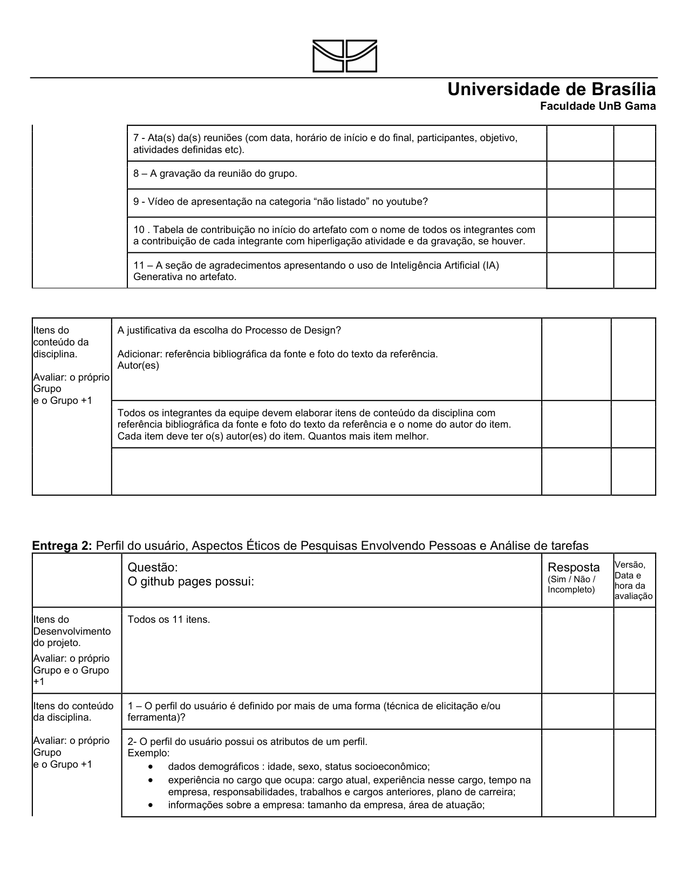

**Figura 1** — Evidência documental referente ao item `PE-E2-01`.  
_Fonte: Plano de Ensino (Sales, 2026, p. 9, Item 1)_

A **Figura 2** reproduz o trecho comprobatório de referência referente ao critério **PE-E2-02**.

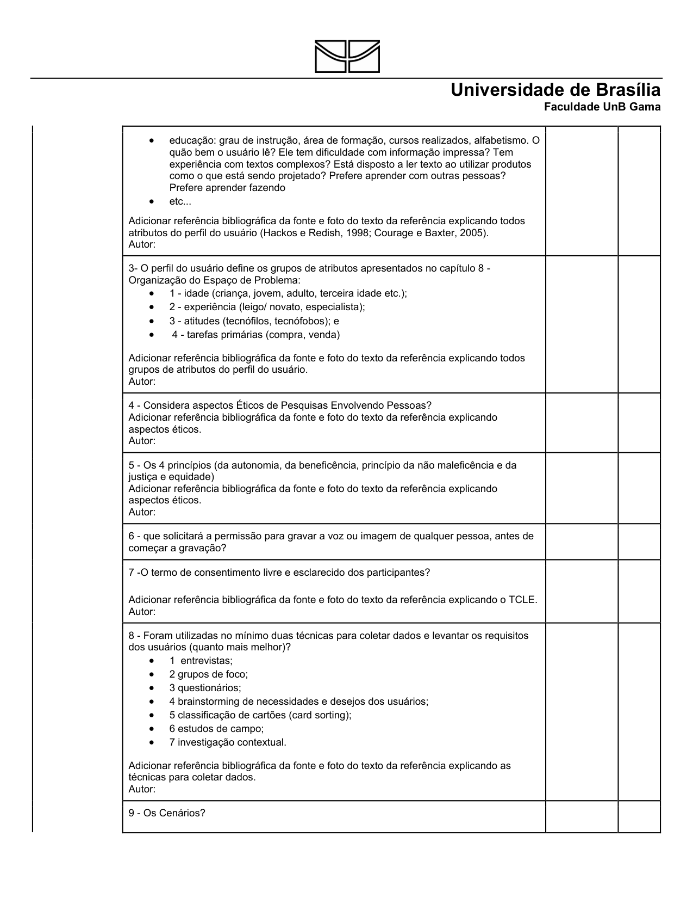

**Figura 2** — Evidência documental referente ao item `PE-E2-02`.  
_Fonte: Plano de Ensino (Sales, 2026, pp. 9–10, Item 2)_

A **Figura 3** reproduz o trecho comprobatório de referência referente ao critério **PU-01**.

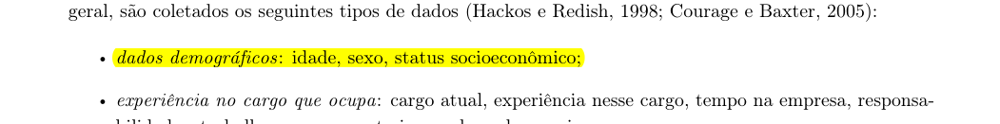

**Figura 3** — Evidência documental referente ao item `PU-01`.  
_Fonte: Barbosa, S. D. J. et al. Interação Humano-Computador e Experiência do Usuário (2021), p. 123 (Capítulo 7)._

A **Figura 4** reproduz o trecho comprobatório de referência referente ao critério **PU-02**.

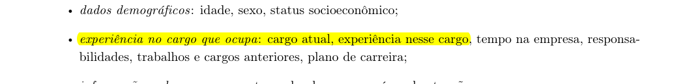

**Figura 4** — Evidência documental referente ao item `PU-02`.  
_Fonte: Barbosa, S. D. J. et al. Interação Humano-Computador e Experiência do Usuário (2021), p. 123 (Capítulo 7)._

A **Figura 5** reproduz o trecho comprobatório de referência referente ao critério **PU-03**.

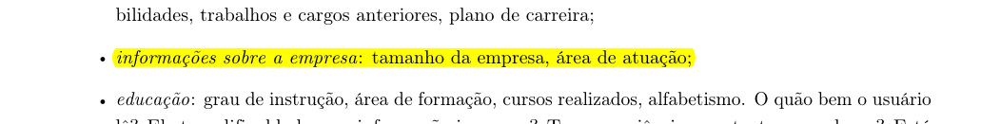

**Figura 5** — Evidência documental referente ao item `PU-03`.  
_Fonte: Barbosa, S. D. J. et al. Interação Humano-Computador e Experiência do Usuário (2021), p. 123 (Capítulo 7)._

A **Figura 6** reproduz o trecho comprobatório de referência referente ao critério **PU-04**.

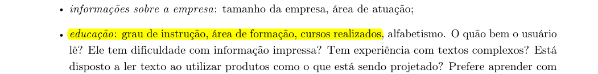

**Figura 6** — Evidência documental referente ao item `PU-04`.  
_Fonte: Barbosa, S. D. J. et al. Interação Humano-Computador e Experiência do Usuário (2021), p. 123 (Capítulo 7)._

A **Figura 7** reproduz o trecho comprobatório de referência referente ao critério **PU-05**.

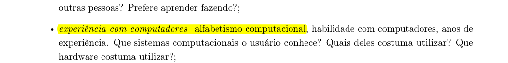

**Figura 7** — Evidência documental referente ao item `PU-05`.  
_Fonte: Barbosa, S. D. J. et al. Interação Humano-Computador e Experiência do Usuário (2021), p. 123 (Capítulo 7)._

A **Figura 8** reproduz o trecho comprobatório de referência referente ao critério **PU-06**.

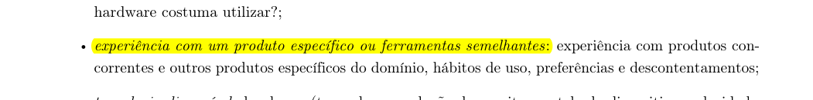

**Figura 8** — Evidência documental referente ao item `PU-06`.  
_Fonte: Barbosa, S. D. J. et al. Interação Humano-Computador e Experiência do Usuário (2021), p. 123 (Capítulo 7)._

A **Figura 9** reproduz o trecho comprobatório de referência referente ao critério **PU-07**.

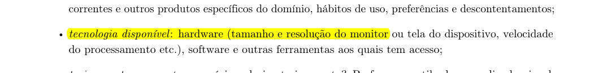

**Figura 9** — Evidência documental referente ao item `PU-07`.  
_Fonte: Barbosa, S. D. J. et al. Interação Humano-Computador e Experiência do Usuário (2021), p. 123 (Capítulo 7)._

A **Figura 10** reproduz o trecho comprobatório de referência referente ao critério **PU-08**.

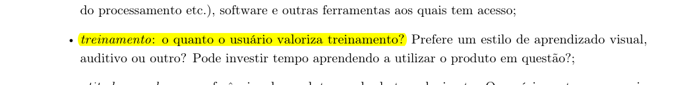

**Figura 10** — Evidência documental referente ao item `PU-08`.  
_Fonte: Barbosa, S. D. J. et al. Interação Humano-Computador e Experiência do Usuário (2021), p. 123 (Capítulo 7)._

A **Figura 11** reproduz o trecho comprobatório de referência referente ao critério **PU-09**.

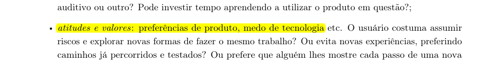

**Figura 11** — Evidência documental referente ao item `PU-09`.  
_Fonte: Barbosa, S. D. J. et al. Interação Humano-Computador e Experiência do Usuário (2021), p. 123 (Capítulo 7)._

A **Figura 12** reproduz o trecho comprobatório de referência referente ao critério **PU-10**.

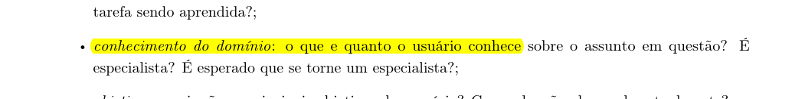

**Figura 12** — Evidência documental referente ao item `PU-10`.  
_Fonte: Barbosa, S. D. J. et al. Interação Humano-Computador e Experiência do Usuário (2021), p. 123 (Capítulo 7)._

A **Figura 13** reproduz o trecho comprobatório de referência referente ao critério **PU-11**.

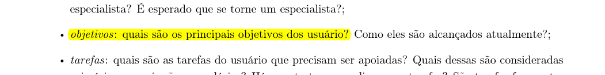

**Figura 13** — Evidência documental referente ao item `PU-11`.  
_Fonte: Barbosa, S. D. J. et al. Interação Humano-Computador e Experiência do Usuário (2021), p. 123 (Capítulo 7)._

A **Figura 14** reproduz o trecho comprobatório de referência referente ao critério **PU-12**.

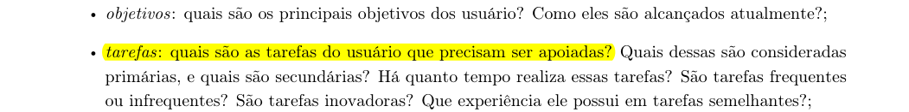

**Figura 14** — Evidência documental referente ao item `PU-12`.  
_Fonte: Barbosa, S. D. J. et al. Interação Humano-Computador e Experiência do Usuário (2021), p. 123 (Capítulo 7)._

A **Figura 15** reproduz o trecho comprobatório de referência referente ao critério **PU-13**.

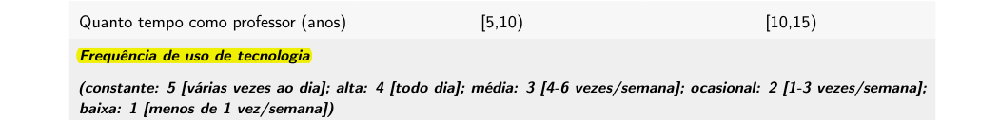

**Figura 15** — Evidência documental referente ao item `PU-13`.  
_Fonte: Barbosa, S. D. J. et al. Interação Humano-Computador e Experiência do Usuário (2021), p. 152 (Capítulo 8)._

A **Figura 16** reproduz o trecho comprobatório de referência referente ao critério **PU-14**.

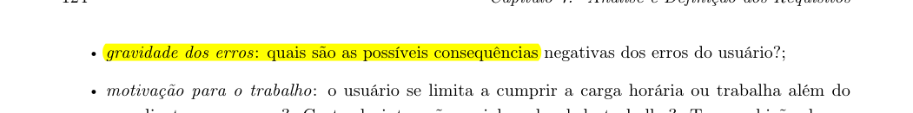

**Figura 16** — Evidência documental referente ao item `PU-14`.  
_Fonte: Barbosa, S. D. J. et al. Interação Humano-Computador e Experiência do Usuário (2021), p. 124 (Capítulo 7)._

A **Figura 17** reproduz o trecho comprobatório de referência referente ao critério **PU-15**.

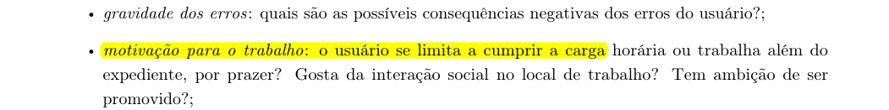

**Figura 17** — Evidência documental referente ao item `PU-15`.  
_Fonte: Barbosa, S. D. J. et al. Interação Humano-Computador e Experiência do Usuário (2021), p. 124 (Capítulo 7)._

A **Figura 18** reproduz o trecho comprobatório de referência referente ao critério **PU-16**.

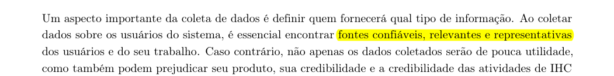

**Figura 18** — Evidência documental referente ao item `PU-16`.  
_Fonte: Barbosa, S. D. J. et al. Interação Humano-Computador e Experiência do Usuário (2021), p. 124 (Capítulo 7)._

A **Figura 19** reproduz o trecho comprobatório de referência referente ao critério **PU-17**.

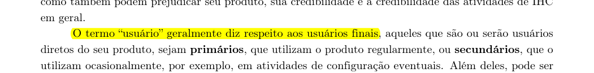

**Figura 19** — Evidência documental referente ao item `PU-17`.  
_Fonte: Barbosa, S. D. J. et al. Interação Humano-Computador e Experiência do Usuário (2021), p. 124 (Capítulo 7)._

A **Figura 20** reproduz o trecho comprobatório de referência referente ao critério **PU-18**.

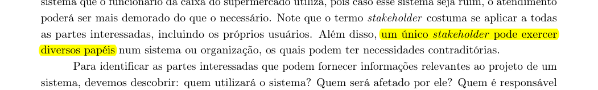

**Figura 20** — Evidência documental referente ao item `PU-18`.  
_Fonte: Barbosa, S. D. J. et al. Interação Humano-Computador e Experiência do Usuário (2021), p. 124 (Capítulo 7)._

A **Figura 21** reproduz o trecho comprobatório de referência referente ao critério **PU-19**.

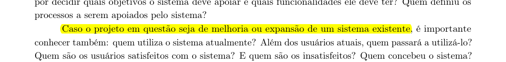

**Figura 21** — Evidência documental referente ao item `PU-19`.  
_Fonte: Barbosa, S. D. J. et al. Interação Humano-Computador e Experiência do Usuário (2021), p. 124 (Capítulo 7)._

A **Figura 22** reproduz o trecho comprobatório de referência referente ao critério **PU-20**.

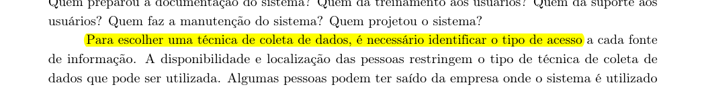

**Figura 22** — Evidência documental referente ao item `PU-20`.  
_Fonte: Barbosa, S. D. J. et al. Interação Humano-Computador e Experiência do Usuário (2021), pp. 124-125 (Capítulo 7)._

A **Figura 23** reproduz o trecho comprobatório de referência referente ao critério **PU-21**.

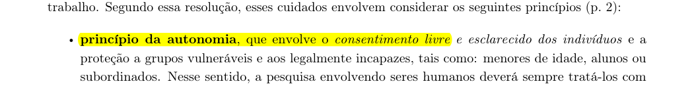

**Figura 23** — Evidência documental referente ao item `PU-21`.  
_Fonte: Barbosa, S. D. J. et al. Interação Humano-Computador e Experiência do Usuário (2021), p. 126 (Capítulo 7)._

A **Figura 24** reproduz o trecho comprobatório de referência referente ao critério **PU-22**.

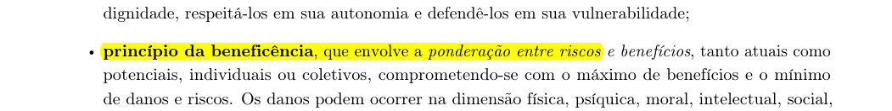

**Figura 24** — Evidência documental referente ao item `PU-22`.  
_Fonte: Barbosa, S. D. J. et al. Interação Humano-Computador e Experiência do Usuário (2021), p. 126 (Capítulo 7)._

A **Figura 25** reproduz o trecho comprobatório de referência referente ao critério **PU-23**.

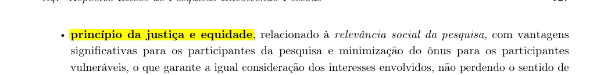

**Figura 25** — Evidência documental referente ao item `PU-23`.  
_Fonte: Barbosa, S. D. J. et al. Interação Humano-Computador e Experiência do Usuário (2021), p. 127 (Capítulo 7)._

A **Figura 26** reproduz o trecho comprobatório de referência referente ao critério **PU-24**.

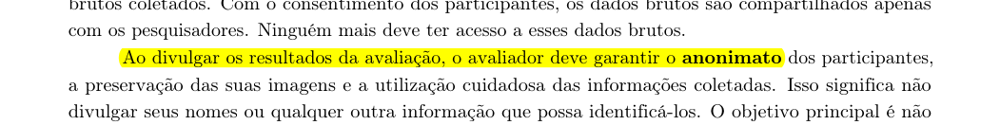

**Figura 26** — Evidência documental referente ao item `PU-24`.  
_Fonte: Barbosa, S. D. J. et al. Interação Humano-Computador e Experiência do Usuário (2021), pp. 127-128 (Capítulo 7)._

A **Figura 27** reproduz o trecho comprobatório de referência referente ao critério **PU-25**.

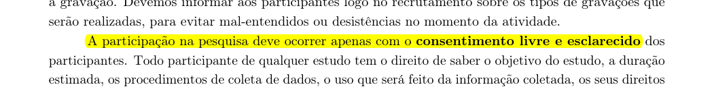

**Figura 27** — Evidência documental referente ao item `PU-25`.  
_Fonte: Barbosa, S. D. J. et al. Interação Humano-Computador e Experiência do Usuário (2021), pp. 127-128 (Capítulo 7)._

A **Figura 28** reproduz o trecho comprobatório de referência referente ao critério **PU-26**.

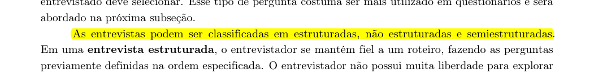

**Figura 28** — Evidência documental referente ao item `PU-26`.  
_Fonte: Barbosa, S. D. J. et al. Interação Humano-Computador e Experiência do Usuário (2021), p. 131 (Capítulo 7)._

A **Figura 29** reproduz o trecho comprobatório de referência referente ao critério **PU-27**.

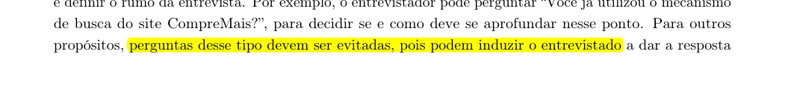

**Figura 29** — Evidência documental referente ao item `PU-27`.  
_Fonte: Barbosa, S. D. J. et al. Interação Humano-Computador e Experiência do Usuário (2021), pp. 131-132 (Capítulo 7)._

A **Figura 30** reproduz o trecho comprobatório de referência referente ao critério **PU-28**.

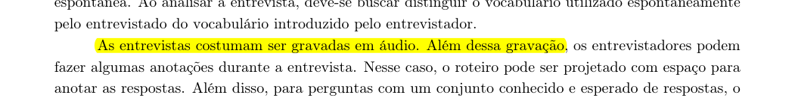

**Figura 30** — Evidência documental referente ao item `PU-28`.  
_Fonte: Barbosa, S. D. J. et al. Interação Humano-Computador e Experiência do Usuário (2021), p. 132 (Capítulo 7)._

A **Figura 31** reproduz o trecho comprobatório de referência referente ao critério **PU-29**.

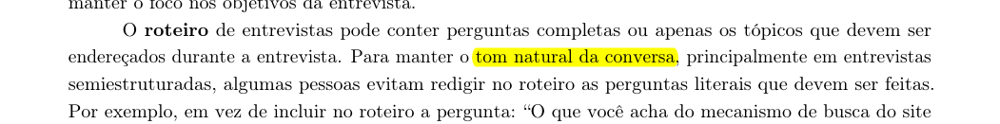

**Figura 31** — Evidência documental referente ao item `PU-29`.  
_Fonte: Barbosa, S. D. J. et al. Interação Humano-Computador e Experiência do Usuário (2021), pp. 131-132 (Capítulo 7)._

A **Figura 32** reproduz o trecho comprobatório de referência referente ao critério **PU-30**.

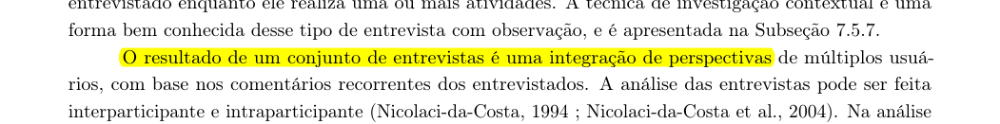

**Figura 32** — Evidência documental referente ao item `PU-30`.  
_Fonte: Barbosa, S. D. J. et al. Interação Humano-Computador e Experiência do Usuário (2021), p. 133 (Capítulo 7)._

A **Figura 33** reproduz o trecho comprobatório de referência referente ao critério **PU-31**.

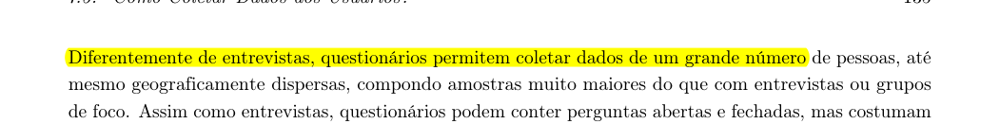

**Figura 33** — Evidência documental referente ao item `PU-31`.  
_Fonte: Barbosa, S. D. J. et al. Interação Humano-Computador e Experiência do Usuário (2021), p. 134 (Capítulo 7)._

A **Figura 34** reproduz o trecho comprobatório de referência referente ao critério **PU-32**.

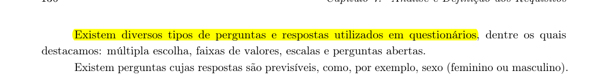

**Figura 34** — Evidência documental referente ao item `PU-32`.  
_Fonte: Barbosa, S. D. J. et al. Interação Humano-Computador e Experiência do Usuário (2021), pp. 135-136 (Capítulo 7)._

A **Figura 35** reproduz o trecho comprobatório de referência referente ao critério **PU-33**.

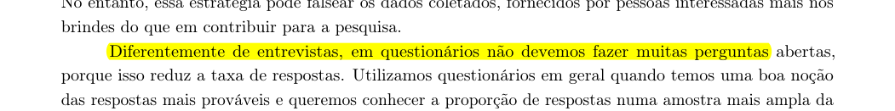

**Figura 35** — Evidência documental referente ao item `PU-33`.  
_Fonte: Barbosa, S. D. J. et al. Interação Humano-Computador e Experiência do Usuário (2021), p. 135 (Capítulo 7)._

A **Figura 36** reproduz o trecho comprobatório de referência referente ao critério **PU-34**.

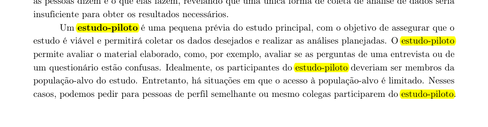

**Figura 36** — Evidência documental referente ao item `PU-34`.  
_Fonte: Barbosa, S. D. J. et al. Interação Humano-Computador e Experiência do Usuário (2021), p. 122 (Capítulo 7)._

A **Figura 37** reproduz o trecho comprobatório de referência referente ao critério **PU-35**.

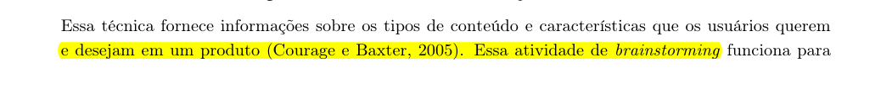

**Figura 37** — Evidência documental referente ao item `PU-35`.  
_Fonte: Barbosa, S. D. J. et al. Interação Humano-Computador e Experiência do Usuário (2021), p. 138-139 (Capítulo 7)._

A **Figura 38** reproduz o trecho comprobatório de referência referente ao critério **PU-36**.

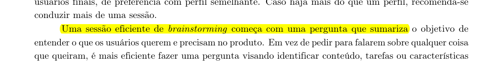

**Figura 38** — Evidência documental referente ao item `PU-36`.  
_Fonte: Barbosa, S. D. J. et al. Interação Humano-Computador e Experiência do Usuário (2021), p. 139 (Capítulo 7)._

A **Figura 39** reproduz o trecho comprobatório de referência referente ao critério **PU-37**.

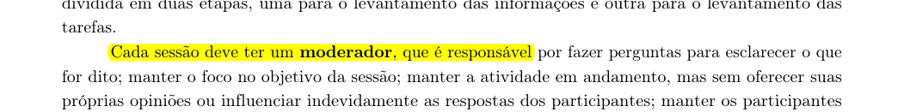

**Figura 39** — Evidência documental referente ao item `PU-37`.  
_Fonte: Barbosa, S. D. J. et al. Interação Humano-Computador e Experiência do Usuário (2021), p. 139 (Capítulo 7)._

A **Figura 40** reproduz o trecho comprobatório de referência referente ao critério **PU-38**.

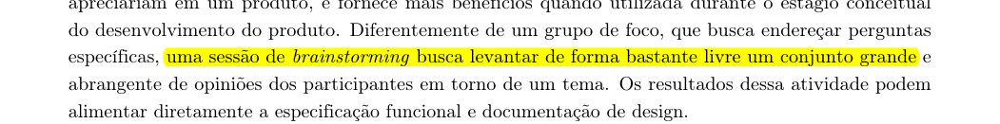

**Figura 40** — Evidência documental referente ao item `PU-38`.  
_Fonte: Barbosa, S. D. J. et al. Interação Humano-Computador e Experiência do Usuário (2021), p. 139 (Capítulo 7)._

A **Figura 41** reproduz o trecho comprobatório de referência referente ao critério **PU-39**.

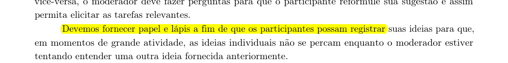

**Figura 41** — Evidência documental referente ao item `PU-39`.  
_Fonte: Barbosa, S. D. J. et al. Interação Humano-Computador e Experiência do Usuário (2021), p. 140 (Capítulo 7)._

A **Figura 42** reproduz o trecho comprobatório de referência referente ao critério **PU-40**.

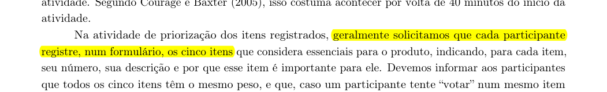

**Figura 42** — Evidência documental referente ao item `PU-40`.  
_Fonte: Barbosa, S. D. J. et al. Interação Humano-Computador e Experiência do Usuário (2021), p. 140 (Capítulo 7)._

A **Figura 43** reproduz o trecho comprobatório de referência referente ao critério **PU-41**.

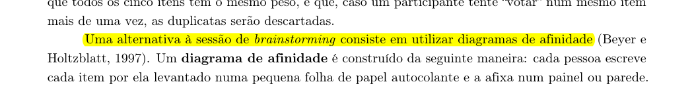

**Figura 43** — Evidência documental referente ao item `PU-41`.  
_Fonte: Barbosa, S. D. J. et al. Interação Humano-Computador e Experiência do Usuário (2021), p. 140 (Capítulo 7)._

A **Figura 44** reproduz o trecho comprobatório de referência referente ao critério **PU-42**.

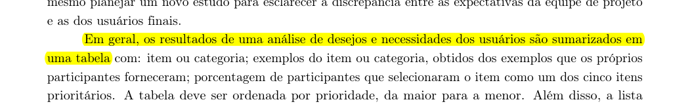

**Figura 44** — Evidência documental referente ao item `PU-42`.  
_Fonte: Barbosa, S. D. J. et al. Interação Humano-Computador e Experiência do Usuário (2021), p. 141 (Capítulo 7)._

A **Figura 45** reproduz o trecho comprobatório de referência referente ao critério **PU-G01**.

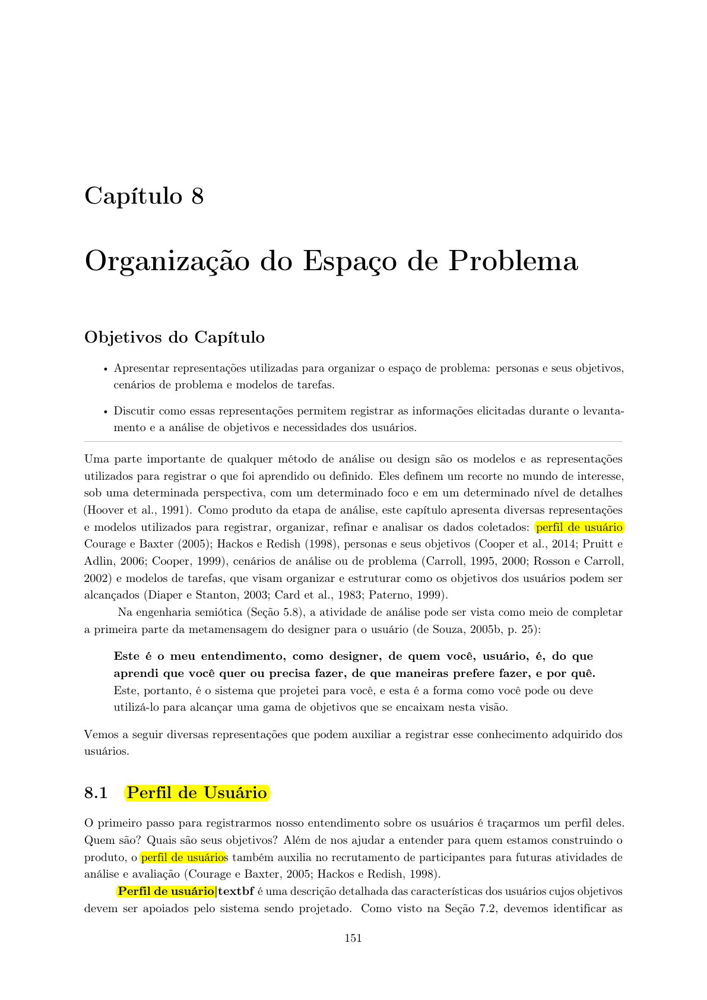

**Figura 45** — Evidência documental referente ao item `PU-G01`.  
_Fonte: BARBOSA, Simone Diniz Junqueira et al. Interação Humano-Computador e Experiência do Usuário. 1. ed. Rio de Janeiro: Autopublicação, 2021, Cap. 7–8, pp. 127–130, 146–152._

---

## 3. Validação desta Lista pela Lista de Governança do Prof. Dr. André Barros de Sales (`DG-01` a `DG-11`)

Em estrito cumprimento às diretrizes de qualidade do Plano de Ensino (*Sales, 2026, pp. 8–9*), a **Tabela 5** submete esta própria página (`03-perfil-usuario.md`) aos **11 Itens de Desenvolvimento do Projeto** formulados pelo Prof. Dr. André Barros de Sales.

**Tabela 5** — Autoavaliação de `03-perfil-usuario.md` frente aos critérios `DG-01` a `DG-11`

| ID | Critério de Governança do Plano de Ensino | Autor do Item | Resposta | Versão, Data e Hora da Avaliação | Evidência de Conformidade nesta Lista |
| :---: | :--- | :--- | :---: | :---: | :--- |
| **DG-01** | O histórico de versão padronizado? | **Prof. Dr. André Barros de Sales** *(Plano de Ensino FGA0173, 2026)* | ✅ **Sim (Conforme)** | `v2.0` — 20/11/2026 às 14:30 | Seção **Histórico de Versão** (**Tabela 6**) padronizada ao final de `03-perfil-usuario.md` registrando `v2.0`. |
| **DG-02** | O(s) autor(es) e o(s) revisor(es) para cada artefato? | **Prof. Dr. André Barros de Sales** *(Plano de Ensino FGA0173, 2026)* | ✅ **Sim (Conforme)** | `v2.0` — 20/11/2026 às 14:30 | Colunas **Autor(es)** e **Revisor(es)** preenchidas com links GitHub no Histórico de Versão, além da coluna **`Autor do Item`** em 100% dos critérios da lista. |
| **DG-03** | Referências bibliográficas e/ou bibliografia em todos os artefatos? | **Prof. Dr. André Barros de Sales** *(Plano de Ensino FGA0173, 2026)* | ✅ **Sim (Conforme)** | `v2.0` — 20/11/2026 às 14:30 | Seção **Referências Bibliográficas (ABNT NBR 6023)** completa ao final do documento com obras, edições e páginas exatas. |
| **DG-04** | As tabelas e imagens possuem legenda e fonte e são chamadas dentro do texto? | **Prof. Dr. André Barros de Sales** *(Plano de Ensino FGA0173, 2026)* | ✅ **Sim (Conforme)** | `v2.0` — 20/11/2026 às 14:30 | 100% das tabelas (`Tabela 1` a `Tabela 6`) e figuras (`Figura 1` a `Figura 45`) possuem numeração, legenda, fonte e chamadas textuais prévias. |
| **DG-05** | Um texto fazendo uma introdução dos artefatos? | **Prof. Dr. André Barros de Sales** *(Plano de Ensino FGA0173, 2026)* | ✅ **Sim (Conforme)** | `v2.0` — 20/11/2026 às 14:30 | Seção **1. Introdução e Contextualização Metodológica** situa o instrumento no Ciclo de Mayhew (1999) e na Inspeção Formal de Fagan (1976). |
| **DG-06** | O cronograma executado com quem realizou cada artefato/atividade e as datas de início e fim da construção/realização? | **Prof. Dr. André Barros de Sales** *(Plano de Ensino FGA0173, 2026)* | ✅ **Sim (Conforme)** | `v2.0` — 20/11/2026 às 14:30 | Registros de elaboração e revisão vinculados ao [Cronograma Executado](../../planejamento/cronograma-executado.md) e ao histórico Git da equipe. |
| **DG-07** | Ata(s) da(s) reuniões (com data, horário de início e do final, participantes, objetivo, atividades definidas etc.)? | **Prof. Dr. André Barros de Sales** *(Plano de Ensino FGA0173, 2026)* | ✅ **Sim (Conforme)** | `v2.0` — 20/11/2026 às 14:30 | Deliberações e alinhamentos documentados nas [Atas de Reunião](../../atas/index.md). |
| **DG-08** | A gravação da reunião do grupo? | **Prof. Dr. André Barros de Sales** *(Plano de Ensino FGA0173, 2026)* | ✅ **Sim (Conforme)** | `v2.0` — 20/11/2026 às 14:30 | Links funcionais de gravações das reuniões de planejamento e auditoria indexados em [Atas de Reunião](../../atas/index.md). |
| **DG-09** | Vídeo de apresentação na categoria 'Não Listado' no YouTube (duração entre 20 e 30 minutos)? | **Prof. Dr. André Barros de Sales** *(Plano de Ensino FGA0173, 2026)* | ⚠️ **Em preparação (Etapa 8)** | `v2.0` — 20/11/2026 às 14:30 | Vídeos das Entregas 1–7 publicados; vídeo oficial da [Entrega 8 — Verificação dos Artefatos](../../entregas/entrega8.md) (20–30 min, Não Listado) agendado após consolidação das inspeções da equipe. |
| **DG-10** | Tabela de contribuição no início do artefato com o nome de todos os integrantes, contribuição com hiperligação da atividade e da gravação? | **Prof. Dr. André Barros de Sales** *(Plano de Ensino FGA0173, 2026)* | ✅ **Sim (Conforme)** | `v2.0` — 20/11/2026 às 14:30 | **Tabela 1** posicionada no topo do documento discriminando cada integrante ativo com hiperligação GitHub e escopo de atuação. |
| **DG-11** | A seção de agradecimentos apresentando o uso de Inteligência Artificial (IA) Generativa no artefato? | **Prof. Dr. André Barros de Sales** *(Plano de Ensino FGA0173, 2026)* | ✅ **Sim (Conforme)** | `v2.0` — 20/11/2026 às 14:30 | Seção **Agradecimentos e Declaração de Uso de IA Generativa** ao final do documento em estrita conformidade com o Código da SBC e Sales (2026). |

_Fonte: Validação elaborada por Vinicius Silva Araruna com base na rubrica oficial de Prof. Dr. André Barros de Sales (Plano de Ensino, 2026, pp. 8–9)._

---

## 4. Histórico de Versão

A **Tabela 6** registra a evolução histórica e o controle de versionamento deste instrumento normativo.

**Tabela 6** — Histórico de Versão do Documento

| Versão | Data | Descrição Detalhada da Modificação | Autor(es) | Revisor(es) |
| :---: | :---: | :--- | :--- | :--- |
| `1.0` | 15/09/2026 | Lista de Verificação original com 42 itens (`Grupo8ViniciusSilvaArarunaVerifacaçãoListaPerfilUsuario.pdf`) e aplicação tabular em `perfil-usuario.md`. | [Vinicius Silva Araruna](https://github.com/ViniciusA05) | [Gustavo Antonio Rodrigues e Silva](https://github.com/gus-ant) |
| `2.0` | 20/11/2026 | Consolidação em `03-perfil-usuario.md`, integração dos 42 itens originais + 3 itens do Prof. André + 6 itens de Gustavo Antonio (`perfil-usuario.md`), publicação dos 42 recortes e validação `DG-01..11`. | [Vinicius Silva Araruna](https://github.com/ViniciusA05) | [Gustavo Antonio Rodrigues e Silva](https://github.com/gus-ant), [Edvaldo Soares Brasileiro Filho](https://github.com/PajeMurici-dev) |

_Fonte: Elaborada pelos autores, 2026._

---

## 5. Referências Bibliográficas (ABNT NBR 6023)

[1] COOPER, Alan; REIMANN, Robert; CRONIN, David; NOESSEL, Christopher. *About Face: The Essentials of Interaction Design*. 4. ed. Indianapolis: Wiley, 2014.

[2] COURAGE, Catherine; BAXTER, Kathy. *Understanding Your Users: A Practical Guide to User Requirements Methods, Tools, and Techniques*. San Francisco: Morgan Kaufmann, 2005.

[3] HACKOS, JoAnn T.; REDISH, Janice C. *User and Task Analysis for Interface Design*. New York: John Wiley & Sons, 1998.

[4] IBGE. *Pesquisa Nacional por Amostra de Domicílios Contínua (PNAD Contínua) — Acesso à Internet e Posse de Telefone Móvel*. Rio de Janeiro: IBGE, 2023.

[5] BARBOSA, Simone Diniz Junqueira et al. *Interação Humano-Computador e Experiência do Usuário*. 1. ed. Rio de Janeiro: Autopublicação, 2021. ISBN 978-65-00-19677-1.

[6] BARBOSA, Simone Diniz Junqueira; SILVA, Bruno Santana da. *Interação Humano-Computador*. 1. ed. Rio de Janeiro: Elsevier / Campus, 2010.

[7] FAGAN, Michael E. Design and code inspections to reduce errors in program development. *IBM Systems Journal*, v. 15, n. 3, p. 182–211, 1976.

[8] MAYHEW, Deborah J. *The Usability Engineering Lifecycle: A Practitioner's Handbook for User Interface Design*. San Francisco: Morgan Kaufmann, 1999.

[9] SALES, André Barros de. *Plano de Ensino da Disciplina de Interação Humano Computador (FGA0173 — 02/2026)*. Brasília: Universidade de Brasília, Faculdade UnB Gama (FGA), 2026.

[10] SOCIEDADE BRASILEIRA DE COMPUTAÇÃO (SBC). *Código de Conduta da Sociedade Brasileira de Computação*. Porto Alegre: SBC, 2023.

---

## 6. Agradecimentos e Declaração de Uso de Inteligência Artificial (IA) Generativa

Em conformidade com o Código de Conduta da Sociedade Brasileira de Computação (SBC, Art. 2º, parágrafo III) e com as diretrizes do Plano de Ensino da disciplina (*Sales, 2026, p. 3*), declara-se que a organização das tabelas em Markdown e a revisão ortográfica contaram com suporte supervisionado da ferramenta de Inteligência Artificial Generativa Google Gemini. Toda a concepção metodológica, verificação bibliográfica nas obras originais, revisão técnica e validação de conformidade foram realizadas pelos discentes identificados no Histórico de Versão.
