# Lista de Verificação — Planejamento da Avaliação — Framework DECIDE

## Tabela de Contribuição e Transparência de IA Generativa

A **Tabela 1** apresenta a distribuição de responsabilidades na elaboração, curadoria e revisão de **Planejamento da Avaliação — Framework DECIDE**.

**Tabela 1** — Matriz de Contribuição e Transparência de IA Generativa — Planejamento da Avaliação — Framework DECIDE

| Integrante | Atribuição no Artefato | Data | Horário | Ferramenta de IA | Propósito do Uso de IA |
| :--- | :--- | :---: | :---: | :--- | :--- |
| [Vinicius Silva Araruna](https://github.com/ViniciusA05) | Elaboração modular dos critérios de `DEC`, citação direta, recortes da obra e autoavaliação pela rubrica `DG-01` a `DG-11` | 20/11/2026 | 14:00 - 15:30 | Google Gemini | Suporte na organização estrutural, formatação de tabelas em Markdown e conferência cruzada com o Plano de Ensino |
| [Gustavo Antonio Rodrigues e Silva](https://github.com/gus-ant) | Revisão de conformidade estrutural, navegação e checagem de links | 20/11/2026 | 15:30 - 16:00 | — | Revisão por pares e validação editorial |
| [Edvaldo Soares Brasileiro Filho](https://github.com/PajeMurici-dev) | Auditoria de rastreabilidade frente ao Plano de Ensino (`DG-01` a `DG-11`) e referências ABNT | 20/11/2026 | 15:30 - 16:00 | — | Revisão por pares e conferência documental |

_Fonte: Elaborada pelos autores, 2026._

---

## 1. Introdução e Contextualização Metodológica

Este módulo reúne os instrumentos de verificação para todo **Planejamento de Avaliação de IHC (Níveis 1, 2 e 3)** estruturado no **Framework DECIDE** (Preece et al., 2002; Barbosa et al., 2021, Cap. 11): os **8 critérios oficiais do Prof. André Barros de Sales** (pp. 12–13), os **14 itens da lista DECIDE** e, como seção complementar de fundamentação teórica, o caderno completo com as **20 Questões de Planejamento da Avaliação** e seus 20 recortes.

Este instrumento normativo atua segundo o **Método de Inspeção Formal de Michael E. Fagan (1976)** e encontra-se desacoplado dos relatórios empíricos de aplicação. Toda inspeção registrada aqui identifica obrigatoriamente o **`Autor do Item`**, a **fundamentação bibliográfica com recorte visual** e a coluna **`Versão, Data e Hora da Avaliação`** exigida pelo Plano de Ensino (*Sales, 2026, pp. 8–13*).

!!! info "Pré-requisito Transversal de Governança (Prof. Dr. André Barros de Sales)"
    Além dos critérios específicos deste artefato listados na **Seção 2**, todo produto de trabalho avaliado deve cumprir integralmente os **11 Itens de Desenvolvimento Geral (`DG-01` a `DG-11`)** definidos pelo Prof. Dr. André Barros de Sales em [00. Governança e Plano de Ensino Geral](00-plano-ensino-geral.md).

---

## 2. Instrumento Normativo de Verificação — Planejamento da Avaliação — Framework DECIDE

### 2.1 Critérios do Plano de Ensino (Prof. Dr. André Barros de Sales — Rubrica Oficial)

A **Tabela 2** reúne os critérios oficiais estipulados pelo docente para este artefato no Plano de Ensino (*Sales, 2026*).

**Tabela 2** — Critérios oficiais do Plano de Ensino para Planejamento da Avaliação — Framework DECIDE

| ID | Critério / Pergunta de Verificação | Autor do Item | Fundamentação Canônica e Fonte | Evidência Visual (Figura) | Resposta | Versão, Data e Hora da Avaliação |
| :---: | :--- | :--- | :--- | :---: | :---: | :---: |
| **PE-E4-02** | O planejamento da avaliação segue o Framework DECIDE? | **Prof. Dr. André Barros de Sales** *(Plano de Ensino FGA0173, 2026)* | Plano de Ensino (Sales, 2026, p. 12, Item 2) | [Ver Figura 1](#figura-1) | `[ ] Sim (Conforme)` `[ ] Não (Não Conforme)` `[ ] Incompleto` `[ ] N/A` | *(Preencher na inspeção)* |
| **PE-E4-03** | Descreve o(s) objetivo(s) da avaliação (apropriação de tecnologia, ideias/alternativas de design, conformidade com padrão e/ou problemas na interação/interface)? | **Prof. Dr. André Barros de Sales** *(Plano de Ensino FGA0173, 2026)* | Plano de Ensino (Sales, 2026, p. 13, Item 3) | [Ver Figura 2](#figura-2) | `[ ] Sim (Conforme)` `[ ] Não (Não Conforme)` `[ ] Incompleto` `[ ] N/A` | *(Preencher na inspeção)* |
| **PE-E4-04** | Define os métodos de avaliação a serem utilizados com referência bibliográfica, foto do texto e autor? | **Prof. Dr. André Barros de Sales** *(Plano de Ensino FGA0173, 2026)* | Plano de Ensino (Sales, 2026, p. 13, Item 4) | [Ver Figura 2](#figura-2) | `[ ] Sim (Conforme)` `[ ] Não (Não Conforme)` `[ ] Incompleto` `[ ] N/A` | *(Preencher na inspeção)* |
| **PE-E4-05** | Detalha as questões práticas (recrutamento, quantidade/razão de participantes, presencial/remoto, equipamentos, prazos, orçamento e mão-de-obra)? | **Prof. Dr. André Barros de Sales** *(Plano de Ensino FGA0173, 2026)* | Plano de Ensino (Sales, 2026, p. 13, Item 5) | [Ver Figura 2](#figura-2) | `[ ] Sim (Conforme)` `[ ] Não (Não Conforme)` `[ ] Incompleto` `[ ] N/A` | *(Preencher na inspeção)* |
| **PE-E4-06** | Contempla as questões éticas garantindo respeito aos participantes sem prejuízos diretos ou indiretos antes ou após a divulgação? | **Prof. Dr. André Barros de Sales** *(Plano de Ensino FGA0173, 2026)* | Plano de Ensino (Sales, 2026, p. 13, Item 6) | [Ver Figura 2](#figura-2) | `[ ] Sim (Conforme)` `[ ] Não (Não Conforme)` `[ ] Incompleto` `[ ] N/A` | *(Preencher na inspeção)* |
| **PE-E4-08** | Apresenta um cronograma (data, horário e local) para realização da avaliação? | **Prof. Dr. André Barros de Sales** *(Plano de Ensino FGA0173, 2026)* | Plano de Ensino (Sales, 2026, p. 13, Item 8) | [Ver Figura 2](#figura-2) | `[ ] Sim (Conforme)` `[ ] Não (Não Conforme)` `[ ] Incompleto` `[ ] N/A` | *(Preencher na inspeção)* |
| **PE-E4-11** | Inclui definição do teste piloto e data de realização antes da avaliação definitiva com referência, foto e autor? | **Prof. Dr. André Barros de Sales** *(Plano de Ensino FGA0173, 2026)* | Plano de Ensino (Sales, 2026, p. 13, Item 11) | [Ver Figura 2](#figura-2) | `[ ] Sim (Conforme)` `[ ] Não (Não Conforme)` `[ ] Incompleto` `[ ] N/A` | *(Preencher na inspeção)* |
| **PE-E4-12** | Assegura que o resultado do teste piloto NÃO será apresentado no resultado da avaliação? | **Prof. Dr. André Barros de Sales** *(Plano de Ensino FGA0173, 2026)* | Plano de Ensino (Sales, 2026, p. 13, Item 12) | [Ver Figura 2](#figura-2) | `[ ] Sim (Conforme)` `[ ] Não (Não Conforme)` `[ ] Incompleto` `[ ] N/A` | *(Preencher na inspeção)* |

_Fonte: Plano de Ensino da Disciplina (Prof. Dr. André Barros de Sales, 2026)._

### 2.2 Critérios Técnicos da Literatura Canônica (Lista de Verificação `DEC`)

A **Tabela 3** apresenta os **14 itens normativos** fundamentados na literatura científica com citação direta literal e recorte visual da página.

**Tabela 3** — Lista de verificação normativa de Planejamento da Avaliação — Framework DECIDE (14 itens)

| ID | Critério / Pergunta de Verificação | Autor do Item | Fundamentação Canônica (Obra, Ed., Cap., Pág.) e Citação Literal | Evidência Visual (Figura) | Resposta | Versão, Data e Hora da Avaliação |
| :---: | :--- | :--- | :--- | :---: | :---: | :---: |
| **DEC-01** | **[Etapa D: Determinar os objetivos gerais da avaliação de IHC]** O planejamento determina claramente quais são os objetivos gerais da avaliação e identifica expressamente quem são as partes interessadas (stakeholders, tais como usuários finais, equipe de desenvolvimento, designers, clientes ou gestores) nesses objetivos, escolhendo um ou mais dos seguintes objetivos consolidados na área: • Analisar a apropriação da tecnologia: verificar como os usuários inserem o sistema no cotidiano, como realizam suas atividades antes e depois do sistema e se o apoio computacional é adequado. • Comparar ideias e alternativas de design: comparar diferentes propostas de telas e fluxos de interação para decidir qual solução é mais eficiente, fácil de aprender e preferida pelos usuários. • Verificar a conformidade com um padrão: avaliar se o sistema segue padrões de acessibilidade (como diretrizes do W3C), padrões visuais de sistemas operacionais ou convenções do domínio. • Identificar problemas na interação e na interface: diagnosticar falhas, erros de projeto, barreiras de navegação e pontos de confusão que prejudiquem a usabilidade e a experiência do usuário? | [Vinicius Silva Araruna](https://github.com/ViniciusA05) | *"D Determinar os objetivos da avaliação de IHC. O avaliador deve determinar os objetivos gerais da avaliação e identificar por que e para quem tais objetivos são importantes. O restante do planejamento da avaliação, sua execução e a apresentação dos resultados serão orientados por esses objetivos."* Barbosa, S. D. J. et al. Interação Humano-Computador e Experiência do Usuário (2021, 1. ed.), p. 264 (Capítulo 11, Seção 11.8 — Etapa D). | [Ver Figura 3](#figura-3) | `[ ] Sim (Conforme)` `[ ] Não (Não Conforme)` `[ ] Incompleto` `[ ] N/A` | *(Preencher na inspeção)* |
| **DEC-02** | **[Etapa D: Determinar os objetivos gerais da avaliação de IHC]** O documento apresenta a justificativa e a contextualização da avaliação, esclarecendo quais motivações práticas levaram à sua realização (como reclamações de usuários sobre dificuldades no uso, pedidos de clientes para melhoria de produto, necessidade de validar novas funcionalidades ou queda no rendimento das tarefas)? | [Vinicius Silva Araruna](https://github.com/ViniciusA05) | *"A questão fundamental de uma avaliação de IHC é definir quais são os objetivos da avaliação, a quem eles interessam e por quê. Os objetivos de uma avaliação determinam quais aspectos relacionados ao uso do sistema devem ser investigados. Esses objetivos são motivados por requisições, reclamações ou comportamentos de qualquer interessado no sistema (stakeholders)..."* Barbosa, S. D. J. et al. Interação Humano-Computador e Experiência do Usuário (2021, 1. ed.), p. 248 (Capítulo 11, Seção 11.2). | [Ver Figura 4](#figura-4) | `[ ] Sim (Conforme)` `[ ] Não (Não Conforme)` `[ ] Incompleto` `[ ] N/A` | *(Preencher na inspeção)* |
| **DEC-03** | **[Etapa E: Explorar perguntas a serem respondidas com a avaliação]** O documento desdobra os objetivos gerais em perguntas operacionais e específicas a serem respondidas durante a avaliação, descrevendo textualmente quais são essas perguntas de acordo com o objetivo selecionado, conforme as questões consolidadas na Tabela 11.1 do livro de referência: • Caso o objetivo seja analisar a apropriação da tecnologia: de que maneira os usuários utilizam o sistema e em que difere do planejado; como o sistema afeta o modo de as pessoas se comunicarem e relacionarem; que variação houve no número de erros cometidos, no tempo para atingir objetivos e na satisfação; o quanto consideram o apoio computacional adequado; o quanto são motivados a explorar novas funcionalidades; quais são os pontos fortes e fracos na opinião dos usuários; quais objetivos e necessidades foram ou não atendidos; e por que não incorporaram o sistema no cotidiano? • Caso o objetivo seja comparar ideias e alternativas de design: qual das alternativas é mais eficiente e mais fácil de aprender; qual pode ser construída em menos tempo; de qual se espera menor impacto negativo ao ser adotada; qual torna mais evidentes os diferenciais da solução projetada; e qual delas os usuários preferem e por quê? • Caso o objetivo seja verificar a conformidade com um padrão: se o sistema está de acordo com os padrões de acessibilidade do W3C; se a interface segue os padrões do sistema operacional ou da empresa; e se os termos na interface seguem convenções estabelecidas no domínio? • Caso o objetivo seja identificar problemas na interação e interface: se o usuário consegue operar o sistema; se atinge seu objetivo, com quanta eficiência, em quanto tempo e após cometer quantos erros; que parte da interface o deixa insatisfeito ou o desmotiva a explorar novas funções; se entende o que significa e para que serve cada elemento; se vai entender o que deve fazer em seguida; que problemas de IHC dificultam ou impedem o alcance dos objetivos; onde os problemas se manifestam, sua frequência e gravidade; e quais barreiras são encontradas? | [Vinicius Silva Araruna](https://github.com/ViniciusA05) | *"E Explorar perguntas a serem respondidas com a avaliação. Para cada objetivo definido, o avaliador deve elaborar perguntas específicas a serem respondidas durante avaliação. Essas perguntas são responsáveis por operacionalizar a investigação e o julgamento de valor a serem realizados. Elas devem considerar o perfil dos usuários-alvo e suas atividades."* Barbosa, S. D. J. et al. Interação Humano-Computador e Experiência do Usuário (2021, 1. ed.), p. 264 e Tabela 11.1 na p. 250 (Capítulo 11). | [Ver Figura 5](#figura-5) | `[ ] Sim (Conforme)` `[ ] Não (Não Conforme)` `[ ] Incompleto` `[ ] N/A` | *(Preencher na inspeção)* |
| **DEC-04** | **[Etapa C: Escolher os métodos de avaliação a serem utilizados]** O planejamento seleciona métodos de avaliação formais e justifica sua escolha demonstrando como eles respondem às perguntas formuladas, escolhendo entre as categorias de métodos consolidadas no livro: • Métodos de Inspeção (Analíticos - sem envolvimento direto de usuários): Avaliação Heurística (especialistas inspecionam a interface guiados pelas heurísticas de usabilidade de Nielsen); Percurso Cognitivo (especialistas avaliam passo a passo a facilidade de aprendizado do sistema por exploração); Método de Inspeção Semiótica - MIS (especialistas analisam os signos da interface para verificar a emissão da metacomunicação do designer). • Métodos de Observação (Empíricos - com envolvimento de usuários): Teste de Usabilidade (observação de usuários representativos realizando tarefas reais para medir desempenho e erros); Método de Avaliação de Comunicabilidade - MAC (observação da recepção da metacomunicação e identificação de rupturas de comunicação através de etiquetas semióticas); Prototipação em Papel (simulação de uso de interfaces em baixa fidelidade para coletar feedback rápido). • Métodos de Investigação (com usuários e interessados): Entrevistas, Questionários, Grupos de Foco ou Estudos de Campo (para coletar opiniões, expectativas, relatos e investigar a apropriação de tecnologia no cotidiano)? | [Vinicius Silva Araruna](https://github.com/ViniciusA05) | *"C Escolher (Choose) os métodos de avaliação a serem utilizados. O avaliador deve escolher os métodos mais adequados para responder as perguntas e atingir os objetivos esperados, considerando também o prazo, o orçamento, os equipamentos disponíveis e o grau de conhecimento e experiência dos avaliadores."* Barbosa, S. D. J. et al. Interação Humano-Computador e Experiência do Usuário (2021, 1. ed.), p. 264 (Capítulo 11, Seção 11.8 — Etapa C). | [Ver Figura 6](#figura-6) | `[ ] Sim (Conforme)` `[ ] Não (Não Conforme)` `[ ] Incompleto` `[ ] N/A` | *(Preencher na inspeção)* |
| **DEC-05** | **[Etapa C: Escolher os métodos de avaliação a serem utilizados]** A escolha dos métodos de avaliação considerou as restrições práticas do projeto, especificando o cronograma e prazos disponíveis, o orçamento financeiro, os equipamentos tecnológicos acessíveis e o nível de treinamento e experiência prévia dos avaliadores na condução dos métodos selecionados? | [Vinicius Silva Araruna](https://github.com/ViniciusA05) | *"Além disso, o avaliador precisa escolher métodos de avaliação adequados ao prazo, orçamento, equipamentos, número de usuários acessíveis, número de avaliadores capacitados e experientes em cada método e demais recursos disponíveis. Ao planejar a avaliação, ele tem de verificar se poderá contar com a participação dos usuários..."* Barbosa, S. D. J. et al. Interação Humano-Computador e Experiência do Usuário (2021, 1. ed.), p. 257 (Capítulo 11, Seção 11.7.1). | [Ver Figura 7](#figura-7) | `[ ] Sim (Conforme)` `[ ] Não (Não Conforme)` `[ ] Incompleto` `[ ] N/A` | *(Preencher na inspeção)* |
| **DEC-06** | **[Etapa I: Identificar e administrar as questões práticas da avaliação]** O planejamento caracteriza o perfil do público-alvo (critérios demográficos, formação acadêmica, experiência com informática e conhecimento do domínio) e define a quantidade de participantes que serão recrutados para as sessões de avaliação (geralmente entre 5 e 12 usuários conforme a literatura de usabilidade descrita por Dumas e Redish e por Jakob Nielsen)? | [Vinicius Silva Araruna](https://github.com/ViniciusA05) | *"Os avaliadores devem buscar participantes que representem o público-alvo do sistema avaliado, ou seja, que possuam características semelhantes aos usuários típicos... Dumas e Redish (1999) relatam que uma avaliação de IHC em geral envolve de cinco a 12 usuários. Nielsen (2000), por sua vez, afirma que bastam cinco usuários para encontrarmos a maioria dos problemas na interface..."* Barbosa, S. D. J. et al. Interação Humano-Computador e Experiência do Usuário (2021, 1. ed.), p. 258 (Capítulo 11, Seção 11.7.2). | [Ver Figura 8](#figura-8) | `[ ] Sim (Conforme)` `[ ] Não (Não Conforme)` `[ ] Incompleto` `[ ] N/A` | *(Preencher na inspeção)* |
| **DEC-07** | **[Etapa I: Identificar e administrar as questões práticas da avaliação]** O documento descreve os cenários de tarefas representativos que os participantes executarão durante a avaliação (garantindo que cada tarefa tenha duração máxima estimada em até 20 minutos e a sessão completa não ultrapasse 1 hora para evitar fadiga do participante) e lista os materiais de apoio necessários (como questionário pré-teste, instruções e cenários de tarefas, roteiro de entrevista pós-teste e formulário de acompanhamento da observação)? | [Vinicius Silva Araruna](https://github.com/ViniciusA05) | *"Antes de começar a coletar dados, o avaliador deve preparar e imprimir o material de apoio necessário... Quando for elaborar os cenários de tarefa, o avaliador deve estar atento ao tempo necessário para os participantes realizarem as tarefas descritas. O tempo estimado para um participante realizar cada tarefa não deveria ultrapassar 20 minutos... Cada participante normalmente despende cerca de uma hora numa sessão de avaliação."* Barbosa, S. D. J. et al. Interação Humano-Computador e Experiência do Usuário (2021, 1. ed.), p. 259 (Capítulo 11, Seção 11.7.2). | [Ver Figura 9](#figura-9) | `[ ] Sim (Conforme)` `[ ] Não (Não Conforme)` `[ ] Incompleto` `[ ] N/A` | *(Preencher na inspeção)* |
| **DEC-08** | **[Etapa I: Identificar e administrar as questões práticas da avaliação]** O planejamento especifica a infraestrutura e os recursos tecnológicos necessários para o teste (computadores, dispositivos móveis, microfones, gravadores de tela e áudio) e define a divisão de papéis da equipe de avaliação (designando ao menos um avaliador moderador para acompanhar o usuário na sala de teste e um avaliador observador para registrar anotações e tempos sem interrupções)? | [Vinicius Silva Araruna](https://github.com/ViniciusA05) | *"O avaliador deve preparar todo ambiente, hardware e software necessário para o uso do sistema avaliado e a captura de dados... É recomendável que pelo menos dois avaliadores trabalhem na coleta de dados: um para acompanhar o participante mais de perto na sala de uso do sistema e outro mais distante da sala de observação."* Barbosa, S. D. J. et al. Interação Humano-Computador e Experiência do Usuário (2021, 1. ed.), pp. 259-261 (Capítulo 11, Seção 11.7.2). | [Ver Figura 10](#figura-10) | `[ ] Sim (Conforme)` `[ ] Não (Não Conforme)` `[ ] Incompleto` `[ ] N/A` | *(Preencher na inspeção)* |
| **DEC-09** | **[Etapa I: Identificar e administrar as questões práticas da avaliação]** O planejamento prevê a realização obrigatória de um teste-piloto antes da execução definitiva das sessões com usuários, explicando que seu propósito é validar o próprio planejamento (testar se as explicações são claras, se os equipamentos de gravação funcionam e se os tempos são adequados) e determinando que os dados obtidos no teste-piloto sejam descartados para não contaminar a pesquisa? | [Vinicius Silva Araruna](https://github.com/ViniciusA05) | *"Concluído todo o planejamento da avaliação, é muito importante que o avaliador realize um teste-piloto. O objetivo desse teste é avaliar o próprio planejamento, e analisar se a avaliação, tal como planejada, produz os dados necessários para responder a questões e objetivos do estudo... Se algum problema for detectado no teste-piloto, o planejamento da avaliação e o material de apoio devem ser corrigidos... Os dados do teste-piloto devem ser descartados..."* Barbosa, S. D. J. et al. Interação Humano-Computador e Experiência do Usuário (2021, 1. ed.), p. 260 (Capítulo 11, Seção 11.7.2). | [Ver Figura 11](#figura-11) | `[ ] Sim (Conforme)` `[ ] Não (Não Conforme)` `[ ] Incompleto` `[ ] N/A` | *(Preencher na inspeção)* |
| **DEC-10** | **[Etapa D: Decidir como lidar com as questões éticas]** O planejamento detalha os procedimentos éticos adotados para assegurar a dignidade, o respeito e a proteção dos participantes, garantindo que o anonimato e a privacidade sejam estritamente preservados (através de códigos de identificação como P1, P2), que a participação seja voluntária com direito de desistência a qualquer momento sem penalidades, e que seja expressamente informado que o foco do teste é o sistema e nunca a capacidade intelectual do usuário? | [Vinicius Silva Araruna](https://github.com/ViniciusA05) | *"D Decidir como lidar com as questões éticas. Sempre que usuários são envolvidos numa avaliação, o avaliador deve tomar os cuidados éticos necessários (veja Seção 7.4). Os participantes da avaliação devem ser respeitados e não podem ser prejudicados direta ou indiretamente, nem durante os experimentos, nem após a divulgação dos resultados da avaliação."* Barbosa, S. D. J. et al. Interação Humano-Computador e Experiência do Usuário (2021, 1. ed.), p. 264 (Capítulo 11, Seção 11.8 — Etapa D). | [Ver Figura 12](#figura-12) | `[ ] Sim (Conforme)` `[ ] Não (Não Conforme)` `[ ] Incompleto` `[ ] N/A` | *(Preencher na inspeção)* |
| **DEC-11** | **[Etapa D: Decidir como lidar com as questões éticas]** O planejamento estabelece a aplicação obrigatória do Termo de Consentimento Livre e Esclarecido (TCLE) em duas vias antes de iniciar a coleta de dados ou gravações, comunicando ao participante os objetivos da pesquisa, a duração estimada, os procedimentos do teste, a destinação dos dados coletados, os riscos eventuais e os direitos garantidos? | [Vinicius Silva Araruna](https://github.com/ViniciusA05) | *"A participação na pesquisa deve ocorrer apenas com o consentimento livre e esclarecido dos participantes. Todo participante de qualquer estudo tem o direito de saber o objetivo do estudo, a duração estimada, os procedimentos de coleta de dados, o uso que será feito da informação coletada, os seus direitos... através de um termo de consentimento. Ao assinar esse termo, o participante atesta que entende as garantias e os riscos do estudo e concorda com sua participação..."* Barbosa, S. D. J. et al. Interação Humano-Computador e Experiência do Usuário (2021, 1. ed.), pp. 127-128 (Capítulo 7, Seção 7.4). | [Ver Figura 13](#figura-13) | `[ ] Sim (Conforme)` `[ ] Não (Não Conforme)` `[ ] Incompleto` `[ ] N/A` | *(Preencher na inspeção)* |
| **DEC-12** | **[Etapa E: Avaliar, interpretar e apresentar os dados]** O planejamento define o processo de interpretação dos dados através de uma análise individual inicial (análise intrassujeito) seguida por uma consolidação em grupo (análise intersujeito para identificar recorrências e tendências comuns), especificando as métricas e os tipos de dados que serão coletados (dados quantitativos objetivos de desempenho como tempo e contagem de erros; e dados qualitativos e subjetivos como opiniões, satisfação e relatos de falhas)? | [Vinicius Silva Araruna](https://github.com/ViniciusA05) | *"Em geral, o avaliador se concentra inicialmente na interpretação dos dados coletados de cada participante individualmente, buscando respostas às questões específicas definidas no planejamento da avaliação. Esse tipo de análise também é conhecido como análise intrassujeito... Uma vez concluída a interpretação individual dos dados coletados... os resultados individuais são consolidados e analisados em conjunto, em uma análise denominada de intersujeito..."* Barbosa, S. D. J. et al. Interação Humano-Computador e Experiência do Usuário (2021, 1. ed.), pp. 262-263 (Capítulo 11, Seções 11.7.4-11.7.5). | [Ver Figura 14](#figura-14) | `[ ] Sim (Conforme)` `[ ] Não (Não Conforme)` `[ ] Incompleto` `[ ] N/A` | *(Preencher na inspeção)* |
| **DEC-13** | **[Etapa E: Avaliar, interpretar e apresentar os dados]** O planejamento estabelece critérios para assegurar a confiabilidade dos dados e define o tratamento das quatro validades científicas do estudo: • Confiabilidade: garantia de que a repetição do método sob as mesmas condições produzirá resultados consistentes e semelhantes. • Validade Interna: rigor metodológico para garantir que os instrumentos medem exatamente o que se pretendia medir, evitando distorções nos dados coletados. • Validade Externa: grau em que os resultados obtidos com a amostra podem ser generalizados para toda a população de usuários do sistema. • Validade Ecológica: grau de semelhança entre os materiais, ferramentas, tarefas e o ambiente de teste em relação ao contexto real de uso do sistema no cotidiano? | [Vinicius Silva Araruna](https://github.com/ViniciusA05) | *"E Avaliar (Evaluate), interpretar e apresentar os dados. O avaliador precisa estar atento a alguns aspectos da avaliação realizada antes de tirar conclusões e divulgar resultados. Ele deve considerar: o grau de confiabilidade dos dados... a validade interna do estudo... a validade externa do estudo... e a validade ecológica do estudo (i.e., o quanto os materiais, métodos e ambiente de estudo se assemelham à situação real investigada)."* Barbosa, S. D. J. et al. Interação Humano-Computador e Experiência do Usuário (2021, 1. ed.), p. 264 (Capítulo 11, Seção 11.8 — Etapa E). | [Ver Figura 15](#figura-15) | `[ ] Sim (Conforme)` `[ ] Não (Não Conforme)` `[ ] Incompleto` `[ ] N/A` | *(Preencher na inspeção)* |
| **DEC-14** | **[Etapa E: Avaliar, interpretar e apresentar os dados]** O planejamento prevê a elaboração de um relatório final consolidado estruturado, contendo a descrição dos objetivos e escopo do estudo, os métodos de avaliação empregados, o número e perfil de usuários e avaliadores participantes, um sumário de dados com tabelas e gráficos, o relato da interpretação dos achados, uma lista de problemas de IHC classificados por gravidade e frequência, e um cronograma ou propostas práticas de reprojeto (redesign) da interface? | [Vinicius Silva Araruna](https://github.com/ViniciusA05) | *"Finalmente, os avaliadores devem relatar os resultados consolidados, que costumam incluir: os objetivos e escopo da avaliação; a forma como a avaliação foi realizada (método de avaliação empregado); o número e o perfil de usuários e avaliadores que participaram da avaliação; um sumário dos dados coletados, incluindo tabelas e gráficos; um relato da interpretação e análise dos dados; uma lista dos problemas encontrados; um planejamento para o reprojeto do sistema."* Barbosa, S. D. J. et al. Interação Humano-Computador e Experiência do Usuário (2021, 1. ed.), p. 263 (Capítulo 11, Seção 11.7.5). | [Ver Figura 16](#figura-16) | `[ ] Sim (Conforme)` `[ ] Não (Não Conforme)` `[ ] Incompleto` `[ ] N/A` | *(Preencher na inspeção)* |

_Fonte: Elaborada por [Vinicius Silva Araruna](https://github.com/ViniciusA05), 2026._

### 2.3 Fundamentação Teórica Aplicada — 20 Questões de Planejamento da Avaliação

Complementando os critérios práticos da lista `DECIDE`, a **Tabela 4** apresenta as **20 questões teóricas respondidas** com base no Capítulo 11 e Seção 7.4 de Barbosa et al. (2021, 1. ed.), todas com `Autor do Item`: [Vinicius Silva Araruna](https://github.com/ViniciusA05) e recorte fotográfico comprobatório (por se tratar de material teórico já respondido, adota 5 colunas sem caixa de inspeção em branco).

**Tabela 4** — Respostas às 20 questões teóricas de Planejamento da Avaliação de IHC

| Nº | Pergunta e Resposta Fundamentada | Autor do Item | Referência Exata e Citação Literal | Evidência Visual |
| :---: | :--- | :--- | :--- | :---: |
| **Q01** | **Explique as vantagens de avaliar a qualidade de uso?** Mesmo que um sistema funcione tecnicamente conforme a especificação de construção (testes de unidade, integração e sistema sob a ótica de quem constrói), ele ainda pode falhar no suporte ao usuário real (da interface para fora). Avaliar a qualidade de uso permite entregar um produto com maior garantia de qualidade, identificar e corrigir problemas de usabilidade, UX, acessibilidade e comunicabilidade antes de o produto chegar ao cotidiano do usuário, e evitar presumir que a lógica do designer será compreendida e aceita pelo usuário. | [Vinicius Silva Araruna](https://github.com/ViniciusA05) | *"Mesmo depois de avaliado e confirmado que um sistema interativo funciona conforme sua especificação, ainda assim ele pode apresentar problemas relacionados ao uso... A avaliação do produto final possibilita entregar um produto com uma garantia maior de qualidade. Para isso, se algum problema for encontrado durante a avaliação, ele deve ser corrigido antes de o produto chegar ao consumidor."* BARBOSA, S. D. J. et al. Interação Humano-Computador e Experiência do Usuário. 1. ed. Rio de Janeiro: Autopublicação, 2021 — Capítulo 11, Seção 11.1 (Por que Avaliar?), p. 246. | [Ver Q01](#q20-figura-1) |
| **Q02** | **A avaliação de IHC deve ser conduzida pelos avaliadores que participaram da concepção da solução? Justifique a sua resposta.** Não, sempre que possível não deve ser conduzida por quem concebeu a solução. Avaliadores externos à concepção possuem um ponto de vista mais neutro, assumindo o papel de 'advogados do usuário' para defender os interesses de quem vai utilizar o sistema em vez de defender as decisões de design concebidas pela equipe. | [Vinicius Silva Araruna](https://github.com/ViniciusA05) | *"Sempre que possível, a avaliação de IHC deve ser conduzida por avaliadores que não participaram da concepção da solução, pois eles possuem melhores condições de analisar a solução sob um ponto de vista mais neutro, para defender os usuários e não o design concebido."* BARBOSA, S. D. J. et al. Interação Humano-Computador e Experiência do Usuário. 1. ed. Rio de Janeiro: Autopublicação, 2021 — Capítulo 11, Seção 11.1 (Por que Avaliar?), p. 247. | [Ver Q02](#q20-figura-2) |
| **Q03** | **Quais são as razões para se avaliar a qualidade de uso de sistemas computacionais interativos?** Segundo Tognazzini (2000), citado pelos autores: (1) corrigir problemas de IHC antes do lançamento, e não depois; (2) concentrar a equipe na solução de problemas reais em vez de debater gostos pessoais dos membros; (3) suprir o papel de 'advogado do usuário', já que engenheiros não estão na melhor posição para julgar qualidade de uso sozinhos; (4) reduzir o tempo até o mercado corrigindo falhas desde o início com menor esforço; e (5) entregar um produto mais robusto sem precisar iniciar imediatamente uma versão corretiva no momento do lançamento. | [Vinicius Silva Araruna](https://github.com/ViniciusA05) | *"Dentre as razões para avaliarmos a qualidade de uso de sistemas computacionais interativos, Tognazzini (2000) destaca as seguintes: • os problemas de IHC podem ser corrigidos antes... • concentrar na solução de problemas reais... • entregar um produto mais robusto..."* BARBOSA, S. D. J. et al. Interação Humano-Computador e Experiência do Usuário. 1. ed. Rio de Janeiro: Autopublicação, 2021 — Capítulo 11, Seção 11.1 (Por que Avaliar?), p. 247. | [Ver Q03](#q20-figura-3) |
| **Q04** | **Quais os benefícios a curto, médio e longo prazo de avaliar a qualidade de uso?** A curto prazo, avaliar e corrigir problemas de IHC aumenta a produtividade dos usuários, reduz a quantidade e a gravidade dos erros cometidos durante o uso e eleva a satisfação dos usuários. A médio e longo prazo, diminui os custos com treinamento e suporte técnico e fornece subsídios para planejar versões futuras, evidenciando partes do sistema que precisam melhorar ou podem ser mais bem exploradas. | [Vinicius Silva Araruna](https://github.com/ViniciusA05) | *"A curto prazo, avaliar a qualidade de uso e corrigir os problemas identificados contribuem para aumentar a produtividade dos usuários, diminuir o número e a gravidade dos erros cometidos durante o uso, e aumentar a satisfação dos usuários. A médio e longo prazo... diminuir o custo de treinamento e suporte, e para planejar versões futuras do sistema..."* BARBOSA, S. D. J. et al. Interação Humano-Computador e Experiência do Usuário. 1. ed. Rio de Janeiro: Autopublicação, 2021 — Capítulo 11, Seção 11.1 (Por que Avaliar?), p. 247. | [Ver Q04](#q20-figura-4) |
| **Q05** | **O que se deve fazer no planejamento de uma avaliação?** Avaliar qualidade de uso exige planejamento cuidadoso para não desperdiçar tempo nem dinheiro. Ao planejar, o avaliador deve definir: o que avaliar (objetivos e perguntas), quando avaliar (momento no processo), onde avaliar (contexto real ou laboratório), como avaliar (atividades de preparação, coleta, interpretação, consolidação e relato), quais dados coletar e produzir, e qual tipo de método de avaliação empregar. | [Vinicius Silva Araruna](https://github.com/ViniciusA05) | *"Ao planejar uma avaliação de IHC, o avaliador deve decidir o que, quando, onde e como avaliar, bem como os dados a serem coletados e produzidos, além do tipo de método utilizado."* BARBOSA, S. D. J. et al. Interação Humano-Computador e Experiência do Usuário. 1. ed. Rio de Janeiro: Autopublicação, 2021 — Capítulo 11, Seção 11.1 (Por que Avaliar?), p. 247. | [Ver Q05](#q20-figura-5) |
| **Q06** | **O que são os objetivos de uma avaliação, a quem eles interessam e por quê?** Os objetivos definem quais aspectos ligados ao uso de um sistema devem ser investigados na avaliação (apropriação de tecnologia, ideias/alternativas de design, conformidade com padrão e problemas na interação/interface). Eles interessam aos stakeholders envolvidos — usuários, designers, clientes ('donos do sistema'), desenvolvedores e equipe de marketing — porque nascem de requisições, reclamações ou comportamentos dessas partes: usuários querem sistemas melhores sem atritos; designers querem comparar alternativas; clientes querem qualidade de uso como diferencial; desenvolvedores querem validar novas tecnologias; e marketing busca oportunidades de mercado. | [Vinicius Silva Araruna](https://github.com/ViniciusA05) | *"A questão fundamental de uma avaliação de IHC é definir quais são os objetivos da avaliação, a quem eles interessam e por quê. Os objetivos de uma avaliação determinam quais aspectos relacionados ao uso do sistema devem ser investigados. Esses objetivos são motivados por requisições, reclamações ou comportamentos de qualquer interessado no sistema (stakeholders)..."* BARBOSA, S. D. J. et al. Interação Humano-Computador e Experiência do Usuário. 1. ed. Rio de Janeiro: Autopublicação, 2021 — Capítulo 11, Seção 11.2 (O que Avaliar?), p. 248. | [Ver Q06](#q20-figura-6) |
| **Q07** | **O que significa avaliação de ideias e alternativas de design? Cite exemplos.** Significa comparar diferentes alternativas de solução quanto a critérios de uso e de construção da interface considerando o contexto de uso, objetivos, necessidades e preferências levantados na análise da situação atual. É geralmente rápida e informal durante o design iterativo, com protótipos em diversos níveis ou sistemas prontos, com ou sem usuários. Exemplos: comparar qual alternativa facilita mais o aprendizado, apoia melhor a recuperação de erros, exige menor custo/tempo de desenvolvimento ou qual infraestrutura de hardware demanda. | [Vinicius Silva Araruna](https://github.com/ViniciusA05) | *"A avaliação de ideias e alternativas de design busca comparar diferentes alternativas de solução de acordo com critérios relacionados com o uso e com a construção da interface com usuário."* BARBOSA, S. D. J. et al. Interação Humano-Computador e Experiência do Usuário. 1. ed. Rio de Janeiro: Autopublicação, 2021 — Capítulo 11, Seção 11.2 (O que Avaliar?), p. 249. | [Ver Q07](#q20-figura-7) |
| **Q08** | **O que significa avaliação de conformidade com um padrão? Cite exemplos.** Significa verificar se a solução de IHC atende às características exigidas por padrões, convenções ou normas estabelecidas (sem necessitar da participação de usuários), promovendo consistência e coerência. Exemplos: verificar conformidade com os padrões de acessibilidade do W3C para evitar barreiras a pessoas com limitações; seguir diretrizes dos ambientes GNOME, KDE, Microsoft Windows ou MacOS (ex.: comportamento padrão de redimensionar/fechar janelas); respeitar convenções terminológicas de e-mail ou comércio eletrônico; ou seguir normas corporativas próprias. | [Vinicius Silva Araruna](https://github.com/ViniciusA05) | *"Avaliar a conformidade com um padrão é importante quando a solução de IHC precisa ter características específicas determinadas por padrões estabelecidos. Por exemplo, pode ser necessário que a solução de IHC esteja de acordo com os padrões do W3C para acessibilidade... ambientes de trabalho GNOME e KDE, ou sistemas operacionais Microsoft Windows e MacOS..."* BARBOSA, S. D. J. et al. Interação Humano-Computador e Experiência do Usuário. 1. ed. Rio de Janeiro: Autopublicação, 2021 — Capítulo 11, Seção 11.2 (O que Avaliar?), p. 249. | [Ver Q08](#q20-figura-8) |
| **Q09** | **Cite exemplos de perguntas que uma avaliação deve responder em relação ao objetivo da avaliação.** Conforme a Tabela 11.1: (a) Apropriação de tecnologia — 'De que maneira os usuários utilizam o sistema? Em que difere do planejado?', 'Por que os usuários não incorporaram o sistema no seu cotidiano?'; (b) Comparar ideias/alternativas — 'Qual das alternativas é a mais eficiente? Mais fácil de aprender?', 'Qual delas os usuários preferem? Por quê?'; (c) Conformidade com padrão — 'O sistema está de acordo com os padrões de acessibilidade do W3C?', 'Os termos na interface seguem convenções estabelecidas no domínio?'; (d) Problemas na interação/interface — 'O usuário consegue operar o sistema?', 'Ele atinge seu objetivo? Em quanto tempo? Após cometer quantos erros?', 'Ele vai entender o que deve fazer em seguida?'. | [Vinicius Silva Araruna](https://github.com/ViniciusA05) | *"Tabela 11.1: Exemplos de perguntas que uma avaliação de IHC pode responder."* BARBOSA, S. D. J. et al. Interação Humano-Computador e Experiência do Usuário. 1. ed. Rio de Janeiro: Autopublicação, 2021 — Capítulo 11, Seção 11.2 (O que Avaliar?), Tabela 11.1, p. 250. | [Ver Q09](#q20-figura-9) |
| **Q10** | **Qual a diferença entre a avaliação formativa e somativa?** A avaliação formativa (ou construtiva) ocorre durante a concepção e elaboração iterativa da solução, antes de haver um sistema pronto, servindo para explorar/comparar alternativas usando cenários, storyboards e protótipos e detectar falhas cedo a baixo custo. Já a avaliação somativa (ou conclusiva) acontece ao final do processo de design, quando já existe uma solução parcial ou completa implementada (ou protótipo de média/alta fidelidade), buscando evidências de que as metas de qualidade de uso foram atingidas. | [Vinicius Silva Araruna](https://github.com/ViniciusA05) | *"A avaliação de IHC realizada durante a elaboração da solução, ou seja, antes de termos uma solução pronta, é chamada de avaliação formativa ou construtiva. A avaliação de IHC realizada depois de uma solução estar pronta é chamada de avaliação somativa ou conclusiva (Hix e Hartson, 1993; Sharp et al., 2019)."* BARBOSA, S. D. J. et al. Interação Humano-Computador e Experiência do Usuário. 1. ed. Rio de Janeiro: Autopublicação, 2021 — Capítulo 11, Seção 11.3 (Quando Avaliar o Uso de um Sistema?), p. 251. | [Ver Q10](#q20-figura-10) |
| **Q11** | **Qual a diferença da avaliação de IHC em um contexto real de uso e em laboratório?** A avaliação em contexto real de uso (estudo de campo) ocorre no ambiente físico, social e cultural cotidiano do usuário (com artefatos paralelos, interrupções, pressões e falhas reais de rede), captando situações autênticas de apropriação e problemas invisíveis em sala controlada, mas com menor controle sobre quais partes do sistema serão testadas. A avaliação em laboratório oferece maior controle sobre interferências externas, facilita captura audiovisual/técnica (vidro espelhado, monitor clone, câmeras) e permite comparar usuários de forma consistente, mantendo foco nas tarefas, embora em ambiente artificial. | [Vinicius Silva Araruna](https://github.com/ViniciusA05) | *"As avaliações de IHC que envolvem a participação dos usuários podem ser realizadas em contexto real de uso ou em laboratório. A avaliação em contexto... aumenta as chances de verificarmos a qualidade de uso... perante um conjunto maior e mais diversificado de situações de uso... A avaliação em laboratório oferece um controle maior sobre as interferências do ambiente..."* BARBOSA, S. D. J. et al. Interação Humano-Computador e Experiência do Usuário. 1. ed. Rio de Janeiro: Autopublicação, 2021 — Capítulo 11, Seção 11.4 (Onde Coletar Dados sobre Experiências de Uso?), p. 252. | [Ver Q11](#q20-figura-11) |
| **Q12** | **Qual a diferença entre os métodos de investigação, inspeção e observação?** Métodos de investigação (inquiry — entrevistas, questionários, grupos de foco, estudos de campo) coletam diretamente opiniões, expectativas, concepções e comportamentos relatados pelos usuários sem exigir interação simultânea obrigatória. Métodos de inspeção (analíticos — avaliação heurística, percurso cognitivo, MIS) não envolvem usuários: avaliadores examinam a interface buscando prever problemas potenciais de uso ou inconformidades com padrões (mais rápidos e baratos, porém limitados à empatia do avaliador). Métodos de observação (empíricos — teste de usabilidade, MAC, prototipação em papel) observam e registram experiências reais de uso de usuários interagindo com o sistema ou protótipo em contexto ou laboratório. | [Vinicius Silva Araruna](https://github.com/ViniciusA05) | *"Os métodos de avaliação de IHC podem ser classificados em: métodos de investigação, de observação de uso e de inspeção."* BARBOSA, S. D. J. et al. Interação Humano-Computador e Experiência do Usuário. 1. ed. Rio de Janeiro: Autopublicação, 2021 — Capítulo 11, Seção 11.6 (Qual Tipo de Método de Avaliação Escolher?), pp. 256-257. | [Ver Q12](#q20-figura-12) |
| **Q13** | **Descreva a atividade de preparação da avaliação.** A atividade de preparação organiza tudo antes de ir a campo/coleta para evitar desperdício de recursos e garantir dados confiáveis. Nela o avaliador: (1) define objetivos motivados pelos stakeholders e os desdobra em perguntas; (2) delimita o escopo (partes da interface, tarefas e perfis) conforme prazos e orçamento; (3) escolhe o(s) método(s), o perfil e a amostra de participantes; (4) aloca pessoal (avaliadores adicionais/treinamento), recursos e equipamentos de captura/registro; (5) prepara e imprime todo material de apoio padronizado (TCLE, questionário pré-teste, roteiro de entrevista pós-teste, instruções/cenários e roteiro de acompanhamento); (6) configura e limpa o ambiente/hardware/software; (7) realiza teste-piloto ajustando o plano; e (8) recruta os participantes. | [Vinicius Silva Araruna](https://github.com/ViniciusA05) | *"Apesar de alguns equivocadamente considerarem-na burocrática, a atividade de preparação é fundamental para a condução adequada de uma avaliação que forneça resultados úteis e confiáveis..."* BARBOSA, S. D. J. et al. Interação Humano-Computador e Experiência do Usuário. 1. ed. Rio de Janeiro: Autopublicação, 2021 — Capítulo 11, Seção 11.7.2 (Preparação), pp. 258-260. | [Ver Q13](#q20-figura-13) |
| **Q14** | **Apresente um modelo de termo de consentimento? Para que ele deve ser usado?** Conforme o Exemplo 7.1 (p. 128, reproduzido no recorte abaixo), o termo deve informar: identificação da equipe e projeto, objetivo da coleta, procedimentos e duração prevista, uso de gravação quando aplicável, garantia de confidencialidade e privacidade/anonimato na divulgação, liberdade de recusar ou retirar o consentimento sem penalidade, campos objetivos de opção ('Dou meu consentimento' / 'Não consinto'), local, data, assinaturas e nomes do entrevistador e entrevistado. Ele é assinado em duas vias (uma com o pesquisador e outra com o participante) para esclarecer objetivos/riscos/direitos e formalizar o compromisso ético da pesquisa. | [Vinicius Silva Araruna](https://github.com/ViniciusA05) | *"Uma das vias assinadas do termo de consentimento permanece com o pesquisador, enquanto a outra é entregue ao participante. O Exemplo 7.1 apresenta um termo de consentimento para a realização de uma entrevista."* BARBOSA, S. D. J. et al. Interação Humano-Computador e Experiência do Usuário. 1. ed. Rio de Janeiro: Autopublicação, 2021 — Capítulo 7, Seção 7.4 (Aspectos Éticos de Pesquisas Envolvendo Pessoas), Exemplo 7.1, p. 128. | [Ver Q14](#q20-figura-14) |
| **Q15** | **Explique o que é um teste-piloto. Quem realiza o teste piloto?** O teste-piloto é um ensaio completo conduzido antes da avaliação definitiva com o objetivo de avaliar o próprio planejamento — verificando se instruções e materiais são claros e suficientes, se sistema, equipamentos e softwares funcionam corretamente, se o tempo das tarefas está adequado e se os dados gerados permitem responder às perguntas de pesquisa. Seus dados são descartados após corrigir o plano. Quem realiza: os próprios avaliadores conduzem a sessão e, caso haja escassez de usuários do perfil exato, podem convidar um participante com perfil ligeiramente diferente, um colega de trabalho, amigo ou pessoa próxima (já que os dados serão descartados), desde que essa pessoa não tenha participado do planejamento nem da preparação da avaliação. | [Vinicius Silva Araruna](https://github.com/ViniciusA05) | *"Concluído todo o planejamento da avaliação, é muito importante que o avaliador realize um teste-piloto. O objetivo desse teste é avaliar o próprio planejamento... Os dados do teste-piloto devem ser descartados... o avaliador pode convidar... um colega de trabalho, um amigo... Entretanto, esse participante não deve ter se envolvido no planejamento e na preparação da avaliação."* BARBOSA, S. D. J. et al. Interação Humano-Computador e Experiência do Usuário. 1. ed. Rio de Janeiro: Autopublicação, 2021 — Capítulo 11, Seção 11.7.2 (Preparação), p. 260. | [Ver Q15](#q20-figura-15) |
| **Q16** | **Qual o tempo máximo sugerido para um participante realizar uma tarefa na avaliação? Qual o tempo máximo sugerido para uma avaliação?** O tempo estimado para um participante realizar cada tarefa não deve ultrapassar 20 minutos (prevendo pausa rápida caso precise de mais tempo para evitar que fadiga física ou mental distorça o estudo). Para a sessão de avaliação como um todo, o tempo máximo sugerido é em torno de uma hora por participante (Sharp et al., 2019), pois períodos maiores tornam-se cansativos. | [Vinicius Silva Araruna](https://github.com/ViniciusA05) | *"O tempo estimado para um participante realizar cada tarefa não deveria ultrapassar 20 minutos. Se for necessário mais tempo, o participante deve poder fazer uma pausa rápida... Cada participante normalmente despende cerca de uma hora numa sessão de avaliação. Mais do que isso seria cansativo para ele (Sharp et al., 2019)."* BARBOSA, S. D. J. et al. Interação Humano-Computador e Experiência do Usuário. 1. ed. Rio de Janeiro: Autopublicação, 2021 — Capítulo 11, Seção 11.7.2 (Preparação), p. 259. | [Ver Q16](#q20-figura-16) |
| **Q17** | **Que informações devem ser colhidas no formulário de acompanhamento das sessões de observação?** O formulário de acompanhamento das sessões de observação deve colher dados cruciais para análise posterior da interação, tais como: falas espontâneas do usuário durante o uso, indicação objetiva de se o participante conseguiu ou não concluir cada tarefa, e registro de se foi necessário ajudá-lo em alguma tarefa para que pudesse prosseguir à tarefa seguinte (além de erros, hesitações e acontecimentos relevantes observados para esclarecimento na entrevista pós-teste). | [Vinicius Silva Araruna](https://github.com/ViniciusA05) | *"O formulário de acompanhamento das sessões de observação facilita a anotação de dados importantes para análise da interação, tais como: falas espontâneas do usuário durante o uso, se o usuário conseguiu ou não concluir uma tarefa, se foi necessário ajudá-lo em uma tarefa para prosseguir com a tarefa seguinte etc."* BARBOSA, S. D. J. et al. Interação Humano-Computador e Experiência do Usuário. 1. ed. Rio de Janeiro: Autopublicação, 2021 — Capítulo 11, Seção 11.7.2 (Preparação), p. 259. | [Ver Q17](#q20-figura-17) |
| **Q18** | **Explique como se faz para recrutar participantes para uma avaliação de design.** Concluído o planejamento e definidas as características do público-alvo, o avaliador utiliza questionários de triagem ou entrevistas curtas para conferir se candidatos atendem ao perfil desejado. Ao convidar os selecionados, esclarece brevemente os objetivos da avaliação, como e onde ela ocorrerá e quanto tempo será necessário, mantendo-se aberto a sanar quaisquer dúvidas desde o primeiro contato. Confirmados interesse e disponibilidade, agenda formalmente data, horário e local da sessão. | [Vinicius Silva Araruna](https://github.com/ViniciusA05) | *"Para recrutar participantes com os perfis especificados, o avaliador pode utilizar questionários ou entrevistas curtas a fim de conferir se uma pessoa possui o perfil desejado. Ao convidar os participantes selecionados, o avaliador deve esclarecer brevemente quais são os objetivos da avaliação, como e onde ela será realizada, e quanto tempo será requerido do participante..."* BARBOSA, S. D. J. et al. Interação Humano-Computador e Experiência do Usuário. 1. ed. Rio de Janeiro: Autopublicação, 2021 — Capítulo 11, Seção 11.7.2 (Preparação), p. 260. | [Ver Q18](#q20-figura-18) |
| **Q19** | **Quem o avaliador deve evitar para ser o participante da avaliação?** Sempre que possível, o avaliador deve evitar selecionar conhecidos, amigos, alunos, subordinados ou pessoas com quem possua relação próxima. Esse vínculo pessoal ou hierárquico contamina e enviesa os dados coletados (por exemplo, amigos ou alunos podem omitir falhas graves da interface com receio de parecerem criticar o avaliador ou professor). | [Vinicius Silva Araruna](https://github.com/ViniciusA05) | *"Sempre que possível, o avaliador deve evitar selecionar seus conhecidos, amigos, alunos, subordinados ou pessoas com as quais possua alguma relação próxima, para evitar que a relação entre ele e o participante influencie ou contamine os dados coletados."* BARBOSA, S. D. J. et al. Interação Humano-Computador e Experiência do Usuário. 1. ed. Rio de Janeiro: Autopublicação, 2021 — Capítulo 11, Seção 11.7.2 (Preparação), p. 260. | [Ver Q19](#q20-figura-19) |
| **Q20** | **Explique o framework DECIDE.** Proposto por Preece et al. (2002), o DECIDE é um framework iterativo e interligado (qualquer mudança em uma atividade impacta as demais) para orientar planejamento, execução e análise de avaliações em 6 etapas: D — Determinar os objetivos gerais e identificar a quem e por que interessam; E — Explorar perguntas específicas operacionalizando os objetivos segundo perfil e atividades; C — Escolher (Choose) os métodos adequados às perguntas, prazos, orçamento, equipamentos e experiência dos avaliadores; I — Identificar e administrar questões práticas (recrutamento, equipamentos, prazos, orçamento, mão de obra); D — Decidir questões éticas garantindo respeito, sigilo e proteção aos participantes (Seção 7.4); e E — Avaliar (Evaluate), interpretar e apresentar dados considerando confiabilidade e validades interna, externa e ecológica. | [Vinicius Silva Araruna](https://github.com/ViniciusA05) | *"Preece et al. (2002) propõem um framework chamado DECIDE para orientar o planejamento, a execução e a análise de uma avaliação de IHC. As atividades do framework são interligadas e executadas iterativamente, à medida que o avaliador articula os objetivos da avaliação, os dados e recursos disponíveis."* BARBOSA, S. D. J. et al. Interação Humano-Computador e Experiência do Usuário. 1. ed. Rio de Janeiro: Autopublicação, 2021 — Capítulo 11, Seção 11.8 (O Framework DECIDE), p. 264; PREECE, J. et al., 2002. | [Ver Q20](#q20-figura-20) |

_Fonte: Elaborada por [Vinicius Silva Araruna](https://github.com/ViniciusA05) com base em Barbosa et al. (2021, 1. ed.), 2026._

#### Evidências Visuais das 20 Questões de Planejamento da Avaliação

A imagem **Q01** reproduz o trecho do livro referente à questão **1** (*Explique as vantagens de avaliar a qualidade de uso?*).

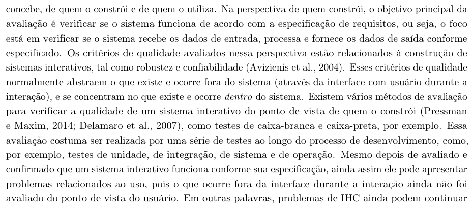

**Figura Q01** — Trecho bibliográfico da questão `1`.  
_Fonte: BARBOSA, S. D. J. et al. Interação Humano-Computador e Experiência do Usuário. 1. ed. Rio de Janeiro: Autopublicação, 2021 — Capítulo 11, Seção 11.1 (Por que Avaliar?), p. 246._

A imagem **Q02** reproduz o trecho do livro referente à questão **2** (*A avaliação de IHC deve ser conduzida pelos avaliadores que participaram da concepção da solução? Justifique a sua resposta.*).

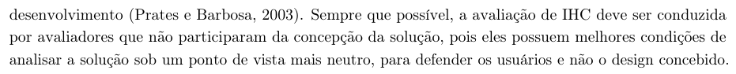

**Figura Q02** — Trecho bibliográfico da questão `2`.  
_Fonte: BARBOSA, S. D. J. et al. Interação Humano-Computador e Experiência do Usuário. 1. ed. Rio de Janeiro: Autopublicação, 2021 — Capítulo 11, Seção 11.1 (Por que Avaliar?), p. 247._

A imagem **Q03** reproduz o trecho do livro referente à questão **3** (*Quais são as razões para se avaliar a qualidade de uso de sistemas computacionais interativos?*).

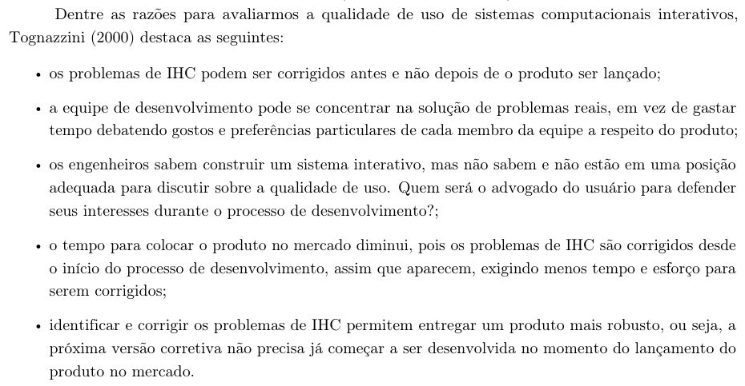

**Figura Q03** — Trecho bibliográfico da questão `3`.  
_Fonte: BARBOSA, S. D. J. et al. Interação Humano-Computador e Experiência do Usuário. 1. ed. Rio de Janeiro: Autopublicação, 2021 — Capítulo 11, Seção 11.1 (Por que Avaliar?), p. 247._

A imagem **Q04** reproduz o trecho do livro referente à questão **4** (*Quais os benefícios a curto, médio e longo prazo de avaliar a qualidade de uso?*).

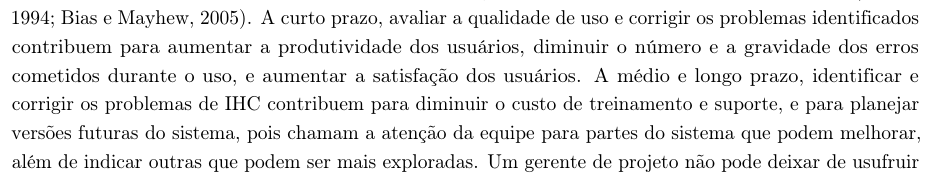

**Figura Q04** — Trecho bibliográfico da questão `4`.  
_Fonte: BARBOSA, S. D. J. et al. Interação Humano-Computador e Experiência do Usuário. 1. ed. Rio de Janeiro: Autopublicação, 2021 — Capítulo 11, Seção 11.1 (Por que Avaliar?), p. 247._

A imagem **Q05** reproduz o trecho do livro referente à questão **5** (*O que se deve fazer no planejamento de uma avaliação?*).

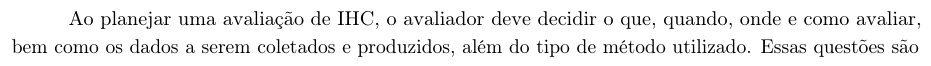

**Figura Q05** — Trecho bibliográfico da questão `5`.  
_Fonte: BARBOSA, S. D. J. et al. Interação Humano-Computador e Experiência do Usuário. 1. ed. Rio de Janeiro: Autopublicação, 2021 — Capítulo 11, Seção 11.1 (Por que Avaliar?), p. 247._

A imagem **Q06** reproduz o trecho do livro referente à questão **6** (*O que são os objetivos de uma avaliação, a quem eles interessam e por quê?*).

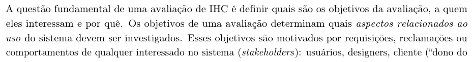

**Figura Q06** — Trecho bibliográfico da questão `6`.  
_Fonte: BARBOSA, S. D. J. et al. Interação Humano-Computador e Experiência do Usuário. 1. ed. Rio de Janeiro: Autopublicação, 2021 — Capítulo 11, Seção 11.2 (O que Avaliar?), p. 248._

A imagem **Q07** reproduz o trecho do livro referente à questão **7** (*O que significa avaliação de ideias e alternativas de design? Cite exemplos.*).

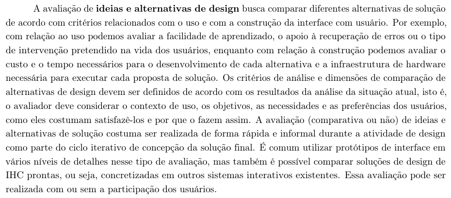

**Figura Q07** — Trecho bibliográfico da questão `7`.  
_Fonte: BARBOSA, S. D. J. et al. Interação Humano-Computador e Experiência do Usuário. 1. ed. Rio de Janeiro: Autopublicação, 2021 — Capítulo 11, Seção 11.2 (O que Avaliar?), p. 249._

A imagem **Q08** reproduz o trecho do livro referente à questão **8** (*O que significa avaliação de conformidade com um padrão? Cite exemplos.*).

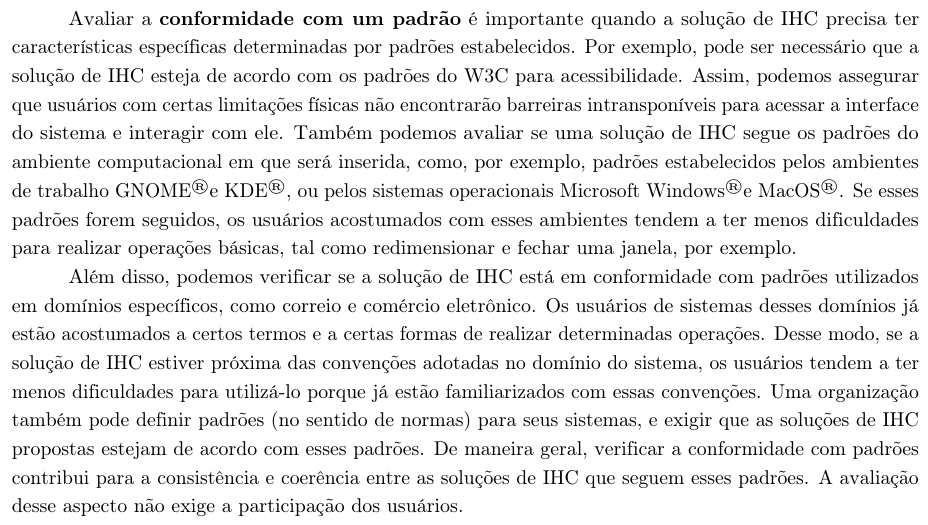

**Figura Q08** — Trecho bibliográfico da questão `8`.  
_Fonte: BARBOSA, S. D. J. et al. Interação Humano-Computador e Experiência do Usuário. 1. ed. Rio de Janeiro: Autopublicação, 2021 — Capítulo 11, Seção 11.2 (O que Avaliar?), p. 249._

A imagem **Q09** reproduz o trecho do livro referente à questão **9** (*Cite exemplos de perguntas que uma avaliação deve responder em relação ao objetivo da avaliação.*).

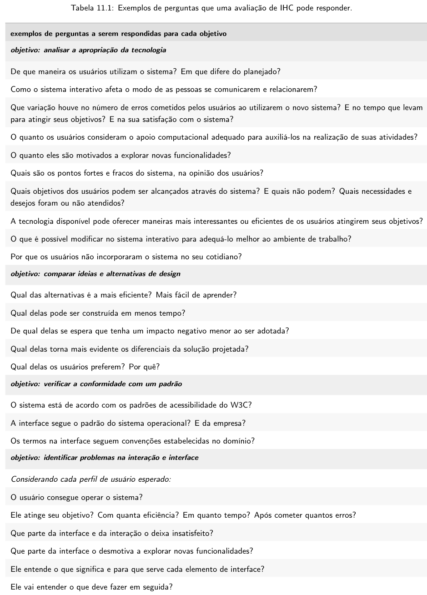

**Figura Q09** — Trecho bibliográfico da questão `9`.  
_Fonte: BARBOSA, S. D. J. et al. Interação Humano-Computador e Experiência do Usuário. 1. ed. Rio de Janeiro: Autopublicação, 2021 — Capítulo 11, Seção 11.2 (O que Avaliar?), Tabela 11.1, p. 250._

A imagem **Q10** reproduz o trecho do livro referente à questão **10** (*Qual a diferença entre a avaliação formativa e somativa?*).

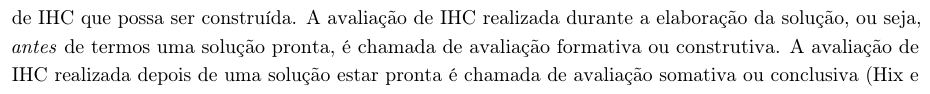

**Figura Q10** — Trecho bibliográfico da questão `10`.  
_Fonte: BARBOSA, S. D. J. et al. Interação Humano-Computador e Experiência do Usuário. 1. ed. Rio de Janeiro: Autopublicação, 2021 — Capítulo 11, Seção 11.3 (Quando Avaliar o Uso de um Sistema?), p. 251._

A imagem **Q11** reproduz o trecho do livro referente à questão **11** (*Qual a diferença da avaliação de IHC em um contexto real de uso e em laboratório?*).

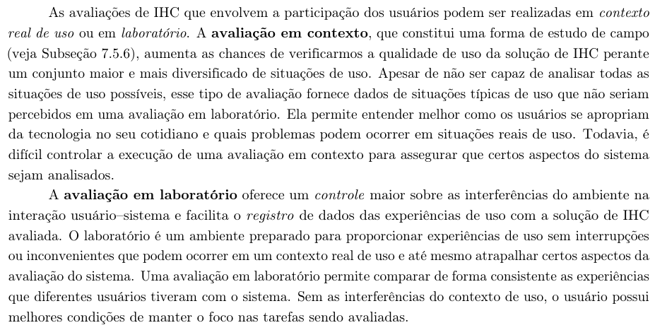

**Figura Q11** — Trecho bibliográfico da questão `11`.  
_Fonte: BARBOSA, S. D. J. et al. Interação Humano-Computador e Experiência do Usuário. 1. ed. Rio de Janeiro: Autopublicação, 2021 — Capítulo 11, Seção 11.4 (Onde Coletar Dados sobre Experiências de Uso?), p. 252._

A imagem **Q12** reproduz o trecho do livro referente à questão **12** (*Qual a diferença entre os métodos de investigação, inspeção e observação?*).

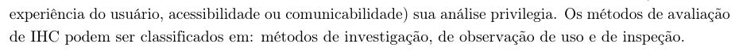

**Figura Q12** — Trecho bibliográfico da questão `12`.  
_Fonte: BARBOSA, S. D. J. et al. Interação Humano-Computador e Experiência do Usuário. 1. ed. Rio de Janeiro: Autopublicação, 2021 — Capítulo 11, Seção 11.6 (Qual Tipo de Método de Avaliação Escolher?), pp. 256-257._

A imagem **Q13** reproduz o trecho do livro referente à questão **13** (*Descreva a atividade de preparação da avaliação.*).

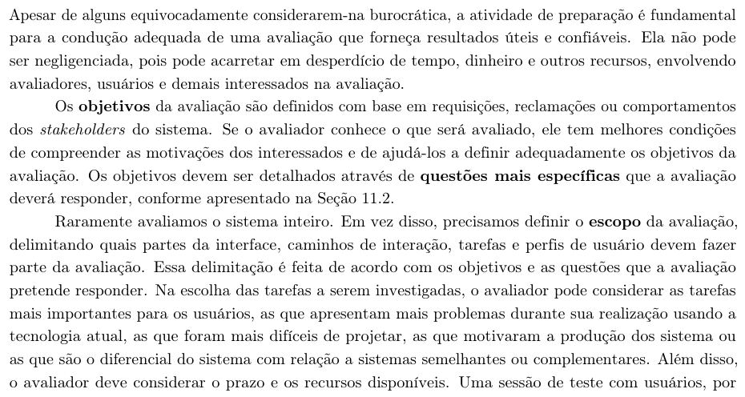

**Figura Q13** — Trecho bibliográfico da questão `13`.  
_Fonte: BARBOSA, S. D. J. et al. Interação Humano-Computador e Experiência do Usuário. 1. ed. Rio de Janeiro: Autopublicação, 2021 — Capítulo 11, Seção 11.7.2 (Preparação), pp. 258-260._

A imagem **Q14** reproduz o trecho do livro referente à questão **14** (*Apresente um modelo de termo de consentimento? Para que ele deve ser usado?*).

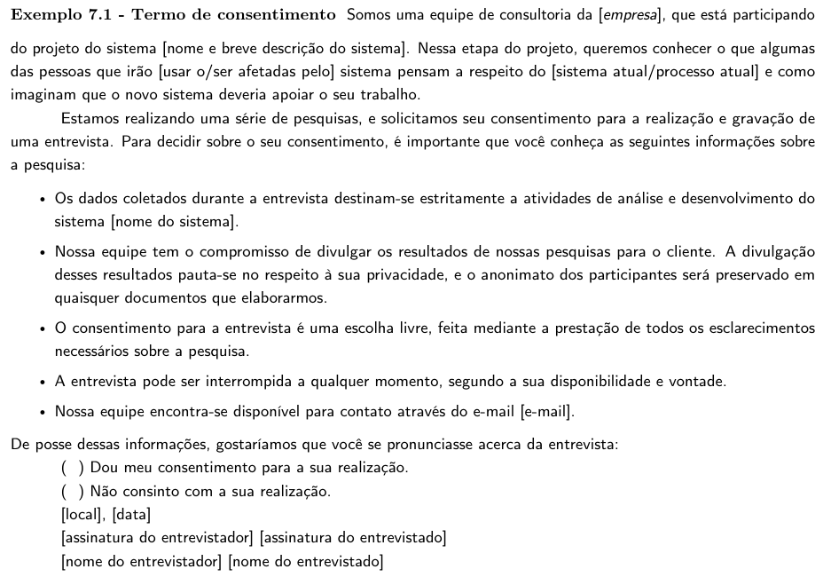

**Figura Q14** — Trecho bibliográfico da questão `14`.  
_Fonte: BARBOSA, S. D. J. et al. Interação Humano-Computador e Experiência do Usuário. 1. ed. Rio de Janeiro: Autopublicação, 2021 — Capítulo 7, Seção 7.4 (Aspectos Éticos de Pesquisas Envolvendo Pessoas), Exemplo 7.1, p. 128._

A imagem **Q15** reproduz o trecho do livro referente à questão **15** (*Explique o que é um teste-piloto. Quem realiza o teste piloto?*).

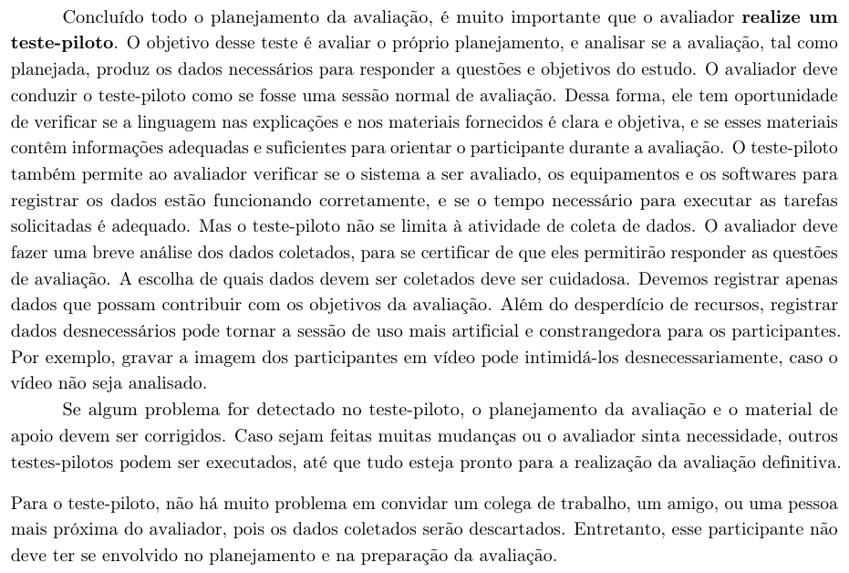

**Figura Q15** — Trecho bibliográfico da questão `15`.  
_Fonte: BARBOSA, S. D. J. et al. Interação Humano-Computador e Experiência do Usuário. 1. ed. Rio de Janeiro: Autopublicação, 2021 — Capítulo 11, Seção 11.7.2 (Preparação), p. 260._

A imagem **Q16** reproduz o trecho do livro referente à questão **16** (*Qual o tempo máximo sugerido para um participante realizar uma tarefa na avaliação? Qual o tempo máximo sugerido para uma avaliação?*).

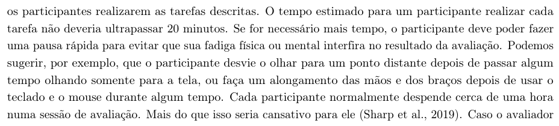

**Figura Q16** — Trecho bibliográfico da questão `16`.  
_Fonte: BARBOSA, S. D. J. et al. Interação Humano-Computador e Experiência do Usuário. 1. ed. Rio de Janeiro: Autopublicação, 2021 — Capítulo 11, Seção 11.7.2 (Preparação), p. 259._

A imagem **Q17** reproduz o trecho do livro referente à questão **17** (*Que informações devem ser colhidas no formulário de acompanhamento das sessões de observação?*).

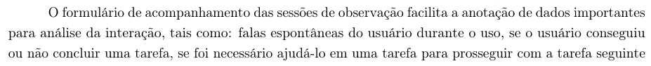

**Figura Q17** — Trecho bibliográfico da questão `17`.  
_Fonte: BARBOSA, S. D. J. et al. Interação Humano-Computador e Experiência do Usuário. 1. ed. Rio de Janeiro: Autopublicação, 2021 — Capítulo 11, Seção 11.7.2 (Preparação), p. 259._

A imagem **Q18** reproduz o trecho do livro referente à questão **18** (*Explique como se faz para recrutar participantes para uma avaliação de design.*).

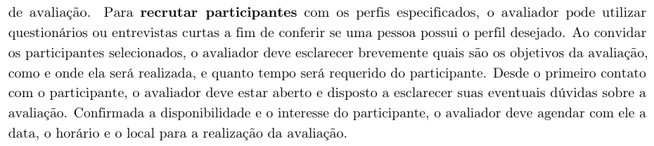

**Figura Q18** — Trecho bibliográfico da questão `18`.  
_Fonte: BARBOSA, S. D. J. et al. Interação Humano-Computador e Experiência do Usuário. 1. ed. Rio de Janeiro: Autopublicação, 2021 — Capítulo 11, Seção 11.7.2 (Preparação), p. 260._

A imagem **Q19** reproduz o trecho do livro referente à questão **19** (*Quem o avaliador deve evitar para ser o participante da avaliação?*).

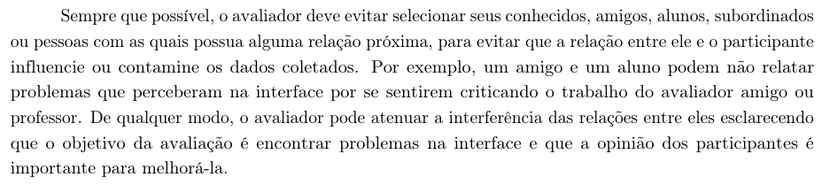

**Figura Q19** — Trecho bibliográfico da questão `19`.  
_Fonte: BARBOSA, S. D. J. et al. Interação Humano-Computador e Experiência do Usuário. 1. ed. Rio de Janeiro: Autopublicação, 2021 — Capítulo 11, Seção 11.7.2 (Preparação), p. 260._

A imagem **Q20** reproduz o trecho do livro referente à questão **20** (*Explique o framework DECIDE.*).

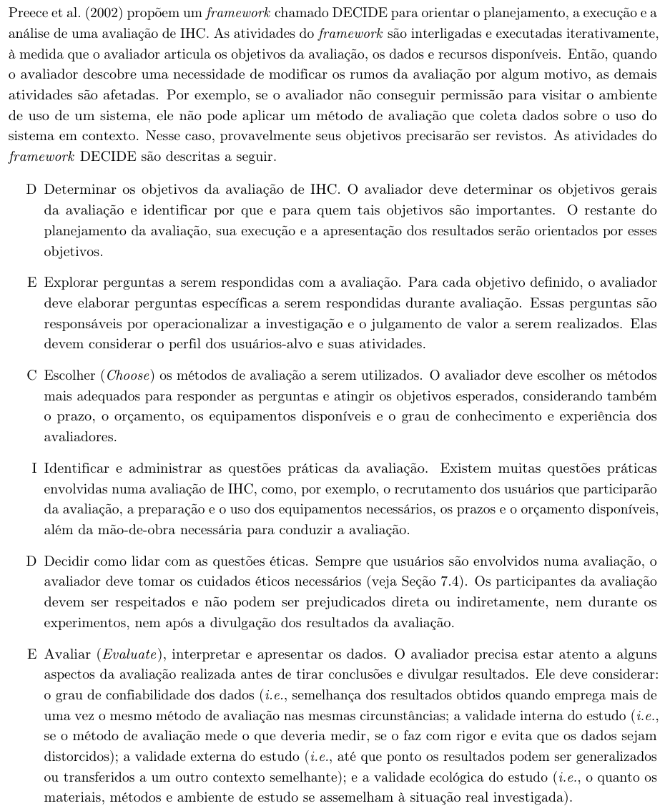

**Figura Q20** — Trecho bibliográfico da questão `20`.  
_Fonte: BARBOSA, S. D. J. et al. Interação Humano-Computador e Experiência do Usuário. 1. ed. Rio de Janeiro: Autopublicação, 2021 — Capítulo 11, Seção 11.8 (O Framework DECIDE), p. 264; PREECE, J. et al., 2002._

### Evidências Visuais da Literatura e do Plano de Ensino

Cada figura a seguir é chamada explicitamente e vinculada ao respectivo critério na tabela normativa acima.

A **Figura 1** reproduz o trecho comprobatório de referência referente ao critério **PE-E4-02**.

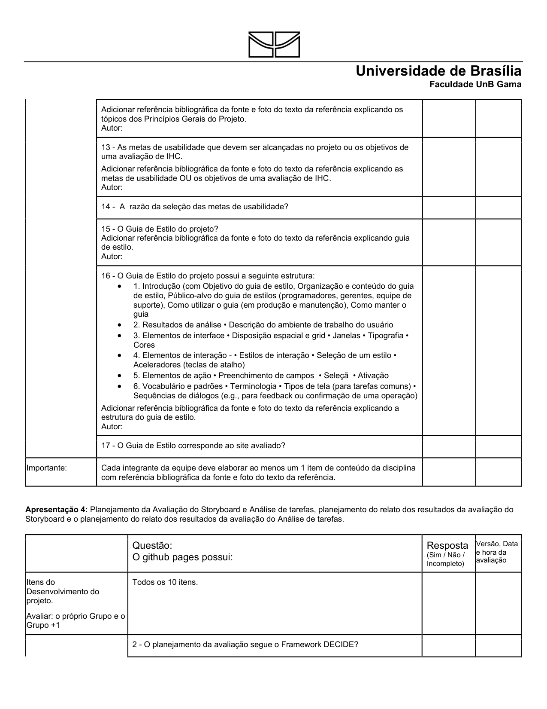

**Figura 1** — Evidência documental referente ao item `PE-E4-02`.  
_Fonte: Plano de Ensino (Sales, 2026, p. 12, Item 2)_

A **Figura 2** reproduz o trecho comprobatório de referência referente ao critério **PE-E4-03**.

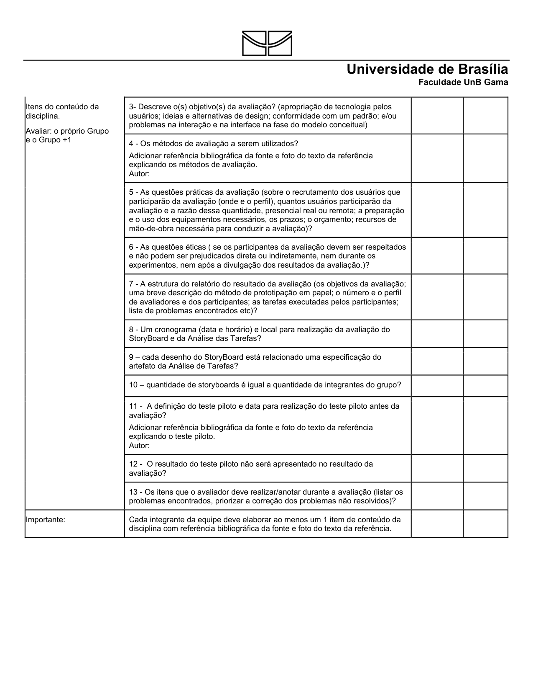

**Figura 2** — Evidência documental referente ao item `PE-E4-03`.  
_Fonte: Plano de Ensino (Sales, 2026, p. 13, Item 3)_

A **Figura 3** reproduz o trecho comprobatório de referência referente ao critério **DEC-01**.

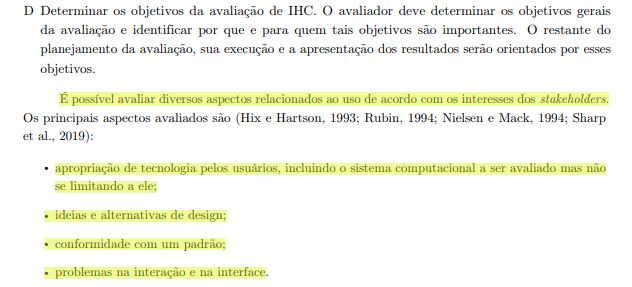

**Figura 3** — Evidência documental referente ao item `DEC-01`.  
_Fonte: Barbosa, S. D. J. et al. Interação Humano-Computador e Experiência do Usuário (2021, 1. ed.), p. 264 (Capítulo 11, Seção 11.8 — Etapa D)._

A **Figura 4** reproduz o trecho comprobatório de referência referente ao critério **DEC-02**.

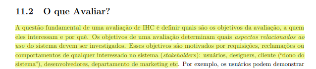

**Figura 4** — Evidência documental referente ao item `DEC-02`.  
_Fonte: Barbosa, S. D. J. et al. Interação Humano-Computador e Experiência do Usuário (2021, 1. ed.), p. 248 (Capítulo 11, Seção 11.2)._

A **Figura 5** reproduz o trecho comprobatório de referência referente ao critério **DEC-03**.

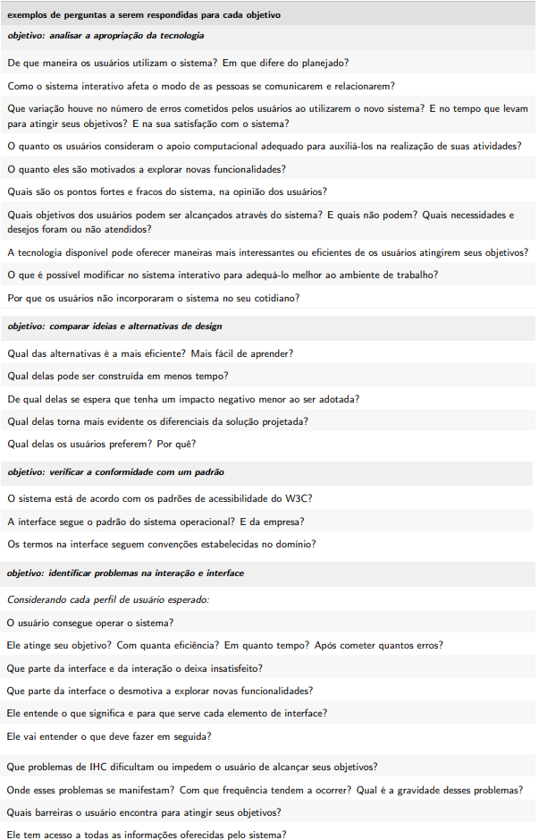

**Figura 5** — Evidência documental referente ao item `DEC-03`.  
_Fonte: Barbosa, S. D. J. et al. Interação Humano-Computador e Experiência do Usuário (2021, 1. ed.), p. 264 e Tabela 11.1 na p. 250 (Capítulo 11)._

A **Figura 6** reproduz o trecho comprobatório de referência referente ao critério **DEC-04**.

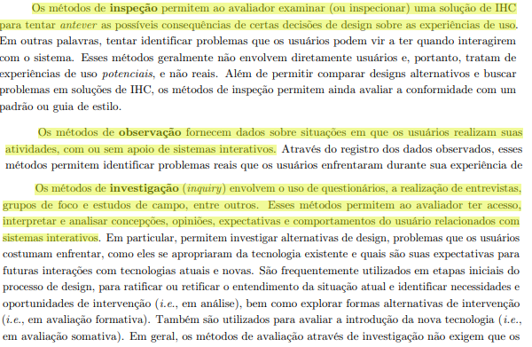

**Figura 6** — Evidência documental referente ao item `DEC-04`.  
_Fonte: Barbosa, S. D. J. et al. Interação Humano-Computador e Experiência do Usuário (2021, 1. ed.), p. 264 (Capítulo 11, Seção 11.8 — Etapa C)._

A **Figura 7** reproduz o trecho comprobatório de referência referente ao critério **DEC-05**.

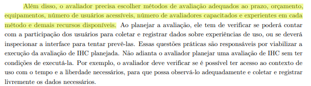

**Figura 7** — Evidência documental referente ao item `DEC-05`.  
_Fonte: Barbosa, S. D. J. et al. Interação Humano-Computador e Experiência do Usuário (2021, 1. ed.), p. 257 (Capítulo 11, Seção 11.7.1)._

A **Figura 8** reproduz o trecho comprobatório de referência referente ao critério **DEC-06**.

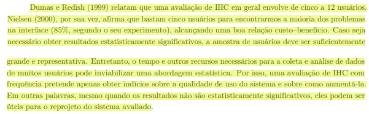

**Figura 8** — Evidência documental referente ao item `DEC-06`.  
_Fonte: Barbosa, S. D. J. et al. Interação Humano-Computador e Experiência do Usuário (2021, 1. ed.), p. 258 (Capítulo 11, Seção 11.7.2)._

A **Figura 9** reproduz o trecho comprobatório de referência referente ao critério **DEC-07**.

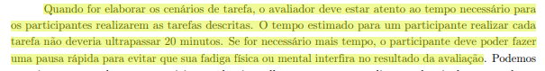

**Figura 9** — Evidência documental referente ao item `DEC-07`.  
_Fonte: Barbosa, S. D. J. et al. Interação Humano-Computador e Experiência do Usuário (2021, 1. ed.), p. 259 (Capítulo 11, Seção 11.7.2)._

A **Figura 10** reproduz o trecho comprobatório de referência referente ao critério **DEC-08**.

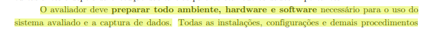

**Figura 10** — Evidência documental referente ao item `DEC-08`.  
_Fonte: Barbosa, S. D. J. et al. Interação Humano-Computador e Experiência do Usuário (2021, 1. ed.), pp. 259-261 (Capítulo 11, Seção 11.7.2)._

A **Figura 11** reproduz o trecho comprobatório de referência referente ao critério **DEC-09**.

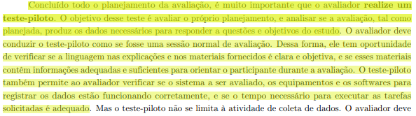

**Figura 11** — Evidência documental referente ao item `DEC-09`.  
_Fonte: Barbosa, S. D. J. et al. Interação Humano-Computador e Experiência do Usuário (2021, 1. ed.), p. 260 (Capítulo 11, Seção 11.7.2)._

A **Figura 12** reproduz o trecho comprobatório de referência referente ao critério **DEC-10**.

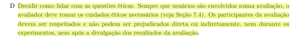

**Figura 12** — Evidência documental referente ao item `DEC-10`.  
_Fonte: Barbosa, S. D. J. et al. Interação Humano-Computador e Experiência do Usuário (2021, 1. ed.), p. 264 (Capítulo 11, Seção 11.8 — Etapa D)._

A **Figura 13** reproduz o trecho comprobatório de referência referente ao critério **DEC-11**.

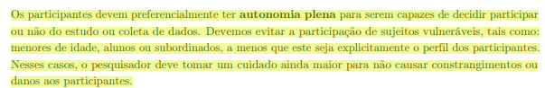

**Figura 13** — Evidência documental referente ao item `DEC-11`.  
_Fonte: Barbosa, S. D. J. et al. Interação Humano-Computador e Experiência do Usuário (2021, 1. ed.), pp. 127-128 (Capítulo 7, Seção 7.4)._

A **Figura 14** reproduz o trecho comprobatório de referência referente ao critério **DEC-12**.

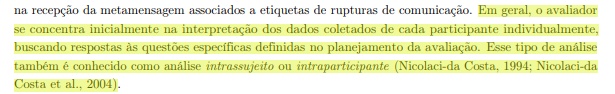

**Figura 14** — Evidência documental referente ao item `DEC-12`.  
_Fonte: Barbosa, S. D. J. et al. Interação Humano-Computador e Experiência do Usuário (2021, 1. ed.), pp. 262-263 (Capítulo 11, Seções 11.7.4-11.7.5)._

A **Figura 15** reproduz o trecho comprobatório de referência referente ao critério **DEC-13**.

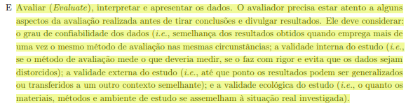

**Figura 15** — Evidência documental referente ao item `DEC-13`.  
_Fonte: Barbosa, S. D. J. et al. Interação Humano-Computador e Experiência do Usuário (2021, 1. ed.), p. 264 (Capítulo 11, Seção 11.8 — Etapa E)._

A **Figura 16** reproduz o trecho comprobatório de referência referente ao critério **DEC-14**.

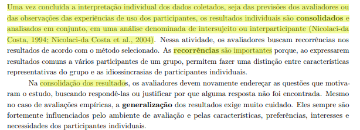

**Figura 16** — Evidência documental referente ao item `DEC-14`.  
_Fonte: Barbosa, S. D. J. et al. Interação Humano-Computador e Experiência do Usuário (2021, 1. ed.), p. 263 (Capítulo 11, Seção 11.7.5)._

---

## 3. Validação desta Lista pela Lista de Governança do Prof. Dr. André Barros de Sales (`DG-01` a `DG-11`)

Em estrito cumprimento às diretrizes de qualidade do Plano de Ensino (*Sales, 2026, pp. 8–9*), a **Tabela 5** submete esta própria página (`04-planejamento-decide.md`) aos **11 Itens de Desenvolvimento do Projeto** formulados pelo Prof. Dr. André Barros de Sales.

**Tabela 5** — Autoavaliação de `04-planejamento-decide.md` frente aos critérios `DG-01` a `DG-11`

| ID | Critério de Governança do Plano de Ensino | Autor do Item | Resposta | Versão, Data e Hora da Avaliação | Evidência de Conformidade nesta Lista |
| :---: | :--- | :--- | :---: | :---: | :--- |
| **DG-01** | O histórico de versão padronizado? | **Prof. Dr. André Barros de Sales** *(Plano de Ensino FGA0173, 2026)* | ✅ **Sim (Conforme)** | `v2.0` — 20/11/2026 às 14:30 | Seção **Histórico de Versão** (**Tabela 6**) padronizada ao final de `04-planejamento-decide.md` registrando `v2.0`. |
| **DG-02** | O(s) autor(es) e o(s) revisor(es) para cada artefato? | **Prof. Dr. André Barros de Sales** *(Plano de Ensino FGA0173, 2026)* | ✅ **Sim (Conforme)** | `v2.0` — 20/11/2026 às 14:30 | Colunas **Autor(es)** e **Revisor(es)** preenchidas com links GitHub no Histórico de Versão, além da coluna **`Autor do Item`** em 100% dos critérios da lista. |
| **DG-03** | Referências bibliográficas e/ou bibliografia em todos os artefatos? | **Prof. Dr. André Barros de Sales** *(Plano de Ensino FGA0173, 2026)* | ✅ **Sim (Conforme)** | `v2.0` — 20/11/2026 às 14:30 | Seção **Referências Bibliográficas (ABNT NBR 6023)** completa ao final do documento com obras, edições e páginas exatas. |
| **DG-04** | As tabelas e imagens possuem legenda e fonte e são chamadas dentro do texto? | **Prof. Dr. André Barros de Sales** *(Plano de Ensino FGA0173, 2026)* | ✅ **Sim (Conforme)** | `v2.0` — 20/11/2026 às 14:30 | 100% das tabelas (`Tabela 1` a `Tabela 6`) e figuras (`Figura 1` a `Figura 16` e `Figura Q01` a `Figura Q20`) possuem numeração, legenda, fonte e chamadas textuais prévias. |
| **DG-05** | Um texto fazendo uma introdução dos artefatos? | **Prof. Dr. André Barros de Sales** *(Plano de Ensino FGA0173, 2026)* | ✅ **Sim (Conforme)** | `v2.0` — 20/11/2026 às 14:30 | Seção **1. Introdução e Contextualização Metodológica** situa o instrumento no Ciclo de Mayhew (1999) e na Inspeção Formal de Fagan (1976). |
| **DG-06** | O cronograma executado com quem realizou cada artefato/atividade e as datas de início e fim da construção/realização? | **Prof. Dr. André Barros de Sales** *(Plano de Ensino FGA0173, 2026)* | ✅ **Sim (Conforme)** | `v2.0` — 20/11/2026 às 14:30 | Registros de elaboração e revisão vinculados ao [Cronograma Executado](../../planejamento/cronograma-executado.md) e ao histórico Git da equipe. |
| **DG-07** | Ata(s) da(s) reuniões (com data, horário de início e do final, participantes, objetivo, atividades definidas etc.)? | **Prof. Dr. André Barros de Sales** *(Plano de Ensino FGA0173, 2026)* | ✅ **Sim (Conforme)** | `v2.0` — 20/11/2026 às 14:30 | Deliberações e alinhamentos documentados nas [Atas de Reunião](../../atas/index.md). |
| **DG-08** | A gravação da reunião do grupo? | **Prof. Dr. André Barros de Sales** *(Plano de Ensino FGA0173, 2026)* | ✅ **Sim (Conforme)** | `v2.0` — 20/11/2026 às 14:30 | Links funcionais de gravações das reuniões de planejamento e auditoria indexados em [Atas de Reunião](../../atas/index.md). |
| **DG-09** | Vídeo de apresentação na categoria 'Não Listado' no YouTube (duração entre 20 e 30 minutos)? | **Prof. Dr. André Barros de Sales** *(Plano de Ensino FGA0173, 2026)* | ⚠️ **Em preparação (Etapa 8)** | `v2.0` — 20/11/2026 às 14:30 | Vídeos das Entregas 1–7 publicados; vídeo oficial da [Entrega 8 — Verificação dos Artefatos](../../entregas/entrega8.md) (20–30 min, Não Listado) agendado após consolidação das inspeções da equipe. |
| **DG-10** | Tabela de contribuição no início do artefato com o nome de todos os integrantes, contribuição com hiperligação da atividade e da gravação? | **Prof. Dr. André Barros de Sales** *(Plano de Ensino FGA0173, 2026)* | ✅ **Sim (Conforme)** | `v2.0` — 20/11/2026 às 14:30 | **Tabela 1** posicionada no topo do documento discriminando cada integrante ativo com hiperligação GitHub e escopo de atuação. |
| **DG-11** | A seção de agradecimentos apresentando o uso de Inteligência Artificial (IA) Generativa no artefato? | **Prof. Dr. André Barros de Sales** *(Plano de Ensino FGA0173, 2026)* | ✅ **Sim (Conforme)** | `v2.0` — 20/11/2026 às 14:30 | Seção **Agradecimentos e Declaração de Uso de IA Generativa** ao final do documento em estrita conformidade com o Código da SBC e Sales (2026). |

_Fonte: Validação elaborada por Vinicius Silva Araruna com base na rubrica oficial de Prof. Dr. André Barros de Sales (Plano de Ensino, 2026, pp. 8–9)._

---

## 4. Histórico de Versão

A **Tabela 6** registra a evolução histórica e o controle de versionamento deste instrumento normativo.

**Tabela 6** — Histórico de Versão do Documento

| Versão | Data | Descrição Detalhada da Modificação | Autor(es) | Revisor(es) |
| :---: | :---: | :--- | :--- | :--- |
| `1.0` | 27/08/2026 | Lista de Verificação DECIDE original com 14 itens (`Grupo8ViniciusSilvaArarunaVerifacaçãoListaDECIDE.pdf`). | [Vinicius Silva Araruna](https://github.com/ViniciusA05) | [Gustavo Antonio Rodrigues e Silva](https://github.com/gus-ant) |
| `2.0` | 20/11/2026 | Consolidação por artefato em `04-planejamento-decide.md`: inclusão dos 8 itens do Prof. André (pp. 12–13), incorporação das 20 questões teóricas respondidas com recortes, paginação impressa (pp. 127–128, 248–264) e validação `DG-01..11`. | [Vinicius Silva Araruna](https://github.com/ViniciusA05) | [Gustavo Antonio Rodrigues e Silva](https://github.com/gus-ant), [Edvaldo Soares Brasileiro Filho](https://github.com/PajeMurici-dev) |

_Fonte: Elaborada pelos autores, 2026._

---

## 5. Referências Bibliográficas (ABNT NBR 6023)

[1] BRASIL. *Resolução nº 510, de 7 de abril de 2016*. Conselho Nacional de Saúde, Brasília, DF, 2016.

[2] DUMAS, Joseph S.; REDISH, Janice C. *A Practical Guide to Usability Testing*. Exeter: Intellect, 1999.

[3] HIX, Deborah; HARTSON, H. Rex. *Developing User Interfaces: Ensuring Usability Through Product & Process*. New York: John Wiley & Sons, 1993.

[4] NIELSEN, Jakob. *Why You Only Need to Test with 5 Users*. Fremont: Nielsen Norman Group, 2000.

[5] PREECE, Jennifer; ROGERS, Yvonne; SHARP, Helen. *Interaction Design: Beyond Human-Computer Interaction*. New York: John Wiley & Sons, 2002.

[6] SHARP, Helen; ROGERS, Yvonne; PREECE, Jennifer. *Interaction Design: Beyond Human-Computer Interaction*. 5. ed. Indianapolis: Wiley, 2019.

[7] TOGNAZZINI, Bruce. *First Principles of Interaction Design*, 2000.

[8] BARBOSA, Simone Diniz Junqueira et al. *Interação Humano-Computador e Experiência do Usuário*. 1. ed. Rio de Janeiro: Autopublicação, 2021. ISBN 978-65-00-19677-1.

[9] BARBOSA, Simone Diniz Junqueira; SILVA, Bruno Santana da. *Interação Humano-Computador*. 1. ed. Rio de Janeiro: Elsevier / Campus, 2010.

[10] FAGAN, Michael E. Design and code inspections to reduce errors in program development. *IBM Systems Journal*, v. 15, n. 3, p. 182–211, 1976.

[11] MAYHEW, Deborah J. *The Usability Engineering Lifecycle: A Practitioner's Handbook for User Interface Design*. San Francisco: Morgan Kaufmann, 1999.

[12] SALES, André Barros de. *Plano de Ensino da Disciplina de Interação Humano Computador (FGA0173 — 02/2026)*. Brasília: Universidade de Brasília, Faculdade UnB Gama (FGA), 2026.

[13] SOCIEDADE BRASILEIRA DE COMPUTAÇÃO (SBC). *Código de Conduta da Sociedade Brasileira de Computação*. Porto Alegre: SBC, 2023.

---

## 6. Agradecimentos e Declaração de Uso de Inteligência Artificial (IA) Generativa

Em conformidade com o Código de Conduta da Sociedade Brasileira de Computação (SBC, Art. 2º, parágrafo III) e com as diretrizes do Plano de Ensino da disciplina (*Sales, 2026, p. 3*), declara-se que a organização das tabelas em Markdown e a revisão ortográfica contaram com suporte supervisionado da ferramenta de Inteligência Artificial Generativa Google Gemini. Toda a concepção metodológica, verificação bibliográfica nas obras originais, revisão técnica e validação de conformidade foram realizadas pelos discentes identificados no Histórico de Versão.
