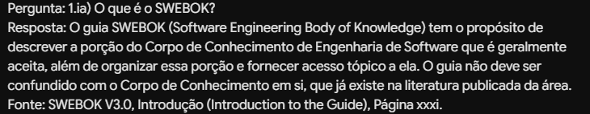
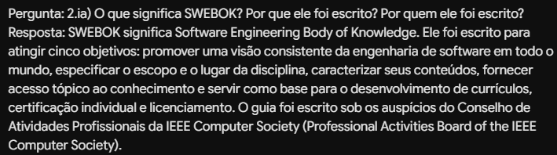
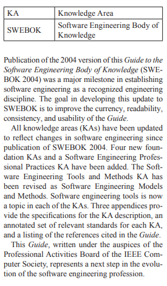
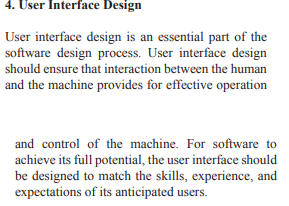
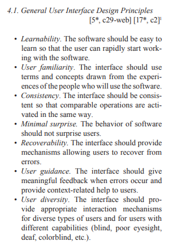
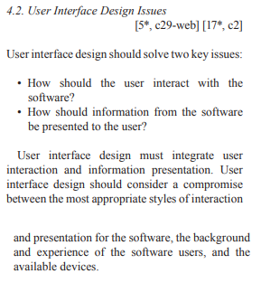
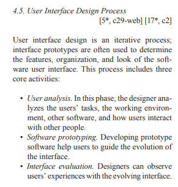
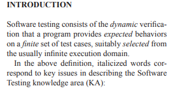
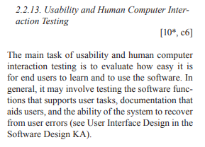
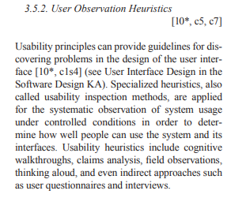

# Lista de Verificação — Engenharia de Requisitos e Design de Software (SWEBOK v3.0)

## Tabela de Contribuição e Transparência de IA Generativa

A **Tabela 1** apresenta a distribuição de responsabilidades na elaboração, curadoria e revisão de **Engenharia de Requisitos e Design de Software (SWEBOK v3.0)**.

**Tabela 1** — Matriz de Contribuição e Transparência de IA Generativa — Engenharia de Requisitos e Design de Software (SWEBOK v3.0)

| Integrante | Atribuição no Artefato | Data | Horário | Ferramenta de IA | Propósito do Uso de IA |
| :--- | :--- | :---: | :---: | :--- | :--- |
| [Vinicius Silva Araruna](https://github.com/ViniciusA05) | Elaboração modular dos critérios de `SW`, citação direta, recortes da obra e autoavaliação pela rubrica `DG-01` a `DG-11` | 20/11/2026 | 14:00 - 15:30 | Google Gemini | Suporte na organização estrutural, formatação de tabelas em Markdown e conferência cruzada com o Plano de Ensino |
| [Gustavo Antonio Rodrigues e Silva](https://github.com/gus-ant) | Revisão de conformidade estrutural, navegação e checagem de links | 20/11/2026 | 15:30 - 16:00 | — | Revisão por pares e validação editorial |
| [Gustavo Antonio Rodrigues e Silva](https://github.com/gus-ant) | Saneamento formal das questões `1.ia` e `2.ia` com citação direta da *Introduction to the Guide* do SWEBOK v3.0 (`pp. xxxi–xxxii`), limpeza textual em `SW-02` e consolidação em coautoria das questões `3–10` (`SW-01` a `SW-10`) | 22/11/2026 | 15:35 - 16:00 | Google Gemini | Conferência cruzada e correção bibliográfica direta no SWEBOK v3.0 |
| [Edvaldo Soares Brasileiro Filho](https://github.com/PajeMurici-dev) | Auditoria de rastreabilidade frente ao Plano de Ensino (`DG-01` a `DG-11`) e referências ABNT | 20/11/2026 | 15:30 - 16:00 | — | Revisão por pares e conferência documental |

_Fonte: Elaborada pelos autores, 2026._

---

## 1. Introdução e Contextualização Metodológica

Este módulo contempla os **10 critérios/questões** (em **coautoria** entre Vinicius Silva Araruna e Gustavo Antonio Rodrigues e Silva após saneamento integral das respostas `1.ia` e `2.ia` frente ao documento oficial) baseados no *Guide to the Software Engineering Body of Knowledge (SWEBOK v3.0)*, cobrindo definição, princípios gerais de interface (`Learnability`, `User familiarity`, `Consistency`, `Minimal surprise`, `Recoverability`, `User guidance`, `User diversity`), processo iterativo de design de interface, teste de usabilidade e heurísticas de observação.

Este instrumento normativo atua segundo o **Método de Inspeção Formal de Michael E. Fagan (1976)** e encontra-se desacoplado dos relatórios empíricos de aplicação. Toda inspeção registrada aqui identifica obrigatoriamente o **`Autor do Item`**, a **fundamentação bibliográfica com recorte visual** e a coluna **`Versão, Data e Hora da Avaliação`** exigida pelo Plano de Ensino (*Sales, 2026, pp. 8–13*).

!!! info "Pré-requisito Transversal de Governança (Prof. Dr. André Barros de Sales)"
    Além dos critérios específicos deste artefato listados na **Seção 2**, todo produto de trabalho avaliado deve cumprir integralmente os **11 Itens de Desenvolvimento Geral (`DG-01` a `DG-11`)** definidos pelo Prof. Dr. André Barros de Sales em [00. Governança e Plano de Ensino Geral](00-plano-ensino-geral.md).

---

## 2. Instrumento Normativo de Verificação — Engenharia de Requisitos e Design de Software (SWEBOK v3.0)

### 2.1 Critérios Técnicos da Literatura Canônica (Lista de Verificação `SW`)

A **Tabela 2** apresenta os **10 itens normativos** fundamentados na literatura científica com citação direta literal e recorte visual da página.

**Tabela 2** — Lista de verificação normativa de Engenharia de Requisitos e Design de Software (SWEBOK v3.0) (10 itens)

| ID | Critério / Pergunta de Verificação | Autor do Item | Fundamentação Canônica (Obra, Ed., Cap., Pág.) e Citação Literal | Evidência Visual (Figura) | Resposta | Versão, Data e Hora da Avaliação |
| :---: | :--- | :--- | :--- | :---: | :---: | :---: |
| **SW-01** | **O que é o SWEBOK?** *Síntese esperada (validada diretamente na fonte):* O guia SWEBOK (*Software Engineering Body of Knowledge*) descreve a porção do Corpo de Conhecimento de Engenharia de Software que é geralmente aceita, além de organizar essa porção e fornecer acesso tópico a ela. O guia não deve ser confundido com o Corpo de Conhecimento em si, que já existe na literatura publicada da área. | [Vinicius Silva Araruna](https://github.com/ViniciusA05) e [Gustavo Antonio Rodrigues e Silva](https://github.com/gus-ant) | BOURQUE, Pierre; FAIRLEY, Richard E. Guide to the Software Engineering Body of Knowledge (SWEBOK). Version 3.0. IEEE Computer Society, 2014 (Introdução — *Introduction to the Guide*, p. xxxi, e Cap. 2, Seção 4, pp. 2-5 a 2-7); BARBOSA et al. (2021, Cap. 1–2, pp. 15–32). | [Ver Figura 1](#figura-1) | `[ ] Sim (Conforme)` `[ ] Não (Não Conforme)` `[ ] Incompleto` `[ ] N/A` | *(Preencher na inspeção)* |
| **SW-02** | **O que significa SWEBOK? Por que ele foi escrito? Por quem ele foi escrito?** *Síntese esperada (validada diretamente na fonte):* SWEBOK significa *Software Engineering Body of Knowledge*. Ele foi escrito para atingir cinco objetivos: promover uma visão consistente da engenharia de software em todo o mundo, especificar o escopo e o lugar da disciplina em relação a outras áreas, caracterizar seus conteúdos, fornecer acesso tópico ao conhecimento e servir como base para o desenvolvimento de currículos, certificação individual e licenciamento. O guia foi escrito sob os auspícios do Conselho de Atividades Profissionais da IEEE Computer Society (*Professional Activities Board of the IEEE Computer Society*). | [Vinicius Silva Araruna](https://github.com/ViniciusA05) e [Gustavo Antonio Rodrigues e Silva](https://github.com/gus-ant) | BOURQUE, Pierre; FAIRLEY, Richard E. Guide to the Software Engineering Body of Knowledge (SWEBOK). Version 3.0. IEEE Computer Society, 2014 (Introdução — *Introduction to the Guide*, *What Are the Objectives of the SWEBOK Guide?*, pp. xxxi–xxxii); BARBOSA et al. (2021, Cap. 1–2, pp. 15–32). | [Ver Figura 2](#figura-2) | `[ ] Sim (Conforme)` `[ ] Não (Não Conforme)` `[ ] Incompleto` `[ ] N/A` | *(Preencher na inspeção)* |
| **SW-03** | **O que é o SWEBOK? Para que ele foi escrito? Por quem ele foi escrito?** *Síntese esperada:* O SWEBOK é um guia que descreve a porção do corpo de conhecimento de engenharia de software que é geralmente aceita, organizando e fornecendo acesso tópico a esse conteúdo. Ele foi escrito com cinco objetivos: promover uma visão consistente da área mundialmente, especificar seu escopo em relação a outras disciplinas, caracterizar seus conteúdos, fornecer acesso tópico e servir de base para currículos acadêmicos, certificações e licenciamentos. O documento foi escrito sob os auspícios do Conselho de Atividades Profissionais da IEEE Computer Society. | [Vinicius Silva Araruna](https://github.com/ViniciusA05) e [Gustavo Antonio Rodrigues e Silva](https://github.com/gus-ant) | BOURQUE; FAIRLEY (2014) — SWEBOK V3.0, Introdução (Introduction to the Guide), Página xxxi. | [Ver Figura 3](#figura-3) | `[ ] Sim (Conforme)` `[ ] Não (Não Conforme)` `[ ] Incompleto` `[ ] N/A` | *(Preencher na inspeção)* |
| **SW-04** | **Qual a definição de Projeto de Interface do Usuário (User Interface Design) apresentada no Capítulo 2 "Design Software" do SWEBok?** *Síntese esperada:* O projeto de interface do usuário é uma parte essencial do processo de design de software. Ele deve garantir que a interação entre o ser humano e a máquina proporcione a operação e o controle efetivos da máquina. Para que o software alcance todo o seu potencial, a interface do usuário deve ser projetada para corresponder às habilidades, experiência e expectativas de seus usuários previstos. | [Vinicius Silva Araruna](https://github.com/ViniciusA05) e [Gustavo Antonio Rodrigues e Silva](https://github.com/gus-ant) | BOURQUE; FAIRLEY (2014) — SWEBOK V3.0, Capítulo 2 (Software Design), Item 4 (User Interface Design), Páginas 2-5 e 2-6. | [Ver Figura 4](#figura-4) | `[ ] Sim (Conforme)` `[ ] Não (Não Conforme)` `[ ] Incompleto` `[ ] N/A` | *(Preencher na inspeção)* |
| **SW-05** | **Quais são os Princípios Gerais Projeto de Interface do Usuário (General User Interface Design Principles)? Descreva cada um deles.** *Síntese esperada:* Os princípios gerais descritos são: Aprendizagem (Learnability): o software deve ser fácil de aprender para que o usuário possa começar a trabalhar rapidamente com ele. Familiaridade do usuário (User familiarity): a interface deve usar termos e conceitos extraídos da experiência das pessoas que usarão o software. Consistência (Consistency): a interface deve ser consistente para que operações comparáveis sejam ativadas da mesma maneira. Surpresa mínima (Minimal surprise): o comportamento do software não deve surpreender os usuários. Recuperabilidade (Recoverability): a interface deve fornecer mecanismos permitindo aos usuários se recuperar de erros. Orientação ao usuário (User guidance): a interface deve dar feedback significativo quando ocorrem erros e fornecer ajuda relacionada ao contexto para os usuários. Diversidade de usuários (User diversity): a interface deve fornecer mecanismos de interação apropriados para diversos tipos de usuários e para usuários com diferentes capacidades, como pessoas cegas, com baixa visão, surdas, daltônicas, etc. | [Vinicius Silva Araruna](https://github.com/ViniciusA05) e [Gustavo Antonio Rodrigues e Silva](https://github.com/gus-ant) | BOURQUE; FAIRLEY (2014) — SWEBOK V3.0, Capítulo 2 (Software Design), Item 4.1 (General User Interface Design Principles), Página 2-6. | [Ver Figura 5](#figura-5) | `[ ] Sim (Conforme)` `[ ] Não (Não Conforme)` `[ ] Incompleto` `[ ] N/A` | *(Preencher na inspeção)* |
| **SW-06** | **Quais são os duas questões chaves que o projeto de interface deve resolver?** *Síntese esperada:* O projeto de interface do usuário deve resolver duas questões chaves: como o usuário deve interagir com o software e como as informações do software devem ser apresentadas ao usuário. | [Vinicius Silva Araruna](https://github.com/ViniciusA05) e [Gustavo Antonio Rodrigues e Silva](https://github.com/gus-ant) | BOURQUE; FAIRLEY (2014) — SWEBOK V3.0, Capítulo 2 (Software Design), Item 4.2 (User Interface Design Issues), Página 2-6. | [Ver Figura 6](#figura-6) | `[ ] Sim (Conforme)` `[ ] Não (Não Conforme)` `[ ] Incompleto` `[ ] N/A` | *(Preencher na inspeção)* |
| **SW-07** | **Fale sobre o Processo de Design de Interface do Usuário e apresente as três atividades principais desse processo?** *Síntese esperada:* O processo de design de interface do usuário é um processo iterativo, onde protótipos de interface são frequentemente usados para determinar os recursos, a organização e a aparência da interface do software. Este processo inclui três atividades principais: Análise do usuário (User analysis): o designer analisa as tarefas dos usuários, o ambiente de trabalho, outros softwares e como os usuários interagem com outras pessoas. Prototipagem de software (Software prototyping): o desenvolvimento de protótipos de software ajuda os usuários a guiar a evolução da interface. Avaliação da interface (Interface evaluation): os designers podem observar as experiências dos usuários com a interface em evolução. | [Vinicius Silva Araruna](https://github.com/ViniciusA05) e [Gustavo Antonio Rodrigues e Silva](https://github.com/gus-ant) | BOURQUE; FAIRLEY (2014) — SWEBOK V3.0, Capítulo 2 (Software Design), Item 4.5 (User Interface Design Process), Página 2-7. | [Ver Figura 7](#figura-7) | `[ ] Sim (Conforme)` `[ ] Não (Não Conforme)` `[ ] Incompleto` `[ ] N/A` | *(Preencher na inspeção)* |
| **SW-08** | **O que é Teste de Software (Software testing)?** *Síntese esperada:* O teste de software consiste na verificação dinâmica de que um programa fornece os comportamentos esperados em um conjunto finito de casos de teste, adequadamente selecionados a partir de um domínio de execução geralmente infinito. | [Vinicius Silva Araruna](https://github.com/ViniciusA05) e [Gustavo Antonio Rodrigues e Silva](https://github.com/gus-ant) | BOURQUE; FAIRLEY (2014) — SWEBOK V3.0, Capítulo 4 (Software Testing), Introdução (Introduction), Página 4-1. | [Ver Figura 8](#figura-8) | `[ ] Sim (Conforme)` `[ ] Não (Não Conforme)` `[ ] Incompleto` `[ ] N/A` | *(Preencher na inspeção)* |
| **SW-09** | **O que é teste de usabilidade e de interação Humana Computador (Usability and Human Computer Interaction Testing)? O que esse teste pode envolve?** *Síntese esperada:* A tarefa principal do teste de usabilidade e interação humano computador é avaliar o quão fácil é para os usuários finais aprenderem e usarem o software. Em geral, pode envolver o teste das funções do software que apoiam as tarefas do usuário, a documentação que ajuda os usuários e a capacidade do sistema de se recuperar de erros do usuário. | [Vinicius Silva Araruna](https://github.com/ViniciusA05) e [Gustavo Antonio Rodrigues e Silva](https://github.com/gus-ant) | BOURQUE; FAIRLEY (2014) — SWEBOK V3.0, Capítulo 4 (Software Testing), Item 2.2.13 (Usability and Human Computer Interaction Testing), Página 4-7. | [Ver Figura 9](#figura-9) | `[ ] Sim (Conforme)` `[ ] Não (Não Conforme)` `[ ] Incompleto` `[ ] N/A` | *(Preencher na inspeção)* |
| **SW-10** | **O que é Heurísticas de Observação de Usuário (User Observation Heuristics)?** *Síntese esperada:* São heurísticas especializadas, também chamadas de métodos de inspeção de usabilidade, aplicadas para a observação sistemática do uso do sistema sob condições controladas, com o intuito de determinar o quão bem as pessoas podem usar o sistema e suas interfaces. As heurísticas de usabilidade incluem acompanhamentos cognitivos (cognitive walkthroughs), análise de reivindicações (claims analysis), observações de campo (field observations), técnica de pensar em voz alta (thinking aloud) e até abordagens indiretas, como questionários e entrevistas com os usuários. | [Vinicius Silva Araruna](https://github.com/ViniciusA05) e [Gustavo Antonio Rodrigues e Silva](https://github.com/gus-ant) | BOURQUE; FAIRLEY (2014) — SWEBOK V3.0, Capítulo 4 (Software Testing), Item 3.5.2 (User Observation Heuristics), Página 4-10. | [Ver Figura 10](#figura-10) | `[ ] Sim (Conforme)` `[ ] Não (Não Conforme)` `[ ] Incompleto` `[ ] N/A` | *(Preencher na inspeção)* |

_Fonte: Elaborada por [Vinicius Silva Araruna](https://github.com/ViniciusA05) em coautoria com [Gustavo Antonio Rodrigues e Silva](https://github.com/gus-ant), 2026._

### Evidências Visuais da Literatura e do Plano de Ensino

Cada figura a seguir é chamada explicitamente e vinculada ao respectivo critério na tabela normativa acima.

A **Figura 1** reproduz o trecho comprobatório de referência referente ao critério **SW-01**.

**Figura 1** — Evidência documental referente ao item `SW-01`.  
_Fonte: BOURQUE, Pierre; FAIRLEY, Richard E. Guide to the Software Engineering Body of Knowledge (SWEBOK). Version 3.0. IEEE Computer Society, 2014 (Introdução e Cap. 2, Seção 4, pp. xxxi e 2-5 a 2-7); BARBOSA et al. (2021, Cap. 1–2, pp. 15–32)._

A **Figura 2** reproduz o trecho comprobatório de referência referente ao critério **SW-02**.

**Figura 2** — Evidência documental referente ao item `SW-02`.  
_Fonte: BOURQUE, Pierre; FAIRLEY, Richard E. Guide to the Software Engineering Body of Knowledge (SWEBOK). Version 3.0. IEEE Computer Society, 2014 (Introdução e Cap. 2, Seção 4, pp. xxxi e 2-5 a 2-7); BARBOSA et al. (2021, Cap. 1–2, pp. 15–32)._

A **Figura 3** reproduz o trecho comprobatório de referência referente ao critério **SW-03**.

**Figura 3** — Evidência documental referente ao item `SW-03`.  
_Fonte: BOURQUE; FAIRLEY (2014) — SWEBOK V3.0, Introdução (Introduction to the Guide), Página xxxi._

A **Figura 4** reproduz o trecho comprobatório de referência referente ao critério **SW-04**.

**Figura 4** — Evidência documental referente ao item `SW-04`.  
_Fonte: BOURQUE; FAIRLEY (2014) — SWEBOK V3.0, Capítulo 2 (Software Design), Item 4 (User Interface Design), Páginas 2-5 e 2-6._

A **Figura 5** reproduz o trecho comprobatório de referência referente ao critério **SW-05**.

**Figura 5** — Evidência documental referente ao item `SW-05`.  
_Fonte: BOURQUE; FAIRLEY (2014) — SWEBOK V3.0, Capítulo 2 (Software Design), Item 4.1 (General User Interface Design Principles), Página 2-6._

A **Figura 6** reproduz o trecho comprobatório de referência referente ao critério **SW-06**.

**Figura 6** — Evidência documental referente ao item `SW-06`.  
_Fonte: BOURQUE; FAIRLEY (2014) — SWEBOK V3.0, Capítulo 2 (Software Design), Item 4.2 (User Interface Design Issues), Página 2-6._

A **Figura 7** reproduz o trecho comprobatório de referência referente ao critério **SW-07**.

**Figura 7** — Evidência documental referente ao item `SW-07`.  
_Fonte: BOURQUE; FAIRLEY (2014) — SWEBOK V3.0, Capítulo 2 (Software Design), Item 4.5 (User Interface Design Process), Página 2-7._

A **Figura 8** reproduz o trecho comprobatório de referência referente ao critério **SW-08**.

**Figura 8** — Evidência documental referente ao item `SW-08`.  
_Fonte: BOURQUE; FAIRLEY (2014) — SWEBOK V3.0, Capítulo 4 (Software Testing), Introdução (Introduction), Página 4-1._

A **Figura 9** reproduz o trecho comprobatório de referência referente ao critério **SW-09**.

**Figura 9** — Evidência documental referente ao item `SW-09`.  
_Fonte: BOURQUE; FAIRLEY (2014) — SWEBOK V3.0, Capítulo 4 (Software Testing), Item 2.2.13 (Usability and Human Computer Interaction Testing), Página 4-7._

A **Figura 10** reproduz o trecho comprobatório de referência referente ao critério **SW-10**.

**Figura 10** — Evidência documental referente ao item `SW-10`.  
_Fonte: BOURQUE; FAIRLEY (2014) — SWEBOK V3.0, Capítulo 4 (Software Testing), Item 3.5.2 (User Observation Heuristics), Página 4-10._

---

> **Nota sobre Coautoria de Critérios:** Nos itens registrados com coautoria entre integrantes na coluna `Autor do Item`, foi identificada semelhança e equivalência direta entre as listas de verificação individuais elaboradas pelos membros da equipe, optando-se por unificá-los sob coautoria nominal para evitar a duplicação de critérios equivalentes na mesma lista de verificação.

---

## 3. Validação desta Lista pela Lista de Governança do Prof. Dr. André Barros de Sales (`DG-01` a `DG-11`)

Em estrito cumprimento às diretrizes de qualidade do Plano de Ensino (*Sales, 2026, pp. 8–9*), a **Tabela 3** submete esta própria página (`05-swebok.md`) aos **11 Itens de Desenvolvimento do Projeto** formulados pelo Prof. Dr. André Barros de Sales.

**Tabela 3** — Autoavaliação de `05-swebok.md` frente aos critérios `DG-01` a `DG-11`

| ID | Critério de Governança do Plano de Ensino | Autor do Item | Resposta | Versão, Data e Hora da Avaliação | Evidência de Conformidade nesta Lista |
| :---: | :--- | :--- | :---: | :---: | :--- |
| **DG-01** | O histórico de versão padronizado? | **Prof. Dr. André Barros de Sales** *(Plano de Ensino FGA0173, 2026)* | ✅ **Sim (Conforme)** | `v2.1` — 22/11/2026 às 15:35 | Seção **Histórico de Versão** (**Tabela 4**) padronizada ao final de `05-swebok.md` registrando `v2.1`. |
| **DG-02** | O(s) autor(es) e o(s) revisor(es) para cada artefato? | **Prof. Dr. André Barros de Sales** *(Plano de Ensino FGA0173, 2026)* | ✅ **Sim (Conforme)** | `v2.1` — 22/11/2026 às 15:35 | Colunas **Autor(es)** e **Revisor(es)** preenchidas com links GitHub no Histórico de Versão, além da coluna **`Autor do Item`** e coautorias nominais em 100% dos critérios da lista. |
| **DG-03** | Referências bibliográficas e/ou bibliografia em todos os artefatos? | **Prof. Dr. André Barros de Sales** *(Plano de Ensino FGA0173, 2026)* | ✅ **Sim (Conforme)** | `v2.1` — 22/11/2026 às 15:35 | Seção **Referências Bibliográficas (ABNT NBR 6023)** completa ao final do documento com obras, edições e páginas exatas. |
| **DG-04** | As tabelas e imagens possuem legenda e fonte e são chamadas dentro do texto? | **Prof. Dr. André Barros de Sales** *(Plano de Ensino FGA0173, 2026)* | ✅ **Sim (Conforme)** | `v2.1` — 22/11/2026 às 15:35 | 100% das tabelas (`Tabela 1` a `Tabela 4`) e figuras (`Figura 1` a `Figura 10`) possuem numeração, legenda, fonte e chamadas textuais prévias. |
| **DG-05** | Um texto fazendo uma introdução dos artefatos? | **Prof. Dr. André Barros de Sales** *(Plano de Ensino FGA0173, 2026)* | ✅ **Sim (Conforme)** | `v2.1` — 22/11/2026 às 15:35 | Seção **1. Introdução e Contextualização Metodológica** situa o instrumento no Ciclo de Mayhew (1999) e na Inspeção Formal de Fagan (1976). |
| **DG-06** | O cronograma executado com quem realizou cada artefato/atividade e as datas de início e fim da construção/realização? | **Prof. Dr. André Barros de Sales** *(Plano de Ensino FGA0173, 2026)* | ✅ **Sim (Conforme)** | `v2.1` — 22/11/2026 às 15:35 | Registros de elaboração e revisão vinculados ao [Cronograma Executado](../../planejamento/cronograma-executado.md) e ao histórico Git da equipe. |
| **DG-07** | Ata(s) da(s) reuniões (com data, horário de início e do final, participantes, objetivo, atividades definidas etc.)? | **Prof. Dr. André Barros de Sales** *(Plano de Ensino FGA0173, 2026)* | ✅ **Sim (Conforme)** | `v2.1` — 22/11/2026 às 15:35 | Deliberações e alinhamentos documentados nas [Atas de Reunião](../../atas/index.md). |
| **DG-08** | A gravação da reunião do grupo? | **Prof. Dr. André Barros de Sales** *(Plano de Ensino FGA0173, 2026)* | ✅ **Sim (Conforme)** | `v2.1` — 22/11/2026 às 15:35 | Links funcionais de gravações das reuniões de planejamento e auditoria indexados em [Atas de Reunião](../../atas/index.md). |
| **DG-09** | Vídeo de apresentação na categoria 'Não Listado' no YouTube (duração entre 20 e 30 minutos)? | **Prof. Dr. André Barros de Sales** *(Plano de Ensino FGA0173, 2026)* | ⚠️ **Em preparação (Etapa 8)** | `v2.1` — 22/11/2026 às 15:35 | Vídeos das Entregas 1–7 publicados; vídeo oficial da [Entrega 8 — Verificação dos Artefatos](../../entregas/entrega8.md) (20–30 min, Não Listado) agendado após consolidação das inspeções da equipe. |
| **DG-10** | Tabela de contribuição no início do artefato com o nome de todos os integrantes, contribuição com hiperligação da atividade e da gravação? | **Prof. Dr. André Barros de Sales** *(Plano de Ensino FGA0173, 2026)* | ✅ **Sim (Conforme)** | `v2.1` — 22/11/2026 às 15:35 | **Tabela 1** posicionada no topo do documento discriminando cada integrante ativo com hiperligação GitHub e escopo de atuação. |
| **DG-11** | A seção de agradecimentos apresentando o uso de Inteligência Artificial (IA) Generativa no artefato? | **Prof. Dr. André Barros de Sales** *(Plano de Ensino FGA0173, 2026)* | ✅ **Sim (Conforme)** | `v2.1` — 22/11/2026 às 15:35 | Seção **Agradecimentos e Declaração de Uso de IA Generativa** ao final do documento em estrita conformidade com o Código da SBC e Sales (2026). |

_Fonte: Validação elaborada por Vinicius Silva Araruna e atualizada por Gustavo Antonio Rodrigues e Silva com base na rubrica oficial de Prof. Dr. André Barros de Sales (Plano de Ensino, 2026, pp. 8–9)._

---

## 4. Histórico de Versão

A **Tabela 4** registra a evolução histórica e o controle de versionamento deste instrumento normativo.

**Tabela 4** — Histórico de Versão do Documento

| Versão | Data | Descrição Detalhada da Modificação | Autor(es) | Revisor(es) |
| :---: | :---: | :--- | :--- | :--- |
| `1.0` | 25/08/2026 | Versão inicial das 10 questões sobre SWEBOK v3.0 elaborada na avaliação individual da disciplina. | [Vinicius Silva Araruna](https://github.com/ViniciusA05) | [Edvaldo Soares Brasileiro Filho](https://github.com/PajeMurici-dev) |
| `2.0` | 20/11/2026 | Integração por artefato em `05-swebok.md`, publicação dos 10 recortes originais do SWEBOK v3.0, adição das colunas `Autor do Item` e `Versão, Data e Hora da Avaliação` e validação `DG-01..11`. | [Vinicius Silva Araruna](https://github.com/ViniciusA05) | [Gustavo Antonio Rodrigues e Silva](https://github.com/gus-ant), [Edvaldo Soares Brasileiro Filho](https://github.com/PajeMurici-dev) |
| `2.1` | 22/11/2026 | Incremento com saneamento das questões `1.ia`/`2.ia` diretamente contra *Introduction to the Guide* do SWEBOK v3.0 (`pp. xxxi–xxxii`), limpeza editorial em `SW-02` e consolidação em coautoria de Gustavo Antonio em `SW-01` a `SW-10`. | [Gustavo Antonio Rodrigues e Silva](https://github.com/gus-ant) | [Vinicius Silva Araruna](https://github.com/ViniciusA05), [Edvaldo Soares Brasileiro Filho](https://github.com/PajeMurici-dev) |

_Fonte: Elaborada pelos autores, 2026._

---

## 5. Referências Bibliográficas (ABNT NBR 6023)

[1] BOURQUE, Pierre; FAIRLEY, Richard E. *Guide to the Software Engineering Body of Knowledge (SWEBOK)*. Version 3.0. IEEE Computer Society, 2014.

[2] BARBOSA, Simone Diniz Junqueira et al. *Interação Humano-Computador e Experiência do Usuário*. 1. ed. Rio de Janeiro: Autopublicação, 2021. ISBN 978-65-00-19677-1.

[3] BARBOSA, Simone Diniz Junqueira; SILVA, Bruno Santana da. *Interação Humano-Computador*. 1. ed. Rio de Janeiro: Elsevier / Campus, 2010.

[4] FAGAN, Michael E. Design and code inspections to reduce errors in program development. *IBM Systems Journal*, v. 15, n. 3, p. 182–211, 1976.

[5] MAYHEW, Deborah J. *The Usability Engineering Lifecycle: A Practitioner's Handbook for User Interface Design*. San Francisco: Morgan Kaufmann, 1999.

[6] SALES, André Barros de. *Plano de Ensino da Disciplina de Interação Humano Computador (FGA0173 — 02/2026)*. Brasília: Universidade de Brasília, Faculdade UnB Gama (FGA), 2026.

[7] SOCIEDADE BRASILEIRA DE COMPUTAÇÃO (SBC). *Código de Conduta da Sociedade Brasileira de Computação*. Porto Alegre: SBC, 2023.

---

## 6. Agradecimentos e Declaração de Uso de Inteligência Artificial (IA) Generativa

Em conformidade com o Código de Conduta da Sociedade Brasileira de Computação (SBC, Art. 2º, parágrafo III) e com as diretrizes do Plano de Ensino da disciplina (*Sales, 2026, p. 3*), declara-se que a organização das tabelas em Markdown e a revisão ortográfica contaram com suporte supervisionado da ferramenta de Inteligência Artificial Generativa Google Gemini. Toda a concepção metodológica, verificação bibliográfica nas obras originais, revisão técnica e validação de conformidade foram realizadas pelos discentes identificados no Histórico de Versão.
