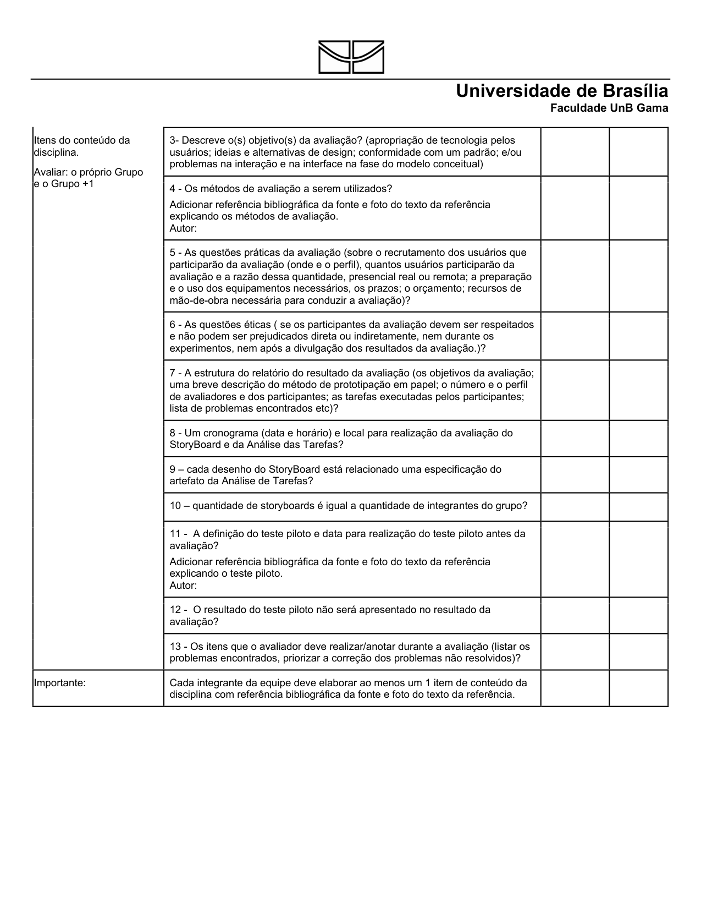
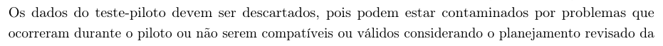
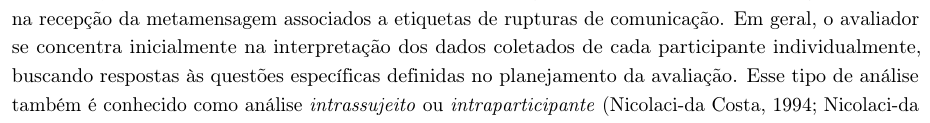
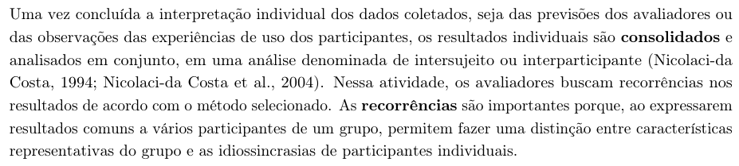
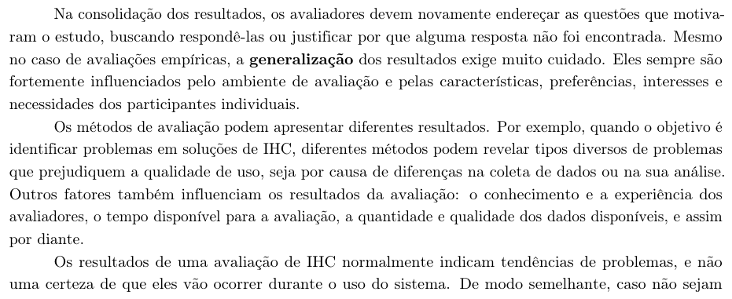
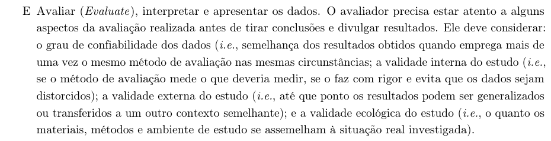
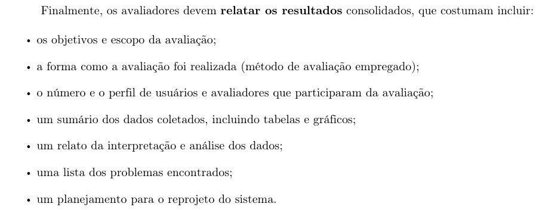
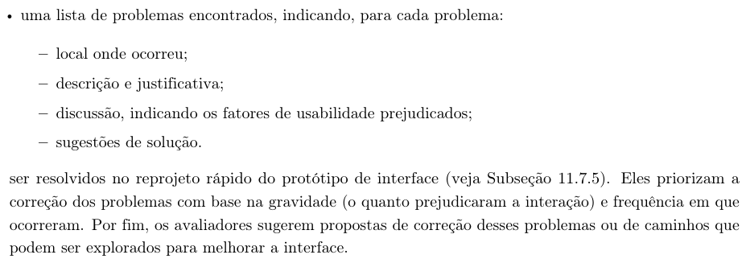
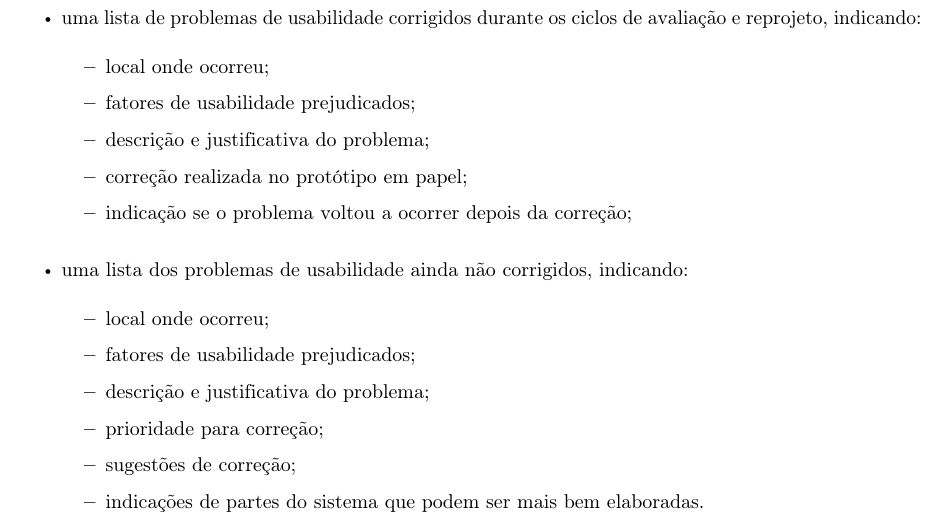
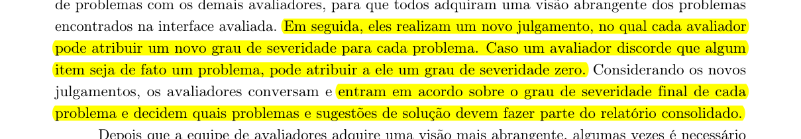

# Lista de Verificação — Planejamento do Resultado e Relato dos Resultados da Avaliação

## Tabela de Contribuição e Transparência de IA Generativa

A **Tabela 1** apresenta a distribuição de responsabilidades na elaboração, curadoria e revisão de **Planejamento do Resultado e Relato dos Resultados da Avaliação**.

**Tabela 1** — Matriz de Contribuição e Transparência de IA Generativa — Planejamento do Resultado e Relato dos Resultados da Avaliação

| Integrante | Atribuição no Artefato | Data | Horário | Ferramenta de IA | Propósito do Uso de IA |
| :--- | :--- | :---: | :---: | :--- | :--- |
| [Vinicius Silva Araruna](https://github.com/ViniciusA05) | Elaboração modular dos critérios de `RA`, citação direta, recortes da obra e autoavaliação pela rubrica `DG-01` a `DG-11` | 20/11/2026 | 14:00 - 15:30 | Google Gemini | Suporte na organização estrutural, formatação de tabelas em Markdown e conferência cruzada com o Plano de Ensino |
| [Gustavo Antonio Rodrigues e Silva](https://github.com/gus-ant) | Revisão de conformidade estrutural, navegação e checagem de links | 20/11/2026 | 15:30 - 16:00 | — | Revisão por pares e validação editorial |
| [Gustavo Antonio Rodrigues e Silva](https://github.com/gus-ant) | Saneamento das referências da avaliação heurística individual (Barbosa et al., 2021, Cap. 12, pp. 270–271), coautoria em `RA-06` e `RA-07` e adição do critério complementar `RA-G01` (**Figura 10**) sobre consolidação consensual de severidade e matriz de reprojeto (*redesign*) | 22/11/2026 | 15:40 - 16:00 | Antigravity / Gemini | Suporte sintático Markdown e geração de recorte grifado de Barbosa et al. (2021, p. 270) |
| [Edvaldo Soares Brasileiro Filho](https://github.com/PajeMurici-dev) | Auditoria de rastreabilidade frente ao Plano de Ensino (`DG-01` a `DG-11`) e referências ABNT | 20/11/2026 | 15:30 - 16:00 | — | Revisão por pares e conferência documental |

_Fonte: Elaborada pelos autores, 2026._

---

## 1. Introdução e Contextualização Metodológica

Este módulo normatiza especificamente o **Planejamento do Relato de Resultados e Relato dos Resultados da Avaliação** (Níveis 1, 2 e 3), sem redundância com o planejamento DECIDE inicial. Cobre o isolamento dos dados do teste-piloto (p. 260), análise intraparticipante e interparticipante (pp. 262–263), consolidação quanti/quali, confiabilidade e validades interna/externa/ecológica (pp. 263–264), os 7 elementos estruturais obrigatórios do relatório final (p. 263), priorização por gravidade/severidade e insumos de reprojeto (pp. 290, 305–306) — reunindo **8 itens `RA`** (**2 em coautoria**) e **1 critério complementar `RA-G01`** sobre negociação consensual e matriz de reprojeto (*redesign*).

Este instrumento normativo atua segundo o **Método de Inspeção Formal de Michael E. Fagan (1976)** e encontra-se desacoplado dos relatórios empíricos de aplicação. Toda inspeção registrada aqui identifica obrigatoriamente o **`Autor do Item`**, a **fundamentação bibliográfica com recorte visual** e a coluna **`Versão, Data e Hora da Avaliação`** exigida pelo Plano de Ensino (*Sales, 2026, pp. 8–13*).

!!! info "Pré-requisito Transversal de Governança (Prof. Dr. André Barros de Sales)"
    Além dos critérios específicos deste artefato listados na **Seção 2**, todo produto de trabalho avaliado deve cumprir integralmente os **11 Itens de Desenvolvimento Geral (`DG-01` a `DG-11`)** definidos pelo Prof. Dr. André Barros de Sales em [00. Governança e Plano de Ensino Geral](00-plano-ensino-geral.md).

---

## 2. Instrumento Normativo de Verificação — Planejamento do Resultado e Relato dos Resultados da Avaliação

### 2.1 Critérios do Plano de Ensino (Prof. Dr. André Barros de Sales — Rubrica Oficial)

A **Tabela 2** reúne os critérios oficiais estipulados pelo docente para este artefato no Plano de Ensino (*Sales, 2026*).

**Tabela 2** — Critérios oficiais do Plano de Ensino para Planejamento do Resultado e Relato dos Resultados da Avaliação

| ID | Critério / Pergunta de Verificação | Autor do Item | Fundamentação Canônica e Fonte | Evidência Visual (Figura) | Resposta | Versão, Data e Hora da Avaliação |
| :---: | :--- | :--- | :--- | :---: | :---: | :---: |
| **PE-E4-07** | Define a estrutura do relatório do resultado da avaliação (objetivos, descrição do método, avaliadores/participantes, tarefas executadas, lista de problemas)? | **Prof. Dr. André Barros de Sales** *(Plano de Ensino FGA0173, 2026)* | Plano de Ensino (Sales, 2026, p. 13, Item 7) | [Ver Figura 1](#figura-1) | `[ ] Sim (Conforme)` `[ ] Não (Não Conforme)` `[ ] Incompleto` `[ ] N/A` | *(Preencher na inspeção)* |
| **PE-E4-13** | Explicita os itens que o avaliador deve realizar/anotar durante a avaliação (listar problemas encontrados e priorizar correção dos não resolvidos)? | **Prof. Dr. André Barros de Sales** *(Plano de Ensino FGA0173, 2026)* | Plano de Ensino (Sales, 2026, p. 13, Item 13) | [Ver Figura 1](#figura-1) | `[ ] Sim (Conforme)` `[ ] Não (Não Conforme)` `[ ] Incompleto` `[ ] N/A` | *(Preencher na inspeção)* |

_Fonte: Plano de Ensino da Disciplina (Prof. Dr. André Barros de Sales, 2026)._

### 2.2 Critérios Técnicos da Literatura Canônica (Lista de Verificação `RA`)

A **Tabela 3** apresenta os **8 itens normativos** fundamentados na literatura científica com citação direta literal e recorte visual da página.

**Tabela 3** — Lista de verificação normativa de Planejamento do Resultado e Relato dos Resultados da Avaliação (8 itens)

| ID | Critério / Pergunta de Verificação | Autor do Item | Fundamentação Canônica (Obra, Ed., Cap., Pág.) e Citação Literal | Evidência Visual (Figura) | Resposta | Versão, Data e Hora da Avaliação |
| :---: | :--- | :--- | :--- | :---: | :---: | :---: |
| **RA-01** | **Isolamento e Descarte Formal dos Dados do Teste-Piloto no Relato** Tanto o planejamento do relato quanto o relatório final de resultados comprovam e declaram explicitamente que os dados coletados no teste-piloto serviram apenas para calibrar o estudo e foram descartados, não sendo computados nem apresentados nos resultados finais da avaliação? • **Descarte formal dos dados piloto:** cláusula explícita impedindo contaminação da amostra oficial; • **Segregação no relatório final:** o relato eventual de ajustes oriundos do piloto fica separado dos achados dos participantes oficiais; • **Consistência pós-revisão:** garantia de que todos os resultados oficiais derivam do plano definitivo estabilizado. | [Vinicius Silva Araruna](https://github.com/ViniciusA05) | *"Os dados do teste-piloto devem ser descartados, pois podem estar contaminados por problemas que ocorreram durante o piloto ou não serem compatíveis ou válidos considerando o planejamento revisado da avaliação."* BARBOSA, Simone Diniz Junqueira et al. Interação Humano-Computador e Experiência do Usuário. 1. ed. Rio de Janeiro: Autopublicação, 2021, p. 260 (Capítulo 11, Seção 11.7.2); SALES, André Barros de. Plano de Ensino de IHC, UnB FGA, 2026, p. 13. | [Ver Figura 2](#figura-2) | `[ ] Sim (Conforme)` `[ ] Não (Não Conforme)` `[ ] Incompleto` `[ ] N/A` | *(Preencher na inspeção)* |
| **RA-02** | **Interpretação Individual Prévia — Análise Intrassujeito (Intraparticipante)** O planejamento do resultado prevê — e o relatório final executa — inicialmente a interpretação individual dos registros de cada participante ou sessão isoladamente (análise intrassujeito/intraparticipante), buscando responder às perguntas específicas da avaliação para cada sujeito? • **Análise individualizada por participante:** exame de logs, vídeos, tempos, erros e falas sessão por sessão; • **Orientação pelas perguntas do estudo:** interpretação guiada pelos indicadores do método aplicado e questões planejadas; • **Ordem de análise:** análise intrassujeito realizada antes da agregação comparativa entre usuários. | [Vinicius Silva Araruna](https://github.com/ViniciusA05) | *"Em geral, o avaliador se concentra inicialmente na interpretação dos dados coletados de cada participante individualmente, buscando respostas às questões específicas definidas no planejamento da avaliação. Esse tipo de análise também é conhecido como análise intrassujeito ou intraparticipante (Nicolaci-da Costa, 1994; Nicolaci-da Costa et al., 2004)."* BARBOSA, Simone Diniz Junqueira et al. Interação Humano-Computador e Experiência do Usuário. 1. ed. Rio de Janeiro: Autopublicação, 2021, p. 262 (Capítulo 11, Seção 11.7.4). | [Ver Figura 3](#figura-3) | `[ ] Sim (Conforme)` `[ ] Não (Não Conforme)` `[ ] Incompleto` `[ ] N/A` | *(Preencher na inspeção)* |
| **RA-03** | **Consolidação Cruzada — Análise Intersujeito e Separação Recorrência × Idiossincrasia** Após interpretar cada caso individualmente, o relato consolida os resultados de todos os participantes (análise intersujeito/interparticipante) buscando recorrências e distinguindo características representativas do grupo daquelas que são idiossincrasias particulares? • **Consolidação entre participantes (intersujeito):** cruzamento sistemático dos resultados individuais; • **Identificação de recorrências:** contagem de quantos participantes ou avaliadores encontraram cada padrão/problema; • **Filtro contra idiossincrasias:** diferenciação explícita entre problema recorrente do grupo e comportamento atípico isolado. | [Vinicius Silva Araruna](https://github.com/ViniciusA05) | *"Uma vez concluída a interpretação individual dos dados coletados, seja das previsões dos avaliadores ou das observações das experiências de uso dos participantes, os resultados individuais são consolidados e analisados em conjunto, em uma análise denominada de intersujeito ou interparticipante (Nicolaci-da Costa, 1994; Nicolaci-da Costa et al., 2004). Nessa atividade, os avaliadores buscam recorrências nos resultados de acordo com o método selecionado. As recorrências são importantes porque, ao expressarem resultados comuns a vários participantes de um grupo, permitem fazer uma distinção entre características representativas do grupo e as idiossincrasias de participantes individuais."* BARBOSA, Simone Diniz Junqueira et al. Interação Humano-Computador e Experiência do Usuário. 1. ed. Rio de Janeiro: Autopublicação, 2021, p. 263 (Capítulo 11, Seção 11.7.5). | [Ver Figura 4](#figura-4) | `[ ] Sim (Conforme)` `[ ] Não (Não Conforme)` `[ ] Incompleto` `[ ] N/A` | *(Preencher na inspeção)* |
| **RA-04** | **Resposta às Questões do Estudo e Interpretação Cautelosa dos Resultados (Tendências, sem Generalização Indevida)** A consolidação endereça objetivamente todas as questões que motivaram a avaliação (ou justifica quando alguma não pôde ser respondida) e apresenta os achados com rigor científico como tendências dentro do escopo testado, sem extrapolar certezas absolutas? • **Fechamento de todas as perguntas:** rastreabilidade direta entre cada pergunta formulada no plano e a conclusão obtida; • **Justificativa de lacunas:** explicação transparente caso alguma pergunta não tenha obtido resposta suficiente; • **Cautela de generalização:** reconhecimento explícito de que a ausência de falhas observadas não prova perfeição fora do escopo. | [Vinicius Silva Araruna](https://github.com/ViniciusA05) | *"Na consolidação dos resultados, os avaliadores devem novamente endereçar as questões que motivaram o estudo, buscando respondê-las ou justificar por que alguma resposta não foi encontrada... Os resultados de uma avaliação de IHC normalmente indicam tendências de problemas, e não uma certeza de que eles vão ocorrer durante o uso do sistema."* BARBOSA, Simone Diniz Junqueira et al. Interação Humano-Computador e Experiência do Usuário. 1. ed. Rio de Janeiro: Autopublicação, 2021, p. 263 (Capítulo 11, Seção 11.7.5). | [Ver Figura 5](#figura-5) | `[ ] Sim (Conforme)` `[ ] Não (Não Conforme)` `[ ] Incompleto` `[ ] N/A` | *(Preencher na inspeção)* |
| **RA-05** | **Discussão Crítica de Confiabilidade e Validades (Interna, Externa e Ecológica)** Antes de tirar conclusões e divulgar resultados, o planejamento do relato e o relatório avaliam e registram limitações relativas à confiabilidade dos dados e às validades interna (rigor sem distorção), externa (capacidade de transferência/generalização) e ecológica (semelhança do ambiente/materiais à situação real)? • **Confiabilidade:** consistência esperada caso o método seja repetido nas mesmas condições; • **Validade interna:** controle de vieses do avaliador, ordem de tarefas ou problemas instrumentais; • **Validade externa e ecológica:** explicitação das restrições amostrais (ex.: amostra reduzida) e artificialidade do ambiente controlado. | [Vinicius Silva Araruna](https://github.com/ViniciusA05) | *"O avaliador precisa estar atento a alguns aspectos da avaliação realizada antes de tirar conclusões e divulgar resultados. Ele deve considerar: o grau de confiabilidade dos dados... a validade interna do estudo... a validade externa do estudo... e a validade ecológica do estudo (i.e., o quanto os materiais, métodos e ambiente de estudo se assemelham à situação real investigada)."* BARBOSA, Simone Diniz Junqueira et al. Interação Humano-Computador e Experiência do Usuário. 1. ed. Rio de Janeiro: Autopublicação, 2021, p. 264 (Capítulo 11, Seção 11.8 — Etapa E do DECIDE). | [Ver Figura 6](#figura-6) | `[ ] Sim (Conforme)` `[ ] Não (Não Conforme)` `[ ] Incompleto` `[ ] N/A` | *(Preencher na inspeção)* |
| **RA-06** | **Estrutura Completa Obrigatória do Relato Consolidado dos Resultados** O planejamento do relato prevê — e o resultado entregue contém — todos os sete componentes estruturais de Barbosa et al. (2021, p. 263): objetivos e escopo, método empregado, número e perfil de usuários e avaliadores, sumário de dados com tabelas e gráficos, relato da interpretação/análise, lista de problemas e planejamento para reprojeto? • **Identificação metodológica:** objetivos, escopo, método(s) e perfis/quantitativo reais de participantes e avaliadores; • **Sumário quanti/quali estruturado:** tabelas e gráficos resumindo métricas coletadas e relato interpretativo; • **Lista de problemas e plano de reprojeto:** diagnóstico conectado a ações concretas de redesenho. | [Vinicius Silva Araruna](https://github.com/ViniciusA05) e [Gustavo Antonio Rodrigues e Silva](https://github.com/gus-ant) | *"Finalmente, os avaliadores devem relatar os resultados consolidados, que costumam incluir: • os objetivos e escopo da avaliação; • a forma como a avaliação foi realizada (método de avaliação empregado); • o número e o perfil de usuários e avaliadores que participaram da avaliação; • um sumário dos dados coletados, incluindo tabelas e gráficos; • um relato da interpretação e análise dos dados; • uma lista dos problemas encontrados; • um planejamento para o reprojeto do sistema."* BARBOSA, Simone Diniz Junqueira et al. Interação Humano-Computador e Experiência do Usuário. 1. ed. Rio de Janeiro: Autopublicação, 2021, p. 263 (Capítulo 11, Seção 11.7.5). | [Ver Figura 7](#figura-7) | `[ ] Sim (Conforme)` `[ ] Não (Não Conforme)` `[ ] Incompleto` `[ ] N/A` | *(Preencher na inspeção)* |
| **RA-07** | **Catalogação Estruturada dos Problemas: Local, Fatores Prejudicados, Gravidade e Frequência** Cada problema listado no resultado da avaliação traz catalogação estruturada contendo: local exato onde ocorreu na interface/fluxo, descrição e justificativa, diretriz/fatores de qualidade prejudicados, gravidade (severidade), frequência de ocorrência e recomendação objetiva de solução? • **Rastreabilidade espacial e conceitual:** identificação precisa da tela/componente e do fator de usabilidade/heurística violado; • **Priorização por gravidade e frequência:** classificação objetiva para ordenar o esforço de correção; • **Justificativa e sugestão de melhoria:** explicação de causa e recomendação prática de redesign. | [Vinicius Silva Araruna](https://github.com/ViniciusA05) e [Gustavo Antonio Rodrigues e Silva](https://github.com/gus-ant) | *"uma lista de problemas encontrados, indicando, para cada problema: – local onde ocorreu; – descrição e justificativa; – discussão, indicando os fatores de usabilidade prejudicados; – sugestões de solução. [...] Eles priorizam a correção dos problemas com base na gravidade (o quanto prejudicaram a interação) e frequência em que ocorreram."* BARBOSA, Simone Diniz Junqueira et al. Interação Humano-Computador e Experiência do Usuário. 1. ed. Rio de Janeiro: Autopublicação, 2021, pp. 290 e 305 (Capítulo 12, Seções 12.2.1 e 12.2.3). | [Ver Figura 8](#figura-8) | `[ ] Sim (Conforme)` `[ ] Não (Não Conforme)` `[ ] Incompleto` `[ ] N/A` | *(Preencher na inspeção)* |
| **RA-08** | **Rastreamento de Problemas Corrigidos nos Ciclos vs. Problemas Pendentes para Reprojeto** Em avaliações formativas ou ciclos iterativos entre níveis (ex.: Protótipo de Papel -> Alta Fidelidade), o relato distingue formalmente os problemas já corrigidos durante os ciclos (com correção realizada e registro de eventual reincidência) dos problemas ainda não corrigidos (com prioridade, sugestões e partes do sistema a elaborar melhor)? • **Histórico do retrabalho imediato:** registro transparente do que já foi corrigido durante a iteração e se voltou a ocorrer; • **Backlog de reprojeto priorizado:** problemas pendentes ordenados por prioridade para a próxima etapa/nível de fidelidade; • **Diretrizes de evolução arquitetural:** indicação clara das partes do sistema que requerem melhor elaboração. | [Vinicius Silva Araruna](https://github.com/ViniciusA05) | *"• uma lista de problemas de usabilidade corrigidos durante os ciclos de avaliação e reprojeto, indicando: local onde ocorreu; fatores de usabilidade prejudicados; descrição e justificativa do problema; correção realizada... indicação se o problema voltou a ocorrer depois da correção; • uma lista dos problemas de usabilidade ainda não corrigidos, indicando: local onde ocorreu; fatores de usabilidade prejudicados; descrição e justificativa do problema; prioridade para correção; sugestões de correção; indicações de partes do sistema que podem ser mais bem elaboradas."* BARBOSA, Simone Diniz Junqueira et al. Interação Humano-Computador e Experiência do Usuário. 1. ed. Rio de Janeiro: Autopublicação, 2021, pp. 305-306 (Capítulo 12, Seção 12.2.3). | [Ver Figura 9](#figura-9) | `[ ] Sim (Conforme)` `[ ] Não (Não Conforme)` `[ ] Incompleto` `[ ] N/A` | *(Preencher na inspeção)* |

_Fonte: Elaborada por [Vinicius Silva Araruna](https://github.com/ViniciusA05) (coautoria com [Gustavo Antonio Rodrigues e Silva](https://github.com/gus-ant) em `RA-06` e `RA-07`), 2026._

### 2.3 Critérios Complementares — Consenso de Severidade e Matriz de Reprojeto (Gustavo Antonio)

A **Tabela 4** integra o critério complementar oriundo da consolidação do relatório de inspeção individual de [Gustavo Antonio Rodrigues e Silva](https://github.com/gus-ant) (normalizado para Barbosa et al., 2021).

**Tabela 4** — Critério complementar de Consolidação Consensual e Reprojeto (*Redesign*) (1 item)

| ID | Critério / Pergunta de Verificação | Autor do Item | Fundamentação Canônica (Obra, Ed., Cap., Pág.) e Citação Literal | Evidência Visual (Figura) | Resposta | Versão, Data e Hora da Avaliação |
| :---: | :--- | :--- | :--- | :---: | :---: | :---: |
| **RA-G01** | **Consolidação Consensual de Severidade (Incluindo Grau Zero) e Matriz de Correção / Redesign** Na consolidação multiavaliador, a equipe reavalia e entra em acordo sobre o grau de severidade final de cada achado (atribuindo grau `0` caso discorde que constitua problema real), decide quais violações e sugestões integram o relatório final e organiza uma matriz de correção / diretrizes concretas de reprojeto (*redesign*) priorizadas? • **Revisão consensual:** unificação de achados duplicados e atribuição de severidade `0` a falsos positivos; • **Matriz de correção:** vínculo direto entre problema, diretriz violada, severidade final e solução de *redesign* proposta. | [Gustavo Antonio Rodrigues e Silva](https://github.com/gus-ant) | *"Em seguida, eles realizam um novo julgamento, no qual cada avaliador pode atribuir um novo grau de severidade para cada problema. Caso um avaliador discorde que algum item seja de fato um problema, pode atribuir a ele um grau de severidade zero. Considerando os novos julgamentos, os avaliadores conversam e entram em acordo sobre o grau de severidade final de cada problema e decidem quais problemas e sugestões de solução devem fazer parte do relatório consolidado."* BARBOSA, Simone Diniz Junqueira et al. Interação Humano-Computador e Experiência do Usuário. 1. ed. Rio de Janeiro: Autopublicação, 2021, p. 270 (Capítulo 12, Seção 12.1.1). | [Ver Figura 10](#figura-10) | `[ ] Sim (Conforme)` `[ ] Não (Não Conforme)` `[ ] Incompleto` `[ ] N/A` | *(Preencher na inspeção)* |

_Fonte: Elaborada por [Gustavo Antonio Rodrigues e Silva](https://github.com/gus-ant), 2026._

### Evidências Visuais da Literatura e do Plano de Ensino

Cada figura a seguir é chamada explicitamente e vinculada ao respectivo critério na tabela normativa acima.

A **Figura 1** reproduz o trecho comprobatório de referência referente ao critério **PE-E4-07**.

**Figura 1** — Evidência documental referente ao item `PE-E4-07`.  
_Fonte: Plano de Ensino (Sales, 2026, p. 13, Item 7)_

A **Figura 2** reproduz o trecho comprobatório de referência referente ao critério **RA-01**.

**Figura 2** — Evidência documental referente ao item `RA-01`.  
_Fonte: BARBOSA, Simone Diniz Junqueira et al. Interação Humano-Computador e Experiência do Usuário. 1. ed. Rio de Janeiro: Autopublicação, 2021, p. 260 (Capítulo 11, Seção 11.7.2); SALES, André Barros de. Plano de Ensino de IHC, UnB FGA, 2026, p. 13._

A **Figura 3** reproduz o trecho comprobatório de referência referente ao critério **RA-02**.

**Figura 3** — Evidência documental referente ao item `RA-02`.  
_Fonte: BARBOSA, Simone Diniz Junqueira et al. Interação Humano-Computador e Experiência do Usuário. 1. ed. Rio de Janeiro: Autopublicação, 2021, p. 262 (Capítulo 11, Seção 11.7.4)._

A **Figura 4** reproduz o trecho comprobatório de referência referente ao critério **RA-03**.

**Figura 4** — Evidência documental referente ao item `RA-03`.  
_Fonte: BARBOSA, Simone Diniz Junqueira et al. Interação Humano-Computador e Experiência do Usuário. 1. ed. Rio de Janeiro: Autopublicação, 2021, p. 263 (Capítulo 11, Seção 11.7.5)._

A **Figura 5** reproduz o trecho comprobatório de referência referente ao critério **RA-04**.

**Figura 5** — Evidência documental referente ao item `RA-04`.  
_Fonte: BARBOSA, Simone Diniz Junqueira et al. Interação Humano-Computador e Experiência do Usuário. 1. ed. Rio de Janeiro: Autopublicação, 2021, p. 263 (Capítulo 11, Seção 11.7.5)._

A **Figura 6** reproduz o trecho comprobatório de referência referente ao critério **RA-05**.

**Figura 6** — Evidência documental referente ao item `RA-05`.  
_Fonte: BARBOSA, Simone Diniz Junqueira et al. Interação Humano-Computador e Experiência do Usuário. 1. ed. Rio de Janeiro: Autopublicação, 2021, p. 264 (Capítulo 11, Seção 11.8 — Etapa E do DECIDE)._

A **Figura 7** reproduz o trecho comprobatório de referência referente ao critério **RA-06**.

**Figura 7** — Evidência documental referente ao item `RA-06`.  
_Fonte: BARBOSA, Simone Diniz Junqueira et al. Interação Humano-Computador e Experiência do Usuário. 1. ed. Rio de Janeiro: Autopublicação, 2021, p. 263 (Capítulo 11, Seção 11.7.5)._

A **Figura 8** reproduz o trecho comprobatório de referência referente ao critério **RA-07**.

**Figura 8** — Evidência documental referente ao item `RA-07`.  
_Fonte: BARBOSA, Simone Diniz Junqueira et al. Interação Humano-Computador e Experiência do Usuário. 1. ed. Rio de Janeiro: Autopublicação, 2021, pp. 290 e 305 (Capítulo 12, Seções 12.2.1 e 12.2.3)._

A **Figura 9** reproduz o trecho comprobatório de referência referente ao critério **RA-08**.

**Figura 9** — Evidência documental referente ao item `RA-08`.  
_Fonte: BARBOSA, Simone Diniz Junqueira et al. Interação Humano-Computador e Experiência do Usuário. 1. ed. Rio de Janeiro: Autopublicação, 2021, pp. 305-306 (Capítulo 12, Seção 12.2.3)._

A **Figura 10** reproduz o trecho comprobatório de referência referente ao critério **RA-G01**.

**Figura 10** — Evidência documental referente ao item `RA-G01`.  
_Fonte: BARBOSA, Simone Diniz Junqueira et al. Interação Humano-Computador e Experiência do Usuário. 1. ed. Rio de Janeiro: Autopublicação, 2021, p. 270 (Capítulo 12, Seção 12.1.1)._

---

## 3. Validação desta Lista pela Lista de Governança do Prof. Dr. André Barros de Sales (`DG-01` a `DG-11`)

Em estrito cumprimento às diretrizes de qualidade do Plano de Ensino (*Sales, 2026, pp. 8–9*), a **Tabela 5** submete esta própria página (`06-resultado-avaliacao.md`) aos **11 Itens de Desenvolvimento do Projeto** formulados pelo Prof. Dr. André Barros de Sales.

**Tabela 5** — Autoavaliação de `06-resultado-avaliacao.md` frente aos critérios `DG-01` a `DG-11`

| ID | Critério de Governança do Plano de Ensino | Autor do Item | Resposta | Versão, Data e Hora da Avaliação | Evidência de Conformidade nesta Lista |
| :---: | :--- | :--- | :---: | :---: | :--- |
| **DG-01** | O histórico de versão padronizado? | **Prof. Dr. André Barros de Sales** *(Plano de Ensino FGA0173, 2026)* | ✅ **Sim (Conforme)** | `v1.1` — 22/11/2026 às 15:40 | Seção **Histórico de Versão** (**Tabela 6**) padronizada ao final de `06-resultado-avaliacao.md` registrando `v1.1`. |
| **DG-02** | O(s) autor(es) e o(s) revisor(es) para cada artefato? | **Prof. Dr. André Barros de Sales** *(Plano de Ensino FGA0173, 2026)* | ✅ **Sim (Conforme)** | `v1.1` — 22/11/2026 às 15:40 | Colunas **Autor(es)** e **Revisor(es)** preenchidas com links GitHub no Histórico de Versão, além da coluna **`Autor do Item`** e coautorias nominais em 100% dos critérios da lista. |
| **DG-03** | Referências bibliográficas e/ou bibliografia em todos os artefatos? | **Prof. Dr. André Barros de Sales** *(Plano de Ensino FGA0173, 2026)* | ✅ **Sim (Conforme)** | `v1.1` — 22/11/2026 às 15:40 | Seção **Referências Bibliográficas (ABNT NBR 6023)** completa ao final do documento com obras, edições e páginas exatas. |
| **DG-04** | As tabelas e imagens possuem legenda e fonte e são chamadas dentro do texto? | **Prof. Dr. André Barros de Sales** *(Plano de Ensino FGA0173, 2026)* | ✅ **Sim (Conforme)** | `v1.1` — 22/11/2026 às 15:40 | 100% das tabelas (`Tabela 1` a `Tabela 6`) e figuras (`Figura 1` a `Figura 10`) possuem numeração, legenda, fonte e chamadas textuais prévias. |
| **DG-05** | Um texto fazendo uma introdução dos artefatos? | **Prof. Dr. André Barros de Sales** *(Plano de Ensino FGA0173, 2026)* | ✅ **Sim (Conforme)** | `v1.1` — 22/11/2026 às 15:40 | Seção **1. Introdução e Contextualização Metodológica** situa o instrumento no Ciclo de Mayhew (1999) e na Inspeção Formal de Fagan (1976). |
| **DG-06** | O cronograma executado com quem realizou cada artefato/atividade e as datas de início e fim da construção/realização? | **Prof. Dr. André Barros de Sales** *(Plano de Ensino FGA0173, 2026)* | ✅ **Sim (Conforme)** | `v1.1` — 22/11/2026 às 15:40 | Registros de elaboração e revisão vinculados ao [Cronograma Executado](../../planejamento/cronograma-executado.md) e ao histórico Git da equipe. |
| **DG-07** | Ata(s) da(s) reuniões (com data, horário de início e do final, participantes, objetivo, atividades definidas etc.)? | **Prof. Dr. André Barros de Sales** *(Plano de Ensino FGA0173, 2026)* | ✅ **Sim (Conforme)** | `v1.1` — 22/11/2026 às 15:40 | Deliberações e alinhamentos documentados nas [Atas de Reunião](../../atas/index.md). |
| **DG-08** | A gravação da reunião do grupo? | **Prof. Dr. André Barros de Sales** *(Plano de Ensino FGA0173, 2026)* | ✅ **Sim (Conforme)** | `v1.1` — 22/11/2026 às 15:40 | Links funcionais de gravações das reuniões de planejamento e auditoria indexados em [Atas de Reunião](../../atas/index.md). |
| **DG-09** | Vídeo de apresentação na categoria 'Não Listado' no YouTube (duração entre 20 e 30 minutos)? | **Prof. Dr. André Barros de Sales** *(Plano de Ensino FGA0173, 2026)* | ⚠️ **Em preparação (Etapa 8)** | `v1.1` — 22/11/2026 às 15:40 | Vídeos das Entregas 1–7 publicados; vídeo oficial da [Entrega 8 — Verificação dos Artefatos](../../entregas/entrega8.md) (20–30 min, Não Listado) agendado após consolidação das inspeções da equipe. |
| **DG-10** | Tabela de contribuição no início do artefato com o nome de todos os integrantes, contribuição com hiperligação da atividade e da gravação? | **Prof. Dr. André Barros de Sales** *(Plano de Ensino FGA0173, 2026)* | ✅ **Sim (Conforme)** | `v1.1` — 22/11/2026 às 15:40 | **Tabela 1** posicionada no topo do documento discriminando cada integrante ativo com hiperligação GitHub e escopo de atuação. |
| **DG-11** | A seção de agradecimentos apresentando o uso de Inteligência Artificial (IA) Generativa no artefato? | **Prof. Dr. André Barros de Sales** *(Plano de Ensino FGA0173, 2026)* | ✅ **Sim (Conforme)** | `v1.1` — 22/11/2026 às 15:40 | Seção **Agradecimentos e Declaração de Uso de IA Generativa** ao final do documento em estrita conformidade com o Código da SBC e Sales (2026). |

_Fonte: Validação elaborada por Vinicius Silva Araruna e atualizada por Gustavo Antonio Rodrigues e Silva com base na rubrica oficial de Prof. Dr. André Barros de Sales (Plano de Ensino, 2026, pp. 8–9)._

---

## 4. Histórico de Versão

A **Tabela 6** registra a evolução histórica e o controle de versionamento deste instrumento normativo.

**Tabela 6** — Histórico de Versão do Documento

| Versão | Data | Descrição Detalhada da Modificação | Autor(es) | Revisor(es) |
| :---: | :---: | :--- | :--- | :--- |
| `1.0` | 20/11/2026 | Criação da lista específica para Planejamento e Relato dos Resultados da Avaliação (8 itens fundamentados na literatura + 2 itens oficiais do Prof. André `PE-E4-07, 13`) e validação `DG-01..11`. | [Vinicius Silva Araruna](https://github.com/ViniciusA05) | [Gustavo Antonio Rodrigues e Silva](https://github.com/gus-ant), [Edvaldo Soares Brasileiro Filho](https://github.com/PajeMurici-dev) |
| `1.1` | 22/11/2026 | Saneamento bibliográfico dos achados do relatório heurístico individual (`Barbosa et al., 2021, p. 270`), atribuição de coautoria em `RA-06` e `RA-07` e adição do critério `RA-G01` (**Tabela 4** e **Figura 10**). | [Gustavo Antonio Rodrigues e Silva](https://github.com/gus-ant) | [Vinicius Silva Araruna](https://github.com/ViniciusA05), [Edvaldo Soares Brasileiro Filho](https://github.com/PajeMurici-dev) |

_Fonte: Elaborada pelos autores, 2026._

---

## 5. Referências Bibliográficas (ABNT NBR 6023)

[1] BARBOSA, Simone Diniz Junqueira et al. Interação Humano-Computador e Experiência do Usuário. 1. ed. Rio de Janeiro: Autopublicação, 2021, Cap. 11 (§§11.7.2, 11.7.4, 11.7.5 e 11.8, pp. 260-264) e Cap. 12 (§§12.2.1 e 12.2.3, pp. 290, 305-306).

[2] SALES, André Barros de. Plano de Ensino da Disciplina de Interação Humano Computador. Faculdade UnB Gama (FGA), UnB, 2026.

[3] NICOLACI-DA-COSTA, Ana Maria. A análise de discurso em questão. *Psicologia: Teoria e Pesquisa*, v. 10, n. 2, p. 317–331, 1994.

[4] NICOLACI-DA-COSTA, Ana Maria et al. O uso de entrevistas on-line no método de explicitação do discurso subjacente (MEDS). *Psicologia: Reflexão e Crítica*, v. 17, n. 3, p. 417–426, 2004.

[5] NIELSEN, Jakob. *Usability Engineering*. San Francisco: Morgan Kaufmann, 1994.

[6] SNYDER, Carolyn. *Paper Prototyping: The Fast and Easy Way to Design and Refine User Interfaces*. San Francisco: Morgan Kaufmann, 2003.

[7] BARBOSA, Simone Diniz Junqueira; SILVA, Bruno Santana da. *Interação Humano-Computador*. 1. ed. Rio de Janeiro: Elsevier / Campus, 2010.

[8] FAGAN, Michael E. Design and code inspections to reduce errors in program development. *IBM Systems Journal*, v. 15, n. 3, p. 182–211, 1976.

[9] MAYHEW, Deborah J. *The Usability Engineering Lifecycle: A Practitioner's Handbook for User Interface Design*. San Francisco: Morgan Kaufmann, 1999.

[10] SOCIEDADE BRASILEIRA DE COMPUTAÇÃO (SBC). *Código de Conduta da Sociedade Brasileira de Computação*. Porto Alegre: SBC, 2023.

---

## 6. Agradecimentos e Declaração de Uso de Inteligência Artificial (IA) Generativa

Em conformidade com o Código de Conduta da Sociedade Brasileira de Computação (SBC, Art. 2º, parágrafo III) e com as diretrizes do Plano de Ensino da disciplina (*Sales, 2026, p. 3*), declara-se que a organização das tabelas em Markdown e a revisão ortográfica contaram com suporte supervisionado da ferramenta de Inteligência Artificial Generativa Google Gemini. Toda a concepção metodológica, verificação bibliográfica nas obras originais, revisão técnica e validação de conformidade foram realizadas pelos discentes identificados no Histórico de Versão.
