# Lista de Verificação — Métodos de Avaliação de IHC (Investigação, Inspeção e Observação)

## Tabela de Contribuição e Transparência de IA Generativa

A **Tabela 1** apresenta a distribuição de responsabilidades na elaboração, curadoria e revisão de **Métodos de Avaliação de IHC (Investigação, Inspeção e Observação)**.

**Tabela 1** — Matriz de Contribuição e Transparência de IA Generativa — Métodos de Avaliação de IHC (Investigação, Inspeção e Observação)

| Integrante | Atribuição no Artefato | Data | Horário | Ferramenta de IA | Propósito do Uso de IA |
| :--- | :--- | :---: | :---: | :--- | :--- |
| [Vinicius Silva Araruna](https://github.com/ViniciusA05) | Elaboração modular dos critérios de `MA`, citação direta, recortes da obra e autoavaliação pela rubrica `DG-01` a `DG-11` | 20/11/2026 | 14:00 - 15:30 | Google Gemini | Suporte na organização estrutural, formatação de tabelas em Markdown e conferência cruzada com o Plano de Ensino |
| [Gustavo Antonio Rodrigues e Silva](https://github.com/gus-ant) | Revisão de conformidade estrutural, navegação e checagem de links | 20/11/2026 | 15:30 - 16:00 | — | Revisão por pares e validação editorial |
| [Edvaldo Soares Brasileiro Filho](https://github.com/PajeMurici-dev) | Auditoria de rastreabilidade frente ao Plano de Ensino (`DG-01` a `DG-11`) e referências ABNT | 20/11/2026 | 15:30 - 16:00 | — | Revisão por pares e conferência documental |

_Fonte: Elaborada pelos autores, 2026._

---

## 1. Introdução e Contextualização Metodológica

Este módulo verifica a fundamentação, adequação comparativa (Tabelas 12.10–12.12 de Barbosa et al., 2021, pp. 306–308) e rigor de aplicação de todos os **Métodos de Avaliação de IHC**: **Investigação** (entrevistas, questionários, grupos de foco, estudos de campo), **Inspeção** (avaliação heurística de Nielsen, percurso cognitivo, inspeção semiótica MIS) e **Observação** (teste de usabilidade, avaliação de comunicabilidade MAC e prototipação em papel).

Este instrumento normativo atua segundo o **Método de Inspeção Formal de Michael E. Fagan (1976)** e encontra-se desacoplado dos relatórios empíricos de aplicação. Toda inspeção registrada aqui identifica obrigatoriamente o **`Autor do Item`**, a **fundamentação bibliográfica com recorte visual** e a coluna **`Versão, Data e Hora da Avaliação`** exigida pelo Plano de Ensino (*Sales, 2026, pp. 8–13*).

!!! info "Pré-requisito Transversal de Governança (Prof. Dr. André Barros de Sales)"
    Além dos critérios específicos deste artefato listados na **Seção 2**, todo produto de trabalho avaliado deve cumprir integralmente os **11 Itens de Desenvolvimento Geral (`DG-01` a `DG-11`)** definidos pelo Prof. Dr. André Barros de Sales em [00. Governança e Plano de Ensino Geral](00-plano-ensino-geral.md).

---

## 2. Instrumento Normativo de Verificação — Métodos de Avaliação de IHC (Investigação, Inspeção e Observação)

### 2.1 Critérios do Plano de Ensino (Prof. Dr. André Barros de Sales — Rubrica Oficial)

A **Tabela 2** reúne os critérios oficiais estipulados pelo docente para este artefato no Plano de Ensino (*Sales, 2026*).

**Tabela 2** — Critérios oficiais do Plano de Ensino para Métodos de Avaliação de IHC (Investigação, Inspeção e Observação)

| ID | Critério / Pergunta de Verificação | Autor do Item | Fundamentação Canônica e Fonte | Evidência Visual (Figura) | Resposta | Versão, Data e Hora da Avaliação |
| :---: | :--- | :--- | :--- | :---: | :---: | :---: |
| **PE-E4-04** | Os métodos de avaliação a serem utilizados estão definidos com referência bibliográfica da fonte, foto do texto da referência e autor? | **Prof. Dr. André Barros de Sales** *(Plano de Ensino FGA0173, 2026)* | Plano de Ensino (Sales, 2026, p. 13, Item 4) | [Ver Figura 1](#figura-1) | `[ ] Sim (Conforme)` `[ ] Não (Não Conforme)` `[ ] Incompleto` `[ ] N/A` | *(Preencher na inspeção)* |

_Fonte: Plano de Ensino da Disciplina (Prof. Dr. André Barros de Sales, 2026)._

### 2.2 Critérios Técnicos da Literatura Canônica (Lista de Verificação `MA`)

A **Tabela 3** apresenta os **14 itens normativos** fundamentados na literatura científica com citação direta literal e recorte visual da página.

**Tabela 3** — Lista de verificação normativa de Métodos de Avaliação de IHC (Investigação, Inspeção e Observação) (14 itens)

| ID | Critério / Pergunta de Verificação | Autor do Item | Fundamentação Canônica (Obra, Ed., Cap., Pág.) e Citação Literal | Evidência Visual (Figura) | Resposta | Versão, Data e Hora da Avaliação |
| :---: | :--- | :--- | :--- | :---: | :---: | :---: |
| **MA-01** | **[Parte 1 — Classificação e Seleção Comparativa dos Métodos de Avaliação] Classificação Tripartida e Natureza do Método (Investigação, Inspeção e Observação)** O planejamento diferencia adequadamente os métodos escolhidos conforme sua família — Investigação (coleta de opiniões/expectativas com usuários), Inspeção (métodos analíticos sem usuários sobre experiências potenciais) e Observação (métodos empíricos registrando uso real) — reconhecendo os limites de empatia do avaliador na inspeção? • **Distinção empírico × analítico:** clareza sobre experiências potenciais previstas (inspeção) vs. reais observadas/relatadas; • **Triangulação recomendada:** combinação complementar de métodos sempre que prazo e recursos permitirem; • **Coerência metodológica:** caracterização fiel da família de cada técnica empregada. | [Vinicius Silva Araruna](https://github.com/ViniciusA05) | *"Os métodos de avaliação de IHC podem ser classificados em: métodos de investigação, de observação de uso e de inspeção."* BARBOSA, Simone Diniz Junqueira et al. Interação Humano-Computador e Experiência do Usuário. 1. ed. Rio de Janeiro: Autopublicação, 2021, pp. 256-257 (Capítulo 11, Seção 11.6). | [Ver Figura 2](#figura-2) | `[ ] Sim (Conforme)` `[ ] Não (Não Conforme)` `[ ] Incompleto` `[ ] N/A` | *(Preencher na inspeção)* |
| **MA-02** | **Métodos de Avaliação por Investigação / Inquiry (Questionários, Entrevistas, Grupos de Foco e Estudos de Campo)** Quando a avaliação visa acessar concepções, opiniões, expectativas, motivos de não apropriação ou experiências relatadas pelos usuários, são empregados e planejados métodos de investigação (entrevistas, questionários, grupos de foco, estudos de campo), apoiados quando útil por materiais como cenários ou telas? • **Cobertura da família Inquiry:** explicitação das técnicas de investigação aplicáveis ao objetivo; • **Foco em concepções e expectativas:** aderência do instrumento ao que o usuário pensa, lembra e opina; • **Uso em múltiplos momentos:** enquadramento em análise atual, avaliação formativa ou avaliação somativa. | [Vinicius Silva Araruna](https://github.com/ViniciusA05) | *"Os métodos de investigação (inquiry) envolvem o uso de questionários, a realização de entrevistas, grupos de foco e estudos de campo, entre outros. Esses métodos permitem ao avaliador ter acesso, interpretar e analisar concepções, opiniões, expectativas e comportamentos do usuário relacionados com sistemas interativos."* BARBOSA, Simone Diniz Junqueira et al. Interação Humano-Computador e Experiência do Usuário. 1. ed. Rio de Janeiro: Autopublicação, 2021, p. 256 (Capítulo 11, Seção 11.6). | [Ver Figura 3](#figura-3) | `[ ] Sim (Conforme)` `[ ] Não (Não Conforme)` `[ ] Incompleto` `[ ] N/A` | *(Preencher na inspeção)* |
| **MA-03** | **Critérios Comparativos de Seleção: O Que Avalia, Quando Avalia e Tipo de Dado (Tabelas 12.10–12.12)** A seleção do(s) método(s) justifica formalmente sua adequação nas três dimensões comparativas da Seção 12.2.4: (a) o aspecto avaliado (apropriação, alternativas, conformidade com padrão ou problemas — Tabela 12.10); (b) o momento formativo ou somativo (Tabela 12.11); e (c) a ênfase quantitativa ou qualitativa dos dados (Tabela 12.12)? • **O que avaliar (Tabela 12.10):** ex.: conformidade com padrão pede inspeção; apropriação pede investigação/observação; • **Quando avaliar (Tabela 12.11):** coerência entre maturidade do artefato (protótipo vs. sistema pronto) e método; • **Dados gerados (Tabela 12.12):** alinhamento entre tipo de dado predominante (quanti vs. quali) e as perguntas do estudo. | [Vinicius Silva Araruna](https://github.com/ViniciusA05) | *"Nesta seção comparamos algumas características desses métodos para auxiliar o avaliador na escolha do método mais adequado em cada caso. Eles serão comparados de acordo com o que e quando se avalia, bem como o tipo de resultado produzido."* BARBOSA, Simone Diniz Junqueira et al. Interação Humano-Computador e Experiência do Usuário. 1. ed. Rio de Janeiro: Autopublicação, 2021, pp. 306-308 (Capítulo 12, Seção 12.2.4, Tabelas 12.10, 12.11 e 12.12). | [Ver Figura 4](#figura-4) | `[ ] Sim (Conforme)` `[ ] Não (Não Conforme)` `[ ] Incompleto` `[ ] N/A` | *(Preencher na inspeção)* |
| **MA-04** | **[Parte 2 — Métodos de Avaliação por Inspeção (Analíticos)] Avaliação Heurística — Inspeção Sistemática pelas 10 Heurísticas de Nielsen (1994c)** A aplicação da Avaliação Heurística verifica sistematicamente todas as dez diretrizes clássicas de Nielsen (visibilidade do estado, mundo real, controle e liberdade, consistência, reconhecimento em vez de memorização, flexibilidade e eficiência, projeto estético e minimalista, prevenção de erros, reconhecimento/recuperação de erros e ajuda/documentação) e eventuais diretrizes de domínio? • **Cobertura integral das 10 heurísticas:** todas as dez diretrizes de Nielsen (1994c, p. 30) avaliadas tela a tela; • **Expansão para estilo/domínio quando aplicável:** consideração de convenções Web, WIMP, acessibilidade ou plataforma; • **Associação precisa violação-heurística:** cada defeito apontado identifica qual(is) heurística(s) foram violadas. | [Vinicius Silva Araruna](https://github.com/ViniciusA05) | *"Nielsen (1994c) descreve um conjunto inicial de heurísticas a serem utilizadas em seu método de avaliação heurística (p. 30): • visibilidade do estado do sistema... • ajuda e documentação..."* BARBOSA, Simone Diniz Junqueira et al. Interação Humano-Computador e Experiência do Usuário. 1. ed. Rio de Janeiro: Autopublicação, 2021, pp. 267-268 (Capítulo 12, Seção 12.1.1); NIELSEN, Jakob, 1994c. | [Ver Figura 5](#figura-5) | `[ ] Sim (Conforme)` `[ ] Não (Não Conforme)` `[ ] Incompleto` `[ ] N/A` | *(Preencher na inspeção)* |
| **MA-05** | **Avaliação Heurística — 3 a 5 Avaliadores Independentes, Duas Passagens e Gravidade (Tabela 12.1)** O protocolo da Avaliação Heurística prevê 3 a 5 avaliadores trabalhando inicialmente de forma individual (percorrendo cada interface pelo menos duas vezes — visão de conjunto e análise detalhada por diretriz/tela), anotando local, gravidade (frequência, impacto e persistência), justificativa e recomendações, com consolidação posterior em grupo? • **Equipe recomendada de 3 a 5 avaliadores independentes:** evita viés de avaliador único na coleta inicial; • **Mínimo de duas passagens na inspeção:** inspeção individual antes da revisão conjunta (Tabela 12.1); • **Registro completo por violação:** local, diretriz violada, grau de gravidade, justificativa e recomendação. | [Vinicius Silva Araruna](https://github.com/ViniciusA05) | *"Com base no estudo, Nielsen recomenda que uma avaliação heurística envolva de três a cinco avaliadores. Algumas atividades devem ser realizadas por cada avaliador (individualmente), enquanto em outras eles devem trabalhar em conjunto."* BARBOSA, Simone Diniz Junqueira et al. Interação Humano-Computador e Experiência do Usuário. 1. ed. Rio de Janeiro: Autopublicação, 2021, pp. 269-271 (Capítulo 12, Seção 12.1.1, Tabela 12.1). | [Ver Figura 6](#figura-6) | `[ ] Sim (Conforme)` `[ ] Não (Não Conforme)` `[ ] Incompleto` `[ ] N/A` | *(Preencher na inspeção)* |
| **MA-06** | **Percurso Cognitivo — Foco em Aprendizado por Exploração e Objetos do Estudo (Tabela 12.2)** A aplicação do Percurso Cognitivo avalia a facilidade de aprendizado por exploração documentando todos os insumos da preparação da Tabela 12.2: perfis dos usuários-alvo (conhecimento prévio e experiência), lista de tarefas, sequência exata de ações corretas (visão do designer) e representação fiel da interface? • **Foco em aprendizado por exploração:** análise baseada em usuários que aprendem fazendo; • **Quatro insumos completos:** perfil, tarefas selecionadas, sequência passo a passo de ações e representação da interface; • **Condução conjunta quando multiavaliador:** se houver mais de um avaliador, realizam todas as atividades em conjunto. | [Vinicius Silva Araruna](https://github.com/ViniciusA05) | *"O percurso cognitivo (cognitive walkthrough) é um método de avaliação de IHC por inspeção cujo principal objetivo é avaliar a facilidade de aprendizado de um sistema interativo, através da exploração da sua interface (Wharton et al., 1994)... Os objetos do estudo são: a lista de tarefas investigadas e a sequência das ações..."* BARBOSA, Simone Diniz Junqueira et al. Interação Humano-Computador e Experiência do Usuário. 1. ed. Rio de Janeiro: Autopublicação, 2021, pp. 272-274 (Capítulo 12, Seção 12.1.2, Tabela 12.2); WHARTON, C. et al., 1994. | [Ver Figura 7](#figura-7) | `[ ] Sim (Conforme)` `[ ] Não (Não Conforme)` `[ ] Incompleto` `[ ] N/A` | *(Preencher na inspeção)* |
| **MA-07** | **Percurso Cognitivo — Avaliação Passo a Passo (P1 a P4) e Histórias de Sucesso/Insucesso** Para cada ação da sequência de cada tarefa, o avaliador responde e justifica todas as quatro perguntas (P1: intenção/efeito correto; P2: ação disponível visível; P3: associação ação-efeito; P4: feedback de progresso), relatando histórias de sucesso/insucesso e prosseguindo até P4 mesmo após resposta negativa? • **Respostas obrigatórias a P1, P2, P3 e P4:** inspeção exaustiva em todas as ações de cada tarefa; • **Justificativa baseada no perfil e interface:** relatos coerentes de sucesso ou insucesso por ação; • **Continuidade após falha:** após registrar insucesso em Pn, supor resposta positiva e avaliar a pergunta seguinte até concluir a tarefa. | [Vinicius Silva Araruna](https://github.com/ViniciusA05) | *"P1 O usuário tentaria atingir o efeito correto?... P2 O usuário perceberia que a ação correta está disponível?... P3 O usuário conseguiria associar a ação correta com o efeito que está tentando atingir?... P4 se a ação correta for realizada, o usuário perceberia que está progredindo para concluir a tarefa?"* BARBOSA, Simone Diniz Junqueira et al. Interação Humano-Computador e Experiência do Usuário. 1. ed. Rio de Janeiro: Autopublicação, 2021, pp. 273-274 (Capítulo 12, Seção 12.1.2). | [Ver Figura 8](#figura-8) | `[ ] Sim (Conforme)` `[ ] Não (Não Conforme)` `[ ] Incompleto` `[ ] N/A` | *(Preencher na inspeção)* |
| **MA-08** | **Método de Inspeção Semiótica (MIS) — Preparação por Cenários e Signos Metalinguísticos, Estáticos e Dinâmicos** O MIS avalia a qualidade da emissão da metacomunicação do designer (sem exigir usuários) definindo perfis, objetivos, escopo e cenários de interação (Tabela 12.3), e inspecionando separadamente os signos metalinguísticos, estáticos e dinâmicos? • **Preparação com cenários de interação:** cenários orientam a interpretação contextualizada dos signos; • **Ordem e cobertura das 3 classes:** inspeção dedicada de signos metalinguísticos (ajuda/erros), estáticos e dinâmicos; • **Foco na emissão:** avaliação analítica do que o designer codificou na interface sem envolver usuários. | [Vinicius Silva Araruna](https://github.com/ViniciusA05) | *"Fundamentado na engenharia semiótica (Seção 5.8), o método de inspeção semiótica avalia a comunicabilidade de uma solução de IHC por meio de inspeção... Para cada tipo de signo, o avaliador inspeciona a interface, incluindo a documentação disponível... com objetivo de reconstruir a metamensagem do designer."* BARBOSA, Simone Diniz Junqueira et al. Interação Humano-Computador e Experiência do Usuário. 1. ed. Rio de Janeiro: Autopublicação, 2021, pp. 279-281 (Capítulo 12, Seção 12.1.3, Tabela 12.3); DE SOUZA, Clarisse S. et al., 2006. | [Ver Figura 9](#figura-9) | `[ ] Sim (Conforme)` `[ ] Não (Não Conforme)` `[ ] Incompleto` `[ ] N/A` | *(Preencher na inspeção)* |
| **MA-09** | **Método de Inspeção Semiótica (MIS) — Paráfrase da Metamensagem e Contraste das Três Versões** Durante o MIS, o avaliador reconstrói três versões da metamensagem do designer preenchendo explicitamente o template de paráfrase de De Souza (2005b) para cada classe de signo, e então contrasta e compara as três versões reconstruídas para julgar problemas de comunicabilidade? • **Uso do template da metamensagem:** preenchimento das lacunas ('Este é o meu entendimento, como designer, de quem você...') para cada tipo de signo; • **Três reconstruções comparáveis:** versões explícitas geradas pelos signos metalinguísticos, estáticos e dinâmicos; • **Contraste e julgamento final:** detecção de contradições entre ajuda, telas estáticas e comportamento dinâmico. | [Vinicius Silva Araruna](https://github.com/ViniciusA05) | *"Em seguida, o avaliador contrasta e compara as três metamensagens reconstruídas, e por fim faz um julgamento de valor sobre a comunicabilidade do sistema interativo... 'Este é o meu entendimento, como designer, de quem você, usuário, é, do que aprendi que você quer ou precisa fazer, de que maneiras prefere fazer, e por quê...'"* BARBOSA, Simone Diniz Junqueira et al. Interação Humano-Computador e Experiência do Usuário. 1. ed. Rio de Janeiro: Autopublicação, 2021, pp. 279-280 (Capítulo 12, Seção 12.1.3). | [Ver Figura 10](#figura-10) | `[ ] Sim (Conforme)` `[ ] Não (Não Conforme)` `[ ] Incompleto` `[ ] N/A` | *(Preencher na inspeção)* |
| **MA-10** | **[Parte 3 — Métodos de Avaliação por Observação (Empíricos)] Teste de Usabilidade — Medição Empírica em Ambiente Controlado e Etapas da Tabela 12.4** O Teste de Usabilidade avalia critérios de usabilidade por meio da execução de tarefas mensuráveis por usuários-alvo em ambiente controlado (ex.: laboratório), seguindo as etapas da Tabela 12.4 (preparar tarefas mensuráveis/materiais/piloto, observar e registrar performance/opinião, contabilizar/sumarizar e relatar)? • **Vinculação critérios → perguntas mensuráveis:** facilidade de aprendizado/uso convertida em medidas observáveis; • **Execução controlada por usuários-alvo:** participantes representativos realizando tarefas com o sistema ou protótipo funcional; • **Ciclo completo da Tabela 12.4:** preparação, coleta (observação + pré/pós-teste), interpretação/consolidação e relato. | [Vinicius Silva Araruna](https://github.com/ViniciusA05) | *"O teste de usabilidade visa a avaliar a usabilidade de um sistema interativo a partir de experiências de uso dos seus usuários-alvo (Rubin, 1994; Rubin e Chisnell, 2008). Os objetivos da avaliação determinam quais critérios de usabilidade devem ser medidos. Esses critérios são geralmente explorados por perguntas específicas associadas a algum dado mensurável... A Tabela 12.4 apresenta as atividades do teste de usabilidade."* BARBOSA, Simone Diniz Junqueira et al. Interação Humano-Computador e Experiência do Usuário. 1. ed. Rio de Janeiro: Autopublicação, 2021, pp. 288-289 (Capítulo 12, Seção 12.2.1, Tabela 12.4); RUBIN, J.; CHISNELL, D., 2008. | [Ver Figura 11](#figura-11) | `[ ] Sim (Conforme)` `[ ] Não (Não Conforme)` `[ ] Incompleto` `[ ] N/A` | *(Preencher na inspeção)* |
| **MA-11** | **Teste de Usabilidade — Métricas Quantitativas e Explicação Qualitativa das Causas** O Teste de Usabilidade registra medições quantitativas (grau de sucesso, tempo necessário, total e tipos de erros, consultas à ajuda on-line e satisfação) analisadas com tabelas/gráficos/estatísticas e integra esses registros (vídeo, áudio, teclas e anotações) para identificar qualitativamente a causa dos problemas na interface? • **Indicadores objetivos de eficácia/eficiência:** conclusão de tarefas, tempo de execução, frequência/tipos de erro e uso de ajuda; • **Análise quantitativa consolidada:** médias, porcentagens, desvios ou comparação contra metas de usabilidade; • **Diagnóstico qualitativo das causas (Goodman et al., 2012):** triangulação de áudio/vídeo/anotações para categorizar problemas e propor melhorias. | [Vinicius Silva Araruna](https://github.com/ViniciusA05) | *"Durante as sessões de observação, são coletados diferentes tipos de dados. Por exemplo, para cada tarefa, realizada por cada participante, é possível medir: o grau de sucesso da execução, o total de erros cometidos, quantos erros de cada tipo ocorreram, quanto tempo foi necessário para concluí-la, o número de vezes que a ajuda on-line foi consultada, o grau de satisfação do usuário, e assim por diante."* BARBOSA, Simone Diniz Junqueira et al. Interação Humano-Computador e Experiência do Usuário. 1. ed. Rio de Janeiro: Autopublicação, 2021, pp. 289-290 (Capítulo 12, Seção 12.2.1). | [Ver Figura 12](#figura-12) | `[ ] Sim (Conforme)` `[ ] Não (Não Conforme)` `[ ] Incompleto` `[ ] N/A` | *(Preencher na inspeção)* |
| **MA-12** | **MAC (Avaliação de Comunicabilidade) — Gravação e Etiquetagem com as 13 Etiquetas Canônicas** A aplicação do Método de Avaliação de Comunicabilidade (MAC) grava a interação em vídeo (tela + teclado/registros) e codifica as rupturas de comunicação utilizando exclusivamente as 13 etiquetas canônicas da Engenharia Semiótica (Cadê?, E agora?, O que é isto?, Epa!, Onde estou?, Ué, o que houve?, Por que não funciona?, Assim não dá., Vai de outro jeito., Não, obrigado!, Pra mim está bom., Socorro! e Desisto.)? • **Inspeção prévia e gravação integral (Tabela 12.5):** preparação de signos e captura de vídeo completo da interação; • **Uso rigoroso das 13 etiquetas oficiais:** nenhuma etiqueta inventada ou omitida na codificação dos vídeos; • **Diferenciação semântica precisa:** ex.: 'Ué, o que houve?' vs. 'Por que não funciona?'; 'Não, obrigado!' vs. 'Vai de outro jeito.'; 'Pra mim está bom.' vs. 'Desisto.'. | [Vinicius Silva Araruna](https://github.com/ViniciusA05) | *"Existem 13 etiquetas para categorizar rupturas de comunicação no método de avaliação de comunicabilidade. São elas (Prates et al., 2000b; de Souza, 2005b; de Souza e Leitão, 2009): Cadê? E agora? O que é isto? Epa! Onde estou? Ué, o que houve? Por que não funciona? Assim não dá. Vai de outro jeito. Não, obrigado! Pra mim está bom. Socorro! e Desisto."* BARBOSA, Simone Diniz Junqueira et al. Interação Humano-Computador e Experiência do Usuário. 1. ed. Rio de Janeiro: Autopublicação, 2021, pp. 291-294 (Capítulo 12, Seção 12.2.2, Tabela 12.5). | [Ver Figura 13](#figura-13) | `[ ] Sim (Conforme)` `[ ] Não (Não Conforme)` `[ ] Incompleto` `[ ] N/A` | *(Preencher na inspeção)* |
| **MA-13** | **MAC — Interpretação das Etiquetagens, Perfil Semiótico e Relato sob o Ponto de Vista do Receptor** A consolidação e o relato do MAC (Tabela 12.5 e p. 303) contabilizam as etiquetas por usuário e por tarefa, interpretam as rupturas para elaborar o perfil semiótico do sistema e comunicam os resultados sob a perspectiva da recepção da metamensagem pelo usuário? • **Contabilização e síntese das rupturas:** distribuição das etiquetas por participante e tarefa; • **Elaboração do perfil semiótico:** interpretação conjunta dos padrões comunicacionais do sistema; • **Relato centrado no receptor (p. 303):** contrastando recepção real (MAC) com emissão pretendida. | [Vinicius Silva Araruna](https://github.com/ViniciusA05) | *"Consolidação dos resultados: • interpretar as etiquetagens de todos os vídeos de interação • elaborar perfil semiótico Relato dos resultados: • relatar a avaliação da comunicabilidade da solução de IHC, sob o ponto de vista do receptor da metamensagem [...] Na atividade de relato dos resultados, o avaliador deve descrever: ... o resultado da etiquetagem ... os problemas de comunicabilidade encontrados; sugestões de melhorias; o perfil semiótico do sistema."* BARBOSA, Simone Diniz Junqueira et al. Interação Humano-Computador e Experiência do Usuário. 1. ed. Rio de Janeiro: Autopublicação, 2021, pp. 291 e 303 (Capítulo 12, Seção 12.2.2, Tabela 12.5). | [Ver Figura 14](#figura-14) | `[ ] Sim (Conforme)` `[ ] Não (Não Conforme)` `[ ] Incompleto` `[ ] N/A` | *(Preencher na inspeção)* |
| **MA-14** | **Prototipação em Papel como Método de Observação Formativa (Seção 12.2.3)** Quando utilizada para avaliar alternativas de design em baixa/média fidelidade antes da codificação executável, a Prototipação em Papel segue as atividades da Tabela 12.9 (preparo de telas estáticas e peças móveis, simulação com ao menos dois avaliadores — 'computador' e observador — ciclos de reprojeto e relato detalhado)? • **Enquadramento metodológico correto:** reconhecida como avaliação formativa por observação/simulação em papel; • **Papel específico frente aos demais métodos:** rápida e barata pré-código para soluções parciais; • **Conformidade operacional completa:** verificação detalhada nos 17 itens específicos da Lista de Protótipo de Papel. | [Vinicius Silva Araruna](https://github.com/ViniciusA05) | *"O método de prototipação em papel (Snyder, 2003) avalia a usabilidade de um design de IHC representado em papel, através de simulações de uso com a participação de potenciais usuários. Simular o uso em papel é um modo rápido e barato de identificar problemas de usabilidade antes mesmo de construir uma solução de IHC executável."* BARBOSA, Simone Diniz Junqueira et al. Interação Humano-Computador e Experiência do Usuário. 1. ed. Rio de Janeiro: Autopublicação, 2021, pp. 303-306 (Capítulo 12, Seção 12.2.3, Tabela 12.9). | [Ver Figura 15](#figura-15) | `[ ] Sim (Conforme)` `[ ] Não (Não Conforme)` `[ ] Incompleto` `[ ] N/A` | *(Preencher na inspeção)* |

_Fonte: Elaborada por [Vinicius Silva Araruna](https://github.com/ViniciusA05), 2026._

### 2.3 Critérios Complementares da Equipe no Repositório

A **Tabela 4** integra os **5 critérios** complementares elaborados pela equipe nos artefatos correspondentes de Métodos de Avaliação de IHC (Investigação, Inspeção e Observação).

**Tabela 4** — Critérios complementares da equipe para Métodos de Avaliação de IHC (Investigação, Inspeção e Observação)

| ID | Critério / Pergunta de Verificação | Autor do Item | Fundamentação Canônica / Fonte | Evidência Visual (Figura) | Resposta | Versão, Data e Hora da Avaliação |
| :---: | :--- | :--- | :--- | :---: | :---: | :---: |
| **MA-E01** | Participação do Usuário: A seleção de método explicita quando há participação direta de usuários/stakeholders (Investigação) versus execução analítica por especialistas (Inspeção)? | [Edvaldo Soares Brasileiro Filho](https://github.com/PajeMurici-dev) | BARBOSA; SILVA (2010, Cap. 9, p. 301) | [Ver Figura 16](#figura-16) | `[ ] Sim (Conforme)` `[ ] Não (Não Conforme)` `[ ] Incompleto` `[ ] N/A` | *(Preencher na inspeção)* |
| **MA-E02** | Natureza dos Dados: O método diferencia coleta de opiniões, percepções e expectativas (Investigação) de diagnóstico analítico de problemas potenciais e conformidade normativa (Inspeção)? | [Edvaldo Soares Brasileiro Filho](https://github.com/PajeMurici-dev) | BARBOSA; SILVA (2010, Cap. 9, p. 301) | [Ver Figura 16](#figura-16) | `[ ] Sim (Conforme)` `[ ] Não (Não Conforme)` `[ ] Incompleto` `[ ] N/A` | *(Preencher na inspeção)* |
| **MA-E03** | Momento Típico de Uso: A aplicação posiciona Investigação na análise de requisitos / avaliação somativa e Inspeção ao longo do ciclo iterativo formativo? | [Edvaldo Soares Brasileiro Filho](https://github.com/PajeMurici-dev) | BARBOSA; SILVA (2010, Cap. 9, pp. 301–302) | [Ver Figura 16](#figura-16) | `[ ] Sim (Conforme)` `[ ] Não (Não Conforme)` `[ ] Incompleto` `[ ] N/A` | *(Preencher na inspeção)* |
| **MA-E04** | Exemplos da Literatura: Foram empregados e nominados métodos adequados (Entrevistas/Questionários/Grupos de Foco/Campo vs. Percurso Cognitivo/Heurística/MIS)? | [Edvaldo Soares Brasileiro Filho](https://github.com/PajeMurici-dev) | BARBOSA; SILVA (2010, pp. 301–322); NIELSEN (1994, p. 25) | [Ver Figura 16](#figura-16) | `[ ] Sim (Conforme)` `[ ] Não (Não Conforme)` `[ ] Incompleto` `[ ] N/A` | *(Preencher na inspeção)* |
| **MA-E05** | Foco na Análise de Tarefas: O método articula a compreensão de como as tarefas são vivenciadas e se a interface apoia cada subobjetivo do HTA? | [Edvaldo Soares Brasileiro Filho](https://github.com/PajeMurici-dev) | BARBOSA; SILVA (2010, pp. 303, 362) | [Ver Figura 16](#figura-16) | `[ ] Sim (Conforme)` `[ ] Não (Não Conforme)` `[ ] Incompleto` `[ ] N/A` | *(Preencher na inspeção)* |

_Fonte: Consolidada a partir dos artefatos produzidos pela equipe no repositório do Grupo 08, 2026._

### Evidências Visuais da Literatura e do Plano de Ensino

Cada figura a seguir é chamada explicitamente e vinculada ao respectivo critério na tabela normativa acima.

A **Figura 1** reproduz o trecho comprobatório de referência referente ao critério **PE-E4-04**.

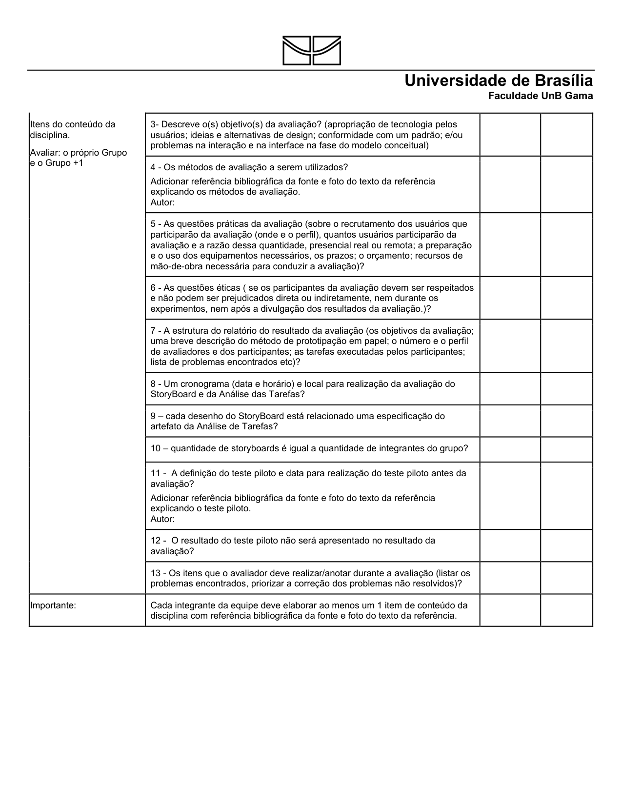

**Figura 1** — Evidência documental referente ao item `PE-E4-04`.  
_Fonte: Plano de Ensino (Sales, 2026, p. 13, Item 4)_

A **Figura 2** reproduz o trecho comprobatório de referência referente ao critério **MA-01**.

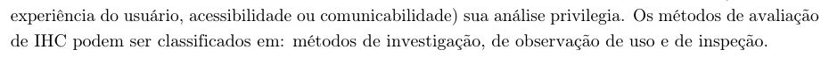

**Figura 2** — Evidência documental referente ao item `MA-01`.  
_Fonte: BARBOSA, Simone Diniz Junqueira et al. Interação Humano-Computador e Experiência do Usuário. 1. ed. Rio de Janeiro: Autopublicação, 2021, pp. 256-257 (Capítulo 11, Seção 11.6)._

A **Figura 3** reproduz o trecho comprobatório de referência referente ao critério **MA-02**.

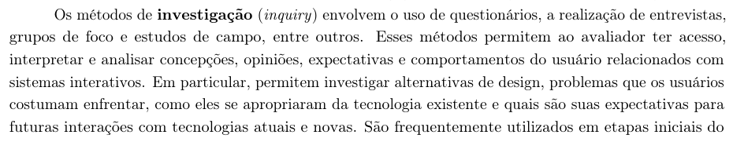

**Figura 3** — Evidência documental referente ao item `MA-02`.  
_Fonte: BARBOSA, Simone Diniz Junqueira et al. Interação Humano-Computador e Experiência do Usuário. 1. ed. Rio de Janeiro: Autopublicação, 2021, p. 256 (Capítulo 11, Seção 11.6)._

A **Figura 4** reproduz o trecho comprobatório de referência referente ao critério **MA-03**.

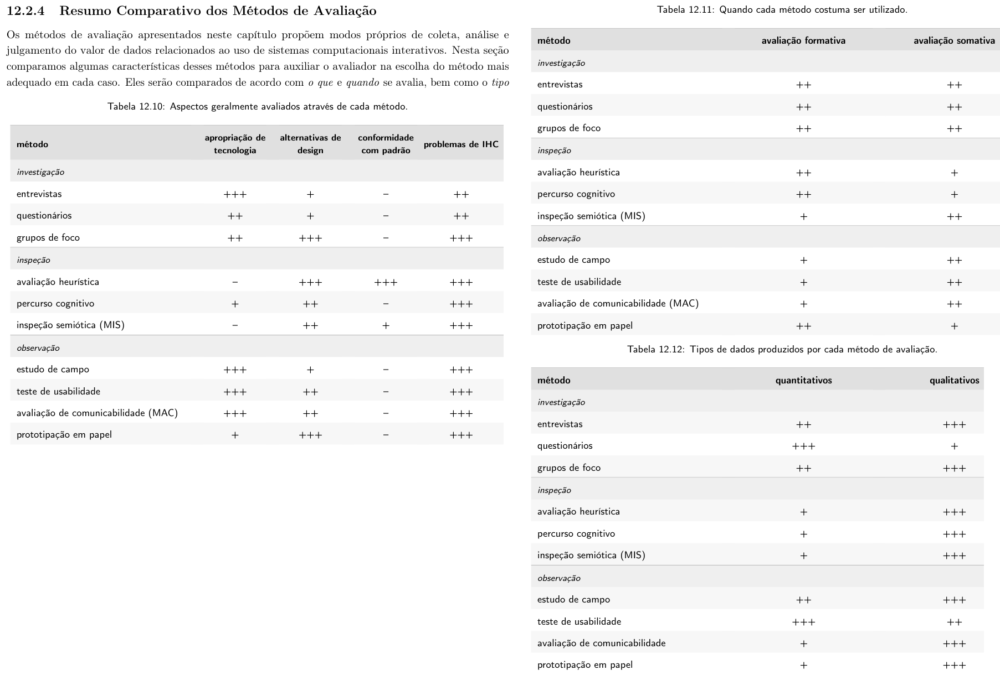

**Figura 4** — Evidência documental referente ao item `MA-03`.  
_Fonte: BARBOSA, Simone Diniz Junqueira et al. Interação Humano-Computador e Experiência do Usuário. 1. ed. Rio de Janeiro: Autopublicação, 2021, pp. 306-308 (Capítulo 12, Seção 12.2.4, Tabelas 12.10, 12.11 e 12.12)._

A **Figura 5** reproduz o trecho comprobatório de referência referente ao critério **MA-04**.

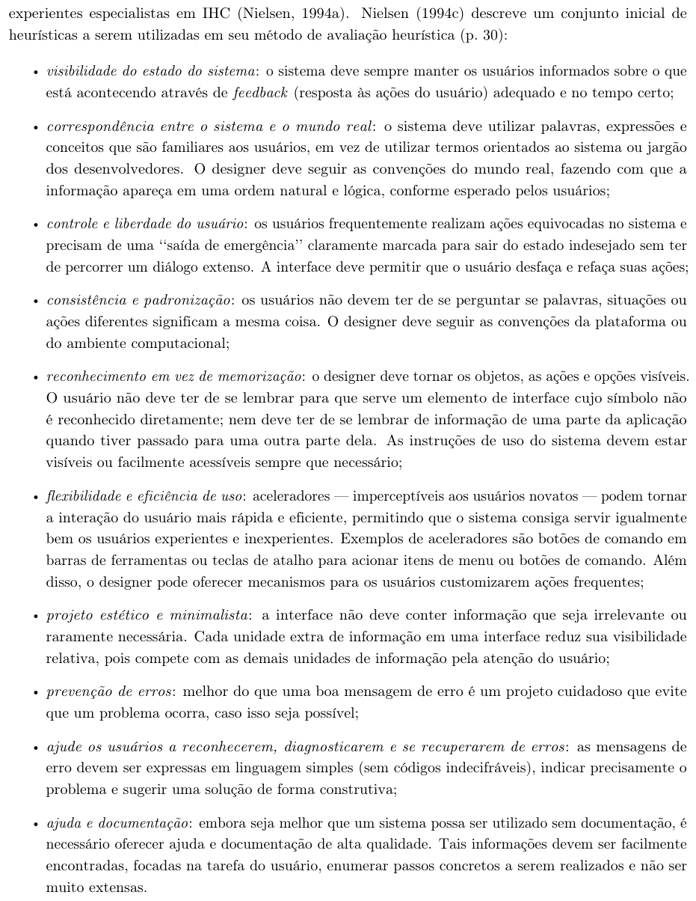

**Figura 5** — Evidência documental referente ao item `MA-04`.  
_Fonte: BARBOSA, Simone Diniz Junqueira et al. Interação Humano-Computador e Experiência do Usuário. 1. ed. Rio de Janeiro: Autopublicação, 2021, pp. 267-268 (Capítulo 12, Seção 12.1.1); NIELSEN, Jakob, 1994c._

A **Figura 6** reproduz o trecho comprobatório de referência referente ao critério **MA-05**.

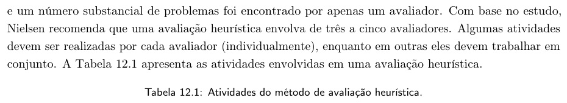

**Figura 6** — Evidência documental referente ao item `MA-05`.  
_Fonte: BARBOSA, Simone Diniz Junqueira et al. Interação Humano-Computador e Experiência do Usuário. 1. ed. Rio de Janeiro: Autopublicação, 2021, pp. 269-271 (Capítulo 12, Seção 12.1.1, Tabela 12.1)._

A **Figura 7** reproduz o trecho comprobatório de referência referente ao critério **MA-06**.

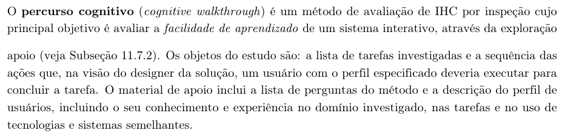

**Figura 7** — Evidência documental referente ao item `MA-06`.  
_Fonte: BARBOSA, Simone Diniz Junqueira et al. Interação Humano-Computador e Experiência do Usuário. 1. ed. Rio de Janeiro: Autopublicação, 2021, pp. 272-274 (Capítulo 12, Seção 12.1.2, Tabela 12.2); WHARTON, C. et al., 1994._

A **Figura 8** reproduz o trecho comprobatório de referência referente ao critério **MA-07**.

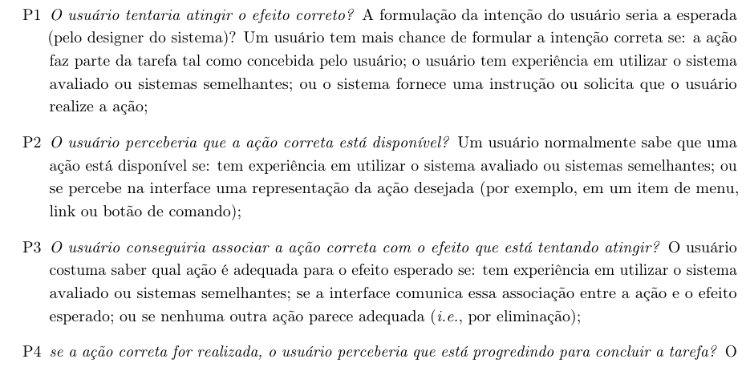

**Figura 8** — Evidência documental referente ao item `MA-07`.  
_Fonte: BARBOSA, Simone Diniz Junqueira et al. Interação Humano-Computador e Experiência do Usuário. 1. ed. Rio de Janeiro: Autopublicação, 2021, pp. 273-274 (Capítulo 12, Seção 12.1.2)._

A **Figura 9** reproduz o trecho comprobatório de referência referente ao critério **MA-08**.

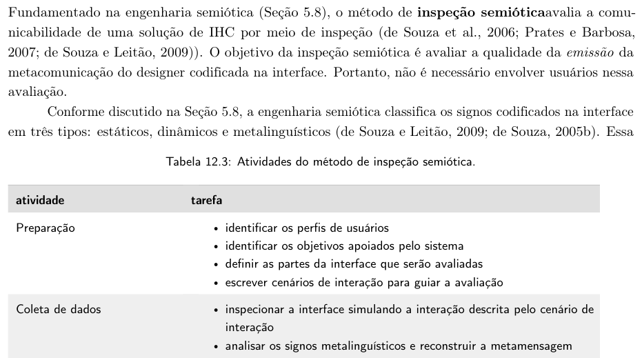

**Figura 9** — Evidência documental referente ao item `MA-08`.  
_Fonte: BARBOSA, Simone Diniz Junqueira et al. Interação Humano-Computador e Experiência do Usuário. 1. ed. Rio de Janeiro: Autopublicação, 2021, pp. 279-281 (Capítulo 12, Seção 12.1.3, Tabela 12.3); DE SOUZA, Clarisse S. et al., 2006._

A **Figura 10** reproduz o trecho comprobatório de referência referente ao critério **MA-09**.

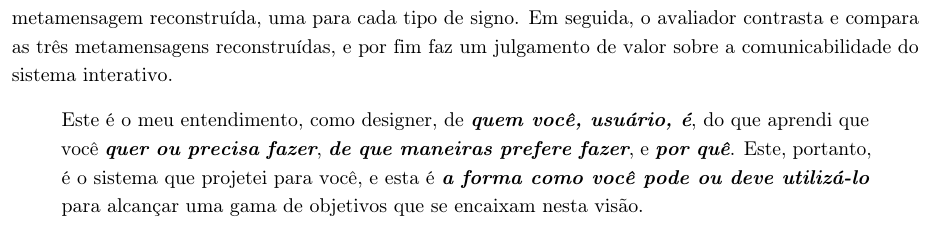

**Figura 10** — Evidência documental referente ao item `MA-09`.  
_Fonte: BARBOSA, Simone Diniz Junqueira et al. Interação Humano-Computador e Experiência do Usuário. 1. ed. Rio de Janeiro: Autopublicação, 2021, pp. 279-280 (Capítulo 12, Seção 12.1.3)._

A **Figura 11** reproduz o trecho comprobatório de referência referente ao critério **MA-10**.

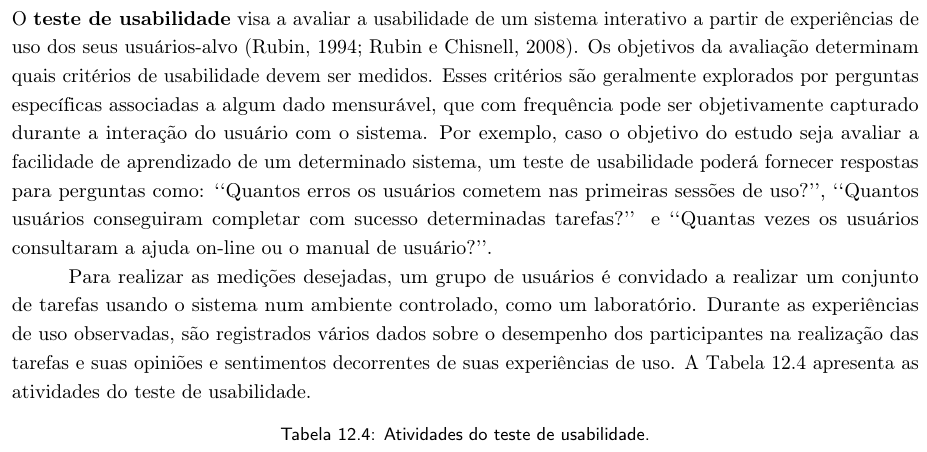

**Figura 11** — Evidência documental referente ao item `MA-10`.  
_Fonte: BARBOSA, Simone Diniz Junqueira et al. Interação Humano-Computador e Experiência do Usuário. 1. ed. Rio de Janeiro: Autopublicação, 2021, pp. 288-289 (Capítulo 12, Seção 12.2.1, Tabela 12.4); RUBIN, J.; CHISNELL, D., 2008._

A **Figura 12** reproduz o trecho comprobatório de referência referente ao critério **MA-11**.

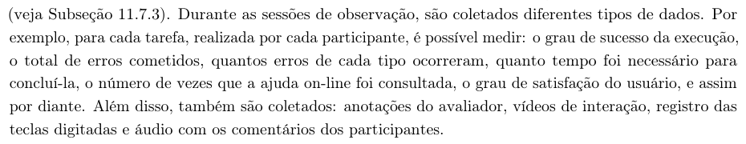

**Figura 12** — Evidência documental referente ao item `MA-11`.  
_Fonte: BARBOSA, Simone Diniz Junqueira et al. Interação Humano-Computador e Experiência do Usuário. 1. ed. Rio de Janeiro: Autopublicação, 2021, pp. 289-290 (Capítulo 12, Seção 12.2.1)._

A **Figura 13** reproduz o trecho comprobatório de referência referente ao critério **MA-12**.

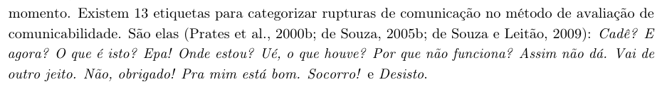

**Figura 13** — Evidência documental referente ao item `MA-12`.  
_Fonte: BARBOSA, Simone Diniz Junqueira et al. Interação Humano-Computador e Experiência do Usuário. 1. ed. Rio de Janeiro: Autopublicação, 2021, pp. 291-294 (Capítulo 12, Seção 12.2.2, Tabela 12.5)._

A **Figura 14** reproduz o trecho comprobatório de referência referente ao critério **MA-13**.

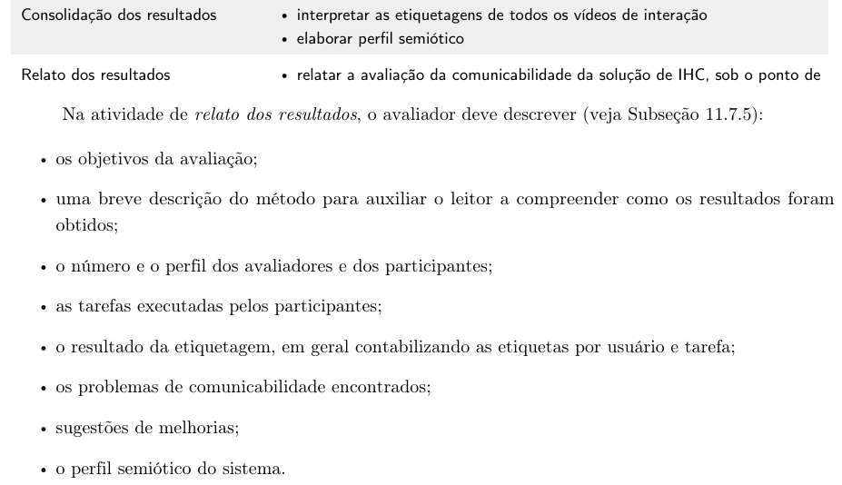

**Figura 14** — Evidência documental referente ao item `MA-13`.  
_Fonte: BARBOSA, Simone Diniz Junqueira et al. Interação Humano-Computador e Experiência do Usuário. 1. ed. Rio de Janeiro: Autopublicação, 2021, pp. 291 e 303 (Capítulo 12, Seção 12.2.2, Tabela 12.5)._

A **Figura 15** reproduz o trecho comprobatório de referência referente ao critério **MA-14**.

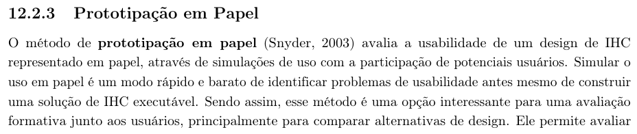

**Figura 15** — Evidência documental referente ao item `MA-14`.  
_Fonte: BARBOSA, Simone Diniz Junqueira et al. Interação Humano-Computador e Experiência do Usuário. 1. ed. Rio de Janeiro: Autopublicação, 2021, pp. 303-306 (Capítulo 12, Seção 12.2.3, Tabela 12.9)._

A **Figura 16** reproduz o trecho comprobatório de referência referente ao critério **MA-E01**.

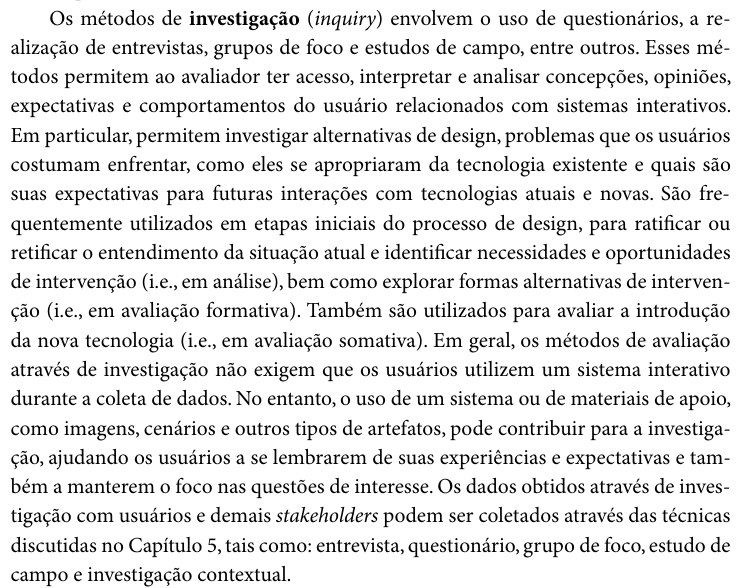

**Figura 16** — Evidência documental referente ao item `MA-E01`.  
_Fonte: BARBOSA, Simone Diniz Junqueira; SILVA, Bruno Santana da. Interação Humano-Computador. 1. ed. Rio de Janeiro: Elsevier, 2010, Cap. 9, pp. 301–303._

---

## 3. Validação desta Lista pela Lista de Governança do Prof. Dr. André Barros de Sales (`DG-01` a `DG-11`)

Em estrito cumprimento às diretrizes de qualidade do Plano de Ensino (*Sales, 2026, pp. 8–9*), a **Tabela 5** submete esta própria página (`07-metodos-avaliacao.md`) aos **11 Itens de Desenvolvimento do Projeto** formulados pelo Prof. Dr. André Barros de Sales.

**Tabela 5** — Autoavaliação de `07-metodos-avaliacao.md` frente aos critérios `DG-01` a `DG-11`

| ID | Critério de Governança do Plano de Ensino | Autor do Item | Resposta | Versão, Data e Hora da Avaliação | Evidência de Conformidade nesta Lista |
| :---: | :--- | :--- | :---: | :---: | :--- |
| **DG-01** | O histórico de versão padronizado? | **Prof. Dr. André Barros de Sales** *(Plano de Ensino FGA0173, 2026)* | ✅ **Sim (Conforme)** | `v2.0` — 20/11/2026 às 14:30 | Seção **Histórico de Versão** (**Tabela 6**) padronizada ao final de `07-metodos-avaliacao.md` registrando `v2.0`. |
| **DG-02** | O(s) autor(es) e o(s) revisor(es) para cada artefato? | **Prof. Dr. André Barros de Sales** *(Plano de Ensino FGA0173, 2026)* | ✅ **Sim (Conforme)** | `v2.0` — 20/11/2026 às 14:30 | Colunas **Autor(es)** e **Revisor(es)** preenchidas com links GitHub no Histórico de Versão, além da coluna **`Autor do Item`** em 100% dos critérios da lista. |
| **DG-03** | Referências bibliográficas e/ou bibliografia em todos os artefatos? | **Prof. Dr. André Barros de Sales** *(Plano de Ensino FGA0173, 2026)* | ✅ **Sim (Conforme)** | `v2.0` — 20/11/2026 às 14:30 | Seção **Referências Bibliográficas (ABNT NBR 6023)** completa ao final do documento com obras, edições e páginas exatas. |
| **DG-04** | As tabelas e imagens possuem legenda e fonte e são chamadas dentro do texto? | **Prof. Dr. André Barros de Sales** *(Plano de Ensino FGA0173, 2026)* | ✅ **Sim (Conforme)** | `v2.0` — 20/11/2026 às 14:30 | 100% das tabelas (`Tabela 1` a `Tabela 6`) e figuras (`Figura 1` a `Figura 16`) possuem numeração, legenda, fonte e chamadas textuais prévias. |
| **DG-05** | Um texto fazendo uma introdução dos artefatos? | **Prof. Dr. André Barros de Sales** *(Plano de Ensino FGA0173, 2026)* | ✅ **Sim (Conforme)** | `v2.0` — 20/11/2026 às 14:30 | Seção **1. Introdução e Contextualização Metodológica** situa o instrumento no Ciclo de Mayhew (1999) e na Inspeção Formal de Fagan (1976). |
| **DG-06** | O cronograma executado com quem realizou cada artefato/atividade e as datas de início e fim da construção/realização? | **Prof. Dr. André Barros de Sales** *(Plano de Ensino FGA0173, 2026)* | ✅ **Sim (Conforme)** | `v2.0` — 20/11/2026 às 14:30 | Registros de elaboração e revisão vinculados ao [Cronograma Executado](../../planejamento/cronograma-executado.md) e ao histórico Git da equipe. |
| **DG-07** | Ata(s) da(s) reuniões (com data, horário de início e do final, participantes, objetivo, atividades definidas etc.)? | **Prof. Dr. André Barros de Sales** *(Plano de Ensino FGA0173, 2026)* | ✅ **Sim (Conforme)** | `v2.0` — 20/11/2026 às 14:30 | Deliberações e alinhamentos documentados nas [Atas de Reunião](../../atas/index.md). |
| **DG-08** | A gravação da reunião do grupo? | **Prof. Dr. André Barros de Sales** *(Plano de Ensino FGA0173, 2026)* | ✅ **Sim (Conforme)** | `v2.0` — 20/11/2026 às 14:30 | Links funcionais de gravações das reuniões de planejamento e auditoria indexados em [Atas de Reunião](../../atas/index.md). |
| **DG-09** | Vídeo de apresentação na categoria 'Não Listado' no YouTube (duração entre 20 e 30 minutos)? | **Prof. Dr. André Barros de Sales** *(Plano de Ensino FGA0173, 2026)* | ⚠️ **Em preparação (Etapa 8)** | `v2.0` — 20/11/2026 às 14:30 | Vídeos das Entregas 1–7 publicados; vídeo oficial da [Entrega 8 — Verificação dos Artefatos](../../entregas/entrega8.md) (20–30 min, Não Listado) agendado após consolidação das inspeções da equipe. |
| **DG-10** | Tabela de contribuição no início do artefato com o nome de todos os integrantes, contribuição com hiperligação da atividade e da gravação? | **Prof. Dr. André Barros de Sales** *(Plano de Ensino FGA0173, 2026)* | ✅ **Sim (Conforme)** | `v2.0` — 20/11/2026 às 14:30 | **Tabela 1** posicionada no topo do documento discriminando cada integrante ativo com hiperligação GitHub e escopo de atuação. |
| **DG-11** | A seção de agradecimentos apresentando o uso de Inteligência Artificial (IA) Generativa no artefato? | **Prof. Dr. André Barros de Sales** *(Plano de Ensino FGA0173, 2026)* | ✅ **Sim (Conforme)** | `v2.0` — 20/11/2026 às 14:30 | Seção **Agradecimentos e Declaração de Uso de IA Generativa** ao final do documento em estrita conformidade com o Código da SBC e Sales (2026). |

_Fonte: Validação elaborada por Vinicius Silva Araruna com base na rubrica oficial de Prof. Dr. André Barros de Sales (Plano de Ensino, 2026, pp. 8–9)._

---

## 4. Histórico de Versão

A **Tabela 6** registra a evolução histórica e o controle de versionamento deste instrumento normativo.

**Tabela 6** — Histórico de Versão do Documento

| Versão | Data | Descrição Detalhada da Modificação | Autor(es) | Revisor(es) |
| :---: | :---: | :--- | :--- | :--- |
| `1.0` | 27/08/2026 | Versão inicial (`Grupo8ViniciusSilvaArarunaVerifacaçãoListaMetodosdeAvaliação.pdf`) e item teórico publicado em `item-teorico-metodos-avaliacao.md`. | [Vinicius Silva Araruna](https://github.com/ViniciusA05) | [Gustavo Antonio Rodrigues e Silva](https://github.com/gus-ant) |
| `2.0` | 20/11/2026 | Revisão completa com inclusão dos métodos de Investigação e critérios comparativos (Tabelas 12.10–12.12 em recorte 2 colunas), correção de citações e referências (De Souza, 2005; Goodman et al., 2012), integração dos critérios do Prof. André (`PE-E4-04`) e de Edvaldo Soares e validação `DG-01..11`. | [Vinicius Silva Araruna](https://github.com/ViniciusA05) | [Gustavo Antonio Rodrigues e Silva](https://github.com/gus-ant), [Edvaldo Soares Brasileiro Filho](https://github.com/PajeMurici-dev) |

_Fonte: Elaborada pelos autores, 2026._

---

## 5. Referências Bibliográficas (ABNT NBR 6023)

[1] BARBOSA, Simone Diniz Junqueira et al. Interação Humano-Computador e Experiência do Usuário. 1. ed. Rio de Janeiro: Autopublicação, 2021, Cap. 11 (§11.6, pp. 256-257) e Cap. 12 (§§12.1–12.2, pp. 267-308).

[2] DE SOUZA, Clarisse Sieckenius. The Semiotic Engineering of Human-Computer Interaction. Cambridge: MIT Press, 2005.

[3] DE SOUZA, Clarisse Sieckenius et al. The semiotic inspection method. In: VII Simpósio Brasileiro sobre Fatores Humanos em Sistemas Computacionais (IHC), 2006.

[4] GOODMAN, Elizabeth; KUNIAVSKY, Mike; MOED, Andrea. Observing the User Experience: A Practitioner's Guide to User Research. 2. ed. San Francisco: Morgan Kaufmann, 2012.

[5] NIELSEN, Jakob. Heuristic evaluation. In: NIELSEN, J.; MACK, R. L. (Ed.). Usability Inspection Methods. John Wiley & Sons, 1994.

[6] RUBIN, Jeffrey; CHISNELL, Dana. Handbook of Usability Testing. 2. ed. Wiley, 2008.

[7] SNYDER, Carolyn. Paper Prototyping. Morgan Kaufmann, 2003.

[8] WHARTON, Cathleen et al. The cognitive walkthrough method: a practitioner's guide. In: NIELSEN, J.; MACK, R. L., 1994.

[9] DE SOUZA, Clarisse Sieckenius; LEITÃO, Carla Faria. *Semiotic Engineering Methods for Scientific Research in HCI*. San Rafael: Morgan & Claypool, 2009.

[10] PRATES, Raquel Oliveira; DE SOUZA, Clarisse Sieckenius; BARBOSA, Simone Diniz Junqueira. A method for evaluating the communicability of user interfaces. *Interactions*, v. 7, n. 1, p. 31–38, 2000.

[11] BARBOSA, Simone Diniz Junqueira; SILVA, Bruno Santana da. *Interação Humano-Computador*. 1. ed. Rio de Janeiro: Elsevier / Campus, 2010.

[12] FAGAN, Michael E. Design and code inspections to reduce errors in program development. *IBM Systems Journal*, v. 15, n. 3, p. 182–211, 1976.

[13] MAYHEW, Deborah J. *The Usability Engineering Lifecycle: A Practitioner's Handbook for User Interface Design*. San Francisco: Morgan Kaufmann, 1999.

[14] SALES, André Barros de. *Plano de Ensino da Disciplina de Interação Humano Computador (FGA0173 — 02/2026)*. Brasília: Universidade de Brasília, Faculdade UnB Gama (FGA), 2026.

[15] SOCIEDADE BRASILEIRA DE COMPUTAÇÃO (SBC). *Código de Conduta da Sociedade Brasileira de Computação*. Porto Alegre: SBC, 2023.

---

## 6. Agradecimentos e Declaração de Uso de Inteligência Artificial (IA) Generativa

Em conformidade com o Código de Conduta da Sociedade Brasileira de Computação (SBC, Art. 2º, parágrafo III) e com as diretrizes do Plano de Ensino da disciplina (*Sales, 2026, p. 3*), declara-se que a organização das tabelas em Markdown e a revisão ortográfica contaram com suporte supervisionado da ferramenta de Inteligência Artificial Generativa Google Gemini. Toda a concepção metodológica, verificação bibliográfica nas obras originais, revisão técnica e validação de conformidade foram realizadas pelos discentes identificados no Histórico de Versão.
