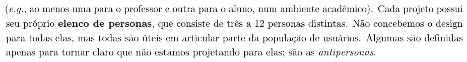
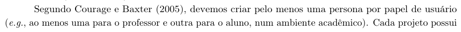
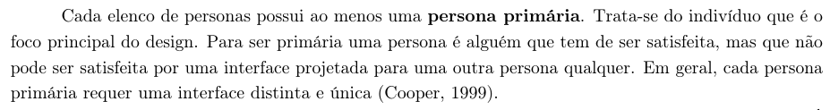
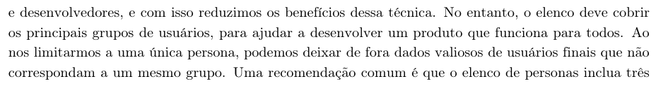
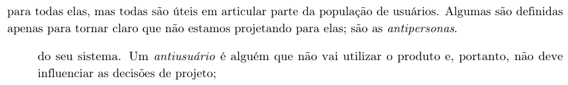
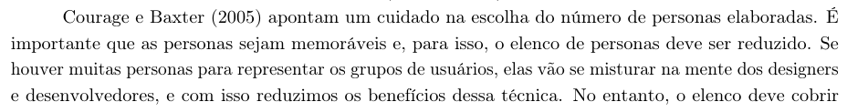
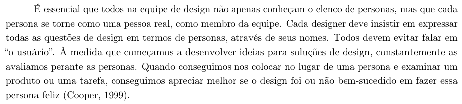

# Lista de Verificação — Elenco de Personas

## Tabela de Contribuição e Transparência de IA Generativa

A **Tabela 1** apresenta a distribuição de responsabilidades na elaboração, curadoria e revisão de **Elenco de Personas**.

**Tabela 1** — Matriz de Contribuição e Transparência de IA Generativa — Elenco de Personas

| Integrante | Atribuição no Artefato | Data | Horário | Ferramenta de IA | Propósito do Uso de IA |
| :--- | :--- | :---: | :---: | :--- | :--- |
| [Vinicius Silva Araruna](https://github.com/ViniciusA05) | Elaboração modular dos critérios de `EP`, citação direta, recortes da obra e autoavaliação pela rubrica `DG-01` a `DG-11` | 20/11/2026 | 14:00 - 15:30 | Google Gemini | Suporte na organização estrutural, formatação de tabelas em Markdown e conferência cruzada com o Plano de Ensino |
| [Gustavo Antonio Rodrigues e Silva](https://github.com/gus-ant) | Revisão de conformidade estrutural, navegação e checagem de links | 20/11/2026 | 15:30 - 16:00 | — | Revisão por pares e validação editorial |
| [Edvaldo Soares Brasileiro Filho](https://github.com/PajeMurici-dev) | Auditoria de rastreabilidade frente ao Plano de Ensino (`DG-01` a `DG-11`) e referências ABNT | 20/11/2026 | 15:30 - 16:00 | — | Revisão por pares e conferência documental |

_Fonte: Elaborada pelos autores, 2026._

---

## 1. Introdução e Contextualização Metodológica

Este módulo verifica exclusivamente a composição e o equilíbrio do **Elenco de Personas** (Análise de Requisitos — Entrega 2), assegurando dimensão recomendada (3 a 12 personas), cobertura de todos os papéis funcionais mapeados, presença de ao menos uma persona primária, personas secundárias, antipersonas e memorabilidade (Barbosa et al., 2021, Cap. 8, pp. 153–155).

Este instrumento normativo atua segundo o **Método de Inspeção Formal de Michael E. Fagan (1976)** e encontra-se desacoplado dos relatórios empíricos de aplicação. Toda inspeção registrada aqui identifica obrigatoriamente o **`Autor do Item`**, a **fundamentação bibliográfica com recorte visual** e a coluna **`Versão, Data e Hora da Avaliação`** exigida pelo Plano de Ensino (*Sales, 2026, pp. 8–13*).

!!! info "Pré-requisito Transversal de Governança (Prof. Dr. André Barros de Sales)"
    Além dos critérios específicos deste artefato listados na **Seção 2**, todo produto de trabalho avaliado deve cumprir integralmente os **11 Itens de Desenvolvimento Geral (`DG-01` a `DG-11`)** definidos pelo Prof. Dr. André Barros de Sales em [00. Governança e Plano de Ensino Geral](00-plano-ensino-geral.md).

---

## 2. Instrumento Normativo de Verificação — Elenco de Personas

### 2.1 Critérios Técnicos da Literatura Canônica (Lista de Verificação `EP`)

A **Tabela 2** apresenta os **7 itens normativos** fundamentados na literatura científica com citação direta literal e recorte visual da página.

**Tabela 2** — Lista de verificação normativa de Elenco de Personas (7 itens)

| ID | Critério / Pergunta de Verificação | Autor do Item | Fundamentação Canônica (Obra, Ed., Cap., Pág.) e Citação Literal | Evidência Visual (Figura) | Resposta | Versão, Data e Hora da Avaliação |
| :---: | :--- | :--- | :--- | :---: | :---: | :---: |
| **EP-01** | **Dimensão e Tamanho do Elenco de Personas** O artefato delimita o tamanho total do elenco dentro da faixa recomendada pela literatura (de 3 a 12 personas distintas), articulando os segmentos necessários da população de usuários sem proliferação excessiva? • **Intervalo canônico (3 a 12):** elenco dimensionado entre três e doze personas distintas; • **Cobertura da população:** inclusão inclusive de personas úteis para articular o escopo sem projetar diretamente para todas; • **Consolidação enxuta:** equilíbrio entre abrangência dos usuários e controle de tamanho. | [Vinicius Silva Araruna](https://github.com/ViniciusA05) | *"Cada projeto possui seu próprio elenco de personas, que consiste de três a 12 personas distintas. Não concebemos o design para todas elas, mas todas são úteis em articular parte da população de usuários. Algumas são definidas apenas para tornar claro que não estamos projetando para elas; são as antipersonas."* BARBOSA, Simone Diniz Junqueira et al. Interação Humano-Computador e Experiência do Usuário. 1. ed. Rio de Janeiro: Autopublicação, 2021, p. 155 (Capítulo 8, Seção 8.2). | [Ver Figura 1](#figura-1) | `[ ] Sim (Conforme)` `[ ] Não (Não Conforme)` `[ ] Incompleto` `[ ] N/A` | *(Preencher na inspeção)* |
| **EP-02** | **Cobertura Sistemática dos Papéis de Usuário Mapeados** O elenco contempla todos os papéis de usuário mapeados no domínio do sistema, criando expressamente ao menos uma persona por papel de usuário identificado (ex.: aluno e professor; usuário comum, moderador e administrador)? • **Critério mínimo por papel (Courage e Baxter, 2005):** pelo menos uma persona para cada papel de usuário; • **Rastreabilidade com perfis:** cada papel funcional do levantamento possui correspondente no elenco; • **Ausência de lacunas:** nenhum perfil relevante do sistema ficou sem representação. | [Vinicius Silva Araruna](https://github.com/ViniciusA05) | *"Segundo Courage e Baxter (2005), devemos criar pelo menos uma persona por papel de usuário (e.g., ao menos uma para o professor e outra para o aluno, num ambiente acadêmico)."* BARBOSA, Simone Diniz Junqueira et al. Interação Humano-Computador e Experiência do Usuário. 1. ed. Rio de Janeiro: Autopublicação, 2021, p. 155 (Capítulo 8, Seção 8.2). | [Ver Figura 2](#figura-2) | `[ ] Sim (Conforme)` `[ ] Não (Não Conforme)` `[ ] Incompleto` `[ ] N/A` | *(Preencher na inspeção)* |
| **EP-03** | **Identificação e Critério de Interface Exclusiva da Persona Primária** O elenco identifica ao menos uma persona primária, justificando que ela é o foco principal do design por precisar ser satisfeita obrigatoriamente e por não poder ser atendida por uma interface projetada para outra persona (demandando interface distinta e única)? • **Designação da persona primária:** indicação explícita de quem constitui o foco principal do projeto; • **Critério de Cooper (1999):** verificação de que exige interface distinta para ser satisfeita; • **Precedência nas decisões:** prioridade garantida em caso de conflito com necessidades periféricas. | [Vinicius Silva Araruna](https://github.com/ViniciusA05) | *"Cada elenco de personas possui ao menos uma persona primária. Trata-se do indivíduo que é o foco principal do design. Para ser primária uma persona é alguém que tem de ser satisfeita, mas que não pode ser satisfeita por uma interface projetada para uma outra persona qualquer. Em geral, cada persona primária requer uma interface distinta e única (Cooper, 1999)."* BARBOSA, Simone Diniz Junqueira et al. Interação Humano-Computador e Experiência do Usuário. 1. ed. Rio de Janeiro: Autopublicação, 2021, p. 155 (Capítulo 8, Seção 8.2). | [Ver Figura 3](#figura-3) | `[ ] Sim (Conforme)` `[ ] Não (Não Conforme)` `[ ] Incompleto` `[ ] N/A` | *(Preencher na inspeção)* |
| **EP-04** | **Cobertura dos Principais Grupos de Usuários e Pluralidade de Personas Primárias** O elenco cobre os principais grupos de usuários sem se limitar indevidamente a uma única persona (evitando omitir dados valiosos de segmentos que não correspondam ao mesmo grupo) e avalia a recomendação usual de incluir até três personas primárias quando houver múltiplas interfaces distintas? • **Cobertura intergrupos:** garantia de não excluir dados valiosos de usuários finais por redução artificial a uma única persona; • **Funcionamento abrangente:** verificação de que os principais perfis da população estão articulados; • **Referência de até 3 primárias:** justificativa clara da quantidade de personas primárias diante das interfaces do produto. | [Vinicius Silva Araruna](https://github.com/ViniciusA05) | *"No entanto, o elenco deve cobrir os principais grupos de usuários, para ajudar a desenvolver um produto que funciona para todos. Ao nos limitarmos a uma única persona, podemos deixar de fora dados valiosos de usuários finais que não correspondam a um mesmo grupo. Uma recomendação comum é que o elenco de personas inclua três personas primárias."* BARBOSA, Simone Diniz Junqueira et al. Interação Humano-Computador e Experiência do Usuário. 1. ed. Rio de Janeiro: Autopublicação, 2021, p. 155 (Capítulo 8, Seção 8.2). | [Ver Figura 4](#figura-4) | `[ ] Sim (Conforme)` `[ ] Não (Não Conforme)` `[ ] Incompleto` `[ ] N/A` | *(Preencher na inspeção)* |
| **EP-05** | **Identificação e Delimitação de Antipersonas (Antiusuários)** O elenco identifica e delimita formalmente eventuais antipersonas (antiusuários — indivíduos que não utilizarão o produto e não devem influenciar decisões de projeto), deixando explícito para quem o sistema deliberadamente NÃO é projetado? • **Distinção clara de status:** diferenciação expressa entre personas-alvo e antiusuários; • **Bloco contra escopo indevido:** garantia de que o antiusuário não influencia prioridades de design; • **Justificativa de exclusão:** explicação objetiva do limite de público atendido. | [Vinicius Silva Araruna](https://github.com/ViniciusA05) | *"Algumas são definidas apenas para tornar claro que não estamos projetando para elas; são as antipersonas. [...] Um antiusuário é alguém que não vai utilizar o produto e, portanto, não deve influenciar as decisões de projeto;"* BARBOSA, Simone Diniz Junqueira et al. Interação Humano-Computador e Experiência do Usuário. 1. ed. Rio de Janeiro: Autopublicação, 2021, pp. 153 e 155 (Capítulo 8, Seção 8.2). | [Ver Figura 5](#figura-5) | `[ ] Sim (Conforme)` `[ ] Não (Não Conforme)` `[ ] Incompleto` `[ ] N/A` | *(Preencher na inspeção)* |
| **EP-06** | **Elenco Reduzido para Garantir Memorabilidade sem Mistura Cognitiva** A quantidade escolhida dentro do elenco é reduzida o bastante para que todas as personas permaneçam memoráveis e claramente diferenciadas na mente dos designers e desenvolvedores, evitando que se misturem e reduzam os benefícios da técnica? • **Foco na memorabilidade (Courage e Baxter, 2005):** elenco enxuto e facilmente recordável pela equipe; • **Ausência de confusão entre arquétipos:** perfis suficientemente distintos para não se fundirem na prática; • **Valor comunicacional preservado:** utilidade prática nas discussões sem sobrecarga informacional. | [Vinicius Silva Araruna](https://github.com/ViniciusA05) | *"Courage e Baxter (2005) apontam um cuidado na escolha do número de personas elaboradas. É importante que as personas sejam memoráveis e, para isso, o elenco de personas deve ser reduzido. Se houver muitas personas para representar os grupos de usuários, elas vão se misturar na mente dos designers e desenvolvedores, e com isso reduzimos os benefícios dessa técnica."* BARBOSA, Simone Diniz Junqueira et al. Interação Humano-Computador e Experiência do Usuário. 1. ed. Rio de Janeiro: Autopublicação, 2021, p. 155 (Capítulo 8, Seção 8.2). | [Ver Figura 6](#figura-6) | `[ ] Sim (Conforme)` `[ ] Não (Não Conforme)` `[ ] Incompleto` `[ ] N/A` | *(Preencher na inspeção)* |
| **EP-07** | **Adoção Nominal do Elenco e Avaliação Contínua (Anti-'Usuário Elástico')** As decisões de design apoiadas no elenco referenciam nominalmente as personas reais criadas (abolindo expressões genéricas como 'o usuário') e avaliam continuamente se cada proposta de design torna essas personas satisfeitas? • **Referência pelo nome próprio:** uso constante dos nomes das personas como 'membros da equipe'; • **Eliminação do termo vago 'o usuário':** prevenção de alvo móvel nas discussões técnicas; • **Avaliação empática perante o elenco:** verificação recorrente do design sob a perspectiva de cada persona (Cooper, 1999). | [Vinicius Silva Araruna](https://github.com/ViniciusA05) | *"É essencial que todos na equipe de design não apenas conheçam o elenco de personas, mas que cada persona se torne como uma pessoa real, como membro da equipe. Cada designer deve insistir em expressar todas as questões de design em termos de personas, através de seus nomes. Todos devem evitar falar em “o usuário”. À medida que começamos a desenvolver ideias para soluções de design, constantemente as avaliamos perante as personas... (Cooper, 1999)."* BARBOSA, Simone Diniz Junqueira et al. Interação Humano-Computador e Experiência do Usuário. 1. ed. Rio de Janeiro: Autopublicação, 2021, p. 155 (Capítulo 8, Seção 8.2). | [Ver Figura 7](#figura-7) | `[ ] Sim (Conforme)` `[ ] Não (Não Conforme)` `[ ] Incompleto` `[ ] N/A` | *(Preencher na inspeção)* |

_Fonte: Elaborada por [Vinicius Silva Araruna](https://github.com/ViniciusA05), 2026._

### Evidências Visuais da Literatura e do Plano de Ensino

Cada figura a seguir é chamada explicitamente e vinculada ao respectivo critério na tabela normativa acima.

A **Figura 1** reproduz o trecho comprobatório de referência referente ao critério **EP-01**.

**Figura 1** — Evidência documental referente ao item `EP-01`.  
_Fonte: BARBOSA, Simone Diniz Junqueira et al. Interação Humano-Computador e Experiência do Usuário. 1. ed. Rio de Janeiro: Autopublicação, 2021, p. 155 (Capítulo 8, Seção 8.2)._

A **Figura 2** reproduz o trecho comprobatório de referência referente ao critério **EP-02**.

**Figura 2** — Evidência documental referente ao item `EP-02`.  
_Fonte: BARBOSA, Simone Diniz Junqueira et al. Interação Humano-Computador e Experiência do Usuário. 1. ed. Rio de Janeiro: Autopublicação, 2021, p. 155 (Capítulo 8, Seção 8.2)._

A **Figura 3** reproduz o trecho comprobatório de referência referente ao critério **EP-03**.

**Figura 3** — Evidência documental referente ao item `EP-03`.  
_Fonte: BARBOSA, Simone Diniz Junqueira et al. Interação Humano-Computador e Experiência do Usuário. 1. ed. Rio de Janeiro: Autopublicação, 2021, p. 155 (Capítulo 8, Seção 8.2)._

A **Figura 4** reproduz o trecho comprobatório de referência referente ao critério **EP-04**.

**Figura 4** — Evidência documental referente ao item `EP-04`.  
_Fonte: BARBOSA, Simone Diniz Junqueira et al. Interação Humano-Computador e Experiência do Usuário. 1. ed. Rio de Janeiro: Autopublicação, 2021, p. 155 (Capítulo 8, Seção 8.2)._

A **Figura 5** reproduz o trecho comprobatório de referência referente ao critério **EP-05**.

**Figura 5** — Evidência documental referente ao item `EP-05`.  
_Fonte: BARBOSA, Simone Diniz Junqueira et al. Interação Humano-Computador e Experiência do Usuário. 1. ed. Rio de Janeiro: Autopublicação, 2021, pp. 153 e 155 (Capítulo 8, Seção 8.2)._

A **Figura 6** reproduz o trecho comprobatório de referência referente ao critério **EP-06**.

**Figura 6** — Evidência documental referente ao item `EP-06`.  
_Fonte: BARBOSA, Simone Diniz Junqueira et al. Interação Humano-Computador e Experiência do Usuário. 1. ed. Rio de Janeiro: Autopublicação, 2021, p. 155 (Capítulo 8, Seção 8.2)._

A **Figura 7** reproduz o trecho comprobatório de referência referente ao critério **EP-07**.

**Figura 7** — Evidência documental referente ao item `EP-07`.  
_Fonte: BARBOSA, Simone Diniz Junqueira et al. Interação Humano-Computador e Experiência do Usuário. 1. ed. Rio de Janeiro: Autopublicação, 2021, p. 155 (Capítulo 8, Seção 8.2)._

---

## 3. Validação desta Lista pela Lista de Governança do Prof. Dr. André Barros de Sales (`DG-01` a `DG-11`)

Em estrito cumprimento às diretrizes de qualidade do Plano de Ensino (*Sales, 2026, pp. 8–9*), a **Tabela 3** submete esta própria página (`08-elenco-personas.md`) aos **11 Itens de Desenvolvimento do Projeto** formulados pelo Prof. Dr. André Barros de Sales.

**Tabela 3** — Autoavaliação de `08-elenco-personas.md` frente aos critérios `DG-01` a `DG-11`

| ID | Critério de Governança do Plano de Ensino | Autor do Item | Resposta | Versão, Data e Hora da Avaliação | Evidência de Conformidade nesta Lista |
| :---: | :--- | :--- | :---: | :---: | :--- |
| **DG-01** | O histórico de versão padronizado? | **Prof. Dr. André Barros de Sales** *(Plano de Ensino FGA0173, 2026)* | ✅ **Sim (Conforme)** | `v2.0` — 20/11/2026 às 14:30 | Seção **Histórico de Versão** (**Tabela 4**) padronizada ao final de `08-elenco-personas.md` registrando `v2.0`. |
| **DG-02** | O(s) autor(es) e o(s) revisor(es) para cada artefato? | **Prof. Dr. André Barros de Sales** *(Plano de Ensino FGA0173, 2026)* | ✅ **Sim (Conforme)** | `v2.0` — 20/11/2026 às 14:30 | Colunas **Autor(es)** e **Revisor(es)** preenchidas com links GitHub no Histórico de Versão, além da coluna **`Autor do Item`** em 100% dos critérios da lista. |
| **DG-03** | Referências bibliográficas e/ou bibliografia em todos os artefatos? | **Prof. Dr. André Barros de Sales** *(Plano de Ensino FGA0173, 2026)* | ✅ **Sim (Conforme)** | `v2.0` — 20/11/2026 às 14:30 | Seção **Referências Bibliográficas (ABNT NBR 6023)** completa ao final do documento com obras, edições e páginas exatas. |
| **DG-04** | As tabelas e imagens possuem legenda e fonte e são chamadas dentro do texto? | **Prof. Dr. André Barros de Sales** *(Plano de Ensino FGA0173, 2026)* | ✅ **Sim (Conforme)** | `v2.0` — 20/11/2026 às 14:30 | 100% das tabelas (`Tabela 1` a `Tabela 4`) e figuras (`Figura 1` a `Figura 7`) possuem numeração, legenda, fonte e chamadas textuais prévias. |
| **DG-05** | Um texto fazendo uma introdução dos artefatos? | **Prof. Dr. André Barros de Sales** *(Plano de Ensino FGA0173, 2026)* | ✅ **Sim (Conforme)** | `v2.0` — 20/11/2026 às 14:30 | Seção **1. Introdução e Contextualização Metodológica** situa o instrumento no Ciclo de Mayhew (1999) e na Inspeção Formal de Fagan (1976). |
| **DG-06** | O cronograma executado com quem realizou cada artefato/atividade e as datas de início e fim da construção/realização? | **Prof. Dr. André Barros de Sales** *(Plano de Ensino FGA0173, 2026)* | ✅ **Sim (Conforme)** | `v2.0` — 20/11/2026 às 14:30 | Registros de elaboração e revisão vinculados ao [Cronograma Executado](../../planejamento/cronograma-executado.md) e ao histórico Git da equipe. |
| **DG-07** | Ata(s) da(s) reuniões (com data, horário de início e do final, participantes, objetivo, atividades definidas etc.)? | **Prof. Dr. André Barros de Sales** *(Plano de Ensino FGA0173, 2026)* | ✅ **Sim (Conforme)** | `v2.0` — 20/11/2026 às 14:30 | Deliberações e alinhamentos documentados nas [Atas de Reunião](../../atas/index.md). |
| **DG-08** | A gravação da reunião do grupo? | **Prof. Dr. André Barros de Sales** *(Plano de Ensino FGA0173, 2026)* | ✅ **Sim (Conforme)** | `v2.0` — 20/11/2026 às 14:30 | Links funcionais de gravações das reuniões de planejamento e auditoria indexados em [Atas de Reunião](../../atas/index.md). |
| **DG-09** | Vídeo de apresentação na categoria 'Não Listado' no YouTube (duração entre 20 e 30 minutos)? | **Prof. Dr. André Barros de Sales** *(Plano de Ensino FGA0173, 2026)* | ⚠️ **Em preparação (Etapa 8)** | `v2.0` — 20/11/2026 às 14:30 | Vídeos das Entregas 1–7 publicados; vídeo oficial da [Entrega 8 — Verificação dos Artefatos](../../entregas/entrega8.md) (20–30 min, Não Listado) agendado após consolidação das inspeções da equipe. |
| **DG-10** | Tabela de contribuição no início do artefato com o nome de todos os integrantes, contribuição com hiperligação da atividade e da gravação? | **Prof. Dr. André Barros de Sales** *(Plano de Ensino FGA0173, 2026)* | ✅ **Sim (Conforme)** | `v2.0` — 20/11/2026 às 14:30 | **Tabela 1** posicionada no topo do documento discriminando cada integrante ativo com hiperligação GitHub e escopo de atuação. |
| **DG-11** | A seção de agradecimentos apresentando o uso de Inteligência Artificial (IA) Generativa no artefato? | **Prof. Dr. André Barros de Sales** *(Plano de Ensino FGA0173, 2026)* | ✅ **Sim (Conforme)** | `v2.0` — 20/11/2026 às 14:30 | Seção **Agradecimentos e Declaração de Uso de IA Generativa** ao final do documento em estrita conformidade com o Código da SBC e Sales (2026). |

_Fonte: Validação elaborada por Vinicius Silva Araruna com base na rubrica oficial de Prof. Dr. André Barros de Sales (Plano de Ensino, 2026, pp. 8–9)._

---

## 4. Histórico de Versão

A **Tabela 4** registra a evolução histórica e o controle de versionamento deste instrumento normativo.

**Tabela 4** — Histórico de Versão do Documento

| Versão | Data | Descrição Detalhada da Modificação | Autor(es) | Revisor(es) |
| :---: | :---: | :--- | :--- | :--- |
| `1.0` | 26/09/2026 | Versão inicial com 6 critérios elaborada na Entrega 2. | [Vinicius Silva Araruna](https://github.com/ViniciusA05) | [Edvaldo Soares Brasileiro Filho](https://github.com/PajeMurici-dev) |
| `2.0` | 20/11/2026 | Revisão técnica e expansão para 7 critérios específicos, atualização dos recortes visuais e ajuste à paginação impressa (pp. 153–155) de Barbosa et al. (2021), adição de `Autor do Item`, `Versão, Data e Hora da Avaliação` e validação `DG-01..11`. | [Vinicius Silva Araruna](https://github.com/ViniciusA05) | [Gustavo Antonio Rodrigues e Silva](https://github.com/gus-ant), [Edvaldo Soares Brasileiro Filho](https://github.com/PajeMurici-dev) |

_Fonte: Elaborada pelos autores, 2026._

---

## 5. Referências Bibliográficas (ABNT NBR 6023)

[1] BARBOSA, Simone Diniz Junqueira et al. Interação Humano-Computador e Experiência do Usuário. 1. ed. Rio de Janeiro: Autopublicação, 2021, Cap. 8, Seção 8.2 (Personas), pp. 153-155.

[2] COOPER, Alan. The Inmates Are Running the Asylum. Indianapolis: Sams Publishing, 1999.

[3] COURAGE, Catherine; BAXTER, Kathy. Understanding Your Users: A Practical Guide to User Requirements. San Francisco: Morgan Kaufmann, 2005.

[4] BARBOSA, Simone Diniz Junqueira; SILVA, Bruno Santana da. *Interação Humano-Computador*. 1. ed. Rio de Janeiro: Elsevier / Campus, 2010.

[5] FAGAN, Michael E. Design and code inspections to reduce errors in program development. *IBM Systems Journal*, v. 15, n. 3, p. 182–211, 1976.

[6] MAYHEW, Deborah J. *The Usability Engineering Lifecycle: A Practitioner's Handbook for User Interface Design*. San Francisco: Morgan Kaufmann, 1999.

[7] SALES, André Barros de. *Plano de Ensino da Disciplina de Interação Humano Computador (FGA0173 — 02/2026)*. Brasília: Universidade de Brasília, Faculdade UnB Gama (FGA), 2026.

[8] SOCIEDADE BRASILEIRA DE COMPUTAÇÃO (SBC). *Código de Conduta da Sociedade Brasileira de Computação*. Porto Alegre: SBC, 2023.

---

## 6. Agradecimentos e Declaração de Uso de Inteligência Artificial (IA) Generativa

Em conformidade com o Código de Conduta da Sociedade Brasileira de Computação (SBC, Art. 2º, parágrafo III) e com as diretrizes do Plano de Ensino da disciplina (*Sales, 2026, p. 3*), declara-se que a organização das tabelas em Markdown e a revisão ortográfica contaram com suporte supervisionado da ferramenta de Inteligência Artificial Generativa Google Gemini. Toda a concepção metodológica, verificação bibliográfica nas obras originais, revisão técnica e validação de conformidade foram realizadas pelos discentes identificados no Histórico de Versão.
