# Lista de Verificação — Personas

## Tabela de Contribuição e Transparência de IA Generativa

A **Tabela 1** apresenta a distribuição de responsabilidades na elaboração, curadoria e revisão de **Personas**.

**Tabela 1** — Matriz de Contribuição e Transparência de IA Generativa — Personas

| Integrante | Atribuição no Artefato | Data | Horário | Ferramenta de IA | Propósito do Uso de IA |
| :--- | :--- | :---: | :---: | :--- | :--- |
| [Vinicius Silva Araruna](https://github.com/ViniciusA05) | Elaboração modular dos critérios de `PR`, citação direta, recortes da obra e autoavaliação pela rubrica `DG-01` a `DG-11` | 20/11/2026 | 14:00 - 15:30 | Google Gemini | Suporte na organização estrutural, formatação de tabelas em Markdown e conferência cruzada com o Plano de Ensino |
| [Gustavo Antonio Rodrigues e Silva](https://github.com/gus-ant) | Revisão de conformidade estrutural, navegação e checagem de links | 20/11/2026 | 15:30 - 16:00 | — | Revisão por pares e validação editorial |
| [Edvaldo Soares Brasileiro Filho](https://github.com/PajeMurici-dev) | Auditoria de rastreabilidade frente ao Plano de Ensino (`DG-01` a `DG-11`) e referências ABNT | 20/11/2026 | 15:30 - 16:00 | — | Revisão por pares e conferência documental |

_Fonte: Elaborada pelos autores, 2026._

---

## 1. Introdução e Contextualização Metodológica

Este módulo verifica a completude individual de cada ficha de **Persona** (Análise de Requisitos — Entrega 2), cobrindo identidade/fotografia, dados demográficos, status, os três níveis de objetivos de Norman/Cooper (experiência/visceral, finais/comportamental e vida/reflexivo), habilidades, tarefas básicas, frustrações, modelo mental, voz da persona, relacionamentos e base em dados reais (Barbosa et al., 2021, Cap. 8, pp. 153–157).

Este instrumento normativo atua segundo o **Método de Inspeção Formal de Michael E. Fagan (1976)** e encontra-se desacoplado dos relatórios empíricos de aplicação. Toda inspeção registrada aqui identifica obrigatoriamente o **`Autor do Item`**, a **fundamentação bibliográfica com recorte visual** e a coluna **`Versão, Data e Hora da Avaliação`** exigida pelo Plano de Ensino (*Sales, 2026, pp. 8–13*).

!!! info "Pré-requisito Transversal de Governança (Prof. Dr. André Barros de Sales)"
    Além dos critérios específicos deste artefato listados na **Seção 2**, todo produto de trabalho avaliado deve cumprir integralmente os **11 Itens de Desenvolvimento Geral (`DG-01` a `DG-11`)** definidos pelo Prof. Dr. André Barros de Sales em [00. Governança e Plano de Ensino Geral](00-plano-ensino-geral.md).

---

## 2. Instrumento Normativo de Verificação — Personas

### 2.1 Critérios Técnicos da Literatura Canônica (Lista de Verificação `PR`)

A **Tabela 2** apresenta os **14 itens normativos** fundamentados na literatura científica com citação direta literal e recorte visual da página.

**Tabela 2** — Lista de verificação normativa de Personas (14 itens)

| ID | Critério / Pergunta de Verificação | Autor do Item | Fundamentação Canônica (Obra, Ed., Cap., Pág.) e Citação Literal | Evidência Visual (Figura) | Resposta | Versão, Data e Hora da Avaliação |
| :---: | :--- | :--- | :--- | :---: | :---: | :---: |
| **PR-01** | **Identidade Nominal e Fotografia Realista da Persona** A persona é caracterizada por uma identidade humanizada e memorável, sendo designada formalmente por nome e sobrenome fictícios e acompanhada por uma fotografia realista representativa de um usuário típico, evitando descrições impessoais ou ilustrações caricatas? • **Nome e sobrenome completos:** atribuição de uma identidade pessoal única e crível à persona; • **Fotografia realista:** inclusão de foto que torne a persona mais realista e memorável; • **Memorabilidade da equipe:** personificação concreta que permite debater decisões pelo nome próprio. | [Vinicius Silva Araruna](https://github.com/ViniciusA05) | *"identidade: dê a uma persona nome e sobrenome. Forneça uma idade e outros dados demográficos que seriam representativos do perfil do usuário. Inclua também uma foto, para tornar a persona ainda mais realista e memorável;"* BARBOSA, Simone Diniz Junqueira et al. Interação Humano-Computador e Experiência do Usuário. 1. ed. Rio de Janeiro: Autopublicação, 2021, p. 153 (Capítulo 8, Seção 8.2). | [Ver Figura 1](#figura-1) | `[ ] Sim (Conforme)` `[ ] Não (Não Conforme)` `[ ] Incompleto` `[ ] N/A` | *(Preencher na inspeção)* |
| **PR-02** | **Dados Demográficos e Perfil Socioeconômico Representativos** A descrição da persona documenta os dados demográficos representativos do perfil de usuário do sistema, informando idade, ocupação/cargo, escolaridade e contexto sociocultural compatíveis com a população investigada? • **Idade e ciclo de vida:** especificação explícita da idade ou faixa etária da persona; • **Ocupação e formação:** definição de profissão, escolaridade e experiência profissional; • **Aderência ao perfil investigado:** consistência direta entre dados demográficos da persona e os dados do perfil. | [Vinicius Silva Araruna](https://github.com/ViniciusA05) | *"Forneça uma idade e outros dados demográficos que seriam representativos do perfil do usuário. Inclua também uma foto, para tornar a persona ainda mais realista e memorável;"* BARBOSA, Simone Diniz Junqueira et al. Interação Humano-Computador e Experiência do Usuário. 1. ed. Rio de Janeiro: Autopublicação, 2021, p. 153 (Capítulo 8, Seção 8.2). | [Ver Figura 2](#figura-2) | `[ ] Sim (Conforme)` `[ ] Não (Não Conforme)` `[ ] Incompleto` `[ ] N/A` | *(Preencher na inspeção)* |
| **PR-03** | **Status e Papel Formal no Domínio do Produto (Courage e Baxter, 2005)** O artefato categoriza explicitamente o status da persona em relação ao sistema, indicando se ela é primária, secundária, outro stakeholder ou se representa um antiusuário (antipersona)? • **Classificação formal de status:** enquadramento conforme os critérios de Courage e Baxter (2005); • **Escopo de atendimento:** clareza sobre se demanda interface dedicada (primária) ou compartilhada (secundária); • **Delimitação de antiusuário:** separação de perfis para os quais não se deve projetar. | [Vinicius Silva Araruna](https://github.com/ViniciusA05) | *"status: defina se esta persona é primária, secundária, outro stakeholder ou representa um antiusuário do seu sistema. Um antiusuário é alguém que não vai utilizar o produto e, portanto, não deve influenciar as decisões de projeto;"* BARBOSA, Simone Diniz Junqueira et al. Interação Humano-Computador e Experiência do Usuário. 1. ed. Rio de Janeiro: Autopublicação, 2021, p. 153 (Capítulo 8, Seção 8.2). | [Ver Figura 3](#figura-3) | `[ ] Sim (Conforme)` `[ ] Não (Não Conforme)` `[ ] Incompleto` `[ ] N/A` | *(Preencher na inspeção)* |
| **PR-04** | **Objetivos Pessoais da Persona (Cooper, 1999)** A ficha da persona explicita seus objetivos pessoais segundo a taxonomia de Cooper (1999) — objetivos simples e universais como manter a dignidade, não se sentir estúpido, não cometer erros, realizar quantidade razoável de trabalho e não ficar entediado? • **Preservação da autoestima:** consideração do objetivo central de 'não se sentir estúpido' ante a interface; • **Segurança e produtividade pessoal:** evitar erros embaraçosos e alcançar resultado razoável sem tédio; • **Precedência humana (Cooper, 1999):** reconhecimento de que objetivos pessoais têm prioridade sobre os corporativos. | [Vinicius Silva Araruna](https://github.com/ViniciusA05) | *"Objetivos pessoais são simples, universais e pessoais: manter sua dignidade e não se sentir estúpido, não cometer erros, conseguir realizar uma quantidade de trabalho razoável, se divertir ou ao menos não ficar completamente entediado."* BARBOSA, Simone Diniz Junqueira et al. Interação Humano-Computador e Experiência do Usuário. 1. ed. Rio de Janeiro: Autopublicação, 2021, p. 156 (Capítulo 8, Seção 8.2.0.1). | [Ver Figura 4](#figura-4) | `[ ] Sim (Conforme)` `[ ] Não (Não Conforme)` `[ ] Incompleto` `[ ] N/A` | *(Preencher na inspeção)* |
| **PR-05** | **Objetivos Práticos da Persona (Cooper, 1999)** A ficha documenta os objetivos práticos segundo Cooper (1999), evidenciando a ponte entre os objetivos corporativos/institucionais e os objetivos pessoais do usuário individual para viabilizar seu trabalho cotidiano? • **Ponte corporativo-pessoal:** conexão entre eficiência operacional esperada e produtividade do indivíduo; • **Resultados concretos de trabalho:** explicitação do que a persona precisa resolver na prática (ex.: atender requisições); • **Equilíbrio operacional:** respeito aos objetivos pessoais enquanto busca metas práticas. | [Vinicius Silva Araruna](https://github.com/ViniciusA05) | *"Os objetivos práticos fazem a ponte entre os objetivos corporativos e os do usuário individual. A empresa quer que todos trabalhem bastante para maximizar o retorno. Um objetivo prático de processar as requisições do cliente conecta os objetivos corporativos de maior lucro com o objetivo pessoal do usuário de ser produtivo."* BARBOSA, Simone Diniz Junqueira et al. Interação Humano-Computador e Experiência do Usuário. 1. ed. Rio de Janeiro: Autopublicação, 2021, p. 156 (Capítulo 8, Seção 8.2.0.1). | [Ver Figura 5](#figura-5) | `[ ] Sim (Conforme)` `[ ] Não (Não Conforme)` `[ ] Incompleto` `[ ] N/A` | *(Preencher na inspeção)* |
| **PR-06** | **Objetivos Corporativos Relacionados à Persona (Cooper, 1999)** O artefato identifica os objetivos corporativos ou organizacionais associados ao contexto da persona (ex.: aumento de produtividade, qualidade do serviço, engajamento, conformidade ou redução de custos), mantendo o designer focado nas metas amplas e livre de distrações? • **Alinhamento organizacional:** visibilidade de como a atuação da persona se conecta ao sucesso institucional; • **Foco estratégico do designer:** prevenção contra distrações com tarefas irrelevantes; • **Coerência tridimensional:** articulação clara com os objetivos pessoais e práticos. | [Vinicius Silva Araruna](https://github.com/ViniciusA05) | *"Objetivos corporativos típicos são: aumentar lucro, aumentar dominação de mercado, derrotar a competição, contratar mais pessoas, oferecer mais produtos e serviços... O designer utiliza esses objetivos para manter o foco nas questões mais amplas e evitar se distrair com tarefas ou outros objetivos falsos."* BARBOSA, Simone Diniz Junqueira et al. Interação Humano-Computador e Experiência do Usuário. 1. ed. Rio de Janeiro: Autopublicação, 2021, p. 156 (Capítulo 8, Seção 8.2.0.1). | [Ver Figura 6](#figura-6) | `[ ] Sim (Conforme)` `[ ] Não (Não Conforme)` `[ ] Incompleto` `[ ] N/A` | *(Preencher na inspeção)* |
| **PR-07** | **Habilidades, Especialidade e Competências da Persona** O documento detalha as habilidades e a especialidade da persona — incluindo educação, treinamento e competências específicas — sem se limitar apenas a detalhes do produto avaliado? • **Formação e treinamento:** registro da instrução formal, cursos e bagagem técnica da persona; • **Competências amplas:** cobertura de conhecimentos do domínio e sistemas semelhantes, além do sistema atual; • **Preferências operacionais:** indicação de aptidões (ex.: preferência por comandos, busca ou assistentes). | [Vinicius Silva Araruna](https://github.com/ViniciusA05) | *"habilidades: qual é a especialidade da sua persona? Isso inclui educação, treinamento e competências específicas. Novamente, não se limite a detalhes relacionados ao seu produto específico;"* BARBOSA, Simone Diniz Junqueira et al. Interação Humano-Computador e Experiência do Usuário. 1. ed. Rio de Janeiro: Autopublicação, 2021, p. 154 (Capítulo 8, Seção 8.2). | [Ver Figura 7](#figura-7) | `[ ] Sim (Conforme)` `[ ] Não (Não Conforme)` `[ ] Incompleto` `[ ] N/A` | *(Preencher na inspeção)* |
| **PR-08** | **Tarefas Básicas e Críticas com Frequência, Importância e Duração** A ficha apresenta em linhas gerais as tarefas básicas ou críticas realizadas pela persona, especificando explicitamente sua frequência, importância relativa e duração estimada (deixando o passo a passo detalhado para os cenários)? • **Inventário geral de tarefas:** listagem sintética das atividades básicas e críticas sem virar roteiro de cenário; • **Atributos obrigatórios:** explicitação clara de frequência, importância e duração das tarefas; • **Separação de nível de detalhe:** detalhamento operacional reservado aos artefatos de cenários e análise de tarefas. | [Vinicius Silva Araruna](https://github.com/ViniciusA05) | *"tarefas: em linhas gerais, quais as tarefas básicas ou críticas que a persona realiza? Qual é a frequência, importância e duração dessas tarefas? Deixe as informações mais detalhadas sobre como as tarefas são realizadas para os cenários (veja a Exemplo 8.4);"* BARBOSA, Simone Diniz Junqueira et al. Interação Humano-Computador e Experiência do Usuário. 1. ed. Rio de Janeiro: Autopublicação, 2021, p. 154 (Capítulo 8, Seção 8.2). | [Ver Figura 8](#figura-8) | `[ ] Sim (Conforme)` `[ ] Não (Não Conforme)` `[ ] Incompleto` `[ ] N/A` | *(Preencher na inspeção)* |
| **PR-09** | **Distinção entre Objetivos Estáveis e Tarefas e Eliminação de Falsos Objetivos** A definição da persona distingue claramente seus objetivos (condições finais estáveis desejadas) das tarefas (processos intermediários que mudam com a tecnologia) e evita 'falsos objetivos' (meios técnicos disfarçados de objetivos, como 'rodar num navegador')? • **Objetivo como condição final:** redação focada no fim desejado pela persona, estável ao longo do tempo; • **Separação objetivo x tarefa:** tarefas tratadas como meios intermediários mutáveis, nunca como substitutos dos objetivos; • **Eliminação de falsos objetivos (Cooper, 1999):** investigação do 'porquê' para converter meios técnicos em metas reais. | [Vinicius Silva Araruna](https://github.com/ViniciusA05) | *"Objetivos não são a mesma coisa que tarefas. Como visto na Subseção 6.3.6, um objetivo é uma condição final, ao passo que uma tarefa é um processo intermediário necessário para atingir o objetivo. Existe uma maneira simples de fazer a distinção entre tarefas e objetivos. As tarefas mudam com a tecnologia, mas os objetivos são bem mais estáveis... Cooper (1999) alerta para o perigo de se definir como objetivos o que ele chama de falsos objetivos. Tratam-se de meios para se atingir um fim, e não objetivos finais. Os objetivos verdadeiros são sempre um fim."* BARBOSA, Simone Diniz Junqueira et al. Interação Humano-Computador e Experiência do Usuário. 1. ed. Rio de Janeiro: Autopublicação, 2021, pp. 156-157 (Capítulo 8, Seção 8.2.0.1). | [Ver Figura 9](#figura-9) | `[ ] Sim (Conforme)` `[ ] Não (Não Conforme)` `[ ] Incompleto` `[ ] N/A` | *(Preencher na inspeção)* |
| **PR-10** | **Expectativas e Modelo Mental da Persona** O documento explicita as expectativas da persona: como ela acredita que o produto funciona e de que maneira organiza as informações em seu domínio ou trabalho? • **Modelo mental sobre o sistema:** como a persona presume o funcionamento e regras da aplicação; • **Organização da informação:** estrutura taxonômica e agrupamento conceitual esperados no domínio; • **Alinhamento de interface:** base para reduzir discrepâncias entre a imagem do sistema e o modelo do usuário. | [Vinicius Silva Araruna](https://github.com/ViniciusA05) | *"expectativas: como a persona acredita que o produto funciona? Como ela organiza as informações no seu domínio ou trabalho?"* BARBOSA, Simone Diniz Junqueira et al. Interação Humano-Computador e Experiência do Usuário. 1. ed. Rio de Janeiro: Autopublicação, 2021, p. 154 (Capítulo 8, Seção 8.2). | [Ver Figura 10](#figura-10) | `[ ] Sim (Conforme)` `[ ] Não (Não Conforme)` `[ ] Incompleto` `[ ] N/A` | *(Preencher na inspeção)* |
| **PR-11** | **Requisitos Específicos e Citações Representativas em Primeira Pessoa** A ficha registra expressamente os requisitos da persona (de que ela precisa para realizar suas metas) acompanhados de citações em primeira pessoa que dão mais vida a essas necessidades? • **Campo explícito de requisitos:** explicitação clara do que a persona precisa do produto; • **Citação marcante:** inclusão de frase entre aspas em primeira pessoa sintetizando suas necessidades e postura; • **Vínculo requisito-objetivo:** coerência entre o que é citado e as metas declaradas na ficha. | [Vinicius Silva Araruna](https://github.com/ViniciusA05) | *"requisitos: de que a persona precisa? Inclua citações que ajudam a dar mais vida a essas necessidades;"* BARBOSA, Simone Diniz Junqueira et al. Interação Humano-Computador e Experiência do Usuário. 1. ed. Rio de Janeiro: Autopublicação, 2021, p. 154 (Capítulo 8, Seção 8.2). | [Ver Figura 11](#figura-11) | `[ ] Sim (Conforme)` `[ ] Não (Não Conforme)` `[ ] Incompleto` `[ ] N/A` | *(Preencher na inspeção)* |
| **PR-12** | **Relacionamentos Interpessoais e Identificação de Stakeholders** O artefato documenta com quem a persona se relaciona no contexto da atividade (pares, clientes, gestores, moderadores, colegas), apoiando a identificação de outros stakeholders relevantes? • **Rede de relacionamentos humanos:** descrição de com quem a persona interage no trabalho ou comunidade (não apenas com o software); • **Fluxos colaborativos ou de prestação de contas:** indicação de trocas de informação ou aprovações entre atores; • **Descoberta de stakeholders:** visibilidade de terceiros afetados direta ou indiretamente pelas ações da persona. | [Vinicius Silva Araruna](https://github.com/ViniciusA05) | *"relacionamentos: entender com quem a persona se relaciona é importante, pois ajuda a identificar outros stakeholders;"* BARBOSA, Simone Diniz Junqueira et al. Interação Humano-Computador e Experiência do Usuário. 1. ed. Rio de Janeiro: Autopublicação, 2021, p. 154 (Capítulo 8, Seção 8.2). | [Ver Figura 12](#figura-12) | `[ ] Sim (Conforme)` `[ ] Não (Não Conforme)` `[ ] Incompleto` `[ ] N/A` | *(Preencher na inspeção)* |
| **PR-13** | **Objetivos de Experiência (Visceral), Finais (Comportamental) e de Vida (Reflexivo)** A caracterização dos objetivos da persona contempla, quando aplicável, a classificação dos três objetivos de Cooper et al. (2014) baseada nos níveis de processamento de Norman (2003): objetivos de experiência (visceral — como deseja se sentir), objetivos finais (comportamental — o que deseja fazer) e objetivos de vida (reflexivo — quem deseja ser)? • **Objetivos de experiência (visceral):** sensações imediatas desejadas (sentir-se seguro, no controle, focado); • **Objetivos finais (comportamental):** ações e entregas cotidianas alinhadas ao comportamento esperado do usuário; • **Objetivos de vida (reflexivo):** aspirações, identidade e significado de longo prazo (ex.: tornar-se especialista, ser respeitado). | [Vinicius Silva Araruna](https://github.com/ViniciusA05) | *"Norman (2003) propôs três níveis de processamento cognitivo: visceral, comportamental e reflexivo. Com base nesses níveis de processamento, Cooper et al. (2014) definiram três tipos de objetivos do usuário: objetivos de experiência, finais e de vida, respectivamente. Os objetivos de experiência (experience goals) dizem respeito a como o usuário deseja se sentir... Os objetivos finais (end goals) representam o que o usuário deseja fazer... Os objetivos de vida (life goals) estão relacionados com quem o usuário deseja ser..."* BARBOSA, Simone Diniz Junqueira et al. Interação Humano-Computador e Experiência do Usuário. 1. ed. Rio de Janeiro: Autopublicação, 2021, pp. 156-157 (Capítulo 8, Seção 8.2.0.1). | [Ver Figura 13](#figura-13) | `[ ] Sim (Conforme)` `[ ] Não (Não Conforme)` `[ ] Incompleto` `[ ] N/A` | *(Preencher na inspeção)* |
| **PR-14** | **Base Empírica Derivado do Processo de Investigação (Perfil de Usuário)** O documento comprova que as personas foram definidas com rigor a partir de um processo prévio de investigação sobre os usuários e seus perfis (inventando-se apenas nomes e detalhes biográficos), evitando arquétipos arbitrários sem evidências empíricas? • **Rastreabilidade ao Perfil de Usuário:** coerência verificável entre atributos da persona e dados coletados; • **Ficção estritamente controlada:** somente nomes e detalhes pessoais ilustrativos são fictícios; • **Combate ao 'usuário elástico':** especificação rígida de habilidades e metas que impede adaptações ad hoc. | [Vinicius Silva Araruna](https://github.com/ViniciusA05) | *"Embora personas sejam fictícias (i.e., não correspondem a uma pessoa real), elas são definidas com rigor e detalhes para representar usuários 'típicos'. Elas são derivadas de um processo de investigação que levanta as características dos usuários e descreve seus perfis. Apenas seus nomes e detalhes pessoais são inventados."* BARBOSA, Simone Diniz Junqueira et al. Interação Humano-Computador e Experiência do Usuário. 1. ed. Rio de Janeiro: Autopublicação, 2021, p. 154 (Capítulo 8, Seção 8.2). | [Ver Figura 14](#figura-14) | `[ ] Sim (Conforme)` `[ ] Não (Não Conforme)` `[ ] Incompleto` `[ ] N/A` | *(Preencher na inspeção)* |

_Fonte: Elaborada por [Vinicius Silva Araruna](https://github.com/ViniciusA05), 2026._

### Evidências Visuais da Literatura e do Plano de Ensino

Cada figura a seguir é chamada explicitamente e vinculada ao respectivo critério na tabela normativa acima.

A **Figura 1** reproduz o trecho comprobatório de referência referente ao critério **PR-01**.

**Figura 1** — Evidência documental referente ao item `PR-01`.  
_Fonte: BARBOSA, Simone Diniz Junqueira et al. Interação Humano-Computador e Experiência do Usuário. 1. ed. Rio de Janeiro: Autopublicação, 2021, p. 153 (Capítulo 8, Seção 8.2)._

A **Figura 2** reproduz o trecho comprobatório de referência referente ao critério **PR-02**.

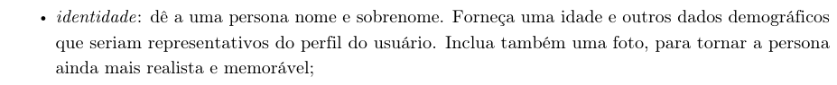

**Figura 2** — Evidência documental referente ao item `PR-02`.  
_Fonte: BARBOSA, Simone Diniz Junqueira et al. Interação Humano-Computador e Experiência do Usuário. 1. ed. Rio de Janeiro: Autopublicação, 2021, p. 153 (Capítulo 8, Seção 8.2)._

A **Figura 3** reproduz o trecho comprobatório de referência referente ao critério **PR-03**.

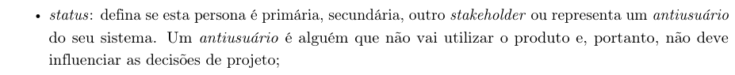

**Figura 3** — Evidência documental referente ao item `PR-03`.  
_Fonte: BARBOSA, Simone Diniz Junqueira et al. Interação Humano-Computador e Experiência do Usuário. 1. ed. Rio de Janeiro: Autopublicação, 2021, p. 153 (Capítulo 8, Seção 8.2)._

A **Figura 4** reproduz o trecho comprobatório de referência referente ao critério **PR-04**.

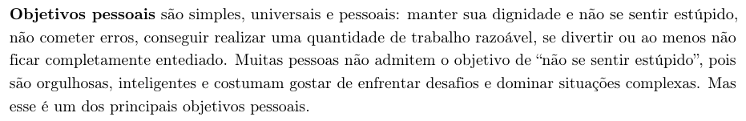

**Figura 4** — Evidência documental referente ao item `PR-04`.  
_Fonte: BARBOSA, Simone Diniz Junqueira et al. Interação Humano-Computador e Experiência do Usuário. 1. ed. Rio de Janeiro: Autopublicação, 2021, p. 156 (Capítulo 8, Seção 8.2.0.1)._

A **Figura 5** reproduz o trecho comprobatório de referência referente ao critério **PR-05**.

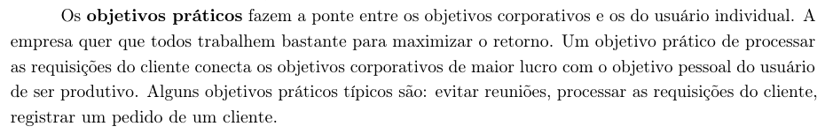

**Figura 5** — Evidência documental referente ao item `PR-05`.  
_Fonte: BARBOSA, Simone Diniz Junqueira et al. Interação Humano-Computador e Experiência do Usuário. 1. ed. Rio de Janeiro: Autopublicação, 2021, p. 156 (Capítulo 8, Seção 8.2.0.1)._

A **Figura 6** reproduz o trecho comprobatório de referência referente ao critério **PR-06**.

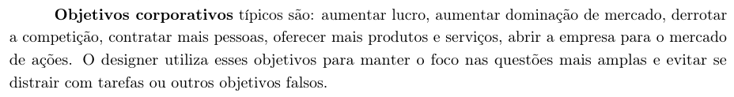

**Figura 6** — Evidência documental referente ao item `PR-06`.  
_Fonte: BARBOSA, Simone Diniz Junqueira et al. Interação Humano-Computador e Experiência do Usuário. 1. ed. Rio de Janeiro: Autopublicação, 2021, p. 156 (Capítulo 8, Seção 8.2.0.1)._

A **Figura 7** reproduz o trecho comprobatório de referência referente ao critério **PR-07**.

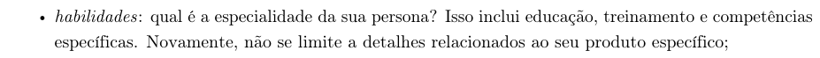

**Figura 7** — Evidência documental referente ao item `PR-07`.  
_Fonte: BARBOSA, Simone Diniz Junqueira et al. Interação Humano-Computador e Experiência do Usuário. 1. ed. Rio de Janeiro: Autopublicação, 2021, p. 154 (Capítulo 8, Seção 8.2)._

A **Figura 8** reproduz o trecho comprobatório de referência referente ao critério **PR-08**.

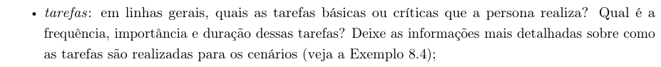

**Figura 8** — Evidência documental referente ao item `PR-08`.  
_Fonte: BARBOSA, Simone Diniz Junqueira et al. Interação Humano-Computador e Experiência do Usuário. 1. ed. Rio de Janeiro: Autopublicação, 2021, p. 154 (Capítulo 8, Seção 8.2)._

A **Figura 9** reproduz o trecho comprobatório de referência referente ao critério **PR-09**.

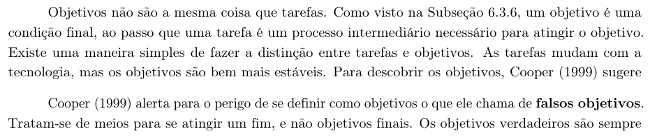

**Figura 9** — Evidência documental referente ao item `PR-09`.  
_Fonte: BARBOSA, Simone Diniz Junqueira et al. Interação Humano-Computador e Experiência do Usuário. 1. ed. Rio de Janeiro: Autopublicação, 2021, pp. 156-157 (Capítulo 8, Seção 8.2.0.1)._

A **Figura 10** reproduz o trecho comprobatório de referência referente ao critério **PR-10**.

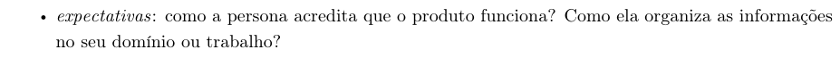

**Figura 10** — Evidência documental referente ao item `PR-10`.  
_Fonte: BARBOSA, Simone Diniz Junqueira et al. Interação Humano-Computador e Experiência do Usuário. 1. ed. Rio de Janeiro: Autopublicação, 2021, p. 154 (Capítulo 8, Seção 8.2)._

A **Figura 11** reproduz o trecho comprobatório de referência referente ao critério **PR-11**.

**Figura 11** — Evidência documental referente ao item `PR-11`.  
_Fonte: BARBOSA, Simone Diniz Junqueira et al. Interação Humano-Computador e Experiência do Usuário. 1. ed. Rio de Janeiro: Autopublicação, 2021, p. 154 (Capítulo 8, Seção 8.2)._

A **Figura 12** reproduz o trecho comprobatório de referência referente ao critério **PR-12**.

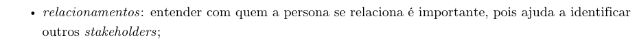

**Figura 12** — Evidência documental referente ao item `PR-12`.  
_Fonte: BARBOSA, Simone Diniz Junqueira et al. Interação Humano-Computador e Experiência do Usuário. 1. ed. Rio de Janeiro: Autopublicação, 2021, p. 154 (Capítulo 8, Seção 8.2)._

A **Figura 13** reproduz o trecho comprobatório de referência referente ao critério **PR-13**.

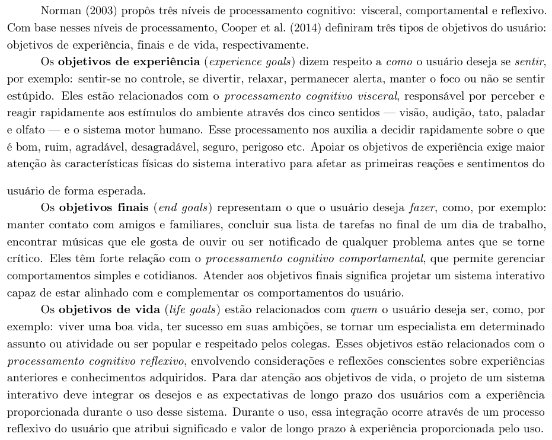

**Figura 13** — Evidência documental referente ao item `PR-13`.  
_Fonte: BARBOSA, Simone Diniz Junqueira et al. Interação Humano-Computador e Experiência do Usuário. 1. ed. Rio de Janeiro: Autopublicação, 2021, pp. 156-157 (Capítulo 8, Seção 8.2.0.1)._

A **Figura 14** reproduz o trecho comprobatório de referência referente ao critério **PR-14**.

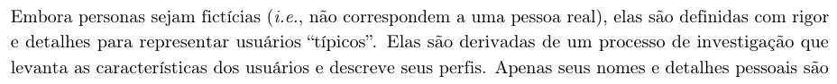

**Figura 14** — Evidência documental referente ao item `PR-14`.  
_Fonte: BARBOSA, Simone Diniz Junqueira et al. Interação Humano-Computador e Experiência do Usuário. 1. ed. Rio de Janeiro: Autopublicação, 2021, p. 154 (Capítulo 8, Seção 8.2)._

---

## 3. Validação desta Lista pela Lista de Governança do Prof. Dr. André Barros de Sales (`DG-01` a `DG-11`)

Em estrito cumprimento às diretrizes de qualidade do Plano de Ensino (*Sales, 2026, pp. 8–9*), a **Tabela 3** submete esta própria página (`09-personas.md`) aos **11 Itens de Desenvolvimento do Projeto** formulados pelo Prof. Dr. André Barros de Sales.

**Tabela 3** — Autoavaliação de `09-personas.md` frente aos critérios `DG-01` a `DG-11`

| ID | Critério de Governança do Plano de Ensino | Autor do Item | Resposta | Versão, Data e Hora da Avaliação | Evidência de Conformidade nesta Lista |
| :---: | :--- | :--- | :---: | :---: | :--- |
| **DG-01** | O histórico de versão padronizado? | **Prof. Dr. André Barros de Sales** *(Plano de Ensino FGA0173, 2026)* | ✅ **Sim (Conforme)** | `v2.0` — 20/11/2026 às 14:30 | Seção **Histórico de Versão** (**Tabela 4**) padronizada ao final de `09-personas.md` registrando `v2.0`. |
| **DG-02** | O(s) autor(es) e o(s) revisor(es) para cada artefato? | **Prof. Dr. André Barros de Sales** *(Plano de Ensino FGA0173, 2026)* | ✅ **Sim (Conforme)** | `v2.0` — 20/11/2026 às 14:30 | Colunas **Autor(es)** e **Revisor(es)** preenchidas com links GitHub no Histórico de Versão, além da coluna **`Autor do Item`** em 100% dos critérios da lista. |
| **DG-03** | Referências bibliográficas e/ou bibliografia em todos os artefatos? | **Prof. Dr. André Barros de Sales** *(Plano de Ensino FGA0173, 2026)* | ✅ **Sim (Conforme)** | `v2.0` — 20/11/2026 às 14:30 | Seção **Referências Bibliográficas (ABNT NBR 6023)** completa ao final do documento com obras, edições e páginas exatas. |
| **DG-04** | As tabelas e imagens possuem legenda e fonte e são chamadas dentro do texto? | **Prof. Dr. André Barros de Sales** *(Plano de Ensino FGA0173, 2026)* | ✅ **Sim (Conforme)** | `v2.0` — 20/11/2026 às 14:30 | 100% das tabelas (`Tabela 1` a `Tabela 4`) e figuras (`Figura 1` a `Figura 14`) possuem numeração, legenda, fonte e chamadas textuais prévias. |
| **DG-05** | Um texto fazendo uma introdução dos artefatos? | **Prof. Dr. André Barros de Sales** *(Plano de Ensino FGA0173, 2026)* | ✅ **Sim (Conforme)** | `v2.0` — 20/11/2026 às 14:30 | Seção **1. Introdução e Contextualização Metodológica** situa o instrumento no Ciclo de Mayhew (1999) e na Inspeção Formal de Fagan (1976). |
| **DG-06** | O cronograma executado com quem realizou cada artefato/atividade e as datas de início e fim da construção/realização? | **Prof. Dr. André Barros de Sales** *(Plano de Ensino FGA0173, 2026)* | ✅ **Sim (Conforme)** | `v2.0` — 20/11/2026 às 14:30 | Registros de elaboração e revisão vinculados ao [Cronograma Executado](../../planejamento/cronograma-executado.md) e ao histórico Git da equipe. |
| **DG-07** | Ata(s) da(s) reuniões (com data, horário de início e do final, participantes, objetivo, atividades definidas etc.)? | **Prof. Dr. André Barros de Sales** *(Plano de Ensino FGA0173, 2026)* | ✅ **Sim (Conforme)** | `v2.0` — 20/11/2026 às 14:30 | Deliberações e alinhamentos documentados nas [Atas de Reunião](../../atas/index.md). |
| **DG-08** | A gravação da reunião do grupo? | **Prof. Dr. André Barros de Sales** *(Plano de Ensino FGA0173, 2026)* | ✅ **Sim (Conforme)** | `v2.0` — 20/11/2026 às 14:30 | Links funcionais de gravações das reuniões de planejamento e auditoria indexados em [Atas de Reunião](../../atas/index.md). |
| **DG-09** | Vídeo de apresentação na categoria 'Não Listado' no YouTube (duração entre 20 e 30 minutos)? | **Prof. Dr. André Barros de Sales** *(Plano de Ensino FGA0173, 2026)* | ⚠️ **Em preparação (Etapa 8)** | `v2.0` — 20/11/2026 às 14:30 | Vídeos das Entregas 1–7 publicados; vídeo oficial da [Entrega 8 — Verificação dos Artefatos](../../entregas/entrega8.md) (20–30 min, Não Listado) agendado após consolidação das inspeções da equipe. |
| **DG-10** | Tabela de contribuição no início do artefato com o nome de todos os integrantes, contribuição com hiperligação da atividade e da gravação? | **Prof. Dr. André Barros de Sales** *(Plano de Ensino FGA0173, 2026)* | ✅ **Sim (Conforme)** | `v2.0` — 20/11/2026 às 14:30 | **Tabela 1** posicionada no topo do documento discriminando cada integrante ativo com hiperligação GitHub e escopo de atuação. |
| **DG-11** | A seção de agradecimentos apresentando o uso de Inteligência Artificial (IA) Generativa no artefato? | **Prof. Dr. André Barros de Sales** *(Plano de Ensino FGA0173, 2026)* | ✅ **Sim (Conforme)** | `v2.0` — 20/11/2026 às 14:30 | Seção **Agradecimentos e Declaração de Uso de IA Generativa** ao final do documento em estrita conformidade com o Código da SBC e Sales (2026). |

_Fonte: Validação elaborada por Vinicius Silva Araruna com base na rubrica oficial de Prof. Dr. André Barros de Sales (Plano de Ensino, 2026, pp. 8–9)._

---

## 4. Histórico de Versão

A **Tabela 4** registra a evolução histórica e o controle de versionamento deste instrumento normativo.

**Tabela 4** — Histórico de Versão do Documento

| Versão | Data | Descrição Detalhada da Modificação | Autor(es) | Revisor(es) |
| :---: | :---: | :--- | :--- | :--- |
| `1.0` | 26/09/2026 | Versão inicial com 14 critérios elaborada na Entrega 2. | [Vinicius Silva Araruna](https://github.com/ViniciusA05) | [Edvaldo Soares Brasileiro Filho](https://github.com/PajeMurici-dev) |
| `2.0` | 20/11/2026 | Revisão completa das 14 evidências visuais, atualização da citação literal no Item 13 (inclusão dos objetivos de experiência/visceral), correção de 'Courage e Baxter', paginação impressa (pp. 153–157), `Autor do Item` e validação `DG-01..11`. | [Vinicius Silva Araruna](https://github.com/ViniciusA05) | [Gustavo Antonio Rodrigues e Silva](https://github.com/gus-ant), [Edvaldo Soares Brasileiro Filho](https://github.com/PajeMurici-dev) |

_Fonte: Elaborada pelos autores, 2026._

---

## 5. Referências Bibliográficas (ABNT NBR 6023)

[1] BARBOSA, Simone Diniz Junqueira et al. Interação Humano-Computador e Experiência do Usuário. 1. ed. Rio de Janeiro: Autopublicação, 2021, Cap. 8, Seção 8.2 (Personas), pp. 153-157.

[2] COOPER, Alan. The Inmates Are Running the Asylum. Indianapolis: Sams Publishing, 1999.

[3] COOPER, Alan; REIMANN, Robert; CRONIN, David; NOESSEL, Christopher. About Face: The Essentials of Interaction Design. 4. ed. Wiley, 2014.

[4] COURAGE, Catherine; BAXTER, Kathy. Understanding Your Users. San Francisco: Morgan Kaufmann, 2005.

[5] NORMAN, Donald A. Emotional Design: Why We Love (or Hate) Everyday Things. New York: Basic Books, 2003.

[6] BARBOSA, Simone Diniz Junqueira; SILVA, Bruno Santana da. *Interação Humano-Computador*. 1. ed. Rio de Janeiro: Elsevier / Campus, 2010.

[7] FAGAN, Michael E. Design and code inspections to reduce errors in program development. *IBM Systems Journal*, v. 15, n. 3, p. 182–211, 1976.

[8] MAYHEW, Deborah J. *The Usability Engineering Lifecycle: A Practitioner's Handbook for User Interface Design*. San Francisco: Morgan Kaufmann, 1999.

[9] SALES, André Barros de. *Plano de Ensino da Disciplina de Interação Humano Computador (FGA0173 — 02/2026)*. Brasília: Universidade de Brasília, Faculdade UnB Gama (FGA), 2026.

[10] SOCIEDADE BRASILEIRA DE COMPUTAÇÃO (SBC). *Código de Conduta da Sociedade Brasileira de Computação*. Porto Alegre: SBC, 2023.

---

## 6. Agradecimentos e Declaração de Uso de Inteligência Artificial (IA) Generativa

Em conformidade com o Código de Conduta da Sociedade Brasileira de Computação (SBC, Art. 2º, parágrafo III) e com as diretrizes do Plano de Ensino da disciplina (*Sales, 2026, p. 3*), declara-se que a organização das tabelas em Markdown e a revisão ortográfica contaram com suporte supervisionado da ferramenta de Inteligência Artificial Generativa Google Gemini. Toda a concepção metodológica, verificação bibliográfica nas obras originais, revisão técnica e validação de conformidade foram realizadas pelos discentes identificados no Histórico de Versão.
