# Lista de Verificação — Análise Hierárquica de Tarefas (HTA)

## Tabela de Contribuição e Transparência de IA Generativa

A **Tabela 1** apresenta a distribuição de responsabilidades na elaboração, curadoria e revisão de **Análise Hierárquica de Tarefas (HTA)**.

**Tabela 1** — Matriz de Contribuição e Transparência de IA Generativa — Análise Hierárquica de Tarefas (HTA)

| Integrante | Atribuição no Artefato | Data | Horário | Ferramenta de IA | Propósito do Uso de IA |
| :--- | :--- | :---: | :---: | :--- | :--- |
| [Vinicius Silva Araruna](https://github.com/ViniciusA05) | Elaboração modular dos critérios de `HTA`, citação direta, recortes da obra e autoavaliação pela rubrica `DG-01` a `DG-11` | 20/11/2026 | 14:00 - 15:30 | Google Gemini | Suporte na organização estrutural, formatação de tabelas em Markdown e conferência cruzada com o Plano de Ensino |
| [Gustavo Antonio Rodrigues e Silva](https://github.com/gus-ant) | Revisão de conformidade estrutural, navegação e checagem de links | 20/11/2026 | 15:30 - 16:00 | — | Revisão por pares e validação editorial |
| [Edvaldo Soares Brasileiro Filho](https://github.com/PajeMurici-dev) | Auditoria de rastreabilidade frente ao Plano de Ensino (`DG-01` a `DG-11`) e referências ABNT | 20/11/2026 | 15:30 - 16:00 | — | Revisão por pares e conferência documental |

_Fonte: Elaborada pelos autores, 2026._

---

## 1. Introdução e Contextualização Metodológica

Este módulo verifica rigorosamente os artefatos de **Análise Hierárquica de Tarefas (HTA)** (Entrega 2), cobrindo definição do objetivo 0, decomposição exaustiva e mutuamente exclusiva, planos lógicos e temporais (`1 > 2`, `1 / 2`, `1 + 2`), barra horizontal terminal em subobjetivos não decompostos, especificação pela tupla `<Inputs, Ações, Feedback>`, critério de parada `p × c` (Annett & Duncan, 1967) e representação dupla Diagrama + Tabela.

Este instrumento normativo atua segundo o **Método de Inspeção Formal de Michael E. Fagan (1976)** e encontra-se desacoplado dos relatórios empíricos de aplicação. Toda inspeção registrada aqui identifica obrigatoriamente o **`Autor do Item`**, a **fundamentação bibliográfica com recorte visual** e a coluna **`Versão, Data e Hora da Avaliação`** exigida pelo Plano de Ensino (*Sales, 2026, pp. 8–13*).

!!! info "Pré-requisito Transversal de Governança (Prof. Dr. André Barros de Sales)"
    Além dos critérios específicos deste artefato listados na **Seção 2**, todo produto de trabalho avaliado deve cumprir integralmente os **11 Itens de Desenvolvimento Geral (`DG-01` a `DG-11`)** definidos pelo Prof. Dr. André Barros de Sales em [00. Governança e Plano de Ensino Geral](00-plano-ensino-geral.md).

---

## 2. Instrumento Normativo de Verificação — Análise Hierárquica de Tarefas (HTA)

### 2.1 Critérios do Plano de Ensino (Prof. Dr. André Barros de Sales — Rubrica Oficial)

A **Tabela 2** reúne os critérios oficiais estipulados pelo docente para este artefato no Plano de Ensino (*Sales, 2026*).

**Tabela 2** — Critérios oficiais do Plano de Ensino para Análise Hierárquica de Tarefas (HTA)

| ID | Critério / Pergunta de Verificação | Autor do Item | Fundamentação Canônica e Fonte | Evidência Visual (Figura) | Resposta | Versão, Data e Hora da Avaliação |
| :---: | :--- | :--- | :--- | :---: | :---: | :---: |
| **PE-E2-10** | Apresenta a Análise de Tarefas com referência bibliográfica, foto do texto e autor? | **Prof. Dr. André Barros de Sales** *(Plano de Ensino FGA0173, 2026)* | Plano de Ensino (Sales, 2026, p. 11, Item 10) | [Ver Figura 1](#figura-1) | `[ ] Sim (Conforme)` `[ ] Não (Não Conforme)` `[ ] Incompleto` `[ ] N/A` | *(Preencher na inspeção)* |
| **PE-E2-11** | Uma atividade para cada integrante modelada em ao menos duas técnicas (HTA com diagrama, legenda e tabela; GOMS: KLM/CMN-GOMS/CPM-GOMS/CTT) com foto e autor? | **Prof. Dr. André Barros de Sales** *(Plano de Ensino FGA0173, 2026)* | Plano de Ensino (Sales, 2026, p. 11, Item 11) | [Ver Figura 1](#figura-1) | `[ ] Sim (Conforme)` `[ ] Não (Não Conforme)` `[ ] Incompleto` `[ ] N/A` | *(Preencher na inspeção)* |
| **PE-E2-12** | Utilizaram técnicas formais adequadas para especificar as tarefas? | **Prof. Dr. André Barros de Sales** *(Plano de Ensino FGA0173, 2026)* | Plano de Ensino (Sales, 2026, p. 11, Item 12) | [Ver Figura 1](#figura-1) | `[ ] Sim (Conforme)` `[ ] Não (Não Conforme)` `[ ] Incompleto` `[ ] N/A` | *(Preencher na inspeção)* |

_Fonte: Plano de Ensino da Disciplina (Prof. Dr. André Barros de Sales, 2026)._

### 2.2 Critérios Técnicos da Literatura Canônica (Lista de Verificação `HTA`)

A **Tabela 3** apresenta os **10 itens normativos** fundamentados na literatura científica com citação direta literal e recorte visual da página.

**Tabela 3** — Lista de verificação normativa de Análise Hierárquica de Tarefas (HTA) (10 itens)

| ID | Critério / Pergunta de Verificação | Autor do Item | Fundamentação Canônica (Obra, Ed., Cap., Pág.) e Citação Literal | Evidência Visual (Figura) | Resposta | Versão, Data e Hora da Avaliação |
| :---: | :--- | :--- | :--- | :---: | :---: | :---: |
| **HTA-01** | **Definição do Objetivo de Alto Nível como Estado Final Observável** A análise HTA inicia pela definição clara do objetivo das pessoas (nível 0) como um estado específico e observável (estado final desejado), antes de listar ações físicas ou computacionais, podendo aferir seu alcance por eventos ou variáveis fisicamente observáveis? • **Foco no estado final:** o objetivo 0 expressa o estado desejado a ser alcançado, e não uma lista prévia de cliques/ações; • **Observabilidade empírica:** definição por eventos ou valores observáveis que permitem verificar alcance e desempenho; • **Ponto de partida funcional:** a decomposição começa dos objetivos das pessoas para então chegar às ações. | [Vinicius Silva Araruna](https://github.com/ViniciusA05) | *"Uma análise funcional de tarefas começa pela definição dos objetivos das pessoas, antes de considerarmos as ações através das quais a tarefa pode ser realizada e o objetivo ser atingido. Um objetivo é um estado específico de coisas, um estado final. Esse estado pode ser definido por um ou mais eventos ou por valores fisicamente observáveis de uma ou mais variáveis, que atuam como critério de alcance do objetivo e, em última instância, do desempenho do sistema. Em vez de identificar uma lista de ações, a HTA inicia com uma definição dos objetivos das pessoas."* BARBOSA, Simone Diniz Junqueira et al. Interação Humano-Computador e Experiência do Usuário. 1. ed. Rio de Janeiro: Autopublicação, 2021, p. 165 (Capítulo 8, Seção 8.4.1). | [Ver Figura 2](#figura-2) | `[ ] Sim (Conforme)` `[ ] Não (Não Conforme)` `[ ] Incompleto` `[ ] N/A` | *(Preencher na inspeção)* |
| **HTA-02** | **Decomposição em Subobjetivos Mutuamente Exclusivos e Exaustivos** Cada objetivo decomposto é dividido em subobjetivos mutuamente exclusivos (sem sobreposição funcional nem redundância entre irmãos) e exaustivos (definindo completamente o objetivo pai a que estão subordinados)? • **Mutuamente exclusivos:** fronteiras claras sem sobreposição entre os subobjetivos de um mesmo nível; • **Exaustivos:** o cumprimento dos subobjetivos satisfaz integralmente o objetivo superior; • **Numeração decimal coerente:** rastreabilidade hierárquica clara (0; 1, 2; 1.1, 1.2). | [Vinicius Silva Araruna](https://github.com/ViniciusA05) | *"Numa decomposição, os subobjetivos devem ser mutuamente exclusivos e exaustivos, ou seja, devem definir completamente o objetivo a que estão subordinados, sem que haja sobreposições entre os subobjetivos."* BARBOSA, Simone Diniz Junqueira et al. Interação Humano-Computador e Experiência do Usuário. 1. ed. Rio de Janeiro: Autopublicação, 2021, p. 167 (Capítulo 8, Seção 8.4.1). | [Ver Figura 3](#figura-3) | `[ ] Sim (Conforme)` `[ ] Não (Não Conforme)` `[ ] Incompleto` `[ ] N/A` | *(Preencher na inspeção)* |
| **HTA-03** | **Especificação Explícita dos Planos de Execução** Para cada objetivo que sofre decomposição, o artefato define formalmente o plano associado, explicando os subobjetivos necessários para atingir o objetivo maior e a ordem ou condição em que devem ser alcançados? • **Plano obrigatório por decomposição:** todo nó pai não-folha possui plano explícito (ex.: Plano 0, Plano 1, Plano 1.2); • **Regra de ordem/disparo:** explicitação das relações de sequência, seleção/decisão ou paralelismo entre os filhos; • **Coerência plano × filhos:** todos os subobjetivos desenhados constam na expressão do plano pai. | [Vinicius Silva Araruna](https://github.com/ViniciusA05) | *"Os subobjetivos de um objetivo e as relações entre eles é denominada de plano. Um plano define os subobjetivos necessários para alcançar um outro objetivo maior, e a ordem em que esses subobjetivos devem ser alcançados. Os planos podem definir diversas relações entre os subobjetivos: sequência fixa (um objetivo deve ser atingido antes do próximo); regra de seleção ou decisão (quais objetivos que deverão ser atingidos dependem das circunstâncias); ou em paralelo (mais de um objetivo deve ser atingido ao mesmo tempo)."* BARBOSA, Simone Diniz Junqueira et al. Interação Humano-Computador e Experiência do Usuário. 1. ed. Rio de Janeiro: Autopublicação, 2021, p. 165 (Capítulo 8, Seção 8.4.1). | [Ver Figura 4](#figura-4) | `[ ] Sim (Conforme)` `[ ] Não (Não Conforme)` `[ ] Incompleto` `[ ] N/A` | *(Preencher na inspeção)* |
| **HTA-04** | **Uso Correto dos Operadores Relacionais da Figura 8.1 (>, /, +)** Os planos empregam corretamente os operadores simbólicos canônicos apresentados na Figura 8.1: sequencial (1 > 2 para ordem fixa), seleção (1 / 2 para regra condicional ou alternativa) e paralelo (1 + 2 para execução simultânea)? • **Sequência fixa (1 > 2):** usada quando um subobjetivo precisa ser atingido estritamente antes do próximo; • **Seleção/decisão (1 / 2):** usada quando a escolha depende de circunstâncias/regras do contexto; • **Paralelismo (1 + 2):** usada quando mais de um subobjetivo pode ocorrer ao mesmo tempo sem dependência linear. | [Vinicius Silva Araruna](https://github.com/ViniciusA05) | *"No nível mais baixo da hierarquia de objetivos, cada subobjetivo é alcançado por uma operação, que é a unidade fundamental em HTA. A Figura 8.1 apresenta os elementos de um diagrama HTA."* BARBOSA, Simone Diniz Junqueira et al. Interação Humano-Computador e Experiência do Usuário. 1. ed. Rio de Janeiro: Autopublicação, 2021, p. 165 (Capítulo 8, Seção 8.4.1, Figura 8.1). | [Ver Figura 5](#figura-5) | `[ ] Sim (Conforme)` `[ ] Não (Não Conforme)` `[ ] Incompleto` `[ ] N/A` | *(Preencher na inspeção)* |
| **HTA-05** | **Especificação das Operações Elementares pela Tupla `<Inputs, Ações, Feedback>`** No nível mais baixo da hierarquia (operações elementares), cada operação explicita as circunstâncias/dados disparadores (input), as ações desempenhadas (actions) e as condições que indicam o atingimento do objetivo (feedback)? • **Inputs (entradas/circunstâncias):** estados ou dados prévios que disparam a operação; • **Ações (actions):** instrução clara de transformação entre estados realizada pelo agente; • **Feedback (avaliação):** condição observável que confirma ao usuário que a operação teve êxito. | [Vinicius Silva Araruna](https://github.com/ViniciusA05) | *"Uma operação é especificada pelas circunstâncias nas quais o objetivo é ativado (input ou entrada), pelas atividades ou ações (actions) que contribuem para atingi-lo e pelas condições que indicam o seu atingimento (feedback). Uma [ação] pode ser entendida como uma instrução para fazer algo sob certas circunstâncias, o input como estados e o feedback como testes ou avaliação do estado final."* BARBOSA, Simone Diniz Junqueira et al. Interação Humano-Computador e Experiência do Usuário. 1. ed. Rio de Janeiro: Autopublicação, 2021, p. 165 (Capítulo 8, Seção 8.4.1). | [Ver Figura 6](#figura-6) | `[ ] Sim (Conforme)` `[ ] Não (Não Conforme)` `[ ] Incompleto` `[ ] N/A` | *(Preencher na inspeção)* |
| **HTA-06** | **Identificação de Problemas Potenciais e Recomendações de Design por Ação** A análise HTA examina como o sistema possibilita ou impede o usuário de atingir seus objetivos, identificando problemas potenciais em cada ação e formulando recomendações práticas para evitá-los ou mitigá-los? • **Diagnóstico de barreiras:** identificação explícita de pontos de falha, perda de dados ou atrito por operação; • **Recomendações acionáveis:** propostas concretas de design ou ajuste procedimental vinculadas aos problemas; • **Apoio ao atingimento de objetivos:** análise crítica de como a interface ajuda ou bloqueia a tarefa. | [Vinicius Silva Araruna](https://github.com/ViniciusA05) | *"Dessa maneira, a análise visa identificar principalmente como um sistema possibilita ou impede as pessoas de alcançarem seus objetivos. Essa análise permite ainda identificar problemas potenciais de cada ação, bem como elaborar recomendações para evitá-los."* BARBOSA, Simone Diniz Junqueira et al. Interação Humano-Computador e Experiência do Usuário. 1. ed. Rio de Janeiro: Autopublicação, 2021, p. 165 (Capítulo 8, Seção 8.4.1). | [Ver Figura 7](#figura-7) | `[ ] Sim (Conforme)` `[ ] Não (Não Conforme)` `[ ] Incompleto` `[ ] N/A` | *(Preencher na inspeção)* |
| **HTA-07** | **Critérios de Sucesso e Consequências de Falha (Consenso — Passo 2 de Diaper)** Para os objetivos analisados em consenso com as partes interessadas, a análise define resultados de desempenho desejados (como frequência de erros e forma de aferição) respondendo às duas questões-chave: qual evidência objetiva indica alcance e quais as consequências da falha? • **Critérios de desempenho e aferição:** explicitação de como o sucesso ou frequência de erros será medido; • **Evidência objetiva de alcance:** resposta clara a 'qual evidência objetiva indicará que esse objetivo foi atingido?'; • **Análise de impacto de falha:** explicitação das consequências caso o usuário falhe em atingir o objetivo. | [Vinicius Silva Araruna](https://github.com/ViniciusA05) | *"2. Obter consenso entre as partes interessadas na definição dos objetivos da tarefa e medidas de sucesso. Devem ser definidos os resultados de desempenho desejados, tal como frequência de erros, e as formas como esses resultados serão aferidos. Para cada objetivo, as questões-chave são: “qual evidência objetiva indicará que esse objetivo foi atingido?” e “quais as consequências da falha em atingir esse objetivo?”."* BARBOSA, Simone Diniz Junqueira et al. Interação Humano-Computador e Experiência do Usuário. 1. ed. Rio de Janeiro: Autopublicação, 2021, p. 166 (Capítulo 8, Seção 8.4.1). | [Ver Figura 8](#figura-8) | `[ ] Sim (Conforme)` `[ ] Não (Não Conforme)` `[ ] Incompleto` `[ ] N/A` | *(Preencher na inspeção)* |
| **HTA-08** | **Critério de Parada da Decomposição (Regra p x c e Origem do Erro)** O nível de profundidade da árvore HTA é justificado pelo critério formal p x c de Annett e Duncan (1967) — parando quando o produto da probabilidade de falha (p) pelo custo da falha (c) for aceitável — ou por já se ter identificado a origem do erro e uma proposta de correção? • **Aplicação explícita de p x c:** justificativa de parada onde probabilidade × custo de falha é tolerável; • **Parada por identificação de causa raiz:** interrupção quando já é possível propor correção de design, procedimento ou treinamento; • **Granularidade equilibrada:** evita decomposição trivial infinita ou encerramento prematuro. | [Vinicius Silva Araruna](https://github.com/ViniciusA05) | *"Um critério de parada é o critério p × c (Annett e Duncan, 1967), que significa parar quando o produto da probabilidade de falha (p) e o custo da falha (c) for julgado aceitável. Uma outra razão para a parada ocorre quando a origem de um erro ou problema já tiver sido identificada e, portanto, o analista já pode propor uma correção, seja em termos de design de sistema, procedimentos operacionais ou treinamento."* BARBOSA, Simone Diniz Junqueira et al. Interação Humano-Computador e Experiência do Usuário. 1. ed. Rio de Janeiro: Autopublicação, 2021, p. 166 (Capítulo 8, Seção 8.4.1); ANNETT, J.; DUNCAN, K. D., 1967. | [Ver Figura 9](#figura-9) | `[ ] Sim (Conforme)` `[ ] Não (Não Conforme)` `[ ] Incompleto` `[ ] N/A` | *(Preencher na inspeção)* |
| **HTA-09** | **Representação Dupla Canônica: Diagrama Gráfico e Tabela Equivalente** A modelagem HTA é documentada por suas duas representações complementares equivalentes — Diagrama Gráfico hierárquico (nos moldes da Figura 8.2) e Tabela HTA textual detalhando inputs, ações, feedback, planos, problemas e recomendações (nos moldes da Tabela 8.4) — mantendo consistência estrita entre ambos? • **Diagrama HTA completo:** visão em árvore com todos os objetivos, subobjetivos, operações e planos; • **Tabela HTA equivalente:** registro textual detalhado de tuplas, problemas e recomendações (padrão Tabela 8.4); • **Consistência diagrama × tabela:** numeração, nomes e expressões de plano idênticos entre diagrama e tabela. | [Vinicius Silva Araruna](https://github.com/ViniciusA05) | *"A Figura 8.2 ilustra um diagrama HTA para o cadastro de um projeto final em um sistema acadêmico, e a Tabela 8.4 apresenta a tabela equivalente ao diagrama."* BARBOSA, Simone Diniz Junqueira et al. Interação Humano-Computador e Experiência do Usuário. 1. ed. Rio de Janeiro: Autopublicação, 2021, pp. 165-167 (Capítulo 8, Seção 8.4.1, Figura 8.2 e Tabela 8.4). | [Ver Figura 10](#figura-10) | `[ ] Sim (Conforme)` `[ ] Não (Não Conforme)` `[ ] Incompleto` `[ ] N/A` | *(Preencher na inspeção)* |
| **HTA-10** | **Notação Visual Canônica do Diagrama HTA (Barra Terminal e Planos sem Caixas)** O diagrama gráfico HTA respeita rigorosamente a notação visual das Figuras 8.1 e 8.2: retângulos simples para objetivos, linha horizontal inferior (barra terminal) exclusivamente abaixo das caixas de operação (folhas da árvore) e notação dos planos (1>2, 1/2, 1+2) associada ao objetivo pai sem criar caixas intermediárias artificiais para planos? • **Barra horizontal terminal apenas nas folhas:** sublinhado duplo/barra abaixo exclusivamente das operações finais; • **Sem caixas intermediárias de plano:** os planos não aparecem como nós/retângulos próprios no meio das arestas; • **Fidelidade visual à Figura 8.2:** linhas hierárquicas limpas conectando pai aos filhos com identificação do plano no pai. | [Vinicius Silva Araruna](https://github.com/ViniciusA05) | *"No nível mais baixo da hierarquia de objetivos, cada subobjetivo é alcançado por uma operação, que é a unidade fundamental em HTA. A Figura 8.1 apresenta os elementos de um diagrama HTA [...] Figura 8.2: Diagrama HTA, para o objetivo de cadastrar um projeto final em um sistema acadêmico."* BARBOSA, Simone Diniz Junqueira et al. Interação Humano-Computador e Experiência do Usuário. 1. ed. Rio de Janeiro: Autopublicação, 2021, pp. 165 e 167 (Capítulo 8, Seção 8.4.1, Figuras 8.1 e 8.2). | [Ver Figura 11](#figura-11) | `[ ] Sim (Conforme)` `[ ] Não (Não Conforme)` `[ ] Incompleto` `[ ] N/A` | *(Preencher na inspeção)* |

_Fonte: Elaborada por [Vinicius Silva Araruna](https://github.com/ViniciusA05), 2026._

### Evidências Visuais da Literatura e do Plano de Ensino

Cada figura a seguir é chamada explicitamente e vinculada ao respectivo critério na tabela normativa acima.

A **Figura 1** reproduz o trecho comprobatório de referência referente ao critério **PE-E2-10**.

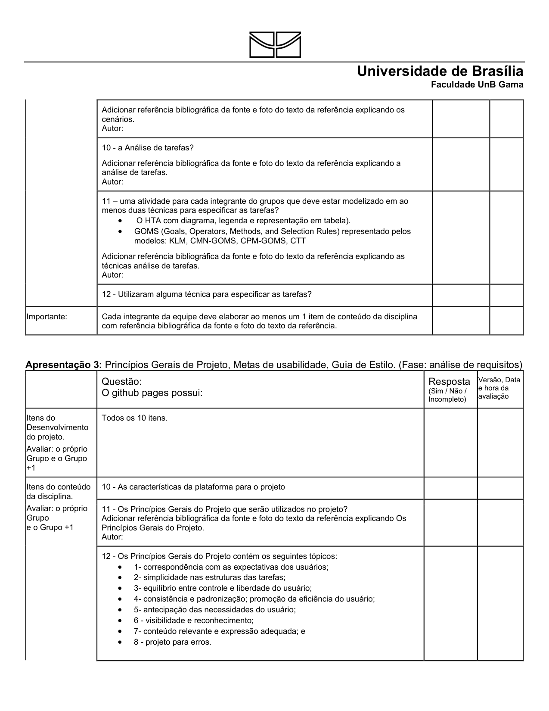

**Figura 1** — Evidência documental referente ao item `PE-E2-10`.  
_Fonte: Plano de Ensino (Sales, 2026, p. 11, Item 10)_

A **Figura 2** reproduz o trecho comprobatório de referência referente ao critério **HTA-01**.

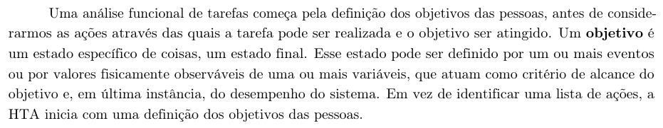

**Figura 2** — Evidência documental referente ao item `HTA-01`.  
_Fonte: BARBOSA, Simone Diniz Junqueira et al. Interação Humano-Computador e Experiência do Usuário. 1. ed. Rio de Janeiro: Autopublicação, 2021, p. 165 (Capítulo 8, Seção 8.4.1)._

A **Figura 3** reproduz o trecho comprobatório de referência referente ao critério **HTA-02**.

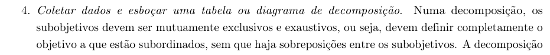

**Figura 3** — Evidência documental referente ao item `HTA-02`.  
_Fonte: BARBOSA, Simone Diniz Junqueira et al. Interação Humano-Computador e Experiência do Usuário. 1. ed. Rio de Janeiro: Autopublicação, 2021, p. 167 (Capítulo 8, Seção 8.4.1)._

A **Figura 4** reproduz o trecho comprobatório de referência referente ao critério **HTA-03**.

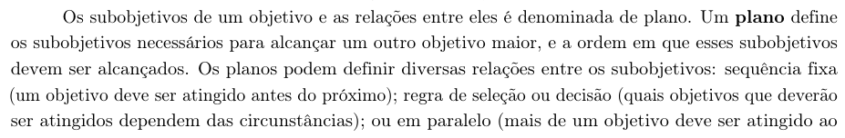

**Figura 4** — Evidência documental referente ao item `HTA-03`.  
_Fonte: BARBOSA, Simone Diniz Junqueira et al. Interação Humano-Computador e Experiência do Usuário. 1. ed. Rio de Janeiro: Autopublicação, 2021, p. 165 (Capítulo 8, Seção 8.4.1)._

A **Figura 5** reproduz o trecho comprobatório de referência referente ao critério **HTA-04**.

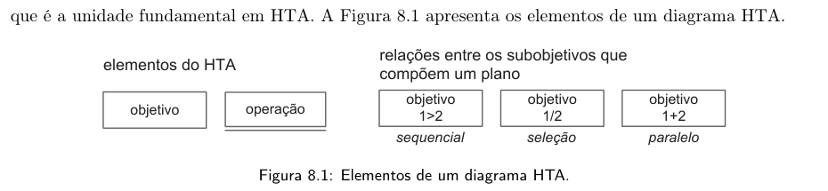

**Figura 5** — Evidência documental referente ao item `HTA-04`.  
_Fonte: BARBOSA, Simone Diniz Junqueira et al. Interação Humano-Computador e Experiência do Usuário. 1. ed. Rio de Janeiro: Autopublicação, 2021, p. 165 (Capítulo 8, Seção 8.4.1, Figura 8.1)._

A **Figura 6** reproduz o trecho comprobatório de referência referente ao critério **HTA-05**.

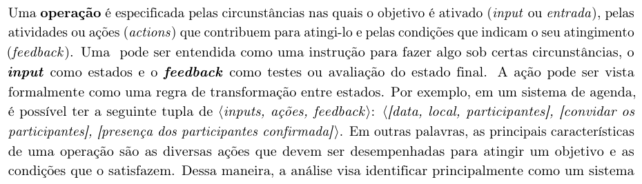

**Figura 6** — Evidência documental referente ao item `HTA-05`.  
_Fonte: BARBOSA, Simone Diniz Junqueira et al. Interação Humano-Computador e Experiência do Usuário. 1. ed. Rio de Janeiro: Autopublicação, 2021, p. 165 (Capítulo 8, Seção 8.4.1)._

A **Figura 7** reproduz o trecho comprobatório de referência referente ao critério **HTA-06**.

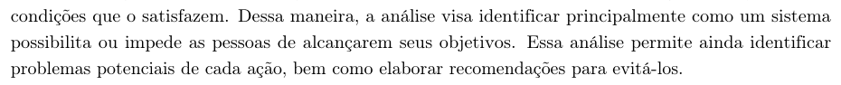

**Figura 7** — Evidência documental referente ao item `HTA-06`.  
_Fonte: BARBOSA, Simone Diniz Junqueira et al. Interação Humano-Computador e Experiência do Usuário. 1. ed. Rio de Janeiro: Autopublicação, 2021, p. 165 (Capítulo 8, Seção 8.4.1)._

A **Figura 8** reproduz o trecho comprobatório de referência referente ao critério **HTA-07**.

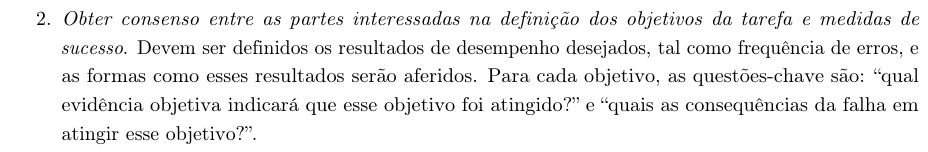

**Figura 8** — Evidência documental referente ao item `HTA-07`.  
_Fonte: BARBOSA, Simone Diniz Junqueira et al. Interação Humano-Computador e Experiência do Usuário. 1. ed. Rio de Janeiro: Autopublicação, 2021, p. 166 (Capítulo 8, Seção 8.4.1)._

A **Figura 9** reproduz o trecho comprobatório de referência referente ao critério **HTA-08**.

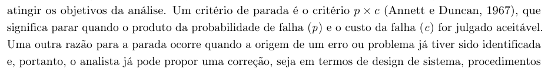

**Figura 9** — Evidência documental referente ao item `HTA-08`.  
_Fonte: BARBOSA, Simone Diniz Junqueira et al. Interação Humano-Computador e Experiência do Usuário. 1. ed. Rio de Janeiro: Autopublicação, 2021, p. 166 (Capítulo 8, Seção 8.4.1); ANNETT, J.; DUNCAN, K. D., 1967._

A **Figura 10** reproduz o trecho comprobatório de referência referente ao critério **HTA-09**.

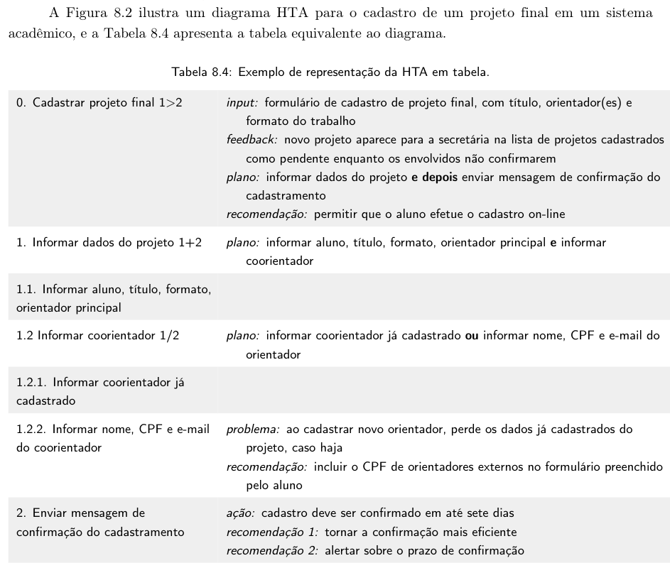

**Figura 10** — Evidência documental referente ao item `HTA-09`.  
_Fonte: BARBOSA, Simone Diniz Junqueira et al. Interação Humano-Computador e Experiência do Usuário. 1. ed. Rio de Janeiro: Autopublicação, 2021, pp. 165-167 (Capítulo 8, Seção 8.4.1, Figura 8.2 e Tabela 8.4)._

A **Figura 11** reproduz o trecho comprobatório de referência referente ao critério **HTA-10**.

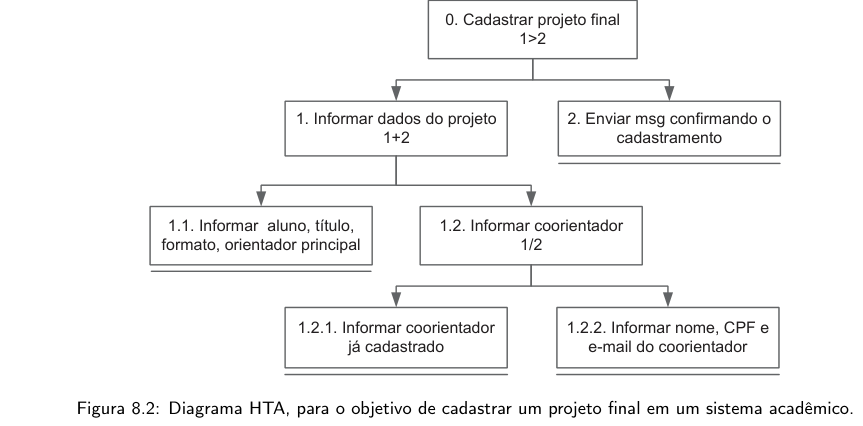

**Figura 11** — Evidência documental referente ao item `HTA-10`.  
_Fonte: BARBOSA, Simone Diniz Junqueira et al. Interação Humano-Computador e Experiência do Usuário. 1. ed. Rio de Janeiro: Autopublicação, 2021, pp. 165 e 167 (Capítulo 8, Seção 8.4.1, Figuras 8.1 e 8.2)._

---

## 3. Validação desta Lista pela Lista de Governança do Prof. Dr. André Barros de Sales (`DG-01` a `DG-11`)

Em estrito cumprimento às diretrizes de qualidade do Plano de Ensino (*Sales, 2026, pp. 8–9*), a **Tabela 4** submete esta própria página (`10-hta.md`) aos **11 Itens de Desenvolvimento do Projeto** formulados pelo Prof. Dr. André Barros de Sales.

**Tabela 4** — Autoavaliação de `10-hta.md` frente aos critérios `DG-01` a `DG-11`

| ID | Critério de Governança do Plano de Ensino | Autor do Item | Resposta | Versão, Data e Hora da Avaliação | Evidência de Conformidade nesta Lista |
| :---: | :--- | :--- | :---: | :---: | :--- |
| **DG-01** | O histórico de versão padronizado? | **Prof. Dr. André Barros de Sales** *(Plano de Ensino FGA0173, 2026)* | ✅ **Sim (Conforme)** | `v2.0` — 20/11/2026 às 14:30 | Seção **Histórico de Versão** (**Tabela 5**) padronizada ao final de `10-hta.md` registrando `v2.0`. |
| **DG-02** | O(s) autor(es) e o(s) revisor(es) para cada artefato? | **Prof. Dr. André Barros de Sales** *(Plano de Ensino FGA0173, 2026)* | ✅ **Sim (Conforme)** | `v2.0` — 20/11/2026 às 14:30 | Colunas **Autor(es)** e **Revisor(es)** preenchidas com links GitHub no Histórico de Versão, além da coluna **`Autor do Item`** em 100% dos critérios da lista. |
| **DG-03** | Referências bibliográficas e/ou bibliografia em todos os artefatos? | **Prof. Dr. André Barros de Sales** *(Plano de Ensino FGA0173, 2026)* | ✅ **Sim (Conforme)** | `v2.0` — 20/11/2026 às 14:30 | Seção **Referências Bibliográficas (ABNT NBR 6023)** completa ao final do documento com obras, edições e páginas exatas. |
| **DG-04** | As tabelas e imagens possuem legenda e fonte e são chamadas dentro do texto? | **Prof. Dr. André Barros de Sales** *(Plano de Ensino FGA0173, 2026)* | ✅ **Sim (Conforme)** | `v2.0` — 20/11/2026 às 14:30 | 100% das tabelas (`Tabela 1` a `Tabela 5`) e figuras (`Figura 1` a `Figura 11`) possuem numeração, legenda, fonte e chamadas textuais prévias. |
| **DG-05** | Um texto fazendo uma introdução dos artefatos? | **Prof. Dr. André Barros de Sales** *(Plano de Ensino FGA0173, 2026)* | ✅ **Sim (Conforme)** | `v2.0` — 20/11/2026 às 14:30 | Seção **1. Introdução e Contextualização Metodológica** situa o instrumento no Ciclo de Mayhew (1999) e na Inspeção Formal de Fagan (1976). |
| **DG-06** | O cronograma executado com quem realizou cada artefato/atividade e as datas de início e fim da construção/realização? | **Prof. Dr. André Barros de Sales** *(Plano de Ensino FGA0173, 2026)* | ✅ **Sim (Conforme)** | `v2.0` — 20/11/2026 às 14:30 | Registros de elaboração e revisão vinculados ao [Cronograma Executado](../../planejamento/cronograma-executado.md) e ao histórico Git da equipe. |
| **DG-07** | Ata(s) da(s) reuniões (com data, horário de início e do final, participantes, objetivo, atividades definidas etc.)? | **Prof. Dr. André Barros de Sales** *(Plano de Ensino FGA0173, 2026)* | ✅ **Sim (Conforme)** | `v2.0` — 20/11/2026 às 14:30 | Deliberações e alinhamentos documentados nas [Atas de Reunião](../../atas/index.md). |
| **DG-08** | A gravação da reunião do grupo? | **Prof. Dr. André Barros de Sales** *(Plano de Ensino FGA0173, 2026)* | ✅ **Sim (Conforme)** | `v2.0` — 20/11/2026 às 14:30 | Links funcionais de gravações das reuniões de planejamento e auditoria indexados em [Atas de Reunião](../../atas/index.md). |
| **DG-09** | Vídeo de apresentação na categoria 'Não Listado' no YouTube (duração entre 20 e 30 minutos)? | **Prof. Dr. André Barros de Sales** *(Plano de Ensino FGA0173, 2026)* | ⚠️ **Em preparação (Etapa 8)** | `v2.0` — 20/11/2026 às 14:30 | Vídeos das Entregas 1–7 publicados; vídeo oficial da [Entrega 8 — Verificação dos Artefatos](../../entregas/entrega8.md) (20–30 min, Não Listado) agendado após consolidação das inspeções da equipe. |
| **DG-10** | Tabela de contribuição no início do artefato com o nome de todos os integrantes, contribuição com hiperligação da atividade e da gravação? | **Prof. Dr. André Barros de Sales** *(Plano de Ensino FGA0173, 2026)* | ✅ **Sim (Conforme)** | `v2.0` — 20/11/2026 às 14:30 | **Tabela 1** posicionada no topo do documento discriminando cada integrante ativo com hiperligação GitHub e escopo de atuação. |
| **DG-11** | A seção de agradecimentos apresentando o uso de Inteligência Artificial (IA) Generativa no artefato? | **Prof. Dr. André Barros de Sales** *(Plano de Ensino FGA0173, 2026)* | ✅ **Sim (Conforme)** | `v2.0` — 20/11/2026 às 14:30 | Seção **Agradecimentos e Declaração de Uso de IA Generativa** ao final do documento em estrita conformidade com o Código da SBC e Sales (2026). |

_Fonte: Validação elaborada por Vinicius Silva Araruna com base na rubrica oficial de Prof. Dr. André Barros de Sales (Plano de Ensino, 2026, pp. 8–9)._

---

## 4. Histórico de Versão

A **Tabela 5** registra a evolução histórica e o controle de versionamento deste instrumento normativo.

**Tabela 5** — Histórico de Versão do Documento

| Versão | Data | Descrição Detalhada da Modificação | Autor(es) | Revisor(es) |
| :---: | :---: | :--- | :--- | :--- |
| `1.0` | 26/09/2026 | Versão inicial com 9 critérios elaborada na Entrega 2. | [Vinicius Silva Araruna](https://github.com/ViniciusA05) | [Edvaldo Soares Brasileiro Filho](https://github.com/PajeMurici-dev) |
| `2.0` | 20/11/2026 | Revisão com ajuste da citação literal no Item 3, inclusão do critério de barra terminal (10 itens totais), exibição integral de `<Inputs, Ações, Feedback>` no Item 5, troca dos recortes pela Tabela 8.4 completa, inclusão dos itens do Prof. André (`PE-E2-10..12`) e validação `DG-01..11`. | [Vinicius Silva Araruna](https://github.com/ViniciusA05) | [Gustavo Antonio Rodrigues e Silva](https://github.com/gus-ant), [Edvaldo Soares Brasileiro Filho](https://github.com/PajeMurici-dev) |

_Fonte: Elaborada pelos autores, 2026._

---

## 5. Referências Bibliográficas (ABNT NBR 6023)

[1] BARBOSA, Simone Diniz Junqueira et al. Interação Humano-Computador e Experiência do Usuário. 1. ed. Rio de Janeiro: Autopublicação, 2021, Cap. 8, Seção 8.4.1 (Análise Hierárquica de Tarefas), pp. 164-167.

[2] ANNETT, J.; DUNCAN, K. D. Task analysis and training design. Occupational Psychology, v. 41, p. 211-221, 1967.

[3] DIAPER, Dan. Understanding task analysis for human-computer interaction. In: DIAPER, D.; STANTON, N. (Ed.). The Handbook of Task Analysis for Human-Computer Interaction. Lawrence Erlbaum, 2003.

[4] BARBOSA, Simone Diniz Junqueira; SILVA, Bruno Santana da. *Interação Humano-Computador*. 1. ed. Rio de Janeiro: Elsevier / Campus, 2010.

[5] FAGAN, Michael E. Design and code inspections to reduce errors in program development. *IBM Systems Journal*, v. 15, n. 3, p. 182–211, 1976.

[6] MAYHEW, Deborah J. *The Usability Engineering Lifecycle: A Practitioner's Handbook for User Interface Design*. San Francisco: Morgan Kaufmann, 1999.

[7] SALES, André Barros de. *Plano de Ensino da Disciplina de Interação Humano Computador (FGA0173 — 02/2026)*. Brasília: Universidade de Brasília, Faculdade UnB Gama (FGA), 2026.

[8] SOCIEDADE BRASILEIRA DE COMPUTAÇÃO (SBC). *Código de Conduta da Sociedade Brasileira de Computação*. Porto Alegre: SBC, 2023.

---

## 6. Agradecimentos e Declaração de Uso de Inteligência Artificial (IA) Generativa

Em conformidade com o Código de Conduta da Sociedade Brasileira de Computação (SBC, Art. 2º, parágrafo III) e com as diretrizes do Plano de Ensino da disciplina (*Sales, 2026, p. 3*), declara-se que a organização das tabelas em Markdown e a revisão ortográfica contaram com suporte supervisionado da ferramenta de Inteligência Artificial Generativa Google Gemini. Toda a concepção metodológica, verificação bibliográfica nas obras originais, revisão técnica e validação de conformidade foram realizadas pelos discentes identificados no Histórico de Versão.
