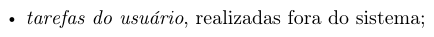
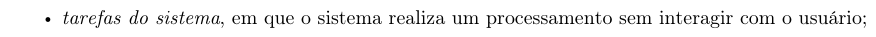
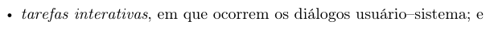
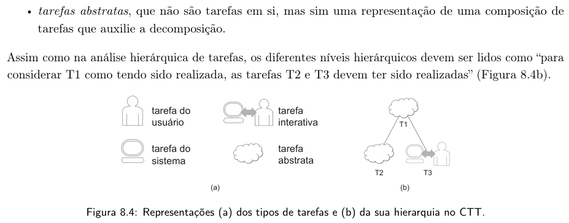
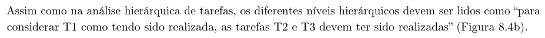
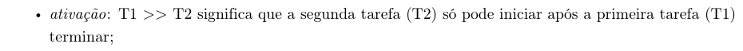
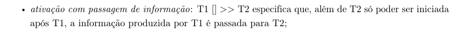
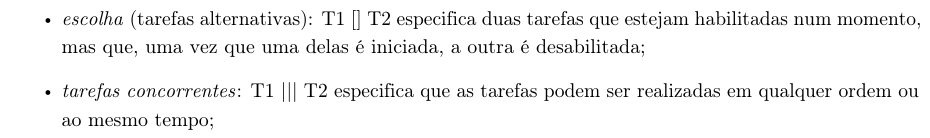
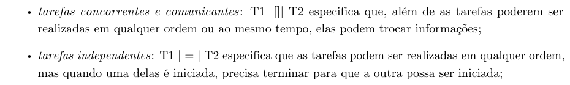
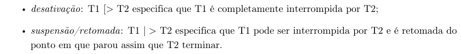

# Lista de Verificação — Árvores de Tarefas Concorrentes (CTT)

## Tabela de Contribuição e Transparência de IA Generativa

A **Tabela 1** apresenta a distribuição de responsabilidades na elaboração, curadoria e revisão de **Árvores de Tarefas Concorrentes (CTT)**.

**Tabela 1** — Matriz de Contribuição e Transparência de IA Generativa — Árvores de Tarefas Concorrentes (CTT)

| Integrante | Atribuição no Artefato | Data | Horário | Ferramenta de IA | Propósito do Uso de IA |
| :--- | :--- | :---: | :---: | :--- | :--- |
| [Vinicius Silva Araruna](https://github.com/ViniciusA05) | Elaboração modular dos critérios de `CTT`, citação direta, recortes da obra e autoavaliação pela rubrica `DG-01` a `DG-11` | 20/11/2026 | 14:00 - 15:30 | Google Gemini | Suporte na organização estrutural, formatação de tabelas em Markdown e conferência cruzada com o Plano de Ensino |
| [Gustavo Antonio Rodrigues e Silva](https://github.com/gus-ant) | Revisão de conformidade estrutural, navegação e checagem de links | 20/11/2026 | 15:30 - 16:00 | — | Revisão por pares e validação editorial |
| [Edvaldo Soares Brasileiro Filho](https://github.com/PajeMurici-dev) | Auditoria de rastreabilidade frente ao Plano de Ensino (`DG-01` a `DG-11`) e referências ABNT | 20/11/2026 | 15:30 - 16:00 | — | Revisão por pares e conferência documental |

_Fonte: Elaborada pelos autores, 2026._

---

## 1. Introdução e Contextualização Metodológica

Este módulo verifica as modelagens em **Árvores de Tarefas Concorrentes (ConcurTaskTrees — CTT)** (Paternò, 1999; Barbosa et al., 2021, Cap. 8, pp. 173–175), cobrindo as 4 categorias de tarefas com iconografia padrão (usuário, sistema, interação e tarefa abstrata com ícone de nuvem na Fig. 8.4a), hierarquia estrita em árvore e todos os 8 operadores temporais LOTOS (`>>`, `[] >>`, `[]`, `|||`, `|[]|`, `|=|`, `[>`, `|>`).

Este instrumento normativo atua segundo o **Método de Inspeção Formal de Michael E. Fagan (1976)** e encontra-se desacoplado dos relatórios empíricos de aplicação. Toda inspeção registrada aqui identifica obrigatoriamente o **`Autor do Item`**, a **fundamentação bibliográfica com recorte visual** e a coluna **`Versão, Data e Hora da Avaliação`** exigida pelo Plano de Ensino (*Sales, 2026, pp. 8–13*).

!!! info "Pré-requisito Transversal de Governança (Prof. Dr. André Barros de Sales)"
    Além dos critérios específicos deste artefato listados na **Seção 2**, todo produto de trabalho avaliado deve cumprir integralmente os **11 Itens de Desenvolvimento Geral (`DG-01` a `DG-11`)** definidos pelo Prof. Dr. André Barros de Sales em [00. Governança e Plano de Ensino Geral](00-plano-ensino-geral.md).

---

## 2. Instrumento Normativo de Verificação — Árvores de Tarefas Concorrentes (CTT)

### 2.1 Critérios Técnicos da Literatura Canônica (Lista de Verificação `CTT`)

A **Tabela 2** apresenta os **10 itens normativos** fundamentados na literatura científica com citação direta literal e recorte visual da página.

**Tabela 2** — Lista de verificação normativa de Árvores de Tarefas Concorrentes (CTT) (10 itens)

| ID | Critério / Pergunta de Verificação | Autor do Item | Fundamentação Canônica (Obra, Ed., Cap., Pág.) e Citação Literal | Evidência Visual (Figura) | Resposta | Versão, Data e Hora da Avaliação |
| :---: | :--- | :--- | :--- | :---: | :---: | :---: |
| **CTT-01** | **Identificação e Notação Canônica das Tarefas do Usuário** O modelo CTT classifica corretamente as tarefas do usuário — atividades físicas ou cognitivas executadas inteiramente fora do sistema computacional — empregando o ícone canônico de figura humana/pessoa (Figura 8.4a)? • **Semântica correta:** tarefas realizadas inteiramente pelo usuário fora do sistema; • **Notação da Figura 8.4a:** ícone representativo de pessoa; • **Distinção clara:** não confundir atividades mentais/físicas externas com comandos na interface. | [Vinicius Silva Araruna](https://github.com/ViniciusA05) | *"• tarefas do usuário, realizadas fora do sistema;"* BARBOSA, Simone Diniz Junqueira et al. Interação Humano-Computador e Experiência do Usuário. 1. ed. Rio de Janeiro: Autopublicação, 2021, p. 173 (Capítulo 8, Seção 8.4.3, Figura 8.4a); PATERNÒ, Fabio, 1999. | [Ver Figura 1](#figura-1) | `[ ] Sim (Conforme)` `[ ] Não (Não Conforme)` `[ ] Incompleto` `[ ] N/A` | *(Preencher na inspeção)* |
| **CTT-02** | **Identificação e Notação Canônica das Tarefas do Sistema** O modelo CTT identifica adequadamente as tarefas do sistema — processamentos executados pelo sistema sem interagir diretamente com o usuário durante a realização — empregando o ícone canônico de monitor/computador (Figura 8.4a)? • **Semântica correta:** processamento interno autônomo sem interação com o usuário; • **Notação da Figura 8.4a:** ícone de monitor/computador; • **Coerência no fluxo:** posicionamento correto de validações, consultas ao banco e notificações automáticas. | [Vinicius Silva Araruna](https://github.com/ViniciusA05) | *"• tarefas do sistema, em que o sistema realiza um processamento sem interagir com o usuário;"* BARBOSA, Simone Diniz Junqueira et al. Interação Humano-Computador e Experiência do Usuário. 1. ed. Rio de Janeiro: Autopublicação, 2021, p. 173 (Capítulo 8, Seção 8.4.3, Figura 8.4a); PATERNÒ, Fabio, 1999. | [Ver Figura 2](#figura-2) | `[ ] Sim (Conforme)` `[ ] Não (Não Conforme)` `[ ] Incompleto` `[ ] N/A` | *(Preencher na inspeção)* |
| **CTT-03** | **Identificação e Notação Canônica das Tarefas Interativas** O modelo CTT diferencia corretamente as tarefas interativas — nas quais ocorrem os diálogos usuário-sistema — empregando o ícone combinado de pessoa e monitor/seta bidirecional (Figura 8.4a)? • **Semântica correta:** troca ativa de ações e respostas entre usuário e interface; • **Notação da Figura 8.4a:** ícone de interação usuário-computador; • **Foco nos pontos de diálogo:** seleção de botões, preenchimento de campos e confirmações. | [Vinicius Silva Araruna](https://github.com/ViniciusA05) | *"• tarefas interativas, em que ocorrem os diálogos usuário–sistema; e"* BARBOSA, Simone Diniz Junqueira et al. Interação Humano-Computador e Experiência do Usuário. 1. ed. Rio de Janeiro: Autopublicação, 2021, p. 173 (Capítulo 8, Seção 8.4.3, Figura 8.4a); PATERNÒ, Fabio, 1999. | [Ver Figura 3](#figura-3) | `[ ] Sim (Conforme)` `[ ] Não (Não Conforme)` `[ ] Incompleto` `[ ] N/A` | *(Preencher na inspeção)* |
| **CTT-04** | **Identificação e Notação Canônica (Nuvem) das Tarefas Abstratas** O modelo CTT utiliza tarefas abstratas exclusivamente para representar composições lógicas de tarefas que auxiliam a decomposição hierárquica nos níveis superiores/intermediários (sem serem ações atômicas), utilizando o ícone canônico de nuvem (Figura 8.4a)? • **Semântica correta:** não são tarefas atômicas em si, mas agrupadores de subtarefas para decomposição; • **Ícone canônico da Figura 8.4a:** uso obrigatório do símbolo de nuvem (e não de árvore/retângulo genérico); • **Aplicação na hierarquia:** nós-pai compostos por múltiplas subtarefas heterogêneas usam tarefa abstrata. | [Vinicius Silva Araruna](https://github.com/ViniciusA05) | *"• tarefas abstratas, que não são tarefas em si, mas sim uma representação de uma composição de tarefas que auxilie a decomposição."* BARBOSA, Simone Diniz Junqueira et al. Interação Humano-Computador e Experiência do Usuário. 1. ed. Rio de Janeiro: Autopublicação, 2021, p. 173 (Capítulo 8, Seção 8.4.3, Figura 8.4a); PATERNÒ, Fabio, 1999. | [Ver Figura 4](#figura-4) | `[ ] Sim (Conforme)` `[ ] Não (Não Conforme)` `[ ] Incompleto` `[ ] N/A` | *(Preencher na inspeção)* |
| **CTT-05** | **Hierarquia Estrita de Decomposição em Árvore CTT (Figura 8.4b)** Os diferentes níveis hierárquicos da árvore CTT respeitam a leitura estrita da Figura 8.4b — 'para considerar T1 como tendo sido realizada, as tarefas T2 e T3 devem ter sido realizadas' — conforme a relação temporal definida entre as irmãs? • **Semântica formal (Figura 8.4b):** a realização do nó superior depende da conclusão de sua composição subordinada; • **Decomposição decrescente:** avanço lógico de tarefas abstratas até tarefas folha concretas; • **Vínculo hierárquico único:** integridade em árvore conectada da raiz às folhas. | [Vinicius Silva Araruna](https://github.com/ViniciusA05) | *"Assim como na análise hierárquica de tarefas, os diferentes níveis hierárquicos devem ser lidos como 'para considerar T1 como tendo sido realizada, as tarefas T2 e T3 devem ter sido realizadas' (Figura 8.4b)."* BARBOSA, Simone Diniz Junqueira et al. Interação Humano-Computador e Experiência do Usuário. 1. ed. Rio de Janeiro: Autopublicação, 2021, p. 173 (Capítulo 8, Seção 8.4.3, Figura 8.4b). | [Ver Figura 5](#figura-5) | `[ ] Sim (Conforme)` `[ ] Não (Não Conforme)` `[ ] Incompleto` `[ ] N/A` | *(Preencher na inspeção)* |
| **CTT-06** | **Operador Temporal de Ativação Sequencial (T1 >> T2)** O modelo emprega o operador de ativação sequencial T1 >> T2 para indicar estritamente que a segunda tarefa (T2) só pode ser iniciada após o término da primeira tarefa (T1), sem troca explícita de informação especificada? • **Notação da Figura 8.5:** símbolo '>>' corretamente grafado entre nós irmãos; • **Restrição de precedência:** T2 desabilitada até a conclusão completa de T1; • **Distinção clara de []>>:** uso de '>>' apenas quando não há transporte explícito de dados de saída. | [Vinicius Silva Araruna](https://github.com/ViniciusA05) | *"• ativação: T1 >> T2 significa que a segunda tarefa (T2) só pode iniciar após a primeira tarefa (T1) terminar;"* BARBOSA, Simone Diniz Junqueira et al. Interação Humano-Computador e Experiência do Usuário. 1. ed. Rio de Janeiro: Autopublicação, 2021, pp. 173-174 (Capítulo 8, Seção 8.4.3, Figura 8.5). | [Ver Figura 6](#figura-6) | `[ ] Sim (Conforme)` `[ ] Não (Não Conforme)` `[ ] Incompleto` `[ ] N/A` | *(Preencher na inspeção)* |
| **CTT-07** | **Operador Temporal de Ativação com Passagem de Informação (T1 []>> T2)** O modelo emprega o operador T1 []>> T2 sempre que, além de T2 só poder iniciar após o término de T1, a informação produzida durante T1 é passada como entrada para T2? • **Notação da Figura 8.5:** símbolo '[]>>' entre tarefas acopladas por fluxo de dados; • **Transferência explícita:** parâmetros preenchidos/gerados em T1 alimentam diretamente T2; • **Consistência com a Figura 8.6:** aplicação coerente em buscas, seleções e formulários sequenciais. | [Vinicius Silva Araruna](https://github.com/ViniciusA05) | *"• ativação com passagem de informação: T1 [] >> T2 especifica que, além de T2 só poder ser iniciada após T1, a informação produzida por T1 é passada para T2;"* BARBOSA, Simone Diniz Junqueira et al. Interação Humano-Computador e Experiência do Usuário. 1. ed. Rio de Janeiro: Autopublicação, 2021, pp. 173-174 (Capítulo 8, Seção 8.4.3, Figura 8.5). | [Ver Figura 7](#figura-7) | `[ ] Sim (Conforme)` `[ ] Não (Não Conforme)` `[ ] Incompleto` `[ ] N/A` | *(Preencher na inspeção)* |
| **CTT-08** | **Operadores de Escolha (T1 [] T2) e Tarefas Concorrentes (T1 &#124;&#124;&#124; T2)** A árvore CTT distingue com rigor o operador de escolha (T1 [] T2, onde duas tarefas estão habilitadas, mas iniciar uma desabilita a outra) do operador de tarefas concorrentes (T1 &#124;&#124;&#124; T2, onde podem ser realizadas em qualquer ordem ou ao mesmo tempo)? • **Escolha exclusiva ([]):** alternativas habilitadas em que o início de uma desabilita a outra; • **Concorrência livre (&#124;&#124;&#124;):** tarefas sem dependência rígida, executáveis em qualquer ordem ou simultaneamente; • **Ausência de confusão semântica:** alternativas mutuamente excludentes não são marcadas como concorrentes. | [Vinicius Silva Araruna](https://github.com/ViniciusA05) | *"• escolha (tarefas alternativas): T1 [] T2 especifica duas tarefas que estejam habilitadas num momento, mas que, uma vez que uma delas é iniciada, a outra é desabilitada; • tarefas concorrentes: T1 &#124;&#124;&#124; T2 especifica que as tarefas podem ser realizadas em qualquer ordem ou ao mesmo tempo;"* BARBOSA, Simone Diniz Junqueira et al. Interação Humano-Computador e Experiência do Usuário. 1. ed. Rio de Janeiro: Autopublicação, 2021, pp. 173-174 (Capítulo 8, Seção 8.4.3, Figura 8.5). | [Ver Figura 8](#figura-8) | `[ ] Sim (Conforme)` `[ ] Não (Não Conforme)` `[ ] Incompleto` `[ ] N/A` | *(Preencher na inspeção)* |
| **CTT-09** | **Operadores de Concorrência Comunicante (T1 &#124;[]&#124; T2) e Independência (T1 &#124;=&#124; T2)** Quando aplicável à interação modelada, o diagrama CTT utiliza corretamente T1 &#124;[]&#124; T2 para tarefas concorrentes que podem trocar informações entre si e T1 &#124;=&#124; T2 para tarefas independentes cuja ordem é livre, mas uma vez iniciada uma delas precisa terminar antes que a outra inicie? • **Concorrência comunicante (&#124;[]&#124;):** tarefas executáveis ao mesmo tempo/qualquer ordem com troca de informações (ex.: preview ao vivo ao digitar); • **Independência de ordem (&#124;=&#124;):** ordem livre, porém com execução mútua não entrelaçada até o término; • **Completude dos 8 operadores LOTOS:** cobertura integral das relações descritas na Seção 8.4.3. | [Vinicius Silva Araruna](https://github.com/ViniciusA05) | *"• tarefas concorrentes e comunicantes: T1 &#124;[]&#124; T2 especifica que, além de as tarefas poderem ser realizadas em qualquer ordem ou ao mesmo tempo, elas podem trocar informações; • tarefas independentes: T1 &#124;=&#124; T2 especifica que as tarefas podem ser realizadas em qualquer ordem, mas quando uma delas é iniciada, precisa terminar para que a outra possa ser iniciada;"* BARBOSA, Simone Diniz Junqueira et al. Interação Humano-Computador e Experiência do Usuário. 1. ed. Rio de Janeiro: Autopublicação, 2021, pp. 173-174 (Capítulo 8, Seção 8.4.3, Figura 8.5). | [Ver Figura 9](#figura-9) | `[ ] Sim (Conforme)` `[ ] Não (Não Conforme)` `[ ] Incompleto` `[ ] N/A` | *(Preencher na inspeção)* |
| **CTT-10** | **Operadores de Desativação (T1 [> T2) e Suspensão/Retomada (T1 &#124;> T2)** O modelo CTT representa adequadamente exceções e interrupções distinguindo T1 [> T2 (desativação definitiva de T1 por T2, ex.: cancelar tarefa) de T1 &#124;> T2 (suspensão temporária de T1 por T2 com retomada do ponto em que parou após T2 terminar)? • **Desativação definitiva ([>):** T2 interrompe e encerra completamente T1 sem retorno; • **Suspensão e retomada (&#124;>):** T1 é pausada por T2 e retomada exatamente de onde parou após o término de T2; • **Coerência notacional:** uso exato de '[>' e '&#124;>' entre irmãos sem anexar operadores soltos dentro de rótulos. | [Vinicius Silva Araruna](https://github.com/ViniciusA05) | *"• desativação: T1 [> T2 especifica que T1 é completamente interrompida por T2; • suspensão/retomada: T1 &#124;> T2 especifica que T1 pode ser interrompida por T2 e é retomada do ponto em que parou assim que T2 terminar."* BARBOSA, Simone Diniz Junqueira et al. Interação Humano-Computador e Experiência do Usuário. 1. ed. Rio de Janeiro: Autopublicação, 2021, pp. 173-174 (Capítulo 8, Seção 8.4.3, Figura 8.5). | [Ver Figura 10](#figura-10) | `[ ] Sim (Conforme)` `[ ] Não (Não Conforme)` `[ ] Incompleto` `[ ] N/A` | *(Preencher na inspeção)* |

_Fonte: Elaborada por [Vinicius Silva Araruna](https://github.com/ViniciusA05), 2026._

### Evidências Visuais da Literatura e do Plano de Ensino

Cada figura a seguir é chamada explicitamente e vinculada ao respectivo critério na tabela normativa acima.

A **Figura 1** reproduz o trecho comprobatório de referência referente ao critério **CTT-01**.

**Figura 1** — Evidência documental referente ao item `CTT-01`.  
_Fonte: BARBOSA, Simone Diniz Junqueira et al. Interação Humano-Computador e Experiência do Usuário. 1. ed. Rio de Janeiro: Autopublicação, 2021, p. 173 (Capítulo 8, Seção 8.4.3, Figura 8.4a); PATERNÒ, Fabio, 1999._

A **Figura 2** reproduz o trecho comprobatório de referência referente ao critério **CTT-02**.

**Figura 2** — Evidência documental referente ao item `CTT-02`.  
_Fonte: BARBOSA, Simone Diniz Junqueira et al. Interação Humano-Computador e Experiência do Usuário. 1. ed. Rio de Janeiro: Autopublicação, 2021, p. 173 (Capítulo 8, Seção 8.4.3, Figura 8.4a); PATERNÒ, Fabio, 1999._

A **Figura 3** reproduz o trecho comprobatório de referência referente ao critério **CTT-03**.

**Figura 3** — Evidência documental referente ao item `CTT-03`.  
_Fonte: BARBOSA, Simone Diniz Junqueira et al. Interação Humano-Computador e Experiência do Usuário. 1. ed. Rio de Janeiro: Autopublicação, 2021, p. 173 (Capítulo 8, Seção 8.4.3, Figura 8.4a); PATERNÒ, Fabio, 1999._

A **Figura 4** reproduz o trecho comprobatório de referência referente ao critério **CTT-04**.

**Figura 4** — Evidência documental referente ao item `CTT-04`.  
_Fonte: BARBOSA, Simone Diniz Junqueira et al. Interação Humano-Computador e Experiência do Usuário. 1. ed. Rio de Janeiro: Autopublicação, 2021, p. 173 (Capítulo 8, Seção 8.4.3, Figura 8.4a); PATERNÒ, Fabio, 1999._

A **Figura 5** reproduz o trecho comprobatório de referência referente ao critério **CTT-05**.

**Figura 5** — Evidência documental referente ao item `CTT-05`.  
_Fonte: BARBOSA, Simone Diniz Junqueira et al. Interação Humano-Computador e Experiência do Usuário. 1. ed. Rio de Janeiro: Autopublicação, 2021, p. 173 (Capítulo 8, Seção 8.4.3, Figura 8.4b)._

A **Figura 6** reproduz o trecho comprobatório de referência referente ao critério **CTT-06**.

**Figura 6** — Evidência documental referente ao item `CTT-06`.  
_Fonte: BARBOSA, Simone Diniz Junqueira et al. Interação Humano-Computador e Experiência do Usuário. 1. ed. Rio de Janeiro: Autopublicação, 2021, pp. 173-174 (Capítulo 8, Seção 8.4.3, Figura 8.5)._

A **Figura 7** reproduz o trecho comprobatório de referência referente ao critério **CTT-07**.

**Figura 7** — Evidência documental referente ao item `CTT-07`.  
_Fonte: BARBOSA, Simone Diniz Junqueira et al. Interação Humano-Computador e Experiência do Usuário. 1. ed. Rio de Janeiro: Autopublicação, 2021, pp. 173-174 (Capítulo 8, Seção 8.4.3, Figura 8.5)._

A **Figura 8** reproduz o trecho comprobatório de referência referente ao critério **CTT-08**.

**Figura 8** — Evidência documental referente ao item `CTT-08`.  
_Fonte: BARBOSA, Simone Diniz Junqueira et al. Interação Humano-Computador e Experiência do Usuário. 1. ed. Rio de Janeiro: Autopublicação, 2021, pp. 173-174 (Capítulo 8, Seção 8.4.3, Figura 8.5)._

A **Figura 9** reproduz o trecho comprobatório de referência referente ao critério **CTT-09**.

**Figura 9** — Evidência documental referente ao item `CTT-09`.  
_Fonte: BARBOSA, Simone Diniz Junqueira et al. Interação Humano-Computador e Experiência do Usuário. 1. ed. Rio de Janeiro: Autopublicação, 2021, pp. 173-174 (Capítulo 8, Seção 8.4.3, Figura 8.5)._

A **Figura 10** reproduz o trecho comprobatório de referência referente ao critério **CTT-10**.

**Figura 10** — Evidência documental referente ao item `CTT-10`.  
_Fonte: BARBOSA, Simone Diniz Junqueira et al. Interação Humano-Computador e Experiência do Usuário. 1. ed. Rio de Janeiro: Autopublicação, 2021, pp. 173-174 (Capítulo 8, Seção 8.4.3, Figura 8.5)._

---

## 3. Validação desta Lista pela Lista de Governança do Prof. Dr. André Barros de Sales (`DG-01` a `DG-11`)

Em estrito cumprimento às diretrizes de qualidade do Plano de Ensino (*Sales, 2026, pp. 8–9*), a **Tabela 3** submete esta própria página (`11-ctt.md`) aos **11 Itens de Desenvolvimento do Projeto** formulados pelo Prof. Dr. André Barros de Sales.

**Tabela 3** — Autoavaliação de `11-ctt.md` frente aos critérios `DG-01` a `DG-11`

| ID | Critério de Governança do Plano de Ensino | Autor do Item | Resposta | Versão, Data e Hora da Avaliação | Evidência de Conformidade nesta Lista |
| :---: | :--- | :--- | :---: | :---: | :--- |
| **DG-01** | O histórico de versão padronizado? | **Prof. Dr. André Barros de Sales** *(Plano de Ensino FGA0173, 2026)* | ✅ **Sim (Conforme)** | `v2.0` — 20/11/2026 às 14:30 | Seção **Histórico de Versão** (**Tabela 4**) padronizada ao final de `11-ctt.md` registrando `v2.0`. |
| **DG-02** | O(s) autor(es) e o(s) revisor(es) para cada artefato? | **Prof. Dr. André Barros de Sales** *(Plano de Ensino FGA0173, 2026)* | ✅ **Sim (Conforme)** | `v2.0` — 20/11/2026 às 14:30 | Colunas **Autor(es)** e **Revisor(es)** preenchidas com links GitHub no Histórico de Versão, além da coluna **`Autor do Item`** em 100% dos critérios da lista. |
| **DG-03** | Referências bibliográficas e/ou bibliografia em todos os artefatos? | **Prof. Dr. André Barros de Sales** *(Plano de Ensino FGA0173, 2026)* | ✅ **Sim (Conforme)** | `v2.0` — 20/11/2026 às 14:30 | Seção **Referências Bibliográficas (ABNT NBR 6023)** completa ao final do documento com obras, edições e páginas exatas. |
| **DG-04** | As tabelas e imagens possuem legenda e fonte e são chamadas dentro do texto? | **Prof. Dr. André Barros de Sales** *(Plano de Ensino FGA0173, 2026)* | ✅ **Sim (Conforme)** | `v2.0` — 20/11/2026 às 14:30 | 100% das tabelas (`Tabela 1` a `Tabela 4`) e figuras (`Figura 1` a `Figura 10`) possuem numeração, legenda, fonte e chamadas textuais prévias. |
| **DG-05** | Um texto fazendo uma introdução dos artefatos? | **Prof. Dr. André Barros de Sales** *(Plano de Ensino FGA0173, 2026)* | ✅ **Sim (Conforme)** | `v2.0` — 20/11/2026 às 14:30 | Seção **1. Introdução e Contextualização Metodológica** situa o instrumento no Ciclo de Mayhew (1999) e na Inspeção Formal de Fagan (1976). |
| **DG-06** | O cronograma executado com quem realizou cada artefato/atividade e as datas de início e fim da construção/realização? | **Prof. Dr. André Barros de Sales** *(Plano de Ensino FGA0173, 2026)* | ✅ **Sim (Conforme)** | `v2.0` — 20/11/2026 às 14:30 | Registros de elaboração e revisão vinculados ao [Cronograma Executado](../../planejamento/cronograma-executado.md) e ao histórico Git da equipe. |
| **DG-07** | Ata(s) da(s) reuniões (com data, horário de início e do final, participantes, objetivo, atividades definidas etc.)? | **Prof. Dr. André Barros de Sales** *(Plano de Ensino FGA0173, 2026)* | ✅ **Sim (Conforme)** | `v2.0` — 20/11/2026 às 14:30 | Deliberações e alinhamentos documentados nas [Atas de Reunião](../../atas/index.md). |
| **DG-08** | A gravação da reunião do grupo? | **Prof. Dr. André Barros de Sales** *(Plano de Ensino FGA0173, 2026)* | ✅ **Sim (Conforme)** | `v2.0` — 20/11/2026 às 14:30 | Links funcionais de gravações das reuniões de planejamento e auditoria indexados em [Atas de Reunião](../../atas/index.md). |
| **DG-09** | Vídeo de apresentação na categoria 'Não Listado' no YouTube (duração entre 20 e 30 minutos)? | **Prof. Dr. André Barros de Sales** *(Plano de Ensino FGA0173, 2026)* | ⚠️ **Em preparação (Etapa 8)** | `v2.0` — 20/11/2026 às 14:30 | Vídeos das Entregas 1–7 publicados; vídeo oficial da [Entrega 8 — Verificação dos Artefatos](../../entregas/entrega8.md) (20–30 min, Não Listado) agendado após consolidação das inspeções da equipe. |
| **DG-10** | Tabela de contribuição no início do artefato com o nome de todos os integrantes, contribuição com hiperligação da atividade e da gravação? | **Prof. Dr. André Barros de Sales** *(Plano de Ensino FGA0173, 2026)* | ✅ **Sim (Conforme)** | `v2.0` — 20/11/2026 às 14:30 | **Tabela 1** posicionada no topo do documento discriminando cada integrante ativo com hiperligação GitHub e escopo de atuação. |
| **DG-11** | A seção de agradecimentos apresentando o uso de Inteligência Artificial (IA) Generativa no artefato? | **Prof. Dr. André Barros de Sales** *(Plano de Ensino FGA0173, 2026)* | ✅ **Sim (Conforme)** | `v2.0` — 20/11/2026 às 14:30 | Seção **Agradecimentos e Declaração de Uso de IA Generativa** ao final do documento em estrita conformidade com o Código da SBC e Sales (2026). |

_Fonte: Validação elaborada por Vinicius Silva Araruna com base na rubrica oficial de Prof. Dr. André Barros de Sales (Plano de Ensino, 2026, pp. 8–9)._

---

## 4. Histórico de Versão

A **Tabela 4** registra a evolução histórica e o controle de versionamento deste instrumento normativo.

**Tabela 4** — Histórico de Versão do Documento

| Versão | Data | Descrição Detalhada da Modificação | Autor(es) | Revisor(es) |
| :---: | :---: | :--- | :--- | :--- |
| `1.0` | 26/09/2026 | Versão inicial com 9 critérios elaborada na Entrega 2. | [Vinicius Silva Araruna](https://github.com/ViniciusA05) | [Edvaldo Soares Brasileiro Filho](https://github.com/PajeMurici-dev) |
| `2.0` | 20/11/2026 | Revisão com correção do ícone de tarefa abstrata para nuvem (Fig. 8.4a), cobertura dos 8 operadores temporais LOTOS (incluindo `|[]|` e `|=|`) em 10 critérios com recortes nítidos, `Autor do Item` e validação `DG-01..11`. | [Vinicius Silva Araruna](https://github.com/ViniciusA05) | [Gustavo Antonio Rodrigues e Silva](https://github.com/gus-ant), [Edvaldo Soares Brasileiro Filho](https://github.com/PajeMurici-dev) |

_Fonte: Elaborada pelos autores, 2026._

---

## 5. Referências Bibliográficas (ABNT NBR 6023)

[1] BARBOSA, Simone Diniz Junqueira et al. Interação Humano-Computador e Experiência do Usuário. 1. ed. Rio de Janeiro: Autopublicação, 2021, Cap. 8, Seção 8.4.3 (ConcurTaskTrees — CTT), pp. 173-175.

[2] PATERNÒ, Fabio. Model-Based Design and Evaluation of Interactive Applications. Berlin: Springer-Verlag, 1999.

[3] BARBOSA, Simone Diniz Junqueira; SILVA, Bruno Santana da. *Interação Humano-Computador*. 1. ed. Rio de Janeiro: Elsevier / Campus, 2010.

[4] FAGAN, Michael E. Design and code inspections to reduce errors in program development. *IBM Systems Journal*, v. 15, n. 3, p. 182–211, 1976.

[5] MAYHEW, Deborah J. *The Usability Engineering Lifecycle: A Practitioner's Handbook for User Interface Design*. San Francisco: Morgan Kaufmann, 1999.

[6] SALES, André Barros de. *Plano de Ensino da Disciplina de Interação Humano Computador (FGA0173 — 02/2026)*. Brasília: Universidade de Brasília, Faculdade UnB Gama (FGA), 2026.

[7] SOCIEDADE BRASILEIRA DE COMPUTAÇÃO (SBC). *Código de Conduta da Sociedade Brasileira de Computação*. Porto Alegre: SBC, 2023.

---

## 6. Agradecimentos e Declaração de Uso de Inteligência Artificial (IA) Generativa

Em conformidade com o Código de Conduta da Sociedade Brasileira de Computação (SBC, Art. 2º, parágrafo III) e com as diretrizes do Plano de Ensino da disciplina (*Sales, 2026, p. 3*), declara-se que a organização das tabelas em Markdown e a revisão ortográfica contaram com suporte supervisionado da ferramenta de Inteligência Artificial Generativa Google Gemini. Toda a concepção metodológica, verificação bibliográfica nas obras originais, revisão técnica e validação de conformidade foram realizadas pelos discentes identificados no Histórico de Versão.
