# Lista de Verificação — Nível 2 — Protótipo de Papel

## Tabela de Contribuição e Transparência de IA Generativa

A **Tabela 1** apresenta a distribuição de responsabilidades na elaboração, curadoria e revisão de **Nível 2 — Protótipo de Papel**.

**Tabela 1** — Matriz de Contribuição e Transparência de IA Generativa — Nível 2 — Protótipo de Papel

| Integrante | Atribuição no Artefato | Data | Horário | Ferramenta de IA | Propósito do Uso de IA |
| :--- | :--- | :---: | :---: | :--- | :--- |
| [Vinicius Silva Araruna](https://github.com/ViniciusA05) | Elaboração modular dos critérios de `PP`, citação direta, recortes da obra e autoavaliação pela rubrica `DG-01` a `DG-11` | 20/11/2026 | 14:00 - 15:30 | Google Gemini | Suporte na organização estrutural, formatação de tabelas em Markdown e conferência cruzada com o Plano de Ensino |
| [Gustavo Antonio Rodrigues e Silva](https://github.com/gus-ant) | Revisão de conformidade estrutural, navegação e checagem de links | 20/11/2026 | 15:30 - 16:00 | — | Revisão por pares e validação editorial |
| [Gustavo Antonio Rodrigues e Silva](https://github.com/gus-ant) | Integração dos critérios individuais de Protótipo de Papel (`LV-PAPEL-01` a `04`, AC `19/10/2026`): coautoria em `PP-01`, `PP-09` e `PP-15` e inclusão do critério inédito `PP-G01` com recorte `Figura 18` | 22/11/2026 | 15:25 - 16:00 | Antigravity / Gemini | Suporte sintático Markdown e extração de recorte grifado de Barbosa et al. (2021, p. 305) |
| [Edvaldo Soares Brasileiro Filho](https://github.com/PajeMurici-dev) | Auditoria de rastreabilidade frente ao Plano de Ensino (`DG-01` a `DG-11`) e referências ABNT | 20/11/2026 | 15:30 - 16:00 | — | Revisão por pares e conferência documental |

_Fonte: Elaborada pelos autores, 2026._

---

## 1. Introdução e Contextualização Metodológica

Este módulo verifica exclusivamente a técnica de **Prototipação em Papel** (Nível 2 do Ciclo de Mayhew), fundamentada integralmente na Seção 12.2.3 e nas matrizes comparativas da Seção 12.2.4 de Barbosa et al. (2021, 1. ed., pp. 303–308) e Snyder (2003). Reúne os **17 critérios técnicos `PP-01` a `PP-17`** (com **3 itens em coautoria** com Gustavo Antonio) e o **critério complementar `PP-G01`** sobre rastreabilidade direta das telas com a Análise Hierárquica de Tarefas (HTA) e Cenários de Uso.

Este instrumento normativo atua segundo o **Método de Inspeção Formal de Michael E. Fagan (1976)** e encontra-se desacoplado dos relatórios empíricos de aplicação. Toda inspeção registrada aqui identifica obrigatoriamente o **`Autor do Item`**, a **fundamentação bibliográfica com recorte visual** e a coluna **`Versão, Data e Hora da Avaliação`** exigida pelo Plano de Ensino (*Sales, 2026, pp. 8–13*).

!!! info "Pré-requisito Transversal de Governança (Prof. Dr. André Barros de Sales)"
    Além dos critérios específicos deste artefato listados na **Seção 2**, todo produto de trabalho avaliado deve cumprir integralmente os **11 Itens de Desenvolvimento Geral (`DG-01` a `DG-11`)** definidos pelo Prof. Dr. André Barros de Sales em [00. Governança e Plano de Ensino Geral](00-plano-ensino-geral.md).

!!! note "Rastreabilidade de Aplicação na Equipe"
    Os 15 critérios anteriores desta técnica também foram aplicados por [Edvaldo Soares Brasileiro Filho](https://github.com/PajeMurici-dev) na Tabela 6 de `planejamento-avaliacao-agendamento.md`.

---

## 2. Instrumento Normativo de Verificação — Nível 2 — Protótipo de Papel

### 2.1 Critérios Técnicos da Literatura Canônica (Lista de Verificação `PP`)

A **Tabela 2** apresenta os **17 itens normativos** fundamentados na literatura científica com citação direta literal e recorte visual da página.

**Tabela 2** — Lista de verificação normativa de Nível 2 — Protótipo de Papel (17 itens)

| ID | Critério / Pergunta de Verificação | Autor do Item | Fundamentação Canônica (Obra, Ed., Cap., Pág.) e Citação Literal | Evidência Visual (Figura) | Resposta | Versão, Data e Hora da Avaliação |
| :---: | :--- | :--- | :--- | :---: | :---: | :---: |
| **PP-01** | **[Parte 1 — Natureza, Adequação e Preparação do Protótipo de Papel] Natureza, Fidelidade e Propósito da Prototipação em Papel** O artefato caracteriza a prototipação em papel como método de avaliação formativa rápida e de baixo custo, destinado a avaliar a usabilidade de soluções parciais (baixa ou média fidelidade) por meio de simulações com potenciais usuários antes da construção executável? • **Baixa/média fidelidade e baixo custo:** protótipo em papel como alternativa rápida e econômica; • **Avaliação formativa pré-código:** identificação de problemas antes do desenvolvimento executável e comparação de alternativas de design; • **Soluções parciais e usuários potenciais:** simulação de uso com participantes representativos sem precisar cobrir toda a interface. | [Vinicius Silva Araruna](https://github.com/ViniciusA05) e [Gustavo Antonio Rodrigues e Silva](https://github.com/gus-ant) | *"O método de prototipação em papel (Snyder, 2003) avalia a usabilidade de um design de IHC representado em papel, através de simulações de uso com a participação de potenciais usuários. Simular o uso em papel é um modo rápido e barato de identificar problemas de usabilidade antes mesmo de construir uma solução de IHC executável. Sendo assim, esse método é uma opção interessante para uma avaliação formativa junto aos usuários, principalmente para comparar alternativas de design. Ele permite avaliar facilmente soluções parciais, que não cobrem toda a interface com usuário, e soluções de baixa e média fidelidade, que ainda não definem todos os detalhes da interface."* BARBOSA, Simone Diniz Junqueira et al. Interação Humano-Computador e Experiência do Usuário. 1. ed. Rio de Janeiro: Autopublicação, 2021, p. 303 (Capítulo 12, Seção 12.2.3); SNYDER, Carolyn. Paper Prototyping: The Fast and Easy Way to Design and Refine User Interfaces. Morgan Kaufmann, 2003. | [Ver Figura 1](#figura-1) | `[ ] Sim (Conforme)` `[ ] Não (Não Conforme)` `[ ] Incompleto` `[ ] N/A` | *(Preencher na inspeção)* |
| **PP-02** | **Adequação do Método ao Objetivo, Momento Formativo e Dados Qualitativos** A seleção do método de prototipação em papel é justificada pela sua alta adequação para comparar ideias/alternativas de design (+++) e identificar problemas de IHC (+++), pelo uso prioritariamente formativo (++) antes da solução pronta e pela geração predominante de resultados qualitativos (+++)? • **O que avaliar (Tabela 12.10):** foco em alternativas de design (+++) e problemas na interação/interface (+++); • **Quando avaliar (Tabela 12.11):** aplicação formativa (++) em protótipos não executáveis; • **Tipo de dado produzido (Tabela 12.12):** ênfase em dados qualitativos (+++) sobre o uso em papel. | [Vinicius Silva Araruna](https://github.com/ViniciusA05) | *"Para comparar e avaliar ideias e alternativas de design, costumamos utilizar grupos de foco, avaliação heurística e prototipação em papel... Já a prototipação em papel é mais apropriada para a avaliação formativa, por explorar ideias em papel e não numa solução de IHC executável... Os demais métodos de avaliação costumam fornecer mais resultados qualitativos."* BARBOSA, Simone Diniz Junqueira et al. Interação Humano-Computador e Experiência do Usuário. 1. ed. Rio de Janeiro: Autopublicação, 2021, pp. 306-308 (Capítulo 12, Seção 12.2.4, Tabelas 12.10, 12.11 e 12.12). | [Ver Figura 2](#figura-2) | `[ ] Sim (Conforme)` `[ ] Não (Não Conforme)` `[ ] Incompleto` `[ ] N/A` | *(Preencher na inspeção)* |
| **PP-03** | **Confecção das Telas Estáticas e Peças Dinâmicas Móveis em Papel** O protótipo em papel contempla as telas estáticas (desenhadas à mão livre sem detalhes irrelevantes, destacando os elementos principais de interação) e os pedaços avulsos de papel para partes móveis/dinâmicas (menus, dicas, itens de lista, resultados de busca e diálogos), prevendo o preparo antecipado do previsível e o desenho no papel do que não for possível prever? • **Telas estáticas funcionais:** destaque para os elementos interativos principais sem detalhes cosméticos irrelevantes; • **Peças dinâmicas móveis:** preparo prévio de menus, dicas, resultados de busca e diálogos em recortes avulsos; • **Adaptação ao imprevisto:** disponibilidade de material para desenhar novos elementos durante as simulações. | [Vinicius Silva Araruna](https://github.com/ViniciusA05) | *"Representamos as telas do sistema em papel, em geral desenhadas à mão livre e sem nos preocuparmos com detalhes de interface que não sejam relevantes para a avaliação. A intenção é representar e destacar os elementos principais da interface com os quais o usuário vai interagir durante a simulação da interação. Além das telas estáticas, o avaliador também deve preparar outros pedaços de papel com partes da interface que se modificam durante a interação, como menus, dicas sobre elementos de interface, itens de alguma lista, resultados de busca e diálogos, por exemplo. O que for possível prever deve ser preparado antes das simulações de uso. O que não for possível será desenhado no papel durante as simulações."* BARBOSA, Simone Diniz Junqueira et al. Interação Humano-Computador e Experiência do Usuário. 1. ed. Rio de Janeiro: Autopublicação, 2021, p. 303 (Capítulo 12, Seção 12.2.3). | [Ver Figura 3](#figura-3) | `[ ] Sim (Conforme)` `[ ] Não (Não Conforme)` `[ ] Incompleto` `[ ] N/A` | *(Preencher na inspeção)* |
| **PP-04** | **Definição das Tarefas a Executar e Cobertura pelos Protótipos em Papel** Na atividade de preparação da prototipação em papel (Tabela 12.9), estão definidas claramente as tarefas que os participantes deverão executar nas simulações e foram confeccionados os protótipos em papel da interface necessários para executá-las do início ao fim? • **Tarefas definidas para os participantes:** seleção explícita das atividades a simular em papel; • **Cobertura integral das pranchas:** telas e peças móveis suficientes para percorrer cada tarefa definida; • **Rastreabilidade preparação-execução:** alinhamento direto com as atividades prescritas na Tabela 12.9. | [Vinicius Silva Araruna](https://github.com/ViniciusA05) | *"Tabela 12.9: Atividades do método de prototipação em papel. Preparação: • definir tarefas para os participantes executarem; • definir o perfil dos participantes e recrutá-los; • criar protótipos em papel da interface para executar as tarefas; • executar um teste-piloto."* BARBOSA, Simone Diniz Junqueira et al. Interação Humano-Computador e Experiência do Usuário. 1. ed. Rio de Janeiro: Autopublicação, 2021, p. 304 (Capítulo 12, Seção 12.2.3, Tabela 12.9). | [Ver Figura 4](#figura-4) | `[ ] Sim (Conforme)` `[ ] Não (Não Conforme)` `[ ] Incompleto` `[ ] N/A` | *(Preencher na inspeção)* |
| **PP-05** | **Definição do Perfil e Recrutamento de Potenciais Usuários** A preparação do método define explicitamente o perfil dos participantes e prevê o recrutamento/convite de potenciais usuários compatíveis para executarem as tarefas com apoio do sistema simulado em papel? • **Perfil dos participantes:** especificação clara das características alinhadas aos usuários-alvo; • **Recrutamento e convite:** plano para convidar potenciais usuários representativos às sessões em papel; • **Vinculação com a Tabela 12.9:** execução explícita da atividade 'definir o perfil dos participantes e recrutá-los'. | [Vinicius Silva Araruna](https://github.com/ViniciusA05) | *"Com tudo preparado, o avaliador convida usuários para executarem algumas tarefas com apoio do sistema simulado em papel."* BARBOSA, Simone Diniz Junqueira et al. Interação Humano-Computador e Experiência do Usuário. 1. ed. Rio de Janeiro: Autopublicação, 2021, pp. 303-304 (Capítulo 12, Seção 12.2.3, Tabela 12.9). | [Ver Figura 5](#figura-5) | `[ ] Sim (Conforme)` `[ ] Não (Não Conforme)` `[ ] Incompleto` `[ ] N/A` | *(Preencher na inspeção)* |
| **PP-06** | **Material de Apoio da Sessão em Papel Preparado Previamente** Além de confeccionar as telas e recortes do protótipo em papel, a atividade de preparação contempla o material de apoio necessário à condução e registro da simulação com usuários? • **Material de apoio completo:** roteiro/cenários impressos e guia de registro preparados antes das sessões; • **Integração com o protótipo físico:** verificação prévia da correspondência entre cenários e telas em papel; • **Organização prévia:** garantia de que todos os materiais estejam prontos antes de convidar participantes. | [Vinicius Silva Araruna](https://github.com/ViniciusA05) | *"Na atividade de preparação, além do material de apoio elaborado na maioria das avaliações com usuários (veja Subseção 11.7.2), o avaliador deve elaborar protótipos em papel."* BARBOSA, Simone Diniz Junqueira et al. Interação Humano-Computador e Experiência do Usuário. 1. ed. Rio de Janeiro: Autopublicação, 2021, p. 303 (Capítulo 12, Seção 12.2.3). | [Ver Figura 6](#figura-6) | `[ ] Sim (Conforme)` `[ ] Não (Não Conforme)` `[ ] Incompleto` `[ ] N/A` | *(Preencher na inspeção)* |
| **PP-07** | **Preparação do Ambiente Físico e dos Equipamentos de Registro** A preparação detalha o ambiente em que a simulação em papel ocorrerá (tipicamente uma sala de reunião com mesa e cadeiras) e os equipamentos necessários para registrar os dados da sessão, como gravador de voz e câmera de vídeo? • **Ambiente físico adequado:** sala reservada equipada com mesa ampla para dispor papéis e cadeiras; • **Câmera de vídeo:** equipamento previsto para registrar gestos e trocas das peças em papel; • **Gravador de voz:** captação de áudio para registrar falas e reações dos participantes. | [Vinicius Silva Araruna](https://github.com/ViniciusA05) | *"Em seguida, o avaliador prepara o ambiente em que a simulação vai ocorrer, tipicamente uma sala de reunião com mesa e cadeiras, e prepara os equipamentos necessários para registrar os dados, como gravador de voz e câmera de vídeo."* BARBOSA, Simone Diniz Junqueira et al. Interação Humano-Computador e Experiência do Usuário. 1. ed. Rio de Janeiro: Autopublicação, 2021, p. 304 (Capítulo 12, Seção 12.2.3). | [Ver Figura 7](#figura-7) | `[ ] Sim (Conforme)` `[ ] Não (Não Conforme)` `[ ] Incompleto` `[ ] N/A` | *(Preencher na inspeção)* |
| **PP-08** | **Execução Prévia do Teste-Piloto com o Protótipo em Papel** O planejamento da prototipação em papel prevê a execução formal de um teste-piloto antes das sessões com os participantes finais, verificando na prática a fluidez do manuseio dos papéis, o tempo das tarefas e a adequação dos cenários? • **Teste-piloto na preparação:** cumprimento do passo obrigatório da Tabela 12.9; • **Calibração das trocas de papel:** ensaio real do simulador ajustando telas faltantes ou peças travadas; • **Verificação dos equipamentos:** checagem prévia de enquadramento da câmera e captação de áudio na mesa. | [Vinicius Silva Araruna](https://github.com/ViniciusA05) | *"Tabela 12.9: Atividades do método de prototipação em papel. Preparação: • definir tarefas para os participantes executarem; • definir o perfil dos participantes e recrutá-los; • criar protótipos em papel da interface para executar as tarefas; • executar um teste-piloto."* BARBOSA, Simone Diniz Junqueira et al. Interação Humano-Computador e Experiência do Usuário. 1. ed. Rio de Janeiro: Autopublicação, 2021, p. 304 (Capítulo 12, Seção 12.2.3, Tabela 12.9). | [Ver Figura 8](#figura-8) | `[ ] Sim (Conforme)` `[ ] Não (Não Conforme)` `[ ] Incompleto` `[ ] N/A` | *(Preencher na inspeção)* |
| **PP-09** | **[Parte 2 — Condução da Sessão de Simulação em Papel] Dois Avaliadores Mínimos: Simulador ('Computador') sem Explicações e Observador** A coleta de dados prevê pelo menos dois avaliadores com papéis segregados: um responsável por simular o sistema manipulando os papéis sem fornecer explicações ou orientações ao usuário (exigindo que tudo esteja representado na própria interface) e outro responsável por observar a experiência de uso? • **Pelo menos dois avaliadores:** divisão explícita entre simulador do comportamento e observador; • **Silêncio operacional do simulador:** o 'computador' compreende ações e atualiza telas sem explicar a interface; • **Autossuficiência da interface:** toda informação necessária ao usuário deve constar no próprio protótipo em papel. | [Vinicius Silva Araruna](https://github.com/ViniciusA05) e [Gustavo Antonio Rodrigues e Silva](https://github.com/gus-ant) | *"A coleta de dados (veja Subseção 11.7.3) na prototipação em papel deve ser realizada por pelo menos dois avaliadores: um responsável por simular o comportamento do sistema e outro por observar a experiência de uso. O responsável por simular o sistema busca compreender as ações do usuário sobre o protótipo em papel (e possivelmente as intenções que motivaram tais ações), e modifica a interface conforme o comportamento planejado para o sistema, sem, no entanto, fornecer explicações ou orientações para o usuário. Tudo o que for necessário informar ao usuário deve estar representado na interface do sistema."* BARBOSA, Simone Diniz Junqueira et al. Interação Humano-Computador e Experiência do Usuário. 1. ed. Rio de Janeiro: Autopublicação, 2021, pp. 304-305 (Capítulo 12, Seção 12.2.3). | [Ver Figura 9](#figura-9) | `[ ] Sim (Conforme)` `[ ] Não (Não Conforme)` `[ ] Incompleto` `[ ] N/A` | *(Preencher na inspeção)* |
| **PP-10** | **Abertura da Sessão: Apresentação dos Widgets e Entrega dos Cenários** O roteiro de abertura prevê que o avaliador-simulador apresente inicialmente o protótipo em papel, explique como os widgets (itens de menu, botões, comboboxes) estão representados e como 'clicar' sobre eles (com dedo, caneta etc.), entregando só depois os cenários e explicando as tarefas? • **Apresentação visual do protótipo:** explicação de quais desenhos representam menus, botões e campos; • **Instrução de interação física:** esclarecimento de como 'clicar' usando dedo, caneta ou outro instrumento; • **Entrega dos cenários após ambientação:** entrega das tarefas escritas após a explicação dos widgets. | [Vinicius Silva Araruna](https://github.com/ViniciusA05) | *"No início da sessão, o responsável por simular o comportamento do sistema apresenta o protótipo em papel e explica como estão representados os elementos de interface (widgets) e como os participantes podem ‘‘interagir’’ com eles. Por exemplo, os avaliadores podem mostrar o que é um item de menu, um botão de comando ou uma combobox e dizer que é possível ‘‘clicar’’ sobre eles (com um dedo, uma caneta ou algum outro instrumento). Depois de apresentar a interface, os avaliadores entregam os cenários ao participante e explicam as tarefas a serem executadas."* BARBOSA, Simone Diniz Junqueira et al. Interação Humano-Computador e Experiência do Usuário. 1. ed. Rio de Janeiro: Autopublicação, 2021, p. 305 (Capítulo 12, Seção 12.2.3). | [Ver Figura 10](#figura-10) | `[ ] Sim (Conforme)` `[ ] Não (Não Conforme)` `[ ] Incompleto` `[ ] N/A` | *(Preencher na inspeção)* |
| **PP-11** | **Manifestação das Ações do Usuário na Simulação (Fala, Gestos e Escrita)** O protocolo orienta o participante sobre como manifestar suas ações sobre o papel durante a simulação — falando, fazendo gestos (apontando/tocando elementos) ou escrevendo diretamente em papéis/peças móveis para simular entradas? • **Gestos e toque no papel:** apontar com o dedo ou instrumento para indicar seleções e cliques; • **Verbalização espontânea:** falar em voz alta o comando ou intenção durante a interação; • **Escrita manual em papéis:** preencher campos ou notas adesivas quando a tarefa exigir digitação. | [Vinicius Silva Araruna](https://github.com/ViniciusA05) | *"Durante a simulação, os usuários falam, fazem gestos ou escrevem para manifestar como desejam interagir com o sistema. Um avaliador atua como ‘‘computador’’ para simular em papel a execução do sistema e expressar suas reações em resposta às ações do usuário."* BARBOSA, Simone Diniz Junqueira et al. Interação Humano-Computador e Experiência do Usuário. 1. ed. Rio de Janeiro: Autopublicação, 2021, p. 303 (Capítulo 12, Seção 12.2.3). | [Ver Figura 11](#figura-11) | `[ ] Sim (Conforme)` `[ ] Não (Não Conforme)` `[ ] Incompleto` `[ ] N/A` | *(Preencher na inspeção)* |
| **PP-12** | **Resposta Dinâmica do Avaliador-Sistema com Peças e Troca de Telas** O protocolo especifica a dinâmica de resposta do avaliador-computador ante cada comando do participante — apresentando peças móveis (ex.: pedaço de papel com subitens de menu), abrindo diálogos sobre a tela atual ou substituindo a tela por outra correspondente? • **Exibição de subitens/menus móveis:** posicionar recortes correspondentes às seleções apontadas ou faladas; • **Abertura de diálogos sobrepostos:** colocar caixas/modais de papel sobre a folha base; • **Transição de telas base:** substituir a folha atual pela nova tela conforme o fluxo planejado. | [Vinicius Silva Araruna](https://github.com/ViniciusA05) | *"Para iniciar uma tarefa, o participante pode querer navegar pelos itens de menu. Ele pode manifestar isso de várias formas, tal como dizer em voz alta ou colocar o dedo sobre um item do menu principal. Como resposta a essa ação, o avaliador responsável por simular o comportamento do sistema deve apresentar um pedaço de papel com os subitens do menu principal indicado. Quando o usuário escolher qual menu acionar, ele indica isso para o avaliador, que, por sua vez, modifica a interface com usuário simulando outro comportamento correspondente à ação do usuário, seja abrindo um diálogo sobre a tela atual, substituindo a tela atual por outra etc."* BARBOSA, Simone Diniz Junqueira et al. Interação Humano-Computador e Experiência do Usuário. 1. ed. Rio de Janeiro: Autopublicação, 2021, p. 305 (Capítulo 12, Seção 12.2.3). | [Ver Figura 12](#figura-12) | `[ ] Sim (Conforme)` `[ ] Não (Não Conforme)` `[ ] Incompleto` `[ ] N/A` | *(Preencher na inspeção)* |
| **PP-13** | **Registro Sistemático do Observador Durante a Simulação** O protocolo orienta o avaliador observador sobre o que registrar durante toda a interação em papel: partes da interface que funcionaram bem e mal, tarefas concluídas com sucesso, erros cometidos e comentários do participante? • **Acertos e falhas de interface:** anotar elementos claros e elementos problemáticos durante o uso; • **Desempenho nas tarefas:** registrar conclusão com sucesso, abandono e erros cometidos; • **Comentários e observações qualitativas:** capturar falas, hesitações e dúvidas úteis para reprojeto. | [Vinicius Silva Araruna](https://github.com/ViniciusA05) | *"Durante a simulação da interação, o observador deve ficar atento a diversos aspectos: partes da interface que funcionaram bem e que funcionaram mal, quais tarefas foram concluídas com sucesso, quais erros foram cometidos, quais comentários foram feitos e quaisquer outros dados que lhe auxiliem a apreciar a qualidade da interface."* BARBOSA, Simone Diniz Junqueira et al. Interação Humano-Computador e Experiência do Usuário. 1. ed. Rio de Janeiro: Autopublicação, 2021, p. 305 (Capítulo 12, Seção 12.2.3). | [Ver Figura 13](#figura-13) | `[ ] Sim (Conforme)` `[ ] Não (Não Conforme)` `[ ] Incompleto` `[ ] N/A` | *(Preencher na inspeção)* |
| **PP-14** | **Entrevista Pós-Teste (e Pré-Teste quando Aplicável) sobre o Protótipo** Após a conclusão das tarefas simuladas no papel, o método prevê a possibilidade de conduzir entrevista pós-teste (e considerar entrevistas pré/pós-teste na interpretação) para colher a opinião do participante sobre o protótipo e sugestões de melhorias? • **Entrevista pós-teste prevista:** momento estruturado após o término das tarefas em papel; • **Percepção e sugestões:** coleta da opinião direta do participante e ideias de melhoria da interface; • **Uso na interpretação conjunta:** cruzamento das entrevistas com anotações e gravações. | [Vinicius Silva Araruna](https://github.com/ViniciusA05) | *"Como nos demais métodos de observação, depois de terminar a execução das tarefas os avaliadores podem realizar uma entrevista pós-teste para colher a opinião do participante sobre o protótipo da interface e sugestões de melhorias."* BARBOSA, Simone Diniz Junqueira et al. Interação Humano-Computador e Experiência do Usuário. 1. ed. Rio de Janeiro: Autopublicação, 2021, p. 305 (Capítulo 12, Seção 12.2.3). | [Ver Figura 14](#figura-14) | `[ ] Sim (Conforme)` `[ ] Não (Não Conforme)` `[ ] Incompleto` `[ ] N/A` | *(Preencher na inspeção)* |
| **PP-15** | **[Parte 3 — Reprojeto Iterativo, Consolidação e Relato da Prototipação em Papel] Interpretação Integrada e Reprojeto Rápido do Papel Entre Sessões** O processo contempla coleta e interpretação integradas, permitindo modificar ligeiramente o papel para resolver problemas simples antes da próxima simulação em ciclos sucessivos de avaliação e reprojeto (e encaminhar o participante à próxima tarefa se um problema for complexo demais)? • **Interpretação contínua pelo observador:** início da análise durante a própria observação da sessão; • **Ajustes simples no papel:** correção rápida (ex.: adicionar um botão facilitador) antes do próximo usuário; • **Contorno de problemas complexos:** instruir avanço à próxima tarefa sem travar o restante da sessão. | [Vinicius Silva Araruna](https://github.com/ViniciusA05) e [Gustavo Antonio Rodrigues e Silva](https://github.com/gus-ant) | *"Sempre que necessário, os avaliadores podem modificar ligeiramente a interface para solucionar algum problema simples de usabilidade, como, por exemplo, colocar um botão de comando numa tela de modo a facilitar o acesso a uma operação. Se o problema de usabilidade for mais complexo, os avaliadores podem sugerir que o participante passe para a próxima tarefa solicitada... Os problemas fáceis de resolver podem ser resolvidos antes da execução da próxima simulação de uso com outro participante. Dessa forma, o protótipo em papel da interface com usuário pode ser aprimorado por ciclos sucessivos de avaliação e reprojeto."* BARBOSA, Simone Diniz Junqueira et al. Interação Humano-Computador e Experiência do Usuário. 1. ed. Rio de Janeiro: Autopublicação, 2021, p. 305 (Capítulo 12, Seção 12.2.3). | [Ver Figura 15](#figura-15) | `[ ] Sim (Conforme)` `[ ] Não (Não Conforme)` `[ ] Incompleto` `[ ] N/A` | *(Preencher na inspeção)* |
| **PP-16** | **Consolidação e Priorização de Problemas Não Resolvidos por Gravidade e Frequência** Na atividade de consolidação após os ciclos em papel, os avaliadores identificam os problemas que não puderam ser resolvidos no reprojeto rápido, priorizam sua correção por gravidade e frequência de ocorrência, e formulam sugestões concretas de correção? • **Triagem do saldo aberto:** separação dos problemas não resolvidos durante os ajustes simples; • **Critério duplo de prioridade:** ordenação explícita por gravidade (impacto prejudicial) e frequência; • **Recomendações de melhoria:** proposição de caminhos de reprojeto para a próxima iteração. | [Vinicius Silva Araruna](https://github.com/ViniciusA05) | *"Na atividade de consolidação dos resultados, os avaliadores verificam quais problemas não puderam ser resolvidos no reprojeto rápido do protótipo de interface (veja Subseção 11.7.5). Eles priorizam a correção dos problemas com base na gravidade (o quanto prejudicaram a interação) e frequência em que ocorreram. Por fim, os avaliadores sugerem propostas de correção desses problemas ou de caminhos que podem ser explorados para melhorar a interface."* BARBOSA, Simone Diniz Junqueira et al. Interação Humano-Computador e Experiência do Usuário. 1. ed. Rio de Janeiro: Autopublicação, 2021, p. 305 (Capítulo 12, Seção 12.2.3). | [Ver Figura 16](#figura-16) | `[ ] Sim (Conforme)` `[ ] Não (Não Conforme)` `[ ] Incompleto` `[ ] N/A` | *(Preencher na inspeção)* |
| **PP-17** | **Estrutura Específica do Relato da Prototipação em Papel (Corrigidos x Não Corrigidos)** O relato dos resultados da prototipação em papel comunica todos os itens prescritos pelo método: objetivos, breve descrição do método em papel, quantidade/perfil de avaliadores e participantes, tarefas executadas, lista de problemas corrigidos nos ciclos (incluindo verificação de reincidência) e lista de problemas ainda não corrigidos (com prioridade e sugestões)? • **Contextualização do estudo:** objetivos, descrição do método em papel, avaliadores, participantes e tarefas; • **Problemas corrigidos nos ciclos:** local, fatores prejudicados, justificativa, correção aplicada e reincidência; • **Problemas ainda não corrigidos:** local, fatores, justificativa, prioridade para correção e partes a elaborar. | [Vinicius Silva Araruna](https://github.com/ViniciusA05) | *"No relato dos resultados, os avaliadores devem comunicar aos interessados: • os objetivos da avaliação; • uma breve descrição do método de prototipação em papel; • o número e o perfil de avaliadores e dos participantes; • as tarefas executadas pelos participantes; • uma lista de problemas de usabilidade corrigidos durante os ciclos de avaliação e reprojeto, indicando: local onde ocorreu; fatores de usabilidade prejudicados; descrição e justificativa do problema; correção realizada no protótipo em papel; indicação se o problema voltou a ocorrer depois da correção; • uma lista dos problemas de usabilidade ainda não corrigidos, indicando: local onde ocorreu; fatores de usabilidade prejudicados; descrição e justificativa do problema; prioridade para correção; sugestões de correção; indicações de partes do sistema que podem ser mais bem elaboradas."* BARBOSA, Simone Diniz Junqueira et al. Interação Humano-Computador e Experiência do Usuário. 1. ed. Rio de Janeiro: Autopublicação, 2021, pp. 305-306 (Capítulo 12, Seção 12.2.3). | [Ver Figura 17](#figura-17) | `[ ] Sim (Conforme)` `[ ] Não (Não Conforme)` `[ ] Incompleto` `[ ] N/A` | *(Preencher na inspeção)* |

_Fonte: Elaborada por [Vinicius Silva Araruna](https://github.com/ViniciusA05) (coautoria com [Gustavo Antonio Rodrigues e Silva](https://github.com/gus-ant) em `PP-01`, `PP-09` e `PP-15`), 2026._

### 2.2 Critérios Complementares — Rastreabilidade entre Telas, HTA e Cenários (Gustavo Antonio)

A **Tabela 3** integra o critério inédito oriundo da lista individual `LV-PAPEL-03` de [Gustavo Antonio Rodrigues e Silva](https://github.com/gus-ant) (`19/10/2026`, `AC`).

**Tabela 3** — Critério complementar de rastreabilidade do Protótipo de Papel (1 item)

| ID | Critério / Pergunta de Verificação | Autor do Item | Fundamentação Canônica (Obra, Ed., Cap., Pág.) e Citação Literal | Evidência Visual (Figura) | Resposta | Versão, Data e Hora da Avaliação |
| :---: | :--- | :--- | :--- | :---: | :---: | :---: |
| **PP-G01** | **Rastreabilidade e Correspondência Direta das Telas com HTA e Cenários de Uso** Todas as telas, janelas, formulários e fluxos de navegação desenhados no protótipo em papel apresentam rastreabilidade direta e declarada com as especificações da Análise Hierárquica de Tarefas (HTA) e com as narrativas dos Cenários de Uso previamente homologados, assegurando que cada tela ou peça móvel corresponda a um subobjetivo operacional concreto sem telas órfãs nem lacunas de fluxo? | [Gustavo Antonio Rodrigues e Silva](https://github.com/gus-ant) | *"Depois de apresentar a interface, os avaliadores entregam os cenários ao participante e explicam as tarefas a serem executadas. O participante, então, começa a interagir com o protótipo em papel da interface do sistema."* BARBOSA, Simone Diniz Junqueira et al. Interação Humano-Computador e Experiência do Usuário. 1. ed. Rio de Janeiro: Autopublicação, 2021, p. 305 (Capítulo 12, Seção 12.2.3). | [Ver Figura 18](#figura-18) | `[ ] Sim (Conforme)` `[ ] Não (Não Conforme)` `[ ] Incompleto` `[ ] N/A` | *(Preencher na inspeção)* |

_Fonte: Elaborada por [Gustavo Antonio Rodrigues e Silva](https://github.com/gus-ant), 2026._

### Evidências Visuais da Literatura e do Plano de Ensino

Cada figura a seguir é chamada explicitamente e vinculada ao respectivo critério na tabela normativa acima.

A **Figura 1** reproduz o trecho comprobatório de referência referente ao critério **PP-01**.

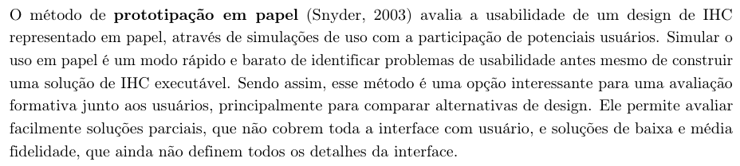

**Figura 1** — Evidência documental referente ao item `PP-01`.  
_Fonte: BARBOSA, Simone Diniz Junqueira et al. Interação Humano-Computador e Experiência do Usuário. 1. ed. Rio de Janeiro: Autopublicação, 2021, p. 303 (Capítulo 12, Seção 12.2.3); SNYDER, Carolyn. Paper Prototyping: The Fast and Easy Way to Design and Refine User Interfaces. Morgan Kaufmann, 2003._

A **Figura 2** reproduz o trecho comprobatório de referência referente ao critério **PP-02**.

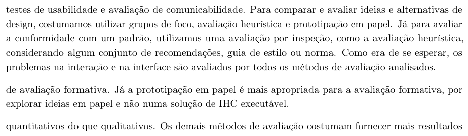

**Figura 2** — Evidência documental referente ao item `PP-02`.  
_Fonte: BARBOSA, Simone Diniz Junqueira et al. Interação Humano-Computador e Experiência do Usuário. 1. ed. Rio de Janeiro: Autopublicação, 2021, pp. 306-308 (Capítulo 12, Seção 12.2.4, Tabelas 12.10, 12.11 e 12.12)._

A **Figura 3** reproduz o trecho comprobatório de referência referente ao critério **PP-03**.

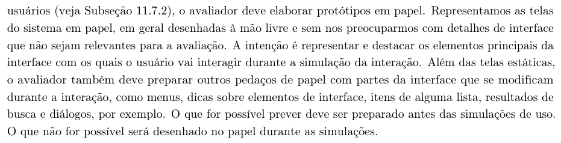

**Figura 3** — Evidência documental referente ao item `PP-03`.  
_Fonte: BARBOSA, Simone Diniz Junqueira et al. Interação Humano-Computador e Experiência do Usuário. 1. ed. Rio de Janeiro: Autopublicação, 2021, p. 303 (Capítulo 12, Seção 12.2.3)._

A **Figura 4** reproduz o trecho comprobatório de referência referente ao critério **PP-04**.

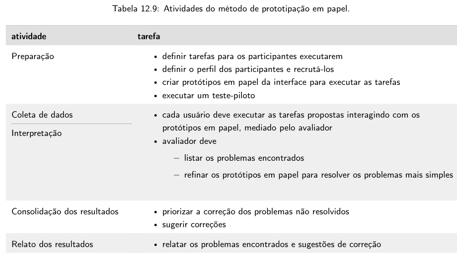

**Figura 4** — Evidência documental referente ao item `PP-04`.  
_Fonte: BARBOSA, Simone Diniz Junqueira et al. Interação Humano-Computador e Experiência do Usuário. 1. ed. Rio de Janeiro: Autopublicação, 2021, p. 304 (Capítulo 12, Seção 12.2.3, Tabela 12.9)._

A **Figura 5** reproduz o trecho comprobatório de referência referente ao critério **PP-05**.

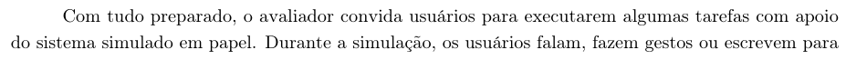

**Figura 5** — Evidência documental referente ao item `PP-05`.  
_Fonte: BARBOSA, Simone Diniz Junqueira et al. Interação Humano-Computador e Experiência do Usuário. 1. ed. Rio de Janeiro: Autopublicação, 2021, pp. 303-304 (Capítulo 12, Seção 12.2.3, Tabela 12.9)._

A **Figura 6** reproduz o trecho comprobatório de referência referente ao critério **PP-06**.

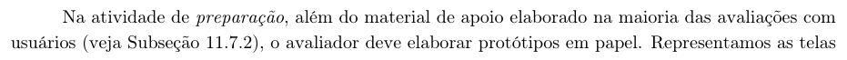

**Figura 6** — Evidência documental referente ao item `PP-06`.  
_Fonte: BARBOSA, Simone Diniz Junqueira et al. Interação Humano-Computador e Experiência do Usuário. 1. ed. Rio de Janeiro: Autopublicação, 2021, p. 303 (Capítulo 12, Seção 12.2.3)._

A **Figura 7** reproduz o trecho comprobatório de referência referente ao critério **PP-07**.

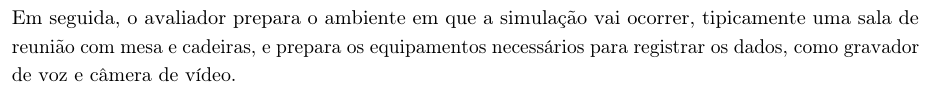

**Figura 7** — Evidência documental referente ao item `PP-07`.  
_Fonte: BARBOSA, Simone Diniz Junqueira et al. Interação Humano-Computador e Experiência do Usuário. 1. ed. Rio de Janeiro: Autopublicação, 2021, p. 304 (Capítulo 12, Seção 12.2.3)._

A **Figura 8** reproduz o trecho comprobatório de referência referente ao critério **PP-08**.

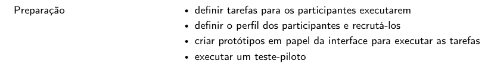

**Figura 8** — Evidência documental referente ao item `PP-08`.  
_Fonte: BARBOSA, Simone Diniz Junqueira et al. Interação Humano-Computador e Experiência do Usuário. 1. ed. Rio de Janeiro: Autopublicação, 2021, p. 304 (Capítulo 12, Seção 12.2.3, Tabela 12.9)._

A **Figura 9** reproduz o trecho comprobatório de referência referente ao critério **PP-09**.

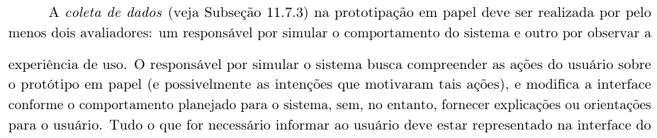

**Figura 9** — Evidência documental referente ao item `PP-09`.  
_Fonte: BARBOSA, Simone Diniz Junqueira et al. Interação Humano-Computador e Experiência do Usuário. 1. ed. Rio de Janeiro: Autopublicação, 2021, pp. 304-305 (Capítulo 12, Seção 12.2.3)._

A **Figura 10** reproduz o trecho comprobatório de referência referente ao critério **PP-10**.

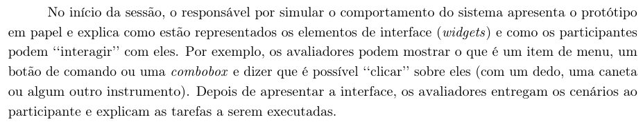

**Figura 10** — Evidência documental referente ao item `PP-10`.  
_Fonte: BARBOSA, Simone Diniz Junqueira et al. Interação Humano-Computador e Experiência do Usuário. 1. ed. Rio de Janeiro: Autopublicação, 2021, p. 305 (Capítulo 12, Seção 12.2.3)._

A **Figura 11** reproduz o trecho comprobatório de referência referente ao critério **PP-11**.

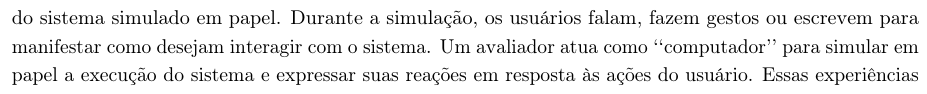

**Figura 11** — Evidência documental referente ao item `PP-11`.  
_Fonte: BARBOSA, Simone Diniz Junqueira et al. Interação Humano-Computador e Experiência do Usuário. 1. ed. Rio de Janeiro: Autopublicação, 2021, p. 303 (Capítulo 12, Seção 12.2.3)._

A **Figura 12** reproduz o trecho comprobatório de referência referente ao critério **PP-12**.

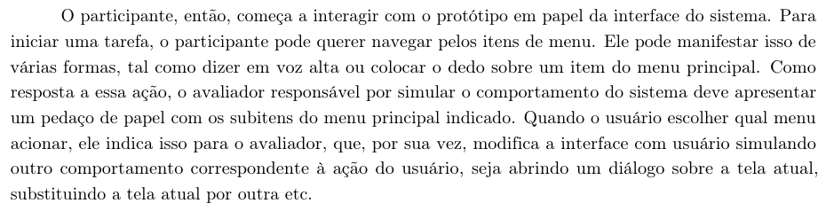

**Figura 12** — Evidência documental referente ao item `PP-12`.  
_Fonte: BARBOSA, Simone Diniz Junqueira et al. Interação Humano-Computador e Experiência do Usuário. 1. ed. Rio de Janeiro: Autopublicação, 2021, p. 305 (Capítulo 12, Seção 12.2.3)._

A **Figura 13** reproduz o trecho comprobatório de referência referente ao critério **PP-13**.

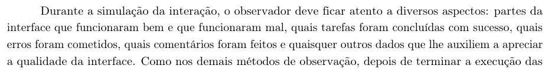

**Figura 13** — Evidência documental referente ao item `PP-13`.  
_Fonte: BARBOSA, Simone Diniz Junqueira et al. Interação Humano-Computador e Experiência do Usuário. 1. ed. Rio de Janeiro: Autopublicação, 2021, p. 305 (Capítulo 12, Seção 12.2.3)._

A **Figura 14** reproduz o trecho comprobatório de referência referente ao critério **PP-14**.

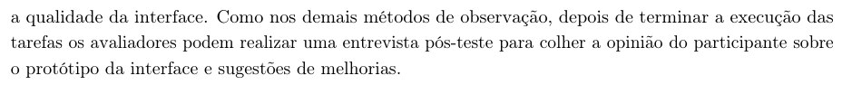

**Figura 14** — Evidência documental referente ao item `PP-14`.  
_Fonte: BARBOSA, Simone Diniz Junqueira et al. Interação Humano-Computador e Experiência do Usuário. 1. ed. Rio de Janeiro: Autopublicação, 2021, p. 305 (Capítulo 12, Seção 12.2.3)._

A **Figura 15** reproduz o trecho comprobatório de referência referente ao critério **PP-15**.

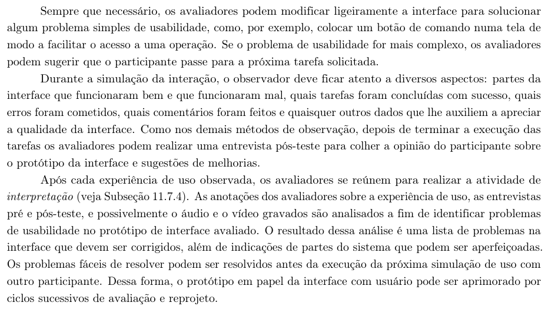

**Figura 15** — Evidência documental referente ao item `PP-15`.  
_Fonte: BARBOSA, Simone Diniz Junqueira et al. Interação Humano-Computador e Experiência do Usuário. 1. ed. Rio de Janeiro: Autopublicação, 2021, p. 305 (Capítulo 12, Seção 12.2.3)._

A **Figura 16** reproduz o trecho comprobatório de referência referente ao critério **PP-16**.

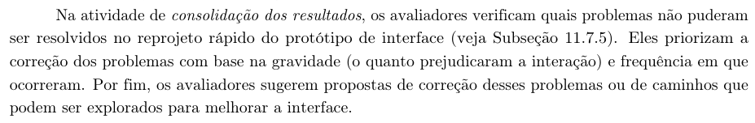

**Figura 16** — Evidência documental referente ao item `PP-16`.  
_Fonte: BARBOSA, Simone Diniz Junqueira et al. Interação Humano-Computador e Experiência do Usuário. 1. ed. Rio de Janeiro: Autopublicação, 2021, p. 305 (Capítulo 12, Seção 12.2.3)._

A **Figura 17** reproduz o trecho comprobatório de referência referente ao critério **PP-17**.

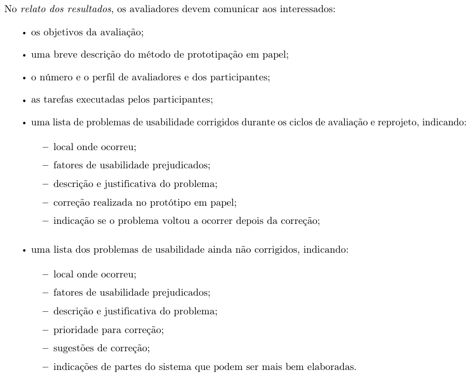

**Figura 17** — Evidência documental referente ao item `PP-17`.  
_Fonte: BARBOSA, Simone Diniz Junqueira et al. Interação Humano-Computador e Experiência do Usuário. 1. ed. Rio de Janeiro: Autopublicação, 2021, pp. 305-306 (Capítulo 12, Seção 12.2.3)._

A **Figura 18** reproduz o trecho comprobatório de referência referente ao critério **PP-G01**.

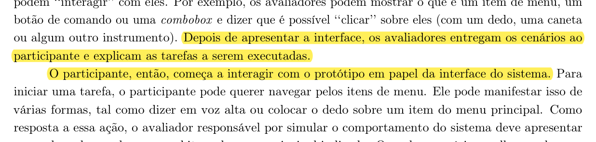

**Figura 18** — Evidência documental referente ao item `PP-G01`.  
_Fonte: BARBOSA, Simone Diniz Junqueira et al. Interação Humano-Computador e Experiência do Usuário. 1. ed. Rio de Janeiro: Autopublicação, 2021, p. 305 (Capítulo 12, Seção 12.2.3)._

---

### 2.3 Critérios Complementares de Edvaldo Soares — Protótipo de Papel

Itens complementares integrados da lista individual de Edvaldo. Os critérios existentes e suas autorias foram preservados.

| **PP-E01** | O protótipo de papel foi confeccionado contendo as representações das telas estáticas (desenhadas com os elementos principais da interface) acompanhadas das peças e pedaços de papel avulsos móveis para simular os elementos que se modificam durante a interação (como caixas de diálogo, submenus abertos, dicas de ferramentas, itens de listas suspensas e mensagens de feedback)? | [Edvaldo Soares Brasileiro Filho](https://github.com/PajeMurici-dev) | *"Além das telas estáticas, o avaliador também deve preparar outros pedaços de papel com partes da interface que se modificam durante a interação, como menus, dicas sobre elementos de interface, itens de alguma lista, resultados de busca e diálogos, por exemplo. O que for possível prever deve ser preparado antes das simulações de uso. O que não for possível será desenhado no papel durante as simulações."* (BARBOSA; SILVA, 2010, Cap. 10, Seção 10.2.3, p. 358) | — | `[ ] Sim (Conforme)` `[ ] Não (Não Conforme)` `[ ] Incompleto` `[ ] N/A` | — |
| **PP-E02** | O protótipo de papel mantém um nível de baixa a média fidelidade (representações em rascunho ou esboços manuais/digitais sem acabamento visual final de cores definitivas, fontes e gráficos refinados), focando na disposição espacial, na navegação e nos controles da interação sem induzir comprometimento precoce com detalhes cosméticos? | [Edvaldo Soares Brasileiro Filho](https://github.com/PajeMurici-dev) | *"Simular o uso em papel é um modo rápido e barato de identificar problemas de usabilidade antes mesmo de construir uma solução de IHC executável (...) Ele permite avaliar facilmente soluções parciais, que não cobrem toda a interface com usuário, e soluções de baixa e média fidelidade..."* (p. 358) e *"Uma representação é dita de baixa fidelidade quando se trata de um rascunho ou esboço da interface, sem muita preocupação com detalhes dos aspectos gráficos."* (BARBOSA; SILVA, 2010, Cap. 7, Seção 7.4.2, p. 249) | — | `[ ] Sim (Conforme)` `[ ] Não (Não Conforme)` `[ ] Incompleto` `[ ] N/A` | — |
| **PP-E03** | O planejamento estabelece explicitamente os objetivos gerais da avaliação do protótipo de papel, definindo com clareza quais aspectos de qualidade serão investigados (como identificação de problemas de usabilidade na interação e interface, comparação de ideias/alternativas de design, conformidade com padrões ou apropriação preliminar da tecnologia) e identificando por que e para quem tais objetivos são importantes? | [Edvaldo Soares Brasileiro Filho](https://github.com/PajeMurici-dev) | *"Determinar os objetivos da avaliação de IHC. O avaliador deve determinar os objetivos gerais da avaliação e identificar por que e para quem tais objetivos são importantes. (...) Os principais aspectos avaliados são: apropriação de tecnologia pelos usuários (...); ideias e alternativas de design; conformidade com um padrão; problemas na interação e na interface."* (BARBOSA; SILVA, 2010, Cap. 9, Seções 9.2 e 9.8, pp. 290, 313) | — | `[ ] Sim (Conforme)` `[ ] Não (Não Conforme)` `[ ] Incompleto` `[ ] N/A` | — |
| **PP-E04** | Os objetivos gerais da avaliação foram operacionalizados e detalhados em perguntas específicas a serem respondidas pela observação das sessões (tais como: 'O participante consegue operar a interface simulada?', 'O participante compreende o que significa e para que serve cada elemento de interface?', 'Quais problemas de IHC dificultam ou impedem o usuário de alcançar seus objetivos?', 'Onde esses problemas se manifestam e qual a sua gravidade?')? | [Edvaldo Soares Brasileiro Filho](https://github.com/PajeMurici-dev) | *"Os objetivos de uma avaliação de IHC precisam ser detalhados em perguntas mais específicas para torná-los operacionais (Sharp et al., 2007). (...) Para cada objetivo definido, o avaliador deve elaborar perguntas específicas a serem respondidas durante avaliação."* (BARBOSA; SILVA, 2010, Cap. 9, Seções 9.2 e 9.8, pp. 292, 313) | — | `[ ] Sim (Conforme)` `[ ] Não (Não Conforme)` `[ ] Incompleto` `[ ] N/A` | — |
| **PP-E05** | O planejamento delimita com precisão o escopo da avaliação e define o conjunto de tarefas típicas ou críticas que os participantes deverão realizar (selecionadas com base na frequência de uso, na importância para as metas do usuário, nas tarefas que motivaram o sistema ou nas partes mais complexas do design)? | [Edvaldo Soares Brasileiro Filho](https://github.com/PajeMurici-dev) | *"Raramente avaliamos o sistema inteiro. Em vez disso, precisamos definir o escopo da avaliação, delimitando quais partes da interface, caminhos de interação, tarefas e perfis de usuário devem fazer parte da avaliação. (...) Na escolha das tarefas a serem investigadas, o avaliador pode considerar as tarefas mais importantes para os usuários..."* (BARBOSA; SILVA, 2010, Cap. 9, Seção 9.7.2, p. 304) | — | `[ ] Sim (Conforme)` `[ ] Não (Não Conforme)` `[ ] Incompleto` `[ ] N/A` | — |
| **PP-E06** | O planejamento prevê uma duração temporal controlada e confortável para as atividades, estipulando que o tempo estimado para cada tarefa individual não ultrapasse 20 minutos e que a sessão completa de avaliação com cada participante não exceda aproximadamente 1 hora (evitando a fadiga física e mental do usuário)? | [Edvaldo Soares Brasileiro Filho](https://github.com/PajeMurici-dev) | *"O tempo estimado para um participante realizar cada tarefa não deveria ultrapassar 20 minutos. Se for necessário mais tempo, o participante deve poder fazer uma pausa rápida para evitar que sua fadiga física ou mental interfira no resultado da avaliação. (...) Cada participante normalmente despende cerca de uma hora numa sessão de avaliação. Mais do que isso seria cansativo para ele..."* (BARBOSA; SILVA, 2010, Cap. 9, Seção 9.7.2, p. 306) | — | `[ ] Sim (Conforme)` `[ ] Não (Não Conforme)` `[ ] Incompleto` `[ ] N/A` | — |
| **PP-E07** | O planejamento define e documenta detalhadamente o perfil dos participantes a serem recrutados, contemplando características fundamentais do público-alvo real (como faixa etária, escolaridade/ocupação, experiência prévia com tecnologia, nível de familiaridade com o domínio da aplicação e uso de sistemas semelhantes)? | [Edvaldo Soares Brasileiro Filho](https://github.com/PajeMurici-dev) | *"Os avaliadores devem buscar participantes que representem o público-alvo do sistema avaliado, ou seja, que possuam características semelhantes aos usuários típicos. A definição dos perfis de participantes pode considerar fatores como: idade, sexo, formação acadêmica, grau de conhecimento sobre o domínio..."* (BARBOSA; SILVA, 2010, Cap. 9, Seção 9.7.2, p. 305) | — | `[ ] Sim (Conforme)` `[ ] Não (Não Conforme)` `[ ] Incompleto` `[ ] N/A` | — |
| **PP-E08** | A quantidade de participantes prevista para a avaliação está formalizada e segue os parâmetros estabelecidos para estudos de IHC (amostra entre 5 e 12 usuários típicos, respeitando a recomendação de no mínimo 5 participantes para revelar a maioria dos problemas de interface sem custos desnecessários)? | [Edvaldo Soares Brasileiro Filho](https://github.com/PajeMurici-dev) | *"Dumas e Redish (1999) relatam que uma avaliação de IHC em geral envolve de cinco a 12 usuários. Nielsen (2000), por sua vez, afirma que bastam cinco usuários para encontrarmos a maioria dos problemas na interface (85%, segundo o seu experimento), alcançando uma boa relação custo-benefício."* (BARBOSA; SILVA, 2010, Cap. 9, Seção 9.7.2, p. 305) | — | `[ ] Sim (Conforme)` `[ ] Não (Não Conforme)` `[ ] Incompleto` `[ ] N/A` | — |
| **PP-E09** | O planejamento define a equipe de condução com no mínimo dois avaliadores distribuídos em papéis específicos e complementares: um avaliador dedicado a atuar como o 'computador' (simulando mecanicamente as reações do sistema através dos papéis, sem instruir ou dar dicas ao usuário) e ao menos um avaliador dedicado a atuar como 'observador' (registrando o comportamento, falas, dúvidas e problemas enfrentados pelo participante)? | [Edvaldo Soares Brasileiro Filho](https://github.com/PajeMurici-dev) | *"A coleta de dados (...) na prototipação em papel deve ser realizada por pelo menos dois avaliadores: um responsável por simular o comportamento do sistema e outro por observar a experiência de uso. O responsável por simular o sistema busca compreender as ações do usuário (...) e modifica a interface conforme o comportamento planejado, sem fornecer explicações..."* (BARBOSA; SILVA, 2010, Cap. 10, Seção 10.2.3, p. 360) | — | `[ ] Sim (Conforme)` `[ ] Não (Não Conforme)` `[ ] Incompleto` `[ ] N/A` | — |
| **PP-E10** | O planejamento apresenta o conjunto completo de materiais de apoio padronizados para a sessão, contendo instruções e cenários de tarefas para o participante, questionário pré-teste (para caracterização sociodemográfica), formulário/roteiro de observação para notas dos avaliadores e roteiro de entrevista pós-teste (para colher impressões e opiniões finais)? | [Edvaldo Soares Brasileiro Filho](https://github.com/PajeMurici-dev) | *"Antes de começar a coletar dados, o avaliador deve preparar e imprimir o material de apoio necessário (...) esse material costuma incluir: termo de consentimento (...); questionário pré-teste (...); roteiro de entrevista pós-teste (...); instruções e cenários para orientar os participantes sobre as tarefas a serem realizadas; roteiro de acompanhamento da observação..."* (BARBOSA; SILVA, 2010, Cap. 9, Seção 9.7.2, p. 306) | — | `[ ] Sim (Conforme)` `[ ] Não (Não Conforme)` `[ ] Incompleto` `[ ] N/A` | — |
| **PP-E11** | O planejamento contempla os procedimentos éticos obrigatórios e apresenta o modelo de Termo de Consentimento Livre e Esclarecido (TCLE), contendo a explicação dos objetivos do estudo, a garantia expressa de confidencialidade e anonimato, a autorização voluntária para registros/gravações, o esclarecimento de que o produto é o alvo da avaliação e a garantia de que o participante pode desistir ou interromper a sessão a qualquer momento sem penalidades? | [Edvaldo Soares Brasileiro Filho](https://github.com/PajeMurici-dev) | *"O pesquisador deve explicar os objetivos da pesquisa aos participantes e dizer exatamente como deverá ser a participação deles. (...) Ao divulgar os resultados da avaliação, o avaliador deve garantir o anonimato dos participantes (...) O participante tem o direito e a liberdade de se recusar a participar ou retirar seu consentimento e abandonar o estudo em qualquer fase da pesquisa, sem ser penalizado por isso."* (BARBOSA; SILVA, 2010, Cap. 5, Seção 5.4, pp. 139–141) | — | `[ ] Sim (Conforme)` `[ ] Não (Não Conforme)` `[ ] Incompleto` `[ ] N/A` | — |
| **PP-E12** | O planejamento define o ambiente físico adequado para a sessão de simulação (sala silenciosa com mesa ampla para disposição das peças de papel, cadeiras confortáveis e iluminação adequada) e lista os recursos e equipamentos necessários para o registro dos dados (como câmera de vídeo, gravador de áudio, folhas avulsas de papel e canetas para ajustes imediatos)? | [Edvaldo Soares Brasileiro Filho](https://github.com/PajeMurici-dev) | *"Dependendo do método utilizado, uma sala de reunião com mesa e cadeiras pode ser um ambiente adequado para realizar uma avaliação. Esse é o caso dos métodos de grupo de foco e prototipação em papel."* (p. 296) e *"Em seguida, o avaliador prepara o ambiente em que a simulação vai ocorrer (...) e prepara os equipamentos necessários para registrar os dados, como gravador de voz e câmera de vídeo."* (BARBOSA; SILVA, 2010, Cap. 9 e 10, pp. 296, 360) | — | `[ ] Sim (Conforme)` `[ ] Não (Não Conforme)` `[ ] Incompleto` `[ ] N/A` | — |
| **PP-E13** | O planejamento prevê a realização obrigatória de um teste-piloto prévio com o protótipo de papel e todo o material de apoio, com o objetivo de testar e ajustar o próprio protocolo de avaliação (avaliando clareza das instruções, adequação do tempo, manuseio das peças de papel pelo 'computador' e eficácia dos instrumentos de registro, com descarte dos dados desse ensaio)? | [Edvaldo Soares Brasileiro Filho](https://github.com/PajeMurici-dev) | *"Concluído todo o planejamento da avaliação, é muito importante que o avaliador realize um teste-piloto. O objetivo desse teste é avaliar o próprio planejamento, e analisar se a avaliação, tal como planejada, produz os dados necessários para responder a questões e objetivos do estudo. (...) Os dados do teste-piloto devem ser descartados..."* (BARBOSA; SILVA, 2010, Cap. 9, Seção 9.7.2, pp. 307–308) | — | `[ ] Sim (Conforme)` `[ ] Não (Não Conforme)` `[ ] Incompleto` `[ ] N/A` | — |
| **PP-E14** | O planejamento descreve o método planejado para consolidação e relato dos resultados da avaliação, prevendo a elaboração de um relatório final que documente os objetivos, perfis de participantes, tarefas testadas, a lista dos problemas de usabilidade identificados (indicando local na interface, gravidade, fatores de usabilidade prejudicados e justificativa) e as recomendações de reprojeto da interface? | [Edvaldo Soares Brasileiro Filho](https://github.com/PajeMurici-dev) | *"No relato dos resultados, os avaliadores devem comunicar aos interessados: os objetivos da avaliação; uma breve descrição do método de prototipação em papel; o número e o perfil de avaliadores e dos participantes; as tarefas executadas (...) uma lista de problemas de usabilidade corrigidos (...) uma lista dos problemas de usabilidade ainda não corrigidos, indicando: local onde ocorreu; fatores de usabilidade prejudicados; descrição e justificativa do problema; prioridade para correção; sugestões de correção..."* (BARBOSA; SILVA, 2010, Cap. 10, Seção 10.2.3, pp. 361–362) | — | `[ ] Sim (Conforme)` `[ ] Não (Não Conforme)` `[ ] Incompleto` `[ ] N/A` | — |

## 3. Validação desta Lista pela Lista de Governança do Prof. Dr. André Barros de Sales (`DG-01` a `DG-11`)

Em estrito cumprimento às diretrizes de qualidade do Plano de Ensino (*Sales, 2026, pp. 8–9*), a **Tabela 4** submete esta própria página (`12-prototipo-papel.md`) aos **11 Itens de Desenvolvimento do Projeto** formulados pelo Prof. Dr. André Barros de Sales.

**Tabela 4** — Autoavaliação de `12-prototipo-papel.md` frente aos critérios `DG-01` a `DG-11`

| ID | Critério de Governança do Plano de Ensino | Autor do Item | Resposta | Versão, Data e Hora da Avaliação | Evidência de Conformidade nesta Lista |
| :---: | :--- | :--- | :---: | :---: | :--- |
| **DG-01** | O histórico de versão padronizado? | **Prof. Dr. André Barros de Sales** *(Plano de Ensino FGA0173, 2026)* | ✅ **Sim (Conforme)** | `v2.1` — 22/11/2026 às 15:30 | Seção **Histórico de Versão** (**Tabela 5**) padronizada ao final de `12-prototipo-papel.md` registrando `v2.1`. |
| **DG-02** | O(s) autor(es) e o(s) revisor(es) para cada artefato? | **Prof. Dr. André Barros de Sales** *(Plano de Ensino FGA0173, 2026)* | ✅ **Sim (Conforme)** | `v2.1` — 22/11/2026 às 15:30 | Colunas **Autor(es)** e **Revisor(es)** preenchidas com links GitHub no Histórico de Versão, além da coluna **`Autor do Item`** e coautorias nominais em 100% dos critérios da lista. |
| **DG-03** | Referências bibliográficas e/ou bibliografia em todos os artefatos? | **Prof. Dr. André Barros de Sales** *(Plano de Ensino FGA0173, 2026)* | ✅ **Sim (Conforme)** | `v2.1` — 22/11/2026 às 15:30 | Seção **Referências Bibliográficas (ABNT NBR 6023)** completa ao final do documento com obras, edições e páginas exatas. |
| **DG-04** | As tabelas e imagens possuem legenda e fonte e são chamadas dentro do texto? | **Prof. Dr. André Barros de Sales** *(Plano de Ensino FGA0173, 2026)* | ✅ **Sim (Conforme)** | `v2.1` — 22/11/2026 às 15:30 | 100% das tabelas (`Tabela 1` a `Tabela 5`) e figuras (`Figura 1` a `Figura 18`) possuem numeração, legenda, fonte e chamadas textuais prévias. |
| **DG-05** | Um texto fazendo uma introdução dos artefatos? | **Prof. Dr. André Barros de Sales** *(Plano de Ensino FGA0173, 2026)* | ✅ **Sim (Conforme)** | `v2.1` — 22/11/2026 às 15:30 | Seção **1. Introdução e Contextualização Metodológica** situa o instrumento no Ciclo de Mayhew (1999) e na Inspeção Formal de Fagan (1976). |
| **DG-06** | O cronograma executado com quem realizou cada artefato/atividade e as datas de início e fim da construção/realização? | **Prof. Dr. André Barros de Sales** *(Plano de Ensino FGA0173, 2026)* | ✅ **Sim (Conforme)** | `v2.1` — 22/11/2026 às 15:30 | Registros de elaboração e revisão vinculados ao [Cronograma Executado](../../planejamento/cronograma-executado.md) e ao histórico Git da equipe. |
| **DG-07** | Ata(s) da(s) reuniões (com data, horário de início e do final, participantes, objetivo, atividades definidas etc.)? | **Prof. Dr. André Barros de Sales** *(Plano de Ensino FGA0173, 2026)* | ✅ **Sim (Conforme)** | `v2.1` — 22/11/2026 às 15:30 | Deliberações e alinhamentos documentados nas [Atas de Reunião](../../atas/index.md). |
| **DG-08** | A gravação da reunião do grupo? | **Prof. Dr. André Barros de Sales** *(Plano de Ensino FGA0173, 2026)* | ✅ **Sim (Conforme)** | `v2.1` — 22/11/2026 às 15:30 | Links funcionais de gravações das reuniões de planejamento e auditoria indexados em [Atas de Reunião](../../atas/index.md). |
| **DG-09** | Vídeo de apresentação na categoria 'Não Listado' no YouTube (duração entre 20 e 30 minutos)? | **Prof. Dr. André Barros de Sales** *(Plano de Ensino FGA0173, 2026)* | ⚠️ **Em preparação (Etapa 8)** | `v2.1` — 22/11/2026 às 15:30 | Vídeos das Entregas 1–7 publicados; vídeo oficial da [Entrega 8 — Verificação dos Artefatos](../../entregas/entrega8.md) (20–30 min, Não Listado) agendado após consolidação das inspeções da equipe. |
| **DG-10** | Tabela de contribuição no início do artefato com o nome de todos os integrantes, contribuição com hiperligação da atividade e da gravação? | **Prof. Dr. André Barros de Sales** *(Plano de Ensino FGA0173, 2026)* | ✅ **Sim (Conforme)** | `v2.1` — 22/11/2026 às 15:30 | **Tabela 1** posicionada no topo do documento discriminando cada integrante ativo com hiperligação GitHub e escopo de atuação. |
| **DG-11** | A seção de agradecimentos apresentando o uso de Inteligência Artificial (IA) Generativa no artefato? | **Prof. Dr. André Barros de Sales** *(Plano de Ensino FGA0173, 2026)* | ✅ **Sim (Conforme)** | `v2.1` — 22/11/2026 às 15:30 | Seção **Agradecimentos e Declaração de Uso de IA Generativa** ao final do documento em estrita conformidade com o Código da SBC e Sales (2026). |

_Fonte: Validação elaborada por Vinicius Silva Araruna e atualizada por Gustavo Antonio Rodrigues e Silva com base na rubrica oficial de Prof. Dr. André Barros de Sales (Plano de Ensino, 2026, pp. 8–9)._

---

## 4. Histórico de Versão

A **Tabela 5** registra a evolução histórica e o controle de versionamento deste instrumento normativo.

**Tabela 5** — Histórico de Versão do Documento

| Versão | Data | Descrição Detalhada da Modificação | Autor(es) | Revisor(es) |
| :---: | :---: | :--- | :--- | :--- |
| `1.0` | 19/10/2026 | Versão inicial em 15 itens (`LVGrupo8ViniciusSilvaArarunaPrototipoPapel01.pdf`). | [Vinicius Silva Araruna](https://github.com/ViniciusA05) | [Gustavo Antonio Rodrigues e Silva](https://github.com/gus-ant) |
| `2.0` | 20/11/2026 | Revisão temática dedicada integralmente à Seção 12.2.3/12.2.4 em 17 critérios específicos de Protótipo de Papel com 17 recortes da 1ª ed. de 2021 (pp. 303–308), `Autor do Item`, `Versão, Data e Hora da Avaliação` e validação `DG-01..11`. | [Vinicius Silva Araruna](https://github.com/ViniciusA05) | [Gustavo Antonio Rodrigues e Silva](https://github.com/gus-ant), [Edvaldo Soares Brasileiro Filho](https://github.com/PajeMurici-dev) |
| `2.1` | 22/11/2026 | Incremento cumulativo com `LV-PAPEL-01..04` (`LVGrupo8GustavoAntonioRodriguesESilvaPrototipoPapel01.pdf`, AC `19/10/2026`): atribuição de coautoria em `PP-01`, `PP-09` e `PP-15` e adição do critério complementar `PP-G01` (**Tabela 3** e **Figura 18**). | [Gustavo Antonio Rodrigues e Silva](https://github.com/gus-ant) | [Vinicius Silva Araruna](https://github.com/ViniciusA05), [Edvaldo Soares Brasileiro Filho](https://github.com/PajeMurici-dev) |

_Fonte: Elaborada pelos autores, 2026._

---

## 5. Referências Bibliográficas (ABNT NBR 6023)

[1] BARBOSA, Simone Diniz Junqueira et al. Interação Humano-Computador e Experiência do Usuário. 1. ed. Rio de Janeiro: Autopublicação, 2021, Cap. 12, Seções 12.2.3 e 12.2.4, pp. 303-308.

[2] SNYDER, Carolyn. Paper Prototyping: The Fast and Easy Way to Design and Refine User Interfaces. San Francisco: Morgan Kaufmann, 2003.

[3] BARBOSA, Simone Diniz Junqueira; SILVA, Bruno Santana da. *Interação Humano-Computador*. 1. ed. Rio de Janeiro: Elsevier / Campus, 2010.

[4] FAGAN, Michael E. Design and code inspections to reduce errors in program development. *IBM Systems Journal*, v. 15, n. 3, p. 182–211, 1976.

[5] MAYHEW, Deborah J. *The Usability Engineering Lifecycle: A Practitioner's Handbook for User Interface Design*. San Francisco: Morgan Kaufmann, 1999.

[6] SALES, André Barros de. *Plano de Ensino da Disciplina de Interação Humano Computador (FGA0173 — 02/2026)*. Brasília: Universidade de Brasília, Faculdade UnB Gama (FGA), 2026.

[7] SOCIEDADE BRASILEIRA DE COMPUTAÇÃO (SBC). *Código de Conduta da Sociedade Brasileira de Computação*. Porto Alegre: SBC, 2023.

---

## 6. Agradecimentos e Declaração de Uso de Inteligência Artificial (IA) Generativa

Em conformidade com o Código de Conduta da Sociedade Brasileira de Computação (SBC, Art. 2º, parágrafo III) e com as diretrizes do Plano de Ensino da disciplina (*Sales, 2026, p. 3*), declara-se que a organização das tabelas em Markdown e a revisão ortográfica contaram com suporte supervisionado da ferramenta de Inteligência Artificial Generativa Google Gemini. Toda a concepção metodológica, verificação bibliográfica nas obras originais, revisão técnica e validação de conformidade foram realizadas pelos discentes identificados no Histórico de Versão.
