# Lista de Verificação — Aspectos Éticos, Plataforma, Princípios, Metas e Guia de Estilo

## Tabela de Contribuição e Transparência de IA Generativa

A **Tabela 1** apresenta a distribuição de responsabilidades na elaboração, curadoria e revisão de **Aspectos Éticos, Plataforma, Princípios, Metas e Guia de Estilo**.

**Tabela 1** — Matriz de Contribuição e Transparência de IA Generativa — Aspectos Éticos, Plataforma, Princípios, Metas e Guia de Estilo

| Integrante | Atribuição no Artefato | Data | Horário | Ferramenta de IA | Propósito do Uso de IA |
| :--- | :--- | :---: | :---: | :--- | :--- |
| [Vinicius Silva Araruna](https://github.com/ViniciusA05) | Consolidação dos 13 critérios do Prof. André (pp. 10–12) e dos 18 critérios analíticos de inspeção da Entrega 3 | 20/11/2026 | 14:00 - 15:30 | Google Gemini | Suporte na organização estrutural, formatação de tabelas em Markdown e conferência cruzada com o Plano de Ensino |
| [Gustavo Antonio Rodrigues e Silva](https://github.com/gus-ant) | Revisão de conformidade estrutural, navegação e checagem de links | 20/11/2026 | 15:30 - 16:00 | — | Revisão por pares e validação editorial |
| [Edvaldo Soares Brasileiro Filho](https://github.com/PajeMurici-dev) | Auditoria de rastreabilidade frente ao Plano de Ensino (`DG-01` a `DG-11`) e referências ABNT | 20/11/2026 | 15:30 - 16:00 | — | Revisão por pares e conferência documental |

_Fonte: Elaborada pelos autores, 2026._

---

## 1. Introdução e Contextualização Metodológica

Este módulo consolida os instrumentos de verificação para os artefatos de **Aspectos Éticos (TCLE), Coleta de Requisitos e Análise de Requisitos da Entrega 3** (*Características da Plataforma, Princípios Gerais de Projeto, Metas de Usabilidade/UX e Guia de Estilo*). Reúne as rubricas específicas do **Prof. Dr. André Barros de Sales** (pp. 10–12), os **18 critérios analíticos de auditoria da Entrega 3** elaborados por Vinicius Silva Araruna e os **10 critérios de autoinspeção do Guia de Estilo** registrados pela equipe em `guia-de-estilo.md`.

!!! info "Pré-requisito Transversal de Governança (Prof. Dr. André Barros de Sales)"
    Além dos critérios específicos abaixo, cada artefato é auditado pelos **11 Itens de Desenvolvimento Geral (`DG-01` a `DG-11`)** em [00. Governança e Plano de Ensino Geral](00-plano-ensino-geral.md).

---

## 2. Instrumento Normativo de Verificação — Aspectos Éticos, Plataforma, Princípios, Metas e Guia de Estilo

### 2.1 Critérios do Plano de Ensino (Prof. Dr. André Barros de Sales — pp. 10–12)

A **Tabela 2** apresenta os **13 critérios** do Plano de Ensino aplicáveis a Aspectos Éticos, Técnicas de Coleta, Plataforma, Princípios Gerais, Metas e Guia de Estilo.

**Tabela 2** — Critérios do Plano de Ensino para Ética, Coleta e Análise de Requisitos (Entrega 3)

| ID | Critério / Pergunta de Verificação | Autor do Item | Fundamentação Canônica e Fonte | Evidência Visual (Figura) | Resposta | Versão, Data e Hora da Avaliação |
| :---: | :--- | :--- | :--- | :---: | :---: | :---: |
| **PE-E2-04** | Considera Aspectos Éticos de Pesquisas Envolvendo Pessoas com referência, foto e autor? | **Prof. Dr. André Barros de Sales** *(Plano de Ensino FGA0173, 2026)* | Plano de Ensino (Sales, 2026, p. 10, Item 4) | [Ver Figura 1](#figura-1) | `[ ] Sim (Conforme)` `[ ] Não (Não Conforme)` `[ ] Incompleto` `[ ] N/A` | *(Preencher na inspeção)* |
| **PE-E2-05** | Explicita os 4 princípios éticos (autonomia, beneficência, não maleficência e justiça/equidade) com foto e autor? | **Prof. Dr. André Barros de Sales** *(Plano de Ensino FGA0173, 2026)* | Plano de Ensino (Sales, 2026, p. 10, Item 5) | [Ver Figura 1](#figura-1) | `[ ] Sim (Conforme)` `[ ] Não (Não Conforme)` `[ ] Incompleto` `[ ] N/A` | *(Preencher na inspeção)* |
| **PE-E2-06** | Assegura que solicitará permissão para gravar voz ou imagem antes de começar qualquer gravação? | **Prof. Dr. André Barros de Sales** *(Plano de Ensino FGA0173, 2026)* | Plano de Ensino (Sales, 2026, p. 10, Item 6) | [Ver Figura 2](#figura-2) | `[ ] Sim (Conforme)` `[ ] Não (Não Conforme)` `[ ] Incompleto` `[ ] N/A` | *(Preencher na inspeção)* |
| **PE-E2-07** | Disponibiliza o Termo de Consentimento Livre e Esclarecido (TCLE) com referência, foto e autor? | **Prof. Dr. André Barros de Sales** *(Plano de Ensino FGA0173, 2026)* | Plano de Ensino (Sales, 2026, p. 10, Item 7) | [Ver Figura 3](#figura-3) | `[ ] Sim (Conforme)` `[ ] Não (Não Conforme)` `[ ] Incompleto` `[ ] N/A` | *(Preencher na inspeção)* |
| **PE-E2-08** | Foram utilizadas no mínimo duas técnicas para coletar dados e levantar requisitos dos usuários (entrevistas, foco, questionários, brainstorming, card sorting, campo, investigação contextual)? | **Prof. Dr. André Barros de Sales** *(Plano de Ensino FGA0173, 2026)* | Plano de Ensino (Sales, 2026, p. 10, Item 8) | [Ver Figura 4](#figura-4) | `[ ] Sim (Conforme)` `[ ] Não (Não Conforme)` `[ ] Incompleto` `[ ] N/A` | *(Preencher na inspeção)* |
| **PE-E3-10** | As características da plataforma para o projeto estão documentadas? | **Prof. Dr. André Barros de Sales** *(Plano de Ensino FGA0173, 2026)* | Plano de Ensino (Sales, 2026, p. 11, Item 10) | [Ver Figura 5](#figura-5) | `[ ] Sim (Conforme)` `[ ] Não (Não Conforme)` `[ ] Incompleto` `[ ] N/A` | *(Preencher na inspeção)* |
| **PE-E3-11** | Os Princípios Gerais do Projeto utilizados estão fundamentados com referência, foto do texto e autor? | **Prof. Dr. André Barros de Sales** *(Plano de Ensino FGA0173, 2026)* | Plano de Ensino (Sales, 2026, p. 11, Item 11) | [Ver Figura 6](#figura-6) | `[ ] Sim (Conforme)` `[ ] Não (Não Conforme)` `[ ] Incompleto` `[ ] N/A` | *(Preencher na inspeção)* |
| **PE-E3-12** | Os Princípios Gerais do Projeto contêm os 8 tópicos canônicos (incluindo o 8º 'Projeto para erros') com foto e autor? | **Prof. Dr. André Barros de Sales** *(Plano de Ensino FGA0173, 2026)* | Plano de Ensino (Sales, 2026, pp. 11–12, Item 12) | [Ver Figura 7](#figura-7) | `[ ] Sim (Conforme)` `[ ] Não (Não Conforme)` `[ ] Incompleto` `[ ] N/A` | *(Preencher na inspeção)* |
| **PE-E3-13** | As metas de usabilidade ou os objetivos da avaliação estão definidos com referência, foto do texto e autor? | **Prof. Dr. André Barros de Sales** *(Plano de Ensino FGA0173, 2026)* | Plano de Ensino (Sales, 2026, p. 12, Item 13) | [Ver Figura 8](#figura-8) | `[ ] Sim (Conforme)` `[ ] Não (Não Conforme)` `[ ] Incompleto` `[ ] N/A` | *(Preencher na inspeção)* |
| **PE-E3-14** | Apresenta a razão da seleção das metas de usabilidade? | **Prof. Dr. André Barros de Sales** *(Plano de Ensino FGA0173, 2026)* | Plano de Ensino (Sales, 2026, p. 12, Item 14) | [Ver Figura 9](#figura-9) | `[ ] Sim (Conforme)` `[ ] Não (Não Conforme)` `[ ] Incompleto` `[ ] N/A` | *(Preencher na inspeção)* |
| **PE-E3-15** | O Guia de Estilo do projeto está documentado com referência, foto do texto e autor? | **Prof. Dr. André Barros de Sales** *(Plano de Ensino FGA0173, 2026)* | Plano de Ensino (Sales, 2026, p. 12, Item 15) | [Ver Figura 10](#figura-10) | `[ ] Sim (Conforme)` `[ ] Não (Não Conforme)` `[ ] Incompleto` `[ ] N/A` | *(Preencher na inspeção)* |
| **PE-E3-16** | O Guia de Estilo contempla as 6 seções canônicas de Mayhew (Introdução, Resultados de análise, Elementos de interface, Interação, Ações, Vocabulário e padrões)? | **Prof. Dr. André Barros de Sales** *(Plano de Ensino FGA0173, 2026)* | Plano de Ensino (Sales, 2026, p. 12, Item 16) | [Ver Figura 10](#figura-10) | `[ ] Sim (Conforme)` `[ ] Não (Não Conforme)` `[ ] Incompleto` `[ ] N/A` | *(Preencher na inspeção)* |
| **PE-E3-17** | O Guia de Estilo corresponde efetivamente ao site avaliado? | **Prof. Dr. André Barros de Sales** *(Plano de Ensino FGA0173, 2026)* | Plano de Ensino (Sales, 2026, p. 12, Item 17) | [Ver Figura 11](#figura-11) | `[ ] Sim (Conforme)` `[ ] Não (Não Conforme)` `[ ] Incompleto` `[ ] N/A` | *(Preencher na inspeção)* |

_Fonte: Plano de Ensino da Disciplina (Prof. Dr. André Barros de Sales, 2026, pp. 10–12)._

### 2.2 Critérios Analíticos de Inspeção da Entrega 3

A **Tabela 3** lista os **18 critérios analíticos normativos** para inspeção completa dos artefatos da Entrega 3.

**Tabela 3** — Critérios normativos de Análise de Requisitos (Entrega 3)

| ID | Critério / Pergunta de Verificação | Autor do Item | Fundamentação Canônica | Evidência Visual (Figura) | Resposta | Versão, Data e Hora da Avaliação |
| :---: | :--- | :--- | :--- | :---: | :---: | :---: |
| **IE3-01** | **Características da Plataforma (Arquitetura, Hardware/Software e Navegadores)** Avaliar se documenta ecossistema tecnológico, limitações operacionais, navegadores homologados, autoria e legenda nas tabelas. | [Vinicius Silva Araruna](https://github.com/ViniciusA05) | BARBOSA et al. (2021, Cap. 6, p. 105) | [Ver Figura 5](#figura-5) | `[ ] Sim (Conforme)` `[ ] Não (Não Conforme)` `[ ] Incompleto` `[ ] N/A` | *(Preencher na inspeção)* |
| **IE3-02** | **Princípios Gerais de Projeto: Fundamentação Teórica e Recortes** Avaliar se apresenta fundamentação de Barbosa et al. (2021) com recortes fotográficos para cada princípio e numeração tabular. | [Vinicius Silva Araruna](https://github.com/ViniciusA05) | BARBOSA et al. (2021, Cap. 6, p. 111) | [Ver Figura 6](#figura-6) | `[ ] Sim (Conforme)` `[ ] Não (Não Conforme)` `[ ] Incompleto` `[ ] N/A` | *(Preencher na inspeção)* |
| **IE3-03** | **Princípios Gerais de Projeto: Cobertura dos 8 Tópicos Canônicos** Verificar presença integral dos 8 princípios (incluindo o 8º princípio 'Projeto para erros') e evidências na interface. | [Vinicius Silva Araruna](https://github.com/ViniciusA05) | BARBOSA et al. (2021, pp. 111–116); NORMAN (1988) | [Ver Figura 7](#figura-7) | `[ ] Sim (Conforme)` `[ ] Não (Não Conforme)` `[ ] Incompleto` `[ ] N/A` | *(Preencher na inspeção)* |
| **IE3-04** | **Metas de Usabilidade e UX: Fundamentação Teórica e Evidência Visual** Verificar fundamentação das metas de usabilidade (Nielsen) e UX (Rogers et al.), com foto do livro chamada no texto e linha de autor. | [Vinicius Silva Araruna](https://github.com/ViniciusA05) | BARBOSA et al. (2021, Cap. 6, p. 106); NIELSEN (1993, p. 26) | [Ver Figura 8](#figura-8) | `[ ] Sim (Conforme)` `[ ] Não (Não Conforme)` `[ ] Incompleto` `[ ] N/A` | *(Preencher na inspeção)* |
| **IE3-05** | **Metas de Usabilidade e UX: Justificativa e Indicadores Mensuráveis** Verificar alinhamento com personas, tarefas HTA, papéis funcionais e definição de níveis inaceitáveis, aceitáveis e ideais em UTF-8. | [Vinicius Silva Araruna](https://github.com/ViniciusA05) | BARBOSA et al. (2021, Cap. 6, p. 106) | [Ver Figura 8](#figura-8) | `[ ] Sim (Conforme)` `[ ] Não (Não Conforme)` `[ ] Incompleto` `[ ] N/A` | *(Preencher na inspeção)* |
| **IE3-06** | **Guia de Estilo: Fundamentação Teórica com Autor e Foto do Livro** Verificar citação direta e imagem comprobatória baseada em Mayhew (1999) e Barbosa & Silva (2010), com autoria explícita. | [Vinicius Silva Araruna](https://github.com/ViniciusA05) | MAYHEW (1999, Cap. 9, pp. 242–256); BARBOSA; SILVA (2010, p. 201) | [Ver Figura 10](#figura-10) | `[ ] Sim (Conforme)` `[ ] Não (Não Conforme)` `[ ] Incompleto` `[ ] N/A` | *(Preencher na inspeção)* |
| **IE3-07** | **Guia de Estilo: Completude das 6 Seções Canônicas de Mayhew** Verificar presença das 6 seções: 1. Introdução; 2. Resultados de Análise; 3. Elementos de Interface; 4. Interação; 5. Ações; 6. Vocabulário e Padrões. | [Vinicius Silva Araruna](https://github.com/ViniciusA05) | MAYHEW (1999, Cap. 9, pp. 242–256); MARCUS (1991) | [Ver Figura 10](#figura-10) | `[ ] Sim (Conforme)` `[ ] Não (Não Conforme)` `[ ] Incompleto` `[ ] N/A` | *(Preencher na inspeção)* |
| **IE3-08** | **Guia de Estilo: Evidências Visuais e Conformidade Editorial das Figuras** Verificar se capturas da interface real estão numeradas como Figuras com título, legenda, fonte e chamadas prévias no texto. | [Vinicius Silva Araruna](https://github.com/ViniciusA05) | MAYHEW (1999, Cap. 9); SALES (2026, p. 8, Item 4) | [Ver Figura 11](#figura-11) | `[ ] Sim (Conforme)` `[ ] Não (Não Conforme)` `[ ] Incompleto` `[ ] N/A` | *(Preencher na inspeção)* |
| **IE3-09** | **Itens Teóricos Individuais Distribuídos entre os Integrantes Ativos** Verificar se todos os integrantes ativos assumiram autoria nominal de itens teóricos com citação e foto. | [Vinicius Silva Araruna](https://github.com/ViniciusA05) | SALES (2026, Plano de Ensino FGA0173, p. 12) | [Ver Figura 9](#figura-9) | `[ ] Sim (Conforme)` `[ ] Não (Não Conforme)` `[ ] Incompleto` `[ ] N/A` | *(Preencher na inspeção)* |
| **IE3-10** | **Tabela de Contribuição no Topo de Todos os Artefatos da Entrega 3** Verificar presença de matriz de contribuição no topo com participantes ativos, atribuições e uso de IA. | [Vinicius Silva Araruna](https://github.com/ViniciusA05) | SALES (2026, Plano de Ensino FGA0173, p. 9, Item 10) | [Ver Figura 9](#figura-9) | `[ ] Sim (Conforme)` `[ ] Não (Não Conforme)` `[ ] Incompleto` `[ ] N/A` | *(Preencher na inspeção)* |
| **IE3-11** | **Histórico de Versão e Revisão Cruzada por Pares** Verificar histórico padronizado sem revisores marcados como 'Pendente'. | [Vinicius Silva Araruna](https://github.com/ViniciusA05) | FAGAN (1976); SALES (2026, p. 8, Itens 1–2) | [Ver Figura 9](#figura-9) | `[ ] Sim (Conforme)` `[ ] Não (Não Conforme)` `[ ] Incompleto` `[ ] N/A` | *(Preencher na inspeção)* |
| **IE3-12** | **Introdução Formal Contextualizando Objetivo e Sistema** Verificar parágrafos introdutórios situando o artefato na Entrega 3 e no sistema avaliado. | [Vinicius Silva Araruna](https://github.com/ViniciusA05) | SALES (2026, Plano de Ensino FGA0173, p. 8, Item 5) | [Ver Figura 9](#figura-9) | `[ ] Sim (Conforme)` `[ ] Não (Não Conforme)` `[ ] Incompleto` `[ ] N/A` | *(Preencher na inspeção)* |
| **IE3-13** | **Chamadas Textuais, Numeração e Fontes de Todas as Tabelas e Imagens** Verificar ausência de imagens soltas ou tabelas órfãs sem numeração/chamada. | [Vinicius Silva Araruna](https://github.com/ViniciusA05) | SALES (2026, Plano de Ensino FGA0173, p. 8, Item 4) | [Ver Figura 9](#figura-9) | `[ ] Sim (Conforme)` `[ ] Não (Não Conforme)` `[ ] Incompleto` `[ ] N/A` | *(Preencher na inspeção)* |
| **IE3-14** | **Cronograma Executado da Entrega 3 Atualizado** Verificar registro real das atividades, datas de início/fim, autores e revisores da etapa. | [Vinicius Silva Araruna](https://github.com/ViniciusA05) | SALES (2026, Plano de Ensino FGA0173, p. 8, Item 6) | [Ver Figura 9](#figura-9) | `[ ] Sim (Conforme)` `[ ] Não (Não Conforme)` `[ ] Incompleto` `[ ] N/A` | *(Preencher na inspeção)* |
| **IE3-15** | **Ata de Reunião de Alinhamento da Etapa 3** Verificar publicação da ata com data, horário, participantes, pauta e decisões. | [Vinicius Silva Araruna](https://github.com/ViniciusA05) | SALES (2026, Plano de Ensino FGA0173, p. 9, Item 7) | [Ver Figura 9](#figura-9) | `[ ] Sim (Conforme)` `[ ] Não (Não Conforme)` `[ ] Incompleto` `[ ] N/A` | *(Preencher na inspeção)* |
| **IE3-16** | **Gravação em Vídeo da Reunião de Planejamento (YouTube)** Verificar link funcional da gravação da reunião sem lacunas. | [Vinicius Silva Araruna](https://github.com/ViniciusA05) | SALES (2026, Plano de Ensino FGA0173, p. 9, Item 8) | [Ver Figura 9](#figura-9) | `[ ] Sim (Conforme)` `[ ] Não (Não Conforme)` `[ ] Incompleto` `[ ] N/A` | *(Preencher na inspeção)* |
| **IE3-17** | **Vídeo Oficial de Apresentação da Entrega 3 (Não Listado, 20–30 min)** Verificar publicação e incorporação do vídeo oficial da apresentação em 'Não Listado'. | [Vinicius Silva Araruna](https://github.com/ViniciusA05) | SALES (2026, Plano de Ensino FGA0173, pp. 8–9, Item 9) | [Ver Figura 9](#figura-9) | `[ ] Sim (Conforme)` `[ ] Não (Não Conforme)` `[ ] Incompleto` `[ ] N/A` | *(Preencher na inspeção)* |
| **IE3-18** | **Seção de Agradecimentos e Declaração Ética de IA Generativa** Verificar presença obrigatória da declaração de uso supervisionado de IA em cada artefato. | [Vinicius Silva Araruna](https://github.com/ViniciusA05) | SBC (2023, Art. 2º); SALES (2026, p. 3 e p. 9, Item 11) | [Ver Figura 9](#figura-9) | `[ ] Sim (Conforme)` `[ ] Não (Não Conforme)` `[ ] Incompleto` `[ ] N/A` | *(Preencher na inspeção)* |

_Fonte: Elaborada por [Vinicius Silva Araruna](https://github.com/ViniciusA05), 2026._

### 2.3 Critérios de Autoinspeção do Guia de Estilo

A **Tabela 4** integra os **10 critérios** de autoinspeção elaborados pela equipe em `docs/analise-requisitos/guia-de-estilo.md`.

**Tabela 4** — Critérios de autoinspeção do Guia de Estilo (`guia-de-estilo.md`)

| ID | Critério / Pergunta de Verificação | Autor do Item | Fundamentação Canônica | Evidência Visual (Figura) | Resposta | Versão, Data e Hora da Avaliação |
| :---: | :--- | :--- | :--- | :---: | :---: | :---: |
| **GE-G01** | O Guia de Estilo possui fundamentação teórica sólida e cita formalmente a obra de Mayhew (1999) ou Barbosa et al. (2021), acompanhada de imagem comprobatória? | [Gustavo Antonio Rodrigues e Silva](https://github.com/gus-ant) | MAYHEW (1999, Cap. 9); BARBOSA; SILVA (2010, p. 201) | [Ver Figura 10](#figura-10) | `[ ] Sim (Conforme)` `[ ] Não (Não Conforme)` `[ ] Incompleto` `[ ] N/A` | *(Preencher na inspeção)* |
| **GE-G02** | O documento está estruturado cobrindo formalmente as 6 seções de Mayhew (1999) e Marcus (1991)? | [Gustavo Antonio Rodrigues e Silva](https://github.com/gus-ant) | MAYHEW (1999, pp. 242–256); MARCUS (1991) | [Ver Figura 10](#figura-10) | `[ ] Sim (Conforme)` `[ ] Não (Não Conforme)` `[ ] Incompleto` `[ ] N/A` | *(Preencher na inspeção)* |
| **GE-G03** | A Seção 1 (Introdução) define expressamente público-alvo, objetivo do guia e políticas de uso e governança/manutenção? | [Gustavo Antonio Rodrigues e Silva](https://github.com/gus-ant) | MAYHEW (1999, Cap. 9, p. 244) | [Ver Figura 10](#figura-10) | `[ ] Sim (Conforme)` `[ ] Não (Não Conforme)` `[ ] Incompleto` `[ ] N/A` | *(Preencher na inspeção)* |
| **GE-G04** | A Seção 2 (Resultados de Análise) estabelece relação direta com as personas e as tarefas HTA/GOMS? | [Gustavo Antonio Rodrigues e Silva](https://github.com/gus-ant) | MAYHEW (1999, Cap. 9, p. 245); BARBOSA et al. (2021, p. 165) | [Ver Figura 10](#figura-10) | `[ ] Sim (Conforme)` `[ ] Não (Não Conforme)` `[ ] Incompleto` `[ ] N/A` | *(Preencher na inspeção)* |
| **GE-G05** | A Seção 3 (Elementos de Interface) define grid modular, modais, escala tipográfica e paleta de cores com cálculo de contraste WCAG 2.1? | [Gustavo Antonio Rodrigues e Silva](https://github.com/gus-ant) | MAYHEW (1999, Cap. 9, p. 246); W3C WCAG 2.1 (2018) | [Ver Figura 10](#figura-10) | `[ ] Sim (Conforme)` `[ ] Não (Não Conforme)` `[ ] Incompleto` `[ ] N/A` | *(Preencher na inspeção)* |
| **GE-G06** | A Seção 4 (Elementos de Interação) cobre navegação, breadcrumbs, linha do tempo e tabela de atalhos do Discourse? | [Gustavo Antonio Rodrigues e Silva](https://github.com/gus-ant) | MAYHEW (1999, Cap. 9, p. 248) | [Ver Figura 10](#figura-10) | `[ ] Sim (Conforme)` `[ ] Não (Não Conforme)` `[ ] Incompleto` `[ ] N/A` | *(Preencher na inspeção)* |
| **GE-G07** | A Seção 5 (Elementos de Ação) especifica os estados de botões (padrão, hover, foco acessível, ativo, desabilitado), ações sociais e modais destrutivos? | [Gustavo Antonio Rodrigues e Silva](https://github.com/gus-ant) | MAYHEW (1999, Cap. 9, p. 250); NIELSEN (1994, p. 30) | [Ver Figura 10](#figura-10) | `[ ] Sim (Conforme)` `[ ] Não (Não Conforme)` `[ ] Incompleto` `[ ] N/A` | *(Preencher na inspeção)* |
| **GE-G08** | A Seção 6 (Vocabulário e Padrões) define glossário terminológico claro, níveis de confiança (TL0 a TL4) e diretrizes de tom de voz? | [Gustavo Antonio Rodrigues e Silva](https://github.com/gus-ant) | MAYHEW (1999, Cap. 9, p. 253) | [Ver Figura 10](#figura-10) | `[ ] Sim (Conforme)` `[ ] Não (Não Conforme)` `[ ] Incompleto` `[ ] N/A` | *(Preencher na inspeção)* |
| **GE-G09** | Todas as imagens possuem identificação formal ('Figura X'), legenda explicativa, indicação de fonte e estão chamadas no texto antecedente? | [Gustavo Antonio Rodrigues e Silva](https://github.com/gus-ant) | SALES (2026, Plano de Ensino FGA0173, p. 8, Item 4) | [Ver Figura 10](#figura-10) | `[ ] Sim (Conforme)` `[ ] Não (Não Conforme)` `[ ] Incompleto` `[ ] N/A` | *(Preencher na inspeção)* |
| **GE-G10** | Foi disponibilizado um arquivo consolidado em PDF do Guia de Estilo para download no topo da página? | [Gustavo Antonio Rodrigues e Silva](https://github.com/gus-ant) | SALES (2026, Plano de Ensino FGA0173, p. 12) | [Ver Figura 10](#figura-10) | `[ ] Sim (Conforme)` `[ ] Não (Não Conforme)` `[ ] Incompleto` `[ ] N/A` | *(Preencher na inspeção)* |

_Fonte: Consolidada a partir de `docs/analise-requisitos/guia-de-estilo.md` (Seção 7 / Tabela 9), Grupo 08, 2026._

### Evidências Visuais da Literatura e do Plano de Ensino

Cada figura a seguir é chamada explicitamente e vinculada ao respectivo critério na tabela normativa acima.

A **Figura 1** reproduz o trecho comprobatório de referência referente ao critério **PE-E2-04**.

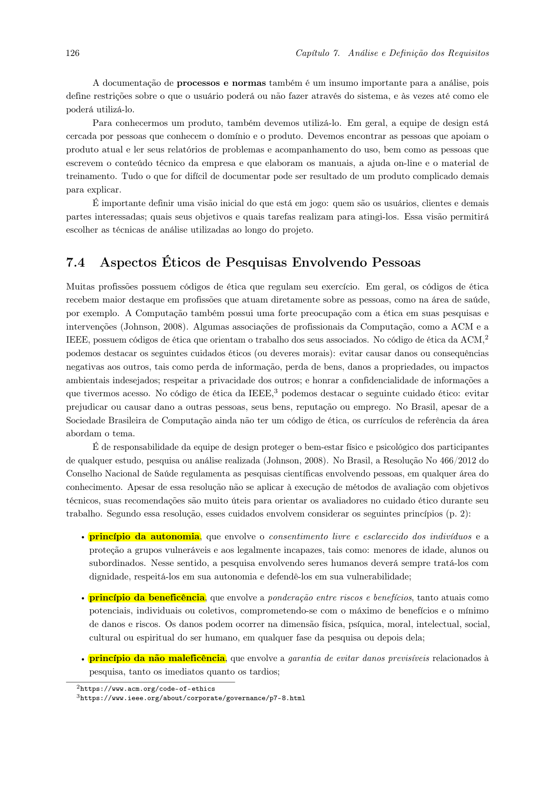

**Figura 1** — Evidência documental referente ao item `PE-E2-04`.  
_Fonte: Plano de Ensino (Sales, 2026, p. 10, Item 4)_

A **Figura 2** reproduz o trecho comprobatório de referência referente ao critério **PE-E2-06**.

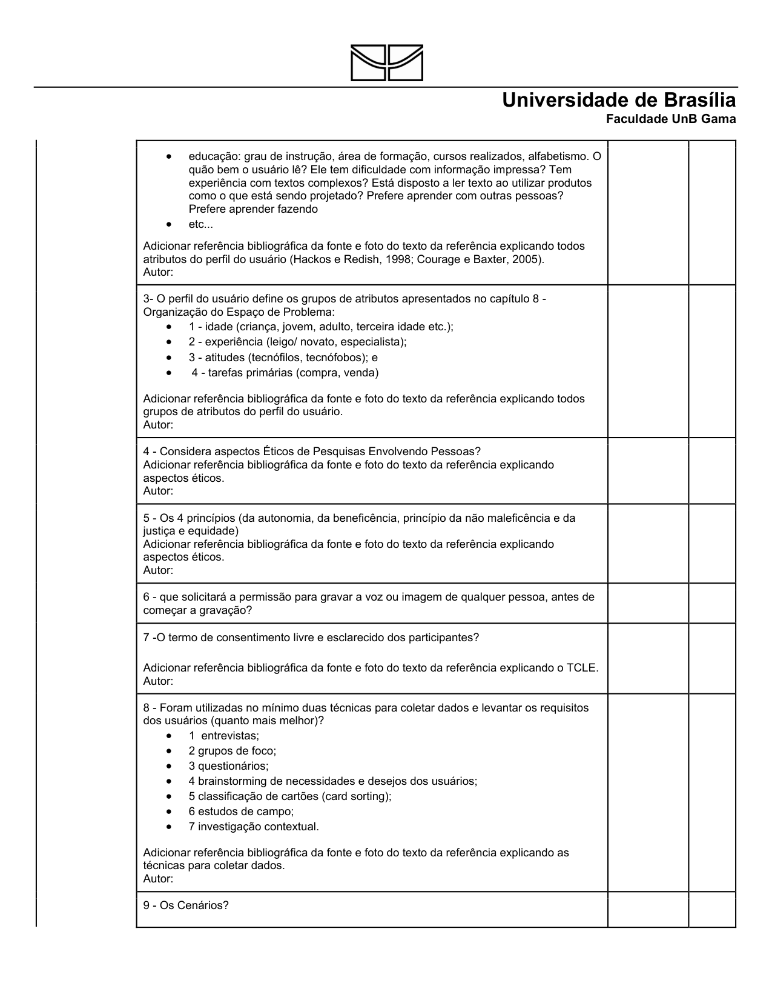

**Figura 2** — Evidência documental referente ao item `PE-E2-06`.  
_Fonte: Plano de Ensino (Sales, 2026, p. 10, Item 6)_

A **Figura 3** reproduz o trecho comprobatório de referência referente ao critério **PE-E2-07**.

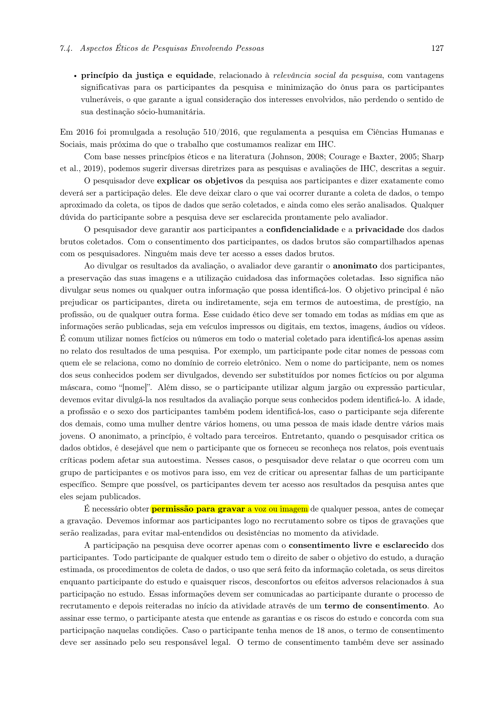

**Figura 3** — Evidência documental referente ao item `PE-E2-07`.  
_Fonte: Plano de Ensino (Sales, 2026, p. 10, Item 7)_

A **Figura 4** reproduz o trecho comprobatório de referência referente ao critério **PE-E2-08**.

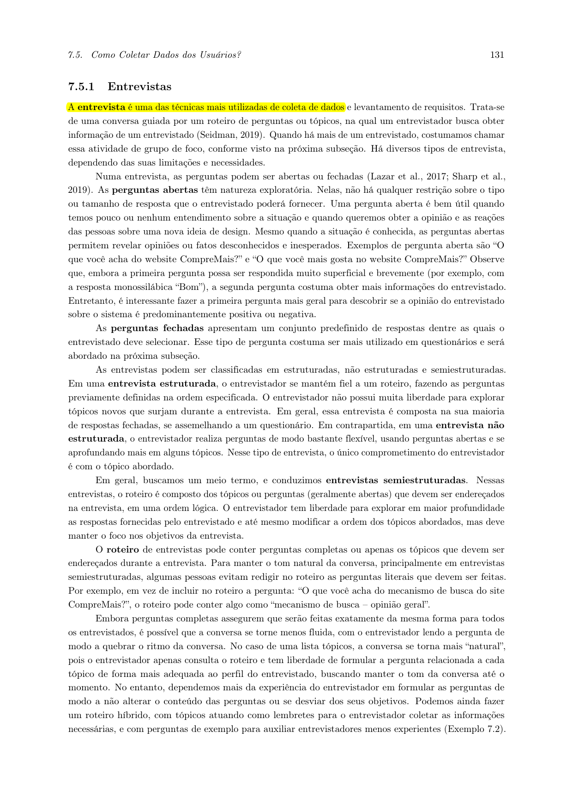

**Figura 4** — Evidência documental referente ao item `PE-E2-08`.  
_Fonte: Plano de Ensino (Sales, 2026, p. 10, Item 8)_

A **Figura 5** reproduz o trecho comprobatório de referência referente ao critério **PE-E3-10**.

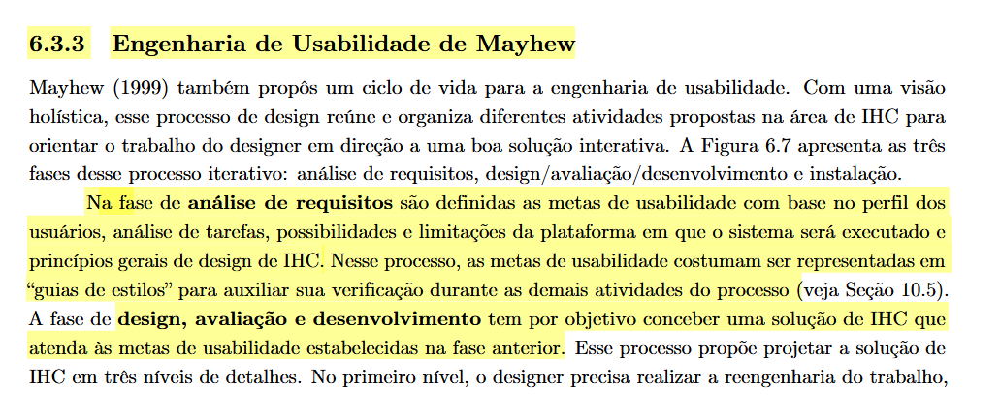

**Figura 5** — Evidência documental referente ao item `PE-E3-10`.  
_Fonte: Plano de Ensino (Sales, 2026, p. 11, Item 10)_

A **Figura 6** reproduz o trecho comprobatório de referência referente ao critério **PE-E3-11**.

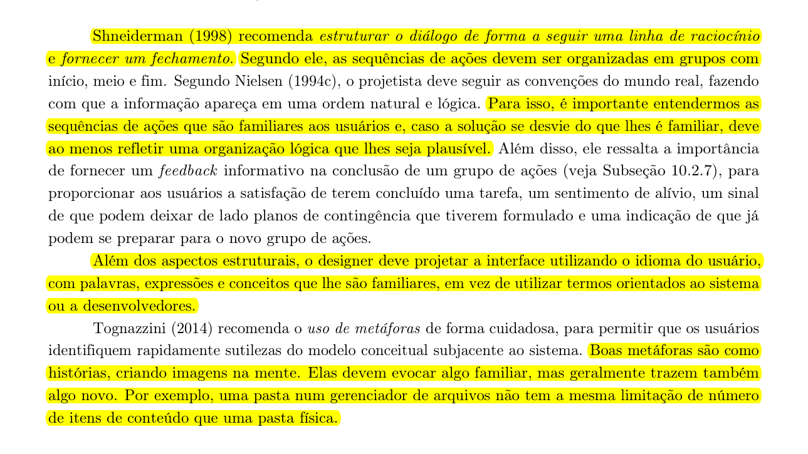

**Figura 6** — Evidência documental referente ao item `PE-E3-11`.  
_Fonte: Plano de Ensino (Sales, 2026, p. 11, Item 11)_

A **Figura 7** reproduz o trecho comprobatório de referência referente ao critério **PE-E3-12**.

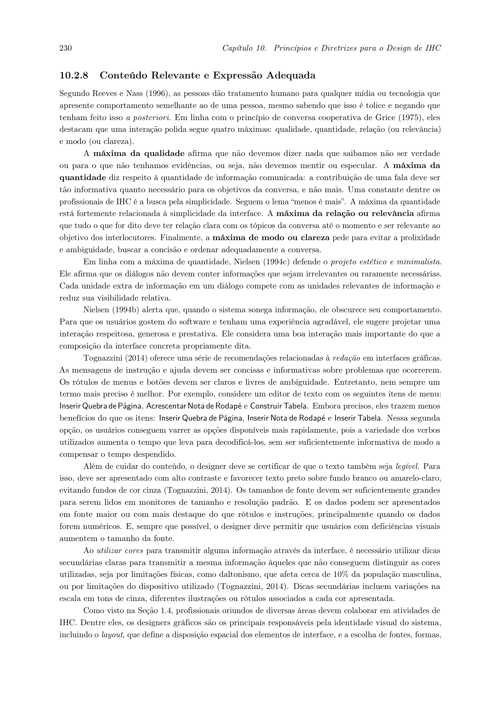

**Figura 7** — Evidência documental referente ao item `PE-E3-12`.  
_Fonte: Plano de Ensino (Sales, 2026, pp. 11–12, Item 12)_

A **Figura 8** reproduz o trecho comprobatório de referência referente ao critério **PE-E3-13**.

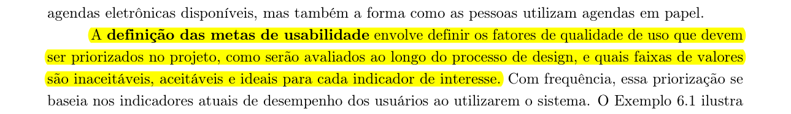

**Figura 8** — Evidência documental referente ao item `PE-E3-13`.  
_Fonte: Plano de Ensino (Sales, 2026, p. 12, Item 13)_

A **Figura 9** reproduz o trecho comprobatório de referência referente ao critério **PE-E3-14**.

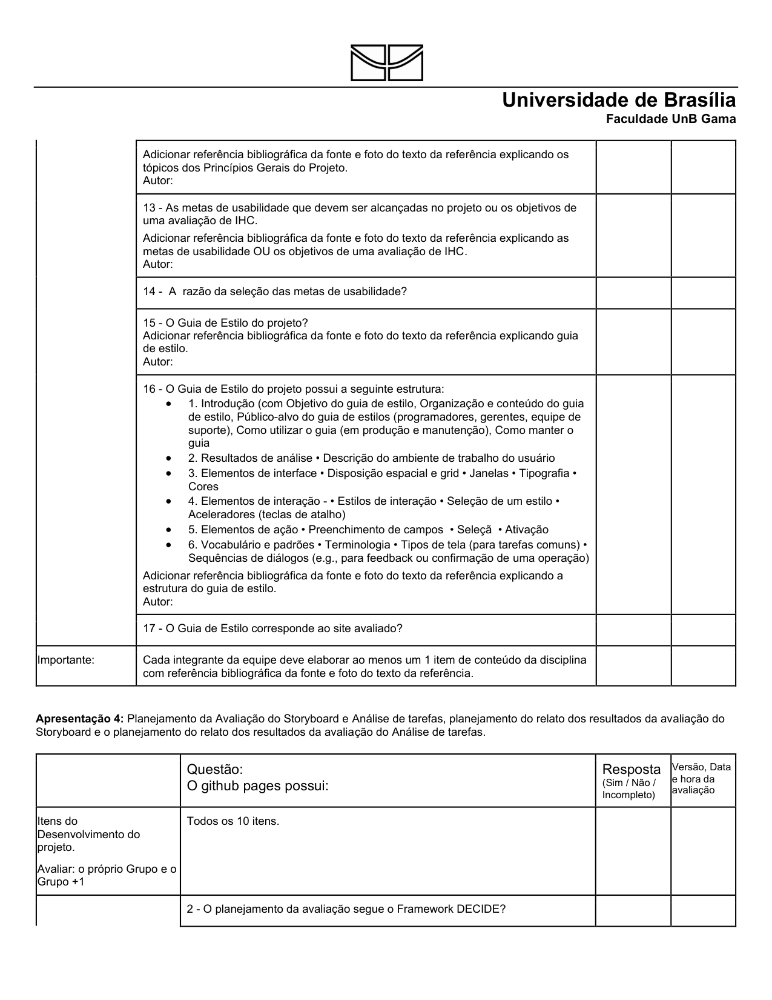

**Figura 9** — Evidência documental referente ao item `PE-E3-14`.  
_Fonte: Plano de Ensino (Sales, 2026, p. 12, Item 14)_

A **Figura 10** reproduz o trecho comprobatório de referência referente ao critério **PE-E3-15**.

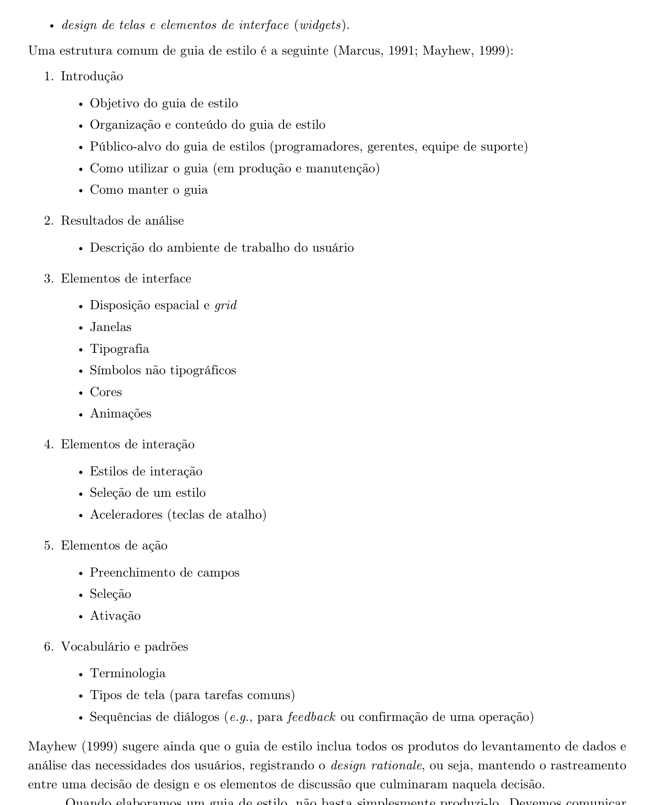

**Figura 10** — Evidência documental referente ao item `PE-E3-15`.  
_Fonte: Plano de Ensino (Sales, 2026, p. 12, Item 15)_

A **Figura 11** reproduz o trecho comprobatório de referência referente ao critério **PE-E3-17**.

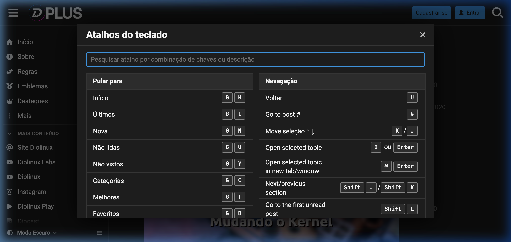

**Figura 11** — Evidência documental referente ao item `PE-E3-17`.  
_Fonte: Plano de Ensino (Sales, 2026, p. 12, Item 17)_

---

## 3. Validação desta Lista pela Lista de Governança do Prof. Dr. André Barros de Sales (`DG-01` a `DG-11`)

Em estrito cumprimento às diretrizes de qualidade do Plano de Ensino (*Sales, 2026, pp. 8–9*), a **Tabela 5** submete esta própria página (`13-requisitos-plataforma-guia.md`) aos **11 Itens de Desenvolvimento do Projeto** formulados pelo Prof. Dr. André Barros de Sales.

**Tabela 5** — Autoavaliação de `13-requisitos-plataforma-guia.md` frente aos critérios `DG-01` a `DG-11`

| ID | Critério de Governança do Plano de Ensino | Autor do Item | Resposta | Versão, Data e Hora da Avaliação | Evidência de Conformidade nesta Lista |
| :---: | :--- | :--- | :---: | :---: | :--- |
| **DG-01** | O histórico de versão padronizado? | **Prof. Dr. André Barros de Sales** *(Plano de Ensino FGA0173, 2026)* | ✅ **Sim (Conforme)** | `v2.0` — 20/11/2026 às 14:30 | Seção **Histórico de Versão** (**Tabela 6**) padronizada ao final de `13-requisitos-plataforma-guia.md` registrando `v2.0`. |
| **DG-02** | O(s) autor(es) e o(s) revisor(es) para cada artefato? | **Prof. Dr. André Barros de Sales** *(Plano de Ensino FGA0173, 2026)* | ✅ **Sim (Conforme)** | `v2.0` — 20/11/2026 às 14:30 | Colunas **Autor(es)** e **Revisor(es)** preenchidas com links GitHub no Histórico de Versão, além da coluna **`Autor do Item`** em 100% dos critérios da lista. |
| **DG-03** | Referências bibliográficas e/ou bibliografia em todos os artefatos? | **Prof. Dr. André Barros de Sales** *(Plano de Ensino FGA0173, 2026)* | ✅ **Sim (Conforme)** | `v2.0` — 20/11/2026 às 14:30 | Seção **Referências Bibliográficas (ABNT NBR 6023)** completa ao final do documento com obras, edições e páginas exatas. |
| **DG-04** | As tabelas e imagens possuem legenda e fonte e são chamadas dentro do texto? | **Prof. Dr. André Barros de Sales** *(Plano de Ensino FGA0173, 2026)* | ✅ **Sim (Conforme)** | `v2.0` — 20/11/2026 às 14:30 | 100% das tabelas (`Tabela 1` a `Tabela 6`) e figuras (`Figura 1` a `Figura 11`) possuem numeração, legenda, fonte e chamadas textuais prévias. |
| **DG-05** | Um texto fazendo uma introdução dos artefatos? | **Prof. Dr. André Barros de Sales** *(Plano de Ensino FGA0173, 2026)* | ✅ **Sim (Conforme)** | `v2.0` — 20/11/2026 às 14:30 | Seção **1. Introdução e Contextualização Metodológica** situa o instrumento no Ciclo de Mayhew (1999) e na Inspeção Formal de Fagan (1976). |
| **DG-06** | O cronograma executado com quem realizou cada artefato/atividade e as datas de início e fim da construção/realização? | **Prof. Dr. André Barros de Sales** *(Plano de Ensino FGA0173, 2026)* | ✅ **Sim (Conforme)** | `v2.0` — 20/11/2026 às 14:30 | Registros de elaboração e revisão vinculados ao [Cronograma Executado](../../planejamento/cronograma-executado.md) e ao histórico Git da equipe. |
| **DG-07** | Ata(s) da(s) reuniões (com data, horário de início e do final, participantes, objetivo, atividades definidas etc.)? | **Prof. Dr. André Barros de Sales** *(Plano de Ensino FGA0173, 2026)* | ✅ **Sim (Conforme)** | `v2.0` — 20/11/2026 às 14:30 | Deliberações e alinhamentos documentados nas [Atas de Reunião](../../atas/index.md). |
| **DG-08** | A gravação da reunião do grupo? | **Prof. Dr. André Barros de Sales** *(Plano de Ensino FGA0173, 2026)* | ✅ **Sim (Conforme)** | `v2.0` — 20/11/2026 às 14:30 | Links funcionais de gravações das reuniões de planejamento e auditoria indexados em [Atas de Reunião](../../atas/index.md). |
| **DG-09** | Vídeo de apresentação na categoria 'Não Listado' no YouTube (duração entre 20 e 30 minutos)? | **Prof. Dr. André Barros de Sales** *(Plano de Ensino FGA0173, 2026)* | ⚠️ **Em preparação (Etapa 8)** | `v2.0` — 20/11/2026 às 14:30 | Vídeos das Entregas 1–7 publicados; vídeo oficial da [Entrega 8 — Verificação dos Artefatos](../../entregas/entrega8.md) (20–30 min, Não Listado) agendado após consolidação das inspeções da equipe. |
| **DG-10** | Tabela de contribuição no início do artefato com o nome de todos os integrantes, contribuição com hiperligação da atividade e da gravação? | **Prof. Dr. André Barros de Sales** *(Plano de Ensino FGA0173, 2026)* | ✅ **Sim (Conforme)** | `v2.0` — 20/11/2026 às 14:30 | **Tabela 1** posicionada no topo do documento discriminando cada integrante ativo com hiperligação GitHub e escopo de atuação. |
| **DG-11** | A seção de agradecimentos apresentando o uso de Inteligência Artificial (IA) Generativa no artefato? | **Prof. Dr. André Barros de Sales** *(Plano de Ensino FGA0173, 2026)* | ✅ **Sim (Conforme)** | `v2.0` — 20/11/2026 às 14:30 | Seção **Agradecimentos e Declaração de Uso de IA Generativa** ao final do documento em estrita conformidade com o Código da SBC e Sales (2026). |

_Fonte: Validação elaborada por Vinicius Silva Araruna com base na rubrica oficial de Prof. Dr. André Barros de Sales (Plano de Ensino, 2026, pp. 8–9)._

---

## 4. Histórico de Versão

A **Tabela 6** registra a evolução histórica e o controle de versionamento deste instrumento normativo.

**Tabela 6** — Histórico de Versão do Documento

| Versão | Data | Descrição Detalhada da Modificação | Autor(es) | Revisor(es) |
| :---: | :---: | :--- | :--- | :--- |
| `1.0` | 07/10/2026 | Diagnóstico inicial em 18 itens da Entrega 3 (`Grupo08ViniciusSilvaArarunaInspecaoEntrega3.pdf`) e autoinspeção do Guia de Estilo (`guia-de-estilo.md`). | [Vinicius Silva Araruna](https://github.com/ViniciusA05) | [Gustavo Antonio Rodrigues e Silva](https://github.com/gus-ant), [Edvaldo Soares Brasileiro Filho](https://github.com/PajeMurici-dev) |
| `2.0` | 20/11/2026 | Separação em instrumento normativo por artefato reunindo os 13 itens do Prof. André (pp. 10–12), 18 critérios analíticos `IE3-01..18`, 10 critérios `GE-G01..10` do Guia de Estilo, colunas de autoria/avaliação e validação `DG-01` a `DG-11`. | [Vinicius Silva Araruna](https://github.com/ViniciusA05) | [Gustavo Antonio Rodrigues e Silva](https://github.com/gus-ant), [Edvaldo Soares Brasileiro Filho](https://github.com/PajeMurici-dev) |

_Fonte: Elaborada pelos autores, 2026._

---

## 5. Referências Bibliográficas (ABNT NBR 6023)

[1] BRASIL. *Resolução nº 510, de 7 de abril de 2016*. Conselho Nacional de Saúde, Brasília, DF, 2016.

[2] BRASIL. *Lei nº 13.709, de 14 de agosto de 2018 (LGPD)*. Diário Oficial da União, Brasília, DF, 2018.

[3] MARCUS, Aaron. *Graphic Design for Electronic Documents and User Interfaces*. New York: ACM Press, 1991.

[4] NIELSEN, Jakob. *Usability Engineering*. Boston: Academic Press, 1993.

[5] NORMAN, Donald A. *The Design of Everyday Things*. New York: Basic Books, 1988.

[6] W3C. *Web Content Accessibility Guidelines (WCAG) 2.1*. World Wide Web Consortium, 2018.

[7] BARBOSA, Simone Diniz Junqueira et al. *Interação Humano-Computador e Experiência do Usuário*. 1. ed. Rio de Janeiro: Autopublicação, 2021. ISBN 978-65-00-19677-1.

[8] BARBOSA, Simone Diniz Junqueira; SILVA, Bruno Santana da. *Interação Humano-Computador*. 1. ed. Rio de Janeiro: Elsevier / Campus, 2010.

[9] FAGAN, Michael E. Design and code inspections to reduce errors in program development. *IBM Systems Journal*, v. 15, n. 3, p. 182–211, 1976.

[10] MAYHEW, Deborah J. *The Usability Engineering Lifecycle: A Practitioner's Handbook for User Interface Design*. San Francisco: Morgan Kaufmann, 1999.

[11] SALES, André Barros de. *Plano de Ensino da Disciplina de Interação Humano Computador (FGA0173 — 02/2026)*. Brasília: Universidade de Brasília, Faculdade UnB Gama (FGA), 2026.

[12] SOCIEDADE BRASILEIRA DE COMPUTAÇÃO (SBC). *Código de Conduta da Sociedade Brasileira de Computação*. Porto Alegre: SBC, 2023.

---

## 6. Agradecimentos e Declaração de Uso de Inteligência Artificial (IA) Generativa

Em conformidade com o Código de Conduta da Sociedade Brasileira de Computação (SBC, Art. 2º, parágrafo III) e com as diretrizes do Plano de Ensino da disciplina (*Sales, 2026, p. 3*), declara-se que a organização das tabelas em Markdown e a revisão ortográfica contaram com suporte supervisionado da ferramenta de Inteligência Artificial Generativa Google Gemini. Toda a concepção metodológica, verificação bibliográfica nas obras originais, revisão técnica e validação de conformidade foram realizadas pelos discentes identificados no Histórico de Versão.
