# Lista de Verificação — Protótipo de Alta Fidelidade e Teste de Usabilidade (Nível 3)

## Tabela de Contribuição e Transparência de IA Generativa

A **Tabela 1** apresenta a distribuição de responsabilidades na elaboração, curadoria e revisão de **Protótipo de Alta Fidelidade e Teste de Usabilidade (Nível 3)**.

**Tabela 1** — Matriz de Contribuição e Transparência de IA Generativa — Protótipo de Alta Fidelidade e Teste de Usabilidade (Nível 3)

| Integrante | Atribuição no Artefato | Data | Horário | Ferramenta de IA | Propósito do Uso de IA |
| :--- | :--- | :---: | :---: | :--- | :--- |
| [Vinicius Silva Araruna](https://github.com/ViniciusA05) | Consolidação dos critérios de Alta Fidelidade (`AF-01` a `AF-12`, extraídos de `lista-verificacao.md`) e rastreabilidade Plano de Ensino / Mayhew Nível 3 | 20/11/2026 | 14:00 - 15:30 | Google Gemini | Suporte na organização estrutural, formatação de tabelas em Markdown e conferência cruzada com o Plano de Ensino |
| [Gustavo Antonio Rodrigues e Silva](https://github.com/gus-ant) | Revisão de conformidade estrutural, navegação e checagem de links | 20/11/2026 | 15:30 - 16:00 | — | Revisão por pares e validação editorial |
| [Edvaldo Soares Brasileiro Filho](https://github.com/PajeMurici-dev) | Auditoria de rastreabilidade frente ao Plano de Ensino (`DG-01` a `DG-11`) e referências ABNT | 20/11/2026 | 15:30 - 16:00 | — | Revisão por pares e conferência documental |

_Fonte: Elaborada pelos autores, 2026._

---

## 1. Introdução e Contextualização Metodológica

Este módulo normativo rege a verificação do **Nível 3 do Ciclo de Vida de Deborah Mayhew (1999) — Protótipo de Alta Fidelidade e Teste de Usabilidade** (Entregas 6 e 7). Para evitar repetição dos recortes já publicados no Framework Transversal, os critérios de planejamento DECIDE (`04-planejamento-decide.md`), métodos empíricos (`07-metodos-avaliacao.md`) e estrutura de relato (`06-resultado-avaliacao.md`) complementam diretamente os critérios específicos de Nível 3 abaixo.

!!! info "Pré-requisito Transversal de Governança (Prof. Dr. André Barros de Sales)"
    Todo artefato de Nível 3 também é auditado pelos **11 Itens de Desenvolvimento Geral (`DG-01` a `DG-11`)** em [00. Governança e Plano de Ensino Geral](00-plano-ensino-geral.md).

---

## 2. Instrumento Normativo de Verificação — Protótipo de Alta Fidelidade e Teste de Usabilidade (Nível 3)

### 2.1 Critérios do Plano de Ensino Aplicáveis às Entregas 6 e 7 (Prof. Dr. André Barros de Sales)

A **Tabela 2** registra os requisitos institucionais do Plano de Ensino incidentes sobre o Nível 3.

**Tabela 2** — Critérios do Plano de Ensino para Prototipação de Alta Fidelidade

| ID | Critério / Pergunta de Verificação | Autor do Item | Fundamentação Normativa | Evidência Visual (Figura) | Resposta | Versão, Data e Hora da Avaliação |
| :---: | :--- | :--- | :--- | :---: | :---: | :---: |
| **PE-E6-E7-01** | As entregas de Prototipação de Alta Fidelidade e Relato dos Resultados contemplam integralmente os 11 itens transversais de desenvolvimento (`DG-01` a `DG-11`), incluindo autoria individualizada em artefato e vídeo Não Listado (20–30 min)? | **Prof. Dr. André Barros de Sales** *(Plano de Ensino FGA0173, 2026)* | Plano de Ensino (Sales, 2026, pp. 5–6, 8–9) | [Ver Figura 1](#figura-1) | `[ ] Sim (Conforme)` `[ ] Não (Não Conforme)` `[ ] Incompleto` `[ ] N/A` | *(Preencher na inspeção)* |
| **PE-E6-E7-02** | Os métodos, planejamento DECIDE, teste-piloto isolado e relato de resultados atendem às exigências da disciplina conforme aplicabilidade transversal no Nível 3? | **Prof. Dr. André Barros de Sales** *(Plano de Ensino FGA0173, 2026)* | Plano de Ensino (Sales, 2026, pp. 5, 12–13) | [Ver Figura 2](#figura-2) | `[ ] Sim (Conforme)` `[ ] Não (Não Conforme)` `[ ] Incompleto` `[ ] N/A` | *(Preencher na inspeção)* |

_Fonte: Plano de Ensino da Disciplina (Prof. Dr. André Barros de Sales, 2026)._

### 2.2 Critérios Normativos de Alta Fidelidade e Teste de Usabilidade (`AF-01` a `AF-12`)

A **Tabela 3** consolida os **12 critérios** originalmente publicados em `lista-verificacao.md` (Seção 10) com vínculo às evidências visuais de Teste de Usabilidade, Teste-Piloto e Relato.

**Tabela 3** — Lista de verificação normativa de Protótipo de Alta Fidelidade (12 itens)

| ID | Critério / Pergunta de Verificação | Autor do Item | Fundamentação Canônica | Evidência Visual (Figura) | Resposta | Versão, Data e Hora da Avaliação |
| :---: | :--- | :--- | :--- | :---: | :---: | :---: |
| **AF-01** | O protótipo de alta fidelidade foi construído (Figma/Web) em conformidade com o Guia de Estilo e Personas e possui links e telas acessíveis? | [Vinicius Silva Araruna](https://github.com/ViniciusA05) | MAYHEW (1999, Cap. 9–11); BARBOSA et al. (2021, Cap. 10, pp. 235–240) | [Ver Figura 3](#figura-3) | `[ ] Sim (Conforme)` `[ ] Não (Não Conforme)` `[ ] Incompleto` `[ ] N/A` | *(Preencher na inspeção)* |
| **AF-02** | Há rastreabilidade explícita demonstrando como os problemas e oportunidades do Protótipo de Papel (Nível 2) foram resolvidos no Nível 3? | [Vinicius Silva Araruna](https://github.com/ViniciusA05) | MAYHEW (1999, Cap. 11–13); SNYDER (2003, Cap. 10) | [Ver Figura 4](#figura-4) | `[ ] Sim (Conforme)` `[ ] Não (Não Conforme)` `[ ] Incompleto` `[ ] N/A` | *(Preencher na inspeção)* |
| **AF-03** | Foi executado e gravado o Teste-Piloto de Alta Fidelidade antes das sessões empíricas com usuários reais? | [Vinicius Silva Araruna](https://github.com/ViniciusA05) | BARBOSA et al. (2021, Cap. 11, Seção 11.7.2, p. 260) | [Ver Figura 5](#figura-5) | `[ ] Sim (Conforme)` `[ ] Não (Não Conforme)` `[ ] Incompleto` `[ ] N/A` | *(Preencher na inspeção)* |
| **AF-04** | Consta declaração explícita de que os dados do Teste-Piloto foram rigorosamente isolados e não computados nos resultados finais? | [Vinicius Silva Araruna](https://github.com/ViniciusA05) | BARBOSA et al. (2021, p. 260); SALES (2026, Plano de Ensino, p. 13) | [Ver Figura 5](#figura-5) | `[ ] Sim (Conforme)` `[ ] Não (Não Conforme)` `[ ] Incompleto` `[ ] N/A` | *(Preencher na inspeção)* |
| **AF-05** | A escolha do método (Teste de Usabilidade / Think-Aloud) e o tamanho da amostra (n participantes) estão justificados na literatura? | [Vinicius Silva Araruna](https://github.com/ViniciusA05) | RUBIN; CHISNELL (2008); KRUG (2014); NIELSEN (1993, p. 26) | [Ver Figura 6](#figura-6) | `[ ] Sim (Conforme)` `[ ] Não (Não Conforme)` `[ ] Incompleto` `[ ] N/A` | *(Preencher na inspeção)* |
| **AF-06** | O Termo de Consentimento Livre e Esclarecido (TCLE) foi gravado ou assinado nos primeiros 60 segundos, garantindo anonimização LGPD? | [Vinicius Silva Araruna](https://github.com/ViniciusA05) | BRASIL (Resolução CNS nº 510/2016 e Lei nº 13.709/2018); BARBOSA et al. (2021, p. 128) | [Ver Figura 7](#figura-7) | `[ ] Sim (Conforme)` `[ ] Não (Não Conforme)` `[ ] Incompleto` `[ ] N/A` | *(Preencher na inspeção)* |
| **AF-07** | As sessões empíricas com usuários reais aderentes ao perfil foram conduzidas e disponibilizadas em vídeo? | [Vinicius Silva Araruna](https://github.com/ViniciusA05) | KRUG (2014); RUBIN; CHISNELL (2008); BARBOSA et al. (2021, pp. 289–290) | [Ver Figura 8](#figura-8) | `[ ] Sim (Conforme)` `[ ] Não (Não Conforme)` `[ ] Incompleto` `[ ] N/A` | *(Preencher na inspeção)* |
| **AF-08** | O relato apresenta estrutura completa (objetivos, método, tarefas, resultados, limitações) e página principal consolidada sem lacunas? | [Vinicius Silva Araruna](https://github.com/ViniciusA05) | BARBOSA et al. (2021, Cap. 11–12, pp. 263 e 290) | [Ver Figura 9](#figura-9) | `[ ] Sim (Conforme)` `[ ] Não (Não Conforme)` `[ ] Incompleto` `[ ] N/A` | *(Preencher na inspeção)* |
| **AF-09** | Foram coletadas e analisadas métricas quantitativas de desempenho (conclusão, tempo de execução, erros/KLM) e satisfação (ex.: SUS)? | [Vinicius Silva Araruna](https://github.com/ViniciusA05) | RUBIN; CHISNELL (2008); BROOKE (1996, pp. 189–194) | [Ver Figura 10](#figura-10) | `[ ] Sim (Conforme)` `[ ] Não (Não Conforme)` `[ ] Incompleto` `[ ] N/A` | *(Preencher na inspeção)* |
| **AF-10** | Os problemas de usabilidade detectados foram classificados na escala de severidade de Nielsen (0 a 4) com indicação das heurísticas violadas? | [Vinicius Silva Araruna](https://github.com/ViniciusA05) | NIELSEN (1994, p. 30); BARBOSA et al. (2021, pp. 290 e 305) | [Ver Figura 11](#figura-11) | `[ ] Sim (Conforme)` `[ ] Não (Não Conforme)` `[ ] Incompleto` `[ ] N/A` | *(Preencher na inspeção)* |
| **AF-11** | Foram definidas diretrizes concretas de reprojeto e executada a Lista de Verificação da Técnica antes da entrega? | [Vinicius Silva Araruna](https://github.com/ViniciusA05) | MAYHEW (1999, Cap. 13); FAGAN (1976, pp. 182–211) | [Ver Figura 12](#figura-12) | `[ ] Sim (Conforme)` `[ ] Não (Não Conforme)` `[ ] Incompleto` `[ ] N/A` | *(Preencher na inspeção)* |
| **AF-12** | Todos os integrantes ativos participaram do desenvolvimento e o vídeo da apresentação oficial (20–30 min, Não Listado) e o PDF foram entregues? | [Vinicius Silva Araruna](https://github.com/ViniciusA05) | SALES (2026, Plano de Ensino FGA0173, pp. 5–6, 8–9) | [Ver Figura 1](#figura-1) | `[ ] Sim (Conforme)` `[ ] Não (Não Conforme)` `[ ] Incompleto` `[ ] N/A` | *(Preencher na inspeção)* |

_Fonte: Elaborada por [Vinicius Silva Araruna](https://github.com/ViniciusA05) (`lista-verificacao.md`, Seção 10), 2026._

### 2.3 Critérios Complementares de Autoinspeção da Equipe (Tarefa 3)

A **Tabela 4** reproduz integralmente os **8 critérios** da Tabela 4 elaborada em `docs/design-avaliacao-desenvolvimento/nivel-3/prototipo-alta-fidelidade-tarefa3.md`.

**Tabela 4** — Critérios complementares de Alta Fidelidade (`prototipo-alta-fidelidade-tarefa3.md`)

| ID | Critério / Pergunta de Verificação | Autor do Item | Fundamentação Canônica | Evidência Visual (Figura) | Resposta | Versão, Data e Hora da Avaliação |
| :---: | :--- | :--- | :--- | :---: | :---: | :---: |
| **AF-E01** | O protótipo se enquadra conceitualmente no Nível 3 de Mayhew (diferenciando-se do Nível 2 e extinguindo o Computador Humano)? | [Edvaldo Soares Brasileiro Filho](https://github.com/PajeMurici-dev) | MAYHEW (1999, Cap. 11–13); BARBOSA et al. (2021, p. 306) | [Ver Figura 3](#figura-3) | `[ ] Sim (Conforme)` `[ ] Não (Não Conforme)` `[ ] Incompleto` `[ ] N/A` | *(Preencher na inspeção)* |
| **AF-E02** | Há especificação detalhada dos tokens cromáticos e tipográficos em conformidade com o Guia de Estilo e WCAG 2.1? | [Edvaldo Soares Brasileiro Filho](https://github.com/PajeMurici-dev) | MAYHEW (1999, Cap. 9); W3C WCAG 2.1 (2018) | [Ver Figura 3](#figura-3) | `[ ] Sim (Conforme)` `[ ] Não (Não Conforme)` `[ ] Incompleto` `[ ] N/A` | *(Preencher na inspeção)* |
| **AF-E03** | O artefato apresenta rastreabilidade com os problemas identificados no Protótipo de Papel (Nível 2)? | [Edvaldo Soares Brasileiro Filho](https://github.com/PajeMurici-dev) | MAYHEW (1999, Cap. 11); BARBOSA et al. (2021, pp. 305–306) | [Ver Figura 3](#figura-3) | `[ ] Sim (Conforme)` `[ ] Não (Não Conforme)` `[ ] Incompleto` `[ ] N/A` | *(Preencher na inspeção)* |
| **AF-E04** | Há especificação das telas principais do fluxo com imagens ilustrativas? | [Edvaldo Soares Brasileiro Filho](https://github.com/PajeMurici-dev) | SNYDER (2003, Cap. 4); RUBIN; CHISNELL (2008, Cap. 7) | [Ver Figura 3](#figura-3) | `[ ] Sim (Conforme)` `[ ] Não (Não Conforme)` `[ ] Incompleto` `[ ] N/A` | *(Preencher na inspeção)* |
| **AF-E05** | O ponto de entrada no tópico/interface original do fórum foi mantido fielmente? | [Edvaldo Soares Brasileiro Filho](https://github.com/PajeMurici-dev) | BARBOSA et al. (2021, Cap. 12); SALES (2026, pp. 5–6) | [Ver Figura 3](#figura-3) | `[ ] Sim (Conforme)` `[ ] Não (Não Conforme)` `[ ] Incompleto` `[ ] N/A` | *(Preencher na inspeção)* |
| **AF-E06** | A ferramenta de desenvolvimento utilizada na prototipação está explicitada conforme a execução real? | [Edvaldo Soares Brasileiro Filho](https://github.com/PajeMurici-dev) | BARBOSA et al. (2021, Cap. 10, p. 235); SALES (2026, pp. 8–9) | [Ver Figura 3](#figura-3) | `[ ] Sim (Conforme)` `[ ] Não (Não Conforme)` `[ ] Incompleto` `[ ] N/A` | *(Preencher na inspeção)* |
| **AF-E07** | O artefato prevê o endereçamento dos apontamentos e propostas de reprojeto pós-avaliação? | [Edvaldo Soares Brasileiro Filho](https://github.com/PajeMurici-dev) | NIELSEN (1994, p. 103); BARBOSA et al. (2021, p. 290) | [Ver Figura 3](#figura-3) | `[ ] Sim (Conforme)` `[ ] Não (Não Conforme)` `[ ] Incompleto` `[ ] N/A` | *(Preencher na inspeção)* |
| **AF-E08** | Há declaração formal de autoria e uso ético de IA Generativa no artefato? | [Edvaldo Soares Brasileiro Filho](https://github.com/PajeMurici-dev) | SBC (2023, Art. 2º); SALES (2026, p. 3 e p. 9, Item 11) | [Ver Figura 3](#figura-3) | `[ ] Sim (Conforme)` `[ ] Não (Não Conforme)` `[ ] Incompleto` `[ ] N/A` | *(Preencher na inspeção)* |

_Fonte: Consolidada a partir de `docs/design-avaliacao-desenvolvimento/nivel-3/prototipo-alta-fidelidade-tarefa3.md` (Seção 5 / Tabela 4), Grupo 08, 2026._

### Evidências Visuais da Literatura e do Plano de Ensino

Cada figura a seguir é chamada explicitamente e vinculada ao respectivo critério na tabela normativa acima.

A **Figura 1** reproduz o trecho comprobatório de referência referente ao critério **PE-E6-E7-01**.

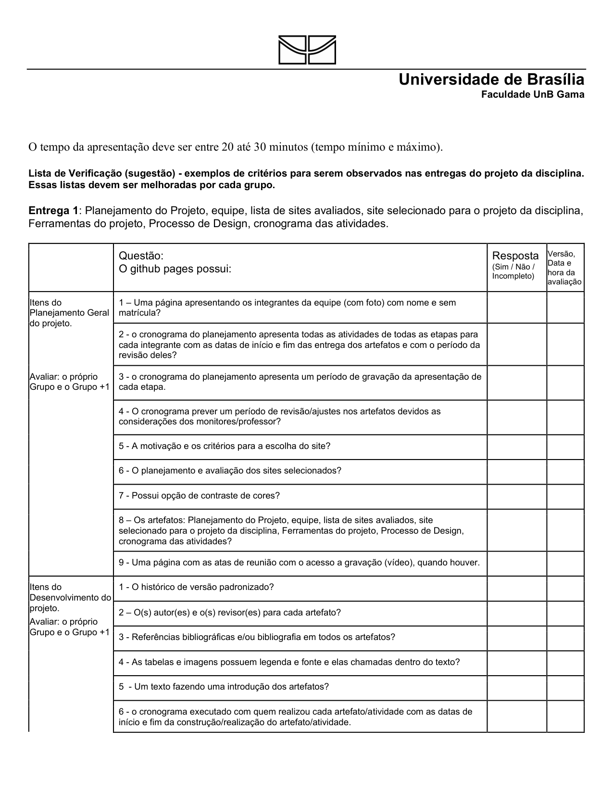

**Figura 1** — Evidência documental referente ao item `PE-E6-E7-01`.  
_Fonte: Plano de Ensino (Sales, 2026, pp. 5–6, 8–9)_

A **Figura 2** reproduz o trecho comprobatório de referência referente ao critério **PE-E6-E7-02**.

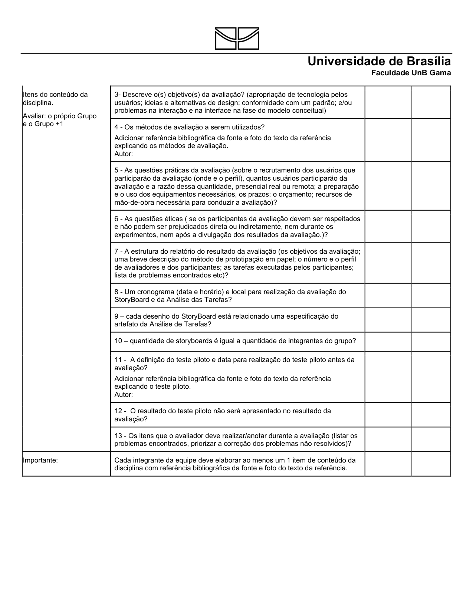

**Figura 2** — Evidência documental referente ao item `PE-E6-E7-02`.  
_Fonte: Plano de Ensino (Sales, 2026, pp. 5, 12–13)_

A **Figura 3** reproduz o trecho comprobatório de referência referente ao critério **AF-01**.

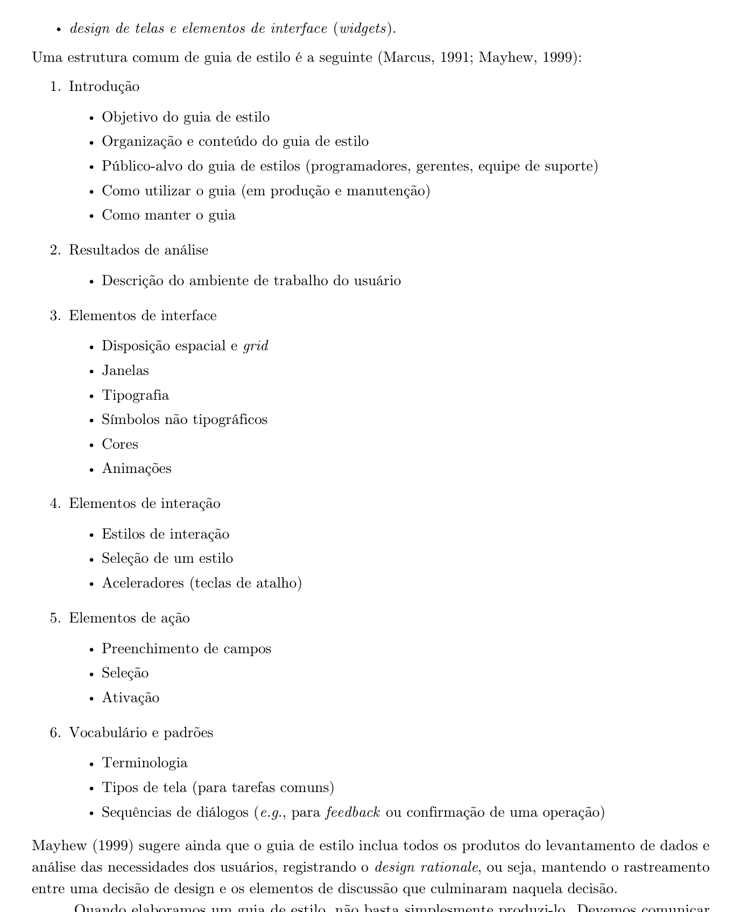

**Figura 3** — Evidência documental referente ao item `AF-01`.  
_Fonte: Mayhew (1999); Guia de Estilo_

A **Figura 4** reproduz o trecho comprobatório de referência referente ao critério **AF-02**.

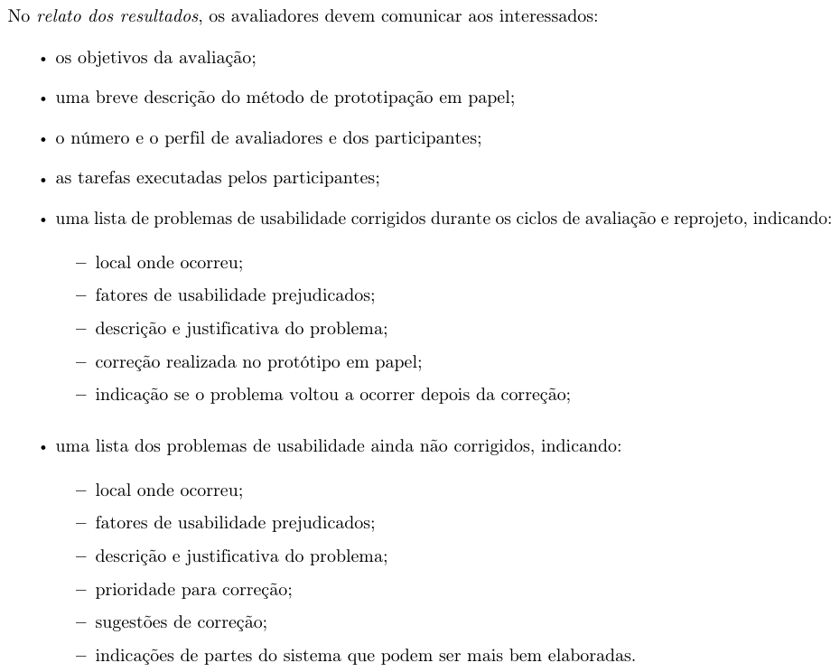

**Figura 4** — Evidência documental referente ao item `AF-02`.  
_Fonte: Barbosa et al. (2021, p. 306) — Reprojeto pós-Papel_

A **Figura 5** reproduz o trecho comprobatório de referência referente ao critério **AF-03**.

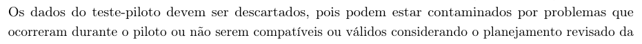

**Figura 5** — Evidência documental referente ao item `AF-03`.  
_Fonte: Barbosa et al. (2021, p. 260) — Teste-Piloto_

A **Figura 6** reproduz o trecho comprobatório de referência referente ao critério **AF-05**.

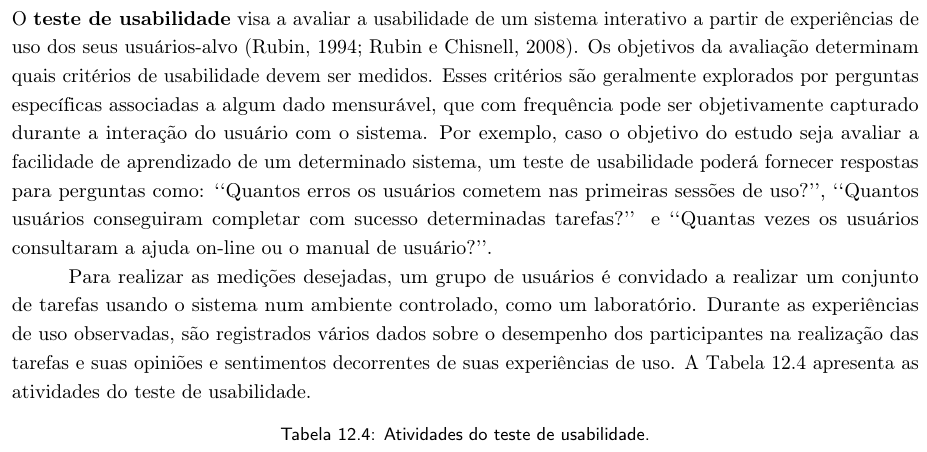

**Figura 6** — Evidência documental referente ao item `AF-05`.  
_Fonte: Barbosa et al. (2021, pp. 288-289) — Teste de Usabilidade_

A **Figura 7** reproduz o trecho comprobatório de referência referente ao critério **AF-06**.

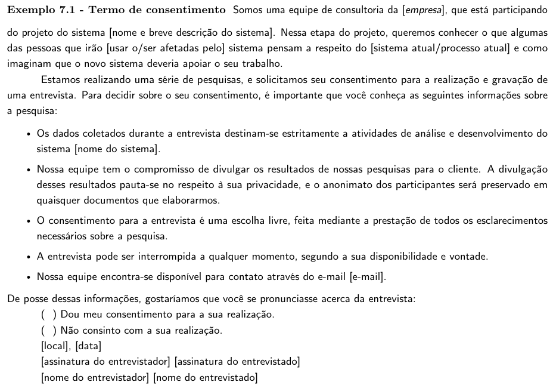

**Figura 7** — Evidência documental referente ao item `AF-06`.  
_Fonte: Barbosa et al. (2021, p. 128) — TCLE_

A **Figura 8** reproduz o trecho comprobatório de referência referente ao critério **AF-07**.

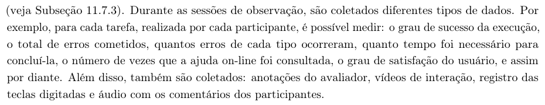

**Figura 8** — Evidência documental referente ao item `AF-07`.  
_Fonte: Barbosa et al. (2021, pp. 289-290) — Sessões de observação_

A **Figura 9** reproduz o trecho comprobatório de referência referente ao critério **AF-08**.

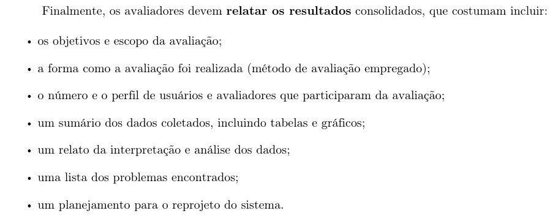

**Figura 9** — Evidência documental referente ao item `AF-08`.  
_Fonte: Barbosa et al. (2021, p. 263) — Relato dos Resultados_

A **Figura 10** reproduz o trecho comprobatório de referência referente ao critério **AF-09**.

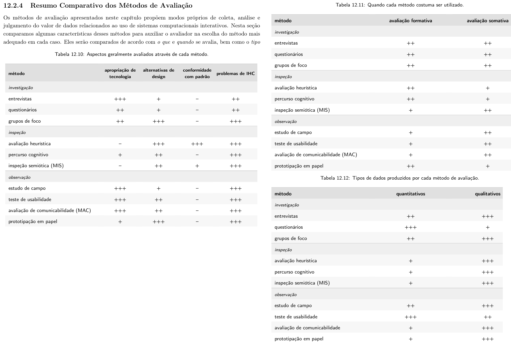

**Figura 10** — Evidência documental referente ao item `AF-09`.  
_Fonte: Barbosa et al. (2021, pp. 306-308) — Critérios Comparativos e Tipos de Dados_

A **Figura 11** reproduz o trecho comprobatório de referência referente ao critério **AF-10**.

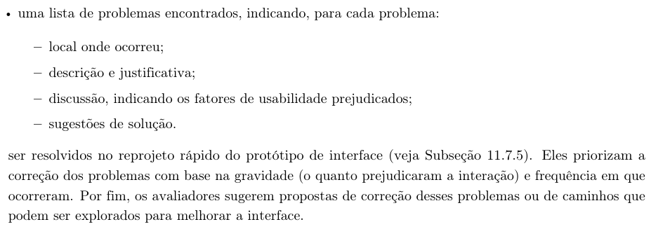

**Figura 11** — Evidência documental referente ao item `AF-10`.  
_Fonte: Barbosa et al. (2021, pp. 290 e 305) — Severidade e Correção_

A **Figura 12** reproduz o trecho comprobatório de referência referente ao critério **AF-11**.

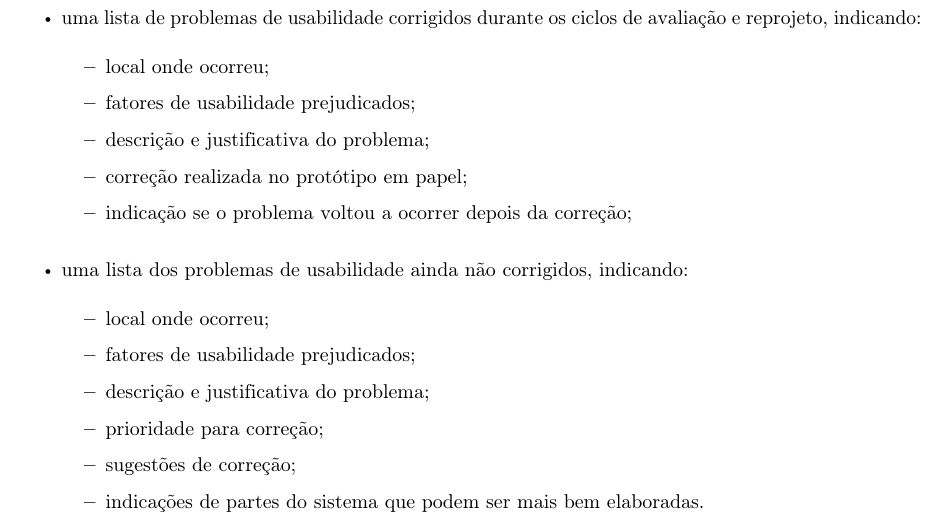

**Figura 12** — Evidência documental referente ao item `AF-11`.  
_Fonte: Barbosa et al. (2021, pp. 305-306) — Reprojeto_

---

## 3. Validação desta Lista pela Lista de Governança do Prof. Dr. André Barros de Sales (`DG-01` a `DG-11`)

Em estrito cumprimento às diretrizes de qualidade do Plano de Ensino (*Sales, 2026, pp. 8–9*), a **Tabela 5** submete esta própria página (`14-alta-fidelidade.md`) aos **11 Itens de Desenvolvimento do Projeto** formulados pelo Prof. Dr. André Barros de Sales.

**Tabela 5** — Autoavaliação de `14-alta-fidelidade.md` frente aos critérios `DG-01` a `DG-11`

| ID | Critério de Governança do Plano de Ensino | Autor do Item | Resposta | Versão, Data e Hora da Avaliação | Evidência de Conformidade nesta Lista |
| :---: | :--- | :--- | :---: | :---: | :--- |
| **DG-01** | O histórico de versão padronizado? | **Prof. Dr. André Barros de Sales** *(Plano de Ensino FGA0173, 2026)* | ✅ **Sim (Conforme)** | `v2.0` — 20/11/2026 às 14:30 | Seção **Histórico de Versão** (**Tabela 6**) padronizada ao final de `14-alta-fidelidade.md` registrando `v2.0`. |
| **DG-02** | O(s) autor(es) e o(s) revisor(es) para cada artefato? | **Prof. Dr. André Barros de Sales** *(Plano de Ensino FGA0173, 2026)* | ✅ **Sim (Conforme)** | `v2.0` — 20/11/2026 às 14:30 | Colunas **Autor(es)** e **Revisor(es)** preenchidas com links GitHub no Histórico de Versão, além da coluna **`Autor do Item`** em 100% dos critérios da lista. |
| **DG-03** | Referências bibliográficas e/ou bibliografia em todos os artefatos? | **Prof. Dr. André Barros de Sales** *(Plano de Ensino FGA0173, 2026)* | ✅ **Sim (Conforme)** | `v2.0` — 20/11/2026 às 14:30 | Seção **Referências Bibliográficas (ABNT NBR 6023)** completa ao final do documento com obras, edições e páginas exatas. |
| **DG-04** | As tabelas e imagens possuem legenda e fonte e são chamadas dentro do texto? | **Prof. Dr. André Barros de Sales** *(Plano de Ensino FGA0173, 2026)* | ✅ **Sim (Conforme)** | `v2.0` — 20/11/2026 às 14:30 | 100% das tabelas (`Tabela 1` a `Tabela 6`) e figuras (`Figura 1` a `Figura 12`) possuem numeração, legenda, fonte e chamadas textuais prévias. |
| **DG-05** | Um texto fazendo uma introdução dos artefatos? | **Prof. Dr. André Barros de Sales** *(Plano de Ensino FGA0173, 2026)* | ✅ **Sim (Conforme)** | `v2.0` — 20/11/2026 às 14:30 | Seção **1. Introdução e Contextualização Metodológica** situa o instrumento no Ciclo de Mayhew (1999) e na Inspeção Formal de Fagan (1976). |
| **DG-06** | O cronograma executado com quem realizou cada artefato/atividade e as datas de início e fim da construção/realização? | **Prof. Dr. André Barros de Sales** *(Plano de Ensino FGA0173, 2026)* | ✅ **Sim (Conforme)** | `v2.0` — 20/11/2026 às 14:30 | Registros de elaboração e revisão vinculados ao [Cronograma Executado](../../planejamento/cronograma-executado.md) e ao histórico Git da equipe. |
| **DG-07** | Ata(s) da(s) reuniões (com data, horário de início e do final, participantes, objetivo, atividades definidas etc.)? | **Prof. Dr. André Barros de Sales** *(Plano de Ensino FGA0173, 2026)* | ✅ **Sim (Conforme)** | `v2.0` — 20/11/2026 às 14:30 | Deliberações e alinhamentos documentados nas [Atas de Reunião](../../atas/index.md). |
| **DG-08** | A gravação da reunião do grupo? | **Prof. Dr. André Barros de Sales** *(Plano de Ensino FGA0173, 2026)* | ✅ **Sim (Conforme)** | `v2.0` — 20/11/2026 às 14:30 | Links funcionais de gravações das reuniões de planejamento e auditoria indexados em [Atas de Reunião](../../atas/index.md). |
| **DG-09** | Vídeo de apresentação na categoria 'Não Listado' no YouTube (duração entre 20 e 30 minutos)? | **Prof. Dr. André Barros de Sales** *(Plano de Ensino FGA0173, 2026)* | ⚠️ **Em preparação (Etapa 8)** | `v2.0` — 20/11/2026 às 14:30 | Vídeos das Entregas 1–7 publicados; vídeo oficial da [Entrega 8 — Verificação dos Artefatos](../../entregas/entrega8.md) (20–30 min, Não Listado) agendado após consolidação das inspeções da equipe. |
| **DG-10** | Tabela de contribuição no início do artefato com o nome de todos os integrantes, contribuição com hiperligação da atividade e da gravação? | **Prof. Dr. André Barros de Sales** *(Plano de Ensino FGA0173, 2026)* | ✅ **Sim (Conforme)** | `v2.0` — 20/11/2026 às 14:30 | **Tabela 1** posicionada no topo do documento discriminando cada integrante ativo com hiperligação GitHub e escopo de atuação. |
| **DG-11** | A seção de agradecimentos apresentando o uso de Inteligência Artificial (IA) Generativa no artefato? | **Prof. Dr. André Barros de Sales** *(Plano de Ensino FGA0173, 2026)* | ✅ **Sim (Conforme)** | `v2.0` — 20/11/2026 às 14:30 | Seção **Agradecimentos e Declaração de Uso de IA Generativa** ao final do documento em estrita conformidade com o Código da SBC e Sales (2026). |

_Fonte: Validação elaborada por Vinicius Silva Araruna com base na rubrica oficial de Prof. Dr. André Barros de Sales (Plano de Ensino, 2026, pp. 8–9)._

---

## 4. Histórico de Versão

A **Tabela 6** registra a evolução histórica e o controle de versionamento deste instrumento normativo.

**Tabela 6** — Histórico de Versão do Documento

| Versão | Data | Descrição Detalhada da Modificação | Autor(es) | Revisor(es) |
| :---: | :---: | :--- | :--- | :--- |
| `1.0` | 16/11/2026 | Criação inicial do checklist normativo da Entrega 7 (`E7-01..12` em `lista-verificacao.md`) e autoinspeção da Tarefa 3 (`prototipo-alta-fidelidade-tarefa3.md`). | [Vinicius Silva Araruna](https://github.com/ViniciusA05) | [Gustavo Antonio Rodrigues e Silva](https://github.com/gus-ant), [Edvaldo Soares Brasileiro Filho](https://github.com/PajeMurici-dev) |
| `2.0` | 20/11/2026 | Organização por artefato em `14-alta-fidelidade.md`, vínculo das figuras comprobatórias, atribuição nominal de `Autor do Item`, inclusão de `Versão, Data e Hora da Avaliação` e autovalidação pela lista `DG-01..11` do Prof. André. | [Vinicius Silva Araruna](https://github.com/ViniciusA05) | [Gustavo Antonio Rodrigues e Silva](https://github.com/gus-ant), [Edvaldo Soares Brasileiro Filho](https://github.com/PajeMurici-dev) |

_Fonte: Elaborada pelos autores, 2026._

---

## 5. Referências Bibliográficas (ABNT NBR 6023)

[1] BRASIL. *Resolução nº 510, de 7 de abril de 2016*. Conselho Nacional de Saúde, Brasília, DF, 2016.

[2] BRASIL. *Lei nº 13.709, de 14 de agosto de 2018 (LGPD)*. Diário Oficial da União, Brasília, DF, 2018.

[3] BROOKE, John. SUS: A quick and dirty usability scale. In: JORDAN, P. W. et al. *Usability Evaluation in Industry*. London: Taylor & Francis, 1996, pp. 189–194.

[4] KRUG, Steve. *Don't Make Me Think, Revisited*. 3. ed. New Riders, 2014.

[5] NIELSEN, Jakob. *Usability Engineering*. Boston: Academic Press, 1993.

[6] RUBIN, Jeffrey; CHISNELL, Dana. *Handbook of Usability Testing*. 2. ed. Indianapolis: Wiley, 2008.

[7] SNYDER, Carolyn. *Paper Prototyping*. San Francisco: Morgan Kaufmann, 2003.

[8] W3C. *Web Content Accessibility Guidelines (WCAG) 2.1*. World Wide Web Consortium, 2018.

[9] BARBOSA, Simone Diniz Junqueira et al. *Interação Humano-Computador e Experiência do Usuário*. 1. ed. Rio de Janeiro: Autopublicação, 2021. ISBN 978-65-00-19677-1.

[10] BARBOSA, Simone Diniz Junqueira; SILVA, Bruno Santana da. *Interação Humano-Computador*. 1. ed. Rio de Janeiro: Elsevier / Campus, 2010.

[11] FAGAN, Michael E. Design and code inspections to reduce errors in program development. *IBM Systems Journal*, v. 15, n. 3, p. 182–211, 1976.

[12] MAYHEW, Deborah J. *The Usability Engineering Lifecycle: A Practitioner's Handbook for User Interface Design*. San Francisco: Morgan Kaufmann, 1999.

[13] SALES, André Barros de. *Plano de Ensino da Disciplina de Interação Humano Computador (FGA0173 — 02/2026)*. Brasília: Universidade de Brasília, Faculdade UnB Gama (FGA), 2026.

[14] SOCIEDADE BRASILEIRA DE COMPUTAÇÃO (SBC). *Código de Conduta da Sociedade Brasileira de Computação*. Porto Alegre: SBC, 2023.

---

## 6. Agradecimentos e Declaração de Uso de Inteligência Artificial (IA) Generativa

Em conformidade com o Código de Conduta da Sociedade Brasileira de Computação (SBC, Art. 2º, parágrafo III) e com as diretrizes do Plano de Ensino da disciplina (*Sales, 2026, p. 3*), declara-se que a organização das tabelas em Markdown e a revisão ortográfica contaram com suporte supervisionado da ferramenta de Inteligência Artificial Generativa Google Gemini. Toda a concepção metodológica, verificação bibliográfica nas obras originais, revisão técnica e validação de conformidade foram realizadas pelos discentes identificados no Histórico de Versão.
