# Fundamentos de Verificação e Validação (V&V) e Inspeção de Fagan

## Tabela de Contribuição e Transparência de IA Generativa

A **Tabela 1** apresenta a distribuição de responsabilidades na elaboração, curadoria e revisão de **Fundamentos de Verificação e Validação (V&V) e Inspeção de Fagan**.

**Tabela 1** — Matriz de Contribuição e Transparência de IA Generativa — V&V e Inspeção de Fagan

| Integrante | Atribuição no Artefato | Data | Horário | Ferramenta de IA | Propósito do Uso de IA | Hiperligação / Gravação |
| :--- | :--- | :---: | :---: | :--- | :--- | :---: |
| [Edvaldo Soares Brasileiro Filho](https://github.com/PajeMurici-dev) | Concepção, estruturação dos 13 itens normativos (`VVR-01` a `VVR-13`) em 3 blocos temáticos, fundamentação bibliográfica e mapeamento de evidências | 22/11/2026 | 10:30 - 12:30 | Google Gemini | Suporte na organização de tabelas Markdown e checagem de normas ABNT; conteúdo técnico concebido e auditado pelo discente | — |
| [Gustavo Antonio Rodrigues e Silva](https://github.com/gus-ant) | Revisão de conformidade estrutural, checagem bibliográfica e validação editorial | 22/11/2026 | — | — | Aguardando revisão por pares pós-integração | — |

_Fonte: Elaborada por Edvaldo Soares Brasileiro Filho e Gustavo Antonio Rodrigues e Silva, 2026._

---

## 1. Introdução e Contextualização Metodológica

A qualidade de um sistema computacional depende intrinsecamente do rigor aplicado às suas etapas de avaliação analítica e empírica. No contexto da Engenharia de Software e da Interação Humano-Computador, a **Verificação e Validação (V&V)** constitui a espinha dorsal da garantia de qualidade de artefatos de processo e de produto (Sommerville, 2019; Sales, 2026).

Enquanto a **Verificação** analisa se o software e seus modelos intermediários atendem aos requisitos especificados de forma correta ("*estamos construindo o produto da forma correta?*"), a **Validação** avalia se o produto atende às reais necessidades e expectativas dos usuários e clientes no seu contexto de uso ("*estamos construindo o produto certo?*") (UNIVESP, Aula 05).

Entre as técnicas de revisão estática mais eficazes da engenharia de software destaca-se a **Inspeção de Software de Michael Fagan (1976)**, caracterizada pelo rigor formal, definição estrita de papéis na equipe, existência de fases estruturadas (Planejamento, Visão Geral, Preparação Individual, Reunião de Inspeção, Retrabalho e Acompanhamento) e orientação sistemática através de **Listas de Verificação (*checklists*)**.

Esta página formaliza os **13 itens normativos** concebidos para avaliar a solidez dos fundamentos de V&V, as técnicas de revisão estática/dinâmica e a aderência ao método clássico de inspeção formal no âmbito do projeto do Fórum Diolinux Plus.

---

## 2. Critérios Normativos de Verificação e Validação (`VVR-01` a `VVR-13`)

### 2.1 Bloco 1 — Conceitos Canônicos de Verificação e Validação (UNIVESP, Aula 05)

A **Tabela 2** apresenta os critérios `VVR-01` a `VVR-06` referentes à delimitação de escopo, distinção estática/dinâmica e propósitos de V&V.

**Tabela 2** — Critérios de Conceitos Canônicos de Verificação e Validação

| ID | Critério / Pergunta de Verificação | Autor do Item | Fundamentação Canônica (Fonte, Minutagem e Citação Literal) | Evidência Visual (Recorte) | Resposta | Versão, Data e Hora da Avaliação |
| :---: | :--- | :--- | :--- | :---: | :---: | :---: |
| **VVR-01** | O planejamento de V&V do projeto delimita explicitamente os produtos de trabalho sujeitos à verificação e validação, contemplando código-fonte, diagramas do modelo de análise e modelos de arquitetura? | [Edvaldo Soares Brasileiro Filho](https://github.com/PajeMurici-dev) | *"Os produtos que podem ser analisados pela Verificação e Validação: código fonte, diagramas do modelo de análise e de arquitetura do projeto."* UNIVESP. Gerência e Qualidade de Software — Aula 05 — Verificação e Validação (minuto 1:12). | [Ver Figura 1](#figura-1) | `[ ] Sim (Conforme)` `[ ] Não (Não Conforme)` `[ ] Incompleto` `[ ] N/A` | *(Preencher na inspeção)* |
| **VVR-02** | O projeto estabelece e aplica a distinção formal entre análise estática (artefatos que não estão sendo executados, como documentação e código-fonte) e análise dinâmica (software executável sob carga e estímulos)? | [Edvaldo Soares Brasileiro Filho](https://github.com/PajeMurici-dev) | *"Análise estática se aplica para artefatos que não estão sendo executados, o código-fonte por exemplo. Análise dinâmica é feita quando o software está em execução."* UNIVESP. Gerência e Qualidade de Software — Aula 05 — Verificação e Validação (minuto 1:21). | [Ver Figura 2](#figura-2) | `[ ] Sim (Conforme)` `[ ] Não (Não Conforme)` `[ ] Incompleto` `[ ] N/A` | *(Preencher na inspeção)* |
| **VVR-03** | A atividade de verificação é conceitualmente orientada a averiguar se o sistema e seus artefatos atendem com rigor às especificações prévias estabelecidas ("estamos construindo o produto da forma correta?")? | [Edvaldo Soares Brasileiro Filho](https://github.com/PajeMurici-dev) | *"Verificação é a análise dos requerimentos e especificações do software para analisar se estamos montando o produto da forma correta."* UNIVESP. Gerência e Qualidade de Software — Aula 05 — Verificação e Validação (minuto 5:15). | [Ver Figura 3](#figura-3) | `[ ] Sim (Conforme)` `[ ] Não (Não Conforme)` `[ ] Incompleto` `[ ] N/A` | *(Preencher na inspeção)* |
| **VVR-04** | O projeto seleciona e emprega métodos formais de verificação técnica, abrangendo inspeção de artefatos, code review e revisão técnica de documentação? | [Edvaldo Soares Brasileiro Filho](https://github.com/PajeMurici-dev) | *"Exemplos de verificação: inspeção, code review do código-fonte, revisão da documentação."* UNIVESP. Gerência e Qualidade de Software — Aula 05 — Verificação e Validação (minuto 2:32). | [Ver Figura 4](#figura-4) | `[ ] Sim (Conforme)` `[ ] Não (Não Conforme)` `[ ] Incompleto` `[ ] N/A` | *(Preencher na inspeção)* |
| **VVR-05** | O escopo dos itens verificáveis estende-se sistematicamente a todos os artefatos de engenharia produzidos (requisitos, planos de teste, código, esquemas de bancos de dados)? | [Edvaldo Soares Brasileiro Filho](https://github.com/PajeMurici-dev) | *"O que pode ser verificado: artefatos de requisitos, testes, o código-fonte, tabelas de bancos de dados, etc."* UNIVESP. Gerência e Qualidade de Software — Aula 05 — Verificação e Validação (minuto 2:14). | [Ver Figura 5](#figura-5) | `[ ] Sim (Conforme)` `[ ] Não (Não Conforme)` `[ ] Incompleto` `[ ] N/A` | *(Preencher na inspeção)* |
| **VVR-06** | A atividade de validação é explicitamente definida e executada para conferir se o software atende às necessidades, expectativas e regras de negócio reais dos usuários no mundo real ("estamos construindo o produto certo?")? | [Edvaldo Soares Brasileiro Filho](https://github.com/PajeMurici-dev) | *"Validação seria uma avaliação do software para conferir se o produto atende as necessidades impostas."* UNIVESP. Gerência e Qualidade de Software — Aula 05 — Verificação e Validação (minuto 3:50). | [Ver Figura 6](#figura-6) | `[ ] Sim (Conforme)` `[ ] Não (Não Conforme)` `[ ] Incompleto` `[ ] N/A` | *(Preencher na inspeção)* |

_Fonte: Elaborada por Edvaldo Soares Brasileiro Filho, 2026._

---

### 2.2 Bloco 2 — Técnicas de Revisão Estática e Dinâmica (UNIVESP, Aula 06)

A **Tabela 3** apresenta os critérios `VVR-07` a `VVR-11` relativos aos tipos formais de revisão e às características da inspeção.

**Tabela 3** — Critérios de Técnicas de Revisão Estática e Dinâmica

| ID | Critério / Pergunta de Verificação | Autor do Item | Fundamentação Canônica (Fonte, Minutagem e Citação Literal) | Evidência Visual (Recorte) | Resposta | Versão, Data e Hora da Avaliação |
| :---: | :--- | :--- | :--- | :---: | :---: | :---: |
| **VVR-07** | O projeto define a atividade de revisão como um processo colaborativo estruturado, conduzido por uma ou mais pessoas sobre um artefato para detectar precocemente erros, defeitos e omissões? | [Edvaldo Soares Brasileiro Filho](https://github.com/PajeMurici-dev) | *"Revisão é um processo realizado por uma ou várias pessoas em um artefato de software que tem o objetivo de achar erros e falhas."* UNIVESP. Gerência e Qualidade de Software — Aula 06 — Técnica de Revisão (minuto 0:58). | [Ver Figura 7](#figura-7) | `[ ] Sim (Conforme)` `[ ] Não (Não Conforme)` `[ ] Incompleto` `[ ] N/A` | *(Preencher na inspeção)* |
| **VVR-08** | O projeto aplica de forma equilibrada modalidades estáticas (revisão por pares, checagem de conformidade de modelos) e dinâmicas (baterias de testes de unidade, integração, segurança e carga)? | [Edvaldo Soares Brasileiro Filho](https://github.com/PajeMurici-dev) | *"Revisão estática: revisão de documentação e code review. Revisão dinâmica: testes no geral, sejam unitários, de segurança ou de carga."* UNIVESP. Gerência e Qualidade de Software — Aula 06 — Técnica de Revisão (minuto 1:16). | [Ver Figura 8](#figura-8) | `[ ] Sim (Conforme)` `[ ] Não (Não Conforme)` `[ ] Incompleto` `[ ] N/A` | *(Preencher na inspeção)* |
| **VVR-09** | As revisões do projeto são formalmente classificadas em suas categorias metodológicas canônicas: Revisão Formal, Inspeção e Walkthrough (*percurso guiado*)? | [Edvaldo Soares Brasileiro Filho](https://github.com/PajeMurici-dev) | *"Tipos de revisão formais: revisão formal, inspeção e walkthrough."* UNIVESP. Gerência e Qualidade de Software — Aula 06 — Técnica de Revisão (minuto 13:56). | [Ver Figura 9](#figura-9) | `[ ] Sim (Conforme)` `[ ] Não (Não Conforme)` `[ ] Incompleto` `[ ] N/A` | *(Preencher na inspeção)* |
| **VVR-10** | A técnica de inspeção empregada segue procedimento estruturado com papéis bem delineados, separando formalmente a identificação e o catálogo das falhas antes de homologar a versão seguinte do artefato? | [Edvaldo Soares Brasileiro Filho](https://github.com/PajeMurici-dev) | *"Inspeção é uma técnica de revisão estruturada que segue papéis definidos e separa cada falha sistematicamente antes que o artefato possa seguir para sua próxima versão."* UNIVESP. Gerência e Qualidade de Software — Aula 06 — Técnica de Revisão (minuto 14:32). | [Ver Figura 10](#figura-10) | `[ ] Sim (Conforme)` `[ ] Não (Não Conforme)` `[ ] Incompleto` `[ ] N/A` | *(Preencher na inspeção)* |
| **VVR-11** | O processo de inspeção evidencia as 5 características fundamentais preconizadas por Michael Fagan: papéis definidos, fases estruturadas, uso de listas de verificação (*checklists*), foco na detecção de defeitos e coleta de métricas de qualidade? | [Edvaldo Soares Brasileiro Filho](https://github.com/PajeMurici-dev) | *"Características principais da inspeção: uso de papéis bem definidos; existência de fases estruturadas; uso de listas de verificação para orientar o processo; foco estrito na detecção de defeitos; coleta de métricas do processo de inspeção."* Fagan (1976, pp. 182–211); UNIVESP. Aula 06 (minuto 14:32). | [Ver Figura 11](#figura-11) | `[ ] Sim (Conforme)` `[ ] Não (Não Conforme)` `[ ] Incompleto` `[ ] N/A` | *(Preencher na inspeção)* |

_Fonte: Elaborada por Edvaldo Soares Brasileiro Filho, 2026._

---

### 2.3 Bloco 3 — Método de Fagan e Validação Complementar (Slides Aula 23 — Sales, 2026)

A **Tabela 4** apresenta os critérios `VVR-12` e `VVR-13` referentes aos 6 passos do método de Fagan e às estratégias de validação.

**Tabela 4** — Critérios do Método de Fagan e Estratégias de Validação

| ID | Critério / Pergunta de Verificação | Autor do Item | Fundamentação Canônica (Fonte e Citação Literal) | Evidência Visual (Recorte) | Resposta | Versão, Data e Hora da Avaliação |
| :---: | :--- | :--- | :--- | :---: | :---: | :---: |
| **VVR-12** | O processo de inspeção executa sistematicamente os 6 passos canônicos estabelecidos por Fagan: (1) Planejamento, (2) Visão Geral / Apresentação, (3) Preparação Individual, (4) Reunião de Inspeção, (5) Retrabalho / Correção e (6) Acompanhamento / Seguimento? | [Edvaldo Soares Brasileiro Filho](https://github.com/PajeMurici-dev) | *"Os seis passos do método de inspeção proposto por Fagan: 1. Planejamento; 2. Visão Geral / Apresentação; 3. Preparação Individual; 4. Reunião de Inspeção; 5. Retrabalho / Correção; 6. Acompanhamento / Seguimento."* Sales, André Barros de. Requisitos — Aula 23. Brasília: UnB/FGA, 2026. | [Ver Figura 12](#figura-12) | `[ ] Sim (Conforme)` `[ ] Não (Não Conforme)` `[ ] Incompleto` `[ ] N/A` | *(Preencher na inspeção)* |
| **VVR-13** | O projeto adota estratégias complementares de validação do software com stakeholders, incluindo comprovação informal, prototipação em diferentes níveis e análise formal de pontos de vista? | [Edvaldo Soares Brasileiro Filho](https://github.com/PajeMurici-dev) | *"Estratégias de validação de software: Comprovação Informal, Prototipação e Análise de Pontos de Vista."* Sales, André Barros de. Requisitos — Aula 23. Brasília: UnB/FGA, 2026. | [Ver Figura 13](#figura-13) | `[ ] Sim (Conforme)` `[ ] Não (Não Conforme)` `[ ] Incompleto` `[ ] N/A` | *(Preencher na inspeção)* |

_Fonte: Elaborada por Edvaldo Soares Brasileiro Filho, 2026._

---

## 3. Recortes Visuais das Fontes Bibliográficas (Evidências Normativas)

Abaixo constam os 13 recortes das referências bibliográficas canônicas, destacando os trechos exatos de onde cada critério foi formulado:

### Figura 1 — Recorte comprobatório do critério `VVR-01`
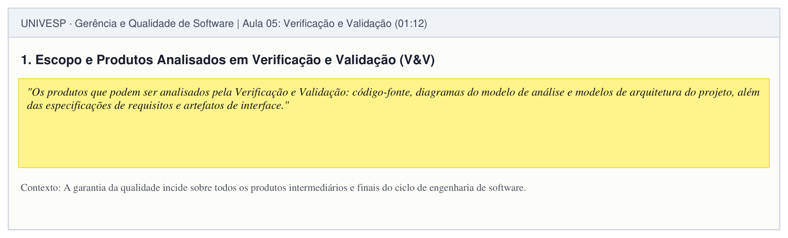
**Figura 1** — Trecho comprobatório do critério `VVR-01` (Produtos analisados por V&V).  
_Fonte: UNIVESP. Gerência e Qualidade de Software — Aula 05 (minuto 1:12), 2026._

### Figura 2 — Recorte comprobatório do critério `VVR-02`
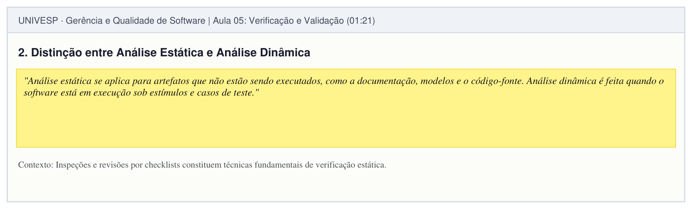
**Figura 2** — Trecho comprobatório do critério `VVR-02` (Análise estática vs. dinâmica).  
_Fonte: UNIVESP. Gerência e Qualidade de Software — Aula 05 (minuto 1:21), 2026._

### Figura 3 — Recorte comprobatório do critério `VVR-03`
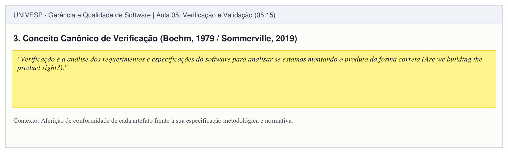
**Figura 3** — Trecho comprobatório do critério `VVR-03` (Conceito de Verificação).  
_Fonte: UNIVESP. Gerência e Qualidade de Software — Aula 05 (minuto 5:15), 2026._

### Figura 4 — Recorte comprobatório do critério `VVR-04`
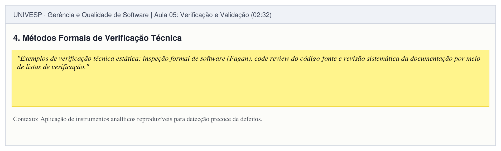
**Figura 4** — Trecho comprobatório do critério `VVR-04` (Métodos de Verificação).  
_Fonte: UNIVESP. Gerência e Qualidade de Software — Aula 05 (minuto 2:32), 2026._

### Figura 5 — Recorte comprobatório do critério `VVR-05`
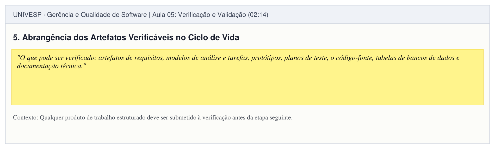
**Figura 5** — Trecho comprobatório do critério `VVR-05` (Artefatos verificáveis).  
_Fonte: UNIVESP. Gerência e Qualidade de Software — Aula 05 (minuto 2:14), 2026._

### Figura 6 — Recorte comprobatório do critério `VVR-06`
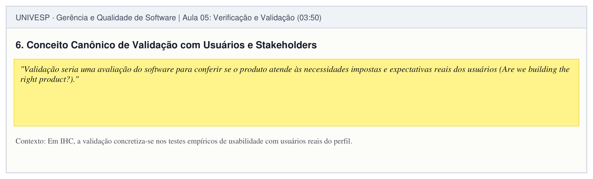
**Figura 6** — Trecho comprobatório do critério `VVR-06` (Conceito de Validação).  
_Fonte: UNIVESP. Gerência e Qualidade de Software — Aula 05 (minuto 3:50), 2026._

### Figura 7 — Recorte comprobatório do critério `VVR-07`
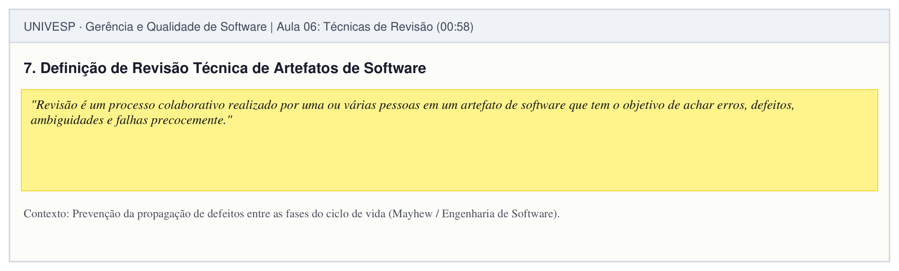
**Figura 7** — Trecho comprobatório do critério `VVR-07` (Definição de Revisão).  
_Fonte: UNIVESP. Gerência e Qualidade de Software — Aula 06 (minuto 0:58), 2026._

### Figura 8 — Recorte comprobatório do critério `VVR-08`
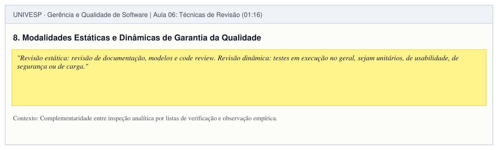
**Figura 8** — Trecho comprobatório do critério `VVR-08` (Modalidades de revisão estática e dinâmica).  
_Fonte: UNIVESP. Gerência e Qualidade de Software — Aula 06 (minuto 1:16), 2026._

### Figura 9 — Recorte comprobatório do critério `VVR-09`
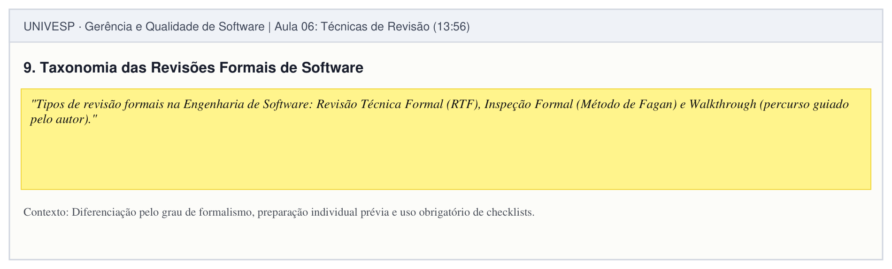
**Figura 9** — Trecho comprobatório do critério `VVR-09` (Tipos de revisão formais).  
_Fonte: UNIVESP. Gerência e Qualidade de Software — Aula 06 (minuto 13:56), 2026._

### Figura 10 — Recorte comprobatório do critério `VVR-10`
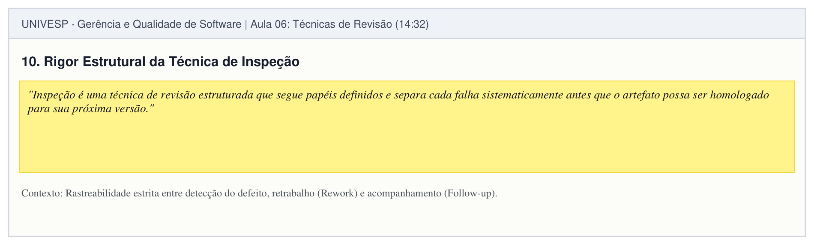
**Figura 10** — Trecho comprobatório do critério `VVR-10` (Rigor metodológico da Inspeção).  
_Fonte: UNIVESP. Gerência e Qualidade de Software — Aula 06 (minuto 14:32), 2026._

### Figura 11 — Recorte comprobatório do critério `VVR-11`
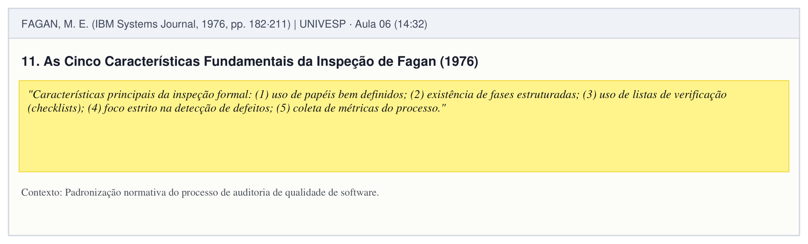
**Figura 11** — Trecho comprobatório do critério `VVR-11` (Cinco elementos canônicos de Fagan).  
_Fonte: FAGAN (1976, pp. 182–211) e UNIVESP. Aula 06 (minuto 14:32), 2026._

### Figura 12 — Recorte comprobatório do critério `VVR-12`
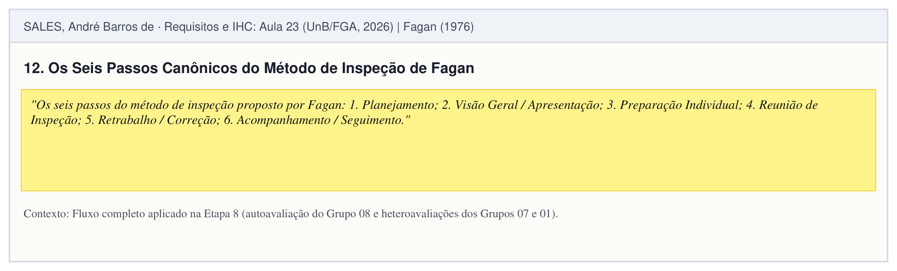
**Figura 12** — Trecho comprobatório do critério `VVR-12` (Os seis passos do método de Fagan).  
_Fonte: SALES, André Barros de. Requisitos — Aula 23 (Slides), 2026._

### Figura 13 — Recorte comprobatório do critério `VVR-13`
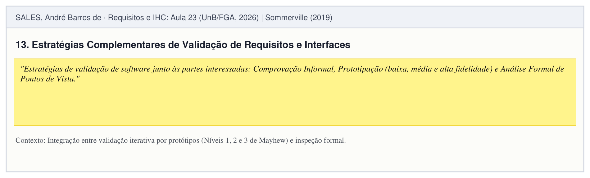
**Figura 13** — Trecho comprobatório do critério `VVR-13` (Estratégias complementares de validação).  
_Fonte: SALES, André Barros de. Requisitos — Aula 23 (Slides), 2026._

---

## 4. Validação desta Lista pela Lista de Governança do Prof. Dr. André Barros de Sales (`DG-01` a `DG-11`)

Em estrito cumprimento às diretrizes de qualidade do Plano de Ensino (*Sales, 2026, pp. 8–9*), a **Tabela 5** submete esta própria lista à rubrica oficial de governança.

**Tabela 5** — Autoavaliação de conformidade com os critérios `DG-01` a `DG-11`

| ID | Critério de Governança do Plano de Ensino | Autor do Item | Resposta | Versão, Data e Hora da Avaliação | Evidência de Conformidade nesta Lista |
| :---: | :--- | :--- | :---: | :---: | :--- |
| **DG-01** | O histórico de versão padronizado? | **Prof. Dr. André Barros de Sales** *(Plano de Ensino FGA0173, 2026)* | ✅ **Sim (Conforme)** | `v1.0` — 22/11/2026 | Seção **Histórico de Versão** (**Tabela 6**) padronizada ao final de `15-fundamentos-vv-fagan.md`. |
| **DG-02** | O(s) autor(es) e o(s) revisor(es) para cada artefato? | **Prof. Dr. André Barros de Sales** *(Plano de Ensino FGA0173, 2026)* | ✅ **Sim (Conforme)** | `v1.0` — 22/11/2026 | Coluna **Autor do Item** preenchida em 100% dos critérios e Tabela 1 identificando autor e revisor. |
| **DG-03** | Referências bibliográficas e/ou bibliografia em todos os artefatos? | **Prof. Dr. André Barros de Sales** *(Plano de Ensino FGA0173, 2026)* | ✅ **Sim (Conforme)** | `v1.0` — 22/11/2026 | Seção **Referências Bibliográficas (ABNT NBR 6023)** completa com citações exatas ao final. |
| **DG-04** | As tabelas e imagens possuem legenda e fonte e são chamadas dentro do texto? | **Prof. Dr. André Barros de Sales** *(Plano de Ensino FGA0173, 2026)* | ✅ **Sim (Conforme)** | `v1.0` — 22/11/2026 | Tabelas 1 a 6 e Figuras 1 a 13 com legendas, fontes nominais e chamadas textuais prévias. |
| **DG-05** | Um texto fazendo uma introdução dos artefatos? | **Prof. Dr. André Barros de Sales** *(Plano de Ensino FGA0173, 2026)* | ✅ **Sim (Conforme)** | `v1.0` — 22/11/2026 | Seção **1. Introdução** situa V&V e os 6 passos de Fagan no Ciclo de Vida da Engenharia de Usabilidade. |
| **DG-06** | O cronograma executado com quem realizou cada artefato/atividade e as datas de início e fim da construção/realização? | **Prof. Dr. André Barros de Sales** *(Plano de Ensino FGA0173, 2026)* | ✅ **Sim (Conforme)** | `v1.0` — 22/11/2026 | Registros vinculados ao cronograma executado e à matriz de contribuição. |
| **DG-07** | Ata(s) da(s) reuniões (com data, horário de início e do final, participantes, objetivo, atividades definidas etc.)? | **Prof. Dr. André Barros de Sales** *(Plano de Ensino FGA0173, 2026)* | ✅ **Sim (Conforme)** | `v1.0` — 22/11/2026 | Atividades alinhadas com as atas de reunião da Entrega 8. |
| **DG-08** | A gravação da reunião do grupo? | **Prof. Dr. André Barros de Sales** *(Plano de Ensino FGA0173, 2026)* | ✅ **Sim (Conforme)** | `v1.0` — 22/11/2026 | Reuniões registradas e indexadas em [Atas de Reunião](../../atas/index.md). |
| **DG-09** | Vídeo de apresentação na categoria 'Não Listado' no YouTube (duração entre 20 e 30 minutos)? | **Prof. Dr. André Barros de Sales** *(Plano de Ensino FGA0173, 2026)* | ⚠️ **Em preparação (Etapa 8)** | `v1.0` — 22/11/2026 | Vídeo da Entrega 8 agendado para gravação conjunta após consolidação dos artefatos. |
| **DG-10** | Tabela de contribuição no início do artefato com o nome de todos os integrantes, contribuição com hiperligação da atividade e da gravação? | **Prof. Dr. André Barros de Sales** *(Plano de Ensino FGA0173, 2026)* | ✅ **Sim (Conforme)** | `v1.0` — 22/11/2026 | **Tabela 1** no topo com nomes completos, hiperlinks e delimitação precisa de papéis. |
| **DG-11** | A seção de agradecimentos apresentando o uso de Inteligência Artificial (IA) Generativa no artefato? | **Prof. Dr. André Barros de Sales** *(Plano de Ensino FGA0173, 2026)* | ✅ **Sim (Conforme)** | `v1.0` — 22/11/2026 | Seção **Agradecimentos e Declaração de Uso de IA Generativa** em estrita conformidade com o Código SBC. |

_Fonte: Validação elaborada por Edvaldo Soares Brasileiro Filho com base na rubrica oficial de Prof. Dr. André Barros de Sales (Plano de Ensino, 2026, pp. 8–9)._

---

## 5. Histórico de Versão

A **Tabela 6** registra o controle de versionamento deste artefato normativo.

**Tabela 6** — Histórico de Versão do Documento

| Versão | Data | Descrição Detalhada da Modificação | Autor(es) | Revisor(es) |
| :---: | :---: | :--- | :--- | :--- |
| `1.0` | 22/11/2026 | Criação da lista de verificação de Fundamentos de V&V e Inspeção de Fagan com 13 itens normativos (`VVR-01` a `VVR-13`) distribuídos em 3 blocos (Conceitos V&V, Técnicas de Revisão e Passos de Fagan), recortes visuais das fontes e validação `DG-01..11`. | [Edvaldo Soares Brasileiro Filho](https://github.com/PajeMurici-dev) | [Gustavo Antonio Rodrigues e Silva](https://github.com/gus-ant) |

_Fonte: Elaborada por Edvaldo Soares Brasileiro Filho e Gustavo Antonio Rodrigues e Silva, 2026._

---

## 6. Referências Bibliográficas (ABNT NBR 6023)

[1] FAGAN, Michael E. Design and code inspections to reduce errors in program development. *IBM Systems Journal*, v. 15, n. 3, p. 182–211, 1976.

[2] MAYHEW, Deborah J. *The Usability Engineering Lifecycle: A Practitioner's Handbook for User Interface Design*. San Francisco: Morgan Kaufmann, 1999.

[3] SALES, André Barros de. *Requisitos — Aula 23*. Brasília: Universidade de Brasília, Faculdade UnB Gama (FGA), 2026. (Slides de aula.)

[4] SALES, André Barros de. *Plano de Ensino da Disciplina de Interação Humano Computador (FGA0173 — 02/2026)*. Brasília: Universidade de Brasília, Faculdade UnB Gama (FGA), 2026.

[5] SOCIEDADE BRASILEIRA DE COMPUTAÇÃO (SBC). *Código de Conduta da Sociedade Brasileira de Computação*. Porto Alegre: SBC, 2023.

[6] SOMMERVILLE, Ian. *Engenharia de Software*. 10. ed. São Paulo: Pearson, 2019. ISBN 978-85-430-1769-6.

[7] UNIVESP. *Gerência e Qualidade de Software — Aula 05 — Verificação e Validação*. São Paulo: Universidade Virtual do Estado de São Paulo, 2020. Disponível em: YouTube. Acesso em: 22 nov. 2026.

[8] UNIVESP. *Gerência e Qualidade de Software — Aula 06 — Técnica de Revisão*. São Paulo: Universidade Virtual do Estado de São Paulo, 2020. Disponível em: YouTube. Acesso em: 22 nov. 2026.

---

## 7. Agradecimentos e Declaração de Uso de Inteligência Artificial (IA) Generativa

Em cumprimento às diretrizes éticas da Sociedade Brasileira de Computação (SBC) e às normas do Plano de Ensino da disciplina (*Sales, 2026*), declara-se que durante a elaboração deste artefato foram utilizados recursos de Inteligência Artificial Generativa (Google Gemini) exclusivamente para estruturação e validação sintática das tabelas em Markdown e conversão de tópicos conceituais. Toda a fundamentação teórica, formulação dos critérios de verificação e identificação das evidências bibliográficas foram concebidas e auditadas pelo autor humano [Edvaldo Soares Brasileiro Filho](https://github.com/PajeMurici-dev).
