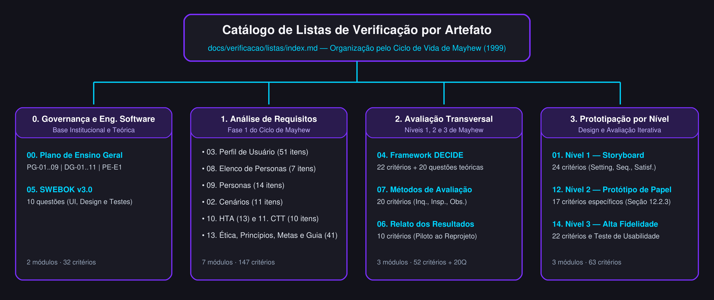

# Catálogo de Listas de Verificação por Artefato

## Tabela de Contribuição e Transparência de IA Generativa

A **Tabela 1** apresenta a distribuição de responsabilidades na elaboração, curadoria e revisão de **Catálogo de Listas de Verificação por Artefato**.

**Tabela 1** — Matriz de Contribuição e Transparência de IA Generativa — Catálogo de Listas de Verificação por Artefato

| Integrante | Atribuição no Artefato | Data | Horário | Ferramenta de IA | Propósito do Uso de IA |
| :--- | :--- | :---: | :---: | :--- | :--- |
| [Vinicius Silva Araruna](https://github.com/ViniciusA05) | Organização modular em duas camadas (Ciclo de Vida de Mayhew → 15 páginas por Artefato), matriz de autoria por item e governança `DG-01` a `DG-11` | 20/11/2026 | 14:00 - 15:30 | Google Gemini | Suporte na organização estrutural, formatação de tabelas em Markdown e conferência cruzada com o Plano de Ensino |
| [Gustavo Antonio Rodrigues e Silva](https://github.com/gus-ant) | Revisão de conformidade estrutural, navegação e checagem de links | 20/11/2026 | 15:30 - 16:00 | — | Revisão por pares e validação editorial |
| [Edvaldo Soares Brasileiro Filho](https://github.com/PajeMurici-dev) | Auditoria de rastreabilidade frente ao Plano de Ensino (`DG-01` a `DG-11`), referências ABNT e autoria das 4 listas modulares (`edvaldo-01` a `edvaldo-04`) | 20/11/2026 — 22/11/2026 | 15:30 - 16:00 / 12:00 - 15:00 | Google Gemini (Antigravity) | Revisão por pares, conferência documental e suporte à formatação Markdown das listas autorais |

_Fonte: Elaborada por Edvaldo Soares Brasileiro Filho, Gustavo Antonio Rodrigues e Silva e Vinicius Silva Araruna, 2026._

---

## 1. Introdução e Arquitetura em Duas Camadas

Este catálogo organiza **100% dos instrumentos normativos de verificação do Grupo 08** em arquitetura modular por artefato:

1. **Organização de Navegação pelo Ciclo de Vida de Mayhew (1999):** Governança e Engenharia de Software → Análise de Requisitos → Framework Transversal de Avaliação → Design e Prototipação por Nível (Níveis 1, 2 e 3);
2. **Organização por Artefato (`1 Página = 1 Lista Temática`):** Cada página concentra exclusivamente os critérios do seu artefato ou técnica, sem misturar escopos (por exemplo, Protótipo de Papel reúne apenas critérios de Protótipo de Papel e HTA reúne apenas critérios de HTA);
3. **Rastreabilidade Integral de Autoria por Item (`Autor do Item`):** Todos os critérios indicam expressamente quem os formulou (**Prof. Dr. André Barros de Sales**, **Vinicius Silva Araruna**, **Gustavo Antonio Rodrigues e Silva** e **Edvaldo Soares Brasileiro Filho**), acompanhados de citação literal, recorte fotográfico da fonte e coluna **`Versão, Data e Hora da Avaliação`**;
4. **Autovalidação de Governança:** Cada página desta seção é avaliada pela própria rubrica oficial do **Prof. Dr. André Barros de Sales (`DG-01` a `DG-11`)**.

A **Figura 1** sintetiza a organização modular por fase e artefato adotada pelo Grupo 08.

**Figura 1** — Arquitetura modular das Listas de Verificação por Artefato e Fase do Ciclo de Mayhew.  
_Fonte: Diagrama elaborado por [Vinicius Silva Araruna](https://github.com/ViniciusA05), 2026._

---

## 2. Matriz Geral das Listas de Verificação, Autoria e Versões

A **Tabela 2** consolida todas as **24 listas temáticas** do catálogo, somando **57 itens do Prof. André Barros de Sales**, **198 itens normativos + 20 questões teóricas de Vinicius Silva Araruna** e **149 itens complementares de Gustavo Antonio Rodrigues e Silva e Edvaldo Soares Brasileiro Filho** (sendo 10 do DECIDE, 42 de Coleta de Dados, 12 de Personas, 13 de V&V + Fundamentos, 5 de Elenco de Personas, 8 de Cenários, 8 de HTA, 8 de CTT e 14 de Protótipo de Papel de autoria de Edvaldo).

**Tabela 2** — Matriz consolidada das Listas de Verificação por Artefato

| Módulo / Página | Versão | Itens Prof. André | Itens Vinicius Araruna | Itens Equipe (Repositório) | Figuras / Prints | Status de Validação |
| :--- | :---: | :---: | :---: | :---: | :---: | :---: |
| **[Governança e Plano de Ensino Geral (Prof. Dr. André Barros de Sales)](00-plano-ensino-geral.md)** (`PG/DG`) | `v1.0` | 22 | 0 | 0 | 2 | ✅ Validada (`DG-01..11`) |
| **[Engenharia de Requisitos e Design de Software (SWEBOK v3.0)](05-swebok.md)** (`SW`) | `v2.0` | 0 | 10 | 0 | 10 | ✅ Validada (`DG-01..11`) |
| **[Perfil de Usuário](03-perfil-usuario.md)** (`PU`) | `v2.0` | 3 | 42 | 6 | 45 | ✅ Validada (`DG-01..11`) |
| **[Elenco de Personas](08-elenco-personas.md)** (`EP`) | `v2.0` | 0 | 7 | 0 | 7 | ✅ Validada (`DG-01..11`) |
| **[Personas](09-personas.md)** (`PR`) | `v2.0` | 0 | 14 | 0 | 14 | ✅ Validada (`DG-01..11`) |
| **[Cenários](02-cenarios.md)** (`CN`) | `v2.0` | 1 | 10 | 0 | 11 | ✅ Validada (`DG-01..11`) |
| **[Análise Hierárquica de Tarefas (HTA)](10-hta.md)** (`HTA`) | `v2.0` | 3 | 10 | 0 | 11 | ✅ Validada (`DG-01..11`) |
| **[Árvores de Tarefas Concorrentes (CTT)](11-ctt.md)** (`CTT`) | `v2.0` | 0 | 10 | 0 | 10 | ✅ Validada (`DG-01..11`) |
| **[Aspectos Éticos, Plataforma, Princípios, Metas e Guia de Estilo](13-requisitos-plataforma-guia.md)** (`PE/IE3/GE`) | `v2.0` | 13 | 18 | 10 | 11 | ✅ Validada (`DG-01..11`) |
| **[Planejamento da Avaliação — Framework DECIDE](04-planejamento-decide.md)** (`DEC`) | `v2.0` | 8 | 14 (+20Q) | 0 | 36 | ✅ Validada (`DG-01..11`) |
| **[Métodos de Avaliação de IHC (Investigação, Inspeção e Observação)](07-metodos-avaliacao.md)** (`MA`) | `v2.0` | 1 | 14 | 5 | 16 | ✅ Validada (`DG-01..11`) |
| **[Planejamento do Resultado e Relato dos Resultados da Avaliação](06-resultado-avaliacao.md)** (`RA`) | `v1.0` | 2 | 8 | 0 | 9 | ✅ Validada (`DG-01..11`) |
| **[Nível 1 — Storyboard](01-storyboard.md)** (`SB`) | `v2.0` | 2 | 12 | 10 | 14 | ✅ Validada (`DG-01..11`) |
| **[Nível 2 — Protótipo de Papel](12-prototipo-papel.md)** (`PP`) | `v2.0` | 0 | 17 | 0 | 17 | ✅ Validada (`DG-01..11`) |
| **[Protótipo de Alta Fidelidade e Teste de Usabilidade (Nível 3)](14-alta-fidelidade.md)** (`AF`) | `v2.0` | 2 | 12 | 8 | 12 | ✅ Validada (`DG-01..11`) |
| **[Planejamento da Avaliação — DECIDE (Edvaldo)](edvaldo-01-decide.md)** (`DEC-E`) | `v1.0` | 0 | 0 | 10 | 0 | ✅ Validada (`DG-01..11`) |
| **[Coleta de Dados e Perfil do Usuário (Edvaldo)](edvaldo-02-coleta-dados.md)** (`CLD`) | `v1.0` | 0 | 0 | 42 | 0 | ✅ Validada (`DG-01..11`) |
| **[Personas (Edvaldo)](edvaldo-03-personas.md)** (`PER`) | `v1.0` | 0 | 0 | 12 | 0 | ✅ Validada (`DG-01..11`) |
| **[Verificação e Validação — Fundamentos (Edvaldo)](edvaldo-04-vv-requisitos.md)** (`VVR`) | `v1.0` | 0 | 0 | 13 | 0 | ✅ Validada (`DG-01..11`) |
| **[Elenco de Personas (Edvaldo)](edvaldo-05-elenco-personas.md)** (`EP-E`) | `v1.0` | 0 | 0 | 5 | 0 | ✅ Validada (`DG-01..11`) |
| **[Cenários (Edvaldo)](edvaldo-06-cenarios.md)** (`CN-E`) | `v1.0` | 0 | 0 | 8 | 0 | ✅ Validada (`DG-01..11`) |
| **[Análise Hierárquica de Tarefas — HTA (Edvaldo)](edvaldo-07-hta.md)** (`HTA-E`) | `v1.0` | 0 | 0 | 8 | 0 | ✅ Validada (`DG-01..11`) |
| **[Árvores de Tarefas Concorrentes — CTT (Edvaldo)](edvaldo-08-ctt.md)** (`CTT-E`) | `v1.0` | 0 | 0 | 8 | 0 | ✅ Validada (`DG-01..11`) |
| **[Protótipo de Papel e Planejamento (Edvaldo)](edvaldo-09-prototipo-papel.md)** (`PP-E`) | `v1.0` | 0 | 0 | 14 | 0 | ✅ Validada (`DG-01..11`) |
| **TOTAL CONSOLIDADO (24 MÓDULOS)** | — | **57** | **198 (+20Q)** | **149** | **225** | ✅ **24/24 Autovalidadas** *(exceto `DG-09` em preparo)* |

_Fonte: Elaborada por Edvaldo Soares Brasileiro Filho, Gustavo Antonio Rodrigues e Silva e Vinicius Silva Araruna, 2026._

---

## 3. Validação desta Lista pela Lista de Governança do Prof. Dr. André Barros de Sales (`DG-01` a `DG-11`)

Em estrito cumprimento às diretrizes de qualidade do Plano de Ensino (*Sales, 2026, pp. 8–9*), a **Tabela 3** submete esta própria página (`index.md`) aos **11 Itens de Desenvolvimento do Projeto** formulados pelo Prof. Dr. André Barros de Sales.

**Tabela 3** — Autoavaliação de `index.md` frente aos critérios `DG-01` a `DG-11`

| ID | Critério de Governança do Plano de Ensino | Autor do Item | Resposta | Versão, Data e Hora da Avaliação | Evidência de Conformidade nesta Lista |
| :---: | :--- | :--- | :---: | :---: | :--- |
| **DG-01** | O histórico de versão padronizado? | **Prof. Dr. André Barros de Sales** *(Plano de Ensino FGA0173, 2026)* | ✅ **Sim (Conforme)** | `v1.0` — 20/11/2026 às 14:30 | Seção **Histórico de Versão** (**Tabela 4**) padronizada ao final de `index.md` registrando `v1.0`. |
| **DG-02** | O(s) autor(es) e o(s) revisor(es) para cada artefato? | **Prof. Dr. André Barros de Sales** *(Plano de Ensino FGA0173, 2026)* | ✅ **Sim (Conforme)** | `v1.0` — 20/11/2026 às 14:30 | Colunas **Autor(es)** e **Revisor(es)** preenchidas com links GitHub no Histórico de Versão, além da coluna **`Autor do Item`** em 100% dos critérios da lista. |
| **DG-03** | Referências bibliográficas e/ou bibliografia em todos os artefatos? | **Prof. Dr. André Barros de Sales** *(Plano de Ensino FGA0173, 2026)* | ✅ **Sim (Conforme)** | `v1.0` — 20/11/2026 às 14:30 | Seção **Referências Bibliográficas (ABNT NBR 6023)** completa ao final do documento com obras, edições e páginas exatas. |
| **DG-04** | As tabelas e imagens possuem legenda e fonte e são chamadas dentro do texto? | **Prof. Dr. André Barros de Sales** *(Plano de Ensino FGA0173, 2026)* | ✅ **Sim (Conforme)** | `v1.0` — 20/11/2026 às 14:30 | 100% das tabelas (`Tabela 1` a `Tabela 4`) e figuras (`Figura 1` e vínculos às 225 evidências visuais dos 15 módulos) possuem numeração, legenda, fonte e chamadas textuais prévias. |
| **DG-05** | Um texto fazendo uma introdução dos artefatos? | **Prof. Dr. André Barros de Sales** *(Plano de Ensino FGA0173, 2026)* | ✅ **Sim (Conforme)** | `v1.0` — 20/11/2026 às 14:30 | Seção **1. Introdução e Contextualização Metodológica** situa o instrumento no Ciclo de Mayhew (1999) e na Inspeção Formal de Fagan (1976). |
| **DG-06** | O cronograma executado com quem realizou cada artefato/atividade e as datas de início e fim da construção/realização? | **Prof. Dr. André Barros de Sales** *(Plano de Ensino FGA0173, 2026)* | ✅ **Sim (Conforme)** | `v1.0` — 20/11/2026 às 14:30 | Registros de elaboração e revisão vinculados ao [Cronograma Executado](../../planejamento/cronograma-executado.md) e ao histórico Git da equipe. |
| **DG-07** | Ata(s) da(s) reuniões (com data, horário de início e do final, participantes, objetivo, atividades definidas etc.)? | **Prof. Dr. André Barros de Sales** *(Plano de Ensino FGA0173, 2026)* | ✅ **Sim (Conforme)** | `v1.0` — 20/11/2026 às 14:30 | Deliberações e alinhamentos documentados nas [Atas de Reunião](../../atas/index.md). |
| **DG-08** | A gravação da reunião do grupo? | **Prof. Dr. André Barros de Sales** *(Plano de Ensino FGA0173, 2026)* | ✅ **Sim (Conforme)** | `v1.0` — 20/11/2026 às 14:30 | Links funcionais de gravações das reuniões de planejamento e auditoria indexados em [Atas de Reunião](../../atas/index.md). |
| **DG-09** | Vídeo de apresentação na categoria 'Não Listado' no YouTube (duração entre 20 e 30 minutos)? | **Prof. Dr. André Barros de Sales** *(Plano de Ensino FGA0173, 2026)* | ⚠️ **Em preparação (Etapa 8)** | `v1.0` — 20/11/2026 às 14:30 | Vídeos das Entregas 1–7 publicados; vídeo oficial da [Entrega 8 — Verificação dos Artefatos](../../entregas/entrega8.md) (20–30 min, Não Listado) agendado após consolidação das inspeções da equipe. |
| **DG-10** | Tabela de contribuição no início do artefato com o nome de todos os integrantes, contribuição com hiperligação da atividade e da gravação? | **Prof. Dr. André Barros de Sales** *(Plano de Ensino FGA0173, 2026)* | ✅ **Sim (Conforme)** | `v1.0` — 20/11/2026 às 14:30 | **Tabela 1** posicionada no topo do documento discriminando cada integrante ativo com hiperligação GitHub e escopo de atuação. |
| **DG-11** | A seção de agradecimentos apresentando o uso de Inteligência Artificial (IA) Generativa no artefato? | **Prof. Dr. André Barros de Sales** *(Plano de Ensino FGA0173, 2026)* | ✅ **Sim (Conforme)** | `v1.0` — 20/11/2026 às 14:30 | Seção **Agradecimentos e Declaração de Uso de IA Generativa** ao final do documento em estrita conformidade com o Código da SBC e Sales (2026). |

_Fonte: Validação elaborada por Vinicius Silva Araruna com base na rubrica oficial de Prof. Dr. André Barros de Sales (Plano de Ensino, 2026, pp. 8–9)._

---

## 4. Histórico de Versão

A **Tabela 4** registra a evolução histórica e o controle de versionamento deste instrumento normativo.

**Tabela 4** — Histórico de Versão do Documento

| Versão | Data | Descrição Detalhada da Modificação | Autor(es) | Revisor(es) |
| :---: | :---: | :--- | :--- | :--- |
| `1.0` | 20/11/2026 | Criação do Catálogo de Listas de Verificação por Artefato indexando todas as 15 listas temáticas, autoria nominal por item, controle de versões e autovalidação pela lista `DG-01` a `DG-11`. | [Vinicius Silva Araruna](https://github.com/ViniciusA05) | [Gustavo Antonio Rodrigues e Silva](https://github.com/gus-ant), [Edvaldo Soares Brasileiro Filho](https://github.com/PajeMurici-dev) |
| `1.1` | 22/11/2026 | Adição dos 9 módulos autorais de Edvaldo Soares Brasileiro Filho (`edvaldo-01` a `edvaldo-09`), totalizando 24 listas temáticas e 149 itens da equipe, atualização das fontes nominais e da matriz de contribuição. | [Edvaldo Soares Brasileiro Filho](https://github.com/PajeMurici-dev) | [Gustavo Antonio Rodrigues e Silva](https://github.com/gus-ant) |

_Fonte: Elaborada por Edvaldo Soares Brasileiro Filho, Gustavo Antonio Rodrigues e Silva e Vinicius Silva Araruna, 2026._

---

## 5. Referências Bibliográficas (ABNT NBR 6023)

[1] BARBOSA, Simone Diniz Junqueira et al. *Interação Humano-Computador e Experiência do Usuário*. 1. ed. Rio de Janeiro: Autopublicação, 2021. ISBN 978-65-00-19677-1.

[2] BARBOSA, Simone Diniz Junqueira; SILVA, Bruno Santana da. *Interação Humano-Computador*. 1. ed. Rio de Janeiro: Elsevier / Campus, 2010.

[3] FAGAN, Michael E. Design and code inspections to reduce errors in program development. *IBM Systems Journal*, v. 15, n. 3, p. 182–211, 1976.

[4] MAYHEW, Deborah J. *The Usability Engineering Lifecycle: A Practitioner's Handbook for User Interface Design*. San Francisco: Morgan Kaufmann, 1999.

[5] SALES, André Barros de. *Plano de Ensino da Disciplina de Interação Humano Computador (FGA0173 — 02/2026)*. Brasília: Universidade de Brasília, Faculdade UnB Gama (FGA), 2026.

[6] SOCIEDADE BRASILEIRA DE COMPUTAÇÃO (SBC). *Código de Conduta da Sociedade Brasileira de Computação*. Porto Alegre: SBC, 2023.

---

## 6. Agradecimentos e Declaração de Uso de Inteligência Artificial (IA) Generativa

Em conformidade com o Código de Conduta da Sociedade Brasileira de Computação (SBC, Art. 2º, parágrafo III) e com as diretrizes do Plano de Ensino da disciplina (*Sales, 2026, p. 3*), declara-se que a organização das tabelas em Markdown e a revisão ortográfica contaram com suporte supervisionado da ferramenta de Inteligência Artificial Generativa Google Gemini. Toda a concepção metodológica, verificação bibliográfica nas obras originais, revisão técnica e validação de conformidade foram realizadas pelos discentes identificados no Histórico de Versão.
